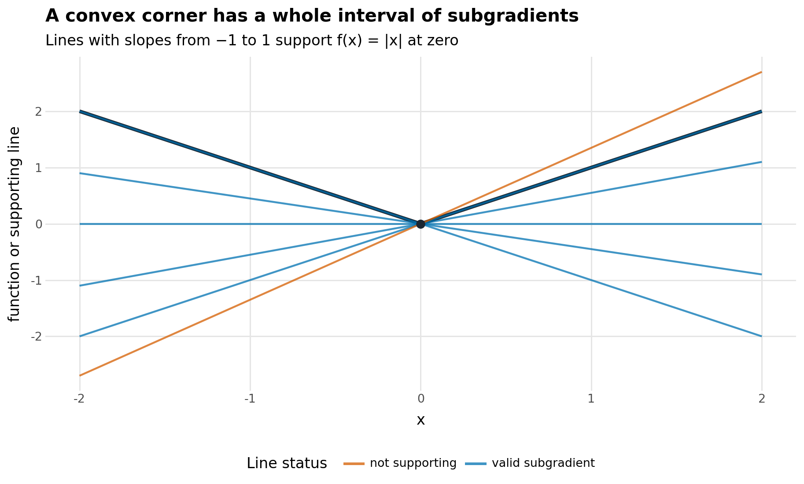

# Convex Analysis, Duality, and Monotone Operators {#sec-convex-duality}

Differentiation solves a smooth minimum by setting a derivative to zero.
Convex analysis keeps the global conclusion while allowing corners, constraints,
and infinite-dimensional spaces. Its replacement for a derivative is a set of
supporting slopes, and its replacement for solving an equation directly is
often a dual problem or a monotone inclusion.

The chapter begins with line segments and inequalities. Familiarity with
continuity and inner products helps, but the local repair kit makes the logical
route explicit.

## Convex sets and functions

A subset $C$ of a vector space is **convex** if

$$
(1-t)x+ty\in C
\quad\text{whenever }x,y\in C,\ 0\le t\le1.
$$

The expression is the line segment from $x$ to $y$. Intersections of convex
sets are convex; unions generally are not.

A function $f:C\to(-\infty,\infty]$ is convex if

$$
f((1-t)x+ty)
\le(1-t)f(x)+tf(y).
$$

Allowing the value $+\infty$ encodes constraints: the indicator function

$$
\iota_C(x)=
\begin{cases}
0,&x\in C,\\
+\infty,&x\notin C
\end{cases}
$$

is convex exactly when $C$ is convex. It must not be confused with a
zero–one indicator.

The **epigraph**

$$
\operatorname{epi}f=\{(x,r):r\ge f(x)\}
$$

is convex exactly when $f$ is convex. A differentiable function on an interval
is convex exactly when its derivative is nondecreasing; if twice
differentiable, $f''\ge0$ suffices.

Convexity makes every local minimiser global. If $x$ were a local minimiser and
$f(y)<f(x)$, points $(1-t)x+ty$ with small $t$ would lie near $x$ and have
smaller values, a contradiction.

## Lower semicontinuity and existence

A function is **lower semicontinuous** if

$$
f(x)\le\liminf_{n\to\infty}f(x_n)
\quad\text{whenever }x_n\to x.
$$

Equivalently, every sublevel set $\{x:f(x)\le a\}$ is closed. The value at
a limit may fall below nearby values; it cannot exceed their lower limit.
Lower semicontinuity is the right condition for taking limits of minimising
sequences.

A function on a normed space is **coercive** if
$f(x)\to+\infty$ as $\|x\|\to\infty$. In finite dimensions, a proper lower
semicontinuous coercive function attains its minimum: choose a minimising
sequence, trap it in a bounded sublevel set, extract a convergent subsequence,
and apply lower semicontinuity.

In an infinite-dimensional reflexive Banach space, bounded sequences have
weakly convergent subsequences. A proper coercive weakly lower semicontinuous
functional therefore attains its minimum. Each adjective has a job:
coercivity bounds the sequence, reflexivity provides weak compactness, and weak
lower semicontinuity passes the inequality to the limit.

The same matching of topology and hypotheses matters for weak-star compactness.
In [The Pillars of Banach-Space Theory](../real-analysis/26-banach-pillars.md#sec-two-preduals), one predual makes the objective continuous but loses
closedness of the probability constraint; another preserves compactness but
allows an upward objective jump. The changed Exercise 8 there produces a lower
semicontinuous objective on the same compact constraint set and an attained
minimum. Norm continuity by itself does not supply weak-star lower
semicontinuity.

## Subgradients

For a proper convex function $f$ on $\mathbb R^n$, a vector $g$ is a
**subgradient** at $x$ if

$$
f(y)\ge f(x)+g\cdot(y-x)
\quad\text{for every }y.
$$

The set of all such $g$ is $\partial f(x)$, the subdifferential.

For $f(x)=|x|$,

$$
\partial f(x)=
\begin{cases}
\{-1\},&x<0,\\
[-1,1],&x=0,\\
\{1\},&x>0.
\end{cases}
$$

The corner has many supporting slopes. A point minimises $f$ exactly when

$$
0\in\partial f(x).
$$

For a differentiable convex function, $\partial f(x)=\{\nabla f(x)\}$. For a
nonempty closed convex set $C$ and $x\in C$, $\partial\iota_C(x)$ is the normal cone

$$
N_C(x)=\{g:g\cdot(y-x)\le0\text{ for every }y\in C\}.
$$

Consequently, minimising smooth $f$ over $C$ becomes
$0\in\nabla f(x)+N_C(x)$, a concise form of constrained first-order
optimality. For $x\notin C$, set $N_C(x)=\partial\iota_C(x)=\varnothing$; the inclusion cannot certify an infeasible point.

<figure id="fig-convex-subgradient">


<figcaption>

Figure 2.1: Subgradients fill an interval of supporting slopes at a convex corner.

</figcaption>
</figure>

[Figure 2.1](#fig-convex-subgradient) depicts the complete subdifferential of one
one-dimensional function. In higher dimensions it is a closed convex set of
supporting vectors.

## Conjugates and Fenchel duality

The **convex conjugate** is

$$
f^\ast(y)=\sup_x\{\langle y,x\rangle-f(x)\}.
$$

It is always convex as a supremum of affine functions. Rearranging the
definition gives Fenchel–Young:

$$
f(x)+f^\ast(y)\ge\langle y,x\rangle.
$$

Equality holds exactly when $y\in\partial f(x)$, equivalently
$x\in\partial f^\ast(y)$ under standard closedness assumptions.

**Example.** If $f(x)=x^2/2$, maximise $yx-x^2/2$. The derivative
$y-x$ vanishes at $x=y$, giving $f^\ast(y)=y^2/2$. If
$f=\iota_C$, then

$$
f^\ast(y)=\sup_{x\in C}\langle y,x\rangle,
$$

the support function of $C$.

The biconjugate theorem says a proper lower semicontinuous convex function
satisfies $f^{\ast\ast}=f$. Without lower semicontinuity, the biconjugate is
the closed convex envelope rather than the original function.

## A primal–dual derivation

Consider

$$
\min_x f(x)\quad\text{subject to }Ax=b.
$$

Introduce a multiplier $y$ and Lagrangian

$$
\mathcal L(x,y)=f(x)+\langle y,Ax-b\rangle.
$$

For every feasible $x$,
$\mathcal L(x,y)=f(x)$, so

$$
\inf_x\mathcal L(x,y)
=-f^\ast(-A^\ast y)-\langle y,b\rangle
$$

is a lower bound on the primal optimum. Maximising these lower bounds gives the
dual problem.

**Weak duality** always says dual value $\le$ primal value. Equality, called
**strong duality**, needs a constraint qualification such as a relative
interior condition. Feasibility alone does not erase the duality gap.

For least squares with equality constraints, both problems reduce to linear
systems. The multiplier measures sensitivity of the optimal value to a change
in $b$, giving dual variables an operational meaning rather than treating them
as algebraic decoration.

## Proximal maps and envelopes

For $\lambda>0$, define

$$
\operatorname{prox}_{\lambda f}(x)
=\operatorname*{arg\,min}_y
\left(f(y)+\frac1{2\lambda}\|y-x\|^2\right).
$$

The quadratic makes the objective strongly convex, so a proper closed convex
$f$ has one proximal point. Optimality gives

$$
\frac{x-y}{\lambda}\in\partial f(y).
$$

For $f(y)=|y|$, the result is soft thresholding:

$$
\operatorname{prox}_{\lambda|\cdot|}(x)
=\operatorname{sign}(x)\max(|x|-\lambda,0).
$$

The minimum value as a function of $x$ is the **Moreau envelope**. It smooths
$f$ while retaining convexity and controlled approximation.

Projected gradient descent is proximal gradient with
$f=\iota_C$; the proximal map is then the nearest-point projection onto $C$.

## Monotone operators

A set-valued operator $T$ on a Hilbert space is **monotone** if

$$
\langle u-v,x-y\rangle\ge0
\quad\text{whenever }u\in T(x),\ v\in T(y).
$$

It is **maximal monotone** if its graph cannot be enlarged while preserving
monotonicity. The subdifferential of a proper lower semicontinuous convex
function is maximal monotone.

The **resolvent**

$$
J_{\lambda T}=(I+\lambda T)^{-1}
$$

is single-valued and nonexpansive for maximal monotone $T$. When
$T=\partial f$, it is exactly $\operatorname{prox}_{\lambda f}$.
Solving $0\in T(x)$ can therefore be approached by the fixed-point iteration

$$
x_{n+1}=J_{\lambda T}(x_n).
$$

Splitting methods decompose $T=A+B$ when each resolvent or forward step is
easier than the combined inclusion. Convergence depends on monotonicity,
cocoercivity, step size, and sometimes strong convexity.

## Algorithm audit

Gradient descent for an $L$-smooth convex function uses

$$
x_{n+1}=x_n-\alpha\nabla f(x_n).
$$

For $0<\alpha<2/L$, the objective decreases under standard assumptions.
Strong convexity gives geometric convergence; plain convexity generally gives
a sublinear rate. A stopping test based only on successive iterates can be
misleading near a flat region. Better certificates include a duality gap,
gradient mapping, or primal residual with a proved error bound.

<div class="callout callout-warning">
<p class="callout-title">Convex does not mean strictly convex</p>

Convexity makes local minima global but does not guarantee uniqueness. Strict
or strong convexity supplies uniqueness under appropriate domain conditions.
Likewise, a numerical iterate is not an exact minimiser unless its residual is
connected to a theorem.

</div>

## Convex calculation and duality laboratory

The definitions become useful when they can be converted into inequalities that
another reader can check. We begin with extended values, compute two complete
subdifferentials and conjugates, derive a dual problem without hiding a sign, and
finish with algorithmic certificates.

### Repair kit: effective domains and extended values

For $f:X\to(-\infty,\infty]$, the **effective domain** is

$$
\operatorname{dom}f=\{x:f(x)<\infty\}.
$$

The function is **proper** if this domain is nonempty and $f$ never equals
$-\infty$. The value $+\infty$ means “forbidden” or “outside the model”; it is not
a very large finite penalty. For the extended-valued indicator $\iota_C$,

$$
f(x)+\iota_C(x)
=\begin{cases}
f(x),&x\in C,\\
+\infty,&x\notin C,
\end{cases}
$$

so unconstrained minimisation of $f+\iota_C$ is exactly constrained minimisation
of $f$ over $C$.

The ordinary zero–one function $1_C$ behaves differently. Let $C=[-1,1]$ and
take $x=-2$, $y=0$, $t=1/2$. The midpoint is $-1\in C$, so

$$
1_C(-1)=1
>\frac12 1_C(-2)+\frac12 1_C(0)=\frac12.
$$

Thus the zero–one indicator is not convex. The extended indicator is convex
because a segment joining two feasible points remains feasible; if either endpoint
is infeasible, the right side of the convexity inequality is $+\infty$ and the
inequality is automatic.

Convexity for two endpoints implies the finite Jensen inequality. If
$t_i\ge0$, $\sum_{i=1}^m t_i=1$, then

$$
f\!\left(\sum_{i=1}^m t_ix_i\right)
\le\sum_{i=1}^m t_if(x_i).
$$

To prove it by induction, separate the last weight. If $t_m<1$, define
$s_i=t_i/(1-t_m)$ for $i<m$. The first $m-1$ weighted points have a convex
average $z=\sum_{i<m}s_ix_i$, and the full average is
$(1-t_m)z+t_mx_m$. Apply two-point convexity, then the induction hypothesis to
$f(z)$. The cases $t_m=1$ and zero weights are immediate.

### Two subdifferentials computed from the definition

Let $h(x)=\max(x,0)$. For $x<0$, the function is locally affine with slope zero,
and the global supporting inequality confirms $\partial h(x)=\{0\}$. For $x>0$,
$\partial h(x)=\{1\}$. At zero, a number $g$ is a subgradient exactly when

$$
\max(y,0)\ge gy
\quad\text{for every }y.
$$

For $y>0$, division by $y$ gives $g\le1$. For $y<0$, division reverses the
inequality and gives $g\ge0$. Hence

$$
\partial h(0)=[0,1].
$$

This solves the corner by auditing positive and negative test points rather than
guessing a slope from a graph.

Now compute the conjugate of $f(x)=|x|$:

$$
f^*(y)=\sup_x(yx-|x|).
$$

If $|y|\le1$, then $yx\le|x|$, so the expression is at most zero, with equality
at $x=0$. If $y>1$, sending $x\to+\infty$ makes
$(y-1)x\to\infty$; if $y<-1$, send $x\to-\infty$. Therefore

$$
f^*(y)=\iota_{[-1,1]}(y).
$$

Fenchel–Young now reads

$$
|x|+\iota_{[-1,1]}(y)\ge xy.
$$

For finite left side this is the familiar inequality $xy\le|x|$ when
$|y|\le1$. Equality occurs precisely when $y$ has the sign of nonzero $x$, or
when $x=0$ and $y\in[-1,1]$—exactly the subgradient relation.

The supporting lines in [Figure 2.1](#fig-convex-subgradient) encode this calculation. Each
line has equation $r=gx$ and must remain below $|x|$ for **all** $x$. The rejected
dashed line fails somewhere away from the corner. A local tangent impression is
not enough because a subgradient is defined by a global inequality.

### Soft thresholding derived in three regions

To compute $\operatorname{prox}_{\lambda|\cdot|}(x)$, minimise

$$
q(y)=|y|+\frac{(y-x)^2}{2\lambda}.
$$

If $y>0$, differentiation gives
$q'(y)=1+(y-x)/\lambda$, whose zero is $y=x-\lambda$. It belongs to the assumed
region only when $x>\lambda$. If $y<0$, then
$q'(y)=-1+(y-x)/\lambda$, giving $y=x+\lambda$, valid only when
$x<-\lambda$. At $y=0$, optimality is

$$
0\in[-1,1]-\frac{x}{\lambda},
$$

which holds exactly when $|x|\le\lambda$. Combining the cases gives

$$
\operatorname{prox}_{\lambda|\cdot|}(x)
=\begin{cases}
x-\lambda,&x>\lambda,\\
0,&|x|\le\lambda,\\
x+\lambda,&x<-\lambda.
\end{cases}
$$

The quadratic makes the objective strongly convex, so these candidates cannot
hide a second minimiser.

The formula is also a complete algorithm: it needs no iterative solver. The
following implementation keeps the threshold as an explicit input and checks
the three regions used in the derivation.

```python
from math import copysign

def soft_threshold(value: float, threshold: float) -> float:
    """Return the proximal map of threshold times the absolute value."""
    if threshold <= 0.0:
        raise ValueError("threshold must be positive")
    magnitude = max(abs(value) - threshold, 0.0)
    return copysign(magnitude, value) if magnitude > 0.0 else 0.0

for input_value in (-2.0, -0.4, 0.0, 0.7, 2.0):
    output = soft_threshold(input_value, threshold=0.75)
    optimality_residual = input_value - output
    print(input_value, output, optimality_residual)
```

For a nonzero output the residual has magnitude exactly $\lambda$ and the
correct sign; for a zero output it lies in $[-\lambda,\lambda]$. Those are the
three finite optimality conditions. The block does not establish maximal
monotonicity of an infinite-dimensional subdifferential.

### A fully checked primal–dual pair

Let $a\in\mathbb R^n$ be nonzero and consider

$$
\min_x\frac12\|x\|^2
\quad\text{subject to }a\cdot x=b.
$$

With scalar multiplier $y$, the Lagrangian is

$$
\mathcal L(x,y)=\frac12\|x\|^2+y(a\cdot x-b).
$$

For fixed $y$, complete the square or set the $x$-gradient to zero:
$x=-ya$. Substitution gives the dual function

$$
g(y)=-\frac12y^2\|a\|^2-yb.
$$

This concave quadratic is maximised at
$y^*=-b/\|a\|^2$, with value
$b^2/(2\|a\|^2)$. The associated primal point is

$$
x^*=-y^*a=\frac{b}{\|a\|^2}a.
$$

It is feasible because $a\cdot x^*=b$, and its objective equals the dual value.
Thus there is no gap. Weak duality can also be checked directly: for any feasible
$x$ and any $y$, $g(y)=\inf_z\mathcal L(z,y)\le\mathcal L(x,y)=f(x)$.

Strong duality here is not a universal consequence of writing a Lagrangian. The
constraint is affine and feasible, and the quadratic is closed and continuous.
In general convex programs one must verify a relative-interior or other constraint
qualification. Without it, the dual remains a lower bound but may not attain the
primal value.

Here is the same primal–dual certificate in coordinates. Reporting feasibility
and the gap makes the output more informative than reporting the minimiser alone.

```python
import numpy as np
from numpy.typing import NDArray

def minimum_norm_certificate(
    normal: NDArray[np.float64], target: float
) -> tuple[NDArray[np.float64], float, float, float]:
    """Return primal point, multiplier, feasibility residual, and duality gap."""
    if normal.ndim != 1 or normal.size == 0:
        raise ValueError("normal must be a nonempty vector")
    squared_norm = float(normal @ normal)
    if squared_norm == 0.0:
        raise ValueError("normal must be nonzero")
    multiplier = -target / squared_norm
    primal = -multiplier * normal
    residual = float(normal @ primal - target)
    primal_value = 0.5 * float(primal @ primal)
    dual_value = -0.5 * multiplier**2 * squared_norm - multiplier * target
    return primal, multiplier, residual, primal_value - dual_value

result = minimum_norm_certificate(np.array([2.0, -1.0, 2.0]), target=3.0)
print(result)
```

The residual and gap should be at floating-point roundoff. This computation
certifies this finite quadratic problem only; constraint qualifications remain
the theorem-level reason that a general convex problem has no gap.

### Fenchel–Young equality as a certificate

The definition

$$
f^*(y)=\sup_x\{\langle y,x\rangle-f(x)\}
$$

immediately implies, for every $x,y$,

$$
f(x)+f^*(y)\ge\langle y,x\rangle.
$$

This is the Fenchel–Young inequality. Its equality case contains the useful
information. Equality holds exactly when the particular point $x$ attains the
supremum defining $f^*(y)$, which means

$$
\langle y,z\rangle-f(z)
\le\langle y,x\rangle-f(x)
\quad\text{for every }z.
$$

Rearranging gives

$$
f(z)\ge f(x)+\langle y,z-x\rangle,
$$

so equality holds exactly when $y\in\partial f(x)$. The same equality can be
read in reverse as $x\in\partial f^*(y)$ when the usual closed-convex hypotheses
permit conjugate symmetry.

For $f(x)=x^2/2$ on $\mathbb R$, complete the square:

$$
f^*(y)=\sup_x\left(yx-\frac{x^2}{2}\right)
=\sup_x\left(\frac{y^2}{2}-\frac{(x-y)^2}{2}\right)
=\frac{y^2}{2}.
$$

Fenchel–Young is then

$$
\frac{x^2}{2}+\frac{y^2}{2}\ge xy,
$$

equivalently $(x-y)^2\ge0$. Equality requires $x=y$, exactly matching
$y\in\partial f(x)=\{x\}$. Thus a zero Fenchel–Young gap is a checkable
optimality certificate, not merely a numerical coincidence.

The extended-valued indicator supplies a second useful model. For
$C=[-1,1]$,

$$
\delta_C^*(y)=\sup_{|x|\le1}yx=|y|.
$$

Its subdifferential, or normal cone, follows directly from the supporting
inequality:

$$
\partial\delta_C(x)=
\begin{cases}
\{0\},&|x|<1,\\
[0,\infty),&x=1,\\
(-\infty,0],&x=-1,\\
\varnothing,&|x|>1.
\end{cases}
$$

The proximal map of $\delta_C$ minimises distance subject to $x\in C$, so it is
the projection

$$
\operatorname{prox}_{\delta_C}(v)
=\min\{1,\max\{-1,v\}\}.
$$

Interior inputs remain unchanged and exterior inputs are clipped to the nearest
endpoint. This is the geometric meaning of using $+\infty$ to encode a hard
constraint.

### Why lower semicontinuity appears in biconjugation

Define the proper extended-valued convex function

$$
f(x)=
\begin{cases}
0,&x>0,\\
1,&x=0,\\
+\infty,&x<0.
\end{cases}
$$

It is convex, but it is not lower semicontinuous at zero because values along
$x\downarrow0$ tend to zero while $f(0)=1$. Its conjugate can be computed
without a theorem. If $y>0$, the expression $xy-f(x)=xy$ becomes arbitrarily
large as $x\to\infty$. If $y\le0$, its supremum over $x>0$ is zero, approached
as $x\downarrow0$; the value from $x=0$ is only $-1$. Therefore

$$
f^*(y)=
\begin{cases}
0,&y\le0,\\
+\infty,&y>0.
\end{cases}
$$

Conjugating again gives

$$
f^{**}(x)=\sup_{y\le0}xy
=\begin{cases}
0,&x\ge0,\\
+\infty,&x<0.
\end{cases}
$$

Thus $f^{**}(0)=0\ne1=f(0)$. The biconjugate has filled the upward jump and
produced the lower-semicontinuous convex envelope. This checked counterexample
explains the hypothesis in Fenchel–Moreau: properness and convexity alone do
not force $f=f^{**}$.

### The descent lemma and its step-size threshold

Assume $f:\mathbb R^n\to\mathbb R$ is differentiable and its gradient is
$L$-Lipschitz:

$$
\|\nabla f(y)-\nabla f(x)\|\le L\|y-x\|.
$$

Set $d=y-x$ and follow the line segment
$h(t)=f(x+td)$. The one-variable fundamental theorem of calculus gives

$$
f(y)-f(x)=\int_0^1\langle\nabla f(x+td),d\rangle\,dt.
$$

Add and subtract $\nabla f(x)$ inside the integral. Cauchy–Schwarz and the
Lipschitz estimate imply

$$
\begin{aligned}
f(y)-f(x)
&=\langle\nabla f(x),d\rangle
 +\int_0^1\langle\nabla f(x+td)-\nabla f(x),d\rangle\,dt\\
&\le\langle\nabla f(x),d\rangle
 +\int_0^1 Lt\|d\|^2\,dt\\
&=\langle\nabla f(x),d\rangle+\frac L2\|d\|^2.
\end{aligned}
$$

This is the descent lemma. Substitute the gradient step
$y=x-\alpha\nabla f(x)$, so $d=-\alpha\nabla f(x)$. Then

$$
f(x-\alpha\nabla f(x))
\le f(x)-\alpha\left(1-\frac{L\alpha}{2}\right)
\|\nabla f(x)\|^2.
$$

For $0<\alpha<2/L$, every nonstationary step strictly lowers the objective.
At $\alpha=2/L$, the estimate guarantees no increase, without guaranteeing strict decrease; above it, even this basic
stability certificate is lost. For the quadratic $f(x)=Lx^2/2$, the update is
$x_{k+1}=(1-\alpha L)x_k$, so convergence occurs exactly for
$|1-\alpha L|<1$, again $0<\alpha<2/L$. The general inequality and the exact
quadratic benchmark agree.

The threshold can be read directly from a bounded trace. The routine below
requires an explicit step count, so divergence is observable without an
unbounded loop.

```python
def quadratic_descent(
    curvature: float, step_size: float, start: float, steps: int
) -> list[tuple[int, float, float]]:
    """Trace gradient descent for f(x) = curvature * x**2 / 2."""
    if curvature <= 0.0 or step_size <= 0.0:
        raise ValueError("curvature and step_size must be positive")
    if steps < 0:
        raise ValueError("steps must be nonnegative")
    point = start
    trace: list[tuple[int, float, float]] = []
    for iteration in range(steps + 1):
        trace.append((iteration, point, 0.5 * curvature * point**2))
        point -= step_size * curvature * point
    return trace

for alpha in (0.2, 1.0, 2.0, 2.2):
    final = quadratic_descent(1.0, alpha, start=1.0, steps=8)[-1]
    print(alpha, final)
```

The first two traces decay, the boundary trace oscillates, and the last grows.
This exact scalar recurrence explains the step-size condition but does not by
itself prove convergence for every smooth convex function.

Descent alone is not yet convergence to a minimiser. One must also show that
gradients approach zero or that iterates have suitable limit points. Convexity
then turns a stationary point into a global minimiser; strong convexity can add
uniqueness and a rate. This separates three claims often blurred in an
algorithm plot: objective decrease, convergence of iterates, and optimality of
their limit.

### Strong convexity and stable proximal points

If $f$ is $m$-strongly convex with $m>0$, then at a midpoint

$$
f\left(\frac{x+y}{2}\right)
\le\frac{f(x)+f(y)}2-\frac{m}{8}\|x-y\|^2.
$$

Two distinct minimisers $x,y$ would make the right side strictly smaller than
the minimum value, an impossibility. Strong convexity therefore proves
uniqueness by a single midpoint test. The quadratic in a proximal objective

$$
z\longmapsto f(z)+\frac1{2\lambda}\|z-x\|^2
$$

makes that objective $1/\lambda$-strongly convex, which explains why the
proximal point is unique even when $f$ has flat regions or many minimisers.

There is also a stability certificate. Let
$p=\operatorname{prox}_{\lambda f}(x)$ and
$q=\operatorname{prox}_{\lambda f}(y)$. Their optimality conditions are

$$
\frac{x-p}{\lambda}\in\partial f(p),
\qquad
\frac{y-q}{\lambda}\in\partial f(q).
$$

Monotonicity of the subdifferential gives

$$
\left\langle(x-p)-(y-q),p-q\right\rangle\ge0.
$$

After rearranging,

$$
\|p-q\|^2\le\langle x-y,p-q\rangle
\le\|x-y\|\,\|p-q\|.
$$

Thus $\|p-q\|\le\|x-y\|$: proximal maps are nonexpansive. The stronger first
inequality is called firm nonexpansiveness. It turns subgradient monotonicity
into a quantitative guarantee that perturbing the input cannot amplify the
proximal output.

### Algorithm and theorem-hypothesis audit

For $f(x)=ax^2/2$ with $a>0$, gradient descent becomes

$$
x_{k+1}=(1-\alpha a)x_k.
$$

It converges to zero for every starting point exactly when
$|1-\alpha a|<1$, equivalently $0<\alpha<2/a$. At
$\alpha=2/a$ it alternates without decay; above that threshold it diverges.
This scalar computation explains the general $2/L$ step-size boundary.

The existence theorem needs compact sublevels in finite dimensions, or
reflexivity and weak lower semicontinuity in the stated infinite-dimensional
form. The biconjugate theorem needs properness, convexity, and lower
semicontinuity. A proximal map is single-valued because the added quadratic is
strongly convex. A resolvent is everywhere single-valued under maximal
monotonicity, not monotonicity alone. Algorithmic rates require the declared
smoothness or strong-convexity constants.

A trustworthy numerical report pairs an upper value $f(x_k)$ with a dual feasible
lower bound $g(y_k)$. Their nonnegative difference is a **duality gap**. If it is
at most $\varepsilon$, then the primal objective is within $\varepsilon$ of the
optimum, whether or not successive iterates happen to look stationary.

### Selected exercise solution clinic

Exercise 3 is the computation of $\partial\max(x,0)$ above. For Exercise 4, if
$0\in\partial f(x)$, the defining inequality gives $f(y)\ge f(x)$ for every
$y$. Conversely, if $x$ minimises $f$, the same inequality holds with supporting
slope zero, so $0\in\partial f(x)$.

For Exercise 5, maximise $yx-ax^2/2$. The maximiser is $x=y/a$ and the value is
$y^2/(2a)$. For Exercise 6, minimising $\iota_{[l,u]}(y)+(y-x)^2/(2\lambda)$
means choosing the feasible point nearest to $x$: the answer is $l$ below the
interval, $x$ inside it, and $u$ above it. Exercise 7 is the three-region
soft-threshold derivation already completed. For Exercise 8, take
$g\in\partial|x|$ and $h\in\partial|y|$. Adding the two supporting inequalities
gives $(g-h)(x-y)\ge0$, which is precisely monotonicity.

## Related results {#fifth-edition-handoff}

Kantorovich duality in [sec-optimal-transport](40-optimal-transport.md#sec-optimal-transport) is a measure-valued instance of
the convex duality developed here. Potentials provide lower certificates, while
entropy regularization and transport algorithms require the primal–dual audit
used in this chapter.

<!-- inline-formula-code:start -->
## Formula and finite computation

A useful formula in this chapter is

$$
f^*(y)=\sup_x(xy-f(x))
$$

A finite grid gives a lower approximation to the supremum for a declared dual point. The following standalone Python block expresses that finite rule with its inputs and stopping conditions visible.

```python
dual_point = 3.0
grid = [index / 100.0 for index in range(-500, 501)]
values = [x * dual_point - 0.5 * x * x for x in grid]
finite_supremum = max(values)
print(finite_supremum, 0.5 * dual_point**2)
```

**What the computation establishes.** The output certifies only the declared finite case. The theorem, if one is claimed, still requires the argument developed in the chapter.
<!-- inline-formula-code:end -->

## Summary, exercises, and support

Convex epigraphs turn geometry into inequalities. Lower semicontinuity and
compactness yield minimisers. Subgradients express optimality at corners;
conjugates create dual bounds; proximal maps are resolvents of monotone
operators and lead directly to stable algorithms.

<div class="exercise" id="real_analysis-34-convex-duality-ex-1">
<p class="exercise-title"><strong>Exercise 1</strong></p>

Prove that an intersection of convex sets is convex.

</div>

<div class="exercise" id="real_analysis-34-convex-duality-ex-2">
<p class="exercise-title"><strong>Exercise 2</strong></p>

Show that the zero–one indicator of a nontrivial convex set need not be
convex, while the extended-valued indicator is.

</div>

<div class="exercise" id="real_analysis-34-convex-duality-ex-3">
<p class="exercise-title"><strong>Exercise 3</strong></p>

Compute $\partial\max(x,0)$ at every real $x$.

</div>

<div class="exercise" id="real_analysis-34-convex-duality-ex-4">
<p class="exercise-title"><strong>Exercise 4</strong></p>

Prove $0\in\partial f(x)$ exactly when $x$ minimises convex $f$.

</div>

<div class="exercise" id="real_analysis-34-convex-duality-ex-5">
<p class="exercise-title"><strong>Exercise 5</strong></p>

Find the conjugate of $f(x)=a x^2/2$ for $a>0$.

</div>

<div class="exercise" id="real_analysis-34-convex-duality-ex-6">
<p class="exercise-title"><strong>Exercise 6</strong></p>

Compute the proximal map of the indicator of $[l,u]$.

</div>

<div class="exercise" id="real_analysis-34-convex-duality-ex-7">
<p class="exercise-title"><strong>Exercise 7</strong></p>

Derive soft thresholding by considering $y<0$, $y=0$, and $y>0$.

<details class="hint"><summary>Hint 1</summary>

For the proximal map of $|x|$, split the minimization into the regions
$y>0$, $y<0$, and $y=0$; check the subgradient inclusion at the join.

</details>

</div>

<div class="exercise" id="real_analysis-34-convex-duality-ex-8">
<p class="exercise-title"><strong>Exercise 8</strong></p>

Verify monotonicity of $\partial|x|$ directly.

</div>

<div class="exercise" id="real_analysis-34-convex-duality-ex-9">
<p class="exercise-title"><strong>Exercise 9</strong></p>

Construct a convex optimisation problem with multiple minimisers.

</div>

<div class="exercise" id="real_analysis-34-convex-duality-ex-10">
<p class="exercise-title"><strong>Exercise 10</strong></p>

For a least-squares problem, report a residual and a dual lower bound
rather than only the final parameter vector.

</div>

For Exercise 3 the subdifferential at zero is $[0,1]$. For Exercise 5, complete
the square or optimise a quadratic to get $y^2/(2a)$. For Exercise 6, the
proximal map is clipping to the interval.
