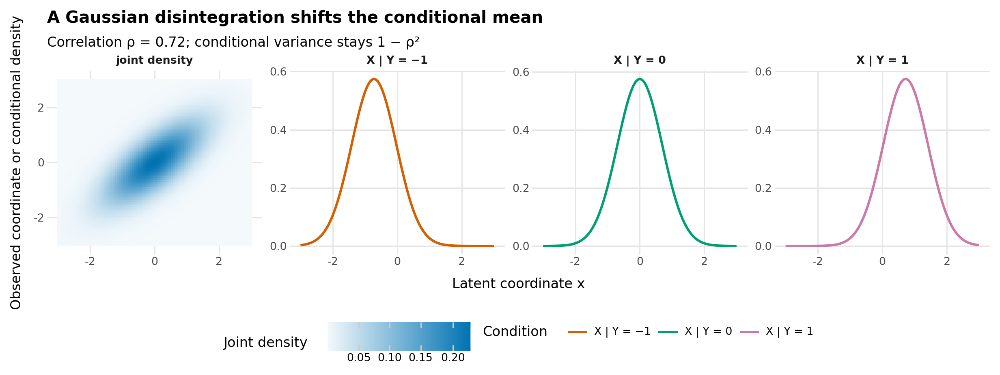

# Polish Spaces, Probability Kernels, and Disintegration {#sec-polish-disintegration}

A probability law can describe one random quantity without saying how it is
coupled to another. Conditioning asks for more: after observing $X=x$, what law
should describe $Y$? In a finite table the answer is a ratio. On a continuum the
event $\{X=x\}$ often has probability zero, so that ratio becomes $0/0$. This
chapter develops the topological and measurable structure that repairs the
question. The decisive setting is not merely a sigma-algebra but a **standard
Borel space**, usually obtained from a complete separable metric space.

## Preparation from this book

Metric convergence and completeness come from
[Metric spaces and contraction](../real-analysis/10-metric-spaces.md#sec-metric-spaces). Borel sets and measure construction come from
[Constructing Lebesgue Measure](../real-analysis/19-lebesgue-measure.md#sec-lebesgue-construction), while products, random variables, and independence
come from [Product Measures, Fubini, and Probability](../real-analysis/22-product-measures-probability.md#sec-product-probability). Local compactness and regular measures from
[sec-radon-measures](33-radon-measures.md#sec-radon-measures) are helpful but not required. Weak convergence and the
statements of Prokhorov and Skorokhod are in [sec-weak-probability](36-weak-probability.md#sec-weak-probability). The repair
sections below rebuild countable bases, product metrics, kernels, and finite
conditioning before they are used.

## Why topology enters conditioning

A **Polish space** is a topological space whose topology is generated by some
complete separable metric. The chosen metric need not be unique. Completeness is
therefore a property of a compatible metric, while being Polish is a property of
the topology together with the existence of such a metric.

Familiar examples include $\mathbb R^d$, every closed subset of a Polish space,
the sequence space $\ell^p$ for $1\le p<\infty$, and
$C([0,1])$ with the supremum norm. A countable set with the discrete metric is
Polish. Two instructive nonexamples separate the hypotheses:

- $\mathbb Q$ with its usual topology is not Polish. It is a countable union of
  singleton nowhere-dense sets, so a compatible complete metric would contradict
  the Baire theorem. The inherited metric is also incomplete, but incompleteness
  of one compatible metric alone would not prove that no other complete one exists.
- An uncountable discrete space is complete but not separable, because every
  dense set must contain every isolated point.

Why ask for both properties? Completeness supports nested approximation and
compactness theorems. Separability supplies a countable collection of tests, so
measurability claims can be made simultaneously outside one null set. That
countability is crucial in disintegration.

### Repair kit: dense sets produce countable bases

Let $(X,d)$ be separable and choose a countable dense set
$D=\{x_1,x_2,\ldots\}$. Consider all balls

$$
\mathcal B=\{B(x_j,r):j\in\mathbb N, r\in\mathbb Q, r>0\}.
$$

This family is countable. We prove it is a base. If $U$ is open and $x\in U$,
choose $\varepsilon>0$ with $B(x,\varepsilon)\subset U$. Density supplies
$x_j$ with $d(x,x_j)<\varepsilon/4$. Choose rational $r$ satisfying

$$
d(x,x_j)<r<\varepsilon-d(x,x_j).
$$

Then $x\in B(x_j,r)$, and if $y$ lies in this ball,

$$
d(y,x)\le d(y,x_j)+d(x_j,x)<r+d(x_j,x)<\varepsilon.
$$

Thus $x\in B(x_j,r)\subset U$. Every open set is a union of members of
$\mathcal B$; because the base itself is countable, only countably many distinct
members are involved. This proof is the basic conversion from topological
questions to countable measurable ones.

## Countable products

Let $(X_n,d_n)$ be Polish spaces. Replacing $d_n$ by
$\min(1,d_n)$ does not change its topology. On
$X=\prod_{n=1}^\infty X_n$, define

$$
d(x,y)=\sum_{n=1}^\infty2^{-n}\min\{1,d_n(x_n,y_n)\}.
$$

The series converges and defines a metric. If $d(x^{(k)},x)\to0$, then for every
fixed $n$,

$$
2^{-n}\min\{1,d_n(x_n^{(k)},x_n)\}\le d(x^{(k)},x)\to0,
$$

so each coordinate converges. Conversely, if every coordinate converges, choose
$N$ so the tail $\sum_{n>N}2^{-n}$ is smaller than $\varepsilon/2$. Coordinate
convergence makes the finite head smaller than $\varepsilon/2$ for all large
$k$. Hence product-metric convergence is exactly coordinatewise convergence.

### Completeness and separability proved

Suppose $x^{(k)}$ is Cauchy in $d$. The preceding coordinate estimate makes
$(x_n^{(k)})_k$ Cauchy in every $X_n$. Completeness gives a coordinate limit
$x_n$. The same head-tail argument proves $x^{(k)}\to(x_n)$ in $d$. Thus $X$ is
complete.

For separability, choose countable dense $D_n\subset X_n$ and a reference point
$a_n\in D_n$. Let $D$ contain sequences that use points of $D_n$ in only
finitely many coordinates and equal $a_n$ thereafter. It is a countable union
of finite products of countable sets, hence countable. Given $x$ and
$\varepsilon$, approximate the first $N$ coordinates by points of $D_n$ and
ignore the small weighted tail. Therefore $D$ is dense, and the countable
product is Polish.

This construction makes $\mathbb R^{\mathbb N}$ a canonical Polish sequence
space. The space $C([0,1])$ is Polish under the supremum norm because uniform
limits of continuous functions are continuous and polygonal functions with
rational breakpoints and values form a countable dense family. In contrast, an
uncountable product of nontrivial spaces cannot generally be handled by one
countable weighted sum. Product topology, cylinder sigma-algebra, and a useful
path topology must then be distinguished.

## Standard Borel spaces

A measurable space $(S,\mathcal S)$ is **standard Borel** if it is measurably
isomorphic to the Borel sigma-algebra of a Polish space: there is a bijection
whose map and inverse are measurable. This definition remembers the measurable
sets but may forget the particular compatible metric.

Every Polish space with its Borel sigma-algebra is standard Borel. Borel subsets
of Polish spaces are standard Borel even when they are not closed and therefore
not complete under the inherited metric. Countable products of standard Borel
spaces are standard Borel. These closure properties cover Euclidean random
variables, countable sequences, continuous paths, and most state spaces used in
analysis.

A warning is necessary. Continuous images of Borel sets need not be Borel;
they are analytic sets and remain measurable for every completed Borel
probability measure. The theorem is valuable, but its proof belongs to
descriptive set theory. We will not silently replace “continuous image” by
“Borel image.” Standard Borel hypotheses are precisely what permit strong
measurable selection and conditioning theorems without pretending every
measurable space behaves so well.

## Probability kernels

Let $(S,\mathcal S)$ and $(T,\mathcal T)$ be measurable spaces. A
**probability kernel** from $S$ to $T$ is a function

$$
K:S\times\mathcal T\to[0,1]
$$

such that:

1. for fixed $s$, the map $A\mapsto K(s,A)$ is a probability measure on $T$;
2. for fixed $A$, the map $s\mapsto K(s,A)$ is $\mathcal S$-measurable.

A stochastic matrix is the finite model: $K(i,\{j\})$ is the entry in row $i$,
column $j$. A deterministic measurable map $F:S\to T$ gives the kernel
$K(s,A)=1_A(F(s))$. Not every kernel is deterministic; a row may split its mass
among several outcomes.

For a nonnegative measurable $g:T\to[0,\infty]$, define

$$
Kg(s)=\int_Tg(t)K(s,dt).
$$

This is measurable in $s$. Prove it first for indicators by the kernel
definition, then for nonnegative simple functions by linearity, and finally for
general $g$ by monotone convergence. This indicator-to-simple-to-limit route is
a reusable proof engine.

If $K$ goes from $S$ to $T$ and $L$ from $T$ to $U$, their composition is

$$
(KL)(s,A)=\int_TL(t,A)K(s,dt).
$$

The same measurability result shows this is a kernel. In a Markov process this
formula says: average the next transition over the current conditional state.
It is the measure-theoretic form of matrix multiplication.

## Building a joint law

Given a probability measure $\mu$ on $S$ and a kernel $K$ from $S$ to $T$, there
is a unique probability measure $\pi$ on $S\times T$ satisfying

$$
\pi(A\times B)=\int_AK(s,B)\mu(ds).
$$

For a nonnegative measurable $f$ this becomes

$$
\int_{S\times T}f(s,t)\pi(d(s,t))
=\int_S\left[\int_Tf(s,t)K(s,dt)\right]\mu(ds).
$$

The construction is proved on rectangles and extended by the monotone-class or
measure-extension theorem. It is not an informal multiplication of two
measure-valued symbols. The first marginal of $\pi$ is $\mu$ because
$K(s,T)=1$. The second marginal is the mixture
$\nu(B)=\int K(s,B)\mu(ds)$.

Independence is the special case in which $K(s,B)=\nu(B)$ does not depend on
$s$. A deterministic relation is the opposite extreme, where each conditional
law is a point mass. Most couplings lie between these cases.

### Finite conditioning as the model calculation

Before conditioning on a continuum, inspect a finite joint table
$p_{ij}=\mathbb P(X=i,Y=j)$. Its first marginal is

$$
p_i=\sum_jp_{ij}.
$$

When $p_i>0$, define

$$
K(i,\{j\})=\frac{p_{ij}}{p_i}.
$$

Every entry is nonnegative and the row sums to one. Multiplying back gives
$p_iK(i,\{j\})=p_{ij}$, so the marginal and kernel reconstruct the joint table.
If $p_i=0$, then nonnegativity and the row-sum identity force every $p_{ij}=0$.
The joint law imposes no condition on the kernel row at $i$; any probability
vector may be inserted there. This is already almost-everywhere uniqueness,
with a zero-mass state taking the role of a null set.

For example, take

$$
(p_{ij})=
\begin{pmatrix}
1/4&1/8&1/8\\
0&1/4&1/4
\end{pmatrix}.
$$

Both row marginals equal $1/2$. The conditional rows are
$(1/2,1/4,1/4)$ and $(0,1/2,1/2)$. The second marginal is
$(1/4,3/8,3/8)$, which also follows by mixing those conditional rows with
weights $1/2,1/2$. This elementary calculation contains the complete logic of
the abstract identity

$$
\pi(dx,dy)=\mu(dx)K(x,dy).
$$

What changes on a continuum is not the identity but the construction. Point
probabilities may all vanish, so the ratio formula cannot define individual
rows. Radon–Nikodym derivatives construct the rows indirectly through their
integrals over measurable sets.

### Cylinder events and countable determination

On $\mathbb R^{\mathbb N}$, a cylinder event restricts only finitely many
coordinates, for example

$$
\{x:x_1\in A_1, x_4\in A_4, x_7\in A_7\}.
$$

Coordinate projections are continuous for the weighted product metric, so
Borel cylinders are Borel. Conversely, product-metric open balls can be
approximated by restrictions on a sufficiently long finite head, while the
weighted tail contributes little. The Borel sigma-algebra is therefore
generated by the coordinate maps. A probability law on the sequence space is
determined by its consistent finite-dimensional distributions because
cylinders form a generating pi-system.

This countable-index conclusion should not be transferred silently to arbitrary
path sets. Brownian motion will first be constructed on a coordinate product
space in [sec-stochastic-processes](42-stochastic-processes.md#sec-stochastic-processes) and only afterward replaced by a continuous
version supported on $C([0,1])$.

## Disintegration

Let $\pi$ be a probability measure on $S\times T$ and let $\mu$ be its first
marginal. A **disintegration of $\pi$ over $S$** is a kernel $K$ such that

$$
\pi(A\times B)=\int_AK(s,B)\mu(ds)
$$

for all measurable rectangles. One writes $K(s,dt)$ as the conditional law of
the second coordinate given the first coordinate $s$.

**Theorem 39.1 (Disintegration).** If $S$ and $T$ are standard Borel spaces, such a
kernel exists and is unique for $\mu$-almost every $s$.

The qualifier “almost every” is essential. If $N$ is a $\mu$-null set, changing
$K(s,\cdot)$ arbitrarily for $s\in N$ changes none of the integrals above. A
conditional distribution is a version, just like conditional expectation in
[Conditional Expectation and Martingale Convergence](../real-analysis/30-martingales.md#sec-martingales).

### The countable-target proof

Suppose $T=\{t_1,t_2,\ldots\}$. Define finite measures on $S$ by

$$
\nu_j(A)=\pi(A\times\{t_j\}).
$$

Each $\nu_j$ is absolutely continuous with respect to $\mu$, since
$\mu(A)=0$ implies $\pi(A\times T)=0$. Radon–Nikodym gives measurable
$k_j=d\nu_j/d\mu$. Countable additivity and
$\sum_j\nu_j=\mu$ imply

$$
k_j\ge0,\qquad \sum_{j=1}^\infty k_j=1
$$

outside one common null set. Modify the functions on that null set to form a
probability vector, and set

$$
K(s,B)=\sum_{j:t_j\in B}k_j(s).
$$

This is the desired kernel. The general standard-Borel proof applies the same
Radon–Nikodym construction to a countable generating class, arranges
simultaneous consistency outside one null set, and extends the resulting set
function to a probability measure. Standard Borel structure supplies exactly
the countable coding and extension properties required at the final step.

## Weak convergence on Polish spaces

For probability measures on a metric space, define the bounded-Lipschitz
distance

$$
d_{BL}(\mu,\nu)=
\sup\left\{
\left|\int f\,d\mu-\int f\,d\nu\right|:
\|f\|_\infty\le1,
\operatorname{Lip}(f)\le1
\right\}.
$$

On a separable metric space this metric detects weak convergence. It replaces
the uncountable class of all bounded continuous functions by a uniformly
controlled class and ultimately by a countable dense family. The metric does
not make every family compact. Prokhorov's theorem adds tightness: on a Polish
space, a family of probability measures is relatively weakly compact exactly
when it is tight.

Skorokhod representation also uses Polish structure. If $\mu_n\Rightarrow\mu$,
it constructs variables with these laws on a new probability space that
converge almost surely. It does not improve the original coupling. These
topological hypotheses explain, rather than decorate, the theorems stated in
[sec-weak-probability](36-weak-probability.md#sec-weak-probability).

## Gaussian observation case study

Let $X\sim N(0,1)$ and let $\varepsilon\sim N(0,\sigma^2)$ be independent. We
observe $Y=X+\varepsilon$. Ignoring constants independent of $x$, the joint
density at a fixed observed $y$ is

$$
\exp\left[-\frac{x^2}{2}-\frac{(y-x)^2}{2\sigma^2}\right].
$$

Expand and complete the square:

$$
\frac{x^2}{2}+\frac{(y-x)^2}{2\sigma^2}
=\frac{1+\sigma^2}{2\sigma^2}
\left(x-\frac{y}{1+\sigma^2}\right)^2
+\frac{y^2}{2(1+\sigma^2)}.
$$

The final term is independent of $x$ and belongs to the normalising constant.
Therefore

$$
X\mid Y=y\sim
N\left(
\frac{y}{1+\sigma^2},
\frac{\sigma^2}{1+\sigma^2}
\right).
$$

The posterior mean shrinks the noisy observation toward the prior mean zero.
As $\sigma\downarrow0$, the conditional variance tends to zero and the mean
tends to $y$. As $\sigma\to\infty$, the observation carries little information:
the mean tends to zero and the variance tends to one.

The marginal law is $Y\sim N(0,1+\sigma^2)$. Multiplying its density by the
conditional density and simplifying recovers the original joint density. That
identity verifies disintegration; completing a square without checking the
normalisation would not.

<figure id="fig-polish-disintegration">


<figcaption>

Figure 7.1: A joint Gaussian density is paired with three analytic conditional slices.

</figcaption>
</figure>

[Figure 7.1](#fig-polish-disintegration) depicts the density case, where conditioning can be
calculated by division of densities. The disintegration theorem is stronger: it
produces a kernel on standard Borel spaces even when no joint density exists.

## Pathwise null-set audit

Let $U$ be uniform on $[0,1]$ and define a process
$Z_t=1_{\{U=t\}}$. For every fixed $t$,
$\mathbb P(Z_t=0)=1$. Thus $Z_t$ is a modification of the identically zero
process: the variables agree almost surely at every fixed time. Nevertheless,
for every outcome $U=u$, the path $t\mapsto Z_t$ has a spike at $u$ and is not
continuous. The intersection of the uncountably many events
$\{Z_t=0\}$ need not retain probability one.

This example is the correct warning before Brownian path regularity in
[sec-stochastic-processes](42-stochastic-processes.md#sec-stochastic-processes). Finite-dimensional laws and pointwise versions do
not by themselves choose a well-behaved path version. A continuity theorem must
produce one common null set outside which the entire path has the stated
property.

## Theorem and claim audit

Before using conditioning or Polish-space compactness, record:

1. the topology and its Borel sigma-algebra;
2. whether a complete separable compatible metric is available;
3. the direction and two measurability clauses of every kernel;
4. which marginal is used for almost-everywhere uniqueness;
5. whether a statement concerns a fixed coordinate, countably many
   coordinates, or an entire path;
6. whether tightness has been established before claiming a weakly convergent
   subsequence; and
7. whether a conditional density calculation is being mistaken for the
   general definition of regular conditioning.

<!-- inline-formula-code:start -->
## Formula and finite computation

A useful formula in this chapter is

$$
K(x,Y)=1
$$

Rows of a finite probability kernel must each sum to one. The following standalone Python block expresses that finite rule with its inputs and stopping conditions visible.

```python
kernel = {
    "low": {"left": 0.8, "right": 0.2},
    "high": {"left": 0.3, "right": 0.7},
}
row_sums = {state: sum(row.values()) for state, row in kernel.items()}
print(row_sums)
```

**What the computation establishes.** The output certifies only the declared finite case. The theorem, if one is claimed, still requires the argument developed in the chapter.
<!-- inline-formula-code:end -->

## Summary

Polish spaces combine completeness with countable approximation. Standard
Borel spaces retain the measurable structure needed for kernels and
disintegration. A kernel builds a joint law from a marginal, while
disintegration recovers conditional laws from a joint measure, uniquely only
almost everywhere. Countable products provide canonical sequence spaces;
pathwise properties require more than coordinatewise probability-one claims.

## Exercises

<div class="exercise" id="real_analysis-39-polish-disintegration-ex-1">
<p class="exercise-title"><strong>Exercise 1</strong></p>

Prove an uncountable discrete metric space is complete but not separable.

</div>

<div class="exercise" id="real_analysis-39-polish-disintegration-ex-2">
<p class="exercise-title"><strong>Exercise 2</strong></p>

Construct explicitly a countable base for $\mathbb R^2$.

</div>

<div class="exercise" id="real_analysis-39-polish-disintegration-ex-3">
<p class="exercise-title"><strong>Exercise 3</strong></p>

Verify the weighted sum in the product section satisfies the triangle
inequality.

</div>

<div class="exercise" id="real_analysis-39-polish-disintegration-ex-4">
<p class="exercise-title"><strong>Exercise 4</strong></p>

Prove the finite-support sequence family used above is countable and dense.

</div>

<div class="exercise" id="real_analysis-39-polish-disintegration-ex-5">
<p class="exercise-title"><strong>Exercise 5</strong></p>

Show $K(x,A)=1_A(F(x))$ is a kernel exactly when $F$ is measurable.

</div>

<div class="exercise" id="real_analysis-39-polish-disintegration-ex-6">
<p class="exercise-title"><strong>Exercise 6</strong></p>

Compose two finite stochastic matrices and match the answer with kernel
composition.

</div>

<div class="exercise" id="real_analysis-39-polish-disintegration-ex-7">
<p class="exercise-title"><strong>Exercise 7</strong></p>

Given a marginal $\mu$ and kernel $K$, verify both marginals of the induced
joint law.

</div>

<div class="exercise" id="real_analysis-39-polish-disintegration-ex-8">
<p class="exercise-title"><strong>Exercise 8</strong></p>

Prove the countable-target disintegration formula in full, including the
common-null-set step.

<details class="hint"><summary>Hint 1</summary>

For each target atom use Radon–Nikodym to obtain one density. Intersect
the countably many full-measure sets on which positivity and normalization hold;
this common-null-set step is why a countable target is manageable.

</details>

</div>

<div class="exercise" id="real_analysis-39-polish-disintegration-ex-9">
<p class="exercise-title"><strong>Exercise 9</strong></p>

For $X\sim N(0,4)$ and $Y=X+\varepsilon$ with
$\varepsilon\sim N(0,1)$, derive the law of $X\mid Y=y$.

<details class="hint"><summary>Hint 1</summary>

Compute the covariance matrix of $(X,Y)$, then use the scalar Gaussian
conditioning formula. The conditional mean coefficient is
$\operatorname{Cov}(X,Y)/\operatorname{Var}(Y)$.

</details>

</div>

<div class="exercise" id="real_analysis-39-polish-disintegration-ex-10">
<p class="exercise-title"><strong>Exercise 10</strong></p>

Give two regular conditional kernels that differ at one null observation
but induce the same joint law.

</div>

<div class="exercise" id="real_analysis-39-polish-disintegration-ex-11">
<p class="exercise-title"><strong>Exercise 11</strong></p>

Show $d_{BL}(\delta_x,\delta_y)\le\min\{2,d(x,y)\}$.

</div>

<div class="exercise" id="real_analysis-39-polish-disintegration-ex-12">
<p class="exercise-title"><strong>Exercise 12</strong></p>

Explain precisely why the spike process has the same finite-dimensional
laws as the zero process but different sample paths.

</div>

## Selected solutions

### Solution to Exercise 4: a countable dense product family

For each $N$, sequences whose first $N$ entries lie in the countable sets
$D_1,\ldots,D_N$ and whose later entries equal the chosen references form a
finite product of countable sets, hence are countable. The union over
$N\in\mathbb N$ remains countable. Given $x$ and $\varepsilon$, choose $N$ so
$\sum_{n>N}2^{-n}<\varepsilon/2$. Approximate each of the first $N$
coordinates closely enough that its weighted contribution is below
$\varepsilon/(2N)$. The constructed finite-support sequence lies within
$\varepsilon$ of $x$.

### Solution to Exercise 8: the common null set

Radon–Nikodym gives $k_j\ge0$ almost everywhere, but initially the exceptional
set may depend on $j$. Take the countable union of those null sets. Also,
$\sum_j\nu_j=\mu$ implies, by monotone convergence,

$$
\int_A\sum_jk_j\,d\mu=\mu(A)
$$

for every measurable $A$, hence $\sum_jk_j=1$ almost everywhere. Add the null
set where this fails. Outside the resulting single null set, $(k_j(s))_j$ is a
probability vector. On the null set define $k_1=1$ and all other coordinates
zero. Then $K(s,B)=\sum_{t_j\in B}k_j(s)$ is a kernel and
$\int_AK(s,\{t_j\})\,d\mu=\nu_j(A)$; summing over $j$ proves the rectangle
identity for all subsets of $T$.

### Solution to Exercise 9: a noisily observed Gaussian

Here the prior variance is $4$ and the noise variance is $1$. The exponent is

$$
\frac{x^2}{8}+\frac{(y-x)^2}{2}
=\frac58\left(x-\frac45y\right)^2+\frac{y^2}{10}.
$$

The conditional precision is $5/4$, so the variance is $4/5$ and the mean is
$4y/5$. Thus

$$
X\mid Y=y\sim N(4y/5,4/5).
$$

The posterior variance is smaller than both the prior variance and the
observation-noise variance because the two independent information sources are
combined through their precisions.
