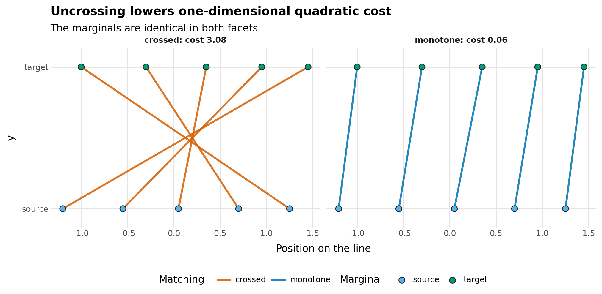

# Optimal Transport and Wasserstein Geometry {#sec-optimal-transport}

Suppose several warehouses contain specified amounts of material and several
shops demand specified amounts. Shipping one unit between each pair has a known
cost. Which routing meets every balance constraint at minimum total cost? The
finite question is linear optimisation. Replacing warehouses and shops by
probability distributions produces **optimal transport**. It combines product
measures, weak convergence, convex duality, and geometry on a space whose points
are themselves measures.

## Preparation from this book

Product measures and couplings come from [Product Measures, Fubini, and Probability](../real-analysis/22-product-measures-probability.md#sec-product-probability). Weak
convergence, tightness, and escaping-mass examples come from
[sec-weak-probability](36-weak-probability.md#sec-weak-probability). Convex duality and lower semicontinuity come from
[sec-convex-duality](34-convex-duality.md#sec-convex-duality). Kernels and disintegration from
[sec-polish-disintegration](39-polish-disintegration.md#sec-polish-disintegration) supply the gluing construction. The chapter repairs
finite balance tables, pushforwards, generalized inverses, and the exact role of
moments before invoking general transport theorems.

## Finite transport tables

Let sources have masses $a_1,\ldots,a_m$ and targets have masses
$b_1,\ldots,b_n$, with all entries nonnegative and

$$
\sum_{i=1}^ma_i=\sum_{j=1}^nb_j=1.
$$

A **transport plan** is a nonnegative matrix $\pi=(\pi_{ij})$ satisfying

$$
\sum_j\pi_{ij}=a_i,
\qquad
\sum_i\pi_{ij}=b_j.
$$

If shipping from $x_i$ to $y_j$ costs $c_{ij}$ per unit, the total cost is

$$
C(\pi)=\sum_{i,j}c_{ij}\pi_{ij}.
$$

The feasible plans form a closed bounded polytope in finite-dimensional space,
so a continuous linear cost attains its minimum. The row and column equations
are not bookkeeping after the optimisation: they define what it means to
transport the declared measures.

For two equally weighted sources and targets, every feasible table has the
form

$$
\pi_t=
\begin{pmatrix}
t&1/2-t\\
1/2-t&t
\end{pmatrix},
\qquad 0\le t\le1/2.
$$

Its cost is affine in $t$, so a minimum occurs at an endpoint unless the two
matchings have equal cost. This one-parameter model will reappear in the
uncrossing argument.

A transport result should expose feasibility before cost. This finite audit
returns both marginal residuals and the objective:

```python
import numpy as np
from numpy.typing import NDArray

def audit_transport_plan(
    plan: NDArray[np.float64],
    costs: NDArray[np.float64],
    source: NDArray[np.float64],
    target: NDArray[np.float64],
) -> tuple[float, float, float]:
    """Return row residual, column residual, and cost of a finite plan."""
    if plan.ndim != 2 or costs.shape != plan.shape:
        raise ValueError("plan and costs must be matching matrices")
    if source.shape != (plan.shape[0],) or target.shape != (plan.shape[1],):
        raise ValueError("marginal lengths must match the plan")
    if np.any(plan < 0.0) or np.any(source < 0.0) or np.any(target < 0.0):
        raise ValueError("masses must be nonnegative")
    if not np.isclose(float(source.sum()), float(target.sum())):
        raise ValueError("source and target must have equal total mass")
    row_residual = float(np.max(np.abs(plan.sum(axis=1) - source)))
    column_residual = float(np.max(np.abs(plan.sum(axis=0) - target)))
    return row_residual, column_residual, float(np.sum(plan * costs))

coupling = np.array([[0.5, 0.0], [0.0, 0.5]])
cost_matrix = np.array([[0.0, 3.0], [2.0, 1.0]])
marginal = np.array([0.5, 0.5])
print(audit_transport_plan(coupling, cost_matrix, marginal, marginal))
```

Zero residuals certify the finite balance equations; the cost $1/2$ can then be
compared with the dual certificate later in the chapter. This array check says
nothing by itself about tightness or existence for measures on a Polish space.

## Maps, plans, and mass splitting

For a measurable map $T:X\to Y$, the pushforward $T_\#\mu$ is defined by

$$
(T_\#\mu)(B)=\mu(T^{-1}(B)).
$$

The **Monge problem** asks for $T_\#\mu=\nu$ minimizing
$\int c(x,T(x))\mu(dx)$. A map sends all mass at one source point to one target
point. This can make the feasible class empty. No map transports $\delta_0$ to

$$
\frac12\delta_{-1}+\frac12\delta_1,
$$

because the image of one atom under a function remains one atom.

The **Kantorovich problem** replaces maps by probability measures
$\pi$ on $X\times Y$ with marginals $\mu$ and $\nu$. The set of such couplings
is denoted $\Pi(\mu,\nu)$, and the problem is

$$
\inf_{\pi\in\Pi(\mu,\nu)}
\int_{X\times Y}c(x,y)\pi(dx,dy).
$$

The atom-splitting example has the plan
$\tfrac12\delta_{(0,-1)}+\tfrac12\delta_{(0,1)}$. Every transport map induces a
plan $(I,T)_\#\mu$, but not every plan is concentrated on a graph.

## Existence by compactness and lower semicontinuity

Let $X,Y$ be Polish spaces, let $\mu,\nu$ be probability measures, and suppose
$c:X\times Y\to[0,\infty]$ is lower semicontinuous. An optimal plan exists
whenever some feasible plan has finite cost.

Here is the proof architecture with every limit passage identified. Choose a
minimizing sequence $\pi_n$. Tightness of $\mu$ and $\nu$ gives compact
$K_X,K_Y$ with

$$
\mu(K_X)>1-\varepsilon/2,
\qquad
\nu(K_Y)>1-\varepsilon/2.
$$

For every coupling,

$$
\pi_n(K_X\times K_Y)
\ge1-\pi_n(K_X^c\times Y)-\pi_n(X\times K_Y^c)
>1-\varepsilon.
$$

Thus the entire sequence is tight. Prokhorov gives a weakly convergent
subsequence $\pi_{n_k}\Rightarrow\pi$. Testing functions depending only on
$x$ or only on $y$ shows that $\pi$ retains marginals $\mu,\nu$. Finally, the
Portmanteau lower-semicontinuity inequality gives

$$
\int c\,d\pi
\le\liminf_{k\to\infty}\int c\,d\pi_{n_k}.
$$

Hence $\pi$ is optimal. Compactness produces a candidate; lower semicontinuity
prevents cost from jumping upward at the limit. Neither hypothesis replaces the
other.

## Kantorovich duality

Let functions $\phi:X\to\mathbb R$ and $\psi:Y\to\mathbb R$ satisfy

$$
\phi(x)+\psi(y)\le c(x,y).
$$

For any coupling $\pi$, the marginal identities give

$$
\int_X\phi\,d\mu+\int_Y\psi\,d\nu
=\int_{X\times Y}[\phi(x)+\psi(y)]\,d\pi
\le\int c\,d\pi.
$$

This is **weak duality**: every feasible pair of potentials supplies a certified
lower bound on every transport cost. The difference between a feasible plan's
cost and a feasible dual value is a nonnegative duality gap.

In a finite table the dual is

$$
\sup_{u_i+v_j\le c_{ij}}
\left(\sum_ia_iu_i+\sum_jb_jv_j\right).
$$

Finite-dimensional linear-programming duality proves equality of primal and
dual optima. On Polish spaces, strong Kantorovich duality holds under standard
lower-semicontinuity and integrability hypotheses. That general theorem is not
obtained merely by writing the weak-duality inequality; approximation and
tightness are substantive parts of its proof.

For the quadratic cost, equality
$\phi(x)+\psi(y)=|x-y|^2$ on the support of an optimal plan is a complementary
slackness certificate. It identifies where transported pairs may live.

## Wasserstein distances

For $1\le p<\infty$, let $\mathcal P_p(X)$ be probability measures with finite
$p$th moment relative to one, hence every, reference point. Define

$$
W_p(\mu,\nu)=
\left[
\inf_{\pi\in\Pi(\mu,\nu)}
\int d(x,y)^p\pi(dx,dy)
\right]^{1/p}.
$$

Symmetry follows by swapping coordinates. If $W_p=0$, an optimal plan is
concentrated where $d(x,y)=0$, so the marginals agree. The triangle inequality
uses a gluing construction.

### The gluing proof of the triangle inequality

Choose couplings $\pi_{12}$ of $\mu_1,\mu_2$ and $\pi_{23}$ of
$\mu_2,\mu_3$. Disintegrate them over their common marginal:

$$
\pi_{12}(dx,dy)=\mu_2(dy)K_1(y,dx),
\qquad
\pi_{23}(dy,dz)=\mu_2(dy)K_3(y,dz).
$$

Sample $y\sim\mu_2$, then conditionally sample $x$ and $z$ independently from
$K_1(y,\cdot)$ and $K_3(y,\cdot)$. This produces a joint law of $(x,y,z)$ with
the two prescribed pairwise marginals. Its $(x,z)$ marginal couples
$\mu_1,\mu_3$. Since $d(x,z)\le d(x,y)+d(y,z)$, Minkowski's inequality gives

$$
W_p(\mu_1,\mu_3)
\le
\left(\mathbb E d(x,z)^p\right)^{1/p}
\le
\left(\mathbb E d(x,y)^p\right)^{1/p}
+\left(\mathbb E d(y,z)^p\right)^{1/p}.
$$

Taking nearly optimal pairwise couplings and then their infima proves the
triangle inequality. The shared middle variable is why arbitrary independent
couplings would not suffice.

## Quantiles and monotone transport on the line

For a distribution function $F$, define its generalized inverse

$$
F^{-1}(u)=\inf\{x:F(x)\ge u\},
\qquad 0<u<1.
$$

If $U$ is uniform on $(0,1)$, then $F^{-1}(U)$ has distribution function $F$.
Indeed,

$$
F^{-1}(u)\le x
\quad\Longleftrightarrow\quad
u\le F(x)
$$

apart from harmless endpoint conventions, so the probability is $F(x)$.

Let $c(x,y)=|x-y|^p$. If $x_1<x_2$ and $y_1<y_2$, convexity implies the
**uncrossing inequality**

$$
|x_1-y_1|^p+|x_2-y_2|^p
\le
|x_1-y_2|^p+|x_2-y_1|^p.
$$

For $p=2$, subtracting the left side from the right gives
$2(x_2-x_1)(y_2-y_1)\ge0$. The general convex-cost statement follows by
monotonicity of secant slopes. Any finite crossed matching can therefore be
uncrossed without increasing cost. Approximation by empirical quantiles extends
the conclusion to probability measures:

$$
W_p(\mu,\nu)^p
=\int_0^1
|F_\mu^{-1}(u)-F_\nu^{-1}(u)|^p\,du.
$$

The common-uniform coupling is optimal. This is a special one-dimensional gift;
there is no global ordering of $\mathbb R^d$ that gives the same formula.

For equally weighted empirical measures with the same sample size, the quantile
coupling is obtained simply by sorting both samples and pairing equal ranks.
This is the finite uncrossing algorithm behind the integral formula.

```python
from math import isfinite

def empirical_wasserstein(
    left_samples: list[float], right_samples: list[float], exponent: float
) -> float:
    """Return the one-dimensional equal-weight empirical W_p distance."""
    if not left_samples or len(left_samples) != len(right_samples):
        raise ValueError("samples must be nonempty and equally long")
    if not isfinite(exponent) or exponent < 1.0:
        raise ValueError("exponent must be finite and at least one")
    if any(not isfinite(value) for value in left_samples + right_samples):
        raise ValueError("sample values must be finite")
    ordered_left = sorted(left_samples)
    ordered_right = sorted(right_samples)
    mean_power_cost = sum(
        abs(left_value - right_value) ** exponent
        for left_value, right_value in zip(
            ordered_left, ordered_right, strict=True
        )
    ) / len(ordered_left)
    return mean_power_cost ** (1.0 / exponent)

distance = empirical_wasserstein([0.0, 3.0, 5.0], [1.0, 2.0, 8.0], 2.0)
print(distance)
```

The result is the exact equal-rank cost up to the final floating-point root.
It proves neither convergence of empirical measures nor the continuum
one-dimensional optimality theorem; the uncrossing argument supplies that
justification.

### Why crossings cost more for every convex distance cost

The quadratic expansion proves one case, but the mechanism is more general.
Let $h(r)=|r|^p$, a convex function, and suppose
$x_1<x_2$ and $y_1<y_2$. Put $a=x_1-y_2$ and
$b=x_2-y_2$, so $a<b$. Replacing $y_2$ by the smaller $y_1$ adds the same
positive shift $s=y_2-y_1$ to both arguments. Convexity says the increment

$$
h(r+s)-h(r)
$$

is nondecreasing in $r$: it is a secant slope multiplied by $s$. Therefore

$$
h(b+s)-h(b)\ge h(a+s)-h(a).
$$

Rearranging gives exactly

$$
h(x_1-y_1)+h(x_2-y_2)
\le h(x_1-y_2)+h(x_2-y_1).
$$

For a finite matching, repeatedly remove an inversion. The process terminates
because each swap decreases the finite inversion count. The resulting matching
is monotone and has no greater cost. Approximation by finitely supported
quantile measures then gives the continuous theorem. This proof also shows what
would fail for a nonconvex cost: the increment need not be monotone, so crossing
could be advantageous.

### The exact $W_1$ area formula

On the real line, first moments permit a second representation:

$$
W_1(\mu,\nu)=\int_{\mathbb R}|F_\mu(t)-F_\nu(t)|\,dt.
$$

We prove both inequalities. For real numbers $x,y$,

$$
|x-y|=\int_{\mathbb R}
|1_{\{x\le t\}}-1_{\{y\le t\}}|\,dt,
$$

because the integrand equals one precisely between $x$ and $y$. For any coupling
$(X,Y)$, Tonelli and $|\mathbb EZ|\le\mathbb E|Z|$ yield

$$
\begin{aligned}
\mathbb E|X-Y|
&=\int\mathbb E
|1_{\{X\le t\}}-1_{\{Y\le t\}}|\,dt\\
&\ge\int
|\mathbb P(X\le t)-\mathbb P(Y\le t)|\,dt\\
&=\int|F_\mu(t)-F_\nu(t)|\,dt.
\end{aligned}
$$

Thus the right side is a lower bound for every plan. Under the monotone
quantile coupling, the two indicators are nested for each fixed $t$, so
$\mathbb E|A-B|=|\mathbb EA-\mathbb EB|$ and equality holds. The formula turns
one-dimensional earth-moving cost into literal area between two CDF graphs.

The Kantorovich–Rubinstein theorem generalizes the dual description to a
metric space:

$$
W_1(\mu,\nu)
=\sup_{\operatorname{Lip}(f)\le1}
\left(\int f\,d\mu-\int f\,d\nu\right),
$$

with an integrability normalisation when the space is unbounded. Weak duality
is immediate from $f(x)-f(y)\le d(x,y)$ and integration against a coupling.
The reverse inequality is the substantive part of the theorem. It should not be
claimed merely because the easy direction fits on one line.

## Exact case study: uniform to triangular density

Let $\mu$ be uniform on $[0,1]$, and let $\nu$ have density $2y$ there. Its
distribution function is $F_\nu(y)=y^2$, so its quantile is
$F_\nu^{-1}(u)=\sqrt u$. Since the source quantile is $u$, the optimal map is

$$
T(x)=\sqrt x.
$$

Check the pushforward rather than trusting the formula:

$$
\mathbb P(T(U)\le y)
=\mathbb P(U\le y^2)=y^2=F_\nu(y).
$$

For squared cost,

$$
\begin{aligned}
W_2(\mu,\nu)^2
&=\int_0^1(u-\sqrt u)^2\,du\\
&=\int_0^1(u^2-2u^{3/2}+u)\,du\\
&=\frac13-\frac45+\frac12
=\frac1{30}.
\end{aligned}
$$

Every equality is exact. A discretized transport program should converge toward
this value, but the exact integral is the certificate.

<figure id="fig-optimal-transport-monotone">


<figcaption>

Figure 8.1: Crossed and monotone one-dimensional matchings have different exact squared costs.

</figcaption>
</figure>

[Figure 8.1](#fig-optimal-transport-monotone) is the finite uncrossing argument made visible.
The plot proves nothing about arbitrary measures by itself; the inequality and
approximation argument perform that passage.

## Weak convergence, moments, and geometry

Wasserstein convergence is stronger than weak convergence. On $\mathbb R^d$,

$$
W_p(\mu_n,\mu)\to0
$$

implies $\mu_n\Rightarrow\mu$ and convergence of $p$th moments. Conversely,
weak convergence plus suitable uniform integrability of the $p$th moments gives
$W_p$ convergence.

The escaping-mass example

$$
\mu_n=\left(1-\frac1n\right)\delta_0+\frac1n\delta_{n^2}
$$

converges weakly to $\delta_0$, but its first moment is $n$. Consequently
$W_1(\mu_n,\delta_0)=n$, not zero. Bounded continuous tests ignore a small mass
far away; transport cost multiplies that mass by its travel distance.

If an optimal plan $\pi$ joins $\mu_0$ to $\mu_1$ in Euclidean space, define

$$
\mu_t=[(1-t)x+ty]_\#\pi,
\qquad 0\le t\le1.
$$

For $W_2$ this is a constant-speed geodesic under standard conditions. When the
optimal plan is induced by a map $T$, it becomes
$\mu_t=((1-t)I+tT)_\#\mu_0$. Brenier's theorem says that for quadratic cost and
an absolutely continuous source in $\mathbb R^d$, the optimal map is the
gradient of a convex function, uniquely almost everywhere. Atomic sources and
general metric spaces lie outside that formulation.

### Constant-speed verification

Write $X_t=(1-t)X_0+tX_1$ under an optimal $W_p$ coupling of the endpoints.
For $0\le s<t\le1$, the joint law of $(X_s,X_t)$ is a coupling of
$\mu_s,\mu_t$, and

$$
\left(\mathbb E|X_t-X_s|^p\right)^{1/p}
=(t-s)W_p(\mu_0,\mu_1).
$$

Hence
$W_p(\mu_s,\mu_t)\le(t-s)W_p(\mu_0,\mu_1)$. The endpoint triangle inequality
gives

$$
W_p(\mu_0,\mu_1)
\le W_p(\mu_0,\mu_s)+W_p(\mu_s,\mu_t)+W_p(\mu_t,\mu_1).
$$

Applying the preceding upper bound to all three terms makes their total at most
$W_p(\mu_0,\mu_1)$. Equality is therefore forced in every segment. The curve is
not just visually linear; its metric speed is certified.

For one-dimensional $W_2$ barycentres, let measures $\mu_i$ have quantiles
$q_i(u)$ and weights $\lambda_i$ summing to one. At each $u$, the number
$q(u)$ minimizing

$$
\sum_i\lambda_i|q-q_i(u)|^2
$$

is $q(u)=\sum_i\lambda_iq_i(u)$. Because a weighted average of nondecreasing
functions is nondecreasing, this is a quantile function. Thus the Wasserstein
barycentre is obtained by averaging quantiles, not densities. Ordinary mixture
and displacement barycentre answer different questions.

## Stability under maps, noise, and empirical approximation

Wasserstein distance behaves well under a Lipschitz observation. If
$F:X\to Y$ is $L$-Lipschitz and $\pi$ couples $\mu,\nu$, then
$(F,F)_\#\pi$ couples their pushforwards and

$$
\int d_Y(F(x),F(y))^p\,d\pi
\le L^p\int d_X(x,y)^p\,d\pi.
$$

Taking infima gives

$$
W_p(F_\#\mu,F_\#\nu)\le L W_p(\mu,\nu).
$$

A measurement cannot amplify transport error by more than its Lipschitz
constant. Continuity without a quantitative modulus gives weak-convergence
stability through the mapping theorem, but not this metric estimate.

On a normed vector space, adding the same independent noise is nonexpansive.
Take an almost optimal pair $(X,Y)$ and an independent $Z$ with law $\eta$.
Then $(X+Z,Y+Z)$ couples $\mu*\eta$ and $\nu*\eta$, while

$$
\|(X+Z)-(Y+Z)\|=\|X-Y\|.
$$

Therefore
$W_p(\mu*\eta,\nu*\eta)\le W_p(\mu,\nu)$. Smoothing can hide distinctions,
so the reverse inequality generally fails.

For equally weighted empirical measures on the line,

$$
\mu_n=\frac1n\sum_{i=1}^n\delta_{x_i},
\qquad
\nu_n=\frac1n\sum_{i=1}^n\delta_{y_i},
$$

sort the samples as $x_{(1)}\le\cdots\le x_{(n)}$ and similarly for $y$.
The quantile formula becomes the exact finite identity

$$
W_p(\mu_n,\nu_n)^p
=\frac1n\sum_{i=1}^n|x_{(i)}-y_{(i)}|^p.
$$

The identity works for every finite $p\ge1$, not only for the $W_1$ instance
used in the chapter's final formula block:

```python
def empirical_wasserstein(
    source: list[float], target: list[float], exponent: float
) -> float:
    """Return exact equal-weight one-dimensional empirical W-p distance."""
    if not source or len(source) != len(target):
        raise ValueError("samples must be nonempty and have equal length")
    if exponent < 1.0:
        raise ValueError("exponent must be at least one")
    ordered_source = sorted(source)
    ordered_target = sorted(target)
    mean_cost = sum(
        abs(x - y) ** exponent
        for x, y in zip(ordered_source, ordered_target, strict=True)
    ) / len(source)
    return mean_cost ** (1.0 / exponent)

for power in (1.0, 2.0, 3.0):
    print(power, empirical_wasserstein([0.0, 1.0, 4.0], [1.0, 2.0, 6.0], power))
```

Thus one-dimensional empirical transport requires sorting rather than a
general linear program. Repeated observations, ties, and atoms cause no
problem; generalized quantiles automatically retain their multiplicities.
In higher dimensions, independently sorting coordinates does not usually
produce a valid optimum because it destroys the joint geometry.

## Computation and theorem audit

Discrete optimal transport is a linear program. A numerical answer should
report marginal residuals, primal cost, a feasible dual value, and their gap.
Entropic regularization instead minimizes

$$
\int c\,d\pi+\varepsilon
\operatorname{KL}(\pi\,\|\,\mu\otimes\nu).
$$

It is smoother and can be solved by Sinkhorn scaling, but it is a different
problem. Smaller $\varepsilon$ reduces regularization bias while worsening
conditioning. Grid spacing, stopping error, and regularization error must not be
collapsed into one decimal.

### Where Sinkhorn scaling comes from

For positive finite marginals, write the regularized objective as

$$
\sum_{i,j}c_{ij}\pi_{ij}
+\varepsilon\sum_{i,j}\pi_{ij}
\left(\log\frac{\pi_{ij}}{a_ib_j}-1\right).
$$

Introduce multipliers $\alpha_i,\beta_j$ for the row and column constraints.
Differentiation at a positive optimum gives

$$
c_{ij}+\varepsilon\log\frac{\pi_{ij}}{a_ib_j}
-\alpha_i-\beta_j=0.
$$

Consequently

$$
\pi_{ij}=u_iK_{ij}v_j,
\qquad
K_{ij}=e^{-c_{ij}/\varepsilon},
$$

after absorbing fixed marginal factors into positive scalings $u_i,v_j$.
Alternately rescaling rows to $a$ and columns to $b$ is Sinkhorn iteration.
The derivation assumes positive entries and exact arithmetic. In implementation,
small $\varepsilon$ can underflow $K_{ij}$; logarithmic stabilization and a
reported marginal residual are part of a reliable result.

For a small, well-scaled positive problem, fixed-count Sinkhorn iteration makes
the row and column equations executable. The bounded iteration count is an input,
and the function reports rather than hides its final residual.

```python
import numpy as np
from numpy.typing import NDArray

def sinkhorn_plan(
    costs: NDArray[np.float64],
    source: NDArray[np.float64],
    target: NDArray[np.float64],
    regularization: float,
    iterations: int,
) -> tuple[NDArray[np.float64], float]:
    """Return a small entropic plan and its largest marginal residual."""
    if costs.ndim != 2:
        raise ValueError("costs must be a matrix")
    if costs.shape[0] == 0 or costs.shape[1] == 0:
        raise ValueError("costs and marginals must be nonempty")
    if source.shape != (costs.shape[0],) or target.shape != (costs.shape[1],):
        raise ValueError("marginal lengths must match costs")
    if not np.all(np.isfinite(costs)):
        raise ValueError("this elementary implementation requires finite costs")
    if regularization <= 0.0 or iterations <= 0:
        raise ValueError("regularization and iterations must be positive")
    if np.any(source <= 0.0) or np.any(target <= 0.0):
        raise ValueError("this elementary implementation requires positive masses")
    if not np.isclose(float(source.sum()), float(target.sum())):
        raise ValueError("marginal totals must agree")
    kernel = np.exp(-costs / regularization)
    if np.any(kernel == 0.0):
        raise ValueError("kernel underflowed; use log-domain stabilization")
    left = np.ones_like(source)
    right = np.ones_like(target)
    for _ in range(iterations):
        left = source / (kernel @ right)
        right = target / (kernel.T @ left)
    plan = left[:, None] * kernel * right[None, :]
    residual = max(
        float(np.max(np.abs(plan.sum(axis=1) - source))),
        float(np.max(np.abs(plan.sum(axis=0) - target))),
    )
    return plan, residual

costs = np.array([[0.0, 1.0], [1.0, 0.0]])
masses = np.array([0.4, 0.6])
plan, residual = sinkhorn_plan(costs, masses, masses, 0.2, iterations=100)
print(plan, residual, float(np.sum(plan * costs)))
```

This is deliberately not a production solver: it rejects kernel underflow
rather than concealing it. It solves the declared regularized finite problem,
not the unregularized continuum problem, and its residual certifies marginals
rather than regularization or mesh error.

Audit every transport claim for:

1. equality of total masses;
2. existence of at least one finite-cost coupling;
3. topology and moment class;
4. lower semicontinuity or continuity of the cost;
5. whether the result concerns a plan or a deterministic map;
6. the hypotheses of strong duality or Brenier's theorem; and
7. whether the reported computation is exact or regularized.

<!-- inline-formula-code:start -->
## Formula and finite computation

A useful formula in this chapter is

$$
W_1(\mu_n,\nu_n)=\frac1n\sum_{i=1}^n|x_{(i)}-y_{(i)}|
$$

In one dimension, sorting gives the exact equal-weight finite transport cost. The following standalone Python block expresses that finite rule with its inputs and stopping conditions visible.

```python
source = sorted([0.0, 1.0, 4.0, 6.0])
target = sorted([1.0, 2.0, 2.0, 7.0])
wasserstein = sum(abs(x - y) for x, y in zip(source, target, strict=True)) / len(source)
print(wasserstein)
```

**What the computation establishes.** The output certifies only the declared finite case. The theorem, if one is claimed, still requires the argument developed in the chapter.
<!-- inline-formula-code:end -->

## Summary

Kantorovich plans repair the mass-splitting failure of Monge maps. Tightness and
lower semicontinuity give existence; feasible potentials give dual lower bounds.
Wasserstein distance records both weak location and moment cost. On the line,
quantile coupling is optimal and turns transport into an exact integral.

## Exercises

<div class="exercise" id="real_analysis-40-optimal-transport-ex-1">
<p class="exercise-title"><strong>Exercise 1</strong></p>

Parameterize all couplings of $(1/2,1/2)$ with itself and minimize a given
$2\times2$ cost table.

</div>

<div class="exercise" id="real_analysis-40-optimal-transport-ex-2">
<p class="exercise-title"><strong>Exercise 2</strong></p>

Prove no map transports one atom to two atoms of positive mass.

</div>

<div class="exercise" id="real_analysis-40-optimal-transport-ex-3">
<p class="exercise-title"><strong>Exercise 3</strong></p>

Derive weak Kantorovich duality for finite tables directly from the row and
column equations.

</div>

<div class="exercise" id="real_analysis-40-optimal-transport-ex-4">
<p class="exercise-title"><strong>Exercise 4</strong></p>

Verify the squared-cost uncrossing identity by expansion.

</div>

<div class="exercise" id="real_analysis-40-optimal-transport-ex-5">
<p class="exercise-title"><strong>Exercise 5</strong></p>

Prove $F^{-1}(U)$ has distribution function $F$ with careful endpoint
conventions.

<details class="hint"><summary>Hint 1</summary>

Check separately the inequalities
$\mathbb P(F^{-1}(U)\le x)\le F(x)$ and the reverse, using the infimum definition
and right continuity of $F$.

</details>

</div>

<div class="exercise" id="real_analysis-40-optimal-transport-ex-6">
<p class="exercise-title"><strong>Exercise 6</strong></p>

Compute $W_2$ between the uniform laws on $[0,1]$ and $[1,3]$.

</div>

<div class="exercise" id="real_analysis-40-optimal-transport-ex-7">
<p class="exercise-title"><strong>Exercise 7</strong></p>

Derive the uniform-to-$2y$ case study without consulting the text.

</div>

<div class="exercise" id="real_analysis-40-optimal-transport-ex-8">
<p class="exercise-title"><strong>Exercise 8</strong></p>

Use the gluing construction to prove the $W_1$ triangle inequality.

<details class="hint"><summary>Hint 1</summary>

Disintegrate both couplings over the shared middle marginal, multiply
the two kernels to obtain a triple law, and project onto the first and third
coordinates before applying Minkowski.

</details>

</div>

<div class="exercise" id="real_analysis-40-optimal-transport-ex-9">
<p class="exercise-title"><strong>Exercise 9</strong></p>

Compute $W_1(\mu_n,\delta_0)$ for the escaping-mass example.

</div>

<div class="exercise" id="real_analysis-40-optimal-transport-ex-10">
<p class="exercise-title"><strong>Exercise 10</strong></p>

Find a dual certificate for the monotone matching of two ordered
two-point measures.

</div>

<div class="exercise" id="real_analysis-40-optimal-transport-ex-11">
<p class="exercise-title"><strong>Exercise 11</strong></p>

Show displacement interpolation between two Dirac masses is a moving
Dirac mass.

</div>

<div class="exercise" id="real_analysis-40-optimal-transport-ex-12">
<p class="exercise-title"><strong>Exercise 12</strong></p>

Explain which error terms must accompany a Sinkhorn cost computed on a
finite grid.

</div>

## Selected solutions

### Solution to Exercise 1: a complete two-by-two problem

Let the cost matrix be

$$
C=\begin{pmatrix}0&3\\2&1\end{pmatrix}.
$$

Every feasible plan is $\pi_t$ from the opening section. Its cost is

$$
C(\pi_t)=0t+3(1/2-t)+2(1/2-t)+1t
=\frac52-4t.
$$

This is minimized at $t=1/2$, giving the diagonal plan and cost $1/2$. For a
dual certificate choose $u=(0,2)$ and $v=(0,-1)$. Then
$u_i+v_j\le c_{ij}$ for all four entries, and the dual value is

$$
\frac12(0+2)+\frac12(0-1)=\frac12.
$$

Weak duality and equality of values certify optimality.

### Solution to Exercise 6: translated and rescaled uniforms

The source quantile is $u$ and the target quantile is $1+2u$. Therefore

$$
W_2^2=\int_0^1|u-(1+2u)|^2du
=\int_0^1(1+u)^2du
=1+1+\frac13=\frac73.
$$

Hence $W_2=\sqrt{7/3}$. The optimal map is $T(x)=1+2x$, whose pushforward is
uniform on $[1,3]$.

### Solution to Exercise 9: weak but not Wasserstein convergence

Any coupling with $\delta_0$ must pair every source point with zero. Thus the
transport cost is forced:

$$
W_1(\mu_n,\delta_0)
=\int|x|\mu_n(dx)
=\frac1n n^2=n.
$$

Although $\mu_n\Rightarrow\delta_0$, the Wasserstein distance diverges. The
failed upgrade is exactly first-moment uniform integrability.

### Solution to Exercise 8: gluing for $W_1$

Choose couplings with costs within $\varepsilon$ of
$W_1(\mu_1,\mu_2)$ and $W_1(\mu_2,\mu_3)$. Disintegrate and glue them over
$\mu_2$ as in the chapter. The $(x,z)$ marginal is admissible, and the ordinary
triangle inequality gives

$$
\begin{aligned}
W_1(\mu_1,\mu_3)
&\le\mathbb E d(x,z)\\
&\le\mathbb E d(x,y)+\mathbb E d(y,z)\\
&\le W_1(\mu_1,\mu_2)+W_1(\mu_2,\mu_3)+2\varepsilon.
\end{aligned}
$$

Letting $\varepsilon\downarrow0$ proves the claim. Using two unrelated
couplings would not define one shared middle variable and would leave the
pointwise triangle inequality unavailable.

### Solution to Exercise 12: a reproducible Sinkhorn claim

A defensible report separates at least four quantities. First state the grid
and its quadrature weights; changing them changes the discrete marginals and
cost. Next report the regularization parameter $\varepsilon$, because the
transport cost of the regularized plan generally exceeds the unregularized
Kantorovich optimum, while the entropy-adjusted objective is a different
reported quantity. Report the largest row and column
residual,

$$
r=\max\left\{
\max_i\left|\sum_j\pi_{ij}-a_i\right|,
\max_j\left|\sum_i\pi_{ij}-b_j\right|
\right\},
$$

and a stopping tolerance in the same mass units. Finally compare a primal value
with a feasible dual lower bound whenever available. Mesh error,
regularization bias, and iteration error arise from different limits; one small
residual certifies only the balance equations, not the continuum answer.
Repeating the computation with a halved grid spacing and a smaller
$\varepsilon$ supplies a sensitivity table. Agreement across that table is
useful evidence, while the exact quantile calculation remains the proof in the
one-dimensional benchmark.
