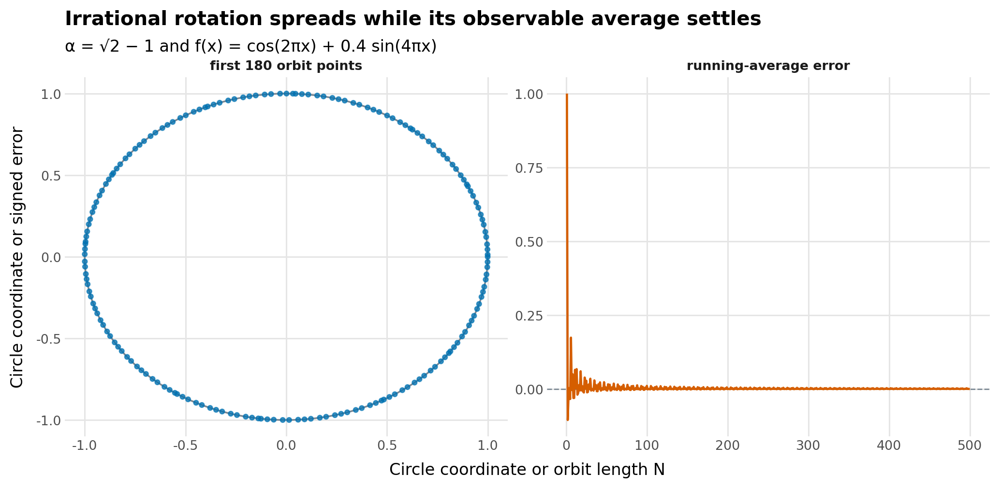

# Ergodic Theory and Long-Time Averages {#sec-ergodic-theory}

A physical experiment may record one system for a long time rather than many
independent systems at one time. When can the average along that single orbit
recover a space average? Ergodic theory studies this question for deterministic
transformations that preserve measure. Its proof engines combine recurrence,
Hilbert-space projections, conditional expectation, and maximal inequalities.

## Preparation from this book

Probability spaces and inverse-image calculations come from
[Product Measures, Fubini, and Probability](../real-analysis/22-product-measures-probability.md#sec-product-probability). Hilbert projections and orthogonality come from
[Hilbert Spaces, Projections, and Spectral Ideas](../real-analysis/27-hilbert-spectral.md#sec-hilbert-spectral). Conditional expectation comes from [Conditional Expectation and Martingale Convergence](../real-analysis/30-martingales.md#sec-martingales),
and operator iteration from [sec-semigroups](35-semigroups.md#sec-semigroups). Fourier approximation in the
rotation case uses [Fourier analysis: oscillation and approximation](../real-analysis/12-fourier.md#sec-fourier) and [Baire Category and Function-Space Compactness](../real-analysis/25-baire-ascoli.md#sec-baire-ascoli). The local repair below
defines iteration, modulo-one arithmetic, invariant events, and correlations,
so no prior dynamics or group theory is assumed.

## Orbits and measure preservation

Let $(X,\mathcal A,\mu)$ be a probability space and let
$T:X\to X$ be measurable. Its iterates are

$$
T^0x=x,
\qquad
T^{n+1}x=T(T^nx).
$$

The sequence $x,T x,T^2x,\ldots$ is the **forward orbit** of $x$. The map is
**measure preserving** when

$$
\mu(T^{-1}A)=\mu(A)
$$

for every measurable $A$. The inverse image is used even when $T$ has no
inverse. Preservation says that the distribution of $T(X)$ equals that of $X$
when $X$ initially has law $\mu$.

### Repair kit: arithmetic on the circle

Represent the circle by $[0,1)$ with endpoints identified. Write
$x+\alpha\pmod1$ for the fractional part of $x+\alpha$. Rotation by $\alpha$ is

$$
R_\alpha(x)=x+\alpha\pmod1.
$$

It preserves length because translating an interval preserves its length;
finite unions and then a monotone-class argument extend the identity to Borel
sets. If $\alpha=p/q$ is rational, every orbit is periodic with period dividing
$q$. If $\alpha$ is irrational, no orbit repeats: equality
$R_\alpha^m x=R_\alpha^n x$ would imply $(m-n)\alpha\in\mathbb Z$.

The doubling map $D(x)=2x\pmod1$ also preserves length. The inverse image of an
interval consists of two intervals, each half as long. It is two-to-one and
therefore not invertible, illustrating why measure preservation is formulated
with preimages rather than a pointwise inverse.

A nonexample is $T(x)=x/2$ on $[0,1]$: the preimage of $[0,1/4]$ is
$[0,1/2]$, whose length is not $1/4$. Its orbits collapse toward zero, so a
uniform initial distribution is not retained.

## Invariant events and ergodicity

A measurable set $A$ is **invariant modulo null sets** if
$\mu(T^{-1}A\mathbin{\triangle}A)=0$. The system is **ergodic** if every such
set has measure zero or one. Equivalently, every measurable function satisfying
$f\circ T=f$ almost everywhere is almost everywhere constant.

To see one direction, if $f$ is invariant, then each sublevel set
$\{f\le r\}$ is invariant. Ergodicity forces its measure to be zero or one for
every rational $r$. The distribution function of $f$ therefore jumps from zero
to one at one value, making $f$ constant almost everywhere. Conversely,
$1_A\circ T=1_A$ for an invariant set, so the functional formulation forces
$1_A$ to be constant and $\mu(A)\in\{0,1\}$.

The identity map is measure preserving but rarely ergodic: every measurable set
is invariant. Thus preservation alone does not say that one orbit explores the
space. Rational rotations also fail ergodicity; a small interval repeated
around its finite cycle forms a nontrivial invariant set.

## Poincaré recurrence

If $T$ preserves a finite measure and $A$ has positive measure, almost every
point of $A$ returns to $A$ infinitely often. The proof begins with points that
never return. Define

$$
W=A\setminus\bigcup_{n\ge1}T^{-n}A.
$$

The sets $T^{-n}W$ are pairwise disjoint. Indeed, if $m<n$ and a point belonged
to both, then applying the orbit relation would show a point of $W$ returns to
$W\subset A$ after $n-m$ steps, contradicting the definition. Preservation
gives $\mu(T^{-n}W)=\mu(W)$. If $\mu(W)>0$, their disjoint union would have
infinite measure, impossible in a finite space. Hence $\mu(W)=0$.

To upgrade one return to infinitely many, let $F\subset A$ contain points that
return only finitely often. After each point's last return, some forward iterate
lands in a no-return set. Thus $F$ is contained in a countable union of inverse
images of null wandering sets and is null.

Finiteness is essential. Translation $T(x)=x+1$ preserves Lebesgue measure on
$\mathbb R$, but a point of $[0,1)$ never returns to that interval. Recurrence
does not state a uniform return time, and it does not say every point returns.

## Koopman operators

For $1\le p\le\infty$, define the **Koopman operator**

$$
Uf=f\circ T.
$$

Measure preservation gives

$$
\|Uf\|_p^p
=\int|f(Tx)|^p\,d\mu(x)
=\int|f(x)|^p\,d\mu(x)
$$

for finite $p$, with the analogous essential-supremum identity. Thus $U$ is an
isometry. If $T$ is invertible with a measure-preserving inverse, $U$ is unitary
on $L^2$. For the noninvertible doubling map, it is an isometry but not onto.

Fixed vectors $Uf=f$ are precisely invariant functions. Let

$$
\mathcal I=\{A:T^{-1}A=A\text{ modulo null sets}\}
$$

be the invariant sigma-algebra. The fixed subspace of $L^2$ is
$L^2(\mathcal I)$. In an ergodic system this consists only of constants.

The time average of an observable is now an operator average:

$$
A_Nf=\frac1N\sum_{k=0}^{N-1}U^kf
=\frac1N\sum_{k=0}^{N-1}f(T^kx).
$$

This translation turns a dynamics question into a Hilbert-space convergence
problem.

### A complete finite-state model

Let $X=\{0,1,\ldots,q-1\}$ with uniform probability and let
$T(j)=j+r\pmod q$. This permutation preserves measure. Write
$d=\gcd(r,q)$. The space splits into $d$ cycles, each of length $q/d$.
An invariant function must be constant along each cycle, and it may choose a
different constant on different cycles. Hence the transformation is ergodic
exactly when $d=1$.

For an arbitrary function $f:X\to\mathbb R$ and a point $j$, the average over
one full cycle is

$$
\frac{d}{q}\sum_{k=0}^{q/d-1}f(j+kr\pmod q).
$$

Write $N=m(q/d)+s$ with $0\le s<q/d$. The first $m$ complete cycles contribute
$m$ times this sum, while the remainder has at most $q/d$ bounded terms.
Dividing by $N$ shows the time average converges to the cycle average. It equals
the whole-space average for every $j$ precisely in the single-cycle case.

This finite calculation is the mean ergodic theorem without limiting
functional analysis. The fixed subspace consists of functions constant on
cycles, and orthogonal projection replaces $f$ by its average on the cycle
containing each point. It also shows why periodic behaviour need not contradict
ergodic behaviour on a finite probability space: one cycle visits every state
with the correct frequency.

## The mean ergodic theorem

**Theorem 41.1 (Von Neumann mean ergodic).** If $U$ is a contraction on a Hilbert
space $H$, then $A_N=N^{-1}\sum_{k<N}U^k$ converges strongly to the orthogonal
projection $P$ onto $M=\ker(I-U)$.

We give the complete proof. First observe

$$
\overline{\operatorname{ran}(I-U)}=M^\perp.
$$

For any bounded operator,
$\operatorname{ran}(I-U)^\perp=\ker(I-U^*)$. For a contraction,
$\ker(I-U^*)=\ker(I-U)$. To verify this, suppose $Ux=x$. Then

$$
\langle U^*x,x\rangle=\langle x,Ux\rangle=\|x\|^2.
$$

Since $\|U^*x\|\le\|x\|$, equality in Cauchy–Schwarz forces $U^*x=x$.
The reverse implication is identical with $U$ and $U^*$ exchanged. Taking
orthogonal complements proves the displayed decomposition.

On $M$, every $U^kf=f$, so $A_Nf=f$. On the range of $I-U$, write
$f=(I-U)g$. The sum telescopes:

$$
A_Nf
=\frac1N\sum_{k=0}^{N-1}(U^kg-U^{k+1}g)
=\frac{g-U^Ng}{N}.
$$

Because $U$ is a contraction,

$$
\|A_Nf\|\le\frac{2\|g\|}{N}\longrightarrow0.
$$

Also $\|A_N\|\le1$. If $f$ lies in the closure of the range, approximate it by
$f_m=(I-U)g_m$. Then

$$
\|A_Nf\|
\le\|A_N(f-f_m)\|+\|A_Nf_m\|
\le\|f-f_m\|+\|A_Nf_m\|.
$$

Choose $m$ to make the first term small and then $N$ to make the second small.
Thus $A_Nf\to0$ throughout $M^\perp$. Decomposing any $f=Pf+(I-P)f$ gives
$A_Nf\to Pf$. Every use of closure has been paired with the uniform bound on
$A_N$.

For a measure-preserving system on a probability space, the conclusion is

$$
A_Nf\longrightarrow\mathbb E(f\mid\mathcal I)
\quad\text{in }L^2.
$$

In the ergodic case this conditional expectation is the constant
$\int f\,d\mu$.

## Birkhoff's pointwise theorem

The mean theorem gives norm convergence but does not by itself give convergence
at almost every point. Birkhoff's theorem supplies the pointwise result:

**Theorem 41.2 (Birkhoff ergodic).** If $T$ preserves a probability measure and
$f\in L^1$, then

$$
A_Nf(x)\longrightarrow\mathbb E(f\mid\mathcal I)(x)
$$

for almost every $x$, and the limit is integrable. In an ergodic system the
limit equals $\int f\,d\mu$ almost everywhere.

The proof uses a maximal ergodic inequality to control the set on which partial
averages have a positive excess, then applies the inequality to limsup and
liminf truncations. It is longer than the Hilbert proof because pointwise
oscillation cannot be controlled by orthogonal decomposition alone. This
chapter treats the maximal inequality and truncation argument as a precise proof
architecture rather than falsely compressing them into “apply dominated
convergence.”

Birkhoff does not promise convergence at every point, a uniform rate, or
uniform convergence over observables. It also does not make the random variables
$f(T^kx)$ independent.

### Visit frequencies and conditional information

Apply Birkhoff to $f=1_A$. Then

$$
\frac1N\#\{0\le k<N:T^kx\in A\}
\longrightarrow\mathbb E(1_A\mid\mathcal I)(x)
$$

for almost every $x$. In an ergodic system the limit is $\mu(A)$. This is the
precise “time equals space” conclusion: the asymptotic visit frequency of a
typical orbit equals the measure of the set.

Without ergodicity, the limit can depend on the invariant component containing
$x$. In the finite cyclic model, it is the fraction of the point's own cycle
that lies in $A$, not necessarily $|A|/|X|$. Conditional expectation records
exactly this remaining invariant information. The theorem does not average
away a decomposition the dynamics never crosses.

If $A$ has a boundary of positive relevance to a numerical encoding, a plotted
visit frequency can be sensitive to rounding. For a theorem, $A$ is a fixed
measurable set. For a computation, the representation of membership and the
handling of boundary points must be reported.

### A two-component audit of the conditional limit

Take two disjoint copies $C_0,C_1$ of the circle, give each mass $1/2$, and
rotate each copy by an irrational angle. Every orbit remains in its original
copy, so $C_0$ is a nontrivial invariant event and the combined system is not
ergodic. Let $f=1_{C_0}$. For every starting point and every $N$,

$$
A_Nf(x)=
\begin{cases}
1,&x\in C_0,\\
0,&x\in C_1.
\end{cases}
$$

The global space average is $\int f\,d\mu=1/2$, yet no orbit average equals
$1/2$. There is no contradiction: $f$ is already invariant, and
$\mathbb E(f\mid\mathcal I)=f$. Within each component, an observable depending
on the circle coordinate still averages to its component mean by irrational
rotation. Thus Birkhoff first identifies the component and only then averages
inside it.

This example also blocks a common simulation error. Pooling samples from many
initial points can converge to the global mean while each individual long
trajectory converges to a different conditional mean. An empirical ensemble
average and a time average answer different questions unless ergodicity has
been established. Reproducible numerical work must therefore report whether
it follows one orbit, many independently initialized orbits, or both.

## Mixing distinctions

An ergodic transformation has no nontrivial invariant event. A stronger
property is **mixing**:

$$
\mu(A\cap T^{-n}B)\longrightarrow\mu(A)\mu(B)
$$

for all measurable $A,B$. Equivalently, for square-integrable observables,

$$
\langle U^nf,g\rangle
\longrightarrow
\left(\int f\,d\mu\right)
\overline{\left(\int g\,d\mu\right)}.
$$

Mixing implies ergodicity: if $A$ is invariant, the left side with $B=A$ is
$\mu(A)$ for every $n$, while the limit is $\mu(A)^2$.

Irrational rotation is ergodic but not mixing. Let
$f(x)=e^{2\pi ix}$, which has mean zero. Then

$$
f(R_\alpha^nx)=e^{2\pi in\alpha}f(x),
$$

so

$$
\langle U^nf,f\rangle=e^{2\pi in\alpha}\|f\|_2^2.
$$

Its magnitude stays one rather than tending to zero. This separates the two
definitions with a checked correlation.

The two-sided Bernoulli shift on independent symbol sequences is mixing. Events
depending on finitely many coordinates become independent after a sufficiently
large shift; approximation extends the claim to the full product sigma-algebra.
Its mixing arises from product structure, not merely from complicated-looking
orbits.

### Cylinder proof for the Bernoulli shift

Let $X=\{0,1\}^{\mathbb Z}$ with independent Bernoulli$(p)$ coordinates and
let $(Tx)_k=x_{k+1}$. A cylinder event $A$ depends on coordinates in a finite
set $I\subset\mathbb Z$, while $B$ depends on a finite set $J$. The event
$T^{-n}B$ depends on coordinates $J+n$. For all sufficiently large $n$, the
sets $I$ and $J+n$ are disjoint. Product independence then gives the exact
identity

$$
\mu(A\cap T^{-n}B)=\mu(A)\mu(B),
$$

not merely a limit.

General measurable events can be approximated in probability by cylinder
events because cylinders generate the product sigma-algebra. If
$\mu(A\mathbin{\triangle}A_0)<\varepsilon$ and similarly for $B,B_0$, then
the correlation difference is bounded by a constant times $\varepsilon$.
Apply the exact cylinder identity and let $\varepsilon\downarrow0$. This proves
mixing for all events and exposes both proof engines: finite-coordinate
independence first, approximation second.

Pairwise decorrelation of one chosen pair of observables would not establish
this theorem. Mixing quantifies over all measurable pairs, and the generating
class plus uniform probability estimate is what makes that extension legal.

## Irrational rotation and equidistribution

Let $\alpha$ be irrational. For the Fourier mode
$e_m(x)=e^{2\pi imx}$ with $m\ne0$,

$$
\begin{aligned}
\frac1N\sum_{k=0}^{N-1}e_m(x+k\alpha)
&=e^{2\pi imx}
\frac{1-e^{2\pi imN\alpha}}
{N(1-e^{2\pi im\alpha})}.
\end{aligned}
$$

The denominator is nonzero because $m\alpha$ is not an integer, while the
numerator has magnitude at most two. The average therefore tends uniformly in
$x$ to zero. The constant mode averages to itself. By linearity, for every
trigonometric polynomial $p$,

$$
\frac1N\sum_{k=0}^{N-1}p(x+k\alpha)
\longrightarrow\int_0^1p(t)\,dt
$$

uniformly in $x$.

Given continuous $f$ and $\varepsilon>0$, Stone–Weierstrass supplies a
trigonometric polynomial $p$ with $\|f-p\|_\infty<\varepsilon$. Then

$$
\left|A_Nf(x)-\int f\right|
\le2\varepsilon+
\left|A_Np(x)-\int p\right|.
$$

The last term tends uniformly to zero. Letting $\varepsilon$ decrease proves
that every irrational-rotation orbit is equidistributed and that continuous
time averages converge uniformly. This stronger conclusion comes from the
special uniquely ergodic rotation, not from Birkhoff alone.

<figure id="fig-ergodic-rotation">


<figcaption>

Figure 9.1: An irrational rotation orbit fills the circle while a running observable average approaches its integral.

</figcaption>
</figure>

[Figure 9.1](#fig-ergodic-rotation) uses an exact declared rotation and observable. The finite
plot neither proves density nor provides a universal rate. The geometric-sum
bound and uniform-approximation argument prove the limiting claim.

## Reproducible orbit audit

A numerical orbit should report the transformation, starting point, observable,
number of iterates, and arithmetic precision. Rational floating-point storage
eventually makes every computed circle rotation periodic, even when the stated
mathematical parameter is irrational. A long apparent period is not evidence of
true mixing.

Distinguish at least four claims:

1. recurrence says almost every point of a positive-measure set returns;
2. ergodicity identifies invariant functions;
3. Birkhoff gives almost-everywhere convergence for each $L^1$ observable;
4. mixing controls correlations at separated times.

None can be inferred solely from a scatterplot that appears to fill a region.

<!-- inline-formula-code:start -->
## Formula and finite computation

A useful formula in this chapter is

$$
A_Nf(x)=\frac1N\sum_{k=0}^{N-1}f(T^kx)
$$

A rational rotation produces exact finite orbit averages with a visible period. The following standalone Python block expresses that finite rule with its inputs and stopping conditions visible.

```python
from fractions import Fraction

state = Fraction(0)
rotation = Fraction(2, 7)
values: list[int] = []
for _ in range(14):
    values.append(int(state < Fraction(1, 2)))
    state = (state + rotation) % 1
print(values, Fraction(sum(values), len(values)))
```

**What the computation establishes.** The output certifies only the declared finite case. The theorem, if one is claimed, still requires the argument developed in the chapter.
<!-- inline-formula-code:end -->

## Summary

Measure preservation turns composition into an isometry. Recurrence follows
from finite measure and disjointness. Hilbert decomposition proves norm
convergence of operator averages; Birkhoff supplies almost-everywhere
convergence. Ergodicity, mixing, and independence are distinct. Irrational
rotation makes those distinctions explicit through exact Fourier sums.

## Exercises

<div class="exercise" id="real_analysis-41-ergodic-theory-ex-1">
<p class="exercise-title"><strong>Exercise 1</strong></p>

Verify directly that rotation preserves length on finite unions of
intervals.

</div>

<div class="exercise" id="real_analysis-41-ergodic-theory-ex-2">
<p class="exercise-title"><strong>Exercise 2</strong></p>

Show $x\mapsto x/2$ is not measure preserving on $[0,1]$.

</div>

<div class="exercise" id="real_analysis-41-ergodic-theory-ex-3">
<p class="exercise-title"><strong>Exercise 3</strong></p>

Find a nontrivial invariant set for rotation by $1/4$.

</div>

<div class="exercise" id="real_analysis-41-ergodic-theory-ex-4">
<p class="exercise-title"><strong>Exercise 4</strong></p>

Complete the repeated-return step in Poincaré recurrence.

</div>

<div class="exercise" id="real_analysis-41-ergodic-theory-ex-5">
<p class="exercise-title"><strong>Exercise 5</strong></p>

Show the Koopman operator of the doubling map is an isometry but not onto.

</div>

<div class="exercise" id="real_analysis-41-ergodic-theory-ex-6">
<p class="exercise-title"><strong>Exercise 6</strong></p>

Prove $\ker(I-U)=\ker(I-U^*)$ for a Hilbert-space contraction.

</div>

<div class="exercise" id="real_analysis-41-ergodic-theory-ex-7">
<p class="exercise-title"><strong>Exercise 7</strong></p>

For $f=(I-U)g$, derive the exact telescoping formula for $A_Nf$.

<details class="hint"><summary>Hint 1</summary>

Expand $\sum_{k=0}^{N-1}U^k(I-U)g$; every interior term cancels and the
remaining numerator has norm at most $2\|g\|$.

</details>

</div>

<div class="exercise" id="real_analysis-41-ergodic-theory-ex-8">
<p class="exercise-title"><strong>Exercise 8</strong></p>

Apply the mean ergodic theorem to the identity operator and to
$U(x,y)=(x,-y)$ on $\mathbb R^2$.

</div>

<div class="exercise" id="real_analysis-41-ergodic-theory-ex-9">
<p class="exercise-title"><strong>Exercise 9</strong></p>

Prove mixing implies ergodicity using an invariant event.

</div>

<div class="exercise" id="real_analysis-41-ergodic-theory-ex-10">
<p class="exercise-title"><strong>Exercise 10</strong></p>

Compute the irrational-rotation correlation that disproves mixing.

</div>

<div class="exercise" id="real_analysis-41-ergodic-theory-ex-11">
<p class="exercise-title"><strong>Exercise 11</strong></p>

Bound the Fourier-mode average explicitly in terms of
$|1-e^{2\pi im\alpha}|$.

<details class="hint"><summary>Hint 1</summary>

Sum a finite geometric progression with ratio
$e^{2\pi im\alpha}$. Irrationality ensures the denominator is nonzero.

</details>

</div>

<div class="exercise" id="real_analysis-41-ergodic-theory-ex-12">
<p class="exercise-title"><strong>Exercise 12</strong></p>

Explain why a finite-precision simulation of irrational rotation must
eventually become periodic.

</div>

## Selected solutions

### Solution to Exercise 4: infinitely many returns

For $r\ge0$, let $F_r\subset A$ consist of points whose final visit to $A$
occurs at time $r$. Then $T^rx$ lies in the no-future-return set $W$, so
$F_r\subset T^{-r}W$. The one-return proof gives $\mu(W)=0$, and preservation
gives $\mu(T^{-r}W)=0$. Points with only finitely many visits lie in the
countable union $\bigcup_rF_r$, which is null. Thus almost every point of $A$
returns infinitely often.

### Solution to Exercise 8: two projections

For $U=I$, every vector is fixed, so $A_N=I$ and the limiting projection is
$I$. For $U(x,y)=(x,-y)$,

$$
A_N(x,y)=
\left(x,\frac1N\sum_{k=0}^{N-1}(-1)^ky\right).
$$

The second component tends to zero, while the first stays $x$. The fixed space
is the horizontal axis and the limit is the orthogonal projection
$(x,y)\mapsto(x,0)$.

### Solution to Exercise 10: ergodic but not mixing

For $f(x)=e^{2\pi ix}$, its integral is zero and its $L^2$ norm is one. Under
rotation,

$$
U^nf(x)=e^{2\pi in\alpha}f(x).
$$

Therefore

$$
\langle U^nf,f\rangle=e^{2\pi in\alpha},
$$

whose magnitude is always one. Mixing would force this correlation to the
product of the means, namely zero. Irrationality still gives ergodicity through
the Fourier-average argument, so this is a genuine separation rather than a
failure of both properties.

### Solution to Exercise 5: the doubling Koopman operator

Length preservation gives $\|f\circ D\|_2=\|f\|_2$, so the Koopman operator is
an isometry. It is not onto. If $Ug=h$, then points with the same doubled image
must receive the same value of $h$: almost everywhere,

$$
h(x)=h(x+1/2).
$$

The function $h(x)=e^{2\pi ix}$ violates this relation because
$h(x+1/2)=-h(x)$. Therefore no $g\in L^2$ satisfies $Ug=h$. Noninvertibility of
the underlying map appears as failure of surjectivity of its Koopman isometry.

### Solution to Exercise 11: an explicit Fourier bound

For $m\ne0$, the geometric-sum calculation gives

$$
\left|
\frac1N\sum_{k=0}^{N-1}e^{2\pi im(x+k\alpha)}
\right|
\le\frac{2}{N|1-e^{2\pi im\alpha}|}.
$$

The bound is uniform in $x$ but depends strongly on how close $m\alpha$ is to
an integer. It proves convergence for every fixed mode. It does not give one
rate valid over all frequencies, which is why the approximation step must first
fix a trigonometric polynomial with finitely many modes.

### Solution to Exercise 3: a rational-rotation invariant set

For rotation by $1/4$, choose an interval $I=[0,1/16)$ and set

$$
A=I\cup(I+1/4)\cup(I+1/2)\cup(I+3/4)
\pmod1.
$$

Rotation permutes the four component intervals, so $R_{1/4}^{-1}A=A$. Their
interiors are disjoint and each has length $1/16$, hence
$\mu(A)=1/4$. The invariant set has neither zero nor full measure, proving the
rotation is not ergodic. Using a union of the whole four-point orbit would not
work as a positive-measure counterexample because a finite set has length zero;
the small intervals provide the necessary measurable thickness.
More generally, rotation by $p/q$ partitions the circle into finite orbits.
Repeating any sufficiently short interval along those $q$ translates produces
an invariant set of intermediate measure, so the obstruction is structural and
not special to the angle $1/4$.
The finite-state cycle calculation is the discrete analogue of this same
decomposition.
