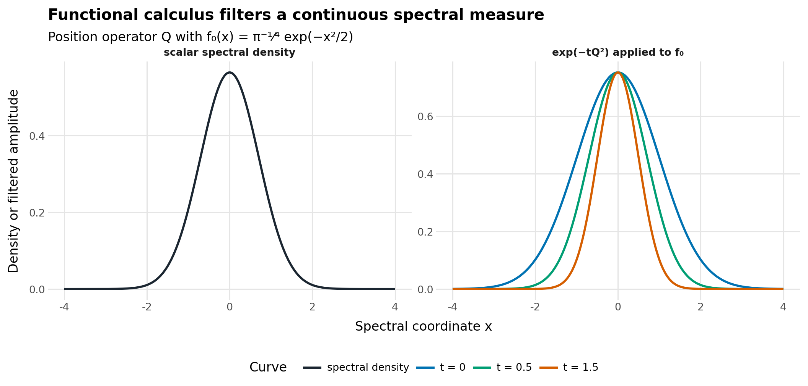

# Spectral Measures, Functional Calculus, and Unbounded Operators {#sec-unbounded-spectral}

The derivative, position, and Laplace operators are central precisely because
they are not bounded on their natural Hilbert spaces. Their formulas alone do
not determine operators: a domain and boundary conditions are part of the
definition. This chapter repairs that omission, states the self-adjoint
spectral theorem in its projection-valued form, and proves the entire theory
directly for the position operator on $L^2(\mathbb R)$.

## Preparation from this book

Hilbert spaces, orthogonal projections, compact self-adjoint operators, and
bounded spectral ideas come from [Hilbert Spaces, Projections, and Spectral Ideas](../real-analysis/27-hilbert-spectral.md#sec-hilbert-spectral). Adjoints and the closed
graph theorem come from [The Pillars of Banach-Space Theory](../real-analysis/26-banach-pillars.md#sec-banach-pillars). Fourier multipliers and weak
derivatives come from [Convolution, Fourier Transform, and Distributions](../real-analysis/29-fourier-distributions.md#sec-fourier-distributions), while semigroups and their
generators come from [sec-semigroups](35-semigroups.md#sec-semigroups). Measurable functional calculus also uses
the measure theory developed before [L-p Spaces and Modes of Convergence](../real-analysis/21-lp-convergence.md#sec-lp-convergence).

We work over a complex Hilbert space $H$ and take the inner product to be
linear in its first variable. A reader who uses the opposite convention must
conjugate the displayed boundary forms. The repair begins with dense domains,
graph norms, adjoint domains, and projection-valued integration; none is
optional notation.

## An unbounded operator includes its domain

An **operator** $A$ is a linear map

$$
A:D(A)\subset H\longrightarrow H.
$$

It is **densely defined** when $D(A)$ is dense in $H$. Two operators with the
same formula but different domains are different operators. For example,
$-i\,d/dx$ on $L^2(0,1)$ may be assigned a periodic domain, a zero-boundary
domain, or an initially smooth compactly supported domain. Their adjoints and
spectra differ.

There is usually no finite constant $C$ satisfying
$\|Af\|\le C\|f\|$ on $D(A)$. The correct replacement is the **graph norm**

$$
\|f\|_A=(\|f\|^2+\|Af\|^2)^{1/2}.
$$

The graph is

$$
G(A)=\{(f,Af):f\in D(A)\}\subset H\times H.
$$

$A$ is **closed** if this graph is closed. Equivalently, whenever
$f_n\to f$ and $Af_n\to g$ in $H$, one has $f\in D(A)$ and $Af=g$. This is
exactly the assertion that $(D(A),\|\cdot\|_A)$ is complete: a graph-norm
Cauchy sequence makes both $f_n$ and $Af_n$ converge, and closedness identifies
the two limits. Reversing that argument proves the converse.

An operator is **closable** if the closure of its graph is itself the graph of
an operator. The obstruction is concrete: if $f_n\to0$ while $Af_n\to g\ne0$,
then the closed graph would contain both $(0,0)$ and $(0,g)$. A subspace
$D_0\subset D(A)$ is a **core** when the graph-norm closure of $A|_{D_0}$ is
$A$. A core lets one calculate on smooth vectors without pretending that every
domain vector is smooth.

### Closedness of a multiplication operator

Let $m:X\to\mathbb R$ be measurable on a measure space and define

$$
M_mf=mf,
\qquad
D(M_m)=\{f\in L^2:mf\in L^2\}.
$$

Suppose $f_n\to f$ and $mf_n\to g$ in $L^2$. Choose a subsequence along which
both convergences hold almost everywhere. Then $f_n(x)\to f(x)$ and
$m(x)f_n(x)\to g(x)$ almost everywhere, so $g=mf$ almost everywhere. Since
$g\in L^2$, $f\in D(M_m)$ and $M_mf=g$. Thus $M_m$ is closed.

This proof also gives a useful nonexample. Multiplication by $m$ on the domain
of all $L^2$ functions for which the pointwise product merely exists is not an
operator into $L^2$ at all. Saying “multiply by $x$ on $L^2(\mathbb R)$” omits
the range condition that determines the maximal domain.

## Adjoints, symmetry, and boundary forms

For densely defined $A$, a vector $g$ belongs to $D(A^*)$ when there exists
$h\in H$ such that

$$
\langle Af,g\rangle=\langle f,h\rangle
\quad\text{for every }f\in D(A).
$$

Density makes $h$ unique, and one defines $A^*g=h$. The adjoint domain is
therefore discovered by a boundedness condition; it cannot be copied from the
formal differential expression.

$A$ is **symmetric** when $D(A)\subset D(A^*)$ and $A^*f=Af$ on $D(A)$. It is
**self-adjoint** when both the domain and action agree: $A=A^*$. Symmetry is
strictly weaker. It says a boundary form vanishes on pairs from the proposed
domain; self-adjointness says no larger adjoint domain remains.

Consider $P=-i\,d/dx$ on $L^2(0,1)$. For $f,g\in H^1(0,1)$, integration by
parts gives

$$
\langle Pf,g\rangle-\langle f,Pg\rangle
=-i[f(x)\overline{g(x)}]_{0}^{1}.
$$

On the periodic domain

$$
D(P_{\mathrm{per}})=\{f\in H^1(0,1):f(0)=f(1)\},
$$

the form vanishes, and testing against all periodic $f$ shows the adjoint has
the same boundary condition; $P_{\mathrm{per}}$ is self-adjoint. On
$H_0^1(0,1)$ both endpoint values vanish, so the restriction is symmetric.
Its adjoint has the full domain $H^1(0,1)$, however, because the test function
already kills the boundary term. That restriction is not self-adjoint.

Calling the latter condition “Dirichlet momentum” does not repair it. For the
second-order expression $-d^2/dx^2$, by contrast, the domain
$H^2(0,1)\cap H_0^1(0,1)$ gives the self-adjoint Dirichlet Laplacian. The order
of the differential expression changes how many boundary conditions a
self-adjoint realization requires.

Every densely defined symmetric operator is closable and satisfies
$\overline A=A^{**}$. A closed symmetric operator can still fail to be
self-adjoint, as the zero-boundary momentum operator demonstrates. Deficiency
indices measure the missing boundary data through
$\ker(A^*\mp i)$; their full extension theory is a destination, not an
assumption used below.

## Resolvent and spectrum

For a closed operator $A$, the **resolvent set** $\rho(A)$ consists of those
$z\in\mathbb C$ for which

$$
A-zI:D(A)\to H
$$

is bijective and has a bounded inverse on $H$. The spectrum is
$\sigma(A)=\mathbb C\setminus\rho(A)$. The boundedness clause is automatic
from the closed graph theorem once bijectivity and closedness are known, but
including it keeps the definition transparent.

Writing $R(z)=(A-z)^{-1}$, direct multiplication gives the **resolvent
identity**

$$
R(z)-R(w)=(z-w)R(z)R(w).
$$

For a finite symmetric matrix, the identity is a direct complex-valued
calculation. The implementation validates only the matrix shape; invertibility
at the chosen parameters is the mathematical precondition for the inverse calls.

```python
import numpy as np
from numpy.typing import NDArray

def matrix_resolvent(
    operator: NDArray[np.float64], parameter: complex
) -> NDArray[np.complex128]:
    """Return (A - zI)^(-1) for a square finite matrix."""
    if operator.ndim != 2 or operator.shape[0] != operator.shape[1]:
        raise ValueError("operator must be a square matrix")
    identity = np.eye(operator.shape[0], dtype=np.complex128)
    return np.linalg.inv(operator.astype(np.complex128) - parameter * identity)

matrix = np.array([[2.0, 1.0], [1.0, 2.0]])
z, w = 0.5 + 0.7j, -1.0 + 0.3j
left = matrix_resolvent(matrix, z) - matrix_resolvent(matrix, w)
right = (z - w) * matrix_resolvent(matrix, z) @ matrix_resolvent(matrix, w)
print(float(np.max(np.abs(left - right))))
```

Roundoff-sized error checks the finite algebra. It neither locates an
unbounded operator's domain nor proves that its resolvent is bounded on a
Hilbert space.

It implies norm-analytic dependence on $z$ locally in the resolvent set. The
spectrum divides into point spectrum, where $A-z$ is not injective; continuous
spectrum, where it is injective with dense but non-surjective range; and
residual spectrum, where its range is not dense.

### Why a self-adjoint spectrum is real

Let $A=A^*$ and $z=a+ib$ with $b\ne0$. For $f\in D(A)$,
$\langle Af,f\rangle$ is real, so Cauchy–Schwarz gives

$$
|b|\|f\|^2
=|\operatorname{Im}\langle(A-z)f,f\rangle|
\le\|(A-z)f\|\,\|f\|.
$$

Hence $\|(A-z)f\|\ge|b|\|f\|$. The range is closed and the operator is
injective. Its orthogonal complement is

$$
\operatorname{Ran}(A-z)^\perp
=\ker((A-z)^*)
=\ker(A-\overline z),
$$

which is zero by the same estimate. Thus the range is also dense, hence all of
$H$. We have proved

$$
z\in\rho(A),
\qquad
\|(A-z)^{-1}\|\le\frac1{|\operatorname{Im}z|}.
$$

Therefore $\sigma(A)\subset\mathbb R$. The proof uses self-adjointness in the
range argument; symmetry alone does not suffice.

## Projection-valued measures

A **projection-valued measure**, or PVM, is a map $E$ from Borel subsets of
$\mathbb R$ to orthogonal projections on $H$ satisfying

$$
E(\varnothing)=0,
\quad E(\mathbb R)=I,
\quad E(B\cap C)=E(B)E(C),
$$

and countable additivity in the strong topology. Thus, for pairwise disjoint
$B_n$ and every $f\in H$,

$$
E\left(\bigcup_nB_n\right)f
=\sum_nE(B_n)f
$$

with convergence in $H$. Norm additivity of the operators is neither required
nor generally true.

Each vector produces a finite positive scalar measure

$$
\mu_f(B)=\langle E(B)f,f\rangle=\|E(B)f\|^2.
$$

Pairs of vectors produce complex measures
$\mu_{f,g}(B)=\langle E(B)f,g\rangle$. For a simple function
$s=\sum_kc_k1_{B_k}$ with disjoint sets, define

$$
\int s\,dE=\sum_kc_kE(B_k).
$$

Orthogonality yields

$$
\left\|\left(\int s\,dE\right)f\right\|^2
=\int|s(\lambda)|^2\,d\mu_f(\lambda).
$$

Uniform approximation extends this construction to bounded Borel functions;
measurable approximation plus the displayed identity handles unbounded
functions on vector-dependent domains.

## The self-adjoint spectral theorem

**Theorem 44.1 (Spectral).** For every self-adjoint operator $A$ there is a unique PVM
$E_A$ on $\mathbb R$ such that

$$
D(A)=\left\{f\in H:
\int_{\mathbb R}\lambda^2\,d\mu_f(\lambda)<\infty\right\},
\qquad
Af=\int_{\mathbb R}\lambda\,dE_A(\lambda)f.
$$

Equivalently, after a unitary change of representation, $A$ acts as
multiplication by a real measurable function. The compact theorem from
[Hilbert Spaces, Projections, and Spectral Ideas](../real-analysis/27-hilbert-spectral.md#sec-hilbert-spectral) is the atomic special case: its PVM is concentrated on
eigenvalues. An unbounded self-adjoint operator may instead have continuous
spectrum and no eigenvectors at all.

One proof applies the bounded spectral theorem to the Cayley transform

$$
U=(A-iI)(A+iI)^{-1}.
$$

$U$ is unitary and has no eigenvector with eigenvalue $1$. The unit-circle PVM
for $U$ is transported back to the line by
$\lambda\mapsto(\lambda-i)/(\lambda+i)$. Resolvent approximation then recovers
the domain and the integral for $A$. Establishing the bounded unitary spectral
theorem, the transported PVM, and uniqueness is a chapter-length proof in its
own right. The theorem is therefore stated with this proof architecture; the
multiplication case below is proved without invoking the general result and
verifies every clause concretely.

This boundary matters. Diagonalizing larger and larger matrices is not a proof
of the infinite-dimensional theorem. It can miss continuous spectrum, and
Galerkin eigenvalues can appear in gaps of the true spectrum unless additional
approximation hypotheses exclude spectral pollution.

The resolvent formulation is especially valuable in continuous spectrum.
Failure of invertibility can be detected by unit vectors $f_n$ for which
$(A-\lambda)f_n\to0$, even when no nonzero vector solves
$(A-\lambda)f=0$. Such a **Weyl sequence** behaves like an increasingly
localized approximate eigenvector. For self-adjoint operators, Weyl's
criterion characterizes the spectrum through these sequences. The position
operator calculation below constructs them explicitly, explaining how a real
spectral value can be observed through arbitrarily accurate localization
without ever acquiring an $L^2$ eigenfunction.

## Borel functional calculus

Given $A=A^*$ and a bounded Borel function $\phi$, define

$$
\phi(A)=\int\phi(\lambda)\,dE_A(\lambda).
$$

The map preserves sums, products, conjugation, and constants:

$$
(\phi\psi)(A)=\phi(A)\psi(A),
\qquad
\overline\phi(A)=\phi(A)^*,
\qquad
1_B(A)=E_A(B).
$$

Moreover $\|\phi(A)\|$ is the essential supremum of $|\phi|$ relative to the
spectral measure class. For continuous functions, spectral mapping reads

$$
\sigma(\phi(A))=\overline{\phi(\sigma(A))}
$$

when the expression defines a bounded operator. A raw pointwise image formula
for arbitrary Borel functions can overcount values occurring only on
spectrally null sets.

The calculus also recovers the resolvent. For $z\notin\mathbb R$, take
$\phi_z(\lambda)=(\lambda-z)^{-1}$. Then

$$
(A-z)^{-1}=\int\frac1{\lambda-z}\,dE_A(\lambda).
$$

Consequently

$$
\|(A-z)^{-1}\|
=\frac1{\operatorname{dist}(z,\sigma(A))}.
$$

The earlier imaginary-part argument supplied only the upper bound
$1/|\operatorname{Im}z|$. The spectral formula is exact and can be strictly
smaller when the real part of $z$ lies far from the spectrum. It also shows
that resolvent norms blow up precisely as $z$ approaches the spectrum, a more
stable numerical diagnostic than searching only for eigenvectors.

For unbounded measurable $\phi$, the domain is part of the definition:

$$
D(\phi(A))=
\left\{f:\int|\phi(\lambda)|^2\,d\mu_f(\lambda)<\infty\right\}.
$$

This produces $|A|$, fractional powers of nonnegative operators, and inverse
powers on appropriate subspaces. Spectral cutoffs
$E_A([-R,R])$ are bounded projections and satisfy
$E_A([-R,R])f\to f$ for every $f$. If $f\in D(A)$, then also
$AE_A([-R,R])f\to Af$. Thus bounded-frequency vectors form a core for $A$.

### Bounded approximants and domain recovery

Several bounded functions of $A$ expose its domain without discarding the
unbounded operator. The spectral truncation

$$
A_R=AE_A([-R,R])
=\int_{[-R,R]}\lambda\,dE_A(\lambda)
$$

acts on all of $H$ and has norm at most $R$. For $f\in D(A)$,
$A_Rf\to Af$ by dominated convergence against $\lambda^2d\mu_f$. For a
general $f\in H$, that convergence occurs exactly when
$\int\lambda^2d\mu_f<\infty$: if $A_Rf$ is Cauchy, orthogonality of disjoint
spectral bands shows the second moments of expanding cutoffs are uniformly
bounded, and monotone convergence puts $f$ in $D(A)$.

A smoother approximation is

$$
A_\varepsilon=A(I+\varepsilon A^2)^{-1},
$$

whose multiplier $\lambda/(1+\varepsilon\lambda^2)$ is bounded by
$1/(2\sqrt\varepsilon)$. For every $f\in D(A)$,
$A_\varepsilon f\to Af$ because the multipliers converge pointwise and are
dominated after squaring by $\lambda^2$. The **bounded transform**

$$
F=A(I+A^2)^{-1/2}
$$

is a self-adjoint contraction. It compresses the two infinite ends of the
real line toward $-1$ and $1$ while retaining spectral information. These
approximants are useful for proofs and computation, but their convergence is
strong on the correct domain, not automatically in operator norm.

For an atomic finite spectral model, cutoff convergence is coefficient
filtering. Returning both state error and graph error keeps the domain issue
visible:

```python
from math import sqrt

def spectral_cutoff_errors(
    eigenvalues: list[float], coefficients: list[float], radius: float
) -> tuple[float, float]:
    """Return Hilbert and graph-seminorm errors after a spectral cutoff."""
    if not eigenvalues or len(eigenvalues) != len(coefficients):
        raise ValueError("spectral data must be nonempty and have equal length")
    if radius < 0.0:
        raise ValueError("radius must be nonnegative")
    omitted = [
        (value, coefficient)
        for value, coefficient in zip(eigenvalues, coefficients, strict=True)
        if abs(value) > radius
    ]
    state_error = sqrt(sum(coefficient**2 for _, coefficient in omitted))
    graph_error = sqrt(sum((value * coefficient) ** 2 for value, coefficient in omitted))
    return state_error, graph_error

levels = [1.0, 2.0, 4.0, 8.0, 16.0]
state = [1.0 / level**2 for level in levels]
for cutoff in (1.0, 4.0, 16.0):
    print(cutoff, spectral_cutoff_errors(levels, state, cutoff))
```

The finite errors eventually vanish because this model has only five atoms.
For a general PVM, monotone or dominated convergence proves the corresponding
strong and graph-norm limits; a finite list cannot establish countable
additivity or continuous spectrum.

## Closed forms, extensions, and evolution

A densely defined nonnegative quadratic form $q$ is **closed** when its domain
is complete under

$$
\|f\|_q=(\|f\|^2+q(f,f))^{1/2}.
$$

The representation theorem associates a unique nonnegative self-adjoint
operator $A$ such that $D(A^{1/2})=D(q)$ and

$$
q(f,g)=\langle A^{1/2}f,A^{1/2}g\rangle.
$$

Closing the form of a semibounded symmetric operator produces its Friedrichs
extension. For instance, closing
$q(f)=\int_0^1|f'|^2$ initially on $C_c^\infty(0,1)$ gives domain
$H_0^1(0,1)$ and represents the Dirichlet Laplacian. Forms encode the energy
boundary condition before a second weak derivative is available.

Stone's theorem links self-adjoint operators to dynamics. If $A=A^*$, then

$$
U(t)=e^{itA}=\int e^{it\lambda}\,dE_A(\lambda)
$$

is a strongly continuous unitary group, and for $f\in D(A)$,

$$
\lim_{t\to0}\frac{U(t)f-f}{t}=iAf.
$$

Conversely, every strongly continuous unitary group has a unique self-adjoint
generator in this sense. If $A\ge0$, then
$e^{-tA}$ is a contraction semigroup. This sharpens [sec-semigroups](35-semigroups.md#sec-semigroups): spectral
calculus gives the evolution, while generator theory identifies its derivative
and domain.

### Momentum recovered through the Fourier transform

On $L^2(\mathbb R)$ define $P=-i\,d/dx$ with domain $H^1(\mathbb R)$. Under
the convention of [Convolution, Fourier Transform, and Distributions](../real-analysis/29-fourier-distributions.md#sec-fourier-distributions),

$$
\widehat{Pf}(\xi)=2\pi\xi\widehat f(\xi).
$$

Plancherel therefore carries $P$ unitarily to the maximal multiplication
operator $M_{2\pi\xi}$. The multiplication proof shows at once that $P$ is
self-adjoint, has spectrum $\mathbb R$, and has no $L^2$ eigenvectors. Its PVM
is

$$
E_P(B)=\mathcal F^{-1}1_{\{\xi:2\pi\xi\in B\}}\mathcal F.
$$

The functional calculus becomes the Fourier-multiplier rule

$$
\widehat{\phi(P)f}(\xi)=\phi(2\pi\xi)\widehat f(\xi).
$$

In particular, $e^{itP}$ multiplies the transform by
$e^{2\pi it\xi}$, so the translation identity gives

$$
(e^{itP}f)(x)=f(x+t).
$$

For a Schwartz function, differentiating the last formula at zero gives
$f'=iPf$, exactly as Stone's theorem predicts. Density and unitarity extend the
translation group to all of $L^2$, while the derivative exists in norm exactly
on $H^1$. This example connects domain, spectral representation, and dynamics
without solving a differential equation pointwise.

## Complete case study: the position operator

Set $H=L^2(\mathbb R)$ and

$$
(Qf)(x)=xf(x),
\qquad
D(Q)=\{f\in L^2(\mathbb R):xf(x)\in L^2(\mathbb R)\}.
$$

Closedness was proved for general multiplication operators. We now derive its
adjoint. If $g\in D(Q^*)$, there is $h\in L^2$ such that

$$
\int xf(x)\overline{g(x)}\,dx
=\int f(x)\overline{h(x)}\,dx
$$

for every $f\in D(Q)$. Testing with bounded functions supported in bounded
sets shows $xg=h$ almost everywhere. Hence $xg\in L^2$, so $g\in D(Q)$ and
$Q^*g=Qg$. Conversely this equality is immediate for $g\in D(Q)$. Therefore
$Q=Q^*$.

For $z\notin\mathbb R$,

$$
((Q-z)^{-1}f)(x)=\frac{f(x)}{x-z},
$$

and

$$
\|(Q-z)^{-1}\|
=\operatorname*{ess\,sup}_{x\in\mathbb R}\frac1{|x-z|}
=\frac1{|\operatorname{Im}z|}.
$$

Thus nonreal numbers lie in the resolvent. For a real $\lambda$, let

$$
f_n=\left(\frac n2\right)^{1/2}
1_{[\lambda-1/n,\lambda+1/n]}.
$$

Then $\|f_n\|_2=1$ and

$$
\|(Q-\lambda)f_n\|_2\le\frac1n.
$$

If $Q-\lambda$ had a bounded inverse, the last two facts would contradict
$1\le\|(Q-\lambda)^{-1}\|/n$ for large $n$. Hence
$\lambda\in\sigma(Q)$, and

$$
\sigma(Q)=\mathbb R.
$$

Yet $Qf=\lambda f$ forces $(x-\lambda)f(x)=0$ almost everywhere. Since the
singleton $\{\lambda\}$ has Lebesgue measure zero, $f=0$ in $L^2$. The point
spectrum is empty. Every real number belongs to continuous spectrum: the range
of $Q-\lambda$ is dense because its orthogonal complement is its kernel, but it
is not all of $H$.

Define

$$
(E_Q(B)f)(x)=1_B(x)f(x).
$$

These multiplication projections form a PVM; strong countable additivity is
just dominated convergence, or orthogonal additivity on disjoint sets. The
scalar measure is

$$
\mu_f(B)=\int_B|f(x)|^2\,dx,
$$

and for every measurable $\phi$,

$$
(\phi(Q)f)(x)=\phi(x)f(x),
\qquad
D(\phi(Q))=\{f:\phi f\in L^2\}.
$$

This verifies the spectral integral, its domain, all spectral projections, and
the functional calculus directly.

### A reproducible Gaussian filter calculation

Take the normalised vector

$$
f_0(x)=\pi^{-1/4}e^{-x^2/2}.
$$

Its scalar spectral density for $Q$ is
$|f_0(x)|^2=\pi^{-1/2}e^{-x^2}$. Symmetry gives
$\langle Qf_0,f_0\rangle=0$, and the Gaussian moment gives

$$
\|Qf_0\|_2^2
=\int x^2\frac{e^{-x^2}}{\sqrt\pi}\,dx
=\frac12.
$$

Apply the bounded spectral filter $\phi_t(x)=e^{-tx^2}$. Then

$$
e^{-tQ^2}f_0(x)=\pi^{-1/4}e^{-(1/2+t)x^2}
$$

and a second Gaussian integral yields the exact norm decay

$$
\|e^{-tQ^2}f_0\|_2^2=(1+2t)^{-1/2},
\qquad
\|e^{-tQ^2}f_0\|_2=(1+2t)^{-1/4}.
$$

A grid calculation should compare the squared norm with the squared analytic
formula and should declare both its cutoff and resolution:

```python
from math import pi, sqrt

import numpy as np

def gaussian_filter_norm(time: float, cutoff: float, panels: int) -> tuple[float, float]:
    """Compare truncated trapezoidal norm with the exact spectral-filter norm."""
    if time < 0.0 or cutoff <= 0.0 or panels <= 0:
        raise ValueError("use nonnegative time, positive cutoff, and positive panels")
    grid = np.linspace(-cutoff, cutoff, panels + 1)
    density = np.exp(-(1.0 + 2.0 * time) * grid**2) / sqrt(pi)
    squared_norm = float(np.trapezoid(density, grid))
    return sqrt(squared_norm), (1.0 + 2.0 * time) ** (-0.25)

for panel_count in (200, 800, 3_200):
    print(panel_count, gaussian_filter_norm(0.75, cutoff=4.0, panels=panel_count))
```

Agreement tests quadrature against a theorem-derived value. Refining the mesh
does not remove the fixed Gaussian tail outside $[-4,4]$; cutoff and mesh errors
are distinct.

<figure id="fig-spectral-functional">


<figcaption>

Figure 12.1: Gaussian scalar spectral density and its attenuation by three functional-calculus filters.

</figcaption>
</figure>

The data in [Figure 12.1](#fig-spectral-functional) use the fixed grid
$x_k=-4+8k/800$, $0\le k\le800$, and the displayed analytic formulas; there
is no random sampling. A reproducibility check is to numerically integrate each
squared filtered curve and compare it with $(1+2t)^{-1/2}$. Grid quadrature
approaches the formula as the mesh is refined, while truncating at $[-4,4]$
creates a visible but quantifiable Gaussian-tail error.

This case also distinguishes two semigroups. $e^{-tQ^2}$ is a contraction that
damps spectral values far from zero. The unitary group $e^{itQ}$ instead
multiplies by $e^{itx}$ and preserves the norm exactly. Replacing $t$ by $it$
changes dissipation into phase rotation; it is not a harmless plotting choice.

### Scalar measures as observable distributions {#sec-spectral-form-domain}

If $\|f\|=1$, the scalar spectral measure $\mu_f$ is a probability measure.
For a self-adjoint $A$ and **$f\in D(A)$**, the Hilbert-space identities are

$$
\langle Af,f\rangle=\int\lambda\,d\mu_f(\lambda),
\qquad
\|Af\|^2=\int\lambda^2\,d\mu_f(\lambda).
$$

A finite first absolute moment alone permits a scalar expectation, but need
not provide the vector $Af$. To distinguish the two, define the **spectral
form domain** and its quadratic value by

$$
\mathcal Q(A)=D(|A|^{1/2})
=\left\{f\in H:\int|\lambda|\,d\mu_f(\lambda)<\infty\right\},
$$

$$
q_A(f)=\int\lambda\,d\mu_f(\lambda)
=\left\langle\operatorname{sgn}(A)|A|^{1/2}f,
|A|^{1/2}f\right\rangle.
$$

Here $\operatorname{sgn}(A)$ is a bounded spectral multiplier. The inclusion
$D(A)\subseteq\mathcal Q(A)$ follows from Cauchy–Schwarz:

$$
\int|\lambda|\,d\mu_f
\le\left(\int\lambda^2\,d\mu_f\right)^{1/2}\|f\|.
$$

On $D(A)$, $q_A(f)=\langle Af,f\rangle$. Outside $D(A)$ only the form notation
is justified. If $A\ge0$, this reduces to $q_A(f)=\|A^{1/2}f\|^2$; for an
indefinite self-adjoint operator we use the displayed spectral definition,
not the earlier nonnegative-form representation theorem. A finite signed
Lebesgue first moment means absolute first integrability: symmetric
principal-value cancellation is not a finite expectation.

For the position operator this is literally the distribution with density
$|f(x)|^2$. Spectral projection $E_A(B)f$ isolates the part of the vector with
observable values in $B$, and its squared norm is the mass of that event. This
probabilistic language interprets the PVM identities; it does not claim that
an eigenvalue is selected before measurement. The Gaussian vector has mean
zero and variance $1/2$ even though $Q$ possesses no eigenvectors.

The distinction between vector-dependent and operator-wide null sets is also
important. A Borel set may have $\mu_f$-measure zero for one vector but act
nontrivially on another. It is spectrally null only when $E_A(B)=0$, equivalently
when every scalar spectral measure assigns it zero mass.

### A finite mean without an operator vector {#sec-spectral-moment-domain}

Use the position operator $Q$ on $L^2(\mathbb R)$ and the state

$$
f(x)=\sqrt2\,\mathbf1_{[0,\infty)}(x)(1+x)^{-3/2}.
$$

Although $Q$ is globally indefinite, this state's spectral measure has
positive support. Substituting $u=1+x$ gives

$$
\|f\|_2^2=2\int_0^\infty(1+x)^{-3}\,dx=1,
\qquad
\int x|f(x)|^2\,dx
=2\int_1^\infty(u^{-2}-u^{-3})\,du=1.
$$

The second moment diverges logarithmically. In particular,

$$
f\in\mathcal Q(Q)\setminus D(Q),\qquad q_Q(f)=1.
$$

The scalar mean is finite, but $\langle Qf,f\rangle$ is not a Hilbert inner
product because $Qf\notin L^2$. We can see the obstruction through actual
domain vectors. For $R\ge0$, put $f_R=\mathbf1_{[0,R]}f$. Direct integration
gives the exact identities

$$
\|f-f_R\|_2^2=(1+R)^{-2},
\qquad
\langle Qf_R,f_R\rangle=\frac{R^2}{(1+R)^2},
$$

$$
\|Qf_R\|_2^2
=2\log(1+R)+\frac4{1+R}-\frac1{(1+R)^2}-3
\longrightarrow\infty.
$$

For the last identity, expand
$(u-1)^2/u^3=u^{-1}-2u^{-2}+u^{-3}$ and integrate from $1$ to $1+R$.
Thus convergence of states and of scalar cutoff values does not produce
an operator vector. The cutoff states are **unnormalized**:
$\|f_R\|_2^2=1-(1+R)^{-2}$. Their normalised mean, for $R>0$, would instead
be $R/(R+2)$.

There is also a difference between differentiating one scalar observation
and differentiating the state. With our linear-first inner product, define

$$
C(t)=\langle e^{itQ}f,f\rangle
=\int_0^\infty e^{itx}|f(x)|^2\,dx.
$$

The bound $|(e^{itx}-1)/t|\le x$ and the finite first moment allow scalar
dominated convergence, giving **$C'(0)=i$**. In contrast, Fatou's lemma along
every nonzero sequence tending to zero gives

$$
\liminf_{t\to0}
\left\|\frac{(e^{itQ}-I)f}{t}\right\|_2^2
\ge\int_0^\infty x^2|f(x)|^2\,dx=\infty.
$$

The quotient norms tend to infinity, so the state curve has no norm
derivative at zero. A derivative of this one scalar autocorrelation is not
weak differentiability of the vector orbit. Exercise 14 asks you to decide
these issues for a new family rather than infer a domain from a finite mean.

### An exact spectral-pollution toy model

Let $A$ multiply by $-1$ on one copy of a Hilbert space and by $1$ on a second
copy. Then $\sigma(A)=\{-1,1\}$, so zero lies in a spectral gap. Choose unit
vectors $u$ and $v$ from the negative and positive copies and set
$w=(u+v)/\sqrt2$. Compression to the one-dimensional trial space
$V=\operatorname{span}\{w\}$ gives

$$
P_VA|_V=0,
$$

because $\langle Aw,w\rangle=(-1+1)/2=0$. Thus the Galerkin matrix reports the
eigenvalue zero although zero is not in the spectrum of $A$.

The calculation does not say that every finite-section method fails. It says
that density of trial spaces alone does not make every computed eigenvalue
reliable inside a gap. Structure-preserving approximation, resolvent
convergence, variational one-sided bounds, or a no-pollution theorem must do
the additional work. This exact two-component example is the smallest warning
against treating matrix spectra as automatic subsets of operator spectra.

## Domain and theorem audit

The most common false inferences are these:

1. A formally real differential expression need not be self-adjoint; compute
   its adjoint domain and boundary form.
2. Symmetric does not mean self-adjoint. The $H_0^1$ momentum restriction is a
   concrete counterexample.
3. A spectrum need not consist of eigenvalues. The position operator has
   spectrum $\mathbb R$ and no eigenvectors.
4. Strong countable additivity of a PVM is not operator-norm additivity.
5. $\phi(A)$ for unbounded $\phi$ requires its own domain.
6. Pointwise convergence of multipliers is insufficient for operator-norm
   convergence; identify the spectral bound and convergence mode.
7. Finite-section eigenvalues can pollute spectral gaps. A numerical matrix is
   evidence only after a convergence theorem matches its discretization.

For any proposed unbounded operator, audit in order: specify $D(A)$; prove
density; test closedness or closability; calculate $D(A^*)$; distinguish
symmetry from self-adjointness; identify the resolvent before declaring the
spectrum; and state whether functional-calculus convergence is strong, weak, or
in norm. This order prevents later notation from hiding an earlier domain gap.

<!-- inline-formula-code:start -->
## Formula and finite computation

A useful formula in this chapter is

$$
A=\sum_j\lambda_jP_j
$$

A finite symmetric matrix gives a complete spectral-resolution model. The following standalone Python block expresses that finite rule with its inputs and stopping conditions visible.

```python
import numpy as np

operator = np.array([[2.0, 1.0], [1.0, 2.0]])
eigenvalues, eigenvectors = np.linalg.eigh(operator)
reconstructed = eigenvectors @ np.diag(eigenvalues) @ eigenvectors.T
print(eigenvalues)
print(np.max(np.abs(operator - reconstructed)))
```

**What the computation establishes.** The output certifies only the declared finite case. The theorem, if one is claimed, still requires the argument developed in the chapter.
<!-- inline-formula-code:end -->

## Summary

Closed operators are complete in graph norm, and adjoint domains encode hidden
boundary conditions. Self-adjointness forces real spectrum and enables a unique
projection-valued measure. Spectral integration then defines bounded and
unbounded functions of the operator, forms construct canonical extensions, and
Stone's theorem turns the calculus into evolution. The position operator shows
that continuous spectrum is not exceptional: spectral measures replace an
eigenvector basis when no eigenvectors exist.

## Exercises

<div class="exercise" id="real_analysis-44-unbounded-spectral-ex-1">
<p class="exercise-title"><strong>Exercise 1</strong></p>

Prove that closedness of $A$ is equivalent to completeness of $D(A)$ in the
graph norm.

</div>

<div class="exercise" id="real_analysis-44-unbounded-spectral-ex-2">
<p class="exercise-title"><strong>Exercise 2</strong></p>

Prove directly that the maximal multiplication operator $M_m$ is densely
defined when $m$ is finite almost everywhere.

</div>

<div class="exercise" id="real_analysis-44-unbounded-spectral-ex-3">
<p class="exercise-title"><strong>Exercise 3</strong></p>

Find a sequence showing that multiplication by $x$ is unbounded on
$L^2(\mathbb R)$.

</div>

<div class="exercise" id="real_analysis-44-unbounded-spectral-ex-4">
<p class="exercise-title"><strong>Exercise 4</strong></p>

Derive the boundary form for $-i\,d/dx$ and verify that periodic boundary
conditions make it vanish.

</div>

<div class="exercise" id="real_analysis-44-unbounded-spectral-ex-5">
<p class="exercise-title"><strong>Exercise 5</strong></p>

Explain why $H_0^1(0,1)$ gives a symmetric but not self-adjoint momentum
operator.

</div>

<div class="exercise" id="real_analysis-44-unbounded-spectral-ex-6">
<p class="exercise-title"><strong>Exercise 6</strong></p>

Prove the resolvent identity, including the order of its factors.

</div>

<div class="exercise" id="real_analysis-44-unbounded-spectral-ex-7">
<p class="exercise-title"><strong>Exercise 7</strong></p>

Reproduce the proof that a self-adjoint operator has real spectrum and the
nonreal resolvent estimate.

<details class="hint"><summary>Hint 1</summary>

The imaginary part supplies a lower bound and closed range. Use
$\operatorname{Ran}(A-z)^\perp=\ker(A-\bar z)$ to prove density and hence
surjectivity.

</details>

</div>

<div class="exercise" id="real_analysis-44-unbounded-spectral-ex-8">
<p class="exercise-title"><strong>Exercise 8</strong></p>

Verify all PVM axioms for $E_Q(B)f=1_Bf$.

</div>

<div class="exercise" id="real_analysis-44-unbounded-spectral-ex-9">
<p class="exercise-title"><strong>Exercise 9</strong></p>

Show that the normalised indicators $f_n$ in the case study form a Weyl
sequence for every real $\lambda$.

</div>

<div class="exercise" id="real_analysis-44-unbounded-spectral-ex-10">
<p class="exercise-title"><strong>Exercise 10</strong></p>

Prove that $Q$ has empty point spectrum but dense range for
$Q-\lambda$.

</div>

<div class="exercise" id="real_analysis-44-unbounded-spectral-ex-11">
<p class="exercise-title"><strong>Exercise 11</strong></p>

Derive the domain of $Q^2$ and identify $e^{-tQ^2}$ pointwise.

</div>

<div class="exercise" id="real_analysis-44-unbounded-spectral-ex-12">
<p class="exercise-title"><strong>Exercise 12</strong></p>

Compute the Gaussian norm formula in the reproducible case study.

</div>

<div class="exercise" id="real_analysis-44-unbounded-spectral-ex-13">
<p class="exercise-title"><strong>Exercise 13</strong></p>

Show $E_A([-R,R])f\to f$, and prove graph-norm convergence when
$f\in D(A)$.

<details class="hint"><summary>Hint 1</summary>

Express both the Hilbert norm and the image norm as scalar spectral
integrals over $|\lambda|>R$, then apply continuity from above and dominated
convergence to the respective tails.

</details>

</div>

<div class="exercise" id="real_analysis-44-unbounded-spectral-ex-14">
<p class="exercise-title"><strong>Exercise 14</strong></p>

[**Determine what the moment licenses.**]{#ex-spectral-moment-family} For $\beta>1/2$, let

$$
f_\beta(x)=\sqrt{2\beta-1}\,
\mathbf1_{[0,\infty)}(x)(1+x)^{-\beta}.
$$

(a) Prove normalisation. Contrast $\|e^{itQ}f_\beta\|_2$ for real $t$
with $\|e^{-tQ^2}f_\beta\|_2$ for $t>0$, including the latter's limit
as $t\to\infty$.

(b) Determine exactly which $\beta$ put $f_\beta$ in $\mathcal Q(Q)$ and
in $D(Q)$. Compute the finite first and second spectral moments and
settle both equality endpoints by divergent integrals.

(c) For **$\beta>1$ only**, set
$C_\beta(t)=\langle e^{itQ}f_\beta,f_\beta\rangle$. Calculate
$C_\beta'(0)$, and determine when the state curve is norm differentiable
at zero. Prove both the affirmative and failure cases directly. Give
the decisions and values for $\beta=5/4$ and $\beta=2$.

</div>

### Hint for Exercise 14 {#hint-spectral-moment-family}

Put $u=1+x$ in the moments. The form domain uses one power of $x$; the
operator domain uses two. For the scalar quotient, dominate by
$x|f_\beta|^2$. For the state quotient, use its squared norm with dominated
convergence or Fatou. Failure of this scalar domination for $\beta\le1$
is not a proof of scalar nondifferentiability; that range is outside part (c).

## Selected solutions

### Solution to Exercise 1: graph completeness

Suppose $A$ is closed and $(f_n)$ is graph-norm Cauchy. Then $f_n\to f$ and
$Af_n\to g$ in $H$. Closedness gives $f\in D(A)$ and $Af=g$, after which both
terms in $\|f_n-f\|_A$ tend to zero. Thus the domain is complete.

Conversely, suppose the graph-normed domain is complete and
$f_n\to f$, $Af_n\to g$ in $H$. The sequence is graph-norm Cauchy, hence
converges in graph norm to some $u\in D(A)$. Its $H$ limit is both $u$ and $f$,
so $u=f$; its image limit is both $Au$ and $g$. Therefore $(f,g)\in G(A)$ and
the graph is closed.

### Solution to Exercise 5: the missing adjoint boundary condition

Let $P_0=-i\,d/dx$ on $H_0^1(0,1)$. Both endpoint traces of a domain vector
vanish, so integration by parts proves
$\langle P_0f,g\rangle=\langle f,P_0g\rangle$ for $f,g$ in that domain.
Thus $P_0$ is symmetric.

To determine the adjoint, take $g\in H^1(0,1)$. The same integration by parts
has no boundary contribution because $f(0)=f(1)=0$, regardless of the endpoint
values of $g$. Hence every such $g$ belongs to $D(P_0^*)$, with
$P_0^*g=-ig'$. Conversely, the weak-derivative characterization forces an
adjoint-domain vector into $H^1$. Therefore $D(P_0^*)=H^1(0,1)$, strictly
larger than $H_0^1(0,1)$, and $P_0$ is not self-adjoint.

### Solution to Exercise 8: the position PVM

Multiplication by $1_B$ is self-adjoint and idempotent, hence an orthogonal
projection. Empty and full sets give zero and identity. Products satisfy
$1_B1_C=1_{B\cap C}$. If the $B_n$ are disjoint, then for every $f$,

$$
\left\|1_{\cup B_n}f-
\sum_{n=1}^N1_{B_n}f\right\|_2^2
=\int_{\cup_{n>N}B_n}|f|^2\longrightarrow0
$$

by continuity from above of the finite measure $|f|^2dx$. This is strong
countable additivity. It would generally fail in operator norm because every
nonzero omitted multiplication projection has norm one.

### Solution to Exercise 12: exact Gaussian attenuation

Functional calculus gives

$$
e^{-tQ^2}f_0(x)
=e^{-tx^2}\pi^{-1/4}e^{-x^2/2}.
$$

Squaring and integrating,

$$
\|e^{-tQ^2}f_0\|_2^2
=\frac1{\sqrt\pi}
\int_{\mathbb R}e^{-(1+2t)x^2}\,dx
=\frac1{\sqrt{1+2t}}.
$$

Taking the square root gives $(1+2t)^{-1/4}$. At $t=0$ the value is one; it
decreases monotonically for $t>0$, consistently with the contraction
property. The calculation uses the squared norm, so confusing the last two
exponents would fail this basic $t=0$ and semigroup audit.

### Solution to Exercise 13: spectral cutoffs are a core

Let $f_R=E_A([-R,R])f$. Its scalar spectral measure is the restriction of
$\mu_f$ to $[-R,R]$, so

$$
\|f-f_R\|^2
=\int_{|\lambda|>R}1\,d\mu_f(\lambda)\longrightarrow0.
$$

If $f\in D(A)$, then $\lambda^2$ is $\mu_f$-integrable and

$$
\|Af-Af_R\|^2
=\int_{|\lambda|>R}\lambda^2\,d\mu_f(\lambda)
\longrightarrow0.
$$

Thus $f_R\to f$ in graph norm. Each $f_R$ has bounded spectral support, and
their union is graph-norm dense in $D(A)$, which is precisely the core claim.

### Solution to Exercise 14: moments, domains, and derivatives {#sol-spectral-moment-family}

**Norms.** For $\beta>1/2$,

$$
\|f_\beta\|_2^2
=(2\beta-1)\int_0^\infty(1+x)^{-2\beta}\,dx=1.
$$

The unitary multiplier has modulus one, so
$\|e^{itQ}f_\beta\|_2=1$ for every real $t$. For $t>0$, the heat multiplier
$e^{-tx^2}$ lies strictly between zero and one on $x>0$. The density is
positive there, hence $0<\|e^{-tQ^2}f_\beta\|_2<1$. As $t\to\infty$, its
squared norm tends to zero by dominated convergence: the multiplier tends
to zero for $x>0$, and the singleton $\{0\}$ has zero spectral mass.

**Moment and domain decisions.** Write $p=2\beta$. When $p>2$,

$$
m_1=(p-1)\int_1^\infty(u^{-p+1}-u^{-p})\,du
=\frac1{p-2}.
$$

When $p>3$,

$$
\begin{aligned}
m_2&=(p-1)\int_1^\infty
(u^{-p+2}-2u^{-p+1}+u^{-p})\,du\\
&=(p-1)\left(\frac1{p-3}-\frac2{p-2}+\frac1{p-1}\right)
=\frac2{(p-2)(p-3)}.
\end{aligned}
$$

For $k=1,2$, the moment integrand $x^k(1+x)^{-p}$ is comparable on
$x\ge1$ to $x^{k-p}$. Its integral is finite exactly when $p>k+1$;
at equality it diverges logarithmically, and below equality it also
diverges. Thus

$$
f_\beta\in\mathcal Q(Q)\iff\beta>1,
\qquad
f_\beta\in D(Q)\iff\beta>3/2.
$$

The finite values are
$q_Q(f_\beta)=1/(2\beta-2)$ and
$\|Qf_\beta\|_2^2=2/[(2\beta-2)(2\beta-3)]$, with their respective
hypotheses. At $\beta=1$ the first moment is infinite; at $\beta=3/2$
the second is infinite. Endpoint membership cannot be recovered by
substituting into a formula proved only for strict inequalities.

**Scalar and state derivatives at zero.** For every $\beta>1$, the bound
$|(e^{itx}-1)/t|\le x$ gives scalar dominated convergence and

$$
C_\beta'(0)=i\int_0^\infty x|f_\beta(x)|^2\,dx
=\frac{i}{2\beta-2}.
$$

If $\beta>3/2$, then
$[(e^{itx}-1)/t]f_\beta\to ix f_\beta$ pointwise, and the squared error
is bounded by $4x^2|f_\beta|^2$, an integrable function. Dominated
convergence therefore gives the norm derivative $iQf_\beta$.

For $1<\beta\le3/2$, Fatou's lemma along every nonzero sequence
$t_n\to0$ instead gives

$$
\liminf_{n\to\infty}
\int_0^\infty
\left|\frac{e^{it_nx}-1}{t_n}\right|^2|f_\beta(x)|^2\,dx
\ge\int_0^\infty x^2|f_\beta(x)|^2\,dx=\infty.
$$

Thus the state difference-quotient norms tend to infinity. There is no
norm derivative despite the scalar derivative just calculated.

At $\beta=5/4$, the scalar mean is $2$ and $C_{5/4}'(0)=2i$, but the
second moment is infinite and the state has no norm derivative. At
$\beta=2$, the scalar mean is $1/2$, the second moment is $1$, and
$C_2'(0)=i/2$; the state derivative is $iQf_2$, with norm $1$.
