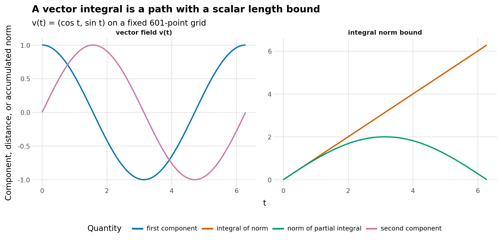

# Banach-Valued Integration and Differentiation {#sec-banach-valued-integration}

The ordinary integral returns a number. Evolution equations, probability in
function spaces, and differentiability of curves in Banach spaces require an
integral whose values are vectors or functions. Chapter [sec-semigroups](35-semigroups.md#sec-semigroups) used
such an integral in Duhamel's formula; this chapter now constructs it, states
the exact convergence theorems it inherits, and identifies a converse
fundamental theorem that can fail in an arbitrary Banach space.

## Preparation from this book

Simple functions, measurable functions, and scalar integration come from
[Measure and the Lebesgue integral: a rigorous vista](../real-analysis/11-measure.md#sec-measure) and [Constructing Lebesgue Measure](../real-analysis/19-lebesgue-measure.md#sec-lebesgue-construction). Banach spaces and bounded linear
operators come from [Functional analysis: spaces of functions](../real-analysis/13-functional-analysis.md#sec-functional-analysis) and [The Pillars of Banach-Space Theory](../real-analysis/26-banach-pillars.md#sec-banach-pillars). Product
measure and Fubini come from [Product Measures, Fubini, and Probability](../real-analysis/22-product-measures-probability.md#sec-product-probability). No prior vector-measure
theory is assumed.

## Strong measurability

Let $(\Omega,\mathcal F,\mu)$ be a measure space and $X$ a Banach space. An
$X$-valued **simple function** has the form

$$
s(\omega)=\sum_{j=1}^m x_j1_{E_j}(\omega),
$$

where the $E_j$ are measurable and the $x_j$ lie in $X$. It is convenient to
make the sets disjoint; then the displayed representation records one value on
each cell.

A function $f:\Omega\to X$ is **strongly measurable** when there are simple
functions $s_n$ such that

$$
\|s_n(\omega)-f(\omega)\|_X\longrightarrow0
$$

for almost every $\omega$. The norm makes measurability quantitative. Strong
measurability implies that the essential range of $f$ lies in a separable
subspace of $X$.

Weak measurability means that $\phi\circ f$ is scalar measurable for every
$\phi\in X^*$. The Pettis measurability theorem says that weak measurability
plus essentially separable range is equivalent to strong measurability. In a
separable Banach space the range condition is automatic. Without it, testing
all scalar observations need not produce a strongly measurable function.

## The Bochner integral

For an integrable simple function, define

$$
\int_\Omega s\,d\mu
=\sum_{j=1}^m\mu(E_j)x_j.
$$

This definition is independent of the disjoint representation: refine two
representations by intersections and use finite additivity. It satisfies

$$
\left\|\int_\Omega s\,d\mu\right\|_X
\le\int_\Omega\|s(\omega)\|_X\,d\mu(\omega).
$$

The inequality follows first from the triangle inequality for the finite sum.

A strongly measurable $f$ is **Bochner integrable** when it admits simple
approximants satisfying

$$
\int_\Omega\|s_n-f\|_X\,d\mu\longrightarrow0.
$$

The sequence of vector integrals is Cauchy by the preceding inequality.
Completeness of $X$ supplies its limit, which is defined to be
$\int f\,d\mu$. The practical criterion is exact:

**Bochner integrability criterion.** A strongly measurable function is Bochner
integrable exactly when

$$
\int_\Omega\|f(\omega)\|_X\,d\mu(\omega)<\infty.
$$

The scalar norm is therefore the correct domination target. The integral is
linear and obeys

$$
\left\|\int_\Omega f\,d\mu\right\|_X
\le\int_\Omega\|f\|_X\,d\mu.
$$

### A simple vector integral in code

When $\Omega$ has finitely many cells, the definition is weighted vector
addition. The code checks dimensions, nonnegative masses, and the norm bound:

```python
import numpy as np
from numpy.typing import NDArray

def finite_bochner_integral(
    values: NDArray[np.float64], masses: NDArray[np.float64]
) -> tuple[NDArray[np.float64], float, float]:
    """Integrate a finite vector-valued simple function."""
    if values.ndim != 2 or masses.shape != (values.shape[0],):
        raise ValueError("values must be a matrix with one mass per row")
    if values.shape[0] == 0 or np.any(masses < 0.0):
        raise ValueError("use at least one cell and nonnegative masses")
    integral = masses @ values
    integral_norm = float(np.linalg.norm(integral))
    norm_integral = float(masses @ np.linalg.norm(values, axis=1))
    return integral, integral_norm, norm_integral

vectors = np.array([[1.0, 2.0], [-2.0, 1.0], [0.5, -1.0]])
weights = np.array([0.2, 0.3, 0.5])
print(finite_bochner_integral(vectors, weights))
```

The second returned number cannot exceed the third. This is an exact finite
model of the definition; it does not decide strong measurability of a function
with uncountable range.

<figure id="fig-bochner-integral-path">


<figcaption>

Figure 13.1: Partial integrals of a rotating vector field trace a curve while the integral of its norm bounds the distance travelled.

</figcaption>
</figure>

In [Figure 13.1](#fig-bochner-integral-path), the partial integral is a curve in $\mathbb R^2$.
The cumulative integral of the vector norm bounds its distance from the origin.
The plot is finite quadrature; the Bochner construction explains the limiting
object.

## Dominated convergence and bounded operators

The scalar dominated convergence theorem lifts cleanly.

**Bochner dominated convergence.** Suppose $f_n$ and $f$ are strongly
measurable, $f_n\to f$ almost everywhere in norm, and

$$
\|f_n(\omega)\|_X\le g(\omega)
$$

for one $g\in L^1(\mu)$. Then $f_n,f$ are Bochner integrable and

$$
\int\|f_n-f\|_X\,d\mu\longrightarrow0,
\qquad
\int f_n\,d\mu\longrightarrow\int f\,d\mu
$$

in the norm of $X$. Apply scalar dominated convergence to
$\|f_n-f\|_X$ and then the integral norm inequality.

There is no direct vector analogue of monotone convergence unless the Banach
space carries a compatible order. Positivity is a scalar or ordered-space
structure, not a consequence of being Banach.

If $T:X\to Y$ is bounded and linear, then

$$
T\left(\int f\,d\mu\right)=\int Tf\,d\mu.
$$

It holds first for simple functions and passes to the limit because
$\|T(s_n-f)\|_Y\le\|T\|\|s_n-f\|_X$. In particular, every
$\phi\in X^*$ satisfies

$$
\phi\left(\int f\,d\mu\right)=\int\phi(f)\,d\mu.
$$

This identity is a powerful check: vector integration must agree with every
continuous scalar observation.

## Fubini and parameter-dependent integrals

Let $f:\Omega_1\times\Omega_2\to X$ be strongly measurable and suppose

$$
\int_{\Omega_1\times\Omega_2}\|f(\omega_1,\omega_2)\|_X\,
d(\mu_1\otimes\mu_2)<\infty.
$$

The Bochner–Fubini theorem says the sections are integrable almost everywhere,
the iterated integrals exist, and

$$
\int_{\Omega_1\times\Omega_2}f\,d(\mu_1\otimes\mu_2)
=\int_{\Omega_1}\left(\int_{\Omega_2}f\,d\mu_2\right)d\mu_1,
$$

with the reversed order giving the same value. The scalar integrability of
$\|f\|$ is the hypothesis that licenses the order exchange.

Suppose $f(t_0,\cdot)$ is Bochner integrable. Assume that, for almost every
$\omega$, the map $t\mapsto f(t,\omega)$ is differentiable throughout a
neighbourhood of $t_0$, that $\partial_t f(t,\cdot)$ is strongly measurable,
and that throughout this neighbourhood

$$
\|\partial_t f(t,\omega)\|_X\le g(\omega)
$$

for one integrable $g$. Then the nearby functions are Bochner integrable, and
the Banach-valued mean-value inequality bounds the difference quotients by
$g$. Consequently, for $F(t)=\int_\Omega f(t,\omega)\,d\mu(\omega)$,
dominated convergence gives

$$
F'(t_0)=\int_\Omega\partial_t f(t_0,\omega)\,d\mu(\omega).
$$

Differentiability only at $t_0$ without such domination does not justify
exchanging derivative and integral.

## Absolutely continuous Banach-valued curves

A curve $F:[a,b]\to X$ is absolutely continuous if for every
$\varepsilon>0$ there is $\delta>0$ such that disjoint intervals
$(a_j,b_j)$ with total length below $\delta$ satisfy

$$
\sum_j\|F(b_j)-F(a_j)\|_X<\varepsilon.
$$

If $f\in L^1([a,b];X)$ in the Bochner sense, then

$$
F(t)=x_0+\int_a^t f(s)\,ds
$$

is absolutely continuous and $F'(t)=f(t)$ for almost every $t$. The proof
applies scalar absolute continuity to $\|f\|$ and uses Banach-valued Lebesgue
differentiation, obtained by approximation with simple functions.

The converse is subtler and needs a precise vector-measure formulation.
An $X$-valued measure $\nu:\mathcal F\to X$ is **countably additive in norm**
when $\nu(\varnothing)=0$ and, for every disjoint sequence $(E_j)$,

$$
\nu\!\left(\bigcup_{j\ge1}E_j\right)
=\lim_{m\to\infty}\sum_{j=1}^m\nu(E_j)
\quad\text{in the norm of }X.
$$

Its **variation** on a measurable set $E$ is

$$
|\nu|(E)=\sup_{\{E_1,\ldots,E_m\}}
\sum_{j=1}^m\|\nu(E_j)\|_X,
$$

where the supremum runs over finite measurable partitions of $E$. Bounded
variation means $|\nu|(\Omega)<\infty$. Write $\nu\ll\mu$ when
$\mu(E)=0$ implies $\nu(E)=0$.

A Banach space $X$ has the **Radon–Nikodym property** if, for every finite
positive measure space $(\Omega,\mathcal F,\mu)$, every norm-countably-additive
$X$-valued measure $\nu$ of bounded variation with $\nu\ll\mu$ has a
Bochner-integrable density $g$ satisfying

$$
\nu(E)=\int_Eg\,d\mu
\quad\text{for every }E\in\mathcal F.
$$

Bounded variation is a condition on the measure; the Radon–Nikodym property is
a condition on the target space. In fact any Bochner density already forces

$$
\sum_{j=1}^m\|\nu(E_j)\|_X
\le\sum_{j=1}^m\int_{E_j}\|g\|_X\,d\mu
=\int_E\|g\|_X\,d\mu,
$$

so $|\nu|(\Omega)\le\int_\Omega\|g\|_X\,d\mu<\infty$.
The target-space property cannot remove this necessary hypothesis. This
formulation and the variation identity are developed in
[Pisier's vector-measure notes, printed pages 33–35](https://webusers.imj-prg.fr/~gilles.pisier/ihp-pisier.pdf).

Equivalently, in a space with the Radon–Nikodym property every absolutely
continuous curve has an almost-everywhere norm derivative that is Bochner
integrable and reconstructs the curve. Reflexive spaces and separable dual
spaces have this property; some Banach spaces do not. The forward theorem for
an indefinite Bochner integral above holds in every Banach space. The converse
needs the target-space hypothesis. The investigation in [Section 13.6.1](#sec-vector-variation)
and its changed Exercise 12 separate these two requirements concretely.

## Weak and Pettis integration

A weakly measurable function is **Pettis integrable** when, for every measurable
$E$, there is an $x_E\in X$ satisfying

$$
\phi(x_E)=\int_E\phi(f)\,d\mu
\quad\text{for every }\phi\in X^*.
$$

Every Bochner-integrable function is Pettis integrable, with
$x_E=\int_Ef\,d\mu$. The converse may fail: scalar observations can be
integrable without the norm being integrable or without a strongly measurable
representative. Pettis integration is useful when weak information is natural,
but it gives weaker norm control. This book uses Bochner integration for
semigroups and evolution because Duhamel estimates require
$\int\|f\|$.

### Two distinct obstructions to a Bochner density {#sec-vector-variation}

Take $\Omega=\mathbb N=\{1,2,\ldots\}$, all its subsets measurable,
$\mu(\{n\})=2^{-n}$, and the real Hilbert space $X=\ell^2$. Thus
$\mu(\Omega)=1$. With the standard coordinate vectors $e_n$, define

$$
\nu(E)=\sum_{n\in E}\frac{e_n}{n}.
$$

Every such vector exists because
$\|\nu(E)\|_2^2=\sum_{n\in E}n^{-2}<\infty$. For disjoint measurable
sets $E_j$, the squared norm of the countable-additivity remainder is

$$
\left\|\nu\!\left(\bigcup_{j\ge1}E_j\right)
-\sum_{j=1}^m\nu(E_j)\right\|_2^2
=\sum_{n\in\cup_{j>m}E_j}\frac1{n^2}\longrightarrow0.
$$

Each coordinate eventually disappears from the remainder, and the summable
sequence $n^{-2}$ dominates it. Thus $\nu$ is countably additive in norm.

All nonempty subsets have positive $\mu$-measure, so $\nu\ll\mu$. There
is also a quantitative small-set statement: given $\varepsilon>0$, choose
$N$ with $\sum_{n>N}n^{-2}<\varepsilon^2$. If $\mu(E)<2^{-N}$, then
$E$ contains none of $1,\ldots,N$, whence $\|\nu(E)\|_2<\varepsilon$.
Even this norm absolute-continuity estimate does not give bounded variation.

Indeed, the exact variation is

$$
|\nu|(E)=\sum_{n\in E}\frac1n.
$$

For any partition, the triangle inequality bounds the sum of vector norms by
the right side. Conversely, put any finite selection of atoms from $E$ into
singleton partition cells, with the remaining points in one cell. This bounds
$|\nu|(E)$ below by every finite partial sum on the right. In particular,
$|\nu|(\Omega)=\infty$. The divergence is analytic: every dyadic block
$2^{k-1}<n\le2^k$ contributes at least $1/2$ to the harmonic sum.

If a density $f$ represented $\nu$, its value on each atom would be forced:

$$
2^{-n}f(n)=\nu(\{n\})=\frac{e_n}{n},
\qquad f(n)=\frac{2^n}{n}e_n.
$$

Finite truncations show that $f$ is strongly measurable, but

$$
\int_\Omega\|f\|_2\,d\mu=\sum_{n\ge1}\frac1n=\infty.
$$

Thus no Bochner density exists. This does not contradict the Radon–Nikodym
property of the Hilbert space: the measure's bounded-variation hypothesis
fails.

Nevertheless $f$ is Pettis integrable. Every continuous linear functional on
real $\ell^2$ has the form $\phi_a(x)=\sum_na_nx_n$, $a\in\ell^2$, and
Cauchy–Schwarz gives

$$
\int_\Omega|\phi_a(f)|\,d\mu
=\sum_{n\ge1}\frac{|a_n|}{n}
\le\|a\|_2\left(\sum_{n\ge1}\frac1{n^2}\right)^{1/2}<\infty.
$$

For every measurable $E$, the vector $\nu(E)$ represents
$\int_E\phi_a(f)\,d\mu$ for all $a$ simultaneously. This verifies every
clause of the Pettis definition while the norm integral remains infinite.

The Bochner construction requires more than convergence of vector integrals.
For $f_N=f\mathbf1_{\{1,\ldots,N\}}$, the finite integrals converge in
$\ell^2$ and their squared tail error is

$$
\left\|\nu(\Omega)-\int_\Omega f_N\,d\mu\right\|_2^2
=\sum_{n>N}\frac1{n^2}\le\frac1N.
$$

But for $M>N$,

$$
\int_\Omega\|f_M-f_N\|_2\,d\mu
=\sum_{n=N+1}^M\frac1n.
$$

Thus the simple functions are not Cauchy in integral norm. The finite tail
estimate and the proved harmonic divergence explain the difference; finitely
many values cannot settle either infinite requirement.

Exercise 12 changes the measure and target. It restores finite variation but
loses the Radon–Nikodym property of the target, so reusing this example's
missing-measure-hypothesis explanation would be wrong.

## Duhamel's formula revisited

Let $T(t)$ be a strongly continuous semigroup with
$\|T(t)\|\le Me^{\omega t}$ and let $f:[0,\tau]\to X$ be Bochner integrable.
For fixed $t$,

$$
s\longmapsto T(t-s)f(s)
$$

is strongly measurable and

$$
\|T(t-s)f(s)\|
\le Me^{\max(\omega,0)t}\|f(s)\|.
$$

The right side is integrable, so

$$
u(t)=T(t)u_0+\int_0^tT(t-s)f(s)\,ds
$$

is a well-defined vector in $X$. Strong continuity plus dominated convergence
then proves continuity of $u$. Differentiability and membership in $D(A)$
require extra regularity; the integral alone produces a mild solution.

### Matrix-valued Duhamel calculation

For a matrix generator, vector computation makes the same formula concrete:

```python
import numpy as np
from numpy.typing import NDArray

def diagonal_duhamel(
    rates: NDArray[np.float64],
    initial: NDArray[np.float64],
    forcing: NDArray[np.float64],
    time: float,
) -> NDArray[np.float64]:
    """Solve u' = diag(rates)u + forcing for constant forcing."""
    if rates.ndim != 1 or initial.shape != rates.shape or forcing.shape != rates.shape:
        raise ValueError("rates, initial, and forcing must be matching vectors")
    if time < 0.0:
        raise ValueError("time must be nonnegative")
    evolution = np.exp(rates * time)
    integral_factors = np.empty_like(rates)
    zero_rates = rates == 0.0
    integral_factors[zero_rates] = time
    integral_factors[~zero_rates] = (
        np.expm1(rates[~zero_rates] * time) / rates[~zero_rates]
    )
    return evolution * initial + integral_factors * forcing

print(
    diagonal_duhamel(
        np.array([-1.0, -4.0]),
        np.array([2.0, 1.0]),
        np.array([1.0, -2.0]),
        time=0.75,
    )
)
```

The zero-rate branch avoids division by zero. This solves a finite diagonal
system exactly; the general semigroup formula additionally needs strong
measurability, an integrable norm bound, and a generator domain.

## Theorem and computation boundary

- Finite weighted vectors exactly model simple-function integration.
- Quadrature can test an explicitly given Banach-valued integrand on a declared
  mesh; it does not prove strong measurability or integrability.
- Applying finitely many functionals does not establish Pettis integrability,
  because the definition quantifies over the whole dual.
- A matrix exponential has full domain. An unbounded semigroup generator does
  not, so matrix code cannot settle domain or boundary-condition questions.
- The Radon–Nikodym property is geometric and infinite-dimensional; no finite
  array distinguishes spaces that have it from spaces that do not.

<!-- inline-formula-code:start -->
## Formula and finite computation

For a vector field $v:[a,b]\to\mathbb R^d$, the integral norm inequality is

$$
\left\|\int_a^b v(t)\,dt\right\|_2
\le\int_a^b\|v(t)\|_2\,dt.
$$

The following trapezoidal calculation evaluates both sides on the same declared
grid.

```python
import numpy as np

panels = 4_000
times = np.linspace(0.0, 2.0, panels + 1)
vectors = np.column_stack((np.cos(times), np.sin(times)))
integral = np.trapezoid(vectors, times, axis=0)
integral_norm = float(np.linalg.norm(integral))
length_bound = float(np.trapezoid(np.linalg.norm(vectors, axis=1), times))
print(integral, integral_norm, length_bound)
```

**What the computation establishes.** It checks one finite quadrature and the
corresponding numerical inequality. The Bochner theorem covers strongly
measurable functions in a Banach space and requires the proof above.
<!-- inline-formula-code:end -->

## Summary

The Bochner integral completes vector-valued simple functions in the integral
of the norm. Scalar domination yields convergence, bounded operators commute
with integration, and norm integrability licenses Fubini. Indefinite integrals
are absolutely continuous; the full converse fundamental theorem is controlled
by the Banach space's Radon–Nikodym property. Pettis integration records weaker
scalar information and must not be substituted when norm estimates are needed.

## Exercises

<div class="exercise" id="real_analysis-45-banach-valued-integration-ex-1">
<p class="exercise-title"><strong>Exercise 1</strong></p>

Prove the integral norm inequality for a simple function.

</div>

<div class="exercise" id="real_analysis-45-banach-valued-integration-ex-2">
<p class="exercise-title"><strong>Exercise 2</strong></p>

Show that bounded linear maps commute with the Bochner integral.

</div>

<div class="exercise" id="real_analysis-45-banach-valued-integration-ex-3">
<p class="exercise-title"><strong>Exercise 3</strong></p>

Compute the integral of $s=xe_1+ye_2$ on three finite cells with declared
masses.

</div>

<div class="exercise" id="real_analysis-45-banach-valued-integration-ex-4">
<p class="exercise-title"><strong>Exercise 4</strong></p>

Prove that a continuous function $[a,b]\to X$ is Bochner integrable.

</div>

<div class="exercise" id="real_analysis-45-banach-valued-integration-ex-5">
<p class="exercise-title"><strong>Exercise 5</strong></p>

Give the dominating scalar function needed to integrate
$f(t)=(e^{-t},te^{-t})$ on $[0,\infty)$.

<details class="hint"><summary>Hint 1</summary>

Bound the Euclidean norm by the sum of the coordinate magnitudes.
The function $(1+t)e^{-t}$ is then a scalar majorant.
Check that both $e^{-t}$ and $te^{-t}$ have finite integrals
on $[0,\infty)$.

</details>

</div>

<div class="exercise" id="real_analysis-45-banach-valued-integration-ex-6">
<p class="exercise-title"><strong>Exercise 6</strong></p>

Derive the parameter-differentiation formula from difference quotients.

</div>

<div class="exercise" id="real_analysis-45-banach-valued-integration-ex-7">
<p class="exercise-title"><strong>Exercise 7</strong></p>

Prove the displayed semigroup bound for the Duhamel integrand.

</div>

<div class="exercise" id="real_analysis-45-banach-valued-integration-ex-8">
<p class="exercise-title"><strong>Exercise 8</strong></p>

Explain why scalar monotone convergence has no automatic Banach-valued form.

</div>

<div class="exercise" id="real_analysis-45-banach-valued-integration-ex-9">
<p class="exercise-title"><strong>Exercise 9</strong></p>

Distinguish strong measurability, weak measurability, Bochner integrability,
and Pettis integrability.

</div>

<div class="exercise" id="real_analysis-45-banach-valued-integration-ex-10">
<p class="exercise-title"><strong>Exercise 10</strong></p>

For $X=\mathbb R^2$, verify directly that
$F(t)=\int_0^tf(s)\,ds$ has derivative $f(t)$ when $f$ is continuous.

<details class="hint"><summary>Hint 1</summary>

Apply each $x^*\in X^*$ to the proposed identity and use the scalar
fundamental theorem. Hahn–Banach then separates two vectors if their scalar
evaluations disagree.

</details>

</div>

<div class="exercise" id="real_analysis-45-banach-valued-integration-ex-11">
<p class="exercise-title"><strong>Exercise 11</strong></p>

Explain precisely where completeness of $X$ enters the construction.

</div>

<div class="exercise" id="real_analysis-45-banach-valued-integration-ex-12">
<p class="exercise-title"><strong>Exercise 12</strong></p>

**Restore finite variation and change the target.** On $[0,1]$ with
Lebesgue measure $\lambda$, take the real space $X=L^1([0,1])$ and define
$\eta(E)=\mathbf1_E$, regarded as an $L^1$ equivalence class. Prove norm
countable additivity, $\eta\ll\lambda$, and
$|\eta|(E)=\lambda(E)$. Show that $F(t)=\eta([0,t])$ is $1$-Lipschitz
but has no norm derivative at any interior point. Use only the forward
theorem for indefinite Bochner integrals to decide whether $\eta$ has a
Bochner density. Identify which hypothesis fails here and which failed in
[Section 13.6.1](#sec-vector-variation); explain why finite variation alone does not replace
the target-space condition.

</div>

### Hint for Exercise 12

For disjoint sets the norm of the omitted indicator is the measure of their
remaining union. Every finite partition computes variation exactly. At
$0<t<1$, compare the right difference quotients at $h$ and $h/2$, where
$0<h<1-t$. If a Bochner density existed, the forward fundamental theorem would
apply to $F(t)$; the RNP converse is not needed. The full solution follows
separately below.

## Selected solutions

For Exercise 1, refine to disjoint cells and apply the finite triangle
inequality to $\sum_j\mu(E_j)x_j$. Exercise 2 holds for simple functions by
linearity; approximate in integral norm and use boundedness of the operator.
For Exercise 4, uniform continuity permits uniform approximation by step
functions, hence approximation in integral norm. In Exercise 7 use the growth
bound and $0\le s\le t$; the remaining factor is a constant multiple of
$\|f(s)\|$. Exercise 11 uses completeness to turn the Cauchy sequence
$\int s_n$ into a vector of $X$ rather than only a point in its completion.

### Solution to Exercise 12: finite variation with a different target

For disjoint measurable sets $E_j$,

$$
\left\|\eta\!\left(\bigcup_{j\ge1}E_j\right)
-\sum_{j=1}^m\eta(E_j)\right\|_1
=\lambda\!\left(\bigcup_{j>m}E_j\right)\longrightarrow0.
$$

This proves countable additivity in norm. Also
$\|\eta(E)\|_1=\lambda(E)$, so absolute continuity holds. For every finite
partition of $E$,

$$
\sum_{j=1}^m\|\eta(E_j)\|_1
=\sum_{j=1}^m\lambda(E_j)=\lambda(E).
$$

Taking the supremum gives $|\eta|(E)=\lambda(E)$; in particular the total
variation is one.

For $s,t\in[0,1]$,
$\|F(t)-F(s)\|_1=|t-s|$, so $F$ is $1$-Lipschitz and absolutely
continuous. Its value at zero is the zero $L^1$ class. Fix $0<t<1$. For
$0<h<1-t$, its right difference quotient, as a function of $r\in[0,1]$, is

$$
q_h(r)=\frac{F(t+h)(r)-F(t)(r)}h
=\frac1h\mathbf1_{(t,t+h]}(r).
$$

On $(t,t+h/2]$, the absolute difference from $q_{h/2}$ is $1/h$; on
$(t+h/2,t+h]$ it is also $1/h$. Therefore

$$
\|q_h-q_{h/2}\|_1
=\frac1h\frac h2+\frac1h\frac h2=1.
$$

The quotients cannot be Cauchy as $h\downarrow0$. Thus $F$ has no norm
derivative at any interior point.

Suppose $\eta(E)=\int_Eg(s)\,ds$ for a Bochner-integrable $g$. Then

$$
F(t)=\int_0^tg(s)\,ds
$$

would be an indefinite Bochner integral. The forward fundamental theorem,
valid in every Banach space, would give a norm derivative almost everywhere,
contradicting the quotient calculation. Hence no such density exists. The
argument does not invoke the RNP converse.

In the worked Hilbert-space example, the target has the Radon–Nikodym
property but the measure has infinite variation. Here variation is finite,
and the counterexample proves that $L^1([0,1])$ lacks the target-space
property. These are distinct failures of the stated theorem's hypotheses.
The indicator-curve obstruction is also described in
[Cheeger–Kleiner, Section 5, printed page 300](https://comptes-rendus.academie-sciences.fr/mathematique/item/10.1016/j.crma.2006.07.001.pdf).
