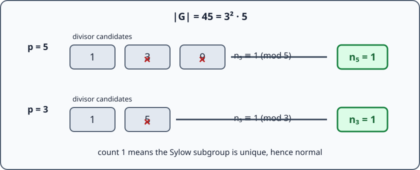

# Sylow Theorems and Finite-Group Constraints

Lagrange's theorem says subgroup orders divide the group order. It does not
say that every divisor occurs. The Sylow theorems give the strongest uniform
partial converse: if the full power $p^n$ divides $|G|$, then $G$ has
subgroups of order $p^n$; all such maximal $p$-subgroups are conjugate; and
their number satisfies simultaneous divisibility and congruence conditions.

Those statements turn prime factorization into structural information. They
often force a normal subgroup, constrain homomorphisms, or reduce a
classification problem to a short list. They do not, by themselves, classify
every group of a given order.

[Conjugacy, the Class Equation, and p-Groups](conjugacy-class-equation-p-groups.md)
develops the fixed-point congruence, nontrivial-center theorem, and internal
prime-power structure used here. Section 2 recalls the exact congruence so the
Sylow proof remains locally checkable. The other prerequisites are Lagrange's
theorem, coset actions, orbit–stabilizer, normalizers, and conjugation.

## 1. Prime-power language

Fix a prime $p$. A finite group is a **$p$-group** if its order is a power of
$p$. A subgroup whose order is a power of $p$ is a **$p$-subgroup**.

Write

$|G|=p^n m$, where $p$ does not divide $m$.

**Definition 10.1 (Sylow subgroup).**

A **Sylow $p$-subgroup** of $G$ is a subgroup of order $p^n$, containing the
entire $p$-part of $|G|$. Denote the set of Sylow $p$-subgroups by
$Syl_p(G)$ and its size by $n_p$.

The adjective “Sylow” depends on the ambient group. A subgroup of order four
is Sylow in a group of order twelve, but not in a group of order twenty-four.
Likewise, a maximal proper $p$-subgroup by inclusion is not the definition;
the theorems will show that maximal $p$-subgroups have the full order $p^n$.

### First examples

- In $\mathbb{Z}/12\mathbb{Z}$, the subgroup $\langle [3]\rangle$ has order four and is the unique Sylow
  $2$-subgroup; $\langle [4]\rangle$ has order three and is the unique Sylow $3$-subgroup.
- In $S_3$, each transposition generates a subgroup of order two, so
  $n_2=3$. The alternating subgroup $A_3$ has order three, so $n_3=1$.
- Every finite $p$-group is its own unique Sylow $p$-subgroup.

## 2. The fixed-point congruence for $p$-group actions

Let a finite $p$-group $P$ act on a finite set $X$. Every orbit has size

$|\operatorname{Orb}(x)|=[P:P_x]$,

which divides $|P|$ and is therefore a power of $p$. An orbit has size one
exactly when every element of $P$ fixes its point. Let

$X^P=\{x:q \cdot x=x \text{ for every } q \in P\}$

be the common fixed-point set. All other orbits have sizes divisible by $p$.
Summing orbit sizes gives the **fixed-point congruence**

$|X| \equiv |X^P| \bmod p$.

This modest congruence drives both conjugacy and counting in Sylow theory.
Notice that $X^P$ means points fixed by the entire subgroup, not points fixed
by at least one nonidentity element.

### Consequence: the center of a $p$-group is nontrivial

Let nontrivial finite $P$ act on itself by conjugation. The common fixed points
are exactly $Z(P)$. Conjugacy classes outside the center have sizes divisible
by $p$, so

$|P| \equiv |Z(P)| \bmod p$.

Both $|P|$ and therefore $|Z(P)|$ are divisible by $p$. In particular the
center contains more than the identity. Chapter 9 used
this fact to build normal series and analyze groups of order $p^2$.

## 3. Cauchy's theorem supplies the first $p$-element

**Theorem 10.2 (Cauchy).** If prime $p$ divides $|G|$, then $G$ contains an element
of order $p$.

Consider

$X=\{(x_1,...,x_p) \in G^p:x_1x_2...x_p=e\}$.

The first $p-1$ entries can be chosen arbitrarily and determine the last, so

$|X|=|G|^{p-1}$,

which is divisible by $p$. The cyclic group $C_p$ acts on $X$ by cyclic shift:

$r \cdot(x_1,x_2,...,x_p)=(x_2,...,x_p,x_1)$.

The shifted product is still identity because

$x_2...x_px_1=x_1^{-1}(x_1...x_p)x_1=e$.

The fixed tuples are exactly $(x,x,...,x)$ with $x^p=e$. The fixed-point
congruence says the number of such elements is divisible by $p$. Identity is
one, so there must be a nonidentity $x$ satisfying $x^p=e$. Its order divides
the prime $p$ and is not one; hence its order is $p$.

The proof works in nonabelian groups because the cyclic-shift closure was
proved by conjugation rather than by commuting the entries.

## 4. Existence of a full Sylow subgroup

We first isolate a coefficient fact.

**Binomial congruence.** If $p$ is prime, then in polynomials modulo $p$,

$(1+t)^{p^n} \equiv 1+t^{p^n} \bmod p$.

For $n=1$, every intermediate binomial coefficient $\binom{p}{k}$ is divisible
by $p$. Repeatedly raising the congruence to the $p$th power proves the general
case. Consequently,

$(1+t)^{p^n m} \equiv (1+t^{p^n})^m \bmod p$.

Comparing coefficients of $t^{p^n}$ gives

$\binom{p^n m}{p^n} \equiv m \pmod p$.

If $p$ does not divide $m$, this binomial coefficient is not divisible by $p$.

**Theorem 10.3 (First Sylow).** If $|G|=p^n m$ with $p$ not dividing $m$, then $G$
has a subgroup of order $p^n$.

Let $X$ be the set of all $p^n$-element subsets of $G$. The group acts on $X$
by left translation: $g \cdot S=\{gs:s \in S\}$. We have

$|X|=\binom{p^n m}{p^n}$,

which is not divisible by $p$. If every orbit had size divisible by $p$, then
$|X|$ would be divisible by $p$; therefore some $S \in X$ has orbit size not
divisible by $p$.

Let $H=G_S$ be its setwise stabilizer. Orbit–stabilizer says

$[G:H]=|\operatorname{Orb}(S)|$.

Because this index has no factor $p$, all $p^n$ in $|G|$ divides $|H|$. On the
other hand, fix $s \in S$. The map $H\to S$, $h\to hs$, is injective and lands in
$S$ because $H$ preserves $S$. Thus

$|H|\le |S|=p^n$.

It follows that $|H|=p^n$. The setwise stabilizer is the required Sylow
$p$-subgroup.

This proof is existential but exact. It does not claim that an arbitrary
$p^n$-element subset is a subgroup; it extracts a subgroup as a stabilizer.

## 5. Every $p$-subgroup fits inside a Sylow subgroup

Let $P$ be a Sylow $p$-subgroup of $G$, and let $Q$ be any $p$-subgroup. Let
$Q$ act by left multiplication on the coset set $G/P$. Its size is

$|G/P|=m$, not divisible by $p$.

The fixed-point congruence implies that $(G/P)^Q$ is nonempty: if there were
no fixed cosets, the size of $G/P$ would be divisible by $p$. Choose a fixed
coset $gP$. For every $q \in Q$,

$qgP=gP$,

so $g^{-1}qg \in P$. Therefore

$g^{-1}Qg\le P$, or equivalently $Q\le gPg^{-1}$.

Thus every $p$-subgroup is contained in a conjugate of $P$. In particular,
every inclusion-maximal $p$-subgroup is Sylow.

## 6. Conjugacy of Sylow subgroups

**Theorem 10.4 (Second Sylow).** Any two Sylow $p$-subgroups of a finite group are
conjugate.

Apply the preceding containment statement when $Q$ is itself Sylow. It gives

$g^{-1}Qg\le P$.

Both sides have order $p^n$, so the containment is equality. Hence

$Q=gPg^{-1}$.

Conjugacy does not mean uniqueness. It says all Sylow $p$-subgroups look the
same internally and form one orbit under conjugation. A Sylow subgroup is
unique exactly when it is normal: uniqueness forces every conjugate to equal
it, while normality means its conjugacy orbit has one member.

## 7. How many Sylow subgroups?

Let $G$ act by conjugation on $Syl_p(G)$ and fix $P \in Syl_p(G)$. This action
is transitive by the second theorem. Its stabilizer at $P$ is the normalizer
$N_G(P)$. Therefore

$n_p=[G:N_G(P)]$.

Because $P\le N_G(P)$, this index divides $[G:P]=m$. Thus

$n_p \mid m$.

To obtain the congruence, restrict the conjugation action to $P$. A Sylow
subgroup $Q$ is fixed by all of $P$ exactly when $P\le N_G(Q)$. In that case
$Q$ is normal in the subgroup $PQ$, and $PQ$ is a $p$-subgroup: the second isomorphism theorem inside $N_G(Q)$ gives $PQ/Q\cong P/(P\cap Q)$, so $|PQ|=|Q|[P:P\cap Q]$ is a power of $p$. Since $P$ and
$Q$ already have the largest possible $p$-power order, $PQ=P=Q$. Therefore
the only common fixed point is $P$ itself. The fixed-point congruence gives

$n_p \equiv 1 \bmod p$.

We have proved the **third Sylow theorem**:

$n_p \mid m$, and $n_p \equiv 1 \bmod p$.

These two constraints should always be used together. The congruence alone
allows infinitely many integers; the divisor condition makes a finite list.

For the pictured case $|G|=45=3^2\cdot5$, the divisor condition creates the
finite candidate lists and the congruence removes the incompatible entries.
Both surviving counts are one, so both Sylow subgroups are normal. The diagram
certifies only these counts; any later classification must still analyze the
possible groups of order nine.

## 8. A reliable order-analysis workflow

For a finite group of known order:

1. Factor $|G|$ into primes.
2. For each prime $p$, write down $n_p \mid |G|/p^n$ and
   $n_p \equiv 1 \bmod p$.
3. Force uniqueness where possible; unique Sylow subgroups are normal.
4. Count nonidentity elements in distinct prime-order subgroups when useful.
5. Let $G$ act by conjugation on a Sylow set to obtain a homomorphism into a
   symmetric group; audit its kernel before claiming injectivity.
6. Combine normal subgroups using intersections, products, and quotient maps.
7. State what remains undetermined. Arithmetic constraints are not a complete
   classification.

### Worked analysis: order 15

**Worked example 10.3 (Forced cyclicity at order fifteen).**

Let $|G|=3 \times 5$. Then

$n_5 \mid 3$ and $n_5 \equiv 1 \bmod 5$,

so $n_5=1$. Also

$n_3 \mid 5$ and $n_3 \equiv 1 \bmod 3$,

so $n_3=1$. Let the unique subgroups be $P$ and $Q$. Both are normal and their
intersection is trivial. For $p \in P,q \in Q$, the commutator
$pqp^{-1}q^{-1}$ lies in both $P$ and $Q$, so it is identity; the subgroups
commute. Their product is all of $G$, and since both prime-order groups are
cyclic, a product of generators has order 15. Thus $G$ is cyclic.

### Worked constraints: order 12

**Worked example 10.4 (What the arithmetic leaves open).**

For $|G|=2^2 \times 3$,

$n_3 \mid 4$, $n_3 \equiv 1 \bmod 3$, so $n_3 \in \{1,4\}$;

$n_2 \mid 3$, $n_2 \equiv 1 \bmod 2$, so $n_2 \in \{1,3\}$.

These alternatives all occur among familiar groups of order twelve. Sylow
arithmetic alone does not decide whether a particular such group is cyclic,
abelian, dihedral, or alternating.

### Worked counting: order 56

**Worked example 10.5 (Prime-order intersection counting).**

If $|G|=2^3 \times 7$, then

$n_7 \mid 8$ and $n_7 \equiv 1 \bmod 7$,

so $n_7$ is $1$ or $8$. If it is $8$, the eight Sylow $7$-subgroups intersect
pairwise only at identity and contribute $8(7-1)=48$ nonidentity elements.
Only eight elements remain, including identity. This often strongly
constrains the Sylow $2$-subgroups, but the count alone is not yet a
classification proof.

## 9. Sylow actions produce homomorphisms

Conjugation on $Syl_p(G)$ defines

$\rho:G\to S_{n_p}$.

Its kernel is the intersection of the normalizers of all Sylow
$p$-subgroups. This is a normal subgroup of $G$. If $G$ is simple and
$n_p>1$, the kernel must be trivial, producing an embedding into $S_{n_p}$.
Order comparison can then rule out simplicity or force further structure.

For example, suppose a group of order 30 were simple. Sylow arithmetic gives
$n_5=6$ as the nonnormal option and $n_3=10$ as the nonnormal option. Counting
the nonidentity elements in these distinct prime-order subgroups gives

$6(5-1)+10(3-1)=44$,

already more than the group's 29 nonidentity elements. Therefore at least one
of the Sylow subgroups is normal, so no group of order 30 is simple.

The disjointness used here is specific: distinct subgroups of prime order
intersect only in identity. For higher prime powers, distinct Sylow subgroups
may have a nontrivial intersection, so naive element counts can overcount.

## 10. Common errors

- Cauchy's theorem gives an element of order $p$, not automatically one of
  order $p^n$.
- A Sylow subgroup has the largest prime-power order allowed by $|G|$; it need
  not be the largest subgroup of $G$.
- The first theorem guarantees existence, not uniqueness.
- “All Sylow subgroups are conjugate” does not mean every $p$-subgroup is
  conjugate to a Sylow subgroup; it is contained in one.
- The third theorem says both $n_p \mid m$ and $n_p=1 \bmod p$.
- A unique Sylow subgroup is normal, but a normal Sylow subgroup need not be
  central.
- Counting elements from distinct Sylow subgroups requires control of their
  intersections.
- Sylow arithmetic can constrain groups without completing their
  classification. Do not label an undetermined order analysis as a theorem of
  uniqueness.

## 11. Chapter summary and retrieval prompts

A finite $p$-group action satisfies $|X| \equiv |X^P| \bmod p$. Cauchy's
theorem uses this to find elements of prime order. An action on subsets proves
that the full $p$-part of $|G|$ occurs as a subgroup order. The coset action
places every $p$-subgroup in a conjugate Sylow subgroup. Conjugation then
proves all Sylow subgroups are conjugate and that their number divides the
prime-to-$p$ part of $|G|$ while being congruent to one modulo $p$.

Retrieve:

1. What is the distinction between a $p$-subgroup and a Sylow $p$-subgroup?
2. Why do nontrivial orbits of a $p$-group have size divisible by $p$?
3. Which set and cyclic action prove Cauchy's theorem?
4. Where does the first Sylow proof obtain a subgroup from a mere subset?
5. Why does a fixed coset imply containment in a conjugate?
6. Why is uniqueness equivalent to normality for a Sylow subgroup?
7. Which two arithmetic conditions constrain $n_p$?

## Exercises with full solutions

### ALG-CH10-E001 — Exercise 1: Recognizing Sylow subgroups

For a group of order $72=2^3 \times 3^2$, state the orders of its Sylow
$2$- and Sylow $3$-subgroups.

Hint 1

Extract the full power of each prime from seventy-two.

Hint 2

That entire power is the required Sylow subgroup order.

#### ALG-CH10-E001 — Solution

Solution

The full $2$-part is $2^3=8$, so a Sylow $2$-subgroup has order
eight. The full $3$-part is $3^2=9$, so a Sylow $3$-subgroup has order nine.

### ALG-CH10-E002 — Exercise 2: Fixed points of a $p$-group action

Let a group of order $25$ act on a set of $17$ elements. Prove it has a common
fixed point.

Hint 1

Use powers of five as possible orbit sizes.

Hint 2

Seventeen is not divisible by five, so singleton orbits cannot all be absent.

#### ALG-CH10-E002 — Solution

Solution

The fixed-point congruence gives
$|X^P| \equiv 17 \equiv 2 \bmod 5$. In particular $|X^P|$ cannot be zero,
so at least one point is fixed by every group element. In fact the number of
common fixed points is congruent to two modulo five.

### ALG-CH10-E003 — Exercise 3: Center of a group of order $p^2$

Use the fixed-point congruence to prove a group $G$ of order $p^2$ has center
of order $p$ or $p^2$.

Hint 1

Use conjugation and its fixed-point congruence.

Hint 2

Center size is a nonzero multiple of p dividing p².

#### ALG-CH10-E003 — Solution

Solution

Conjugation gives $|Z(G)|$ divisible by $p$. By Lagrange it also
divides $p^2$, and it is nonzero, so its order is $p$ or $p^2$. If it is
$p^2$, the group is abelian. Chapter 9 proves that the other apparent case
also forces $G/Z(G)$ cyclic and hence $G$ abelian.

### ALG-CH10-E004 — Exercise 4: Closure in Cauchy's tuple proof

If $x_1...x_p=e$, prove the cyclically shifted tuple also has product identity
without assuming commutativity.

Hint 1

Conjugate the original product by x₁⁻¹.

Hint 2

The first entry moves to the end without commuting arbitrary factors.

#### ALG-CH10-E004 — Solution

Solution

From the original equation,
$x_2...x_p=x_1^{-1}$. Hence
$x_2...x_px_1=x_1^{-1}x_1=e$. Equivalently the shifted product is the
conjugate $x_1^{-1}(x_1...x_p)x_1$ of identity.

### ALG-CH10-E005 — Exercise 5: Cauchy in a group of order 42

What element orders does Cauchy's theorem force in a group of order 42?

Hint 1

Apply Cauchy to each distinct prime divisor.

Hint 2

Do not conclude composite element orders from those prime-order statements.

#### ALG-CH10-E005 — Solution

Solution

Since $42=2 \times 3 \times 7$, it forces elements of orders two,
three, and seven. It does not by itself force elements of order six, fourteen,
twenty-one, or forty-two.

### ALG-CH10-E006 — Exercise 6: The binomial coefficient step

Prove $\binom{p^n m}{p^n}$ is not divisible by $p$ when $p$ does not divide $m$.

Hint 1

Expand the polynomial over the field with p elements.

Hint 2

Use iterated pth powers and compare the coefficient at degree pⁿ.

#### ALG-CH10-E006 — Solution

Solution

Modulo $p$, the freshman's-dream congruence gives
$(1+t)^{p^n m} \equiv (1+t^{p^n})^m$. The coefficient of $t^{p^n}$ on the
left is the stated binomial coefficient; on the right it is $m$. Since
$m$ is nonzero modulo $p$, so is the coefficient.

### ALG-CH10-E007 — Exercise 7: The stabilizer in the subset proof

In the first Sylow proof, why does $|G_S|\le |S|$?

Hint 1

Fix s in S and map h to hs.

Hint 2

Setwise stabilization makes this land in S and cancellation makes it injective.

#### ALG-CH10-E007 — Solution

Solution

Choose $s \in S$. Because every $h \in G_S$ preserves $S$, the
point $hs$ lies in $S$. The map $h\to hs$ is injective: $h_1s=h_2s$ implies
$h_2^{-1}h_1=e$ after right cancellation by $s$, hence $h_1=h_2$. Thus the
stabilizer injects into $S$.

### ALG-CH10-E008 — Exercise 8: Containing a $p$-subgroup

Let $Q$ be a $p$-subgroup and $P$ a Sylow $p$-subgroup. Explain why a
$Q$-fixed coset $gP$ gives $Q\le gPg^{-1}$.

Hint 1

Translate the fixed-coset condition qgP=gP.

Hint 2

The equality criterion gives g⁻¹Qg≤P.

#### ALG-CH10-E008 — Solution

Solution

Fixedness means $qgP=gP$ for every $q \in Q$. Multiplying on the
left by $g^{-1}$ shows $g^{-1}qgP=P$, so $g^{-1}qg \in P$. Thus
$g^{-1}Qg\le P$, equivalently $Q\le gPg^{-1}$.

### ALG-CH10-E009 — Exercise 9: Sylow counts for order 24

List the possibilities for $n_3$ and $n_2$ in a group of order 24.

Hint 1

List divisors of the prime-to-p cofactor.

Hint 2

Retain exactly those congruent to one modulo p.

#### ALG-CH10-E009 — Solution

Solution

For $p=3$, $n_3$ divides eight and is one modulo three, so
$n_3 \in \{1,4\}$. For $p=2$, $n_2$ divides three and is odd, so
$n_2 \in \{1,3\}$.

### ALG-CH10-E010 — Exercise 10: Sylow counts for order 45

Prove every group of order 45 has a normal Sylow $5$-subgroup, and list the
possible numbers of Sylow $3$-subgroups.

Hint 1

Apply both Sylow conditions for each prime separately.

Hint 2

A divisor inconsistent with the congruence cannot occur.

#### ALG-CH10-E010 — Solution

Solution

Since $45=3^2 \times 5$, $n_5$ divides nine and is one modulo
five. The divisors $1,3,9$ leave only $1$ satisfying the congruence, so the
Sylow $5$-subgroup is unique and normal. Also $n_3$ divides five and is one
modulo three. The only candidates are the divisors $1$ and $5$; since five is
two modulo three, only $n_3=1$ works. Thus both Sylow subgroups are normal.
This does **not** force the group to be cyclic: the Sylow $3$-subgroup has
order nine and may be $C_9$ or $C_3\times C_3$. The direct-product argument
shows that a group of order $45$ is abelian, while distinguishing its possible
abelian isomorphism types requires the classification of groups of order
$p^2$.

### ALG-CH10-E011 — Exercise 11: Correcting an impossible count

A student claims a group of order 20 can have three Sylow $5$-subgroups.
Diagnose the error and find the possible count.

Hint 1

Check divisibility before congruence.

Hint 2

The count divides four and equals one modulo five.

#### ALG-CH10-E011 — Solution

Solution

Here $n_5$ must divide four and be congruent to one modulo five.
Among $1,2,4$, only $1$ works. The claimed number three satisfies neither the
divisor condition nor the congruence. The Sylow $5$-subgroup is unique.

### ALG-CH10-E012 — Exercise 12: Unique means normal

Prove a Sylow $p$-subgroup $P$ is normal iff $n_p=1$.

Hint 1

Conjugates of Sylow subgroups are Sylow.

Hint 2

Uniqueness forces normality, while conjugacy supplies the reverse implication.

#### ALG-CH10-E012 — Solution

Solution

If there is only one, every conjugate $gPg^{-1}$ is another
Sylow $p$-subgroup and must equal $P$; this is normality. Conversely, if $P$
is normal, its only conjugate is itself. The second Sylow theorem says every
Sylow subgroup is a conjugate of $P$, so there is only one.

### ALG-CH10-E013 — Exercise 13: Groups of order 33

Prove every group of order 33 has a normal Sylow $11$-subgroup. What can Sylow
arithmetic alone say about the Sylow $3$-subgroups?

Hint 1

Eleven-Sylow counts divide three.

Hint 2

For three-Sylow counts test both divisors of eleven against the congruence.

#### ALG-CH10-E013 — Solution

Solution

$n_{11}$ divides three and is one modulo eleven, so it is one.
For $p=3$, $n_3$ divides eleven and is one modulo three. The candidate eleven
is two modulo three, so only $1$ works. Hence the Sylow $3$-subgroup is also
normal. This forces the group
to be cyclic by the same commuting-product argument as order 15. The explicit
congruence check is essential.

### ALG-CH10-E014 — Exercise 14: Groups of order 21

Determine the allowed values of $n_7$ and $n_3$.

Hint 1

Use cofactors three and seven.

Hint 2

Distinguish arithmetic permission from a realized count in a specified group.

#### ALG-CH10-E014 — Solution

Solution

$n_7$ divides three and is one modulo seven, so $n_7=1$. Also
$n_3$ divides seven and is one modulo three, so $n_3$ may be $1$ or $7$.
Thus the Sylow $7$-subgroup is always normal, while the Sylow $3$-subgroup need
not be. This arithmetic allows both cyclic and nonabelian behavior; it does not
classify the groups by itself.

### ALG-CH10-E015 — Exercise 15: Pairwise intersections at prime order

Prove distinct subgroups of order $p$ intersect only in identity.

Hint 1

The intersection is a subgroup of an order-p group.

Hint 2

Any nonidentity intersection forces both groups equal.

#### ALG-CH10-E015 — Solution

Solution

Their intersection is a subgroup of each, so its order divides
the prime $p$. If the intersection had order $p$, it would equal both
subgroups, contradicting distinctness. Therefore its order is one.

### ALG-CH10-E016 — Exercise 16: No simple group of order 30

Complete the element-count proof that a group of order 30 is not simple.

Hint 1

Assume both prime-order Sylow types are nonnormal.

Hint 2

Count nonidentity elements, checking intersections both within and across the two types.

#### ALG-CH10-E016 — Solution

Solution

If simple, neither Sylow $5$- nor Sylow $3$-subgroup is normal.
The allowed counts are then $n_5=6$ and $n_3=10$. Distinct subgroups of each
prime order intersect only at identity, and a subgroup of order three meets
one of order five only at identity. They would therefore contribute
$6(5-1)+10(3-1)=44$ distinct nonidentity elements, impossible in a group with
29 nonidentity elements. Hence a relevant Sylow subgroup is normal and the
group is not simple.

### ALG-CH10-E017 — Exercise 17: A normalizer formula

Prove $n_p=[G:N_G(P)]$ for a Sylow $p$-subgroup $P$.

Hint 1

Act on the Sylow set by conjugation.

Hint 2

Its stabilizer at P is the normalizer.

#### ALG-CH10-E017 — Solution

Solution

Conjugation acts transitively on $Syl_p(G)$ by the second Sylow
theorem. The stabilizer of $P$ is exactly the set of $g$ satisfying
$gPg^{-1}=P$, namely $N_G(P)$. Orbit–stabilizer gives the formula.

### ALG-CH10-E018 — Exercise 18: Why $n_p$ divides $m$

Starting with the normalizer formula, prove the divisor part of the third
theorem.

Hint 1

Use P≤N_G(P)≤G.

Hint 2

The index-chain formula shows n_p divides [G:P].

#### ALG-CH10-E018 — Solution

Solution

Since every subgroup normalizes itself, $P\le N_G(P)$. Therefore
$[G:N_G(P)]$ divides $[G:P]$ by the index multiplication formula
$[G:P]=[G:N_G(P)][N_G(P):P]$. The left first factor is $n_p$, and
$[G:P]=m$, so $n_p$ divides $m$.

### ALG-CH10-E019 — Exercise 19: Sylow subgroups of a direct product

If $P \in Syl_p(G)$ and $Q \in Syl_p(H)$, prove $P \times Q$ is a Sylow
$p$-subgroup of $G \times H$.

Hint 1

Compute the full p-part of the product-group order.

Hint 2

The product of the two proposed subgroups has exactly that order.

#### ALG-CH10-E019 — Solution

Solution

Write $|G|=p^a m$ and $|H|=p^b n$ with $p$ dividing neither
$m$ nor $n$. Then $|G \times H|=p^{a+b}mn$, while
$|P \times Q|=p^a p^b=p^{a+b}$. It has exactly the full $p$-part of the ambient
order, so it is Sylow.

### ALG-CH10-E020 — Exercise 20: Kernel of the Sylow action

Let $G$ act on $Syl_p(G)$ by conjugation. Prove the kernel is
$\bigcap_{Q \in Syl_p(G)}N_G(Q)$ and explain why it is normal.

Hint 1

An action-kernel element fixes every Sylow subgroup.

Hint 2

This is membership in every normalizer; kernel normality follows from the action homomorphism.

#### ALG-CH10-E020 — Solution

Solution

An element is in the kernel exactly when it fixes every Sylow
subgroup under conjugation, which means it normalizes every $Q$. That is
membership in the displayed intersection. It is normal because it is the
kernel of the action homomorphism $G\to S_{n_p}$; equivalently conjugation
permutes the normalizer factors in the intersection.

## ALG-CH10-P001 — Project: order profiles without overclaiming

For each order $12$, $18$, $20$, $24$, $30$, $36$, and $56$, build a Sylow
constraint sheet. Include the possible $n_p$ values, forced normal subgroups,
legitimate disjoint-element counts, and the permutation representation from
each nontrivial Sylow action. For two orders, exhibit nonisomorphic groups
that share the same permitted Sylow counts, showing why the arithmetic is not
a classification.

### Deliverables

Submit seven labeled constraint sheets, one per order. Each sheet must separate arithmetic candidates, realized or ruled-out branches, forced normality, valid element counts, and the conjugation action on each Sylow family with its kernel. For two orders give explicit pairs of nonisomorphic groups with the same realized Sylow counts and a distinguishing invariant.

### Solution framework and rubric

Factor each order first and intersect the divisor and
congruence lists. For example, order 20 forces $n_5=1$ and permits
$n_2 \in \{1,5\}$; order 36 permits $n_3 \in \{1,4\}$ and $n_2 \in \{1,3,9\}$ after
both tests. Count elements only when intersections are controlled, especially
for prime-order subgroups. A nonnormal family of $n_p$ subgroups gives
$G\to S_{n_p}$ with kernel the common normalizer core; do not declare it
injective without a kernel argument. Cyclic and suitable noncyclic abelian
groups can share unique Sylow counts, while groups such as $A_4$ and other
order-twelve examples show that the same allowed lists can support different
realized structures. A complete report separates forced conclusions,
conditional branches, and examples witnessing nonuniqueness.

The arithmetic candidate sheets, before compatibility checks between primes, are:

| Order | $n_2$ | $n_3$ | $n_5$ | $n_7$ | Forced by arithmetic |
|---|---|---|---|---|---|
| $12$ | $1,3$ | $1,4$ | — | — | none |
| $18$ | $1,3,9$ | $1$ | — | — | normal Sylow $3$ |
| $20$ | $1,5$ | — | $1$ | — | normal Sylow $5$ |
| $24$ | $1,3$ | $1,4$ | — | — | none |
| $30$ | $1,3,5,15$ | $1,10$ | $1,6$ | — | none |
| $36$ | $1,3,9$ | $1,4$ | — | — | none |
| $56$ | $1,7$ | — | — | $1,8$ | none |

Each entry follows from $n_p\mid |G|/p^a$ and $n_p\equiv1\pmod p$; an entry is an arithmetic possibility, not a claim of joint realizability. If $n_p=1$, the Sylow subgroup is normal. Distinct subgroups of prime order intersect trivially, giving exactly $n_p(p-1)$ nonidentity elements of order $p$; do not apply that formula to higher-order Sylow subgroups without proving their intersections. Conjugation gives $G\to S_{n_p}$, with kernel $\bigcap_{Q\in\operatorname{Syl}_p(G)}N_G(Q)$; for $n_p=1$ the action is trivial, while a nontrivial action need not be faithful.

For order 12, $C_{12}$ and $C_6\times C_2$ both have $(n_2,n_3)=(1,1)$; the first has an element of order 12, the second does not. For order 18, $C_{18}$ and $C_3\times C_3\times C_2$ both have $(n_2,n_3)=(1,1)$; their exponents are 18 and 6. These are realized examples and prove that even exact Sylow counts need not classify groups. A complete sheet may rule out additional joint branches, but it must justify each exclusion rather than silently removing arithmetic candidates.

The following checks give feedback on the required deductions beyond the
arithmetic lists; they are not a complete classification of realizable count
tuples.

- At order 12, if $n_3=4$, the eight nonidentity elements in those prime-order
  subgroups leave only three nonidentity elements for any Sylow 2-subgroup.
  Every Sylow 2-subgroup must use those three, so $n_2=1$. Thus at least one
  Sylow subgroup is normal. Its order-four Sylow subgroups must not be counted
  as disjoint without proof.
- At orders 18 and 20, the forced normal subgroups have orders nine and five,
  respectively. At order 18 the $n_2$ involutions can be counted separately;
  at order 20 the unique order-five subgroup contributes four nonidentity
  elements, while the order-four Sylow subgroups may overlap.
- At order 24, $S_4$ realizes $(n_2,n_3)=(3,4)$, so neither Sylow family is
  universally normal. If $n_2=3$, its transitive action on three objects has
  image of order three or six, and kernel of order eight or four; it is not
  faithful. The four order-three subgroups contribute eight nonidentity
  elements in the displayed example.
- At order 30, the joint branch $n_3=10,n_5=6$ would require
  $20+24>29$ nonidentity elements of different orders. It is impossible.
  At least one of the Sylow 3- and 5-subgroups is therefore normal; this
  conclusion alone is not a classification.
- At order 36, if $n_3=4$, the action on four Sylow subgroups has image order
  dividing both 36 and 24 and divisible by four by transitivity. Its order is
  four or twelve, so the kernel has order nine or three. This supplies a
  nontrivial proper normal subgroup even on that branch. If $n_3=1$, the
  Sylow 3-subgroup itself is normal.
- At order 56, if $n_7=8$, its 48 nonidentity elements leave seven for any
  Sylow 2-subgroup of order eight. All such subgroups use those same seven,
  so $n_2=1$. If $n_7=1$, that Sylow subgroup is already normal. This argument
  counts order-seven subgroups, not pairwise-disjoint order-eight subgroups.

For every nontrivial family, the normalizer-intersection formula above is the
required kernel description unless a particular group permits a more precise
calculation. Arithmetic candidates, conditional consequences, and realized
examples must remain labeled separately.

## Summary

Fixed-point counts establish prime-order elements, full Sylow subgroups, containment, conjugacy, and simultaneous divisor/congruence restrictions on their number. These tools often force normal subgroups, but counting requires justified intersections and need not finish a classification. Products and actions on normal factors next explain how finite groups can be assembled.
