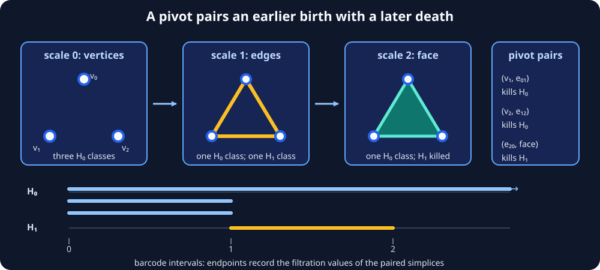

# Persistent Homology and Computational Topology

## Filtrations and persistence

A **filtration** of a topological space $X$ is a nested sequence of subspaces

$$\emptyset = X_0 \subseteq X_1 \subseteq X_2 \subseteq \cdots \subseteq X_N = X.$$

In data analysis, $X_i$ is often the union of balls of radius $\varepsilon_i$ around a finite point cloud. As $\varepsilon$ grows, holes appear and disappear.

Fix a coefficient field $\mathbb F$. For each $i \leq j$, the inclusion $X_i \hookrightarrow X_j$ induces maps $f_k^{i,j}:H_k(X_i;\mathbb F) \to H_k(X_j;\mathbb F)$. The **$k$-th persistent homology** is this system of vector spaces and linear maps. Informally, a class is **born** when it first appears without coming from the previous stage, **survives** while its image remains nonzero, and **dies** when that image first becomes zero or merges with an older class according to the interval decomposition.

A **barcode** represents each interval summand as $[b,d)$, where $b$ is its birth index and $d$ its death index. Long intervals are often candidates for stable structure and short intervals may reflect sampling or discretization, but length alone does not decide which features are scientifically meaningful.

## The persistence algorithm

For a finite filtered simplicial complex, persistent homology over $\mathbb F$ is computed by matrix reduction. Order the simplices by filtration value, breaking ties so that every face precedes its cofaces, and form the boundary matrix $\partial$. **Column reduction** proceeds left to right: add scalar multiples of earlier columns until no two nonzero reduced columns have the same lowest nonzero row. If the reduced column $j$ has pivot row $i$, the simplex indexed by row $i$ creates a class that the simplex indexed by column $j$ kills. In particular, when $\sigma_j$ is a $k$-simplex, this pair records a $(k-1)$-dimensional interval $[\operatorname{filt}(\sigma_i),\operatorname{filt}(\sigma_j))$. A zero reduced column creates a class; if its index is never used as a later pivot row, that class persists to infinity.

This algorithm runs in $O(n^3)$ time for $n$ simplices and is the workhorse of computational topology software.

## Stability

**Theorem 17.6 (Vietoris--Rips stability).** Let $P$ and $Q$ be finite subsets of a common metric space, and define $\operatorname{VR}_\varepsilon(P)$ by including a simplex when its diameter is at most $\varepsilon$. For each fixed homological degree and coefficient field, the **bottleneck distance** $d_B$ between the resulting persistence diagrams satisfies

$$d_B(\operatorname{Dgm}(\operatorname{VR}(P)),\operatorname{Dgm}(\operatorname{VR}(Q))) \leq 2 d_H(P,Q).$$

Thus a small Hausdorff perturbation of a finite point cloud produces a controlled perturbation of its Rips persistence diagram. The constant depends on the scale convention: a radius convention can absorb the factor $2$. Arbitrary filtrations do not obey a universal Hausdorff bound without an interleaving or comparable compatibility hypothesis.

## Applications

**Data analysis.** Persistent homology detects clusters ($H_0$), loops ($H_1$), and voids ($H_2$) in high-dimensional data. It has been applied to image analysis, materials science, neuroscience, and genomics.

**Shape comparison.** Wasserstein and bottleneck distances compare persistence diagrams. When the filtration itself is invariant under rigid motions, the resulting diagram comparison inherits that invariance; its robustness still depends on a stability theorem for the chosen filtration.

**Mapper.** The Mapper algorithm constructs a simplified graph representation of data by clustering within level sets of a filter function. It bridges statistical and topological data analysis.

## Common errors

**Error: interpreting all bars as real features.** Short bars may be noise from sampling density or discretization. Statistical methods (e.g., null models, confidence sets) are needed to distinguish signal from noise.

**Error: choosing filtration parameters arbitrarily.** The choice of filtration (Vietoris--Rips, Cech, alpha complex) affects the barcode. For a finite point cloud in Euclidean space, the Cech complex is the nerve of a finite good cover by convex balls and is homotopy equivalent to their union. Identifying that union with an unknown sampled manifold requires additional sampling and reconstruction assumptions. A Rips complex uses only pairwise distances and is often simpler to construct, but it can contain features absent from the corresponding union of balls.

**Error: forgetting that persistence is not a complete invariant.** Non-homeomorphic spaces can have identical persistence diagrams. Persistence captures only the filtration structure, not the full topology.

## Worked example: a circle from a point cloud

Sample $N$ points uniformly from $S^1 \subseteq \mathbb{R}^2$. The Vietoris--Rips filtration at scale $\varepsilon$ connects points within distance $\varepsilon$. Below the minimum pairwise distance, the complex is discrete ($H_0\cong\mathbb F^N$, $H_1=0$). As $\varepsilon$ grows, edges appear and the number of components drops. For a sufficiently dense and even sample, there is typically a range of scales above the largest adjacent sample gap in which one $H_1$ class represents the circular arrangement. At sufficiently large scale the complex is a full simplex, so $H_1$ dies.

For a sufficiently dense, reasonably even sample there is typically a prominent $H_1$ interval compatible with the underlying circle, along with shorter intervals produced by finite sampling. This is an illustrative pattern, not a significance test.

## Finite persistence as an exact algebraic object

A barcode is not an arbitrary graphical summary of Betti numbers. It records the maps between stages. We prove the decomposition for a finite sequence of finite-dimensional vector spaces over one fixed field F, then prove why the ordered boundary-column reduction computes those intervals.

Let V1→...→VN be such a sequence, extended constantly after N. An interval module I[b,d) has one copy of F at indices b<=i<d, identity maps between those copies, and zero elsewhere. The endpoint d may be infinity. Indices here are integers; real filtration values are attached afterward.

### Theorem 17.1 — Finite interval decomposition

Every such finite persistence module is a direct sum of interval modules.

*Proof.* If every V_i is zero, stop. Otherwise let b be its first nonzero index, choose v_b nonzero, and follow its images v_i until the first zero image at d, or forever if the image at N remains nonzero. These vectors define an embedded interval submodule.

For finite d choose a linear functional lambda_{d-1} on V_{d-1} taking value one on v_{d-1}, and pull it back along each intervening map to obtain lambda_i for b<=i<d. For an infinite interval use lambda_N and the same backward pullback. Set the projection to zero at other stages. These maps form a persistence-module projection onto the interval: inside its support the pullback equations give naturality, before b all spaces are zero, and at its death the target interval map is zero. The interval embedding followed by the projection is the identity.

Therefore V decomposes as that interval plus the kernel of the projection, which is a submodule. The total finite sum of dimensions decreases. Repeat until zero. This finite induction proves the result. $\square$

The decomposition depends on basis choices, but the multiset of interval endpoints does not. Equal birth times can therefore permit different representative cycles while giving the same barcode.

### Theorem 17.2 — Uniqueness by ranks

Put rho(i,j)=rank(V_i→V_j) for i<=j, and rho(0,j)=0. An interval contributes one exactly when its birth b<=i and its death d>j. Hence the multiplicity of a finite interval [b,d) is
$\rho(b,d-1)-\rho(b-1,d-1)-\rho(b,d)+\rho(b-1,d).$
The multiplicity of [b,infinity) is rho(b,N)-rho(b-1,N).

*Proof.* The first difference counts intervals born exactly at b that still exist at d-1. Subtract those born at b that still exist at d. What remains dies exactly at d. At the final stage the surviving exact-birth intervals are the infinite ones. Thus the rank data determine every multiplicity, proving uniqueness. $\square$

Final Betti numbers provide only rho(N,N), not this entire rank table. They cannot determine a filtration's barcode.

## Ordered boundary reduction: the invariants

Take a finite filtered simplicial complex and order all its simplices so filtration values are nondecreasing and faces precede cofaces. Let e_j be the oriented simplex generators and D their boundary matrix over F. Then D²=0 and each nonzero entry lies in an earlier row.

Column reduction uses only additions of earlier columns. It therefore constructs
$R=DV,$
where V is invertible upper triangular with diagonal one. The jth column z_j=V e_j is a chain involving only simplices of index at most j, with coefficient one at e_j. Its boundary is the reduced column R_j.

For a nonzero column let low(R_j) be its greatest row index with nonzero coefficient. Adding an earlier column with that same pivot strictly lowers low. Since the nonnegative row index cannot decrease indefinitely, the algorithm terminates. The final nonzero columns have distinct pivot rows and are linearly independent: in a nontrivial combination, the largest pivot cannot cancel.

These observations also show that reduced nonzero columns span the same prefix boundary-column space as the original ones. The triangular matrix gives a change of basis at every prefix, not just at the final complex.

## Full reduction correctness

**Lemma 17.3.** The zero reduced columns z_i form a filtered basis for the cycle spaces, degree by degree.

*Proof.* In the changed prefix basis z_1,...,z_k, the boundary of a linear combination is the same combination of R columns. The nonzero R columns are independent, so a chain is a cycle exactly when its coefficients on those columns vanish. Therefore the remaining zero-column vectors form a basis. Each z_i first exists at its own prefix because its leading coefficient at e_i is one. $\square$

**Lemma 17.4.** If low(R_j)=i, then R_i=0.

*Proof.* The chain R_j is a cycle because D R_j=D²V_j=0. It is supported in rows at most i and has nonzero coefficient at e_i. By Lemma 17.3 the prefix-i cycle space is spanned by zero-column z_k. If R_i were nonzero, all such basis vectors would have leading index below i and could not produce that coefficient. Thus R_i is zero. $\square$

**Theorem 17.5 (birth-death pairing).** A nonzero reduced column j with pivot i pairs a class born at simplex i with death at simplex j. Unpaired zero columns give infinite intervals.

*Proof.* For every paired positive index i define
$b_i=R_j/(R_j)_i,$
where j is its unique pivot column. This is a cycle supported at indices at most i, with leading coefficient one at i. For an unpaired zero index use b_i=z_i. The collection b_i is a triangular replacement of the filtered zero-column cycle basis, so it is another filtered basis at every prefix.

At prefix k, the boundary space is spanned by R_j with j<=k. By the definition of b_i, each such boundary is a nonzero scalar multiple of its own distinct b_i. Thus the homology basis at stage k consists exactly of those b_i with i<=k whose paired death j has not yet occurred. Under inclusions each surviving generator remains the same chain until its boundary relation appears, when it becomes zero. This is precisely a direct sum of intervals [i,j), with unpaired i surviving forever. $\square$

The proof explains why a later-computed cycle b_i can still be a valid birth representative: its actual chain support is already in prefix i. It also explains why the pivot row must itself have been a zero reduced column. Neither fact follows merely from calling the algorithm standard.

All operations are homogeneous in simplex dimension. A pivot column for a k-simplex has a (k-1)-simplex pivot row, so the interval has degree k-1. Over a general ring a pivot coefficient may not be invertible; the field hypothesis is essential to this elementary barcode algorithm.

## Ties, zero-length bars, and complexity

If several simplices have the same filtration value, a face-first tie order inserts intermediate prefix complexes inside one value. Pairs born and killed within that same value yield zero-length numerical intervals and are omitted from the usual persistence diagram. Different admissible tie orders can change such internal pairings and representatives without changing the persistence module at the stated filtration values.

With N simplices, each column undergoes at most N pivot-lowering additions and each dense column addition takes at most N field operations. This gives the elementary O(N³) bound quoted above. It is a worst-case algebraic operation bound, not a measured runtime or a claim that all implementations use dense storage.

The proof does not require executing software. It specifies the exact invariants an implementation must retain: filtration-respecting basis changes, D²=0, pivot uniqueness, and compatible cycle/boundary spaces.

## Worked examples with explicit relations

### Worked example 1 — A triangle filled one step later

Insert vertices v0,v1,v2 at value zero, then edges 01,12,02 at value one, and face 012 at value two. Over F2, the first two edge boundaries merge the three vertex components. The third edge reduces to zero and its cycle representative is
$01+12+02.$
The face boundary is exactly that cycle, so it pairs the third positive edge with the face.

The barcode has one H0 interval [0,infinity), two H0 intervals [0,1), and one H1 interval [1,2). If the face were inserted at value one, that H1 interval would have zero length and no persistent H1 class would exist at any declared stage after completing that value.

### Worked example 2 — Two modules with equal final dimension

Let V1=F,V2=F with identity map. Its barcode is [1,infinity). Let W1=F,W2=F with zero map. Its barcode is [1,2) plus [2,infinity). Both have final dimension one, but rho(1,2) is one for V and zero for W. Thus final groups cannot substitute for the structure maps.

### Worked example 3 — A field coefficient really matters

For a filtered CW attachment with a loop born first and a two-cell attached by degree two later, the boundary coefficient is two. Over F2 it becomes zero, so the loop survives and the two-cell contributes a top class. Over a field of odd characteristic the coefficient is invertible, so the later cell kills the loop. The underlying attaching geometry has not changed; the coefficient category has.

For a simplicial implementation this CW example must first be replaced by a compatible finite subdivision or a cellular persistence model. One should not insert a degree-two cell into a simplex boundary matrix without specifying that change of chain model.

### Worked example 4 — Reading rank multiplicities

Suppose a module has intervals [1,3), [1,infinity), and [2,4). Then rho(1,2)=2, because both first-born intervals survive at two, while rho(1,3)=1. The difference isolates the [1,3) death. The full four-term formula removes any intervals born before the selected b. This illustrates why ranks of composite maps, rather than only adjacent ranks, are the natural invariant.

## Stability: the geometric part and the imported algebraic part

Let nonempty finite P,Q lie in one metric space with Hausdorff distance delta. If both sets are empty their persistence modules are zero; with exactly one empty set the usual extended Hausdorff bound is infinite or the distance is left undefined, so no finite comparison is asserted. For any eta>delta choose maps f:P→Q and g:Q→P moving each point by less than eta. If a P simplex has diameter at most r, its f-image has diameter at most r+2eta, by two applications of the triangle inequality. Thus f defines a simplicial map
$\operatorname{VR}_r(P)\to\operatorname{VR}_{r+2\eta}(Q),$
and likewise for g.

The composite gf is contiguous to the inclusion into scale r+4eta: the vertices of a simplex together with their twice-moved images have pairwise distances at most r+4eta. Contiguous simplicial maps are homotopic by linear interpolation inside the common image simplex. Hence the induced homology maps form a 2eta-interleaving.

The algebraic stability theorem converting an interleaving of these finite-type field modules into a bottleneck matching of cost at most that shift is an imported theorem. Applying it gives dB<=2eta and then eta decreasing to delta yields the retained Rips bound dB<=2delta. We have proved the metric-to-interleaving step, not concealed the matching theorem inside a claim of obvious continuity.

Bottleneck diagrams include diagonal points with unlimited multiplicity. A point matched to the diagonal costs its L-infinity distance to the diagonal, half its persistence. The triangle inequality composes matchings, adding diagonal copies as necessary; if a chain of matches passes through the diagonal, the 1-Lipschitz distance-to-diagonal function supplies the same sum bound. Infinite intervals must be matched to compatible infinite intervals under the finite-cost convention. These conventions are part of the metric, not optional drawing choices.

## What stability does not recover

A small change in the chosen filtration can imply a small diagram change under the correct theorem. It does not prove that a point cloud sampled an unknown manifold densely enough, that its union of balls has the manifold's homotopy type, or that every long interval is a scientifically meaningful feature.

The nerve theorem for a finite good cover is also an input when a Cech complex is identified with its union of balls. Recovering a target manifold adds geometric sampling and reach or reconstruction hypotheses. The existing circle example is explicitly illustrative, and remains so: a prominent interval is not automatically an inference certificate.

Ordinary one-parameter finite-dimensional field persistence has the proved interval decomposition. Multiparameter modules and integral coefficients need different structure theory; the one-dimensional proof does not extend simply by drawing rectangles or replacing fields with integers. The finite result here is exact, while those further directions are separate mathematics.

## Practice exercises

### Exercise 16.1

Compute the persistent homology barcode for the filtration of a triangle graph: three vertices at scale 0, three edges at scale 1.

Hint 1

Separate component mergers from the cycle birth.

Hint 2

There is no face to kill the triangle loop.

Full solution

**Solution.** Over the fixed field $\mathbb F$, at scale 0 we have $H_0\cong\mathbb F^3$ and $H_1=0$. At scale 1, the three edges form a cycle, so $H_0\cong\mathbb F$ and $H_1\cong\mathbb F$. The barcode has three $H_0$ intervals: two die at scale 1 when edges connect components, and one survives forever. One $H_1$ interval is born at scale 1 and survives forever. $\square$

### Exercise 16.2

Let $P$ be a finite set of $N$ distinct points. Describe the Vietoris--Rips complex at a scale below the minimum pairwise distance, and at a scale at least the diameter of $P$. Explain why general position in $\mathbb R^d$ does not give a global dimension bound of $d$.

Hint 1

At the diameter every subset is a simplex.

Hint 2

Ambient general position does not prevent all pairwise distances falling below one scale.

Full solution

**Solution.** With the diameter convention above, if $\varepsilon$ is smaller than the minimum distance between distinct points, there are no edges, so the complex consists of $N$ isolated vertices and has dimension $0$. If $\varepsilon\ge\operatorname{diam}(P)$, every subset of $P$ has diameter at most $\varepsilon$, so the complex is the full $(N-1)$-simplex. General position prevents specified affine dependencies, but it does not prevent many points from being pairwise close; it therefore gives no dimension bound of $d$ for the Rips complex at arbitrary scale. $\square$

### Exercise 16.3

Show that the bottleneck distance satisfies the triangle inequality.

Hint 1

Compose nearly optimal matchings.

Hint 2

Retain unlimited diagonal copies and use the triangle inequality for point-to-point and point-to-diagonal costs.

Full solution

**Solution.** Let $A,B,C$ be persistence diagrams. A matching between $A$ and $B$ and a matching between $B$ and $C$ compose to give a matching between $A$ and $C$. The cost of the composed matching is at most the sum of costs, giving $d_B(A,C) \leq d_B(A,B)+d_B(B,C)$. $\square$

### Exercise 16.4

Give the torus and Klein bottle their constant filtrations (each space appears at one common time). Show that their persistence barcodes over $\mathbb F_2$ agree in degrees $0$, $1$, and $2$. Explain why agreement of final homology groups alone would not imply agreement for arbitrary filtrations.

Hint 1

A constant filtration makes all classes appear once and survive.

Hint 2

Equal final groups do not determine arbitrary inclusion maps.

Full solution

**Solution.** Over $\mathbb{F}_2$, both spaces have Betti numbers $(\beta_0,\beta_1,\beta_2)=(1,2,1)$: for the Klein bottle, the universal coefficient theorem gives $H_1(K;\mathbb{F}_2) \cong \mathbb{F}_2^2$ and $H_2(K;\mathbb{F}_2) \cong \mathbb{F}_2$, consistent with mod-2 Poincar\'e duality for closed surfaces. In the constant filtrations, each basis class is born when the space appears and never dies, so the barcodes agree in all three degrees. Arbitrary filtrations can have different inclusion maps and hence different birth and death times even when their final vector spaces are isomorphic; equal final Betti numbers alone do not force equal barcodes. Integral homology distinguishes these two spaces because $H_1(K;\mathbb Z)\cong\mathbb Z\oplus\mathbb Z/2$, whereas $H_1(T^2;\mathbb Z)\cong\mathbb Z^2$. Over $\mathbb R$ they already differ in degree $1$. $\square$

## Looking backward and forward

This chapter concludes the first course in algebraic topology developed in this book. We began with the functorial perspective, then studied homotopy, the fundamental group, van Kampen's theorem, and the classification of covering spaces. The chapters from CW complexes through cellular computations built homology theory from chain complexes, exact sequences, and Mayer--Vietoris. Later chapters developed coefficients, cohomology, cup products, manifold duality, and a first look at higher homotopy. Fibrations, spectral sequences, generalized cohomology, characteristic classes, and sheaves are continued in [Advanced Algebraic Topology](#/books/advanced-algebraic-topology).

Persistent homology, developed here in Chapter 17, represents a bridge between classical algebraic topology and modern data science. The computational tools---matrix reduction, stability theorems, and statistical inference---are direct descendants of the homology functors introduced in the chapter on chain complexes and homology. The field continues to evolve, with ongoing research in multiparameter persistence, sheaf-theoretic approaches, and applications to scientific computing.

## Further exercises

### Exercise 17.5

Prove the interval projection in Theorem 17.1 is natural before the interval dies.

Hint 1

Define each functional by pulling the last one backward.

Hint 2

Compare it across one adjacent structure map.

Full solution

For b<=i<d-1, lambda_i=lambda_{d-1}f_{i,d-1}, so lambda_{i+1}f_{i,i+1}=lambda_i. Before b the source spaces are zero by the earliest-index choice. At death the interval map is zero and the next projection is zero. These identities make a persistence-module retraction, not just separate vector-space projections.

### Exercise 17.6

Recover the multiplicity of [b,d) from the rank invariant.

Hint 1

First count bars born at b surviving at d-1.

Hint 2

Subtract those still surviving at d.

Full solution

The first count is rho(b,d-1)-rho(b-1,d-1). The second is rho(b,d)-rho(b-1,d). Their difference is the four-term formula. It counts exactly intervals with that birth and death, establishing uniqueness of the barcode multiset.

### Exercise 17.7

Why do distinct pivot rows make reduced nonzero columns independent?

Hint 1

Take the largest pivot among columns with nonzero coefficients.

Hint 2

No smaller-pivot column reaches that row.

Full solution

In a nontrivial linear combination choose the largest pivot belonging to a column with nonzero coefficient. That row appears in no other participating column with smaller pivot, so its nonzero entry cannot cancel. The combination is nonzero, proving independence.

### Exercise 17.8

Explain why the pivot row of a reduced nonzero column must have reduced to zero earlier.

Hint 1

The reduced boundary column is itself a cycle.

Hint 2

Use the filtered zero-column basis.

Full solution

If its pivot is i, it is a prefix-i cycle with nonzero leading coordinate at i. Prefix cycle space is spanned by zero reduced columns z_k. If R_i were nonzero, all those generators would have leading index below i, making the i coordinate impossible. Hence R_i=0.

### Exercise 17.9

Give the barcode of a square boundary whose vertices appear at zero, four edges at one, and no face ever appears.

Hint 1

Three edges merge four components.

Hint 2

The last edge closes one loop.

Full solution

There is one H0 bar [0,infinity), three H0 bars [0,1), and one H1 bar [1,infinity). The absence of a filling cell leaves that loop alive. Tie ordering chooses which edge is the positive one but does not change the value-level barcode.

### Exercise 17.10

State exactly which stability step is proved here and which remains imported.

Hint 1

Point movement gives diameter control.

Hint 2

A module interleaving still needs a matching theorem.

Full solution

Nearest-point choices moving vertices by eta give maps shifting Rips scale by 2eta; contiguous composites establish that interleaving on homology. The algebraic stability theorem converting interleavings to bottleneck matchings is cited as an input. Neither statement alone proves reconstruction of an unknown sampled space.

## Sources

The finite interval-decomposition, rank-uniqueness, and reduction-correctness proofs are supplied directly. Primary sources: A. Zomorodian and G. Carlsson, [Computing Persistent Homology](https://link.springer.com/article/10.1007/s00454-004-1146-y); F. Chazal, V. de Silva, and S. Oudot, [Persistence Stability for Geometric Complexes](https://arxiv.org/abs/1207.3885); and F. Chazal, V. de Silva, M. Glisse, and S. Oudot, [The Structure and Stability of Persistence Modules](https://arxiv.org/abs/1207.3674). Algebraic stability and reconstruction/nerve results remain identified imports. The original figure path, four exercise statements, and full solutions are retained.

## Summary

Finite-dimensional one-parameter field persistence decomposes into uniquely determined interval multiplicities. Filtration-respecting triangular column operations yield a cycle basis and independent boundary relations, proving the pivot birth-death rule. Metric perturbations give Rips interleavings, while the bottleneck conversion is an explicit imported stability theorem. Coefficients, ties, diagonal conventions, and sampling hypotheses remain part of every interpretation; a barcode alone is not a reconstruction or significance certificate.
