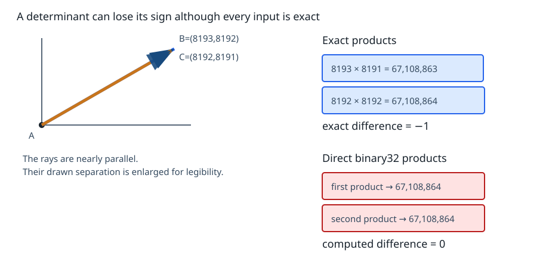

# Orientation Is the Central Planar Predicate

Every algorithm that builds geometric structure---convex hulls, triangulations, arrangements, mesh generation---needs a single reliable test: given three points, do they turn left, turn right, or stay straight? That test is the **orientation predicate**. Its sign controls every later construction, and its robust evaluation is the boundary between a correct program and one that draws plausible but wrong pictures.

This L3 chapter fixes the standard orientation of the Cartesian plane. It assumes vector algebra and exact rational/integer arithmetic when proving predicates. Measurement uncertainty and a specified rounded evaluation are separate models below. The hull-pop discussion uses the usual chain convention in which a retained left turn is positive; reversing that convention reverses the corresponding inequalities.

## Definition and geometric meaning

For points $A=(A_{x},A_{y})$, $B=(B_{x},B_{y})$, and $C=(C_{x},C_{y})$, the orientation is

$$\operatorname{orient}(A,B,C)=(B_{x}-A_{x})(C_{y}-A_{y})-(B_{y}-A_{y})(C_{x}-A_{x}).$$

This expression is the determinant of the $2\times 2$ matrix whose columns are $B-A$ and $C-A$:

$$\operatorname{orient}(A,B,C)=\det\begin{pmatrix}B_{x}-A_{x}&C_{x}-A_{x}\\B_{y}-A_{y}&C_{y}-A_{y}\end{pmatrix}.$$

The determinant is the signed area of the parallelogram spanned by $B-A$ and $C-A$; half the determinant is the signed area of triangle $ABC$, while half its absolute value is the ordinary unsigned area. The sign has the following meaning in the standard coordinate system:

- $\operatorname{orient}(A,B,C)>0$: the turn $A\to B\to C$ is **counterclockwise**;
- $\operatorname{orient}(A,B,C)<0$: the turn is **clockwise**;
- $\operatorname{orient}(A,B,C)=0$: the points are **collinear**.

### Prove the sign and area interpretation

Assume first that A and B are distinct and write $u=B-A$. The left unit normal is $n=(-u_y,u_x)/|u|$. The determinant is $|u|\,n\cdot(C-A)$. Thus its sign is exactly the side of the directed baseline on which C lies. Its absolute value is base length times perpendicular height, proving the parallelogram area rule and the triangle's half-area rule. This argument derives the determinant's meaning from an orthonormal baseline, rather than assuming a determinant-area slogan as the entire proof.

The determinant vanishes precisely when the normal component is zero, that is, when C lies on the carrier line through A and B. If A equals B it also vanishes, but the directed baseline no longer exists. Such a degenerate triple is collinear in the sense that some line contains all its points, yet it supplies no left/right direction. A later routine dividing by baseline length must separate that case before using any signed-height formula. A zero predicate does not secretly provide a nonzero edge.

## Algebraic properties

The orientation predicate has symmetries that make it useful for checking code:

1. **Translation invariance.** For any vector $t$,
   $$\operatorname{orient}(A+t,B+t,C+t)=\operatorname{orient}(A,B,C).$$

2. **Swap sign.** Exchanging the last two points reverses the sign:
   $$\operatorname{orient}(A,C,B)=-\operatorname{orient}(A,B,C).$$

3. **Cyclic invariance.** Rotating the triple cyclically leaves the sign unchanged:
   $$\operatorname{orient}(B,C,A)=\operatorname{orient}(A,B,C).$$

4. **Area relation.** The signed area of triangle $ABC$ is
   $$\operatorname{area}(ABC)=\frac{1}{2}\operatorname{orient}(A,B,C).$$

### Prove the symmetries and affine transformation rule

Translation cancels in each displacement, proving invariance. Swapping determinant columns reverses sign by direct expansion. For cyclic permutation put $u=B-A$ and $v=C-A$; the new columns are v minus u and minus u. Bilinearity and the zero determinant of equal columns give $\det(v-u,-u)=\det(u,v)$. Consequently cyclic permutations preserve orientation and any odd permutation reverses it. This accounts for all six orderings, not just a numerical sample.

Under an affine coordinate change $X\mapsto LX+t$, displacement columns are both multiplied by L. The two-by-two determinant multiplication formula therefore gives

$$\operatorname{orient}(LA+t,LB+t,LC+t)
=\det(L)\operatorname{orient}(A,B,C).$$

An invertible map with positive determinant preserves the sign; a negative determinant reverses it. A singular map sends every such determinant to zero because it collapses the plane into a line or point. Uniform scaling by any nonzero real number multiplies the determinant by its square, preserving the sign, including a negative scale that rotates both axes by pi. Reflecting just one axis reverses it. This is why a screen convention with downward-positive y needs a declared orientation change, rather than a mysterious special case in the predicate.

### Homogeneous coordinates require their denominators

The determinant of the three rows $(A_x,A_y,1)$, $(B_x,B_y,1)$ and $(C_x,C_y,1)$ equals the orientation: subtract the first row from the other two and expand along the last column. For arbitrary homogeneous representatives $(x_i,y_i,w_i)$ with every w nonzero, their determinant divided by the product of the three w-values equals the orientation of the corresponding affine points.

This ratio is unchanged when any representative is rescaled, whereas the numerator sign alone can reverse under a negative representative scale. If a w-value is zero, the point is absent from the selected affine chart and this Euclidean orientation formula is undefined. Homogeneous determinant zero still expresses projective collinearity, but an affine left/right predicate needs its chart. Projective incidence and affine orientation must not be conflated.

## Floating-point evaluation and its limits

The formula is exact when the coordinates are exact. In floating-point arithmetic, subtraction cancels leading bits, and the product of two rounded values introduces relative error. For points that are nearly collinear, the computed orientation may have the wrong sign.

A fixed tolerance such as $10^{-9}$ is not scale-invariant. It may be too large for microscopic coordinates and too small for astronomical ones. Better strategies include:

- **Bounding and rescaling** inputs to a common range before evaluation;
- **Deriving an error bound** from the magnitudes of the operands and comparing the absolute value of the orientation against that bound;
- **Using adaptive exact predicates**, which compute the orientation in increasing precision until the sign is certain;
- **Documenting a minimum resolvable separation** for the application domain.

Never replace ``uncertain sign'' by ``definitely collinear'' without declaring that convention. A program that silently rounds a slightly negative orientation to zero may accept a point as collinear when it is not, breaking every downstream algorithm.

The following diagram describes a specified round-to-nearest binary32 evaluation with separately rounded products, even though the input coordinates are exact. The first exact product is one below the exactly representable power of two; its nearest binary32 number is that power of two. The other product is already that power of two, so their rounded difference is zero. A fused or differently ordered evaluation is a different arithmetic model. The conclusion here is about the stated two-product evaluation, not every possible binary32 implementation.

*The exact determinant is $8193\cdot8191-8192^{2}=-1$; binary32 rounds both products to the same value.*

## Worked example 1 {#worked-example}

Compute $\operatorname{orient}((1,1),(4,2),(2,5))$.

We have $B-A=(3,1)$ and $C-A=(1,4)$. The determinant is

$$3\cdot 4-1\cdot 1=12-1=11>0.$$

The turn is counterclockwise, and the triangle area is $11/2=5.5$.

## A proved coordinate-uncertainty certificate

Suppose each coordinate of A, B and C is known within epsilon of the displayed value, in absolute coordinate units. Let u and v be the displayed displacement columns and let D be their displayed exact determinant. The true displacement perturbations each have coordinate magnitude at most twice epsilon, because each subtracts two uncertain points. Expanding the perturbed determinant gives the error terms $\det(\delta u,v)$, $\det(u,\delta v)$ and $\det(\delta u,\delta v)$. Bounding their two products separately proves

$$|D_{\rm true}-D|\leq
2\varepsilon(|u|_1+|v|_1)+8\varepsilon^2.$$

Here the one-norm is the sum of the two absolute coordinates. If the displayed determinant's magnitude strictly exceeds this bound, every admissible triple has its sign. Equality or overlap with zero is unresolved by this certificate. It is not a collinearity conclusion. The bound is sufficient, not necessarily sharp: dependency among shared point errors can make a simple interval enclosure wider than the actual possibilities.

For exact integer coordinates bounded in absolute value by M, displacement coordinates are bounded by twice M, each product by four M squared, and the determinant by eight M squared. This gives an explicit sufficient intermediate-size budget for an exact-integer implementation. It is a deliberately safe bound, not the sharpest possible geometry bound. An arithmetic type must accommodate the differences, products and final subtraction; merely fitting the original coordinates is insufficient.

Refining arithmetic precision can decide the sign of a nonzero exact rational determinant, and exact rational fallback can recognize zero as well. Arbitrary uncertain real data instead describe a family of possible triples; additional decimal digits in the calculation do not eliminate uncertainty in the input. For arbitrary computable real descriptions, refining enclosures also need not terminate when the exact result is zero. Any universal termination claim therefore needs a stated input representation, not just the instruction to increase precision.

## Worked example 2: a negative homogeneous representative

Represent the affine origin by $(0,0,-1)$, the point $(1,0)$ by $(1,0,1)$ and the point $(0,1)$ by $(0,1,1)$. The homogeneous determinant is minus one, but the denominator product is also minus one. The affine orientation is their ratio, positive one, agreeing with the usual counterclockwise triangle. A routine returning the numerator sign would give opposite results for two representatives of the same origin. Dividing each point to affine last coordinate one before the predicate, or using the complete ratio sign, fixes the representation issue; neither operation permits a point with zero last coordinate in this chart.

## Worked example 3: a certified and an unresolved measured triple

Use displayed displacements $(1,0)$ and $(1,1/10)$, with coordinate uncertainty one thousandth at each of the three points. The determinant is one tenth. The proved error bound is $263/62500$, strictly less than that determinant, so every allowed triple turns positively. This is an analytical certificate from the stated uncertainty, not an empirical observation about a device.

Replace the displayed height by one ten-thousandth while keeping the same uncertainty. The bound now exceeds the determinant, so the certificate is unresolved. In this example the ambiguity is real: keep A and B fixed and move C's vertical coordinate from plus one ten-thousandth to its negative. That change is within the permitted uncertainty and reverses the orientation. No more accurate evaluation of the displayed coordinates can select a unique intended sign from data that admit both configurations.

## A triangle containment consequence

Let ABC be nondegenerate and counterclockwise, with determinant D positive. Every plane point has unique barycentric coordinates with sum one. Solving the two independent displacement equations, or expanding determinants, gives

$$\alpha=\frac{\operatorname{orient}(B,C,P)}D,\quad
\beta=\frac{\operatorname{orient}(C,A,P)}D,\quad
\gamma=\frac{\operatorname{orient}(A,B,P)}D.$$

Their sum is one by determinant expansion, and substitution recovers P as the weighted sum of A, B and C. The closed triangle consists exactly of convex combinations, so membership is equivalent to all three numerators being nonnegative. Strict positivity gives the interior; one or more zeros identify its boundary. This proves a useful half-plane predicate from orientation rather than guessing it from a drawing. A degenerate triangle requires a separate point/segment analysis because division by D is then invalid.

## Common errors

- **Sign confusion.** Remember that positive means counterclockwise in the standard coordinate system. In a graphics system with a flipped $y$-axis, the sign reverses.
- **Using a fixed tolerance without scale awareness.** A tolerance of $10^{-9}$ is meaningless when coordinates are $10^{12}$ or $10^{-12}$.
- **Ignoring collinear boundary cases.** Algorithms that assume strict left turns will fail when three input points lie on a line. The API must document whether collinear points are accepted, rejected, or handled as a separate case.
- **Assuming integer coordinates imply exact computation.** Integer arithmetic is exact only with arbitrary-precision integers, or when every intermediate result is known not to overflow. Converting integers to floating point or using fixed-width integer products can still lose the sign.

## Practice exercises with solutions

### Exercise 1
Compute $\operatorname{orient}((0,0),(1,0),(0,1))$ and state the geometric meaning.

Hint 1

Use the two displacement columns from the origin.

Hint 2

The positive sign refers to the standard upward-positive Cartesian convention.

Full solution

**Solution.** $B-A=(1,0)$, $C-A=(0,1)$. The determinant is $1\cdot 1-0\cdot 0=1>0$. The turn is counterclockwise, and the triangle area is $1/2$.

### Exercise 2
Show that $\operatorname{orient}(A,B,C)=\operatorname{orient}(B,C,A)$.

Hint 1

Expand cyclic orientation into the same six coordinate products.

Hint 2

Alternatively use bilinearity on the columns v minus u and minus u.

Full solution

**Solution.** Both expressions expand to $A_{x}B_{y}-A_{y}B_{x}+B_{x}C_{y}-B_{y}C_{x}+C_{x}A_{y}-C_{y}A_{x}$. The terms are the same; only the order changes.

### Exercise 3
Three points have coordinates $A=(0,0)$, $B=(8193,8192)$, and $C=(8192,8191)$. Compare the exact orientation with a direct binary32 evaluation.

Hint 1

The exact products differ by one, although their magnitudes are much larger.

Hint 2

Use the declared separately rounded binary32 products, not an unspecified fused evaluation.

Full solution

**Solution.** All six coordinates are exactly representable in binary32. Exact arithmetic gives
$$8193\cdot8191-8192\cdot8192=(8192+1)(8192-1)-8192^{2}=-1.$$
The two products are near $2^{26}$, where binary32 spacing exceeds one, so direct binary32 multiplication rounds them to the same value and their subtraction returns zero. This is arithmetic cancellation rather than input rounding. An error-bounded adaptive predicate would detect that the floating result is uncertain and recompute the sign exactly.

### Exercise 4
A convex-hull algorithm needs to reject points that lie on the interior of an edge. Should it use $\operatorname{orient}\leq 0$ or $\operatorname{orient}<0$ as the pop condition? What are the consequences of each choice?

Hint 1

Assume the stated convention where left turns are retained by the hull chain.

Hint 2

Decide whether collinear boundary points are part of the required output.

Full solution

**Solution.** Using $\leq 0$ removes collinear boundary points, keeping only the extreme vertices. Using $<0$ retains them. Neither is universally correct; the API must declare which hull representation it returns. The choice affects downstream algorithms that may assume strict convexity or need the full collinear boundary.

### Exercise 5
Prove that the absolute value of the orientation equals the area of the parallelogram spanned by $B-A$ and $C-A$.

Hint 1

Resolve the second displacement along the first baseline and its left unit normal.

Hint 2

Base length times the absolute normal component is geometric parallelogram area.

Full solution

**Solution.** The determinant of a $2\times 2$ matrix gives the signed area of the parallelogram spanned by its columns. The absolute value removes the sign, leaving the geometric area.

### Exercise 6

An affine map has linear part with diagonal entries minus two and three. A triangle has original orientation five. Find its image orientation and unsigned area, and identify the sign change.

Hint 1

The affine determinant is minus six; translation does not contribute.

Hint 2

Unsigned triangle area is half the absolute orientation.

Full solution

The image orientation is minus thirty and its unsigned area is fifteen. The negative determinant reverses orientation, while its absolute value scales areas by six. Translation cannot repair or change that sign because displacements cancel it. The original area was five halves, and multiplying it by six gives the same image area. A sign-reversing affine map can preserve incidence and convexity while reversing the directed turning convention.

### Exercise 7

A renderer replaces every coordinate y by minus y. What happens to orientation, unsigned area and collinearity? Explain why changing a predicate's comparison without declaring the coordinate convention is misleading.

Hint 1

The linear map has determinant minus one.

Hint 2

Zero and absolute values behave differently from positive/negative side labels.

Full solution

Orientation changes sign, unsigned area remains the same and zero orientation remains zero. Thus collinearity is unchanged, but the visual clockwise/counterclockwise interpretation reverses. A comparison can be chosen consistently for either screen convention; a silent sign change makes its relation to geometric left turns unclear. The mathematical predicate and the coordinate-to-display transformation should be stated separately, so a caller can transport orientation correctly instead of relying on a picture.

### Exercise 8

If A equals B, show that the orientation is zero for every C. Does that permit division by the baseline length to compute C's signed distance from the line AB?

Hint 1

The first displacement column vanishes.

Hint 2

Coincident endpoints do not define a unique directed carrier line.

Full solution

The determinant is zero because one column is zero. The baseline length is also zero, so the signed-height formula is undefined. There is no uniquely specified directed line AB; if C differs from A, a line containing A and C exists, but it was not selected by the repeated baseline points. A point-distance or a separately supplied nonzero direction can define another query. A zero orientation result alone must not be used as permission to divide by a zero edge length.

### Exercise 9

Assume integer input coordinates have absolute value at most one thousand. Give sufficient magnitude bounds for displacement coordinates, determinant products and the final determinant. Would fitting only the input coordinates in an integer type be a sufficient exactness argument?

Hint 1

A subtraction of two bounded coordinates can double the bound.

Hint 2

Bound the two products before subtracting them.

Full solution

Displacement magnitudes are at most two thousand, product magnitudes at most four million and the final determinant magnitude at most eight million by the safe triangle-inequality bound. These values require substantially more range than the original coordinates. A signed type whose maximum positive value exceeds eight million suffices for these integer intermediates under the stated evaluation, while an input-sized type need not. The bound is sufficient rather than sharp, and this is an arithmetic range proof rather than an executed claim about any program's actual integer conversions.

### Exercise 10

Use homogeneous representatives $(0,0,2)$, $(-3,0,-3)$ and $(0,4,4)$. Compute the affine orientation they represent and explain why the homogeneous determinant sign alone is wrong.

Hint 1

The represented affine points are the origin and the two positive coordinate unit points.

Hint 2

The homogeneous determinant and the product of last coordinates are both minus twenty-four.

Full solution

The homogeneous determinant is minus twenty-four and the denominator product is minus twenty-four, so their ratio is positive one. This is the counterclockwise unit right triangle. Returning the numerator's negative sign would treat an arbitrary negative representative scale as a reversal of actual geometry. Dividing each representative by its nonzero last coordinate first gives the same answer. None of these calculations applies to a zero last coordinate without selecting a different affine chart.

## Transferred capstone: Orientation and area {#computational-legacy-capstone-2}

Four points are given: $A=(1,1)$, $B=(4,2)$, $C=(3,5)$, $D=(2,4)$. Compute the orientation of $(A,B,C)$ and $(A,C,D)$. Is the quadrilateral $ABCD$ convex? What is its area?

This retains the earlier [Worked Exercises and Synthesis](worked-exercises-and-synthesis.md) problem and full solution with its original source still available.

Hint 1

Two triangulation orientations alone need not establish convexity.

Hint 2

Check supporting turns or half-plane signs before adding signed triangle areas.

Full solution

**Solution.** $\operatorname{orient}(A,B,C)=(3)(4)-(1)(2)=10>0$. $\operatorname{orient}(A,C,D)=(2)(3)-(4)(1)=2>0$. Two diagonal-based triangle orientations do not by themselves prove convexity. Check all four consecutive turns:
$$\operatorname{orient}(A,B,C)=10,\quad \operatorname{orient}(B,C,D)=4,$$
$$\operatorname{orient}(C,D,A)=2,\quad \operatorname{orient}(D,A,B)=8.$$
All are positive, so this ordered quadrilateral is convex.

The area is the sum of the triangle areas: $\frac{1}{2}(10+2)=6$.

## Looking backward and forward

This chapter established the orientation predicate as the fundamental signed test in planar computational geometry. Its properties---translation invariance, swap sign reversal, and area interpretation---will be used repeatedly.

The next chapter, **Segment Intersection Needs Boundary Cases**, applies the orientation predicate to decide whether two line segments intersect. The intersection test is a direct composition of orientation signs, and its boundary cases---endpoint touching, collinear overlap, and parallel disjointness---are exactly the cases where orientation is zero or where the sign convention matters most.

## Summary and source

Orientation is the directed baseline normal component multiplied by base length, so its sign, area and collinearity interpretations have explicit proofs. Determinant algebra explains permutation, affine and homogeneous-coordinate rules. Exact arithmetic range and input-coordinate uncertainty are separate contracts; a bound excluding zero certifies a sign, while unresolved input does not establish collinearity. Triangle containment follows from barycentric determinants with a nonzero denominator.

The five earlier exercise statements/solutions and transferred capstone are preserved with staged support; five new exercises complete eleven supported questions. New sign, invariance, area and uncertainty proofs develop the L3 commission, retaining the earlier binary32 illustration under its explicit rounded-product model. No implementation, numerical execution or independent review is claimed.
