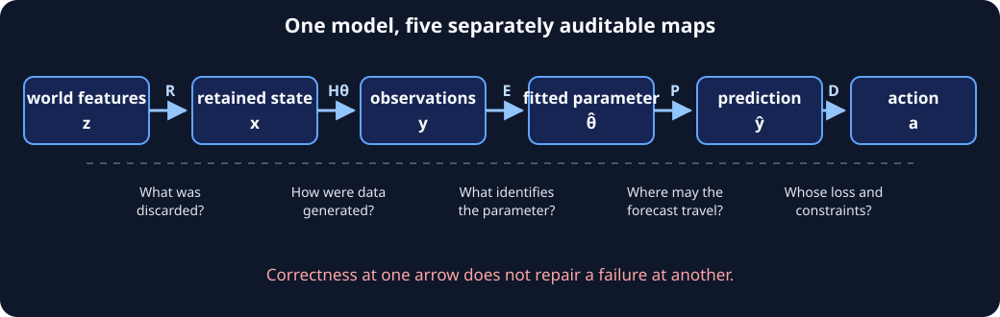

# Model Contracts and Claim Ledgers

## Dependencies and purpose

This chapter requires mathematical maturity but no specialized application. It establishes the language used everywhere else in the volume. The central object is not an equation but a **model contract**: a falsifiable declaration of purpose, state, observation, action, scale, evidence, and scope.

## From a system to a mathematical object

Let $z$ denote features of a real system, $x$ the retained model state, $y$ measured data, $θ$ parameters, and $a$ an action. A modeling chain can be factored as

$z \to x \to y \to \hat{θ} \to \text{prediction} \to a$.

The representation map $R$ discards information. The observation map $H_θ$ connects state to measurements. The estimator $E$ uses data to select parameters. The prediction map $P$ extrapolates within a declared target. The decision rule $D$ combines a prediction with objectives and constraints.

Factorization is useful because each arrow can fail independently. An exact estimator does not repair a biased sensor. A calibrated forecast does not say which action is socially preferable. A mechanistic state equation does not make an observational parameter causal.

*Figure 1.1. The maps $R,H_\theta,E,P,D$ carry different obligations. In
order: audit discarded world features, the data-generation protocol,
identification of the fitted parameter, the prediction domain, and the loss,
constraints, and authority behind the action. Correctness at one map does not
repair a failure at another.*

### Running example: reservoir release

A water manager chooses tomorrow's release $a$ using today's storage reading $y$. True stored volume is $x$, while the gauge has error $ε$, so $y=x+ε$. Rainfall $w$ changes tomorrow's state:

$x_{\mathrm{next}}=x+w-a-\operatorname{loss}(x)$.

A use contract must name storage and release units, legal minimum flow, safe storage interval, forecast horizon, rainfall information available at decision time, loss function for shortage and overflow, and populations affected. The balance equation is not the whole model; the sensor and decision layers are material.

## Five claim types

1. A **mathematical claim** follows from definitions and hypotheses: a feasible flow cannot exceed a cut.
2. A **computational claim** concerns an implementation: this program returned an exact value and certificate for this input.
3. A **predictive claim** links observed samples to future or unobserved outcomes under a sampling or stability assumption.
4. A **causal claim** compares outcomes under interventions and needs a design or identification assumptions.
5. A **normative decision claim** says an action should be chosen relative to values, constraints, alternatives, and authority.

These can support one another without collapsing. A correct algorithm may implement a predictive model used in a decision; each layer retains its own boundary.

## The claim ledger

For each important conclusion, write:

| Field | Question |
| --- | --- |
| Statement | What exactly is asserted? |
| Inputs | Which measurements and conventions enter? |
| Mathematical hypotheses | Which conditions make the derivation valid? |
| Evidence | Which data or external facts support real-world use? |
| Sensitivity | Which perturbations change the conclusion? |
| Excluded inference | What tempting conclusion is not supported? |

For an M/M/1 mean wait, the mathematical hypotheses include Poisson arrivals, exponential independent service, one server, stationary rates, and $λ<μ$. Evidence must examine whether a queue resembles that regime. The excluded inference may be a causal claim about adding staff.

## Information sets and leakage

Let $I_t$ be information available when action $a_t$ is chosen. An implementable rule has form $a_t=π(I_t)$. If evaluation supplies $π$ with a future outcome, later sensor, or a variable affected by $a_t$, it measures an impossible rule. In stochastic-control language the policy must be adapted to the information filtration.

### Worked leakage diagnosis

A clinic chooses Monday staffing using “total patients served this week.” That total is known only after the week and depends on staffing capacity. It cannot belong to Monday's information set. Replace it with prior-week counts, scheduled appointments known by Monday, and a clearly timestamped forecast. Re-evaluate the complete rule, including forecast fitting, on later weeks.

## A model contract as a mathematical tuple

For repeated use, encode the contract as

$M=(Q,Ω,T,X,U,Θ,Y,F,H,I,L,C,V)$,

where:

- $Q$ is the precise question and claim type;
- $Ω$ is the population, system, or scenario domain;
- $T$ is the time grid or horizon;
- $X,U,Θ,Y$ are state, control, parameter, and observation spaces;
- $F$ is the transition or balance rule;
- $H$ is the observation rule;
- $I=(I_t)$ is the information structure;
- $L$ is loss or the vector of outcome criteria;
- $C$ is the feasible set, including safety and institutional constraints;
- $V$ is the validation and monitoring protocol.

This is not a claim that every model must be stochastic or dynamic. A static linear program can use a one-point time set and a deterministic transition. The tuple is a completeness prompt: if an entry is irrelevant, say why; if it is unknown, mark it unknown rather than omitting it invisibly.

Two contracts using the same equation can be different models. The diffusion equation used to interpolate temperature inside a calibrated plate and the same equation used to forecast heat during a phase change have different domains, observation maps, and validation requirements. A fitted $F$ reused after a policy change has a different $Ω$ even if its code is unchanged.

## State sufficiency and closure

A state is sufficient for the model when the declared future depends on the past only through current state and future inputs. In deterministic notation,

$x_{t+1}=F(x_t,u_t,θ)$.

If earlier history still changes the future after $x_t$ and $u_t$ are fixed, the state is not closed. One may enlarge it—adding age structure, queue order, accumulated damage, or delayed values—or accept an effective stochastic/discrepancy term.

### Worked closure failure: aggregate inventory

Two warehouses both report 100 units on hand. In one, all units expire tomorrow; in the other, they have a year of shelf life. If next week's usable stock differs even under the same demand and order, total units alone are not a sufficient state. An age-bin vector may close the model:

$x_t=(\text{units expiring in 1 day}, \text{2 days}, \dots)$.

Aggregation was not merely imprecise; it removed a variable necessary for the transition. A simpler model may still be useful for a one-hour horizon. State sufficiency is tied to horizon and question.

### Worked closure failure: a queue count

Two service systems each contain five jobs. If one contains five one-minute jobs and the other five hour-long jobs, count alone does not predict clearance time. Under exponential memoryless service the count can be a Markov state because residual service has the same law. Under general service, residual service time belongs in the state. The familiar queue notation hides a closure theorem supplied by memorylessness.

## Representation is a choice of equivalence

The representation map $R:z↦x$ declares which world states are treated as equivalent. If two detailed states map to the same $x$, the model promises not to distinguish them for its use.

For a road network, two physical roads may be represented by one edge with one capacity. For a compartment model, individuals with different contact patterns may share one compartment. For a portfolio model, entire return histories can be reduced to mean and covariance. Each equivalence should be challenged by a **separating example**: find two world states sharing $x$ but producing meaningfully different outputs.

If such an example lies inside the intended domain, either enrich the representation or narrow the claim. This is more informative than asking vaguely whether the model is “realistic.” Every useful model is unrealistic in some respects; the question is whether the discarded distinctions matter to $Q$ and $L$.

## Observation models are not optional decoration

An observation is generated by a protocol. A useful generic form is

$y_t=H(x_t,θ_H,s_t)+ε_t$,

where $s_t$ records selection, censoring, or sensor state. Treating $y=x$ assumes direct, complete, correctly timed measurement.

### Worked case: stockouts censor demand

Suppose daily demand is $D_t$ and on-hand stock is $I_t$. Recorded sales are

\[Y_t=\min(D_t,I_t)\]

when unmet customers leave without a backorder record. On days with $Y_t=I_t$, demand may equal stock or exceed it. Fitting a demand distribution to sales as if $Y_t=D_t$ biases the upper tail downward. The operation changes the observation process: a low-stock decision creates more censoring.

The remedy is not automatically one statistical technique. Record lost demand, use availability-aware likelihoods, run a controlled stock experiment where ethical and feasible, or report partial identification. What matters here is recognizing $H$.

### Worked case: epidemic reports

Let incidence be $J_t$, ascertainment probability $p_t$, and reporting-delay mass function $g_k$. Expected reports can have form

$E[Y_t]=Σ_{k≥0}p_{t-k}g_kJ_{t-k}$.

Reports mix past incidence, ascertainment, and delay. A decline in $Y_t$ could arise from incidence, testing, or delay changes. A mechanistic infection model connected directly to reports without $H$ forces transmission parameters to absorb observation changes.

## The objective is a measurement instrument for values

An objective is not merely a computational requirement. It maps outcomes into an ordering. Consider two clinic policies:

| Policy | Mean wait | 95th-percentile wait | Staff overtime |
| --- | ---: | ---: | ---: |
| A | 18 min | 90 min | 0 h |
| B | 22 min | 48 min | 2 h |

No policy dominates across all three columns. Minimizing mean wait chooses A; constraining the tail below 60 minutes removes A; heavily penalizing overtime may restore it. Before scalarizing, report the outcome vector and identify who bears each component.

Hard constraints and penalties are not interchangeable. A penalty permits violation at a price; a hard safety constraint forbids it. Choosing a very large coefficient can create numerical conditioning problems without expressing an actual permissible trade.

## Model hierarchy and repair routes

Build a ladder rather than a single elaborate model:

1. **accounting baseline:** conservation and unit checks;
2. **structural baseline:** simplest mechanism capable of the target behavior;
3. **observation model:** selection, timing, and noise;
4. **heterogeneity or dependence:** added only when diagnostics or use require it;
5. **decision layer:** objectives, constraints, information, and recourse;
6. **feedback layer:** response to deployment or other agents.

At every step record the new identifiable quantities and new failure modes. Added realism can reduce identifiability and make computation harder. Complexity earns its place through a changed claim or validation improvement, not by sounding sophisticated.

### Worked hierarchy: service desk

An accounting baseline uses Little's law on observed throughput and time. An M/M/1 structural baseline adds Poisson/exponential steady-state assumptions. A scheduled-arrival model changes the arrival mechanism. A multi-class priority model adds class and discipline. A staffing decision model adds costs and constraints. A behavioral-feedback model lets customers change arrival time after published waits.

These models answer progressively different questions. Failure of M/M/1 does not invalidate Little's law under stable conservation; success of M/M/1 on one week does not validate a staffing intervention.

## Counterexample studio

### Same fit, different use

Two polynomials interpolate the same finite measurements but diverge outside their range. Calibration equality does not imply extrapolation equality.

### Same prediction, different cause

An umbrella variable and rain sensor can both predict wet streets. Manipulating umbrella ownership does not reproduce the effect of rain. Predictive substitutability is not causal substitutability.

### Same optimum, different feasible reality

A continuous allocation gives $x=2.5$ ambulances to a site. The arithmetic optimum is infeasible for indivisible vehicles. The continuous solution may remain a bound, but implementation needs a discrete model.

### Same equilibrium, different welfare

A congestion equilibrium can be stable against unilateral route changes while another coordinated routing lowers every traveler's time. Equilibrium and system optimality are distinct claim types.

## Prerequisite diagnostic

Before continuing, check that you can:

- distinguish a set from a probability distribution on it;
- identify units of a derivative and integral;
- read a function as a mapping with domain and codomain;
- distinguish an observed variable from a parameter;
- negate a claim containing “for every” and “there exists”;
- explain why one counterexample refutes a universal statement.

Repair missing pieces through the mathematical-language, measurement-units, functions, and probability-model resources before treating compact notation as understanding.

## Exercises

### Exercise 1

Draw a chain for a traffic-routing model whose travel-time data come from phones. Identify representation, measurement, prediction, and decision failures.

Hint 1

Follow the four arrows from the physical road network to the chosen route.

Hint 2

Separate the phone sampling mechanism from the mathematical routing objective.

Full solution

Roads and trips are represented as a graph; phone users selectively measure speeds; a forecast extrapolates to future traffic; routing changes congestion. Missing users, map error, shift, and behavioral feedback occupy different arrows.

### Exercise 2

A model predicts which borrowers will miss payments. Explain why accuracy does not establish the causal effect of changing an interest rate.

Hint 1

Compare a prediction under current lending policy with an intervention on the rate.

Hint 2

Ask what assignment or counterfactual assumptions would justify replacing one with the other.

Full solution

Rate assignment is not randomized and may depend on risk; changing a rate can change behavior. A predictive conditional distribution is not a counterfactual response without identification.

### Exercise 3

Give two objectives for the same ambulance-location feasible set that can choose different solutions. State whose values each expresses.

Hint 1

Compare minimising average response time with minimising the worst response time.

Hint 2

A common feasible set does not require a common ranking of its feasible points.

Full solution

Mean response time and maximum neighborhood response time can conflict. The former weights calls; the latter emphasizes the worst-served location. Neither objective is value-neutral.

### Exercise 4

A reservoir model uses water level as its only state although cross-sectional area changes with level. Decide whether level alone can determine stored volume and state what additional map is needed.

Hint 1

Consider two reservoirs with equal level but different cross sections.

Hint 2

A known cumulative volume-versus-level relation can supply the missing observation map.

Full solution

Level determines volume only after declaring a calibrated geometry map $V=G(level)$ and assuming geometry has not changed. If only level is observed, $G$ belongs to the observation/representation contract; a constant-area shortcut can bias balances.

### Exercise 5

Recorded sales equal $\min(\text{demand}, \text{stock})$. Construct two demand values that generate the same observed sale and explain the identification failure.

Hint 1

Fix stock first and vary demand above it.

Hint 2

The minimum operator is many-to-one on that part of its domain.

Full solution

With stock 10, demands 10 and 50 both record sales 10. The observation is censored at available stock, so upper demand is not point identified. Repeated stockout sales do not reveal how far above ten demand lay.

### Exercise 6

A route planner minimizes total travel time but has no constraint on the longest neighborhood response. Write one alternative objective and one alternative hard constraint.

Hint 1

Introduce response times indexed by neighbourhood.

Hint 2

A maximum objective and a separate upper bound express different decisions.

Full solution

Minimize the maximum neighborhood response time, or minimize mean time subject to every neighborhood response being at most a declared threshold. The first orders trade-offs; the second treats the threshold as nonnegotiable.

### Exercise 7

A policy uses a weather forecast issued at noon to choose an action logged at 9 a.m. Classify the error precisely.

Hint 1

Compare the information timestamps rather than the forecast accuracy.

Hint 2

An admissible decision may use only information available before the logged action.

Full solution

This is future-information leakage: the action precedes the forecast. Evaluation describes a clairvoyant policy unless the decision timestamp or input is corrected.

### Exercise 8

A portfolio engine returns the minimum variance weight from historical covariance. List the extra contract fields needed before any real decision claim.

Hint 1

Separate the covariance calculation from the investor and transaction model.

Hint 2

Name horizon, constraints, estimation uncertainty, costs and the claim being made.

Full solution

Add decision-maker and authority, horizon, liabilities or target, feasible positions, transaction and funding costs, tax/jurisdiction scope, uncertainty and shift model, loss criteria, validation, monitoring, fallback, and an explicit non-advice boundary. The engine alone supplies none of them.

### Exercise 9

For each statement—“flow is at most 7,” “tomorrow's flow will be 7,” “building an edge raises flow by 2,” and “the edge should be built”—classify the claim type and missing support.

Hint 1

Classify each sentence as a bound, forecast, intervention effect or value judgement.

Hint 2

A feasible flow and cut can justify one of these without establishing the others.

Full solution

The first is mathematical given a cut; the second is predictive and needs capacity/demand stability evidence; the third is causal and needs an intervention response model or design; the fourth is normative and needs objectives, alternatives, consequences, and authority.

### Exercise 10

Give a separating example showing that mean and variance do not determine tail risk.

Hint 1

Compare a symmetric two-point law with a law having rare larger values.

Hint 2

Choose probabilities so the second moment is unchanged while a tail probability changes.

Full solution

Let $X$ be $-1$ or $1$ with probability $1/2$ each. Then $E[X]=0$ and $\operatorname{Var}(X)=E[X^2]=1$. Let $Y=-1/3$ with probability $9/10$ and $Y=3$ with probability $1/10$. Its moments are

$$
E[Y]=\frac9{10}\left(-\frac13\right)+\frac1{10}(3)=0,
\qquad E[Y^2]=\frac9{10}\frac19+\frac1{10}(9)=1,
$$

so $\operatorname{Var}(Y)=1$ as well. But $P(X>2)=0$ while $P(Y>2)=1/10$. With the quantile convention $q_\alpha(Z)=\inf\{z:P(Z\le z)\ge\alpha\}$, the $0.95$ quantiles are $q_{0.95}(X)=1$ and $q_{0.95}(Y)=3$. The mean loss in the worst $5\%$ of probability mass is also $1$ for $X$ and $3$ for $Y$ (each selected tail lies inside its largest atom). Thus equal mean and variance do not determine tail probabilities, quantiles, or expected shortfall.

## Chapter project

Choose a modest operational or scientific question. Produce a one-page use contract, a timestamped information set, and three claim-ledger rows. No equations are required until the question and exclusions are stable.

## Reproducible model computation

## Dependencies and purpose

This chapter depends on the model-contract, sensitivity, and validation chapters plus basic programming. It treats code as a mathematical implementation with representations, invariants, error models, and falsification tests.

## A computational contract

Every model computation should record:

- input schema, units, allowed ranges, and missing-value behavior;
- mathematical equations and sign/index conventions;
- data structures and exact-versus-floating representation;
- algorithm, stopping rule, tolerance, and complexity expectation;
- deterministic seed or complete random-stream protocol;
- outputs, status values, certificates, and failure modes;
- unit, property, regression, and independent cross-check tests;
- environment and reproducible command.

A function returning `NaN` after violating $λ<μ$ hides a mathematical boundary. A typed status such as `unstable` with the failed inequality is part of the result.

## Exact arithmetic where it clarifies

Integer network capacities make max-flow conservation and cut certificates exact. Rational arithmetic can represent finite probabilities and small LP certificates. Floating point remains appropriate for large numerical work, but tests should use exact cases and scale-aware tolerances.

Do not compare floating values with an arbitrary universal epsilon. A tolerance should reflect problem scale, algorithmic error, and conditioning. Report residual norms and, when possible, forward-error bounds.

## Property-based mathematical tests

Even without a property-testing package, enumerate or deterministically generate small inputs and test invariants:

- max flow never exceeds any returned cut and equals its certificate at termination;
- queue outputs satisfy $L=λW$ in stable M/M/1 cases and reject $λ≥μ$;
- a covariance quadratic form is nonnegative up to a justified tolerance;
- unit rescaling leaves dimensionless outputs unchanged;
- inventory balance holds row by row;
- serialize/parse round trips sanitize invalid URL state.

Examples test points; properties test families.

## Verification ladder

1. **Hand case:** a tiny input with a derived answer.
2. **Boundary:** zero, equality, singularity, infeasibility, and capacity saturation.
3. **Invariant:** conservation, positivity, symmetry, dual bound, or normalization.
4. **Independent method:** enumeration versus algorithm, analytic formula versus simulation.
5. **Refinement:** decreasing step size or tolerance with predicted convergence behavior.
6. **Stress:** large scale differences, malformed input, and near-boundary parameters.

Passing this ladder verifies implementation relative to its mathematics. It does not validate the model for a real system.

## Accessible interactive instruments

An interactive lab needs semantic controls with labels, keyboard operation, visible focus, and a status region. A visual chart must have a complete numerical or textual alternative. Color must not carry meaning alone. Motion should be absent or respect reduced-motion preferences. Shareable URL state must validate inputs before use.

The Decision Systems lab uses native ranges/selects and tables. Its max-flow engine returns augmenting results and a min-cut certificate; queue mode returns formulas only in the stable region; portfolio mode reports declared scenario moments and an explicit non-advice boundary. No random sampling is required, so repeated state gives identical output.

## Simulation reproducibility

When randomness is essential, name the pseudorandom generator, seed, stream splitting, warm-up, horizon, replication count, and estimator. Events within one simulation run are dependent observations, not independent replications. Confidence intervals quantify Monte Carlo error conditional on the simulated model, not discrepancy from reality.

### Worked Monte Carlo audit

To estimate mean wait under a queue model, run $R$ independent replications and compute replication means $W_r$. Estimate standard error using sample standard deviation across the $R$ means divided by $\sqrt{R}$. Treating all customer waits as iid underestimates uncertainty because waits share the same queue history.

## Numerical provenance

For every displayed result retain input hash or exact state, code revision, algorithm status, and any warnings. A rounded table should not be the only source for downstream calculation. Export machine-readable full-precision values with units and conventions.

## Exercises

1. Specify boundary tests for an EOQ function.
2. Explain why exact max-flow capacity integers do not make the road-capacity data exact.
3. Design an invariant test for a discrete SIR update.
4. Diagnose an experiment that changes a random seed for every policy and compares one run each.

## Answers

1. Reject nonpositive $D,K,h$; verify units externally; test the analytic optimum, equality of setup/holding costs, square-root scaling, and large/small values.
2. Arithmetic exactness concerns representation and algorithm; measured or estimated real capacities still have uncertainty and model discrepancy.
3. Check nonnegativity under a step-size condition and verify $S+I+R$ remains constant to the declared numerical tolerance.
4. One run confounds policy difference with Monte Carlo noise. Use multiple independent replications and preferably common random numbers for paired comparison.

## Chapter project

Implement one pure dependency-free engine with typed failure results, at least eight mathematical tests, deterministic serialized state, and a full text table. Write separate verification and validation statements.

The full [reproducible-computation appendix](reproducible-model-computation.md) remains available for reference.

## Summary

A model contract specifies representations, observations, decisions and the claim being made. Keep the reproducibility record tied to those objects. The cooling audit next gives a concrete model to inspect with that language.
