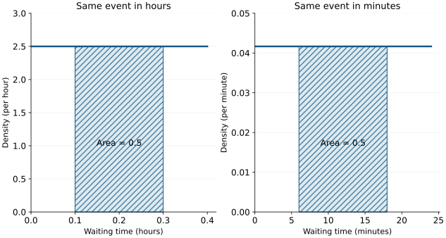

# 0 · Prepare to reason with uncertainty

**Prerequisites:** elementary algebra, fractions, and enough Python to run a cell and recognise a list. **Objectives:** distinguish probabilities from observed proportions; calculate with distributions; simulate and check simple experiments; decompose expectation and variance under conditioning; diagnose simulation units, shapes, and numerical uncertainty. **Time:** 3–5 optional hours for the foundation route; allow additional sessions for the mathematical track and linked remediation.

## Start with a question

A service completes 30% of visits within a target time. In a simulation of 100 visits, must exactly 30 finish on time? Before calculating, describe what could vary if you repeated the simulation. The observed count, the probability used to generate it, and a future count are different objects. Learning to name them is more useful than memorising a formula without knowing what it describes.

This chapter has two connected tracks. The intuitive track uses tables, units, and repeated experiments. The mathematical track explains why the calculations work, including conditioning and variance decomposition. Follow both on a first reading, but return to the appendices when algebra interrupts the story. You do not need calculus to understand the examples; integration initially means adding small pieces of probability.

Our examples are hypothetical teaching models. Their probabilities are specified assumptions, rather than estimates from an operational service. A simulation can check what those assumptions imply. It cannot establish whether they describe a real population.

## Events, support, and conditioning {#events-support-and-conditioning}

An experiment begins with a set of possible outcomes, its **sample space**. An event is a collection of outcomes: “the visit finishes on time” or “at least three of ten visits finish on time.” A probability is between zero and one. Mutually exclusive, exhaustive events have probabilities summing to one. Mutually exclusive means they cannot both happen; exhaustive means none of the possibilities has been omitted.

These qualifications matter. “Late” and “cancelled” may overlap if a cancellation happens after the deadline. Adding their probabilities without correcting the overlap counts some outcomes twice. In general,

$$P(A\cup B)=P(A)+P(B)-P(A\cap B).$$

Write $P(A,B)$ as shorthand for the joint probability $P(A\cap B)$. When $P(B)>0$, conditioning restricts attention to outcomes in $B$ and rescales their probabilities:

$$P(A\mid B)=\frac{P(A,B)}{P(B)},\qquad P(A,B)=P(A\mid B)P(B).$$

The bar means “given,” not “caused by.” Learning that a parcel arrived late can change our uncertainty about its route, even though lateness did not cause the route assignment. Reversing the bar changes the denominator and usually changes the answer. We do not define elementary conditional probability by dividing by an event of probability zero.

Independence is the assumption $P(A,B)=P(A)P(B)$, equivalently $P(A\mid B)=P(A)$ when the conditional exists. It is not implied by separate spreadsheet rows. Two visits by the same person might share travel conditions. Mutually exclusive events with positive probabilities are not independent: learning that one happened rules out the other.

The **support** records which values a model permits. A count of successful visits can be zero through the total number of visits, but cannot be negative or fractional. Check support before calculating a mean or fitting a distribution. Impossible values often reveal a recording error or a mismatch between the variable and the proposed model.

Before choosing a distribution, write a small data dictionary: what one row represents, how an outcome is coded, which units are used, and how the row entered the file. A missing outcome is not automatically a failure. A cancelled visit may belong in the denominator for one operational question and outside it for another. Decide which question you intend before allowing software to drop rows or replace missing entries.

The same discipline applies to aggregated data. A row containing a day's success count and total visits represents many trials; a row containing an individual outcome represents one. Averaging daily proportions without their denominators weights days equally, which differs from weighting visits equally. Neither target is universally correct. Naming the population and statistical unit makes the distinction explicit and provides a practical check on later array operations.

## Worked example: a population mixture

A hypothetical delivery network sends 60% of parcels directly and 40% through a transfer depot. The late-arrival probability is 0.10 for direct parcels and 0.25 for transfer parcels. Routes are exhaustive and exclusive, and each conditional rate applies to its route's parcels in the population under discussion.

Think of 1,000 representative parcels. Expected counts are obtained by multiplication: 600 go directly, with 60 late and 540 on time; 400 use the depot, with 100 late and 300 on time. These are expected counts under the model, not a claim that every sample has exactly this composition. Dividing by 1,000 produces the joint table.

| Route | Late | On time | Route probability |
|---|---:|---:|---:|
| Direct | 0.060 | 0.540 | 0.600 |
| Transfer | 0.100 | 0.300 | 0.400 |
| Total | 0.160 | 0.840 | 1.000 |

Each interior cell describes two events together. Summing the late column gives the **marginal** probability of lateness, 0.16. Conditioning on lateness changes the reference set from all parcels to late parcels, so

$$P(\text{transfer}\mid\text{late})=\frac{0.100}{0.160}=0.625.$$

Transfer parcels are 40% of all parcels but 62.5% of late parcels. This does not contradict their late-arrival rate of 25%: the two statements condition on different populations. Check the calculation in reverse: $0.625\times0.160=0.100$, recovering the joint cell.

The calculation illustrates the law of total probability. For exclusive, exhaustive groups $G_j$,

$$P(A)=\sum_j P(A\mid G_j)P(G_j).$$

An unweighted average of the two late-arrival rates gives 0.175, which describes a population with equal route weights. It is the wrong answer for the specified network. A different sampling scheme also changes the answer: sampling one parcel from each route gives equal route representation, not the network's natural composition.

We will retain a second setting for practice. Suppose 40% of machines are old, with fault probability 0.10, while new machines have fault probability 0.02. Keep the distinction between population weights and fault rates visible when answering the machine exercise.

**Retrieve without looking:** Which denominator would you use to find the late fraction among transfer parcels? Which would you use to find the transfer fraction among late parcels? Explain the choice in words before dividing. If those populations blur together, revisit the table and [Appendix 1 on conditioning](./appendix-01_probability.md).

## Random variables, averages, and spread

A **random variable** assigns a number to an outcome. Before an experiment, $X$ represents uncertain values; after observation, $x$ is the value recorded. A Bernoulli variable is one for success and zero for failure. Here “success” is a coding label: it could mean an undesirable fault. Always state the event represented by one.

For a discrete variable with mass function $p(x)=P(X=x)$, expectation is a weighted average:

$$E[X]=\sum_x x p(x),\qquad \operatorname{Var}(X)=E[(X-E[X])^2]=E[X^2]-E[X]^2.$$

The mean need not itself be a possible outcome. A mean of three and a half visits is compatible with exclusively integer observed counts. Variance measures squared distance from the mean and therefore has squared units. Standard deviation is the square root of variance and has the original units.

For a Bernoulli variable with probability $\theta$, $X^2=X$. Consequently $E[X]=\theta$ and $\operatorname{Var}(X)=\theta-\theta^2$. If $Y$ sums $n$ independent Bernoulli variables with a common probability, it has a binomial distribution:

$$P(Y=y)=\binom ny\theta^y(1-\theta)^{n-y},\quad E[Y]=n\theta,\quad \operatorname{Var}(Y)=n\theta(1-\theta).$$

The coefficient counts the different orders producing the same success count. Identical probabilities and independence are modelling requirements. If success probabilities change between visits, the simple binomial description generally fails.

Expectations add even without independence. Variances require more care:

$$\operatorname{Var}\left(\sum_i X_i\right)=\sum_i\operatorname{Var}(X_i)+2\sum_{i<j}\operatorname{Cov}(X_i,X_j).$$

Covariance is $E[(X_i-E[X_i])(X_j-E[X_j])]$. Positive covariance means above-average values tend to occur together; it increases the variance of the sum. Independence makes covariance zero when these moments exist, but zero covariance alone does not imply independence. A shared busy day can produce dependent outcomes even if visits are independent after the day's conditions are specified.

## Worked example: within-day and between-day variation

Suppose a day is quiet with probability 0.6 and busy with probability 0.4. Observe ten visits each day. Conditional on day type $G$, visits are independent, with event probability 0.2 on quiet days and 0.6 on busy days. One day type is shared by all ten visits; it is not redrawn for each visit.

The conditional count means are 2 and 6. Their probability-weighted average is

$$E[Y]=E[E[Y\mid G]]=0.6(2)+0.4(6)=3.6.$$

This is the law of total expectation. The average day's count mixes quieter and busier days. The conditional variances are $10(0.2)(0.8)=1.6$ and $10(0.6)(0.4)=2.4$. Their weighted average, 1.92, captures variation between days of the same type. It misses the fact that the two types have different means.

To derive the missing term, write a deviation from the overall mean as

$$Y-E[Y]=\{Y-E[Y\mid G]\}+\{E[Y\mid G]-E[Y]\}.$$

Square and average. The cross term disappears because $E[Y-E[Y\mid G]\mid G]=0$. What remains is the law of total variance:

$$\operatorname{Var}(Y)=E[\operatorname{Var}(Y\mid G)]+\operatorname{Var}(E[Y\mid G]).$$

Here the between-type term is $0.6(2-3.6)^2+0.4(6-3.6)^2=3.84$. Total variance is therefore $1.92+3.84=5.76$ squared counts. The standard deviation is 2.4 counts. Averaging only the conditional variances would omit two thirds of the total variation.

As a counterexample to careless pooling, replacing both day types by one probability, 0.36, gives a binomial variance of $10(0.36)(0.64)=2.304$. Its mean is still 3.6, so agreement of means cannot validate the pooled model. Sharing a day type creates positive dependence among visits after day type is averaged out. [Chapter 3](./03_prediction.md) uses the same decomposition when an unknown probability is shared by future visits.

**Retrieve without looking:** What changes if day type is independently redrawn for every visit? Identify which source of shared variation disappears. If the variance derivation is difficult, reconstruct the two conditional means first; they are the bridge between the table intuition and the formula.

## Continuous variables: probability is area

A continuous variable described by a density assigns probabilities to intervals:

$$P(a<X<b)=\int_a^b f(x)\,dx.$$

The integral adds narrow rectangles of height $f(x)$ and width $dx$. A uniform waiting time on zero to 0.2 hours has density 5 per hour. The probability of waiting between 0.04 and 0.10 hours is $5(0.10-0.04)=0.30$. Density height may exceed one; interval probabilities cannot. Multiplying density units by interval units leaves a dimensionless probability.

Express the same wait in minutes. Its support becomes zero to twelve minutes and its uniform density becomes $1/12$ per minute. The corresponding interval, 2.4 to 6 minutes, has probability $(6-2.4)/12=0.30$. The height changed because the horizontal scale changed; the probability did not. This is why comparing density heights across differently measured variables is meaningless without their units.

For a distribution described entirely by a continuous density, an exact point has probability zero. This does not say observations are impossible: a displayed measurement usually describes a rounded interval. Some models mix point masses and densities, such as a positive chance of no wait followed by continuous positive waits; the pure-density statement does not apply to their atom at zero.

In [Chapter 2](./02_beta_binomial.md), a density describes uncertainty about a probability parameter. Its height is not the probability that the parameter equals the plotted value. If area and height remain confusing, use [Appendix 2](./appendix-02_calculus.md) before attempting continuous updating.


<!-- VISUAL01:01 BEGIN -->

### Visual investigation: density height changes; event probability does not

Before reading the marks, predict whether converting a waiting time from hours to minutes should change the probability of waiting between six and eighteen minutes. The figure represents one stipulated uniform waiting-time model in two coordinate systems.



**Read the figure.** Horizontal position is waiting time; vertical height is density per hour on the left and per minute on the right. Hatching marks the same event. The height drops by a factor of sixty while the interval width grows by sixty. Compare areas, not the numerical heights of the two curves.

| Coordinate | Support | Density | Shaded interval | Width × height |
|---|---|---:|---|---:|
| Hours | 0 to 0.4 | 2.5 per hour | 0.1 to 0.3 | 0.2 × 2.5 = 0.5 |
| Minutes | 0 to 24 | 1/24 per minute | 6 to 18 | 12 × 1/24 = 0.5 |

**Mathematical connection.** If $M=60W$, then $f_M(m)=f_W(m/60)/60$. The Jacobian compensates for the wider coordinate scale. A density of 2.5 is legitimate: density has units and is not the probability of an exact value. Under this continuous model a single point has zero probability.

**Original unscored exploration — predict, observe, explain.** Predict the area for the first twelve minutes, then observe that its width is half the 24-minute support. Explain why changing only the units cannot change that probability. Transfer to seconds: give the new height and interval width without changing the model. Uniform waiting times are stipulated for this illustration; the diagram is not evidence that real waits are uniform.

<!-- VISUAL01:01 END -->

## Worked example: repeated simulation and numerical uncertainty

Simulate 4,000 independent batches, each containing twelve independent Bernoulli trials with probability 0.25. The statistical unit for a count is one batch. The exact count mean is 3, and its variance is $12(0.25)(0.75)=2.25$. The sample average of all batch counts is an estimator of that mean.

```python
import numpy as np
rng = np.random.default_rng(42)
trials = rng.binomial(n=1, p=0.25, size=(4000, 12))
counts = trials.sum(axis=1)
mean_count = counts.mean()
sample_variance = counts.var(ddof=1)
mean_mcse = np.sqrt(2.25 / len(counts))
```

The rows are batches and the columns are trial positions. Summing across columns leaves one count per row. In the course environment this calculation gives mean 3.00575 and sample variance approximately 2.35331. Both fluctuate around their theoretical targets. The variance estimate uses the sample correction specified by the code; NumPy's default variance uses a different denominator.

For independent batch counts, the variance of their mean is the count variance divided by the number of batches. Thus the **Monte Carlo standard error** of the estimated mean is $\sqrt{2.25/4000}\approx0.02372$ counts. The observed mean is about a quarter of one such standard error above its target. This checks the scale of the discrepancy; it does not demand exact agreement or prove the random generator correct.

Summing over the other axis would produce twelve totals across batches, answering another question. Flattening all trials and taking their mean estimates the individual success probability, not the batch count mean. Neither operation is inherently invalid. The mistake is interpreting an array operation as a statistical answer without identifying what its entries represent.

Four times as many independent batches halves the theoretical mean standard error. It does not change the generating probability, collect new real visits, or make the model more realistic. A seed reproduces one numerical experiment; changing it changes the estimator's realised value. Approximate error bands are guides, not guaranteed bounds for every seed. [Appendix 4](./appendix-04_numerics.md) develops reproducibility and simulation error further.

The same simulated batches can estimate a different target: the probability that a batch contains at least five successes. Turn each count into an indicator of that event and average the indicators. The expression `np.mean(counts >= 5)` gives 0.1635 for this run. Independently summing binomial masses from five through twelve gives approximately 0.157644. The difference is numerical sampling error for this new target, not a contradiction of the count-mean calculation.

If the event probability is $q$, its independent simulation indicators have variance $q(1-q)$. The estimated event probability therefore has standard error $\sqrt{q(1-q)/4000}$, here approximately 0.005762. This error is on a probability scale, whereas the earlier mean standard error was measured in counts. When the exact probability is unknown, substituting the simulated proportion gives a useful approximate standard error, provided the simulation has observed enough occurrences and nonoccurrences. Seeing no occurrences in a short run does not establish that an event is impossible.

This example illustrates a habit worth keeping: first name the quantity being estimated, then identify the random variable averaged to estimate it. There is no single simulation error that describes every summary of one set of draws.

## Stable computation and a readiness check {#stable-computation-and-a-readiness-check}

Probabilities of conditionally independent observations multiply. Their logarithms add:

$$\log\prod_i p(y_i\mid\theta)=\sum_i\log p(y_i\mid\theta).$$

For example, weights proportional to $e^{-1000}$ and $e^{-1001}$ may both round to zero on a computer. Subtracting the larger log weight before exponentiating gives weights proportional to 1 and $e^{-1}$, which can be safely normalised. This preserves their ratio. If every candidate is genuinely impossible, however, numerical stabilisation cannot create a valid probability distribution. Inspect the model and data first.

For a normal distribution this course writes $\operatorname{Normal}(\mu,\sigma^2)$ mathematically; Python distribution functions commonly take the standard deviation as their scale argument. Checking units prevents accidentally supplying a variance. Likewise, keep a calculation's observed values, assumed parameters, and simulated values under distinct names.

Use these unscored prompts to decide where to spend preparation time:

- Explain a conditional probability using a restricted population in the parcel table.
- Describe why a density can exceed one while an interval probability cannot.
- Explain why a sum's variance may require covariance terms.
- Identify the two axes in the batch simulation and the units of its mean standard error.
- Explain why changing a seed cannot resolve a doubtful independence assumption.

If a prompt is difficult, reconstruct its worked example with the text covered. Use the linked probability appendix for conditioning or variance, and the numerics appendix for simulation. Readiness means explaining your choices, not recalling every displayed number.

## Lab

Run Lab 0, or its [Python source](../../downloads/bayesian/labs/00_preparation.py), after following the installation instructions. The supplied lab tracks a running proportion of Bernoulli draws. Its [generated figure](../../downloads/bayesian/artifacts/figures/00_sampling.svg) can move away from the target temporarily; convergence is not monotone improvement after every observation.

Compare five seeds and two sample sizes. Record the generating probability, estimated proportion, and theoretical standard error separately. Explain the typical change in error scale as sample size grows, including any individual run that breaks your informal expectation. Restart the notebook kernel and run cells in order before reporting a reproducible result.

## Summary

Conditioning changes the reference population; marginalisation averages over it. Tables expose the joint probabilities behind both operations. Expectations add, while variances also track dependence and variation between conditional means. Continuous probabilities are areas with the correct units. Simulations approximate implications of a model, and their numerical uncertainty must be distinguished from uncertainty about the real world. These distinctions support every Bayesian update that follows.

## Exercises

**0.1 — Concept.** Explain the difference between an event probability and an observed proportion, using 30 completions out of 100 visits.

**0.2 — Calculation.** In a population where 40% of machines are old, fault probability is 0.10 for old machines and 0.02 for new machines. Calculate the joint probability of an old machine and a fault, then the fraction of faulty machines that are old.

**0.3 — Computation.** Simulate 1,000 binomial counts with $n=20$ and $\theta=0.3$. Compare their sample mean and variance with theory. State the units of each.

See [solutions](./course-solutions.md) after attempting the questions.

## Further reading

[MIT's probability and statistics materials](https://live.ocw.mit.edu/courses/18-05-introduction-to-probability-and-statistics-spring-2022/pages/classes-reading-and-in-class-materials/) provide probability readings and classroom practice. [Allen Downey's Think Bayes, probability chapter](https://allendowney.github.io/ThinkBayes2/chap01.html) develops conditioning computationally. These are continuation resources; the examples and explanations here are original.
