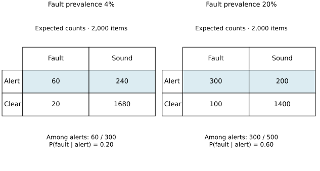

# 1 · Turn evidence into an update

**Prerequisite:** [Chapter 0](./00_preparation.md), especially joint and conditional probabilities. **Objectives:** construct a finite Bayesian update; distinguish likelihood from posterior; explain base rates and conditional independence; derive odds and sequential updates; evaluate dependence and transfer between populations. **Study time:** 6–8 hours for the foundation reading, lab, and original exercises; use separate study sessions for appendix work and optional practice.

## An alarm is evidence, not a verdict

A factory's quality alarm catches 90% of defective items and falsely flags 5% of sound items. Only 2% of items are defective. An item triggers the alarm. Before calculating, predict whether its probability of being defective exceeds one half. Then name the population to which your prediction applies.

The question reverses the direction of the information provided. We know how an alarm behaves given defect status; we want uncertainty about defect status given an alarm. Bayes' rule performs this reversal while retaining the different starting frequencies of defective and sound items. Evidence can strongly favour a hypothesis without making it more probable than all alternatives combined.

We first reason through a population table, then derive the equation. Both tracks describe the same operation: weight possibilities by how well they predict what was observed, then rescale. The examples are hypothetical. Their detector characteristics are stipulated for teaching, not measured performance claims about a real inspection system.

## Worked example: the factory alarm

Imagine 10,000 representative items. About 200 are defective and 9,800 sound. Expected alarms are $200(0.90)=180$ among defective items and $9800(0.05)=490$ among sound items. Among all 670 alarms, only 180 concern defects. Thus the posterior defect probability is $180/670\approx0.269$.

The full table includes negative results as well. This makes the denominators visible rather than leaving the complement implicit.

| Item status | Alarm | No alarm | Total |
|---|---:|---:|---:|
| Defective | 180 | 20 | 200 |
| Sound | 490 | 9,310 | 9,800 |
| Total | 670 | 9,330 | 10,000 |

These are expected counts under the model; a realised batch will usually differ. The calculation itself does not require physically inspecting 10,000 items. Multiplying every entry by the same positive constant leaves every conditional fraction unchanged. The imagined population is a device for representing joint probabilities.

The alarm is useful evidence: it raises defect probability from 2% to about 27%. Yet most alarms still concern sound items because sound items dominate the incoming population. Calling the alarm “accurate” without stating sensitivity, false-alarm rate, and prevalence conceals the quantities required for the update.

For this calculation we assume defective and sound are mutually exclusive and exhaustive, the inspected item comes from the population with 2% prevalence, and the conditional alarm rates apply to it. We also treat those rates as known. Uncertainty in calibration data would require another layer of modelling, rather than treating estimated rates as exact constants forever.

**Retrieve without looking:** Which row estimates the sensitivity? Which column answers the question about a flagged item? Explain why those two ratios have different denominators. If you reverse them, reconstruct the joint table before using an equation.

## Deriving the update from joint probability {#deriving-the-update-from-joint-probability}

The product rule expresses the same joint event in two orders:

$$P(H,y)=P(y\mid H)P(H)=P(H\mid y)P(y).$$

For an observation with $P(y)>0$, divide by its probability:

$$P(H\mid y)=\frac{P(y\mid H)P(H)}{P(y)}.$$

The **prior** $P(H)$ is uncertainty before using this observation. It may already incorporate earlier evidence. The **likelihood** $P(y\mid H)$ evaluates the probability of the observed event under a specified hypothesis. The **posterior** $P(H\mid y)$ is uncertainty after incorporating that event. The **evidence** $P(y)$ is its probability under the full prior mixture of hypotheses.

For mutually exclusive and exhaustive possibilities $H_1,\ldots,H_K$, total probability supplies the denominator:

$$P(y)=\sum_{j=1}^K P(y\mid H_j)P(H_j).$$

An update table therefore needs four operations: specify prior masses, evaluate the observed-data likelihood for each hypothesis, multiply, and divide every product by the sum of products. In the alarm example:

| Hypothesis | Prior | Alarm likelihood | Joint weight | Posterior |
|---|---:|---:|---:|---:|
| Defective | 0.02 | 0.90 | 0.018 | 0.268657 |
| Sound | 0.98 | 0.05 | 0.049 | 0.731343 |
| Total | 1 | — | 0.067 | 1 |

The likelihood column need not sum to one because its entries condition on different hypotheses. Under one fixed hypothesis, probabilities across all possible alarm outcomes must sum to one. Across hypotheses, the prior and posterior columns must each sum to one. The joint column instead sums to the probability of the observed alarm.

At fixed data, multiplying all likelihoods by the same positive constant leaves the posterior unchanged after normalisation. This explains the notation “posterior proportional to likelihood times prior.” But an arbitrarily rescaled likelihood no longer yields the actual evidence when summed against the prior. Keep the normalising constants when the probability of the observation is itself the target.

## Worked example: three possible machine states

A printer is in exactly one of three states during a diagnostic: ready, worn, or jammed. Their prior probabilities are 0.60, 0.30, and 0.10. A warning light appears with probabilities 0.05, 0.40, and 0.90 in those states respectively. The states and likelihoods are a deliberately simple diagnostic model; the state remains fixed during the tests.

| State | Prior | Warning likelihood | Joint weight | Posterior after warning |
|---|---:|---:|---:|---:|
| Ready | 0.60 | 0.05 | 0.030 | 0.125 |
| Worn | 0.30 | 0.40 | 0.120 | 0.500 |
| Jammed | 0.10 | 0.90 | 0.090 | 0.375 |
| Total | 1.00 | — | 0.240 | 1.000 |

For example, the worn weight is $0.30(0.40)=0.12$. The sum is 0.24, so its posterior is $0.12/0.24=0.50$. A jam makes a warning most likely, but worn is the most probable state after a warning because it started three times as probable. Ranking likelihoods and ranking posteriors answer different questions.

Now a vibration test is positive. Conditional on state, suppose this result is independent of the warning, with positive-test probabilities 0.10, 0.60, and 0.20 for ready, worn, and jammed. Use the first posterior as the next prior. The new weights are $0.125(0.10)=0.0125$, $0.50(0.60)=0.30$, and $0.375(0.20)=0.075$. Their sum, 0.3875, is the probability of positive vibration **given the warning**, under this model.

Normalising gives posterior probabilities approximately 0.032258, 0.774194, and 0.193548. Check the whole calculation directly: multiply the original priors by both likelihoods. This gives 0.003, 0.072, and 0.018, totalling 0.093. Dividing each by 0.093 gives the same posterior. Also $0.24(0.3875)=0.093$, as required by the product rule.

The second result reduces the jammed probability even though it is called a “positive” test. What matters is its relative likelihood: positive vibration is more characteristic of worn than jammed. Test names are not numerical evidence. Nor does the result justify absolute certainty: ready retains positive mass because both observed results remain possible in that state.

## Odds measure the strength of evidence

For two hypotheses with positive priors and likelihoods, divide their Bayes equations. The common evidence cancels:

$$\frac{P(H_1\mid y)}{P(H_0\mid y)}=
\frac{P(H_1)}{P(H_0)}\frac{P(y\mid H_1)}{P(y\mid H_0)}.$$

For exhaustive binary alternatives the left side is posterior odds. If a hypothesis has probability $p$, its odds against the complement are $o=p/(1-p)$; conversely $p=o/(1+o)$. Odds of three mean three to one, or probability three quarters, rather than probability three.

For the factory alarm, prior odds are $0.02/0.98=1/49$. The likelihood ratio is $0.90/0.05=18$, so posterior odds are $18/49$. Converting back gives $18/(49+18)=18/67$, matching the population table. The alarm multiplies the odds by eighteen; it does not multiply probability by eighteen. A likelihood ratio greater than one favours the numerator hypothesis, while a ratio below one favours the denominator.

Taking logarithms turns the multiplication into addition:

$$\log\frac{P(H_1\mid y)}{P(H_0\mid y)}=
\log\frac{P(H_1)}{P(H_0)}+\log\frac{P(y\mid H_1)}{P(y\mid H_0)}.$$

Log odds are useful for accumulating several pieces of evidence and for numerical stability. With more than two hypotheses, the same ratio calculation compares any chosen pair, but that pair's odds alone do not determine their probabilities among all hypotheses. The remaining alternatives still need to be included in the normalisation.

For simple hypotheses that fully specify the observation distribution, the likelihood ratio is a **Bayes factor**. A model with unknown parameters must first average its likelihood over its within-model prior. Comparing maximised likelihoods gives a different object. [The model-evidence bridge](./adv-02_model_evidence.md) develops this distinction after the core course.

The positivity qualifications are substantive. A zero prior remains zero under ordinary finite-likelihood updating. A hypothesis assigning zero probability to the observed event receives zero posterior mass if other hypotheses give positive evidence. If every hypothesis assigns zero, the denominator vanishes and the update is undefined. Neither adding tiny numbers silently nor pretending one hypothesis won repairs that model failure.

## Sequential evidence and dependence

The general factorisation for two observations is

$$P(y_1,y_2\mid H)=P(y_1\mid H)P(y_2\mid H,y_1).$$

Consequently the first posterior can serve as the prior for a second update using the second **conditional** likelihood. This is always the appropriate factorisation when the conditional probabilities exist. Replacing the last factor by $P(y_2\mid H)$ needs the additional assumption that observations are independent given $H$.

Order does not affect the final posterior if the same joint model and observations are used consistently. It does affect the intermediate distributions and the form of conditional factors. Treating observations as independent merely because they arrived at different times silently substitutes a different joint model.

### Worked comparison: two sensors or two reports

Consider a separate screening system with a 10% defect prior. Each of two sensors has sensitivity 0.80 and false-alarm probability 0.20. After the first alarm, weights are 0.08 for defective and 0.18 for sound; the posterior is $0.08/0.26=4/13\approx0.307692$.

If the sensors are conditionally independent given status, two alarms have likelihoods $0.80^2=0.64$ and $0.20^2=0.04$. Multiplying by the original priors gives weights 0.064 and 0.036. Their sum is 0.10, so the defect posterior is 0.64. The second independent test supplies additional evidence under the stated model.

Now suppose the second “alarm” is simply a copied report of the first. Given the first report, the duplicate occurs with probability one under either status. Both posterior weights are multiplied by one, so the posterior remains $4/13$. The repeated text is not another sensor observation.

A partially dependent case falls between these examples. Suppose, after the first alarm, the probability of a second alarm is 0.90 for defective items and 0.60 for sound items. The joint two-alarm likelihoods are $0.80(0.90)=0.72$ and $0.20(0.60)=0.12$. Weighted by the original priors, they give 0.072 and 0.108, hence defect posterior $0.072/0.18=0.40$. These conditional rates are compatible with the stated individual sensor rates: after no first alarm, second-alarm probabilities can be 0.40 and 0.10 respectively.

The independence shortcut would report 0.64 where this dependent model gives 0.40. Shared failure conditions make a repeated alarm less surprising among sound items, weakening its added evidence. “Two tests” does not specify the joint likelihood: calibration must address their dependence too.

Conditional independence also differs from marginal independence. In the independent-sensor model above, each sensor alarms with probability 0.26, but both alarm with probability 0.10, rather than $0.26^2=0.0676$. Averaging over their shared unknown defect status induces dependence. The observations can inform each other because both reveal information about that status.

**Retrieve without looking:** What likelihood ratio does a perfect duplicate contribute after the first report? What assumption makes the printer's two likelihoods multiply? Explain both using the conditional factorisation, not the number of rows in a dataset.

## Population transfer and assumptions hidden by notation {#population-transfer-and-assumptions-hidden-by-notation}

We often write the model as an implicit condition: $P(H\mid y,M)$. Its assumptions include the population, measurement process, and permitted hypotheses. The arithmetic is exact given those inputs, but choosing them requires judgement. A posterior probability is not a model-independent property of the observation.

For example, suppose the factory alarm is applied to a preselected population with 10% defects instead of 2%. Assume, provisionally, that sensitivity and false-alarm rates remain 0.90 and 0.05. The alarm weights become $0.10(0.90)=0.09$ and $0.90(0.05)=0.045$. The defect posterior becomes $0.09/0.135=2/3$. The same likelihood ratio now acts on different prior odds.

This is a calculation under a transfer assumption, not proof that sensor performance transfers. A new population might contain different defect types, changing sensitivity. Selection based on a previous related test might change the alarm rate even conditional on defect status. If the 10% prevalence already incorporates earlier inspection information, using that inspection again as fresh evidence double counts it.

Before transferring an analysis, identify what was selected, which information the prior already uses, and which conditional observation probabilities remain defensible. Changing a base rate is sometimes enough, but not when selection changes the within-status observation process. [Appendix 1](./appendix-01_probability.md) provides further conditioning practice.

A posterior is also not a decision. Whether to stop production depends on the consequences of a missed defect, unnecessary inspection, and delay. Two decision makers could agree on every posterior probability while choosing different actions because their costs differ. [Chapter 3](./03_prediction.md) connects inference to explicit loss.

<!-- VISUAL01:02 BEGIN -->

### Visual investigation: conditioning selects the alert population

Imagine a different quality-control population with 2,000 items. The alert catches 75% of faults and flags 12.5% of sound items. Before comparing the panels, predict what happens to the fraction of genuine alerts when faults become more common while those two conditional rates stay fixed.

**Read the figure.** This is a count table, not a density plot: rows are alert outcomes and columns are true item states. Counts are expected counts under the stipulated probabilities, not a newly collected dataset. The shaded alert row is the population selected by conditioning.

| Fault prevalence | Fault + alert | Fault + clear | Sound + alert | Sound + clear | Fault given alert |
|---|---:|---:|---:|---:|---:|
| 0.04 | 60 | 20 | 240 | 1680 | 60/300 = 0.20 |
| 0.20 | 300 | 100 | 200 | 1400 | 300/500 = 0.60 |

**Mathematical connection.** With prevalence $q$, the denominator is $P(A)=0.75q+0.125(1-q)$, so $P(F\mid A)=0.75q/P(A)$. The 0.75 is $P(A\mid F)$; it is not the answer to the reversed question. Multiplying every count by the same population factor leaves this ratio unchanged. If an assumed alert probability is zero, the conditional probability is undefined, not zero.

**Original unscored exploration — predict, observe, explain.** Predict the direction of change if only the false-alert rate falls. Observe which one cell in the alert row changes at fixed prevalence. Explain the denominator in words, then transfer the alert system to a third site: which conditional-rate stability assumptions would you need? Neither transportability nor the true prevalence is established by this synthetic table.

[Open the guided conditioning experiment](../../apps/bayesian/explorer.html#visual-conditioning) to predict, change one setting, and explain the result.

<!-- VISUAL01:02 END -->

## The observation protocol is part of the likelihood

Suppose the factory now performs five tests on each item and reports only whether any test alarms. Assume all five tests have the original conditional performance and are independent given item status. The report “at least one alarm” describes a different event from “the first test alarms” or “all five tests alarm.” It needs its own likelihood.

Calculate the complement first. Under defect status, the probability of no alarms is $0.10^5$; under sound status it is $0.95^5$. The likelihoods of the reported event are therefore $1-0.10^5=0.99999$ and $1-0.95^5\approx0.226219$. With the original 2% defect prior, the posterior is

$$\frac{0.02(0.99999)}{0.02(0.99999)+0.98(0.2262190625)}\approx0.082748.$$

This is lower than the posterior after a specified single test alarms. With five opportunities, at least one false alarm is substantially more common among sound items. The report no longer tells us which tests alarmed or how many did. If the complete five-result sequence is available, conditioning on that sequence uses more detailed information and may give a different posterior.

The lesson is not that additional measurements inherently weaken evidence. The recorded event changed. A system that tests repeatedly but displays only its most striking result must be analysed through that reporting protocol. Asking what was measured and what was retained can matter as much as knowing an individual sensor's sensitivity.

Another protocol can make a particular datum uninformative. If a dataset deliberately includes only flagged items, the fact that a selected row is flagged adds nothing beyond that selection condition. Its appropriate prior population already consists of flagged items. Starting with that population and then updating again on the known flag would reuse information. Whenever an update seems surprisingly decisive, write the complete conditioning information beside both the prior and likelihood and inspect whether the same observation appears twice.

## From named hypotheses to parameter values

A finite table can list candidate values of an unknown probability instead of named machine states. It then describes a discrete prior over those candidates. A numerical approximation to a continuous parameter requires extra care: a grid point usually represents a small interval whose mass is density times width. Giving every candidate equal mass on an uneven grid is generally not a uniform prior on the underlying scale.

A continuous model replaces the denominator's sum by an integral. The principle remains weighting and normalisation, but probabilities belong to intervals rather than individual parameter points. [Chapter 2](./02_beta_binomial.md) develops that transition with an exact distribution against which a grid can be checked. [Appendix 4](./appendix-04_numerics.md) explains how log weights avoid underflow without changing probability ratios.

## Lab

Run Lab 1, also available as [Python](../../downloads/bayesian/labs/01_bayes.py). Reproduce the factory update table and inspect the [before-and-after plot](../../downloads/bayesian/artifacts/figures/01_alarm.svg). Check the odds conversion separately from the table division. Independent representations are useful because a consistently repeated coding error can otherwise look like agreement.

Then investigate the lab's altered base rate and a second alarm. State whether the second datum is a new conditionally independent measurement, a dependent measurement, or a duplicate. Report the prior population, likelihood assumptions, evidence denominator, and normalised posterior. A short explanation of those inputs is part of the result, not decoration added after the calculation.

## Summary

Bayesian updating reverses conditioning through a shared joint distribution. The evidence normalises prior-weighted likelihoods, while odds isolate the relative strength of an observation. Sequential updating agrees with joint updating when both use the same model, including dependence. A zero-support model, duplicated information, or an inappropriate reference population can invalidate an apparently tidy calculation. Carry the assumptions alongside the posterior.

## Exercises

**1.1 — Concept.** A sensor has P(alarm | defect)=0.90 and P(alarm | sound)=0.05. Why do these two alarm likelihoods sum to 0.95 rather than one? Which probabilities should sum to one instead?

**1.2 — Calculation.** With a 20% defect base rate, calculate the posterior after one alarm and after a negative result. Use sensitivity P(alarm | defect)=0.90 and false-alarm probability P(alarm | sound)=0.05.

**1.3 — Applied.** Use defect base rate 0.02, sensitivity 0.90 and false-alarm probability 0.05. A technician reports the same alarm twice. Another technician uses an independent sensor with identical conditional performance. Calculate the two-alarm posterior for the independent case and explain why it is inappropriate for the duplicated report.

[Solutions](./course-solutions.md) are available after an attempt.

## Further reading

[Allen Downey's Think Bayes, Bayes' theorem](https://allendowney.github.io/ThinkBayes2/chap02.html) develops computational updating. [Johnson, Ott, and Dogucu's Bayes Rules!, opening chapter](https://www.bayesrulesbook.com/chapter-1) introduces the broader modelling perspective. These primary teaching resources complement the original worked examples above.
