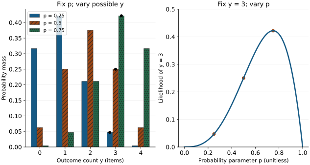
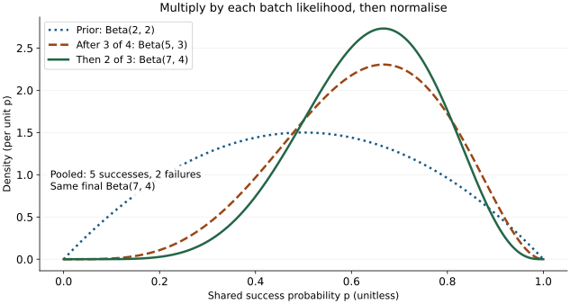

# 2 · Learn an unknown probability

**Prerequisites:** [Chapter 1](./01_bayes.md), elementary powers, and the distinction between density and probability mass. [Appendix 2](./appendix-02_calculus.md) supplies integration and transformation support. **Objectives:** derive a beta-binomial update; calculate posterior summaries; distinguish interval meanings; check a grid against an analytic answer; derive normalisation and moments; assess boundary behaviour and prior sensitivity.

## From an observation to a model

A fictional service completes 14 of 20 visits within its target. What should we say about its underlying completion probability $\theta$? The observed proportion, 0.7, summarises the data but does not identify the probability exactly. Before reading further, sketch where plausible probabilities might lie and decide whether you would rule out one half.

Here $\theta$ is one unknown parameter shared by visits. The observed count is $y=14$; a count before observation is the random variable $Y$. A posterior describes uncertainty about $\theta$. A predictive distribution describes uncertain future outcomes. Those distributions have different supports and answer different questions.

The intuitive track treats updating as adjusting weights on candidate probabilities. The mathematical track recognises the resulting density and obtains its normalising constant and moments. An exact answer provides a reference for numerical approximation; using a conjugate family does not exempt us from explaining the model.

## Specify the sampling assumptions {#specify-the-sampling-assumptions}

Write the sampling model before choosing a prior:

$$Y\mid\theta\sim\operatorname{Binomial}(n,\theta),\qquad
p(y\mid\theta)=\binom ny\theta^y(1-\theta)^{n-y}.$$

We assume a fixed number of observed binary trials, complete outcome recording, a common success probability, and independence conditional on that probability. The target population must also be specified: these visits need to represent the service conditions to which the conclusion will be applied. If staffing changes, visits cluster within people, or failed visits disappear from records, a simple binomial likelihood can misrepresent the information.

For a particular ordered binary sequence with $y$ successes, the likelihood is the product $\theta^y(1-\theta)^{n-y}$. For its count, the binomial coefficient counts all sequences with that total. At fixed observed $n,y$, the coefficient does not depend on $\theta$, so both representations produce the same posterior. Their observed-data probabilities differ because a single sequence and a collection of sequences are different events.

The likelihood is a function of $\theta$ with the observations fixed. It need not integrate to one over candidate parameter values. Normalisation across parameters happens only after multiplying by the prior. Do not confuse a plot of this function with a posterior density.


<!-- VISUAL01:03 BEGIN -->

### Visual investigation: from possible outcomes to a likelihood

Use four independent trials with a common success probability. The left panel asks what counts could occur at each fixed probability. After the count three is observed, the right panel asks which parameter values assign it more probability. Predict which object has to sum to one before inspecting the panels.



**Read the figure.** On the left the horizontal axis is the integer count $y$, and each bar is a probability mass. Each set of five bars sums to one. Black points select the same outcome, $y=3$, across three different models. On the right the horizontal axis is the probability parameter $p$; height is the likelihood of that fixed observation. The connecting curve does not describe a distribution of future counts or a posterior density for $p$.

| Fixed probability p | P(Y = 3 given p), for n = 4 |
|---:|---:|
| 0.25 | 0.046875 |
| 0.50 | 0.250000 |
| 0.75 | 0.421875 |

**Mathematical connection.** The same expression $\binom43p^3(1-p)$ serves two roles because different arguments are held fixed. Its integral over $p$ is not required to equal one. A posterior density additionally multiplies this likelihood by a prior density and divides by the evidence.

**Original unscored exploration — predict, observe, explain.** Predict how the selected points would change if the observed count were one rather than three. Observe the symmetry under exchanging success and failure, and explain why the count axis and the parameter axis cannot be interchanged without changing the question. Independence and a shared probability are assumptions; the plot does not test them.

<!-- VISUAL01:03 END -->

## A prior density on a probability {#a-prior-density-on-a-probability}

A beta prior has shape parameters $\alpha,\beta>0$ and density

$$p(\theta)=\frac{\theta^{\alpha-1}(1-\theta)^{\beta-1}}{B(\alpha,\beta)},\qquad 0<\theta<1,$$

where

$$B(\alpha,\beta)=\int_0^1 t^{\alpha-1}(1-t)^{\beta-1}\,dt.$$

The beta function is the area under the unnormalised shape. Dividing by that area makes total prior probability one. Positive shape parameters ensure a finite integral even when the density grows without bound near an endpoint. A beta density with shapes below one can be unbounded yet integrable; it does not assign point mass to zero or one.

Beta(1,1) has constant density on the probability scale. Beta(2,2) has density $6\theta(1-\theta)$, rising towards the centre and falling towards the boundaries. Its normalising integral is $1/2-1/3=1/6$. Beta(0.5,0.5) puts more probability near the boundaries. These distributions express different uncertainty, even though all three are symmetric about one half.

“Flat” describes a particular parameterisation, not an absence of assumptions. A uniform prior on $\theta$ is not uniform on the odds or log odds. Nor does a density height give the probability of an exact value: under these continuous priors, every individual value has zero mass. To express a genuine prior possibility that a process never succeeds, a model would need an explicit atom at zero as well as any continuous component.

## Worked example: derive and check the service posterior

Use Beta(2,2) as an illustrative prior. It expresses uncertainty centred at one half; it is not claimed to encode measured service knowledge. Multiplication gives

$$p(\theta\mid y)\propto
\theta^{\alpha-1+y}(1-\theta)^{\beta-1+n-y}.$$

Recognise the exponents as a beta density with updated shapes

$$a=\alpha+y,\qquad b=\beta+n-y.$$

Normalising the kernel gives

$$p(\theta\mid y)=\frac{\theta^{a-1}(1-\theta)^{b-1}}{B(a,b)}.$$

For 14 successes and 6 failures, $a=16$ and $b=8$. The prior and posterior belong to the same family, so the beta prior is **conjugate** to the binomial likelihood. This is a property of the algebra, not evidence that the prior is scientifically suitable.

We can also retain all constants and calculate the probability of the observed count:

$$p(y)=\binom ny\frac{B(\alpha+y,\beta+n-y)}{B(\alpha,\beta)}.$$

For positive integer shapes, $B(a,b)=(a-1)!(b-1)!/(a+b-1)!$. Here $B(16,8)\approx2.54938672\times10^{-7}$, and the count evidence is $15/253\approx0.05928854$. Dividing likelihood times prior by this evidence recovers the same normalised Beta(16,8) density. The evidence is a probability for the observed count under the prior model; it is not a probability that the model is true.

To derive moments rather than merely look them up, insert an extra power of $\theta$ into the beta integral:

$$E[\theta^r\mid y]=\frac{B(a+r,b)}{B(a,b)},\qquad r\geq0.$$

The recurrence $B(a+1,b)=aB(a,b)/(a+b)$ follows from beta-integral identities. Applying it once and twice yields

$$E[\theta\mid y]=\frac{a}{a+b},\qquad
E[\theta^2\mid y]=\frac{a(a+1)}{(a+b)(a+b+1)}.$$

Here is a way to establish that recurrence. Inside the beta integral, insert $1=t+(1-t)$ to obtain $B(a,b)=B(a+1,b)+B(a,b+1)$. Next integrate the derivative of $t^a(1-t)^b$ from zero to one. Its endpoint values vanish for positive shapes, giving $aB(a,b+1)=bB(a+1,b)$. Combining the two identities yields the recurrence. This argument also explains why the positivity conditions cannot simply be omitted: the endpoint behaviour is part of the derivation, not a technicality unrelated to normalisation.

Subtract the squared mean to obtain

$$\operatorname{Var}(\theta\mid y)=\frac{ab}{(a+b)^2(a+b+1)}.$$

Thus the service posterior mean is $16/24=2/3$, variance $2/225\approx0.00888889$, and standard deviation approximately 0.094281 on the probability scale. These quantify uncertainty about a parameter. They are not the variance and standard deviation of individual binary outcomes.

The posterior mean can also be written, for $n>0$, as

$$E[\theta\mid y]=\frac{\alpha+\beta}{\alpha+\beta+n}\frac{\alpha}{\alpha+\beta}
+\frac{n}{\alpha+\beta+n}\frac yn.$$

For this example it is $(4/24)(0.5)+(20/24)(0.7)=2/3$. The prior pulls the mean towards one half, while twenty observations receive more weight than the prior concentration of four. The distribution, not just this average, remains the result of inference.

**Retrieve without looking:** Why do successes increment one shape and failures the other? Which constant can be omitted while finding the posterior shape, and why must it return when calculating the count's evidence? Use [Appendix 2](./appendix-02_calculus.md) if the normalising integral is unfamiliar.

## Concentration and the meaning of prior information

Write $\kappa=\alpha+\beta$ and $\mu=\alpha/\kappa$, so $\alpha=\mu\kappa$ and $\beta=(1-\mu)\kappa$. The prior variance becomes $\mu(1-\mu)/(\kappa+1)$. At fixed mean, increasing concentration narrows uncertainty and gives the prior more weight in the posterior mean.

For example, Beta(2,2) and Beta(6,6) both centre on one half, but their prior variances are 0.05 and approximately 0.019231. With the service data, the latter produces Beta(20,12), with mean 0.625 instead of approximately 0.667. The likelihood has not changed; a more concentrated prior resists movement away from its centre.

Calling concentration a “prior sample size” is a useful description of this weighted-mean identity. It is not proof that someone observed that many previous visits. Interpreting shape parameters as literal historical counts requires specifying the earlier baseline prior and observation model. Counts added to a uniform prior, for example, shift its existing shape parameters as well.

Select priors before examining the same observations used in the likelihood, or explicitly model the process used to estimate them. Consider what probability ranges and future data patterns they imply. Conjugacy makes sensitivity comparisons easy, but cannot decide which assumptions suit the application. [Chapter 3](./03_prediction.md) uses prior prediction to make those implications visible.

## Summaries, credible sets, and interpretation

The posterior mean minimises posterior expected squared error. To see why, expand $E[(d-\theta)^2\mid y]$ as $\operatorname{Var}(\theta\mid y)+(d-E[\theta\mid y])^2$. The median minimises expected absolute error. For $a,b>1$, the beta mode is $(a-1)/(a+b-2)$; for Beta(16,8) it is approximately 0.681818. Different summaries are appropriate to different questions and losses.

The median's role also has an intuitive explanation. Moving a proposed estimate slightly to the right decreases absolute error for parameter values to its right and increases it for values to its left. Those effects balance when half the posterior mass lies on each side. Squared error instead gives greater influence to large misses, which pulls the optimum towards a long tail. Reporting a mean or median therefore embeds a choice about how estimation errors matter, even before a larger operational decision is considered.

An equal-tailed 90% credible interval leaves 5% probability below its lower endpoint and 5% above its upper endpoint. For the service posterior it is approximately $[0.503565,0.813656]$. The probability of exceeding one half is approximately 0.953430. These are distinct summaries: a range containing specified posterior mass and the mass above a particular target.

```python
from scipy.stats import beta
interval = beta.ppf([0.05, 0.95], 16, 8)
probability = beta.sf(0.5, 16, 8)
```

The interval has 90% posterior probability conditional on this prior, likelihood, and dataset. It is not a statement about 90% of future visit outcomes, nor a guarantee that the model is appropriate. A frequentist 90% confidence procedure instead describes coverage across repeated samples under its assumptions. Credible intervals may have good or poor repeated-sampling coverage; the definitions are not interchangeable.

A credible **set** need not be an interval. A highest-density set includes parameter values above a suitable density threshold; it may be disconnected for a multimodal posterior. For a skewed unimodal density, a highest-density interval can be shorter than the equal-tailed interval. The shortest interval is not automatically the best communication choice: its parameterisation and definition must be stated.

Under a monotone increasing transformation, transformed endpoints preserve an equal-tailed interval's probability and tail allocation. A decreasing transformation reverses their order. Highest-density sets generally do not transform this way because density heights change with the Jacobian. Quantiles concern probability mass; modes and density thresholds depend on the chosen scale.

## Worked example: no successes, skewness, and sensitivity

A separate pilot records zero successes in six independent trials with one common unknown success probability. Compare three proper priors centred at one half. They represent progressively stronger starting concentration, not three equally justified beliefs about every pilot.

| Prior | Posterior | Posterior mean | Equal-tailed 90% interval |
|---|---|---:|---:|
| Beta(1,1) | Beta(1,7) | 0.125000 | [0.007301, 0.348164] |
| Beta(2,2) | Beta(2,8) | 0.200000 | [0.041023, 0.429136] |
| Beta(10,10) | Beta(10,16) | 0.384615 | [0.235586, 0.543933] |

Each row adds zero to the first shape and six to the second. The posterior means follow by dividing the first updated shape by their sum. Six failures have substantial influence, but cannot make a continuous proper prior collapse to certainty at zero. The concentrated prior gives a much higher posterior mean; retaining it would require substantive support for strong prior confidence near one half.

The first row can be checked without numerical integration. Beta(1,7) has density $7(1-\theta)^6$ and cumulative distribution

$$F(\theta)=1-(1-\theta)^7.$$

Solving $F(q)=p$ gives $q=1-(1-p)^{1/7}$. The median is approximately 0.094276, below the mean 0.125 because the posterior has a long right tail. Its density reaches its maximum at the boundary zero, yet the probability of exactly zero is still zero.

Because this density decreases throughout its support, its highest-density 90% interval is $[0,1-0.1^{1/7}]\approx[0,0.280314]$. This differs from the equal-tailed interval in the table. Both have the stated posterior mass; they allocate the excluded probability differently. Zero successes alone does not choose between these reporting conventions.

Transform the first row's equal-tailed interval to odds $o=\theta/(1-\theta)$. Applying the transformation to both endpoints gives approximately $[0.007355,0.534127]$, still containing 90% posterior probability. Transforming a mean by the same formula does not generally give the mean of transformed values, because nonlinear functions do not commute with averaging.

For a sharper counterexample, let $z=\log[\theta/(1-\theta)]$. Its density is $p_z(z)=p_\theta(\theta)\theta(1-\theta)$, since $d\theta/dz=\theta(1-\theta)$. For Beta(1,7), this is proportional to $\theta(1-\theta)^7$, maximised at $\theta=1/8$, or $z\approx-1.94591$. The log-odds density therefore has an interior mode even though the probability-scale density peaks at zero. A density peak is not an invariant probability statement.

## Sequential updating and sufficiency

Return to the service data. Observing 6 successes in ten visits and then 8 in ten visits gives Beta(8,6) followed by Beta(16,8). Combining all observations first gives the same result. The likelihood factors across batches because they share one fixed $\theta$ and outcomes are conditionally independent. Reusing the original prior for each batch and then multiplying the two posterior densities would count the prior twice.

Within this model, the total success count is **sufficient** for $\theta$: knowing the order adds no parameter information beyond the count. Ordering can nevertheless challenge the model. Fourteen consecutive successes followed by six failures has the same count as an interspersed sequence, but may suggest changing conditions. Sufficiency within a model does not make the discarded information irrelevant to checking that model.

If the batches concern different services or a changed process, carrying one posterior forward as though nothing changed needs justification. A dynamic or hierarchical model may be more appropriate. Sequential coherence is a property of a consistent probability model, not permission to ignore changes in the data-generating process.

Two limiting checks help audit an implementation. With no observations, both added counts are zero and the posterior must equal the prior. With many independent observations whose success fraction stays away from the boundaries, fixed prior concentration receives progressively less weight, and parameter uncertainty decreases. Neither check authorises duplicating existing records to increase the count: copied outcomes do not create independent likelihood factors. A narrow posterior obtained from such duplication can be numerically correct for the supplied array and scientifically misleading.

Also distinguish robustness to a prior from robustness to the observation model. Two reasonable beta priors may give similar answers in a large dataset while both analyses retain the same unrepresentative sample or omitted clustering. A sensitivity table should say which assumptions were varied and which were held fixed. Agreement across its rows only answers the comparison actually performed.


<!-- VISUAL01:04 BEGIN -->

### Visual investigation: normalise each update and count each batch once

A new synthetic sequence starts at $\operatorname{Beta}(2,2)$. The first batch contains three successes in four trials; a separate second batch contains two successes in three. Predict whether reversing the batch order changes the final posterior under a single shared parameter.



**Read the figure.** The horizontal coordinate is that common probability and the vertical coordinate is density per unit probability. Dotted, dashed and solid curves identify successive stages even without colour. Every curve has area one; an increased peak is not extra total probability.

| Available information | Posterior | Mean |
|---|---|---:|
| Prior only | Beta(2,2) | 0.500000 |
| First batch only | Beta(5,3) | 0.625000 |
| Both distinct batches | Beta(7,4) | 0.636364 |

**Mathematical connection.** Multiplying the first density by the Binomial likelihood and dividing by $P(Y_1=3)=8/35$ gives the second curve. The conditional evidence of the second count is $P(Y_2=2\mid Y_1=3)=3/8$. Updating that second density gives the solid curve. The exponents accumulate as successes and failures: $2+3+2=7$ and $2+1+1=4$. Pooling the data therefore gives the same parameter posterior.

The evidence of two separately recorded batch counts is not the evidence of only their pooled count: the sample spaces have different combinatorial factors. Also, adding the old first batch to the already updated prior would count that information twice.

**Original unscored exploration — predict, observe, explain.** Reverse the two batches on paper and observe the same final parameters. Explain why this relies on a shared parameter and conditional independence, then name a time-varying mechanism under which simple pooling would be questionable. This is an analytic identity, not a demonstration that real batches are exchangeable.

<!-- VISUAL01:04 END -->

## Grid inference: densities become cell masses {#grid-inference-densities-become-cell-masses}

Divide zero to one into cells with widths $\Delta_j$ and midpoints $\theta_j$. Approximate the posterior mass in each cell by

$$w_j=\frac{p(\theta_j)p(y\mid\theta_j)\Delta_j}
{\sum_k p(\theta_k)p(y\mid\theta_k)\Delta_k}.$$

These weights sum to one; density heights generally do not. Equal widths cancel from the ratio, which can hide the distinction. Midpoints also avoid evaluating beta log densities exactly at endpoints, but do not automatically resolve a sharp boundary peak. Refinement and an independent reference remain necessary.

On an unequal grid, stable computation includes the widths in the log weights:

```python
import numpy as np
from scipy.stats import beta, binom
edges = np.linspace(0, 1, 101) ** 2
widths = np.diff(edges)
grid = (edges[:-1] + edges[1:]) / 2
logw = beta.logpdf(grid, 2, 2) + binom.logpmf(14, 20, grid)
logw = logw + np.log(widths)
w = np.exp(logw - logw.max())
w = w / w.sum()
mean = grid @ w
fraction_above_half = np.clip((edges[1:] - 0.5) / widths, 0, 1)
probability = w @ fraction_above_half
```

The fraction allocates a threshold-crossing cell in proportion to the part above one half, treating its density as constant at the midpoint approximation. This avoids assigning the entire crossing cell to one side. It still has quadrature error because the true density varies inside the cell.

For the service posterior, this 100-cell grid gives mean approximately 0.666667 and probability above one half approximately 0.953239, compared with the exact 0.953430. With 5,000 cells the tail estimate is approximately 0.95343007. Omitting widths from the 100-cell grid gives a mean approximately 0.659574: the greater density of grid points near zero has accidentally changed the represented measure.

A mean agreeing closely with theory does not establish accurate tail probabilities. On an equal-width 20-cell midpoint grid, the mean is already approximately 0.666667, while summing cells above one half gives approximately 0.954989. Always check the requested quantity as resolution increases. Boundary singularities and small tail masses can demand more care than central averages; [Appendix 4](./appendix-04_numerics.md) develops those numerical checks.

**Retrieve without looking:** Why must an unequal grid include widths? Why can a transformed credible interval retain its mass while losing the highest-density property? Use the area interpretation from [Chapter 0](./00_preparation.md) to connect these two questions.

## Lab

Run Lab 2, or [Python](../../downloads/bayesian/labs/02_beta_binomial.py). Its [density plot](../../downloads/bayesian/artifacts/figures/02_update.svg) shows the prior and posterior on the same probability scale. Compare grid sizes, sequential updates, and prior choices. Report a mean, a clearly labelled 90% interval, and a probability relevant to a service target.

The supplied lab saves the probability above one half; exercise 2.3 asks about a different threshold. Record thresholds explicitly so a correct number cannot be attached to the wrong question. Report resolution and error against the analytic reference alongside any plotted approximation. The unequal-grid calculation above is an additional investigation, not a claim about what the supplied lab already saves.

## Summary

Beta-binomial conjugacy follows by multiplying powers and normalising with a beta integral. The posterior mean balances data and prior concentration, while the full distribution carries uncertainty and skewness. Credible sets describe parameter uncertainty conditional on a model. Sequential updates agree when the shared-parameter assumptions agree. Grids approximate probability mass using density and cell width; their accuracy must be checked for the particular summary being reported.

## Exercises

**2.1 — Concept.** A colleague says the 90% credible interval contains 90% of future visit outcomes. Explain the error, including the possible values of one future outcome.

**2.2 — Derivation.** Under Beta(3,7), observe 12 successes in 20 trials. Derive the posterior and its mean. Express the mean as a weighted average.

**2.3 — Computation.** For Beta(16,8), estimate $P(\theta>0.7)$ using a 100-point midpoint grid and SciPy's survival function. Increase grid resolution and discuss the discrepancy.

[Solutions](./course-solutions.md) follow an independent attempt.

## Further reading

[Allen Downey's Think Bayes, estimating proportions](https://allendowney.github.io/ThinkBayes2/chap04.html) offers a computational continuation on learning probabilities. The linked mathematical appendices support the normalisation, transformation, and numerical arguments used here.
