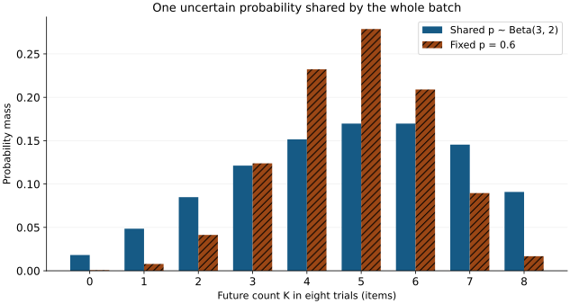

# 3 · Predict outcomes and choose actions

**Prerequisites:** [Chapter 2](./02_beta_binomial.md), conditional expectation, and variance. [Appendix 1](./appendix-01_probability.md) supports conditioning; [Appendix 2](./appendix-02_calculus.md) supports integration. **Objectives:** distinguish prior from posterior prediction; propagate parameter uncertainty; elicit priors through observable consequences; minimise expected loss; derive predictive mass, variance, and dependence between future trials.

## A probability estimate is not a forecast of a count

Our fictional service has posterior completion probability $\theta\mid y\sim\operatorname{Beta}(16,8)$ after 14 completions in 20 visits under a Beta(2,2) prior. A manager asks how many of the next 20 visits will finish on time. Answering $20(2/3)=13.33$ gives an expected count. It does not describe the spread or the chance of missing a target. An expectation need not be a possible realised count.

First specify what “next” means. Assume the future visits follow the same process as the observed visits, with one common probability and independence conditional on that probability. Changing staff, eligibility, or recording could break that connection. Integrating uncertainty under the old model cannot by itself account for an unmodelled change in the service.

Two sources of variation matter. We are uncertain about $\theta$, and even at a known $\theta$, different batches have different counts. The posterior predictive distribution averages the sampling distribution over the posterior:

$$p(\tilde y\mid y)=\int p(\tilde y\mid\theta)p(\theta\mid y)\,d\theta.$$

The tilde marks a future or replicated outcome; $y$ remains the observed data. This factorisation assumes future and observed outcomes are independent conditional on the shared parameter. With temporal dependence, the conditional predictive model may also depend directly on past observations. In either case, define the target before integrating.

## Derive the beta-binomial prediction

Let $\theta\mid y\sim\operatorname{Beta}(a,b)$, with positive shapes, and $\tilde Y\mid\theta\sim\operatorname{Binomial}(m,\theta)$ for a fixed nonnegative integer batch size. For $k=0,\ldots,m$,

$$\begin{aligned}
P(\tilde Y=k\mid y)
&=\int_0^1\binom mk\theta^k(1-\theta)^{m-k}
\frac{\theta^{a-1}(1-\theta)^{b-1}}{B(a,b)}\,d\theta\\
&=\binom mk\frac{B(a+k,b+m-k)}{B(a,b)}.
\end{aligned}$$

Recognise the integral as the beta normalising integral from chapter 2. This is the **beta-binomial** mass function. The binomial coefficient must stay: it distinguishes the probabilities of different counts. To verify normalisation, sum inside the integral. The conditional binomial masses sum to one for every parameter value, leaving the integral of the posterior density, also one.

For the service, use $a=16,b=8,m=20$. The expected count is 13.3333, but the probability of fewer than 12 completions is approximately 0.251683. Substituting the posterior mean into a binomial gives approximately 0.190549 for the same event. This discrepancy matters if the service schedules extra support when shortfalls are likely. Agreement on an expected count does not imply agreement on operational risk.

The predictive distribution is discrete. Its 5th and 95th percentile endpoints are 8 and 18, and the inclusive interval actually contains about 95.67% probability. We cannot generally obtain exactly 90% by choosing whole-count endpoints. Label the requested quantiles and the achieved mass rather than silently treating a discrete interval as continuous.

## Work out both layers of predictive variation {#work-out-both-layers-of-predictive-variation}

Write $K=a+b$, $q=E[\theta\mid y]=a/K$, and $v=\operatorname{Var}(\theta\mid y)=ab/[K^2(K+1)]$. Iterated expectation gives

$$E[\tilde Y\mid y]=E[m\theta\mid y]=mq.$$

The law of total variance separates average conditional variability from variability of conditional averages:

$$\operatorname{Var}(\tilde Y\mid y)
=E[\operatorname{Var}(\tilde Y\mid\theta)\mid y]
+\operatorname{Var}(E[\tilde Y\mid\theta]\mid y).$$

Here the two terms are $mE[\theta(1-\theta)\mid y]$ and $m^2v$. Since $E[\theta^2\mid y]=q^2+v$, the first term is $m[q(1-q)-v]$. Substituting the beta moments gives

$$\begin{aligned}
E[\operatorname{Var}(\tilde Y\mid\theta)\mid y]&=\frac{mab}{K(K+1)},\\
\operatorname{Var}(E[\tilde Y\mid\theta]\mid y)&=\frac{m^2ab}{K^2(K+1)},\\
\operatorname{Var}(\tilde Y\mid y)&=\frac{mab(K+m)}{K^2(K+1)}.
\end{aligned}$$

For the service these components are approximately 4.26667 and 3.55556, adding to 7.82222, or about 7.82. The plug-in binomial variance is $20(2/3)(1/3)=4.44444$, or about 4.44. Notice that its variance is slightly larger than the first component alone. Adding the second component to the plug-in variance would double-count part of the uncertainty; total variance requires the *average conditional variance*.

An equivalent expression is

$$\operatorname{Var}(\tilde Y\mid y)=mq(1-q)+m(m-1)v.$$

This explains why the plug-in answer is exact for a single Bernoulli outcome: when $m=1$, the additional term vanishes. A mixture of Bernoulli distributions is another Bernoulli distribution with the averaged probability. For a batch, the shared uncertain probability creates dependence that a plug-in binomial omits.


<!-- VISUAL01:05 BEGIN -->

### Visual investigation: shared parameter uncertainty widens a batch forecast

For a separate illustrative posterior $p\mid D\sim\operatorname{Beta}(3,2)$, forecast eight new binary outcomes sharing that probability. Predict whether replacing $p$ by its mean 0.6 preserves the spread of the future total.



**Read the figure.** Horizontal positions are possible integer counts; bar heights are probability masses, not density heights. Solid bars integrate one common uncertain probability for the batch. Hatched bars fix it at 0.6. Both distributions sum to one and have mean 4.8, but their tails differ.

| Future K | Full predictive mass | Plug-in mass |
|---:|---:|---:|
| 0 | 0.018182 | 0.000655 |
| 1 | 0.048485 | 0.007864 |
| 2 | 0.084848 | 0.041288 |
| 3 | 0.121212 | 0.123863 |
| 4 | 0.151515 | 0.232243 |
| 5 | 0.169697 | 0.278692 |
| 6 | 0.169697 | 0.209019 |
| 7 | 0.145455 | 0.089580 |
| 8 | 0.090909 | 0.016796 |

**Mathematical connection.** Total variance gives $8E[p(1-p)]+8^2\operatorname{Var}(p)=4.16$, versus $8(0.6)(0.4)=1.92$ for the plug-in model. The tail $P(K\ge7)$ is 0.236364 versus 0.106376. Shared uncertainty makes future indicators positively dependent after integrating out $p$. Drawing a fresh independent probability for every item would describe a different joint model.

**Original unscored exploration — predict, observe, explain.** Increase concentration from five to twenty at the same mean, giving Beta(12,8). Predict the direction, then observe that predictive variance becomes 2.56 while the mean remains 4.8. Explain why one future trial has the same Bernoulli prediction under both treatments but a batch need not. These are conditional forecasts under exchangeability, not evidence of actual batch heterogeneity. Rounded table entries need not sum to exactly one.

[Open the guided prediction experiment](../../apps/bayesian/explorer.html#visual-prediction) to predict, change one setting, and explain the result.

<!-- VISUAL01:05 END -->

## Why the variance decomposition works

**Extended route.** Total variance is useful beyond the binomial model, so derive it once without a named distribution. Let $M(\theta)=E[\tilde Y\mid\theta,y]$ and $\bar M=E[\tilde Y\mid y]$. Subtract the overall mean and split the deviation:

$$\tilde Y-\bar M=(\tilde Y-M(\theta))+(M(\theta)-\bar M).$$

Squaring creates two squared terms and a cross term. The first squared term measures how an outcome differs from its conditional mean. The second measures how the conditional mean differs from the overall mean. Conditional on the parameter, the first deviation has expectation zero, while the second is a fixed number. Their product therefore has zero conditional expectation, and hence zero posterior expectation. Averaging the squared terms gives exactly the two components of total variance, assuming finite second moments.

This reasoning explains why the terms are variances rather than standard deviations. Standard deviations cannot simply be added. It also makes the decomposition specific to the chosen conditioning information: if the model included uncertain staffing, weather, or instrument calibration, averaging over those variables could introduce further layers. “Two layers” describes the current generative model; it is not a claim that every source of real-world uncertainty has been represented. The integral propagates the uncertainties supplied to it.

## Conditional independence does not imply marginal independence {#conditional-independence-does-not-imply-marginal-independence}

Let $X_i$ indicate completion on future visit $i$. At a fixed $\theta$, different $X_i$ are independent. Averaging over $\theta$ gives, for distinct visits,

$$E[X_iX_j\mid y]=E[\theta^2\mid y],\qquad
\operatorname{Cov}(X_i,X_j\mid y)=v.$$

Their marginal variances are $q(1-q)$, so their predictive correlation is $v/[q(1-q)]=1/(K+1)$. For Beta(16,8), covariance is approximately 0.008889 and correlation is 0.04. The probability both visits complete is $16\times17/(24\times25)=0.453333$, larger than the product of their marginal probabilities, $4/9\approx0.444444$.

This dependence does not say that one visit physically causes another to complete. A completion provides information about their shared probability. If the first future visit succeeds, updating gives Beta(17,8), and the next success probability becomes $17/25=0.68$ rather than $2/3$. This sequential prediction produces the same joint probabilities as integrating the whole batch at once.

For each simulated batch, therefore, draw one posterior parameter and then a complete conditional batch:

```python
import numpy as np
rng = np.random.default_rng(303)
theta = rng.beta(16, 8, size=60000)
future = rng.binomial(20, theta)
```

Drawing a fresh independent parameter for every visit instead removes the shared uncertainty. Integrating that different model gives independent Bernoulli outcomes and a binomial count with probability $q$. Independent visit-specific probabilities could be a defensible model if visits really have independently drawn latent propensities from a known population distribution. It is not the same uncertainty statement as one common unknown service probability. Unknown population-level parameters could introduce dependence again.

**Retrieve without looking:** Why can two simulations agree on each visit's completion probability and disagree on the batch variance? Explain the conditional bar before writing a formula.

## Forecasting several batches together

**Extended route.** Suppose a manager needs a joint forecast for two future shifts, each with twenty visits, and assumes the same probability applies to both. Draw one posterior probability for a simulated future world, then draw both shifts conditionally on it. Drawing separate posterior probabilities for the two shifts changes the joint forecast even though each shift's marginal histogram still looks correct.

For counts $Y_1,Y_2$ in batches of sizes $m_1,m_2$, conditional independence gives

$$\operatorname{Cov}(Y_1,Y_2\mid y)=m_1m_2v.$$

For two twenty-visit shifts the covariance is approximately 3.55556. Their combined count has variance $2(7.82222)+2(3.55556)\approx22.75556$, agreeing with the beta-binomial formula for forty visits. Independently simulating the two marginal predictions would omit the covariance and understate uncertainty in their total. This is especially consequential when staff or reserves must cover the combined workload.

The right sharing structure follows the scientific model. If shifts have distinct probabilities, a model must explain how those probabilities are related and what past data inform each one. Chapter 9 develops that extension. For now, list which future observations share a parameter before writing a simulation loop. A collection of correct one-dimensional forecasts does not necessarily constitute a correct joint forecast. Pairing unrelated draws after simulation can lose the dependence needed to answer questions about totals, maxima, or simultaneous shortfalls.

## Prior prediction makes assumptions observable {#prior-prediction-makes-assumptions-observable}

Before using observations, draw from the prior and then the likelihood:

$$p(\tilde y)=\int p(\tilde y\mid\theta)p(\theta)\,d\theta.$$

These are **prior predictive** draws. They turn a distribution over an abstract probability into possible batches a domain expert can inspect. Use the intended population, exposure, and batch size: a prior that seems reasonable for a small pilot may imply surprising patterns for a large deployment.

For 20 trials, consider the extreme event of at most two or at least eighteen successes. Three symmetric priors all have expected count ten, yet imply quite different probabilities:

| Prior for the probability | Probability of an extreme batch |
|---|---:|
| Beta(1,1) | 0.285714 |
| Beta(20,20) | 0.003211 |
| Beta(0.5,0.5) | 0.478372 |

Under Beta(1,1), inserting the factorial expressions for the beta functions gives $P(\tilde Y=k)=1/(m+1)$. Every count is equally likely. Beta(20,20) concentrates the underlying probability near one half, while Beta(0.5,0.5) makes near-boundary probabilities much more plausible. None is empty of assumptions; equal means hide consequential differences.

Elicitation can begin with a plausible central probability and ranges for observable counts. Ask whether almost-all-failure or almost-all-success batches should occur often, then inspect candidate priors rather than forcing one family to match every statement. Disagreement may expose a missing grouping or time variable rather than a badly chosen concentration.

If the current data informed a revision, disclose that dependence. Repeatedly adapting a prior to the same observed count and then treating it as independent knowledge overstates the evidence. Prior predictive checks can motivate a transparent revised analysis; sensitivity analysis reports how defensible alternatives change the conclusions that matter.

## From inference to a decision {#from-inference-to-a-decision}

Suppose a temporary intervention costs 2 units regardless of $\theta$. Leaving the service unchanged incurs loss 10 if $\theta<0.6$, otherwise zero. These stipulated losses make the calculation visible. They do not establish that a real intervention works or that all consequences can be represented by one monetary amount.

For action $d$, posterior expected loss is

$$\rho(d\mid y)=\int L(d,\theta)p(\theta\mid y)\,d\theta.$$

Under Beta(16,8), $P(\theta<0.6\mid y)\approx0.237271$. The action comparison is therefore:

| Action | Loss when below target | Loss otherwise | Posterior expected loss |
|---|---:|---:|---:|
| Intervene | 2 | 2 | 2 |
| Leave | 10 | 0 | 2.372709 |

Choose intervention under this model and loss table. More generally, at cost $c$, intervene when $c<10P(\theta<0.6\mid y)$. The break-even cost is approximately 2.372709; equality gives indifference. At cost 3 the preferred action changes although the evidence is unchanged. The probability threshold of 0.2 at cost 2 comes from consequences, not a universal evidential standard.

This loss concerns an underlying parameter. The event $\theta<0.6$ is different from fewer than 12 completions in the next batch. A contract paying out on a realised count requires predictive expected loss, $\sum_k L(d,k)P(\tilde Y=k\mid y)$. Define actions, horizon, affected population, and units before calculating an optimum. If the action changes outcomes, the predictive model must represent those action-specific consequences.

Expected loss is an average over current uncertainty, not a promise about the realised loss. Leaving the service unchanged yields either zero or ten under the stipulated table, never 2.372709. An intervention selected by expected loss can look unnecessary afterwards if the service was already above target. That observation alone does not show the decision was irrational given the information available when it was made.

Conversely, a lucky outcome does not validate a poorly specified decision model. Review the information and consequences used at decision time, as well as what later happened. If stakeholders particularly dislike rare severe harms, represent that preference in the loss function; do not hide it by demanding an arbitrary posterior probability threshold. A richer loss could also vary continuously with the shortfall or include uncertain intervention efficacy. In that case compute the loss for each possible state and action before averaging. Applying a nonlinear loss only to the posterior mean generally answers a different question. Chapter 12 develops such decisions and the value of collecting more information.

## Worked example: equipment failures and a reserve crew

Consider a separate fictional equipment test. Ten pumps will each attempt one start. Given a common failure probability $q$, starts fail independently. A reserve crew costs 3 loss units and, by assumption, removes a disruption penalty of 20 units incurred if at least four pumps fail. This is a simplified capacity decision, not an estimate of crew effectiveness.

Before collecting a pilot, compare Beta(2,8) and Beta(20,80) priors for $q$. Both imply two expected failures, but the latter expresses more certainty about a failure probability near 0.2. Let $F$ be the number of failures. Evaluate the beta-binomial tail by summing its first four masses and subtracting from one:

$$P(F\geq4)=1-\sum_{k=0}^3\binom{10}{k}
\frac{B(a+k,b+10-k)}{B(a,b)}.$$

| Prior | Predictive variance of $F$ | $P(F\geq4)$ | Loss without crew | Loss with crew | Choice |
|---|---:|---:|---:|---:|---|
| Beta(2,8) | 2.909091 | 0.184211 | 3.684211 | 3 | Crew |
| Beta(20,80) | 1.742574 | 0.130797 | 2.615933 | 3 | No crew |

Thus prior prediction can change an action even when prior means agree. The decision threshold is $P(F\geq4)>3/20=0.15$. A useful elicitation conversation concerns which tail probabilities the engineering team finds credible, not which prior gives its preferred decision.

Now observe two failures in ten comparable pilot starts. Updating the first prior gives Beta(4,16); the next batch still has expected failures two, but $P(F\geq4)\approx0.160620$. Expected loss without the crew is approximately 3.212394, so the crew remains preferred. Its maximum justifiable cost has fallen from about 3.68 to 3.21. Even a pilot exactly matching the prior mean can change a decision's margin by reducing uncertainty. These calculations assume the pilot and deployment share the same failure probability.

## Limits and model failures

**Extended route.** Holding the posterior fixed and increasing future batch size does not provide new information about the parameter. For the future proportion,

$$\operatorname{Var}(\tilde Y/m\mid y)=\frac{q(1-q)}m+
\frac{m-1}{m}v\longrightarrow v.$$

Conditional sampling noise averages away while uncertainty about the shared probability remains. By contrast, gathering more relevant observations can concentrate the posterior and reduce $v$. More simulated draws only improve numerical accuracy; [chapter 5](./05_monte_carlo.md) develops that separate uncertainty.

At $m=0$ the predicted count is certainly zero. As posterior variance approaches zero with its mean fixed, the predictive distribution approaches a binomial. Positive beta shapes still allow failures after all observed trials succeed, and successes after all fail. Very small shapes can create extreme predictions without assigning exact probability atoms at zero or one.

Posterior predictive overdispersion relative to a plug-in binomial arises here from parameter uncertainty. It does not prove the model accommodates physical clustering. Pumps sharing a power supply could fail together even at a known failure probability, violating conditional independence. Service visits could vary systematically by shift. More observations under a misspecified model may narrow parameter uncertainty while leaving these failures untreated.

Prediction also supports checking: simulate replicated datasets with the observed shape and compare relevant patterns, such as extremes, group differences, or runs over time. A plausible total count can hide implausible ordering. Replicated-data checks reuse observations to fit and inspect the model; they are not untouched predictive tests. [Chapter 10](./10_model_checking.md) separates those purposes.

## Lab

Run Lab 3, or [Python](../../downloads/bayesian/labs/03_prediction.py), and inspect the [predictive comparison](../../downloads/bayesian/artifacts/figures/03_predictive.svg). The supplied lab simulates the shared-parameter forecast and a plug-in comparison, then evaluates the original service loss. Compare empirical mean and variance with the exact results; finite simulations need not reproduce every decimal.

For your investigation, compute the shortfall probability as both an indicator average and a sum of exact masses. Repeat after independently redrawing the parameter for each trial. Which summaries remain similar, and which expose the changed model? Compare the three prior predictive extreme-batch probabilities and submit a loss table under two intervention costs. As an optional transfer, reproduce the pump decision and state what evidence would justify sharing a probability across starts. These are extensions to the supplied lab, not additional saved outputs it already produces.

## Summary

A predictive distribution combines parameter uncertainty with variation in outcomes conditional on parameters. Shared uncertain parameters make future observations dependent after integration. Total variance separates the two layers and explains why plug-in forecasts can miss batch risk. Prior prediction expresses assumptions through observables; expected loss turns those predictions or parameter probabilities into decisions with explicit consequences.

## Exercises

**3.1 — Concept.** For future Bernoulli visits conditionally independent given one shared completion probability $\theta$, why does drawing a fresh independent $\theta$ from its posterior for every visit change the model for a batch? When might such a model be appropriate?

**3.2 — Calculation.** For a Beta(3,2) posterior and five future trials, calculate predictive mean and variance. Compare with the plug-in binomial variance.

**3.3 — Decision.** Suppose $P(\theta<0.6\mid y)=0.18$. An intervention costs 2, and failure to act costs 15 when the target is missed. Select an action and find the largest intervention cost at which you are indifferent.

[Solutions](./course-solutions.md).

## Further reading

Allen Downey's [Think Bayes, decision analysis](https://allendowney.github.io/ThinkBayes2/chap09.html) develops action selection from distributions and consequences. Martin, Kumar, and Lao's [Bayesian Modeling and Computation, complete workflow](https://bayesiancomputationbook.com/markdown/chp_09.html) connects predictions, model checking, and decisions in a longer analysis. Our service and pump examples are original fictional teaching examples.
