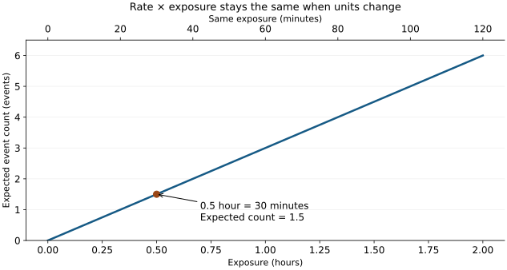

# 4 · Model rates and continuous measurements

**Prerequisites:** [Chapters 2](./02_beta_binomial.md) and [3](./03_prediction.md), exponentials, and completing a square. [Appendix 2](./appendix-02_calculus.md) supports integration and transformations. **Objectives:** derive gamma-Poisson and normal-normal posteriors; handle exposure and units; distinguish marginal from conditional uncertainty; derive integrated predictions; check transformations, scale uncertainty, and posterior propriety.

## Counts need an opportunity to occur

Two service centres report four incidents each. One operated for one hour, the other for ten. Equal counts do not establish equal rates. What should we predict for a centre operating another two hours? We need a model connecting the number of opportunities to the observed count, then must integrate uncertainty about its rate.

Let $t_i\geq0$ denote known exposure and $\lambda>0$ the common event rate per exposure unit. Assume

$$Y_i\mid\lambda\sim\operatorname{Poisson}(t_i\lambda),\qquad
p(y_i\mid\lambda)=\frac{(t_i\lambda)^{y_i}e^{-t_i\lambda}}{y_i!}.$$

Counts are nonnegative integers. Conditional independence, a constant rate over these exposures, and conditional Poisson dispersion are substantive assumptions. Mean and variance both equal $t_i\lambda$ at a fixed rate. The product is dimensionless as a count expectation; changing the exposure unit must change the numerical rate reciprocally.

Exposure may mean machine-hours, monitored area, or person-time, depending on the question. Calendar time while a machine is switched off need not be time at risk. If recording only covers half a shift, the model needs the monitored exposure or an explicit detection model. One row in a file is a storage unit, not a measure of opportunity.

## Derive the gamma-Poisson update {#derive-the-gamma-poisson-update}

For positive exposures, multiplying independent likelihood contributions gives

$$p(y\mid\lambda)=\left(\prod_i\frac{t_i^{y_i}}{y_i!}\right)
\lambda^{C}e^{-T\lambda},\qquad C=\sum_i y_i,\quad T=\sum_i t_i.$$

The bracketed factor does not depend on the rate, so it can be dropped when identifying the posterior kernel. Adopt a gamma prior in **shape-rate** form:

$$p(\lambda)=\frac{b^a}{\Gamma(a)}\lambda^{a-1}e^{-b\lambda},
\qquad a,b>0,\quad\lambda>0.$$

Here $\Gamma(a)=\int_0^\infty u^{a-1}e^{-u}\,du$ is the gamma function. Substitution $u=b\lambda$ verifies the normalising constant. The mean is $a/b$ and variance is $a/b^2$. Multiplication adds powers and exponential rates:

$$p(\lambda\mid y)\propto\lambda^{a+C-1}e^{-(b+T)\lambda},
\qquad\lambda\mid y\sim\operatorname{Gamma}(a+C,b+T).$$

Write $A=a+C$ and $B=b+T$ for the posterior shape and rate. The shape is dimensionless; $b$ and $B$ have exposure units, making their products with the event rate dimensionless. The gamma distribution's “rate parameter” is not the event rate $\lambda$. Naming both and recording their units prevents a particularly easy mistake.

For $T>0$, the posterior mean can be written

$$\frac{a+C}{b+T}=\frac{b}{b+T}\frac ab+
\frac{T}{b+T}\frac CT.$$

It averages the prior mean rate and observed rate with weights determined by prior and observed exposure. Calling $b$ a prior exposure is an interpretation of this identity, not proof that historical observations actually existed. A domain justification is still required.

## Worked example: incidents and future exposure

Observe counts 3, 5, and 4 across exposures 1, 2, and 1 hours. Then $C=12$ and $T=4$. Under Gamma(2,1), the posterior is Gamma(14,5), retaining the original lab calculation. Its mean is 2.8 events per hour, and its variance is 0.56 in squared events-per-hour units. The observed rate of 3 receives weight $4/5$; the prior mean of 2 receives weight $1/5$.

For a future exposure $u>0$, assume $\tilde Y\mid\lambda\sim\operatorname{Poisson}(u\lambda)$. Integrate rather than substitute the posterior mean:

$$\begin{aligned}
P(\tilde Y=k\mid y)
&=\frac{u^kB^A}{k!\Gamma(A)}\int_0^\infty
\lambda^{A+k-1}e^{-(B+u)\lambda}\,d\lambda\\
&=\frac{\Gamma(A+k)}{\Gamma(A)k!}
\left(\frac{B}{B+u}\right)^A
\left(\frac{u}{B+u}\right)^k.
\end{aligned}$$

This is a negative-binomial distribution, including noninteger positive $A$. Software conventions vary: in SciPy it is `nbinom(n=A, p=B/(B+u))`, with support on the future count $k$. Its parameter called `n` need not be an observed number of trials. The Poisson exposure model and the displayed mass, not the distribution's name alone, specify the intended prediction.

Total expectation and total variance give

$$E[\tilde Y\mid y]=uA/B,\qquad
\operatorname{Var}(\tilde Y\mid y)=uA/B+u^2A/B^2.$$

The first term is average conditional Poisson variance; the second is uncertainty in the conditional mean. Over two hours, the predictive mean is 5.6 and variance is $5.6+2.24=7.84$. A plug-in Poisson would have variance 5.6. The chance of no incidents is $(5/7)^{14}\approx0.008999$, rather than $e^{-5.6}\approx0.003698$. Extra spread can change probabilities at the low end as well as the high end.

Prior prediction uses exactly the same formulas with $a,b$ instead of $A,B$. Gamma(2,1) implies a two-hour count with mean 4 and variance 12. This is much more variable than Poisson(4), an observable implication to discuss before seeing the counts. A broad prior on the rate can imply many quiet intervals and occasional large totals; whether that is credible depends on the process.

The predictive negative-binomial variance does not change the conditional Poisson assumption. If the rate became known precisely, the second variance term would disappear. Actual clustering can persist even at a known long-run rate, for example when one breakdown triggers several recorded incidents. Such dependence requires a different observation model. A mixture that represents ignorance about one common rate is not automatically a model of physical bursts.

Likewise, predictions for several future intervals should share a rate draw when the common-rate assumption applies. Their counts are independent at a fixed rate but correlated after integration. Summing separately generated independent marginal forecasts would lose that correlation. Preserve the model's shared variables when estimating the probability of a combined workload exceeding capacity.

## Hours, minutes, rate, and scale {#hours-minutes-rate-and-scale}

SciPy's gamma distribution takes **scale**, the reciprocal of the gamma rate. For Gamma(14,5), use `gamma(a=14, scale=1/5)`. Passing `scale=5` would give mean 70, not 2.8. Checking the implied mean is a simple way to detect a parameterisation error before trusting a plot.

Now express the same event rate per minute: $r=\lambda/60$. The exposure vector becomes $(60,120,60)$ minutes. Changing variables gives

$$p_r(r)=p_\lambda(60r)\,60,\qquad
r\sim\operatorname{Gamma}(a,60b).$$

Thus the prior becomes Gamma(2,60) and the posterior Gamma(14,300). Its mean is $14/300=0.046667$ events per minute and variance is $0.56/60^2$. The gamma scale also divides by 60. This is the same uncertainty in different units, not a new prior elicitation.

For a future 120-minute exposure, the mean remains $120(14/300)=5.6$, and both variance terms remain 5.6 and 2.24. Even the predictive mass is identical because $300/(300+120)=5/7$. Leaving the prior at Gamma(2,1) after converting the data would express a different prior rate of two events per minute. A units error can masquerade as scientific disagreement about the data.

**Retrieve without looking:** Which quantities multiply by sixty, and which divide by sixty? Explain why the density height can change while the probability of a physically specified count stays fixed.

<!-- VISUAL01:06 BEGIN -->

### Visual investigation: exposure and rate travel together

Set an illustrative event rate to three per hour. The two horizontal scales below refer to the same opportunities for events, not two different datasets. Predict which operation changes the expected count: doubling the observation time, or expressing it in minutes.

**Read the figure.** The lower axis measures exposure in hours and the upper axis in minutes. Height is expected event count, which can be fractional even though any realised count is an integer. The highlighted point is one half-hour window with mean 1.5 events.

| Rate | Exposure | Expected count |
|---|---|---:|
| 3 events/hour | 0.5 hour | 1.5 |
| 0.05 events/minute | 30 minutes | 1.5 |
| 3 events/hour | 1 hour | 3 |

**Mathematical connection.** The Poisson mean is $\lambda t$. Converting the time by sixty converts the rate by its reciprocal, leaving $\lambda t$ unchanged. If a rate posterior is transformed, its density must also transform; this line conditions on a fixed rate and is not a posterior interval. At zero exposure this model gives zero events with probability one, so a positive observed count would contradict the stipulated exposure/model pair.

**Original unscored exploration — predict, observe, explain.** Predict the mean in a 45-minute window. Observe that $0.05\times45=2.25$, then explain why replacing 45 minutes by 0.75 hour is only a coordinate change. Transfer to two windows with unequal durations: why is the number of data rows an inadequate substitute for total exposure? The constant-rate line assumes the relevant opportunities are comparable throughout each window.

<!-- VISUAL01:06 END -->

## A second domain: repeated instrument measurements

A fictional calibrated instrument reports readings of one stable physical quantity. Its independently established observation standard deviation is $\sigma=2$ measurement units. Assume independent normal errors around a shared unknown mean:

$$Y_i\mid\mu\sim\operatorname{Normal}(\mu,\sigma^2),\qquad
\mu\sim\operatorname{Normal}(m_0,s_0^2).$$

The second normal argument here is a **variance**. SciPy's `norm(..., scale=...)` takes a standard deviation. Positive $s_0$ represents uncertainty about the mean before these readings; $\sigma$ represents variation among readings at that mean. They describe different sources of uncertainty even if their numerical values coincide.

With $m_0=10$ and $s_0=2$, prior prediction for one reading is Normal(10,8): variances add when averaging over the uncertain mean. This distribution can generate negative values, as any untruncated normal can. If negative readings would be physically impossible and receive appreciable probability, reconsider the observation scale or likelihood rather than interpreting those predictions literally.

## Complete the normal square and interpret precision {#complete-the-normal-square-and-interpret-precision}

Adding log likelihood and log prior, and expanding the squares, gives

$$\begin{aligned}
\log p(\mu\mid y)
&=C_0-\frac{(\mu-m_0)^2}{2s_0^2}
-\frac{\sum_i(y_i-\mu)^2}{2\sigma^2}\\
&=C_1-\tfrac12\left[
(s_0^{-2}+n\sigma^{-2})\mu^2
-2(m_0s_0^{-2}+\sigma^{-2}\sum_i y_i)\mu\right].
\end{aligned}$$

Terms involving only the observations or fixed prior settings enter constants $C_0,C_1$. Let $Q=s_0^{-2}+n\sigma^{-2}$ and $h=m_0s_0^{-2}+\sigma^{-2}\sum_i y_i$. Then

$$Q\mu^2-2h\mu=Q(\mu-h/Q)^2-h^2/Q.$$

The last term is constant in $\mu$. The remaining quadratic identifies a normal posterior with

$$s_n^2=Q^{-1},\qquad m_n=h/Q,\qquad
\mu\mid y\sim\operatorname{Normal}(m_n,s_n^2).$$

Inverse variance is **precision**. In this conditional independence model, prior precision and the data's precision add. The data precision is $n/\sigma^2$, which is the reciprocal of the sampling variance of the sample mean. Precision is measured in inverse squared measurement units; it is not interchangeable with inverse standard deviation.

For $n>0$, the posterior mean is a weighted average of $m_0$ and $\bar y$, with weights proportional to $1/s_0^2$ and $n/\sigma^2$. A large dataset can dominate a weak prior. A strongly concentrated prior can remain influential, so inspect whether its apparent precision is justified by comparable information.

For readings 11, 13, 12, 12, we have $n=4$, $\sum y_i=48$, and $\bar y=12$. Thus $Q=1/4+4/4=1.25$ and $h=10/4+48/4=14.5$. The posterior variance is 0.8 and mean is 11.6. Equivalently, the mean is $(1/5)10+(4/5)12$. These retain the original lab's exact values.

**Extended route.** Equal precision per observation is an assumption, not a requirement of square completion. If each reading has a different known standard deviation $\sigma_i$, the same expansion gives

$$Q=s_0^{-2}+\sum_i\sigma_i^{-2},\qquad
h=m_0s_0^{-2}+\sum_i y_i\sigma_i^{-2}.$$

As a separate two-reading example, retain the prior mean ten and prior standard deviation two, but observe eleven with known standard deviation one and thirteen with known standard deviation three. The precisions contributed by the readings are one and one ninth. The posterior variance is $36/49\approx0.734694$, and its mean is $538/49\approx10.979592$. Simply averaging the two readings at twelve would discard their different information content.

These weights must follow a justified measurement model. Assigning a smaller variance to a reading merely because it agrees with expectations would bias the analysis. Nor can correlated repeat readings be counted as if they were independent measurements of equal quality. Precision addition relies on the factorisation used in the derivation; chapter 7 generalises it to a joint normal calculation. Before pooling instruments, check whether their calibration errors could share a common cause.

## An interval for a mean is not an interval for a reading {#an-interval-for-a-mean-is-not-an-interval-for-a-reading}

A future reading can be written $\tilde Y=\mu+\epsilon$, where the new error is independent of $\mu$ and past observations, with $\epsilon\sim\operatorname{Normal}(0,\sigma^2)$. The sum of these independent normal variables gives

$$\tilde Y\mid y\sim\operatorname{Normal}(m_n,\sigma^2+s_n^2).$$

Using the standard normal 97.5th percentile, approximately 1.959964, produces these equal-tailed 95% intervals:

| Target | Mean | Standard deviation | Interval |
|---|---:|---:|---:|
| Unknown mean $\mu$ | 11.6 | $\sqrt{0.8}\approx0.8944$ | [9.8470, 13.3530] |
| One future reading $\tilde Y$ | 11.6 | $\sqrt{4.8}\approx2.1909$ | [7.3059, 15.8941] |

Both intervals are conditional on the specified model and known observation scale. The wider prediction interval includes measurement variation as well as uncertainty about the mean. As relevant observations accumulate, mean uncertainty can shrink towards zero; the variation of one new reading remains at least the known observation variance.

**Extended route.** For the average of $m$ future readings sharing the same mean, predictive variance is $\sigma^2/m+s_n^2$. It is not $(\sigma^2+s_n^2)/m$: the readings share parameter uncertainty. For four future readings, the variance is $1+0.8=1.8$ and a 95% interval for their average is approximately [8.9704, 14.2296]. Distinct future readings have covariance $s_n^2=0.8$, connecting directly to chapter 3's conditional-versus-marginal dependence.

## Unknown scale changes the problem {#unknown-scale-changes-the-problem}

Usually $\sigma$ is unknown too. A joint prior on $\mu,\sigma$ and a likelihood define $p(\mu,\sigma\mid y)$. Marginal inference for the mean integrates over scale uncertainty. Plugging in one estimated scale treats uncertain precision as certain. Whether a particular interval becomes wider also depends on the prior and the chosen plug-in estimate; it is not a comparison between arbitrary different models.

**Extended route.** A useful analytic reference uses the improper joint prior $p(\mu,\sigma^2)\propto1/\sigma^2$, defined with respect to $d\mu\,d\sigma^2$. Set

$$\bar y=\frac1n\sum_i y_i,\qquad
s^2=\frac{1}{n-1}\sum_i(y_i-\bar y)^2.$$

The identity $\sum_i(y_i-\mu)^2=(n-1)s^2+n(\mu-\bar y)^2$ separates residual variation from mean displacement. Integrating the joint kernel over $v=\sigma^2$ uses

$$\int_0^\infty v^{-n/2-1}e^{-D/(2v)}\,dv
\propto D^{-n/2},\qquad
D=(n-1)s^2+n(\mu-\bar y)^2.$$

Consequently,

$$\frac{\mu-\bar y}{s/\sqrt n}\mid y\sim t_{n-1},\qquad
\tilde Y\mid y\sim t_{n-1}\left(\bar y,\ s\sqrt{1+1/n}\right),$$

where the predictive distribution is written in location-scale form. These results require $n\geq2$ and strictly positive sample variation. With too few observations or all readings identical, this improper reference prior does not yield a proper joint posterior. Do not ask software for credible probabilities from an unnormalisable density.

The Student-t scale is not generally its standard deviation. With degrees of freedom $\nu>2$, variance is scale-squared times $\nu/(\nu-2)$; at smaller degrees of freedom it is not finite. With two distinct observations the mean's posterior is Cauchy: proper, but without a finite expectation. Its location can still be reported as its median.

The prior's reference variable matters here too. Expressing the same improper prior in standard deviation rather than variance requires the derivative $d(\sigma^2)/d\sigma=2\sigma$. Its density with respect to $d\mu\,d\sigma$ is therefore proportional to $1/\sigma$, not $1/\sigma^2$. Copying a familiar formula without its reference measure silently changes the prior. Although constants cancel in posterior normalisation when it exists, variable-dependent factors never count as disposable constants. The log-rate example below illustrates the same principle for a proper distribution whose normalisation can be checked directly.

For the four readings above, $s^2=2/3$ and the mean's t scale is $\sqrt{2/3}/2\approx0.4082$, with three degrees of freedom. This is a different model from the known-$\sigma=2$ analysis, and must be labelled accordingly. The improper prior is a reference derivation, not the lab's prior or the default for later regressions. Its unspecified normalising constant also prevents general use in model-evidence comparisons. Later models use explicit proper priors and check their implications.

## Transforming a density requires a Jacobian

**Extended route.** Let $\eta=\log\lambda$, where the logarithm is taken of the numerical rate expressed in events per hour. Specifying that reference unit avoids taking an ambiguous logarithm of a dimensional quantity. Then $\lambda=e^\eta$, and conservation of probability gives

$$p_\eta(\eta)=p_\lambda(e^\eta)
\left|\frac{d\lambda}{d\eta}\right|
=\frac{B^A}{\Gamma(A)}\exp(A\eta-Be^\eta).$$

The derivative factor $e^\eta$ is a **Jacobian**. Equal-width intervals in log rate correspond to differently sized intervals in rate, so their density heights cannot be copied unchanged. Omitting the factor gives exponent $(A-1)\eta-Be^\eta$, a different distribution. For a gamma shape at most one, that omitted-Jacobian expression is not even integrable over all log rates.

Transforming posterior draws with `np.log` automatically transports probability correctly; no additional weighting is needed. Similarly, taking logs of endpoints of an equal-tailed rate interval preserves its probability and tail allocation. Density modes need not transform: Gamma(14,5) has rate mode $13/5=2.6$, whereas the log-rate density has mode $\log(14/5)$. Mapping that mode back gives 2.8. There is no contradiction because density is defined relative to the coordinate used.

Probabilistic programming software normally handles its internal transformations of declared constrained variables. Add a Jacobian when manually changing the variable with respect to which a density is defined; adding one again to an already transformed target double-counts it. [Chapter 6](./06_hmc.md) returns to this issue when unconstrained coordinates are used for sampling.

## Edge cases and what conjugacy cannot fix

If exposure is zero, the Poisson model assigns probability one to zero events and zero probability to a positive count. A positive count with zero recorded exposure signals a data or model inconsistency; the usual update cannot rescue an impossible likelihood. Zero counts across positive exposure are informative: with a proper gamma prior, the shape stays fixed while the rate increases and the mean event rate decreases.

With no observations, both conjugate updates return their priors. In the normal model, a prior variance tending to zero pins the mean to its prior value, while increasing prior variance gives greater relative weight to the data. Those limits clarify the assumptions; substituting a variance of exactly zero into precision formulas is undefined.

Total count and total exposure are sufficient for the common Poisson rate, but discard timing that could reveal bursts. Sample sum and sample size determine the known-scale normal mean posterior, but discard residual patterns that could reveal outliers, drift, or changing variance. Conditional sufficiency means no further parameter information under the assumed model. It does not mean no further information useful for criticising that model.

Repeated readings also cannot resolve every calibration problem. An unknown common instrument offset is confounded with the true physical level in this simple model: more readings estimate their sum precisely. Separating them requires calibration information or additional measurements with an informative design. A narrow posterior for the model's mean should therefore not be advertised as equally narrow uncertainty about an independently defined physical truth. State what the instrument measures and what external calibration assumptions justify that interpretation.

## Lab

**Selected-core task:** reproduce the gamma–Poisson exposure update and known-scale Normal update, and interpret their units and predictive intervals. Complete the original three exercises. **Extended task:** the unknown-scale Student-t bridge, unequal-precision comparison and log-rate/Jacobian investigation below are optional additions; allow separate study time.

Run Lab 4, or [Python](../../downloads/bayesian/labs/04_continuous.py), and inspect the [gamma update](../../downloads/bayesian/artifacts/figures/04_gamma.svg). The supplied lab saves the gamma parameters and normal posterior and predictive standard deviations. Reproduce those values before extending the analysis.

Then compare the two-hour predictive mass with simulation that draws one rate per replicate and a Poisson count conditional on it. Convert hours to minutes, including the prior, and verify the whole count distribution stays unchanged. Deliberately pass a gamma rate as a scale: what implied mean reveals the error? Compute and label intervals for the normal mean, one future reading, and four-reading average. Finally, compare a histogram of log-rate draws with the transformed density. These investigations extend the saved lab; they are not claims about extra outputs it already generates.

## Summary

Exposure connects counts to rates; gamma conjugacy adds observed count and exposure to distinct prior parameters. Normal conjugacy adds precisions and weights means accordingly. Predictions integrate uncertainty and include future observation variation. Units, scale conventions, and Jacobians determine what distribution a formula actually represents. Exact answers are valuable checks for [numerical computation](./05_monte_carlo.md), provided the underlying assumptions fit the question.

## Exercises

**4.1 — Concept.** A colleague gives every centre equal exposure because the CSV has one row per centre. Explain why row count cannot substitute for exposure.

**4.2 — Derivation.** With Gamma(3,2) in shape-rate form, observe five events in exposure 4. Find posterior mean and variance. Predict the expected number in exposure 3.

**4.3 — Calculation.** Let prior $\mu\sim\operatorname{Normal}(0,1)$ and known observation SD 2. For observations 2 and 4, derive posterior mean, posterior variance, and predictive variance. Explain the units of each.

[Solutions](./course-solutions.md).

## Further reading

Allen Downey's [Think Bayes, conjugate priors](https://allendowney.github.io/ThinkBayes2/chap18.html) develops the algebra behind conjugate families. Aki Vehtari's [BDA chapter notes](https://avehtari.github.io/BDA_course_Aalto/BDA3_notes.html), particularly the single-parameter and multiparameter model notes, provide continuation on normal models and prior assumptions. The numerical service and instrument examples here are fictional teaching examples.
