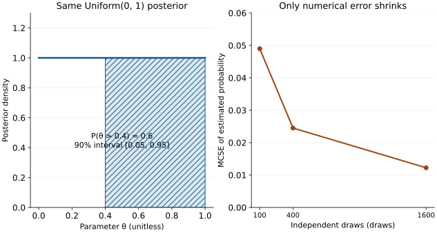

# 5 · Approximate integrals with simulation

**Prerequisites:** [Chapter 2](./02_beta_binomial.md) and [Chapter 4](./04_continuous.md); expectation, variance, and log densities. [Appendix 1](./appendix-01_probability.md) reviews expectations; [Appendix 4](./appendix-04_numerics.md) supports stable computation. **Objectives:** estimate posterior expectations; quantify simulation error; implement Metropolis correctly; diagnose dependence and poor exploration; derive importance-weight estimators and assess numerical error for a specified estimand.

## The integral behind an ordinary question

Fourteen of twenty visits ended in completion. Under the earlier Beta(2,2) prior, the posterior is Beta(16,8). Is the completion probability above 0.7? We can evaluate this probability exactly here, but the same question in a regression or hierarchy may require an integral over many unknowns. Simulation approximates that integral by averaging quantities evaluated at representative posterior draws.

Write the target density as $\pi(\theta)=p(\theta\mid y)$. An **estimand** is the particular quantity we want:

$$\mu_g=E[g(\theta)\mid y]=\int g(\theta)\pi(\theta)\,d\theta,
\qquad \widehat\mu_g=\frac1S\sum_{s=1}^S g(\theta^{(s)}).$$

For a posterior mean, choose $g(\theta)=\theta$. For the probability in our question, choose $g(\theta)=\mathbb{1}(\theta>0.7)$: each draw contributes either one or zero. For an expected loss, evaluate the loss under each draw before averaging. Nonlinear operations generally do not commute with averaging: $E[e^\theta]\ne e^{E[\theta]}$. The sampled parameter values are ingredients; the scientific question determines what to calculate from them.

A predictive probability can also be written this way. For a future count $\tilde Y$, use $g(\theta)=P(\tilde Y\geq k\mid\theta)$. Averaging these conditional probabilities integrates parameter uncertainty without drawing a new count at every iteration. When the conditional probability is available, this removes an extra layer of simulation noise. It does not remove uncertainty about the future outcome itself.

## Two uncertainties with different remedies {#two-uncertainties-with-different-remedies}

For independent draws from the target, the law of large numbers gives convergence of the average when $E_\pi|g|<\infty$. With finite variance, the usual central limit theorem gives an approximate normal sampling distribution for that average, and

$$\operatorname{MCSE}(\widehat\mu_g)\approx\frac{s_g}{\sqrt S},\qquad
s_g^2=\frac{1}{S-1}\sum_s\{g(\theta^{(s)})-\widehat\mu_g\}^2.$$

Posterior standard deviation describes uncertainty about a parameter under the model. Monte Carlo standard error, **MCSE**, describes variation in a computed summary across repeated simulation runs. More draws reduce MCSE; new data may reduce posterior uncertainty. Neither remedy substitutes for checking the model's assumptions.

For a probability estimated with indicators, the variance is $p(1-p)$, giving estimated MCSE $\sqrt{\hat p(1-\hat p)/S}$. If the probability is about 0.2, ten thousand independent draws give MCSE about 0.004. Doubling the draws divides MCSE by $\sqrt2$; quadrupling roughly halves it. The square-root rate can make extra decimal places expensive.

These formulas have conditions. An infinite-variance estimand need not have the stated central limit theorem, even when its expectation exists. A Cauchy location distribution has no ordinary mean to estimate. Finite computer output cannot establish that an integral exists. Likewise, an average from a chain trapped in one region can have a small reported MCSE around the wrong answer.


<!-- VISUAL01:07 BEGIN -->

### Visual investigation: more draws reduce numerical error, not posterior spread

Suppose the target posterior is Uniform(0,1) and the computation estimates $P(\theta>0.4)$. Before comparing panels, predict whether four times as many simulation draws should make the posterior's central interval narrower.



**Read the figure.** The left horizontal axis is the uncertain parameter; its shaded area is the exact probability 0.6. The right horizontal axis is computational effort in independent draws; its vertical axis is the standard error of the estimated probability. These axes represent different quantities and should not be read as two posterior distributions.

| Independent draws | Indicator MCSE | Posterior central 90% interval |
|---:|---:|---|
| 100 | 0.048990 | [0.05, 0.95] |
| 400 | 0.024495 | [0.05, 0.95] |
| 1600 | 0.012247 | [0.05, 0.95] |

**Mathematical connection.** Each event indicator has variance $0.6(0.4)$, so the average of $N$ independent indicators has standard error $\sqrt{0.24/N}$. Quadrupling $N$ halves this error. Nothing in that operation changes the observations, prior or likelihood defining the target posterior. More accurate integration is not more scientific information.

**Original unscored exploration — predict, observe, explain.** Predict the MCSE at 6,400 independent draws and compare it with 0.006124. Explain which uncertainty a new observation might change and which a longer simulation directly changes. Transfer this argument to a correlated Markov chain: the iid formula is then insufficient, and precision needs a dependence-aware estimate. The uniform target is a stipulated teaching example, not a claim about the chapter's fitted model.

<!-- VISUAL01:07 END -->

## Worked example: budget effort for the actual question

For Beta(16,8), direct moment formulas and SciPy's beta survival function give these **computed exact-reference values**, rounded for display:

| Estimand | Exact reference | MCSE with 10,000 independent draws |
|---|---:|---:|
| Posterior mean | 0.6666667 | 0.0009428 |
| Probability above 0.7 | 0.3818716 | 0.0048585 |

The posterior variance is $16\cdot8/(24^2\cdot25)=0.0088889$, so its SD remains approximately 0.09428 regardless of simulation effort. To target MCSE at most 0.001, solve $S\geq\operatorname{Var}_\pi(g)/0.001^2$. Rounding upwards requires 8,889 independent draws for the mean but 236,046 for the probability. These are planning calculations, not guarantees for a realised run or dependent draws.

Absolute and relative accuracy differ. The exact probability above 0.9 is only 0.00122983. An MCSE of 0.001 would be almost as large as that probability. To target relative MCSE of ten percent, solve

$$\frac{\sqrt{p(1-p)/S}}p\leq0.1,
\qquad S\geq\frac{1-p}{0.01p},$$

which requires about 81,213 independent draws. The rarity matters even though the underlying parameter's mean is easy to estimate. If no simulated draw exceeds the threshold, the plug-in indicator variance is zero; interpreting that as perfect accuracy is a diagnostic failure. Zero observed events require a bound or a more suitable rare-event calculation, not a claim that the posterior probability is zero.

When a numerical answer will drive a decision, specify its tolerance beforehand. If two actions have almost equal expected loss, estimate the *difference* in losses using the same posterior draws. That preserves their dependence and can estimate the comparison more efficiently than two unrelated simulations. Report how the remaining MCSE compares with the decision margin.

## Importance sampling: reuse a convenient distribution

Suppose direct posterior sampling is unavailable but independent draws from a density $q$ are easy. Write the unnormalised target as $\tilde\pi(\theta)=p(y\mid\theta)p(\theta)$, with unknown integral $Z$. Changing the density inside each integral gives

$$\mu_g=\frac{E_q[w(\theta)g(\theta)]}{E_q[w(\theta)]},
\quad w(\theta)=\frac{\tilde\pi(\theta)}{q(\theta)},
\quad\widehat\mu_{\mathrm{IS}}=\sum_s\bar w_sg(\theta^{(s)}),
\quad\bar w_s=\frac{w_s}{\sum_jw_j}.$$

The proposal must put positive density wherever the target does. Under appropriate integrability, both averages converge and their ratio converges to the desired expectation. The self-normalised ratio is generally biased at finite sample sizes, although consistent. Finite asymptotic variance additionally requires control of squared weights times squared centred estimand values. Covering the support alone does not ensure useful precision. See [Owen's importance-sampling treatment](https://artowen.su.domains/mc/Ch-var-is.pdf) for the ratio argument and variance conditions.

Calculate log weights and normalise with log-sum-exp, as explained in Appendix 4. This prevents arithmetic underflow; it cannot compensate for an inadequate proposal. Inspect the largest normalised weights and the concentration measure

$$\operatorname{ESS}_{w}=\frac{(\sum_sw_s)^2}{\sum_sw_s^2}=\frac1{\sum_s\bar w_s^2}.$$

Equal weights give the nominal sample size. As a constructed arithmetic example, weights $(1,1,1,97)$ give approximately 1.062, so four samples effectively put nearly all their influence on one value. This weight diagnostic differs from autocorrelation-based MCMC ESS and does not account for which estimand is being estimated.

A subtler failure occurs when a narrow proposal never reaches an important region. Its observed weights may look reassuring because the missing large weights were never seen. Repeating from broader proposals and comparing with known cases tests something that the weight summary cannot. [Chapter 10](./10_model_checking.md) revisits weights in predictive comparison; the [model-evidence bridge](./adv-02_model_evidence.md) explains why posterior expectations and normalising constants are different numerical tasks.

## Worked example: weighted draws and their precision

Use a uniform proposal on the unit interval for our beta target. It covers the support and has density one there, so weights are proportional to the beta density. This proposal spends many draws where the posterior assigns little mass. That waste is manageable in one dimension and makes the weighting operation easy to inspect.

The following short calculation is a **computed demonstration** using NumPy's default generator, seed 509, and ten thousand proposals:

```python
rng = np.random.default_rng(509)
theta = rng.uniform(0, 1, 10000)
log_w = stats.beta.logpdf(theta, 16, 8)
w = np.exp(log_w - logsumexp(log_w))
mean_is = np.sum(w * theta)
```

Here `stats` is imported from SciPy and `logsumexp` from `scipy.special`. The fourth line makes weights sum to one without first exponentiating potentially extreme raw values. The final multiplication allocates each proposal its appropriate influence. Unlike the Metropolis algorithm below, these proposal values are independent; unequal weights are the reason their numerical precision differs from direct posterior draws.

The computed mean is 0.666562, and the weight ESS is approximately 3,322. The largest normalised weight is about 0.000422. An unweighted proposal average estimates the uniform mean, one half, regardless of how many such proposals are collected. The weighted mean instead agrees closely with the exact posterior mean of two thirds. Inspecting the largest weight helps explain why this particular estimate is not dominated by a single proposal.

For independent proposals, a large-sample approximation to the self-normalised estimator's variance is

$$\widehat{\operatorname{MCSE}}_{\mathrm{IS}}^2
\approx\sum_s\bar w_s^2\{g(\theta^{(s)})-\widehat\mu_{\mathrm{IS}}\}^2.$$

This follows by linearising the ratio of the weighted numerator average and denominator average. The centred differences matter: a large weight contributes little error when its estimand value happens to be near the estimated expectation. Conversely, large weights attached to extreme losses can dominate numerical error. Weight ESS alone cannot express that distinction. The approximation assumes suitable finite moments and adequate proposal coverage; unseen tail contributions can invalidate a reassuring finite-sample estimate.

For this run the mean MCSE estimate is 0.001197. Applying the same formula to indicators above 0.7 gives estimated probability 0.380646 with MCSE 0.008346. Compare that with the exact probability 0.381872 and the direct-sampling planning MCSE 0.004858. The same proposals and weights serve both estimands, but the probability pays a larger precision cost. These numbers illustrate a calculation rather than certify this proposal for every posterior or tail question.

When debugging importance sampling, first write down which distribution actually generated the draws. Check that the denominator of every weight is that proposal density, including any truncation normaliser. Then check that the weights sum to one and inspect weighted summaries against a reference. Repeating the calculation with a broader proposal probes missing coverage; merely increasing draws from a proposal with zero density in a required region cannot repair the omission. In higher dimensions, redesigning the proposal is often more valuable than multiplying an already large sample size.

## Markov chains find the target indirectly

A Markov chain chooses its next state using the current state. Its transition kernel is designed to leave the posterior invariant: if the current state has distribution $\pi$, so does the next. Invariance alone is insufficient. A chain that never moves preserves any starting distribution; it cannot learn a target from an arbitrary start. Suitable irreducibility and recurrence conditions support long-run averages; practical mixing concerns how quickly useful exploration actually happens.

For random-walk Metropolis, propose $\theta'=\theta+\epsilon$, with $\epsilon\sim\operatorname{Normal}(0,s^2)$. The proposal is symmetric. Accept with probability $\min\{1,\tilde\pi(\theta')/\tilde\pi(\theta)\}$. The normalising constant cancels. More generally, a nonsymmetric proposal requires

$$\alpha(\theta,\theta')=\min\left\{1,
\frac{\tilde\pi(\theta')q(\theta\mid\theta')}
{\tilde\pi(\theta)q(\theta'\mid\theta)}\right\}.$$

The detailed-balance intuition is equal probability flow between pairs of states at equilibrium. The accepted flow from $\theta$ to $\theta'$ is

$$\pi(\theta)q(\theta'\mid\theta)\alpha(\theta,\theta')
=\min\{\pi(\theta)q(\theta'\mid\theta),
\pi(\theta')q(\theta\mid\theta')\},$$

which is unchanged when the states are exchanged. Rejections supply the probability of staying put. Integrating the balanced flows establishes invariance. Detailed balance is a sufficient construction, not a requirement of every valid sampler. [Hastings (1970)](https://doi.org/10.1093/biomet/57.1.97) develops the general acceptance rule.

## Residence times and boundaries are part of the algorithm

Compare a log-uniform draw with the log-density difference to avoid dividing tiny densities. This fragment assumes a finite-density starting state, a symmetric normal proposal, and a target function returning negative infinity outside its support:

```python
candidate = current + rng.normal(0, proposal_sd)
candidate_logp = log_density(candidate)
if np.log(rng.uniform()) < candidate_logp - current_logp:
    current, current_logp = candidate, candidate_logp
values[i] = current
```

The last line runs whether the proposal is accepted or rejected. A positive log-density difference always passes the comparison; a negative difference sometimes does. Unexpected NaNs should trigger investigation of the density calculation, rather than being treated as ordinary support rejections. The complete teaching implementation is in [common.py](../../downloads/bayesian/labs/common.py).

For a beta target, an unconstrained normal proposal outside $(0,1)$ is rejected. Repeatedly proposing until the candidate falls inside instead creates a truncated proposal. Its normalising probability depends on the current location, especially near a boundary, so the original symmetric acceptance rule no longer applies. Clipping a candidate to a boundary also changes the kernel. Transforming to log-odds is another option, but then the target density needs the transformation's Jacobian, as Chapter 6 explains.

To see why repeats matter, construct a target with probabilities $\pi(A)=0.9$ and $\pi(B)=0.1$, always proposing the other state. Moves from A to B are accepted with probability $1/9$; the reverse move is always accepted. Expected residence times are nine iterations in A and one in B. Full-chain occupancy therefore recovers the nine-to-one ratio. The sequence of accepted moves alternates A, B, A, B, giving a wrong fifty-fifty distribution. This is an exact calculation, not a simulated diagnostic report.

For a continuous Metropolis chain, keeping only accepted states similarly weights locations by their probability of leaving: its invariant jump distribution is proportional to $\pi(\theta)a(\theta)$, where $a(\theta)$ is acceptance probability averaged over proposals at that location. Unless that probability is constant, deleting residence times changes the target. Removing duplicates to make a trace look livelier damages the estimator.

## Dependence reduces useful information

For stationary draws, let $\rho_k$ be the lag-$k$ autocorrelation of the *transformed sequence* $g(\theta^{(s)})$. Expanding the variance of a sum gives

$$\operatorname{Var}(\widehat\mu_g)=\frac{\sigma_g^2}{S}
\left[1+2\sum_{k=1}^{S-1}\left(1-\frac{k}{S}\right)\rho_k\right].$$

With sufficiently summable dependence and a suitable Markov-chain central limit theorem, the bracket approaches an integrated autocorrelation time $\tau_g$. Define $S_{\mathrm{eff},g}=S/\tau_g$; then MCSE is approximately $s_g/\sqrt{S_{\mathrm{eff},g}}$. Positive persistence commonly reduces efficiency. Negative correlations can make ESS exceed the number of stored draws without creating additional observations.

For an illustrative stationary sequence with $\rho_k=0.9^k$, the geometric series gives $\tau_g=19$. Nineteen thousand stored values then have mean-estimation precision comparable to one thousand independent values. This is a theoretical example, not a measured property of our beta chain. Practical ESS estimators stabilise noisy autocorrelations and compare chains; naively summing every empirical lag is unreliable. [Stan's analysis reference](https://mc-stan.org/docs/reference-manual/analysis.html) explains the connection to MCSE and multi-chain estimation.

Warmup allows movement from initial states and, for adaptive methods, tuning. Discarding a fixed percentage cannot rescue a chain that remains trapped. Tune during warmup, then use an appropriately fixed sampling procedure. Routine thinning usually wastes computed information; storage constraints can justify it, but a thinned chain is not automatically independent.

## Worked example: high acceptance can conceal poor exploration

The following **computed demonstration** uses the existing Metropolis helper, Beta(16,8), starts $(0.2,0.4,0.7,0.9)$, and seeds 505–508. Each chain runs 14,000 iterations with the first 2,000 discarded. Acceptance includes warmup; other summaries use retained draws. The middle row reproduces the saved Lab 5 reference. These are results for these seeds, not universal performance rankings.

| Proposal SD | Mean acceptance | Estimated mean | Rank R-hat | Bulk ESS | Mean MCSE |
|---|---:|---:|---:|---:|---:|
| 0.005 | 0.9823 | 0.66967 | 1.1352 | 21 | 0.02453 |
| 0.12 | 0.6451 | 0.66721 | 1.0004 | 7,231 | 0.001114 |
| 1.0 | 0.1194 | 0.66598 | 1.0009 | 3,525 | 0.001594 |

The tiny proposal accepts almost everything, yet explores slowly. Its mean happens to be near the exact 0.66667; that accidental agreement does not cancel chain disagreement or low ESS. For scale 0.12, the discrepancy is about 0.49 reported MCSE. The large proposal rejects frequently and is less efficient here, although its diagnostics are much better than those of the tiny proposal.

Deleting repeated states from the scale-1.0 retained chains gives an empirical SD of 0.10582, compared with 0.09362 for the full chains and exact SD 0.09428. The jump-only mean is 0.66153. This computed counterexample shows why comparing just a plausible mean can miss a distorted distribution. Never feed the shortened chains into a report as though they were ordinary posterior draws.

## A practical debugging decision tree

Start with the integral and the transition, then follow the first applicable branch:

1. **Nonfinite values or impossible states?** Check support, units, log arithmetic, initial values, and proposal symmetry. Compare the implemented density with a hand calculation before tuning.
2. **Exact-reference discrepancy or suspiciously few repeats?** Check rejection storage, the Hastings correction, and any boundary transformation. More iterations cannot repair a wrong invariant distribution.
3. **Persistent traces or disagreement between chains?** Inspect dispersed starts and proposal scale. Very high acceptance suggests testing larger steps; very low acceptance suggests testing smaller ones. Evaluate ESS per unit time as well as acceptance.
4. **Only the requested probability or loss is imprecise?** Compute diagnostics on its transformed draws and increase simulation effort if exploration is credible. A parameter's mean ESS is not a universal precision measure.
5. **Everything looks satisfactory?** Compare independent runs, alternative starts, and known special cases. Chains all stuck in the same unseen-mode configuration can agree. Numerical checks provide evidence about computation, never proof of complete exploration or model adequacy.

## Lab

Run Lab 5, or its [Python source](../../downloads/bayesian/labs/05_monte_carlo.py). The [trace and density figure](../../downloads/bayesian/artifacts/figures/05_metropolis.svg) overlays the exact target. Keep chain and draw axes when calculating diagnostics. Compare proposal scales, then estimate the probability above 0.7 by constructing the indicator sequence for each chain. Compute its mean MCSE directly rather than recycling the mean-parameter MCSE. Retain the full chains when making the deliberately incorrect jump-only comparison.

## Retrieval and summary

Before continuing, explain why an accurate posterior mean need not imply an accurate rare-event probability. Predict what changes when the number of draws quadruples, when the observed sample size quadruples, and when rejected states are deleted.

Monte Carlo approximates a specified integral. Reliable use combines a correct target and transition, adequate exploration, and a numerical error estimate for the actual question. [Chapter 6](./06_hmc.md) develops gradient-based sampling and modern diagnostics; the [approximation bridge](./adv-01_approximation.md) compares simulation error with systematic approximation error.

## Lab and exercises

**5.1 — Concept.** Why does doubling posterior draws leave the scientific uncertainty essentially unchanged? What uncertainty should decrease?

**5.2 — Calculation.** A posterior SD is 3 and the relevant effective sample size is 900. Estimate the MCSE of its mean. Approximately how large an ESS is needed for MCSE 0.05?

**5.3 — Algorithm.** Write pseudocode for a Metropolis transition, including rejection. Explain what goes wrong when rejected iterations are deleted. Use the Beta(16,8) target on (0,1) to demonstrate the bias or change in density. Submit your runnable code, seeds, proposal scale, retained full and accepted-only summaries, and a comparison to the exact mean, variance and a tail probability; use multiple chains and report mean MCSE.

[Solutions](./course-solutions.md).

## Further reading

[Hastings (1970)](https://doi.org/10.1093/biomet/57.1.97) gives the transition construction; [Owen, Chapter 9](https://artowen.su.domains/mc/Ch-var-is.pdf) develops importance sampling. [Vehtari and colleagues (2021)](https://arxiv.org/abs/1903.08008) develop modern multi-chain diagnostics. For further practice, see [Think Bayes, MCMC](https://allendowney.github.io/ThinkBayes2/chap19.html) and [Aalto computational notes](https://avehtari.github.io/BDA_course_Aalto/BDA3_notes.html).
