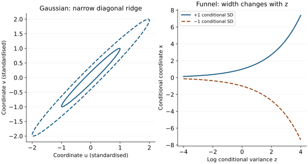

# 6 · Use modern samplers responsibly

**Prerequisites:** [Chapter 5](./05_monte_carlo.md); log densities, derivatives, and covariance. [Appendix 2](./appendix-02_calculus.md) develops gradients and transformations; [Appendix 3](./appendix-03_linear_algebra.md) explains quadratic forms. **Objectives:** explain why gradients help sampling; specify a model in PyMC; interpret modern diagnostics; separate computation from model adequacy; explain Hamiltonian integration and constrained coordinates; design an exact-reference and predictive validation report.

## Why a random walk becomes inefficient

Imagine a narrow diagonal ridge in a two-parameter posterior. Random steps usually leave the ridge; small accepted steps take a long time to travel along it. How can we explore this distribution without confusing a long run with an informative one? Hamiltonian Monte Carlo, **HMC**, uses gradients to construct coordinated proposals. Its benefits depend on geometry: which directions are narrow, how their widths change, and whether distinct regions connect readily.

Finding a high-density point is insufficient. A posterior expectation depends on probability mass, which combines density with volume. In many dimensions, the region containing most mass need not surround the density maximum closely. An optimiser returns a point; a sampler must explore the distribution. Automatic differentiation supplies local derivatives efficiently, but it cannot determine whether the scientific model is identified or whether all important regions have been visited.

## Energy connects the target to a trajectory {#energy-connects-the-target-to-a-trajectory}

Let $q$ denote unconstrained parameter coordinates and $\pi_q(q)$ their posterior density. Introduce auxiliary momentum $p\sim\operatorname{Normal}(0,M)$, where $M$ is a fixed positive-definite mass matrix. Ignoring constants, define

$$U(q)=-\log\pi_q(q),\qquad K(p)=\tfrac12p^TM^{-1}p,
\qquad H(q,p)=U(q)+K(p).$$

The joint density is proportional to $e^{-H(q,p)}$. Integrating out momentum recovers the desired posterior. Hamilton's equations are

$$\frac{dq}{dt}=M^{-1}p,\qquad \frac{dp}{dt}=-\nabla U(q).$$

Momentum moves the position; the gradient redirects momentum according to the target's geometry. Exact dynamics conserve total energy. They can carry a state a substantial distance without proposing arbitrary moves into low-probability regions. Refreshing momentum lets successive trajectories explore different energy levels. Without that refresh, conserving energy would itself restrict exploration.

HMC requires a differentiable continuous target in the coordinates it uses. Unknown discrete variables need marginalisation or a suitable additional sampler. Discontinuous likelihood code and hard parameter-dependent branches may cause difficulties even when every named parameter is continuous. [Betancourt's conceptual introduction](https://arxiv.org/abs/1701.02434) develops the geometric interpretation and its limits.

## Leapfrog and the Metropolis correction

Most Hamiltonian equations cannot be solved analytically. One leapfrog step of size $\epsilon$ alternates a momentum half-step, a position step, and another momentum half-step:

$$\begin{aligned}
p_{1/2}&=p_0-\tfrac\epsilon2\nabla U(q_0),\\
q_1&=q_0+\epsilon M^{-1}p_{1/2},\\
p_1&=p_{1/2}-\tfrac\epsilon2\nabla U(q_1).
\end{aligned}$$

The second gradient is evaluated at the new position. Leapfrog is reversible with a momentum flip and preserves volume; it does not preserve energy exactly. For fixed-length HMC, a proposal made from repeated steps and a momentum flip is accepted with probability

$$\alpha=\min\{1,\exp[H(q_0,p_0)-H(q_L,p_L)]\}.$$

A rejection retains the old position. This is the same residence-time principle as Metropolis, now applied to a proposal in an expanded space. Small integration errors usually allow acceptance. Persistent large errors waste computation and can obstruct exploration. The correction establishes the appropriate invariant target under its assumptions; it does not make every finite run reliable. The [Stan sampling reference](https://mc-stan.org/docs/reference-manual/mcmc.html) describes this construction.

## Worked example: one normal-target trajectory step

Take a standard normal target, so $U(q)=q^2/2$, with $M=1$. Starting at $q_0=0$, $p_0=1$, the exact solution is $q(t)=\sin t$, $p(t)=\cos t$, always with energy $1/2$. This is an exact reference for integration, not a claim that this chosen initial condition is a posterior sample.

With $\epsilon=0.5$, leapfrog gives $p_{1/2}=1$, $q_1=0.5$, and $p_1=0.875$. Its energy is $(0.5^2+0.875^2)/2=0.5078125$. The error is 0.0078125, so the acceptance probability is $e^{-0.0078125}=0.992218$. Direct calculation at time 0.5 gives exact position 0.479426 and momentum 0.877583. These **computed arithmetic values** show both the useful movement and the numerical error.

One accurate step does not establish that an entire sampler works. Repeating the dynamics without momentum refresh would trace an orbit, rather than generate independent posterior draws. Taking excessively long paths can return near the starting position and waste gradient evaluations. Conversely, a very short trajectory behaves locally and may explore slowly. We need both stable integration and useful trajectory lengths.

## Warmup, geometry, and NUTS {#warmup-geometry-and-nuts}

Warmup commonly adapts step size and a mass matrix that adjusts relative scales and, when supported, correlations. With our convention, $M$ is the covariance of momentum; software sometimes reports its inverse. Read that convention before interpreting a fitted matrix. A constant matrix can compensate for a tilted ellipse but cannot flatten a shape whose curvature changes sharply from place to place.

The **No-U-Turn Sampler**, NUTS, expands a trajectory in both directions and stops expansion when continued travel begins turning back. It selects a state using rules that preserve the target, rather than simply returning whichever endpoint looks best. Trajectory length changes during sampling; this is part of the valid transition. Warmup adaptation of its tuning parameters is a different process and ordinarily stops before retained sampling. See the original [Hoffman–Gelman NUTS paper](https://jmlr.org/papers/v15/hoffman14a.html).

Higher target acceptance generally induces smaller integration steps. That may resolve moderately difficult curvature while increasing computational cost. It cannot identify an unidentified likelihood, make an improper posterior proper, or guarantee movement between distant modes. Extra warmup helps when adaptation lacks information; extra retained draws help precision after exploration is credible. Record which problem justifies the additional computation.

## Constrained parameters need the right density {#constrained-parameters-need-the-right-density}

For a probability, PyMC can sample an unconstrained log-odds coordinate $z=\log\{\theta/(1-\theta)\}$. Since $d\theta/dz=\theta(1-\theta)$,

$$\log\pi_z(z)=\log\pi_\theta(\operatorname{logistic}(z))
+\log\theta+\log(1-\theta).$$

For Beta(16,8), this becomes $16\log\theta+8\log(1-\theta)+C$, whose derivative with respect to $z$ is $16-24\theta$. Omitting the Jacobian instead uses powers 15 and 7 in the transformed log density and targets the wrong distribution after transforming draws back. Declared PyMC distributions handle their standard transformations internally. Hand-written densities must account for the measure they describe. Appendix 2 supplies the substitution derivation; [Appendix 4](./appendix-04_numerics.md) covers stable log-logistic arithmetic.

## Declare a generative model

The familiar beta-binomial example makes an implementation error easier to recognise:

```python
with pm.Model() as model:
    theta = pm.Beta("theta", alpha=2, beta=2)
    y = pm.Binomial("y", n=20, p=theta, observed=14)
    prior = pm.sample_prior_predictive(draws=1000, random_seed=606)
    idata = pm.sample(draws=1200, tune=1200, chains=4,
                      cores=1, target_accept=0.95, random_seed=606)
```

The first distribution supplies a prior; the second supplies a likelihood conditioned on the observed count. Prior predictive simulation temporarily generates outcomes from the prior model, before conditioning. The sampling request retains 1,200 draws from each of four chains after 1,200 warmup iterations per chain. Running one core controls execution resources, not the number of chains.

In the lab, [common.py](../../downloads/bayesian/labs/common.py) supplies these settings through `sample_model` and requests pointwise log likelihood for later scoring. The returned inference object keeps chain and draw dimensions and sampler information. Preserve those dimensions for diagnostics. Flattening too early destroys between-chain comparisons; flattening later can be appropriate for a posterior histogram. The dependency lock defines the teaching environment, so these lines should not be interpreted as a promise about every future library release.

## Read agreement, efficiency, and precision separately {#read-agreement-efficiency-and-precision-separately}

Modern rank-normalised split **R-hat** compares within-chain and between-chain variation after splitting chains into halves. Rank normalisation improves behaviour for heavy tails; folding values around the pooled median helps reveal differences in scale. The reported diagnostic uses both location and folded checks. The course screens for R-hat below 1.01 with at least four chains and diverse plausible starts. Use unrounded values: a display of 1.00 can hide a meaningful difference. These choices follow [Vehtari and colleagues (2021)](https://arxiv.org/abs/1903.08008).

R-hat measures agreement among the explored distributions. It cannot detect a region missed by every chain, prove finite moments, or judge a likelihood's suitability. Trace plots reveal persistence and drift. Rank plots compare how each chain occupies the pooled ordering; persistent imbalances suggest that chains sample different locations or scales. Inspect parameters and scientifically important derived quantities, including contrasts whose dependence may be difficult to explore.

For a **computed diagnostic counterexample**, define a target with equal-weight normal components centred at minus six and plus six, both with unit SD. Symmetry gives exact target mean zero. Now deliberately generate four arrays of two thousand independent values from *only the positive component*, using NumPy's default generator with seed 610. These arrays are fabricated incomplete samples, not an HMC run. ArviZ reports mean 5.98840, R-hat 1.00008, bulk ESS 8,094, and mean MCSE 0.01114. Agreement is excellent because all four arrays represent the same wrong component.

The small MCSE describes simulation variability within that component; it does not cover the missing half of the target. This construction isolates the limitation without relying on a particular sampler becoming trapped by chance. In practice, starts near both components, a symmetry argument, or an independently computed reference could expose the omission. Changing only the reporting threshold could not. A posterior without an exact reference requires several complementary checks precisely because such missing regions may be unknown.

**Bulk ESS** uses rank-normalised draws to assess central exploration. **Tail ESS** commonly reports the smaller ESS associated with the fifth and ninety-fifth percentiles. Neither is automatically the ESS for the mean of a nonlinear transformation or for an extremely rare event. We screen for both above 400 across monitored quantities, then check numerical precision for the requested result. The [Stan posterior-analysis reference](https://mc-stan.org/docs/reference-manual/analysis.html) explains these distinctions.

For a probability above a threshold, form its indicator draws and estimate their mean MCSE. For an interval endpoint, request quantile MCSE at that endpoint. For a loss difference, transform draws into that difference first. A parameter SD divided by the square root of bulk ESS is not generally the requested error estimate. Smooth-looking histograms and high aggregate ESS cannot replace this estimand-specific calculation.

For example, this fragment keeps the beta draw dimensions while changing the question:

```python
event = (idata.posterior["theta"] > 0.7).astype(float)
event_mcse = az.mcse(event, method="mean")
```

The first line turns each probability draw into an event indicator. The second estimates numerical error in its average while retaining dependence information. It does not estimate uncertainty about the indicator's true probability by treating the simulated indicators as new observed visits. If indicators are constant because no event occurred, a zero or undefined error estimate is insufficient evidence of accuracy.

For the lower endpoint of a central ninety-percent interval, use the original parameter draws and a quantile MCSE calculation at probability 0.05. A sparse density near that endpoint makes its location harder to resolve: a small probability error can correspond to a substantial change in parameter units. Record the endpoint and its numerical error together, and repeat for the upper endpoint rather than assuming equal precision.

## Worked example: a complete exact-reference comparison

With fourteen successes and six failures, the posterior remains Beta(16,8). Its mean is 0.6666667 and central 90% credible interval is [0.5035649, 0.8136562]. These analytic-family values were recalculated with SciPy. The following table reports the **saved Lab 6 result file**. Its seeded computation is reproducible in the pinned environment:

| Quantity | Saved value |
|---|---:|
| Sample mean | 0.669352 |
| Mean MCSE | 0.0021251 |
| R-hat | 1.002034 |
| Bulk / tail ESS | 1,846 / 1,749 |
| Divergent transitions | 0 |
| Minimum BFMI | 0.88197 |
| Maximum tree-depth hits | 0 |
| Sample central 90% interval | [0.510244, 0.815209] |

The mean discrepancy is about 1.26 reported MCSE, compatible with ordinary simulation variation. The lower interval endpoint differs by about 0.00668. Its precision needs a quantile MCSE; the mean's MCSE does not assess that endpoint. The rebuilt JSON now records separate MCSEs for the 5th and 95th percentiles and checks both endpoint discrepancies against six of their own MCSEs. Passing this numerical screen supports these particular quantiles, without certifying every posterior tail. A credible interval itself describes parameter uncertainty, not simulation error.

<!-- tutor-reference:start -->

**Worked assessment reference — attempt the assessment first.**

For the stronger Beta(10,10) prior in the exercise, conjugacy gives Beta(24,16), with mean 0.6 and central 90% interval [0.4711427, 0.7230985]. These are analytic reference values. The separate [worked exercise solution](./course-solutions.md) reports a changed-prior fit with its own computational evidence; the original-fit diagnostics above do not apply to that refit. Changing prior information changes the target, whereas increasing draws should only improve its numerical representation.

<!-- tutor-reference:end -->

Computation and predictive validation still need separate reports. The lab generates prior predictive counts and posterior predictive counts and saves both a posterior trace figure and a [predictive-count comparison](../../downloads/bayesian/artifacts/figures/06_predictive.svg). As a learner investigation, reproduce those count distributions, check their support, and compare the observed count of fourteen with relevant predictions. Explain which features change under a different prior. Agreement with the exact posterior cannot establish that visits are independent or share one completion probability.

## Identification and funnels

Suppose $Y_i\sim\operatorname{Normal}(a+b,1)$ with known observation SD. The likelihood sees only $a+b$. Adding a constant to $a$ and subtracting it from $b$ leaves every likelihood value unchanged. With flat priors on both coefficients, integration along this ridge is unbounded: there is no proper joint posterior. Proper priors can make the posterior proper, but information about the difference then comes from those priors. More sampler tuning cannot create data information about that difference.

Weakly informed hierarchical scales create another difficulty. Consider the generative construction $v\sim\operatorname{Normal}(0,3^2)$, where the second argument here denotes variance, and $x_j\mid v\sim\operatorname{Normal}(0,e^v)$. Conditional variance contracts as $v$ decreases, creating a funnel: broad in one region, extremely narrow in another. A step size adequate in the broad region may fail in the neck. A global mass matrix cannot accommodate both equally well.

Writing $x_j=e^{v/2}z_j$, with independent standard normal $z_j$, removes that coupling in this prior example. In a hierarchy, the analogous noncentred form is $\theta_j=\mu+\tau z_j$. It defines the same prior model when transformed correctly, but changes sampling geometry. With highly informative group data, a centred form may work better. [Chapter 9](./09_hierarchical.md) develops this choice; the [approximation bridge](./adv-01_approximation.md) shows why difficult geometry also affects alternatives to MCMC.


<!-- VISUAL01:08 BEGIN -->

### Visual investigation: geometry can demand incompatible step scales

Predict where a single step scale might struggle: along the thin diagonal contour, or across a funnel whose width changes sharply with position. These drawings describe analytic geometry. They are not sampled chains, acceptance histories or evidence that any particular sampler succeeded.



**Read the figure.** Left: two constant-density contours use standardised coordinates. Their long and short directions come from covariance eigenvectors. Right: the horizontal coordinate $z$ is log conditional variance, and the two curves mark plus/minus one conditional SD of $x\mid z$. They are cross-section widths, not trajectories.

| Geometry quantity | Value |
|---|---:|
| Larger eigenvalue of covariance with unit variances and correlation 0.98 | 1.98 |
| Smaller eigenvalue | 0.02 |
| Conditional SD at z = −4 | 0.135335 |
| Conditional SD at z = 0 | 1 |
| Conditional SD at z = 4 | 7.389056 |

**Mathematical connection.** The Gaussian covariance is $\left(\begin{smallmatrix}1&.98\\.98&1\end{smallmatrix}\right)$, giving a variance ratio of 99 between principal directions. For the funnel slice, $x\mid z\sim N(0,e^z)$, so its SD is $e^{z/2}$. A global linear scaling can address a fixed Gaussian ridge more directly than a position-dependent funnel width. A full funnel model also needs a marginal distribution for $z$; the right panel deliberately only specifies conditional geometry.

**Original unscored exploration — predict, observe, explain.** Predict the width ratio between z = −4 and z = 4, then observe it is $e^4\approx54.6$. Explain why high acceptance or visually smooth traces alone cannot establish exploration of both regions. Transfer to a non-centred parameterisation: identify the transformed coordinate and the distribution it must preserve before calling the change a remedy.

<!-- VISUAL01:08 END -->

## Worked diagnostic failure and a debugging decision tree

Consider this **illustrative report, not an executed fit**: four chains in a weakly informed centred hierarchy give R-hat 1.003, bulk ESS 1,200, tail ESS 500, eighteen post-warmup divergences, and minimum BFMI 0.18. The agreement and ESS screens pass, yet the run remains suspect. A plausible hypothesis is that all chains underexplore a narrow funnel region. That hypothesis requires investigation; the summary alone does not identify its cause.

A **divergent transition** flags a trajectory with excessive integration error and can indicate missed probability mass. It is not simply an ordinary Metropolis rejection. **BFMI**, Bayesian fraction of missing information, compares energy changes across transitions with marginal energy variation; low values suggest that momentum refreshes explore energy poorly. The course uses 0.3 as a warning threshold. **Tree-depth hits** mean trajectory expansion reached its configured limit, usually signalling inefficiency. None of these warnings is cancelled by a satisfactory R-hat. See [Stan's diagnostic guidance](https://mc-stan.org/learn-stan/diagnostics-warnings.html).

Follow this sequence before reporting a probability:

1. **Invalid initial density or gradients?** Check data, units, support, transformations, and likelihood code. Reduce to a tiny exact or simulated case. Resolve these failures before interpreting summaries.
2. **Divergences?** Locate affected transitions in parameter and pair plots. Examine scale parameters, strong dependencies, constraints, and identification. Test standardisation, defensible priors, or an equivalent reparameterisation. A higher target acceptance can test sensitivity to smaller steps; document whether it actually resolves the issue.
3. **Low BFMI or repeated depth limits?** Inspect per-chain energy behaviour and scales. Reconsider geometry and adaptation before paying for deeper trees. Raising a depth limit may help an otherwise well-behaved but truncated trajectory; it cannot by itself explain the warning.
4. **R-hat or rank plots disagree?** Try scientifically plausible dispersed starts, check modes and symmetries, and compare simpler models. Longer runs are justified when exploration improves, not merely because time has passed.
5. **Exploration credible but MCSE too large?** Add retained draws and reassess the actual estimand. Keep diagnostics and parameterisation fixed in the comparison. Do not select whichever random seed produces a favourable report.
6. **Computational checks pass but predictions fail?** Revisit the observation process and model assumptions. More accurate integration of a poor model leaves its predictive defect intact.

For the illustrative hierarchy, the concrete next step is to mark divergences against the group scale, compare equivalent centred and noncentred formulations, and repeat the full diagnostic and estimand checks. Regularising priors require substantive justification because they change the model. Reparameterisation, correctly implemented, need not change it.

## Lab

**Selected-core task:** compare the supplied NUTS fit with its exact reference and write a diagnostic memo separating computation from model criticism. **Extended task:** hand leapfrog arithmetic, transformed-density derivation and funnel geometry add mathematical depth beyond that submission.

Run Lab 6, or its [Python source](../../downloads/bayesian/labs/06_hmc.py), and inspect the [trace figure](../../downloads/bayesian/artifacts/figures/06_trace.svg). Add rank plots, indicator MCSE, and interval-endpoint MCSE to your investigation. Keep prior predictions, posterior computations, and posterior predictive checks distinct. Record seeds, software versions, settings, and the result needed for the decision. Seeds alone do not ensure identical draws across processors or numerical backends.

## Retrieval and summary

Explain why a valid Metropolis correction and R-hat near one can coexist with inadequate exploration. Describe which error measure belongs beside a posterior mean, a tail probability, and a credible-interval endpoint. Explain why a negative-waiting-time prediction is a modelling issue even when a sampler accurately represents its target.

HMC uses energy-preserving dynamics as an ideal and numerical trajectories as proposals. Warmup and NUTS automate useful tuning, while geometry and identification remain modelling responsibilities. Report agreement, exploration warnings, estimand precision, exact-reference checks, and predictive adequacy as distinct evidence.

## Lab and exercises

**6.1 — Concept.** A model has R-hat 1.00 and zero divergences but predicts negative waiting times frequently. Is the computation necessarily broken? What should be investigated?

**6.2 — Diagnosis.** Four chains produce R-hat 1.08, bulk ESS 70, and 40 divergences. Give a reasoned sequence of three actions before reporting a posterior probability.

**6.3 — Computation.** For 14 observed successes in 20 conditionally independent Bernoulli trials sharing probability theta, replace its Beta(2,2) prior with Beta(10,10), fit the binomial model using multiple chains, and compare its mean with the new analytic answer. Submit your own code and output with seeds, mean MCSE, quantile MCSEs, R-hat, bulk/tail ESS, divergences and the change in a central 90% credible interval against both exact posteriors.

[Solutions](./course-solutions.md).

## Further reading

[Hoffman and Gelman (2014)](https://jmlr.org/papers/v15/hoffman14a.html) derive NUTS; [Betancourt (2017)](https://arxiv.org/abs/1701.02434) develops HMC geometry. [Vehtari and colleagues (2021)](https://arxiv.org/abs/1903.08008) explain rank normalisation, folding, and local precision diagnostics. Consult the [official PyMC resources](https://www.pymc.io/welcome.html) alongside the installed, pinned API and [Stan's warning guide](https://mc-stan.org/learn-stan/diagnostics-warnings.html).
