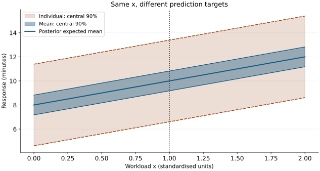

# 7 · Explain variation with regression

**Objectives:** build a Gaussian regression; choose priors on an interpretable scale; propagate joint uncertainty into predictions; recognise residual structure; derive coefficient and prediction covariance; diagnose scaling, collinearity and extrapolation. **Prerequisite:** chapters 4 and 6; use [Appendix 3](./appendix-03_linear_algebra.md) for matrix notation and quadratic forms.

## A mean that changes with context

A service manager wants to tell visitors how long they might wait when the centre is busy. Yesterday's overall average mixes quiet and busy periods. A better forecast could use workload known at arrival. But the manager has two questions: what is the average wait at a given workload, and what range should one visitor expect? Regression addresses both through different distributions.

The recurring [synthetic waiting dataset](../../downloads/bayesian/data/README.md) contains visits at eight centres. Its workload index is already on a centred teaching scale; the suffix `_z` does not mean that this particular sample has mean zero and standard deviation one. Begin with a common regression line, deliberately postponing centre differences until chapter 9. This makes the consequences of omitting structure visible.

Before calculating, predict the direction of the workload association and name one reason the line might fail. Staffing and visit complexity could influence both workload and waiting. The coefficient describes a conditional association; it is not automatically the effect of intervening to increase workload.

## A complete generative regression

Treat observed workloads as fixed inputs, measured without error for this first model. Conditional on these inputs, generate parameters and then independent visits:

$$
\begin{aligned}
\alpha&\sim\operatorname{Normal}(10,3^2),&
\beta&\sim\operatorname{Normal}(0,2^2),&
\sigma&\sim\operatorname{HalfNormal}(2),\\
\mu_i&=\alpha+\beta x_i,&
Y_i\mid\alpha,\beta,\sigma,x_i&\sim\operatorname{Normal}(\mu_i,\sigma^2).
\end{aligned}
$$

The three priors are independent. Throughout this chapter the second Normal argument is a variance, while HalfNormal takes a scale: it is the absolute value of a zero-mean Normal draw with that standard deviation. Alpha and sigma have units of minutes; beta has units of minutes per workload-index unit. Alpha is the mean at workload zero, beta changes the conditional mean, and sigma describes residual variation around it.

The likelihood is a product over visits. Multiplying that product by the three prior densities defines the joint posterior, including the uncertainty in the residual scale. No distribution for workload is needed for this conditional question. Forecasting when future workload is itself unknown requires another model or an explicit scenario distribution for that input.

The assumptions are a linear conditional mean, constant conditional variance, Gaussian residual tails and conditional independence. Marginally, observations share uncertain parameters. Conditional independence would still be wrong if successive visits share an unmodelled queue disruption. A distribution statement should therefore be accompanied by the observation unit and the circumstances under which its independence assumption is plausible.

## Priors have units

Prior prediction means drawing one parameter triple, evaluating its line across the intended workload range, and then generating noisy visits around that same line. Repeat the whole process. Inspect both the implied mean curves and outcomes: a plausible average can coexist with implausible residual variation.

For these independent priors, the mean wait at a fixed workload is exactly Normal with mean ten and variance

$$\operatorname{Var}(\alpha+\beta x)=9+4x^2.$$

At workload zero its prior standard deviation is three minutes; at workload two it is five. The latter mean distribution puts about 2.3% probability below zero. Moreover, the half-normal scale prior has expected squared scale four, so the prior predictive variance for a visit is

$$\operatorname{Var}(Y\mid x)=9+4x^2+E[\sigma^2]=13+4x^2.$$

The predictive distribution is a mixture over residual scales, so its quantiles do not follow just by treating this variance as a single Normal variance. This calculation nevertheless exposes a real limitation: even the lab priors allow physically impossible negative waiting times. They are a teaching starting point to inspect, not a universal recommendation.

Calling Normal with standard deviation one thousand “weak” ignores its predictive consequences. Such a slope can imply enormous waiting-time changes across a small workload range. With several predictors, individually modest independent priors can also combine into very variable linear predictors. Examine plausible combinations of inputs as well as one-variable plots.

### Worked example 1: change units without changing beliefs

Suppose workload is measured as arrivals per hour, denoted by $u$, and define $z=(u-40)/10$. Write the line as $a+bz$, with independent priors $a\sim\operatorname{Normal}(10,3^2)$ and $b\sim\operatorname{Normal}(0,2^2)$. The same line on the original scale is

$$a+b(u-40)/10=A+Bu,\qquad A=a-4b,\quad B=b/10.$$

Thus the original-scale intercept has variance seventy-three, the slope has variance 0.04, and their covariance is −1.6. These follow by expanding the linear transformations, not by choosing new independent priors. At fifty arrivals per hour the predicted mean is either $a+b$ or $A+50B$. The second representation gives

$$\operatorname{Var}(A+50B)=73+50^2(0.04)+2(50)(-1.6)=13,$$

agreeing with the first representation's variance $9+4$. Dropping the induced covariance would give variance 173 and a completely different prior prediction. The apparently uncertain original intercept concerns zero arrivals, far from the reference workload; its strong dependence with the slope preserves sensible predictions near forty.

In general, centring and scaling change coefficient meanings and their joint prior. They do not change the model if the full transformation is carried through. When learning preprocessing constants from data, estimate them on training data and reuse them on validation data. Save those constants with the fitted model so deployment uses the same units.

## A useful analytic connection {#a-useful-analytic-connection}

To see how a likelihood learns a line, temporarily suppose residual variance is known. With $n$ observations and $p$ coefficients, let $y$ be an $n\times1$ vector, $X$ an $n\times p$ design matrix, and $b$ a $p\times1$ coefficient vector. A column of ones in the design supplies the intercept. Take

$$y\mid b\sim\operatorname{Normal}(Xb,\sigma^2I_n),\qquad b\sim\operatorname{Normal}(m_0,V_0).$$

The prior covariance is positive definite. Expanding the two quadratic terms in the log posterior and collecting terms involving the coefficients gives

$$
\begin{aligned}
\log p(b\mid y)&=C_0-\frac{(y-Xb)^T(y-Xb)}{2\sigma^2}
-\frac{(b-m_0)^TV_0^{-1}(b-m_0)}2,\\
\log p(b\mid y)&=C-\tfrac12(b^TP_nb-2b^Th_n),\\
P_n&=V_0^{-1}+X^TX/\sigma^2,\\
h_n&=V_0^{-1}m_0+X^Ty/\sigma^2.
\end{aligned}
$$

Here the precision matrix is $p\times p$ and the information vector is $p\times1$. Completing the square identifies

$$V_n=P_n^{-1},\qquad m_n=V_nh_n,\qquad b\mid y\sim\operatorname{Normal}(m_n,V_n).$$

This is the scalar normal-normal update in several dimensions. The diagonal precision contributions are accompanied by cross-terms, reflecting which coefficient combinations the design can distinguish. A zero-centred Gaussian slope prior penalises squared slopes at the posterior mode, connecting this calculation to ridge regularisation. The full posterior also retains uncertainty and dependence around that mode.

Use linear solves or a Cholesky decomposition in numerical code rather than constructing matrix inverses by default. The inverse notation expresses the mathematical relationship. When sigma is unknown, as in the lab, the conditional calculation depends on its current value; integrating over sigma generally produces a mixture rather than this single multivariate Normal.

### Worked example 2: learn correlated coefficients

Consider three illustrative waits of nine, eleven and thirteen minutes at workloads zero, one and two. This tiny example is separate from the lab dataset. Assume known residual standard deviation one minute and a prior coefficient mean $(10,0)^T$ with identity covariance. The prior slope standard deviation is therefore one, different from the lab's two. Then

$$
X=\begin{pmatrix}1&0\\1&1\\1&2\end{pmatrix},\quad
P_n=\begin{pmatrix}4&3\\3&6\end{pmatrix},\quad
h_n=\begin{pmatrix}43\\37\end{pmatrix}.
$$

The determinant of the precision is fifteen. Solving for the posterior yields

$$V_n=\frac1{15}\begin{pmatrix}6&-3\\-3&4\end{pmatrix},\qquad
m_n=\begin{pmatrix}9.8\\19/15\end{pmatrix}.$$

The slope mean is about 1.267 minutes per workload unit. It is pulled below the data-only line's slope of two because the prior favours smaller slopes and three observations provide limited information. Multiplying the displayed precision by the mean returns the information vector, giving a direct arithmetic check.

The intercept variance is 0.4, slope variance approximately 0.267, and covariance −0.2. A larger intercept can be partly offset by a smaller slope where the observations lie. Thus independent priors need not produce independent posterior coefficients. The uncertainty is an inclined cloud of plausible lines, not a box constructed from separate marginal intervals.

## Joint draws preserve relationships {#joint-draws-preserve-relationships}

At a new workload, let $r_*=(1,x_*)^T$. In the known-scale model, the conditional mean and one new observation have distributions

$$
\mu_*\mid y\sim\operatorname{Normal}(r_*^Tm_n,r_*^TV_nr_*),\qquad
\widetilde Y_*\mid y\sim\operatorname{Normal}(r_*^Tm_n,r_*^TV_nr_*+\sigma^2).
$$

The mean variance expands to intercept variance, plus squared workload times slope variance, plus twice workload times their covariance. In the preceding example it is $0.4-0.4x_*+(4/15)x_*^2$. The covariance matters even when each marginal summary is accurate.

Continue the example at workload one, inside the observed range, and workload four, outside it. Using the Normal 95th percentile, approximately 1.645, gives the following central 90% intervals; all endpoints are minutes.

| Workload | Posterior mean wait | Variance of mean | Interval for mean | Interval for one visit |
|---|---:|---:|---|---|
| 1 | 11.067 | 0.267 | [10.217, 11.916] | [9.215, 12.918] |
| 4 | 14.867 | 3.067 | [11.986, 17.747] | [11.550, 18.184] |

At workload one, discarding covariance would replace the mean variance by approximately 0.667. At negative workloads the same discarded covariance would instead reduce uncertainty. Independently shuffling the marginal draws has no generally conservative interpretation.

For the fitted model with unknown scale, compute a mean from each matching intercept and slope draw, then draw observation noise using that draw's sigma. Total variance gives

$$\operatorname{Var}(\widetilde Y_*\mid y)=\operatorname{Var}(\mu_*\mid y)+E[\sigma^2\mid y].$$

Do not replace the last term by squared posterior mean sigma. Obtain mixture quantiles from simulated predictions. For several future visits, share one parameter draw across the batch and generate separate residuals. If all have the same workload and are conditionally independent, the variance of their average is mean uncertainty plus expected residual variance divided by batch size. Averaging visitors reduces individual noise but does not erase uncertainty about the line.

<!-- VISUAL01:09 BEGIN -->

### Visual investigation: a mean interval is not an individual interval

For this separate toy regression, let $\mu(x)=8+2x+A$ with posterior $A\mid D\sim N(0,0.25)$ and independent future residual SD two minutes. The slope is fixed here. Predict which uncertainty remains if the intercept offset becomes known exactly.

**Read the figure.** The horizontal coordinate is a standardised workload and the vertical coordinate is response time in minutes. The solid line is the posterior expected mean. The narrow band describes the conditional mean; the wider hatched band predicts a new individual response. At each fixed x, both bands are central 90% intervals for their stated targets. In this special fixed-slope model, the same uncertain intercept shifts the whole mean curve, so the narrow band also covers that entire mean curve with probability 0.9. Pointwise bands in more general regression models need not have simultaneous 90% coverage. The individual intervals do not give a joint 90% guarantee for a collection of future responses.

| Target at x = 1 | Centre (minutes) | Variance (minutes squared) | Central 90% interval (minutes) |
|---|---:|---:|---|
| Mean response | 10 | 0.25 | [9.177573, 10.822427] |
| One future response | 10 | 4.25 | [6.609047, 13.390953] |

**Mathematical connection.** Independent residual variation adds to mean uncertainty: $\operatorname{Var}(Y_{new}\mid D,x)=\operatorname{Var}(\mu(x)\mid D)+\sigma^2$. The half-widths are $z_{.95}\sqrt{0.25}$ and $z_{.95}\sqrt{4.25}$. In a regression with uncertain slope too, preserve joint coefficient draws because their covariance changes $\operatorname{Var}(\mu(x))$ with x.

**Original unscored exploration — predict, observe, explain.** Set only the intercept variance to zero. Predict and then observe that the mean interval collapses while the individual interval retains half-width $1.644854\times2=3.289707$. Explain why collecting more information about the mean does not remove irreducible residual variation under this model. Extrapolation, uncertain residual scale and model error are outside this stipulated illustration.

<!-- VISUAL01:09 END -->

## A model can fit the line and miss the process

After fitting the service regression, compute residuals from observed waits minus posterior mean fitted waits. Plot them against workload, centre and visit order when available. A nearly horizontal overall residual trend is not enough: positive errors at one centre and negative errors at another can cancel globally.

Suppose the busy half of a hypothetical dataset has residual standard deviation two minutes and the quiet half has standard deviation one. A fitted common scale of 1.5 can cover some quiet visits too generously while missing busy extremes. A candidate revision models log residual scale as a function of workload, with its own justified priors. Replicated residual spreads within workload bands would then check the feature that motivated the revision.

A curved pattern instead suggests revising the conditional mean, perhaps with a quadratic term or a spline. Persistent centre differences motivate chapter 9's varying intercepts. Serial runs of errors suggest dependence, while isolated extremes call for checking measurement and considering heavier tails. These patterns support different investigations; adding a wider noise distribution indiscriminately can hide a systematic mean error.

Residuals calculated after fitting have been influenced by that fit. Posterior predictive checks generate replicated datasets at the observed inputs and compare a relevant statistic, such as between-centre residual variation or the maximum wait. Chapter 10 develops these checks. A clean R-hat and large effective sample size establish neither correct residual structure nor accurate predictions: they concern computation under the chosen model.

### A diagnostic calculation: a hidden centre contrast

Imagine two centres with the same average workload. They have four and thirty-six independent visits, and adjusted average waits of eight and twelve minutes. Under a common-intercept model with residual standard deviation fixed at 1.5 minutes, the difference of their averages has expected value zero. The common intercept cancels, and the common workload slope cancels because their average workloads match. Its conditional variance is

$$1.5^2(1/4+1/36)=0.625.$$

The standard deviation is approximately 0.791 minutes, so a central 90% model interval for the contrast is about −1.300 to 1.300 minutes. The observed contrast of four minutes is more than five such standard deviations from zero. This is a concrete feature that the common-line model finds difficult to reproduce, even if the overall average wait is well fitted.

For this teaching calculation the scale was held fixed. In a fitted analysis, generate the contrast from replicated visits across posterior draws, keeping each centre's sample size and workload values. Uncertainty in scale changes the reference distribution. If centre workloads do not match, slope uncertainty also matters. The calculation identifies a useful discrepancy; it does not replace the full check or establish the cause of the centre difference.

A model that inflates residual scale to accommodate this contrast may then predict too much variation within each centre. Inspecting both levels explains why a centre intercept can be a better revision than simply making all visits noisier. It also guards against overreacting to the noisiest small group: replication retains its small sample size, so the comparison already allows its average to fluctuate more.

## More predictors do not guarantee more information

If staffing and workload almost always move together, a multiple regression may estimate their combined predictive contribution while learning their separate coefficients poorly. With exactly duplicated predictors, increasing one coefficient and decreasing the other equally leaves every fitted mean unchanged. A proper prior can give a proper posterior in such a direction, but the data have not identified the division of credit.

Inspect joint draws and predictions at observed combinations before interpreting coefficient signs. New combinations, such as high workload with unusually low staffing, may expose the weakly learned direction. Centring can improve numerical geometry and interpretation; it cannot create missing design information. Interactions likewise require data in the relevant combinations, and a common slope assumes an association that does not change across those contexts.

## Prediction has a domain

The interval at workload four in the worked example is wider, but it still assumes the straight line continues. It omits uncertainty about a change in queue behaviour, a staffing threshold or a capacity limit. Even a very precise slope could generate a misleadingly precise extrapolation. State the input range and population for which the forecast is intended.

A Gaussian waiting-time likelihood also allows negative outcomes. If the implied probability is material in the application, consider a positive-support model such as a lognormal or gamma. A lognormal regression models log waiting time; exponentiating its log mean gives the conditional median, not generally the arithmetic mean. Changing support is therefore a substantive model revision, not merely clipping negative simulations to zero.

Return to the manager's question before presenting the result. A staffing planner comparing expected workload scenarios may need uncertainty about mean demand on the service. A visitor needs the distribution of their own wait, possibly a probability of exceeding a practical threshold. A single numerical interval cannot serve both purposes. If centre structure is still missing, report that limitation with the forecast rather than presenting the regression band as a service guarantee.

The prediction table illustrates the distinction without requiring MCMC. Real posterior draws add uncertainty about residual scale, but they do not automatically include every possible model revision. A credible forecasting statement therefore names the outcome, workload, centre information and period of application. Those details make an interval interpretable and allow later data to test the forecast actually issued.

## Lab

Run Lab 7, or [Python](../../downloads/bayesian/labs/07_regression.py). The script fits the specified independent-prior model and saves the [prediction plot](../../downloads/bayesian/artifacts/figures/07_regression.svg). Its inner band describes the conditional mean; its outer band includes visit noise. Both are pointwise intervals at each workload, not a simultaneous guarantee for the entire curve.

Inspect prior draws, sampler diagnostics and centre residual means separately. Explain which feature each checks. Submit a model statement, one quantitative prior prediction, a labelled prediction for a visitor, and a proposed revision tied to a residual pattern. Keep observed inputs fixed when comparing replicated data unless predicting a different workload distribution is explicitly the question. The chapter's three-observation calculations are analytic illustrations, not reported lab estimates.

## Retrieval and summary

Without looking back, explain why independent coefficient priors can lead to correlated posterior coefficients. Describe what information a shuffled-draw prediction loses. Then name a residual pattern that more NUTS draws cannot repair, and distinguish predicting many visits from learning many independent workload settings.

Regression is a distribution for outcomes conditional on context. Units determine prior meaning; joint coefficient uncertainty determines mean predictions; residual variation adds another layer for individuals. The design limits which associations can be separated, and predictive criticism determines whether the line and noise describe the process well enough for the stated use.

## Lab and exercises

**7.1 — Concept.** Explain why the posterior interval for mean waiting time is narrower than the predictive interval for one visitor.

**7.2 — Calculation.** For $Y\mid x,\alpha,\beta,\sigma\sim\operatorname{Normal}(\alpha+\beta x,\sigma^2)$, a draw has $\alpha=10$, $\beta=1.5$, and $\sigma=2$. Find its mean prediction at $x=2$ and the conditional central 90% interval for one outcome at that draw. Does this incorporate parameter uncertainty?

**7.3 — Applied.** The residual means of centres remain far apart, although global R-hat and ESS look good. Propose a model change and a data feature to check after refitting. Explain why more NUTS draws alone cannot fix the discrepancy.

[Solutions](./course-solutions.md).

## Further reading

[Regression and Other Stories](https://sites.stat.columbia.edu/gelman/regression/) develops interpretation, scaling and applied regression workflow. [Bayesian Modeling and Computation in Python, linear models](https://bayesiancomputationbook.com/markdown/chp_03.html) connects joint posterior computation with predictive interpretation. The [Stan regression guide](https://mc-stan.org/docs/stan-users-guide/regression.html) provides another formulation of design matrices and observation models; its programming notation uses Normal standard deviations, unlike this chapter's variance notation.
