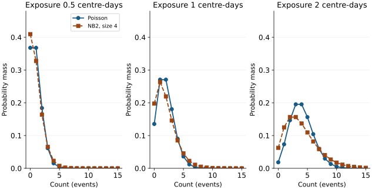

# 8 · Model binary outcomes and counts

**Objectives:** choose likelihoods matching outcome support; interpret logit and log links; translate effects to the response scale; account for exposure and causal assumptions; derive population probability contrasts; diagnose separation, overdispersion and identification limits. **Prerequisite:** chapter 7, conditional probability and the variance decomposition in [Appendix 1](./appendix-01_probability.md).

## A straight line cannot be every probability

A service records whether each user completes onboarding. Managers want to forecast completion at different support levels and plan how many follow-up contacts will be needed. These are two outcomes with different supports: completion is zero or one, while contacts are nonnegative integer counts. Neither is well described by adding constant-variance Gaussian noise to an unrestricted line.

A generalised linear model separates three choices: the sampling distribution, a linear predictor, and a link connecting that predictor to the distribution's mean. A link keeps predictions within the outcome's allowable range; it does not guarantee that the chosen predictor captures the process. Binary and count models still need prior prediction, computational diagnostics, predictive criticism and a clearly defined population.

For the [synthetic completion data](../../downloads/bayesian/data/README.md), treat each user as the observation unit and the supplied centred support index as a known predictor. It is a teaching scale, not a guarantee of sample standardisation. A complete logistic model matching the lab is

$$
\begin{aligned}
\alpha&\sim\operatorname{Normal}(0,1.5^2),\qquad
\beta\sim\operatorname{Normal}(0,1^2),\\
\eta_i&=\alpha+\beta x_i,\qquad
p_i=\frac1{1+\exp(-\eta_i)},\\
Y_i\mid\alpha,\beta,x_i&\sim\operatorname{Bernoulli}(p_i).
\end{aligned}
$$

The priors are independent; users are conditionally independent. The Normal distributions here use variance as the second argument. For a Bernoulli observation the conditional variance is fixed by its mean, $p_i(1-p_i)$. There is no additional Gaussian residual standard deviation to estimate.

## From a generative story to a likelihood

The logit link is $\log[p/(1-p)]$. Solving for the probability gives the inverse link above. Consequently the linear predictor is the log odds, not the probability itself. For recorded binary outcomes, the likelihood and its logarithm are

$$
L(\alpha,\beta)=\prod_i p_i^{y_i}(1-p_i)^{1-y_i},\qquad
\log L=\sum_i\{y_i\eta_i-\log(1+e^{\eta_i})\}.
$$

Each success contributes its predicted probability and each failure the predicted probability of failure. The expression also shows why fitting cannot be done by simply taking the logit of each observed zero or one: those transformed observations would be infinite. The model transforms the unobserved probability.

For computation, evaluate the log likelihood using a stable softplus calculation, such as `logaddexp(0, eta)`, rather than directly exponentiating a very large linear predictor. Multiply the likelihood by the coefficient priors to obtain the posterior. It generally has no simple conjugate form; the lab uses NUTS. Numerical stability and posterior reliability are separate issues from whether the model is scientifically adequate.

Several users with exactly the same conditional probability may be represented by a Binomial success count with the known number of trials. Aggregating users with different predicted probabilities into one Binomial generally changes the model. Likewise, repeated observations of the same user may require a shared effect rather than independent Bernoulli factors.

## Put priors through the inverse link

At support zero, the prior log odds have standard deviation 1.5. A central 95% interval for the log odds is approximately −2.94 to 2.94, corresponding to probabilities about 0.050 to 0.950. At support two, independent coefficient uncertainty gives log-odds variance $2.25+4=6.25$. The corresponding probability interval is approximately 0.0074 to 0.9926. The same priors allow more extreme probabilities toward the edges of the input range.

Symmetry makes the prior mean probability one half at every fixed support value in this particular model. That benign-looking average conceals considerable mass near confident predictions. A large coefficient scale can make simulated curves almost deterministic, even though the prior mean curve looks flat. Inspect distributions of curves and simulated success counts, not only an average probability curve.

Scaling matters as in Gaussian regression. If one support unit changes from one hour to ten hours, keeping the same numerical slope prior changes its meaning. With many predictors, prior variances add in the linear predictor when coefficient priors are independent. Elicit plausible baseline probabilities and changes over meaningful predictor ranges, then check the entire resulting model. Holding input values fixed during prior simulation makes these consequences easier to interpret.

## Odds ratios are not probability differences

Increasing support by one unit adds beta to log odds, so it multiplies odds by $e^\beta$. The odds at probability one fifth are one to four; they are not one fifth. For baseline probability $p_0$ and odds multiplier $R$, the new probability is

$$p_1=\frac{Rp_0}{1-p_0+Rp_0}.$$

The absolute change depends on the baseline. Locally, differentiation gives $dp/dx=\beta p(1-p)$, so a constant log-odds slope produces its largest absolute probability slope near one half. Toward zero or one, the probability curve flattens.

### Worked example 1: the same odds multiplier in a target population

Consider two user strata with baseline completion probabilities 0.2 and 0.6. Suppose a model has separate baseline intercepts for the strata and a common support coefficient $\beta=\log 2$. Compare support zero with support one while holding stratum fixed. This is an illustrative fixed-coefficient calculation, separate from the lab fit.

In the first stratum, odds move from $0.2/0.8=0.25$ to 0.5, giving probability one third. In the second, odds move from $0.6/0.4=1.5$ to three, giving probability three quarters. The probability increases are therefore about 0.1333 and 0.1500: 13.33 and 15 percentage points. Neither is a doubling of completion probability.

Suppose the intended population is three quarters first-stratum users and one quarter second-stratum users. Average the two scenario probabilities with these same weights:

$$
\begin{aligned}
\bar p_0&=0.75(0.2)+0.25(0.6)=0.3000,\\
\bar p_1&=0.75(1/3)+0.25(3/4)=0.4375,\\
\Delta&=\bar p_1-\bar p_0=0.1375.
\end{aligned}
$$

The standardised contrast is 13.75 percentage points, or an expected difference of 137.5 completions per thousand users under these modelled scenarios. An expectation need not be an integer; an actual future count is. If the population weights are instead one half each, the contrast becomes about 14.17 percentage points. A population description is part of the answer.

The marginal odds ratio obtained from probabilities 0.4375 and 0.3000 is about 1.815, although the conditional stratum-specific odds ratio is two. This illustrates the noncollapsibility of odds ratios: conditional and marginal odds contrasts need not agree even without confounding. Do not infer bias merely because those two numerical summaries differ.

In a posterior analysis, repeat every step for each joint coefficient draw. With target covariates $c_k$ and fixed nonnegative weights summing to one, calculate

$$\Delta^{(s)}=\sum_k w_k\{p^{(s)}(x_1,c_k)-p^{(s)}(x_0,c_k)\}.$$

Then summarise the distribution of these contrasts. Do not first average coefficients or average covariates. For example, equally weighted log-odds values −2 and zero give mean probability about 0.3096, whereas applying the inverse logit to their mean gives 0.2689. Nonlinearity makes those operations different. These are modelled probability contrasts; interpreting them as intervention effects requires further assumptions.

## Probability uncertainty and future outcomes

A posterior interval for a user's completion probability describes uncertainty about that probability. The future outcome is still either zero or one, so a central predictive interval often contains both and communicates little. Report the probability, its uncertainty and the user's context.

For a future cohort, draw one joint coefficient vector and simulate all users' outcomes conditional on it. Users can have different probabilities. Repeating this produces a distribution for total completions that includes parameter uncertainty and individual randomness. With a shared uncertain probability for all users, this is the mixture logic from chapter 3. Drawing a fresh posterior parameter vector independently for every user incorrectly removes the uncertainty shared across the cohort.

Check replicated success totals across support bands and relevant user groups. A single binary outcome offers little information about probability calibration; patterns across comparable users are more revealing. A probability curve bounded between zero and one can still systematically overpredict completion for one group. Out-of-sample probability evaluation should retain repeated users or centres together when that matches the prediction target.

For a concrete diagnostic, suppose a fixed fitted model assigns probability one half to forty users in each of two groups. It predicts twenty completions per group, with conditional standard deviation $\sqrt{40(0.5)(0.5)}=\sqrt{10}\approx3.162$. If the observed totals are ten and thirty, the combined total is exactly the predicted forty, yet each group deviates by more than three conditional standard deviations. An overall success-count check would conceal the opposite errors.

Those fixed-probability calculations are a starting point for a discrepancy, not a complete posterior predictive analysis. Repeatedly draw the fitted probabilities, simulate both groups and compare their completion contrast with the observed contrast. Then investigate whether a missing group predictor, dependence or different observation procedures explain the pattern. A wider coefficient prior alone does not supply a systematic group difference absent from the linear predictor.

Likewise, logistic extrapolation can look reassuring because it never leaves the unit interval. Far outside the observed support range, the model may predict near-certain success or failure by continuing its assumed linear log odds. The data may contain little evidence for that certainty. Report where the model was evaluated, and check whether the support intervention or user population has changed. Valid numerical support for an outcome is only the first requirement for a useful forecast.

## Separation and regularisation

### Worked example 2: when a slope can keep increasing

Suppose three users at support −1 all fail and three at support +1 all succeed. Hold the intercept at zero for this demonstration. Both a low-support failure and a high-support success have probability $\operatorname{logit}^{-1}(\beta)$, so

$$L(\beta)=\{\operatorname{logit}^{-1}(\beta)\}^6.$$

As the slope increases, this likelihood approaches one without attaining a finite maximum. At slopes two and six it is approximately 0.467 and 0.985. Almost any sufficiently large positive slope classifies these observations well; they do not establish how enormous the odds multiplier should be. Allowing an unknown intercept does not remove separation in this dataset.

A proper Normal slope prior penalises the otherwise unbounded tail. In this fixed-intercept example, with prior standard deviation $s_\beta$, the derivative of log posterior is

$$6\{1-\operatorname{logit}^{-1}(\beta)\}-\beta/s_\beta^2.$$

The likelihood contribution tends to zero while the prior contribution increasingly opposes large positive slopes, yielding a finite posterior mode. A proper Gaussian prior on every coefficient also gives a proper posterior here, with finite moments. It expresses the information needed to regularise magnitudes that the likelihood scarcely distinguishes.

Diagnose separation by inspecting outcomes across predictor combinations, large coefficient uncertainty and sensitivity to defensible prior scales. Compare resulting probabilities near the transition, not just classification accuracy at the observed extremes. A prior with standard deviation one hundred may be proper but still imply implausibly abrupt transitions and huge odds ratios. More sampling can estimate that posterior better; it cannot supply missing users near the decision boundary. Stan's [discussion of separability](https://mc-stan.org/docs/stan-users-guide/problematic-posteriors.html#separability-in-logistic-regression) gives a complementary account of this likelihood problem.

## Counts: an exponential link and an offset

Now model follow-up incident counts over known positive exposures, measured in centre-days. An illustrative complete Poisson regression is

$$
\begin{aligned}
\alpha&\sim\operatorname{Normal}(\log 2,0.7^2),\quad
\beta\sim\operatorname{Normal}(0,0.5^2),\\
\lambda_i&=\exp(\alpha+\beta x_i),\quad
\mu_i=t_i\lambda_i,\quad
Y_i\mid\alpha,\beta,x_i,t_i\sim\operatorname{Poisson}(\mu_i).
\end{aligned}
$$

Take independent priors and conditionally independent observation windows. Lambda is a rate per centre-day; mu is the expected count for the window. The log expected count is $\log t_i+\alpha+\beta x_i$. The known log exposure is an **offset**, with coefficient fixed to one. Doubling time doubles expected count under this model.

The likelihood contribution is $\exp(-\mu_i)\mu_i^{y_i}/y_i!$. This accommodates different exposure lengths directly. Regressing counts without exposure can confuse opportunity to observe incidents with incidence rate. Exposure must represent time or opportunity actually at risk: a closed centre's calendar days may be the wrong denominator. A zero-exposure window implies count zero deterministically and must be handled separately from a logarithmic offset; a positive count in such a window signals inconsistent data or a wrong definition.

Changing exposure units changes the rate intercept. The baseline prior above has median rate two, but mean rate $2\exp(0.7^2/2)\approx2.555$ because exponentiation is nonlinear. Simulate counts at the actual exposure lengths to judge the prior. A reasonable-looking log-rate interval can imply implausibly large counts at long exposures.

<!-- VISUAL01:10 BEGIN -->

### Visual investigation: matching exposure does not remove conditional dispersion

Before the fitted repair-call workflow, isolate two mechanisms with a new analytic illustration. Set the rate to two events per centre-day. Compare a Poisson observation model with an NB2 model of fixed size four, always matching exposure and expected count. Predict whether equal means force equal probabilities of zero.

**Read the figure.** Every panel uses the same count and probability-mass scales. Circle/solid marks identify the Poisson masses and square/dashed marks the NB2 masses. Lines guide the eye between integer counts; noninteger outcomes do not acquire probability. The displayed range is 0–15; both models have an infinite upper tail, so omitted mass is not zero.

| Exposure (centre-days) | Mean count | Poisson variance | NB2 variance | Poisson P(0) | NB2 P(0) |
|---:|---:|---:|---:|---:|---:|
| 0.5 | 1 | 1 | 1.25 | 0.367879 | 0.409600 |
| 1 | 2 | 2 | 3 | 0.135335 | 0.197531 |
| 2 | 4 | 4 | 8 | 0.018316 | 0.062500 |

**Mathematical connection.** With $\mu=2e$, Poisson variance equals $\mu$, whereas NB2 variance is $\mu+\mu^2/4$. The comparison stipulates conditional dispersion; it does not add uncertainty about fitted coefficients. Unequal exposure can explain some count variation, but a difference remains between these models after matching exposure.

**Original unscored exploration — predict, observe, explain.** Double exposure from one to two centre-days. Observe that the mean doubles, Poisson variance doubles, and NB2 variance changes from three to eight. Explain why this does not identify structural zeros or persistent centre dependence. Transfer to a recorded zero: list exposure and observation-process information needed before interpreting it. These illustrative curves are separate from the independently reviewed fit below.

<!-- VISUAL01:10 END -->

### Worked example 3: exposure and overdispersion

For a fixed illustrative draw, set the baseline rate to two and the one-unit workload rate multiplier to 1.5. At workload one the rate is three incidents per centre-day. Exposure one half gives expected count 1.5; exposure two gives expected count six. A quieter centre at workload zero with exposure four has expected count eight. It can have more incidents despite having the lower rate.

A Poisson count with mean six also has conditional variance six. Suppose comparable windows have more variability than posterior replicated Poisson counts predict. First check missed predictors, dependence and exposure errors: unequal means alone create a marginal variance larger than the marginal mean, even when each conditional Poisson model is correct.

One explicit extension introduces a multiplicative window-specific intensity:

$$U_i\mid\phi\sim\operatorname{Gamma}(\phi,\text{rate}=\phi),\qquad
Y_i\mid U_i,\mu_i\sim\operatorname{Poisson}(\mu_iU_i).$$

The multiplier has mean one and variance $1/\phi$. Integrating it out gives a negative-binomial count with

$$E[Y_i\mid\mu_i,\phi]=\mu_i,\qquad
\operatorname{Var}(Y_i\mid\mu_i,\phi)=\mu_i+\mu_i^2/\phi.$$

Total variance explains the terms: expected Poisson variance is mu, and variance of the random intensity is squared mu divided by phi. For mean six and phi three, variance is eighteen and standard deviation about 4.243, compared with Poisson standard deviation 2.449. The zero probability is $(3/(3+6))^3\approx0.0370$, compared with $e^{-6}\approx0.00248$. Ordinary heterogeneity can therefore increase zeros as well as extreme counts. This parameterisation is documented in the [Stan negative-binomial reference](https://mc-stan.org/docs/functions-reference/unbounded_discrete_distributions.html).

For an unknown dispersion, a complete model also needs a prior. One option to examine is a half-normal prior on the multiplier's standard deviation $d=1/\sqrt\phi$, together with the regression priors above. A scale of one is an illustrative starting point, implying substantial relative rate variation; simulate its consequences before use. Small d approaches Poisson behaviour. A window-specific multiplier does not model persistent dependence across windows; a shared centre effect would instead connect them. Extra zeros alone do not identify a separate structural-zero process.

## A fitted repair-call workflow

The preceding fixed-rate examples separate rate from opportunity. Now [Lab 8](../../downloads/bayesian/labs/08_glm.py) actually fits both count models. Each observation is an independent synthetic repair-call window, with workload known before the window and exposure measured in operational centre-days. There are no persistent centre identities. All 48 windows are training observations; future scenarios have no supplied outcomes.

| Workload | Exposure | Four observed window counts |
|---:|---:|---|
| 2 | 0.5 | 2, 0, 4, 2 |
| 2 | 1 | 1, 1, 10, 1 |
| 2 | 2 | 0, 6, 1, 1 |
| 2 | 4 | 11, 0, 2, 2 |
| 4 | 0.5 | 0, 0, 0, 0 |
| 4 | 1 | 3, 1, 0, 1 |
| 4 | 2 | 3, 4, 0, 7 |
| 4 | 4 | 0, 8, 22, 7 |
| 6 | 0.5 | 0, 0, 0, 2 |
| 6 | 1 | 2, 2, 0, 5 |
| 6 | 2 | 2, 1, 4, 11 |
| 6 | 4 | 41, 0, 25, 2 |

There are 197 calls, 15 zero windows and a maximum count of 41. These counts were frozen before fitting, not selected after seeing model checks. For reproducibility, the original generator used NumPy seed 81201, standardised workload, rate $\exp(\log2+0.45x)$ and independent Gamma(shape 1.2, rate 1.2) multipliers. Those generating values are provenance, not inputs to the fitting routine or proof that the revised model is adequate.

The training workloads have mean four and population standard deviation $s_w=\sqrt{8/3}=1.632993$. Store these values and use $x=(w-4)/s_w$ for every prediction. Appending a future workload must not change the training transformation. Positive-exposure training rows define the transformation; a zero-exposure, zero-count row contributes no rate likelihood. Reject a positive count at zero exposure. This explicit policy avoids taking $\log0$.

### Declare uncertainty before examining the fit

Use the independent coefficient priors already introduced: $\alpha\sim N(\log2,0.7^2)$ and $\beta\sim N(0,0.5^2)$. The baseline rate has prior median two and central 95% interval 0.507–7.886 calls per centre-day. The rate ratio for one training standard deviation of workload has interval 0.375–2.664. These are meaningful scales on which to question the prior.

Start with $Y_i\sim\operatorname{Poisson}(t_i e^{\alpha+\beta x_i})$. Predeclare the revision $d\sim\operatorname{HalfNormal}(1)$ independently, $\phi=d^{-2}$, and the Gamma–Poisson mixture above. Here $d$ is the conditional coefficient of variation of the window multiplier. After integrating that multiplier, the NB2 probability is

$$
p(y_i\mid\mu_i,d)=\frac{\Gamma(y_i+\phi)}{\Gamma(\phi)y_i!}
\left(\frac{\phi}{\phi+\mu_i}\right)^\phi
\left(\frac{\mu_i}{\phi+\mu_i}\right)^{y_i},\qquad
\operatorname{Var}(Y_i\mid\theta)=\mu_i+d^2\mu_i^2.
$$

The name NB2 refers to the quadratic extra variance. [PyMC's NegativeBinomial documentation](https://www.pymc.io/projects/docs/en/stable/api/distributions/generated/pymc.NegativeBinomial.html) uses `mu` and `alpha`, where its `alpha` corresponds to our $\phi$, not our regression intercept. The lab instead integrates this small posterior directly with SciPy; the existing locked PyMC version remains in use for the logistic fit.

Simulate entire datasets at the actual workloads and exposures before fitting. The executed lab uses 50,000 prior replicates (seed 81204); table entries are simulated 5th percentile / median / 95th percentile.

| Prior replicated statistic | Poisson | NB2 |
|---|---|---|
| Total calls | 62 / 202.5 / 662 | 58 / 199 / 676 |
| Maximum window count | 6 / 17 / 57 | 7 / 25 / 122 |
| Number of zero windows | 0 / 7 / 20 | 2 / 12 / 29 |

The tails are substantial, particularly the NB2 maximum. In a real application, ask whether such operational burdens are credible. A broad prior is not automatically a plausible one. Prior prediction and subsequent replicated-data criticism follow the workflow in [Stan's predictive-check guide](https://mc-stan.org/docs/stan-users-guide/posterior-predictive-checks.html) and [Gabry and colleagues' visualization paper](https://sites.stat.columbia.edu/gelman/research/published/bayes-vis.pdf); these references support the method, not an efficacy claim about this course.

### Fit with integration weights and check numerical error

The lab evaluates the likelihood and normalised prior densities on tensor Gauss–Legendre nodes. If $q_{jk}$ is the integration weight in coordinate $k$, posterior node mass is proportional to

$$W_j\propto L(\theta_j)p(\theta_j)\prod_kq_{jk}.$$

Normalise using log-sum-exp. Unequally spaced nodes are not equally weighted posterior draws; omitting integration volumes changes the answer. We integrate directly in $(\alpha,\beta,d)$, so there is no transformation Jacobian. The stable implementation uses $\log(1+z)$ calculations and the exact Poisson branch at $d=0$.

The initial domains are $[-2,3]$ for $\alpha$, $[-2,2]$ for $\beta$, and $[0,6]$ for $d$. Poisson orders 96, 128 and 160 and NB2 orders 52 and 72 agree in reported means/log normalisers within $1.5\times10^{-7}$. Expanding to $[-3,4]\times[-3,3]\times[0,8]$ at orders 160/96 changes reported prediction moments by less than $10^{-8}$. Estimated posterior mass outside the original box is about $8.6\times10^{-78}$ for Poisson and $3.4\times10^{-14}$ for NB2. These are empirical numerical checks, not rigorous global error bounds. The log normalisers validate integration here; this lesson does not use them for a Bayes-factor decision.

Parameter intervals come from marginal density integration and a refined cumulative distribution, using 161 then 241 evaluation points. Endpoint changes are below 0.0012. An independent equally spaced Simpson calculation and gamma-function likelihood check the means and log normalisers. No sampling R-hat or effective sample size applies to deterministic quadrature.

| Posterior quantity | Poisson mean; 90% interval | NB2 mean; 90% interval |
|---|---|---|
| Intercept $\alpha$ | 0.723; [0.598, 0.846] | 0.727; [0.424, 1.041] |
| Workload coefficient $\beta$ | 0.333; [0.212, 0.455] | 0.089; [−0.201, 0.375] |
| Multiplier CV $d$ | fixed zero | 1.167; [0.915, 1.456] |
| Baseline rate $E(e^\alpha\mid y)$ | 2.067 | 2.106 |
| Workload rate ratio $E(e^\beta\mid y)$ | 1.399 | 1.110 |

Allowing extra count variation changes both the slope estimate and its uncertainty. Do not report a posterior mean of $\phi=d^{-2}$: the posterior density remains positive as $d$ approaches zero under this prior, making that expectation divergent. A finite quadrature average would hide the mathematical problem. Summarise $d$, as above.

### Check the observation process at each exposure

A high overall variance alone is not decisive because exposure and workload already produce unequal conditional means. Keep those predictors fixed in posterior replication. For every replicated dataset, draw one **joint** parameter node and use it for all 48 windows. Conditional count noise and window multipliers are independent; uncertainty in the shared coefficients is not.

Within each exposure stratum $s$, examine zero counts $Z_s=\sum_{i\in s}1(Y_i=0)$, extreme counts $H_s=\sum_{i\in s}1(Y_i\ge20)$, and the Poisson-scaled residual discrepancy

$$D_s(y,\theta)=\sum_{i\in s}\frac{(y_i-\mu_i(\theta))^2}{\mu_i(\theta)}.$$

Apply this same discrepancy to both models. Compare $D_s(y^{rep},\theta)$ with $D_s(y,\theta)$ using the same parameter vector, rather than plugging in a posterior average mean. Observed $D_s$ itself varies with that vector. Each model uses 20,000 posterior replicated datasets, seeds 81205 and 81206 respectively.

| Exposure | Observed zeros | Poisson replicated mean; 90% range | NB2 replicated mean; 90% range |
|---:|---:|---|---|
| 0.5 | 8 | 4.311; [2, 7] | 6.305; [3, 9] |
| 1 | 2 | 1.725; [0, 4] | 4.475; [2, 7] |
| 2 | 2 | 0.346; [0, 1] | 3.042; [1, 6] |
| 4 | 3 | 0.021; [0, 0] | 1.953; [0, 4] |

| Exposure | Observed counts at least 20 | Poisson replicated mean | NB2 replicated mean |
|---:|---:|---:|---:|
| 0.5 | 0 | 0.000 | 0.001 |
| 1 | 0 | 0.000 | 0.034 |
| 2 | 0 | 0.000 | 0.325 |
| 4 | 3 | 0.152 | 1.435 |

| Exposure | Poisson median observed / replicated $D_s$ | Poisson $P(D_s^{rep}\ge D_s\mid y)$ | NB2 median observed / replicated $D_s$ | NB2 probability |
|---:|---|---:|---|---:|
| 0.5 | 30.7 / 10.5 | 0.0180 | 22.3 / 19.7 | 0.4389 |
| 1 | 63.3 / 10.9 | 0 of 20,000 | 47.1 / 32.1 | 0.3326 |
| 2 | 27.3 / 11.2 | 0.0139 | 30.8 / 54.8 | 0.7811 |
| 4 | 147.7 / 11.3 | 0 of 20,000 | 204.3 / 100.9 | 0.2274 |

At exposure four, the simulated probability of at least three extreme counts is 0.00060 under Poisson (Monte Carlo SE 0.00017, Wilson 95% interval 0.00034–0.00105), versus 0.1775 under NB2 (SE 0.00270, interval 0.1723–0.1829). No Poisson replicate produced three zeros at exposure four: its Wilson upper limit is about 0.000192, not proof of zero probability. The lab reports Monte Carlo SEs and Wilson intervals for every exceedance, plus replicated ranges and the distribution of observed discrepancies. These intervals describe simulation uncertainty conditional on the fitted model, not uncertainty about model adequacy.

Together, the long-exposure zeros, extremes and residual discrepancies motivate the NB2 revision. NB2 still tends to produce more zeros at exposure one; revision is not a declaration of truth or a demand that every discrete check lie between 0.05 and 0.95. Posterior predictive probabilities reuse the training data and are not uniformly calibrated classical p-values. This workflow supplies training-data criticism, not held-out predictive-performance evidence. Independent window multipliers do not establish persistent centre dependence, identify structural zeros, or automatically define a process consistent under arbitrary splitting and merging of windows.

### Predict with information available before the future window

The prediction interface accepts a fitted posterior, future workload and known exposure, with no outcome argument. The frozen scenarios are workload/exposure $(3,0.75)$, $(5,2.5)$ and $(7,1)$. Workload seven is outside the training range and is explicitly labelled extrapolation.

Distinguish uncertainty in parameters, in the mean rate $\lambda_*$, in the expected count $\mu_*=t_*\lambda_*$, and in the realised future count. For NB2,

$$\operatorname{Var}(Y_*\mid y)=E[\mu_*+d^2\mu_*^2\mid y]+\operatorname{Var}(\mu_*\mid y).$$

For Poisson, set $d=0$. The lab reports rate and mean-count variances separately from future-count variance. At workload five and exposure 2.5, NB2 mean-count variance is 1.445, whereas future-count variance is 52.500: variation in a new window dominates.

| Workload; exposure | Model | Mean rate | Mean count | Future-count variance | 90% count interval |
|---|---|---:|---:|---:|---|
| 3; 0.75 | Poisson | 1.689 | 1.267 | 1.283 | [0, 3] |
| 3; 0.75 | NB2 | 2.009 | 1.507 | 4.994 | [0, 6] |
| 5; 2.5 | Poisson | 2.535 | 6.336 | 6.557 | [2, 11] |
| 5; 2.5 | NB2 | 2.234 | 5.584 | 52.500 | [0, 20] |
| 7; 1 (extrapolation) | Poisson | 3.833 | 3.833 | 4.090 | [1, 7] |
| 7; 1 (extrapolation) | NB2 | 2.603 | 2.603 | 14.429 | [0, 10] |

Integer interval endpoints invert the posterior **mixture CDF**, $\sum_jW_jF(k\mid\theta_j)$; do not average conditional interval endpoints. To accelerate CDF evaluation, the lab omits at most $10^{-12}$ total node mass and renormalises the remainder. This bounds error in a bounded probability by the omitted mass; it does not bound errors of unbounded moments. All moment calculations retain every node. Numerical integration of posterior prediction is described in [Stan's prediction guide](https://mc-stan.org/docs/stan-users-guide/posterior-prediction.html).

At workload five/exposure 2.5, the probability of at least 20 calls is approximately 0.00001788 for Poisson and 0.05074 for NB2. Stable means can conceal sensitivity in operational tails. Refit with predeclared half-normal scales for $d$:

| Half-normal scale for $d$ | Posterior mean $d$ | Future mean count | $P(Y_*\ge20\mid y)$ | 90% count interval |
|---:|---:|---:|---:|---|
| 0.5 | 1.085 | 5.583 | 0.04518 | [0, 19] |
| 1 | 1.167 | 5.584 | 0.05074 | [0, 20] |
| 1.5 | 1.186 | 5.585 | 0.05196 | [0, 20] |

Exposure units also matter to the prior. If hours replace days, $t'=24t$ and $\alpha'=\alpha-\log24$. Shift the intercept **prior mean and integration bounds** by the same amount; preserve its SD and the other priors. Rate predictions divide by 24 and count predictions remain unchanged. Keeping the old intercept prior is a different model. The lab's tests include that incorrect transformation as a negative control. At zero future exposure, the predicted count is exactly zero, including its variance, interval and positive-tail probability.

### Original unscored practice: a changed window

Before computing, use the fixed rate $\lambda=1.6\exp(x\log1.25)$ with $x=-1$, exposures 0.75 and 2.5, and multiplier CV $d=0.8$. Calculate the rate, both expected counts and both NB2 conditional variances. Convert centre-days to centre-hours and state how a rate-intercept prior would have to change. Explain why a larger expected count need not imply a higher rate, and what a posterior predictive interval would add to this fixed-parameter exercise. This optional activity has no assessment ID and no supplied worked answer.

## Association and intervention answer different questions

In an observational service dataset, staff may direct support to users having the most difficulty. A causal story could contain difficulty → support, difficulty → completion and support → completion. A negative support association could arise even when support helps. Adjusting a regression changes its conditioning set; it does not automatically validate a causal interpretation.

To ask about offering support to everyone, define the support intervention, outcome horizon and target population. A causal contrast such as the population mean of $Y(1)-Y(0)$ requires identification assumptions linking observed outcomes to these potential outcomes. Relevant conditions include consistency of the treatment definition, adequate overlap, control of pre-treatment common causes and assumptions about interference between users. Random assignment can justify some assumptions by design; observational data require a defensible alternative argument.

Adding every available variable is unsafe. A post-treatment mediator can change the estimand, while conditioning on a collider can introduce an association. Bayesian uncertainty describes uncertainty within the supplied model and assumptions; a tight posterior does not demonstrate that those assumptions hold. Pearl's [causal-inference overview](https://ftp.cs.ucla.edu/pub/stat_ser/r350.pdf) explains why intervention questions require information beyond a joint observational distribution. The [causal bridge](./adv-04_causal.md) develops this distinction further.

## Lab

**Selected-core task:** interpret the logistic probability curve, compare odds with probability differences, identify count exposure, and explain the causal limitation. Complete the original three exercises. **Extended task:** inspect and investigate the fitted Poisson/NB2 repair-call workflow, its prior sensitivity and replicated-count checks. The existing notebook executes both sections; these labels select what to investigate and submit, not an execution switch.

Run Lab 8, or [Python](../../downloads/bayesian/labs/08_glm.py), and inspect the [logistic curve](../../downloads/bayesian/artifacts/figures/08_logistic.svg). Its band concerns completion probability, not a continuous outcome. Report an odds ratio and probability differences over two support ranges using matching coefficient draws. State the input values and population each contrast describes.

The lab retains the fixed calculation `count_means_exposure_1_3` as an introduction, then fits the repair-call Poisson and NB2 models in `count_workflow`. Compare their exposure-stratified checks and future predictions with the tables above. Examine prior curves, computation and replicated outcomes separately, and explain whether your conclusion forecasts completion or claims an intervention effect.

## Retrieval and summary

Explain from memory why doubling odds does not double probability. Describe a dataset that produces separation and what a proper prior contributes. Then distinguish a rate, an expected count and a realised count, and explain why unequal exposure matters.

Links make valid probabilities and rates from linear predictors. Useful conclusions require translating joint uncertainty to the response scale, respecting shared parameters in future cohorts and checking conditional variability. Regularisation, exposure and dependence are parts of the generative model. Causal interpretation additionally requires a defined intervention and identification argument.

## Lab and exercises

**8.1 — Concept.** Why can an odds ratio of two mean different percentage-point improvements in different populations?

**8.2 — Calculation.** A Poisson model has $Y\mid x,t\sim\operatorname{Poisson}(t\lambda)$, $\log\lambda=\alpha+\beta x$, $\alpha=\log 3$ and $\beta=\log 1.5$. Find the expected count at $x=2$ with exposure 4. Identify the rate and the count separately.

**8.3 — Applied.** Support is offered more frequently to users already at risk of failure. Sketch the variables and arrows in this story. Explain why the posterior support coefficient alone does not identify the effect of offering support to everyone.

[Solutions](./course-solutions.md).

## Further reading

[Think Bayes, logistic regression](https://allendowney.github.io/ThinkBayes2/chap16.html) gives an additional computational treatment. The [Statistical Rethinking course](https://github.com/rmcelreath/stat_rethinking_2026) connects statistical models to scientific questions and causal assumptions. For stable computation of the likelihood and inverse links, consult [Appendix 4](./appendix-04_numerics.md).
