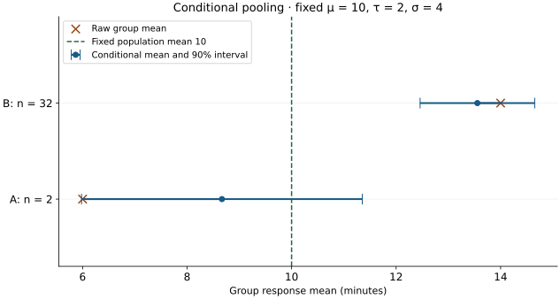

# 9 · Share information across groups

**Objectives:** compare pooling assumptions; explain shrinkage; fit a non-centred hierarchy; distinguish existing-group and new-group predictions; derive shrinkage uncertainty and shared-group prediction; critique exchangeability and hyperprior sensitivity. **Prerequisite:** chapters 6–8; [Appendix 3](./appendix-03_linear_algebra.md) supports the covariance calculations.

## Small groups make noisy rankings

A service manager compares centres using average waiting times. A centre with a few visits appears unusually fast; a busy centre looks only slightly slower. Which difference reflects persistent centre conditions, and which reflects sampling noise? The manager also wants to forecast waits at a centre that has not yet opened. These questions require a model for relationships among centres, not just a separate estimate for each one.

Complete pooling assigns every centre the same intercept. No pooling estimates separate intercepts without learning a shared distribution from the ensemble. Partial pooling introduces a population distribution for centre intercepts and learns its location and spread. It is a generative assumption about related groups, not an adjustment applied to a ranking after fitting.

The [synthetic waiting data](../../downloads/bayesian/data/README.md) contain eight centres with unequal numbers of visits. Chapter 7's common-intercept regression intentionally omits their baseline differences. Here workload still changes expected waiting time through a common slope, while each centre can start from a different baseline. Think first about whether this information sharing is defensible for the centres you wish to predict.

## Write the hierarchy

For visit $i$ at centre $j[i]$, use the following complete model:

$$
\begin{aligned}
\mu_\alpha&\sim\operatorname{Normal}(10,3^2),&
\tau&\sim\operatorname{HalfNormal}(1.5),\\
\beta&\sim\operatorname{Normal}(0,2^2),&
\sigma&\sim\operatorname{HalfNormal}(2),\\
\alpha_j\mid\mu_\alpha,\tau&\sim\operatorname{Normal}(\mu_\alpha,\tau^2),&&j=1,\ldots,J,\\
Y_i\mid\alpha,\beta,\sigma,x_i&\sim\operatorname{Normal}(\alpha_{j[i]}+\beta x_i,\sigma^2).&&
\end{aligned}
$$

The four population-level priors are independent. Centre intercepts are conditionally independent given the population location and scale; visits are conditionally independent given their centre intercepts, slope and residual scale. The second Normal argument is a variance, and HalfNormal uses scale. All intercepts and scales are in minutes; the slope is minutes per workload-index unit.

To generate a dataset, draw population parameters once, draw one intercept for each centre, and then generate every visit using its centre's intercept. Never draw a fresh centre intercept for each visit: that would remove the shared structure. Workload and group labels are conditioned upon here. A model for how centres or visitors are selected would be an additional layer.

The posterior is proportional to the four population prior factors, multiplied by the product of centre-intercept densities and the product of visit likelihoods. The hierarchy therefore propagates uncertainty in both directions: visits inform centre intercepts, and the ensemble informs the distribution from which those intercepts arise. Integrating over the shared population parameters makes centre effects dependent in the posterior.

Sigma describes within-centre residual variation; tau describes between-centre baseline variation. A centre's mean at workload zero is its alpha, not its average observed wait when workload differs from zero. Comparing raw averages without workload adjustment can conflate customer mix with centre differences.

## Prior prediction through all levels

Draw whole sets of centres and visits before fitting. Inspect the spread of centre means, the largest centre contrasts, individual waits and how those features change with workload. An acceptable prior for an overall mean need not imply acceptable extremes among many centres.

Under the stated priors, expected squared tau is $1.5^2=2.25$. Marginally a centre intercept has variance $9+2.25=11.25$, while the difference between two distinct centre intercepts has variance $2(2.25)=4.5$. The population-location uncertainty cancels in the difference. At workload zero an individual visit has prior variance $9+2.25+4=15.25$, adding expected squared sigma. These are variance calculations for mixtures, not claims that the marginal distributions are Normal.

This decomposition helps elicit a scale prior: ask how different two comparable centres could plausibly be, rather than choosing tau's prior by its name alone. The Gaussian likelihood retains the possibility of negative waits; inspect that probability as in chapter 7. A larger tau scale allows both larger centre contrasts and more extreme new-centre predictions. Prior checks should use a realistic number of centres because the expected maximum changes with the number drawn.

For example, changing the half-normal scale for tau from 1.5 to 0.5 reduces the prior variance of a two-centre contrast from 4.5 to 0.5 squared minutes. Both choices leave tau uncertain, but express very different beliefs about heterogeneity. After fitting, compare the new-centre intervals and the practical conclusion under both defensible choices; agreement of existing-centre point estimates alone would be an incomplete sensitivity check.

## Why shrinkage depends on information

Temporarily hold the population mean, both scales and slope fixed. Subtract the known workload contribution and let $\bar r_j$ be the average of $y_i-\beta x_i$ in centre $j$. If that centre has $n_j$ independent visits, then

$$\bar r_j\mid\alpha_j\sim\operatorname{Normal}(\alpha_j,\sigma^2/n_j),\qquad
\alpha_j\sim\operatorname{Normal}(\mu_\alpha,\tau^2).$$

Write $s_j^2=\sigma^2/n_j$. The log posterior kernel for its intercept is

$$-\frac{(\bar r_j-\alpha_j)^2}{2s_j^2}-\frac{(\alpha_j-\mu_\alpha)^2}{2\tau^2}.$$

Expand the squares: the coefficient of squared alpha is the sum of precisions, and the linear coefficient is the sum of precision-weighted locations. Completing the square gives

$$
\begin{aligned}
v_j&=(s_j^{-2}+\tau^{-2})^{-1}
=\frac{\sigma^2\tau^2}{\sigma^2+n_j\tau^2},\\
m_j&=v_j(\bar r_j/s_j^2+\mu_\alpha/\tau^2)
=w_j\bar r_j+(1-w_j)\mu_\alpha,\\
w_j&=\frac{n_j\tau^2}{\sigma^2+n_j\tau^2},\qquad
\alpha_j\mid\bar r_j,\mu_\alpha,\tau,\sigma,\beta\sim\operatorname{Normal}(m_j,v_j).
\end{aligned}
$$

The data weight increases with sample size and between-centre variation. It decreases with within-centre noise. Many precise visits justify a centre estimate closer to its own adjusted mean; similar centres justify more pooling. The weight concerns information about the centre mean, not the importance of its visitors.

With vanishing tau the conditional model approaches complete pooling. With very large tau, data dominate for a nonempty group. With no visits, the group's conditional distribution remains its population distribution. These limits assume fixed population parameters; their uncertainty remains in a full Bayesian analysis, even when conditional variances become small.

<!-- VISUAL01:11 BEGIN -->

### Visual investigation: conditional pooling weights information

This visual conditions on fixed hyperparameters $\mu=10$, $\tau=2$ and $\sigma=4$ minutes. It is not a fully learned hierarchy. Compare an adjusted group mean of six from two observations with a mean of fourteen from thirty-two observations. Predict which summary should move farther toward the fixed population centre.

**Read the figure.** Horizontal positions are group means in minutes. Crosses show raw summaries, connecting segments show movement, and circles with bars show conditional posterior means and central 90% intervals. The dashed line is the stipulated population mean; it is not an estimate learned from these two groups.

| Group | n | Raw mean | Data weight | Conditional mean | Conditional SD |
|---|---:|---:|---:|---:|---:|
| A | 2 | 6 | 1/3 | 8.666667 | 1.632993 |
| B | 32 | 14 | 8/9 | 13.555556 | 0.666667 |

The corresponding 90% intervals are [5.980632, 11.352701] and [12.458986, 14.652125] minutes. These intervals concern group means, not future individuals.

**Mathematical connection.** The likelihood variance of a raw mean is $\sigma^2/n_j$. Its data weight is $w_j=n_j\tau^2/(\sigma^2+n_j\tau^2)$, giving mean $(1-w_j)\mu+w_j\bar r_j$ and variance $\tau^2\sigma^2/(\sigma^2+n_j\tau^2)$. Equal distances from the population mean therefore need not imply equal movement.

**Original unscored exploration — predict, observe, explain.** Change only A's sample size to 32 while holding its raw mean at six. Its weight becomes 8/9 and conditional mean 6.444444. Explain the movement away from ten as information increases. Transfer to a learned hierarchy: what uncertainty is omitted by fixing these hyperparameters? Exchangeability of adjusted effects is an assumption, and many observations in only two groups do not establish a population distribution of groups.

[Open the guided pooling experiment](../../apps/bayesian/explorer.html#visual-pooling) to predict, change one setting, and explain the result.

<!-- VISUAL01:11 END -->

### Worked example 1: small and large centres

For an illustration separate from the lab and exercises, take population mean ten minutes, between-centre standard deviation 1.5, and within-centre standard deviation three. Two centres both have workload-adjusted average fourteen, but one has four visits and the other thirty-six. Thus their sampling variances are 2.25 and 0.25.

The smaller centre's prior variance equals its sampling variance, so the data weight is one half. Its posterior mean is twelve and variance 1.125. The larger centre has weight 0.9, mean 13.6 and variance 0.225. Using the Normal 95th percentile gives central 90% conditional intervals:

| Visits | Data weight | Posterior mean, minutes | Posterior SD, minutes | Interval for centre mean, minutes |
|---|---:|---:|---:|---|
| 4 | 0.5 | 12.0 | 1.061 | [10.255, 13.745] |
| 36 | 0.9 | 13.6 | 0.474 | [12.820, 14.380] |

The calculation can be checked by adding precisions directly. For four visits the sum is $1/2.25+1/2.25=8/9$, whose reciprocal is 1.125. These intervals concern adjusted centre means, not individual waiting times. To predict a visitor conditional on the assumed scales, add residual variance nine.

Shrinkage does not say that a small centre is intrinsically average. It says that its observed extremeness is less persuasive evidence of a persistent difference under this model. Nor must every centre move toward the unweighted grand mean: the fitted population location is learned from the hierarchy and covariates, not specified by a simple averaging rule.

### Unknown hyperparameters change the uncertainty

Suppose instead that tau were fixed at 0.5. For the four-visit centre the data weight would become 0.1, its posterior mean 10.4 and variance 0.225. The same observations support quite different shrinkage under a much tighter population distribution. This is why learning and checking the population scale matters.

In the full model tau, sigma, beta and the population mean are uncertain. Let $H$ denote that collection. Total variance gives

$$\operatorname{Var}(\alpha_j\mid y)=E[v_j(H)\mid y]+\operatorname{Var}(m_j(H)\mid y).$$

The second term represents uncertainty in the conditional centre mean as population parameters and the workload adjustment vary. Plugging in posterior means for all those quantities generally misses it, and the mean of a shrinkage weight need not equal the weight evaluated at mean parameters. Use joint posterior draws for centre contrasts, rankings and predictions.

## Exchangeability is the key judgement

Before seeing outcomes, would relabelling the centres change your joint beliefs about their intercepts, after conditioning on relevant information? If not, an exchangeable model may be reasonable. It says centres share a probabilistic description, not that their underlying means are equal. Conditional independent draws from the Normal population produce an exchangeable joint distribution.

Exchangeability is conditional on what the model knows. A specialist emergency centre and a routine appointment centre may require different predictors or populations. If centre type predicts baseline waits, one extension models the population mean as a function of that type. Unexplained centre effects can then be exchangeable around their predicted baselines. Merely assigning all centres numeric labels does not justify pooling them.

Selection matters too. Centres volunteered after unusually good performance may not represent future centres. Group size can also be informative: if unusually slow centres systematically lose visitors, the association between size and intercept is relevant to the observation process. The basic model conditions on group sizes and does not account for such selection. More elaborate pooling is not a cure for an unexamined sampling mechanism.

Report uncertainty in centre contrasts and decision-relevant predictions. Partial pooling can stabilise comparisons but cannot by itself guarantee fair rankings or protect every subgroup against misspecification. Check whether a Gaussian population understates extreme centres or whether omitted group predictors systematically pull some centres toward an inappropriate reference.

## The number of groups matters

Many visits within a centre reduce uncertainty about that centre's mean. They do not produce many independent centre effects. Even if every mean were observed almost perfectly, a study of three centres would still have only three draws with which to learn the population's spread and tails.

For perspective, if exact centre intercepts were independent Normal draws and the population mean were estimated by their sample mean, the sample variance would have relative standard deviation $\sqrt{2/(J-1)}$. It is one at three centres and one half at nine centres. This repeated-sampling calculation is not a posterior interval for tau; it isolates why the number of groups controls information about between-group variation.

With few groups, compare defensible tau priors through prior predictions and then assess sensitivity of new-centre intervals and policy conclusions. Simply making the prior extremely broad can permit unrealistic populations. A large number of visits cannot test a Normal population tail well when only a few centres have been observed. Predicting an unusually different centre may remain uncertain even after existing centres are estimated precisely.

## Reparameterisation changes geometry {#reparameterisation-changes-geometry}

The centred form declares each intercept directly from its population Normal. When tau is small, all centre intercepts must lie close to the population mean. When tau is larger, they may spread widely. This narrow-to-wide geometry can form a funnel that is difficult for HMC when group data provide little information.

A non-centred representation uses

$$z_j\sim\operatorname{Normal}(0,1),\qquad
\alpha_j=\mu_\alpha+\tau z_j.$$

At fixed positive tau, the affine transformation has mean population location and variance squared tau, so it generates exactly the same intercept distribution. The joint model's predictions and posterior over substantive parameters are unchanged when all priors and likelihood terms are transformed consistently. Here z is the sampled variable and alpha is deterministic; no extra Jacobian factor belongs in this generative specification. Writing a density in a changed integration variable instead would require the usual change-of-variables accounting.

Weakly informed groups often benefit from separating standardised offsets from scale. With very informative group data, the centred form may sample better because the non-centred coordinates must then compensate for each other to preserve accurately known intercepts. Mixed group sizes can produce mixed behaviour. Inspect divergences, R-hat, effective sample size and Monte Carlo error for population scales and group contrasts, not just one easy parameter. The [Stan efficiency guide](https://mc-stan.org/docs/stan-users-guide/efficiency-tuning.html#hierarchical-models-and-the-non-centered-parameterization) discusses this dependence on the information regime.

## Identifiability is a model question too

Writing an unrestricted global intercept plus unrestricted group offsets produces a likelihood that is unchanged if a constant is added to the global intercept and subtracted from every offset. In this chapter the offsets have a specified zero-centred population distribution, and the population location has its own prior. Those assumptions give the decomposition meaning, but with few groups the location and offsets can still be strongly dependent.

An exact sum-to-zero constraint is a different specification unless its induced prior is handled carefully. It makes the intercept refer to the finite collection's average offset convention; the population mean in this chapter concerns the broader distribution of possible centres. Reparameterising alone does not justify changing that estimand or prior.

Workload also needs variation within centres to distinguish its slope from centre intercepts convincingly. If each centre is observed at just one characteristic workload, baseline differences can imitate a workload association. A random-intercept assumption may then supply much of the apparent separation. Distinguishing within-centre workload deviations from between-centre average workload is a possible revision. Varying slopes require enough information to learn their variation and correlation with intercepts; a more elaborate hierarchy cannot create missing contrasts.

## Existing and new groups need different predictions {#existing-and-new-groups-need-different-predictions}

For another visit to an observed centre, select its fitted intercept, beta and sigma from the same posterior draw, evaluate the mean at the intended workload, and add residual noise. For an unseen exchangeable centre, first draw a new intercept conditional on that draw's population mean and tau. Combine it with the same beta before generating visits.

An interval for the population location omits actual centre variation. An interval for a centre mean includes uncertainty about that centre's baseline but omits individual noise. An interval for a visitor includes both. The predictive population must also be specified: an equally likely centre and a randomly selected visitor need not induce the same centre weights.

### Worked example 2: two visits to one new centre

Return to the illustrative fixed population mean ten, tau 1.5 and sigma three, and fix beta at one. At workload one a new centre's mean is Normal with mean eleven and variance 2.25. A visit there has mean eleven and variance $2.25+9=11.25$.

Two visits to that same unseen centre share its intercept. Conditional on the fixed population parameters their covariance is 2.25, giving correlation $2.25/11.25=0.2$. Their average has variance

$$\operatorname{Var}\left(\frac{Y_1+Y_2}{2}\right)=\frac{11.25+11.25+2(2.25)}4=6.75.$$

If the two visits instead occur at independently drawn new centres, the conditional covariance is zero and the average variance is 5.625. Drawing a new intercept for every visit would incorrectly use this second answer for a shared-centre question. With many visits in one new centre, residual noise averages away but its unknown baseline remains.

With uncertain population parameters, two different new centres also share posterior uncertainty. At equal workload their predictive covariance contains $\operatorname{Var}(\mu_\alpha+\beta x\mid y)$. Two visits in the same new centre additionally share $E[\tau^2\mid y]$. Simulate a whole future cohort per joint posterior draw, reusing each newly generated centre effect for every member of that centre.

This distinction affects planning. Sending many visitors to one unopened centre leaves its baseline uncertainty shared across the whole forecast. Spreading them across several exchangeable new centres averages some centre variation. These allocations can have the same expected average wait but different uncertainty, even before accounting for capacity or dependence beyond the model.

## Lab

Run Lab 9, or [Python](../../downloads/bayesian/labs/09_hierarchical.py), and inspect the [pooling plot](../../downloads/bayesian/artifacts/figures/09_pooling.svg). The implementation calls the population location `mu_a` and uses zero-based centre labels. Its adjusted raw means subtract a fitted mean slope; they are descriptive comparison points, not independent no-pooling posterior estimates.

The saved existing-centre and new-centre intervals both describe **centre means at workload zero**. Neither includes individual noise. Explain how you would add that layer. Compare diagnostics for tau, population location and centre effects, then inspect whether replicated centre contrasts and within-centre residuals resemble the data. Good computation cannot validate exchangeability.

Validation must match deployment. Holding out visits from known centres evaluates prediction with centre information available. Holding out entire centres evaluates transfer to unseen groups. Shrinking a small group's estimate or improving a within-centre score does not establish accurate new-centre forecasts. Report the holdout unit and prior sensitivity alongside the predictive target.

## Retrieval and summary

Reconstruct the shrinkage weight from two precisions and identify the missing variance term when hyperparameters are plugged in. Explain why observing more visits differs from observing more centres. Finally, describe which random draws two future visits to one new centre must share.

Partial pooling combines within-group information with a learned population distribution under an exchangeability judgement. The conditional shrinkage formula explains the mechanism; full inference integrates uncertainty about its ingredients. Reparameterisation can improve computation, while prediction and validation must retain the group structure relevant to the question.

## Lab and exercises

**9.1 — Concept.** Explain why 1,000 visits in each of three centres may still leave considerable uncertainty about between-centre variation.

**9.2 — Calculation.** In the known-scale model $Y_{ij}\mid\alpha_j\sim\operatorname{Normal}(\alpha_j,\sigma^2)$ and $\alpha_j\sim\operatorname{Normal}(\mu,\tau^2)$, take $\mu=10$, $\tau=1$, $\sigma=2$, and $\bar y_j=14$. Calculate the posterior centre mean for $n_j=1$ and $n_j=16$.

**9.3 — Prediction.** Under $Y\mid\alpha_j,\beta,\sigma,x\sim\operatorname{Normal}(\alpha_j+\beta x,\sigma^2)$ and $\alpha_j\mid\mu_\alpha,\tau\sim\operatorname{Normal}(\mu_\alpha,\tau^2)$, assume joint posterior draws of the hyperparameters, slope and residual SD are available. Describe the draws needed to predict a visit at a new centre with workload 1. Explain the error in setting its intercept equal to the posterior mean of $\mu_\alpha$.

[Solutions](./course-solutions.md).

## Further reading

[Bayes Rules!, hierarchical models](https://www.bayesrulesbook.com/chapter-15) provides further intuition for partial pooling. The [Aalto BDA course](https://avehtari.github.io/BDA_course_Aalto/Aalto2025.html) connects hierarchical modelling with computational and predictive checks. For the variance decompositions used here, revisit [Appendix 1](./appendix-01_probability.md).
