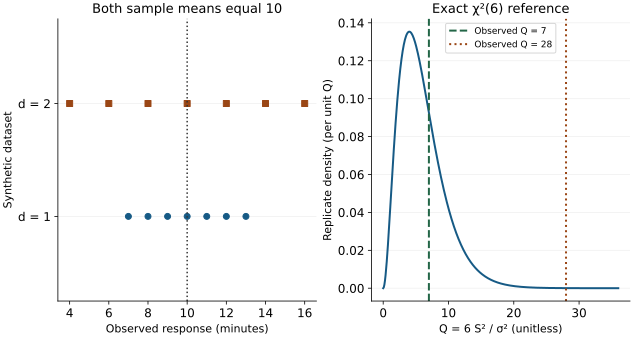

# 10 · Ask how the model fails

**Objectives:** design targeted predictive checks; compute exact and approximate leave-one-out scores; interpret diagnostic limits and score differences; distinguish predictive comparison from Bayes factors; derive importance reweighting; design validation for the intended deployment unit. **Prerequisite:** chapters 6–9, plus the normal update in chapter 4. [Appendix 1](./appendix-01_probability.md) supports conditioning and [Appendix 4](./appendix-04_numerics.md) supports log-scale computation.

## A good fit to which question?

A service forecasts waiting times to allocate staff. Its fitted regression follows the average workload trend, its chains mix well, and it beats a simpler model on predictive scores. Yet one centre regularly has much longer waits than predicted. Can all these statements be correct? Yes: each addresses a different question. The analyst's job is to connect each check to the feature or prediction that matters.

Before looking for a favourable diagnostic, write a sentence such as “predict tomorrow's extreme waits in these existing centres” or “predict average waits in an unseen centre.” These targets require different replications and validation designs. A model can be useful for one and inadequate for another. This chapter develops checks that make that distinction visible.

## Four checks with different limits

Prior predictive checks simulate parameters from the prior and then observations from the likelihood. They expose impossible scales, implausible event frequencies, and unintended joint behaviour before outcomes inform the fit. Very broad predictions are not automatically safe: they can assign most probability to unrealistic datasets. Conversely, a prior can produce a plausible overall histogram while imposing an implausible relationship between groups. Check scientifically meaningful joint features as well as marginal ranges.

Sampler diagnostics ask whether the numerical draws explore the specified posterior adequately. They cannot establish that the likelihood describes the service. Posterior predictive checks compare observed features with replications under the fitted model. Held-out prediction evaluates observations withheld from fitting. These operations complement each other; success at one cannot substitute for another.

With predictors held fixed, the posterior predictive distribution is

$$p(y^{\mathrm{rep}}\mid y,x)=\int p(y^{\mathrm{rep}}\mid\theta,x)p(\theta\mid y,x)\,d\theta.$$

For each posterior draw, simulate a complete replicated dataset, preserving the model's dependence structure. Within an existing centre, reuse that draw's centre effect; for a new centre, draw a new effect from the population distribution. Simulating each row with an unrelated effect changes the model. State what is held fixed, what is resampled, and whether the replicate represents the observed design or a future deployment.

## Choose a discrepancy that can expose failure

A discrepancy is a numerical feature used to compare data and replications. If staffing depends on long waits, inspect upper quantiles or counts exceeding a service threshold. If the model assumes constant residual spread, compare spread at low and high workload. If centre variation matters, compare centre means after adjusting for workload. A check of the overall mean is often weak because fitting the intercept already makes that mean easy to reproduce.

For a parameter-dependent discrepancy $T(y,\theta)$, evaluate both $T(y,\theta^{(s)})$ and $T(y^{\mathrm{rep},(s)},\theta^{(s)})$ at the same draw. Alternatively, explicitly fix a fitted summary in the discrepancy and apply that identical rule to observed and replicated datasets, as Lab 10 does. Do not compare adjusted observations with unadjusted replications.

The posterior predictive tail fraction estimates

$$P\{T(y^{\mathrm{rep}},\theta)\ge T(y,\theta)\mid y\}.$$

It is a descriptive comparison in a specified direction. Because the observations help determine the posterior and the observed discrepancy, it is generally not a uniformly distributed frequentist p-value. It is neither the probability that the model is true nor the chance the result will replicate. Predictive checks may have little power against failures unrelated to the chosen discrepancy. Several purposeful plots are more informative than declaring a model accepted after one moderate tail fraction.

<!-- VISUAL01:12 BEGIN -->

### Visual investigation: a stable fitted mean can conceal a spread failure

Use a new small model: $\mu\sim N(8,9)$ and seven independent responses given $\mu$ with known observation variance $\sigma^2=4$. Construct data $y_i=10+d(-3,-2,-1,0,1,2,3)_i$. Predict whether doubling d changes the fitted mean or the model's ability to reproduce spread.

**Read the figure.** Left: horizontal position is response in minutes, with one row per synthetic dataset. Right: the reference density is for $Q^{rep}=6S_{rep}^2/\sigma^2$; its horizontal coordinate is unitless. The two vertical marks locate observed discrepancies, not two posterior parameter means. The displayed reference runs from zero to 36 and retains an unshown upper tail.

| Spread d | Observations (minutes) | Unbiased sample variance | Observed Q | Exact upper-tail probability |
|---:|---|---:|---:|---:|
| 1 | 7, 8, 9, 10, 11, 12, 13 | 4.666667 | 7 | 0.320847 |
| 2 | 4, 6, 8, 10, 12, 14, 16 | 18.666667 | 28 | 0.000093963 |

**Mathematical connection.** Both datasets give posterior variance $v=(1/9+7/4)^{-1}=0.537313$ and mean $v(8/9+70/4)=9.880597$. Yet the centred replicate variance satisfies $Q^{rep}\sim\chi^2_6$, with expected $S_{rep}^2=4$. This statistic does not depend on $\mu$, so posterior integration leaves its distribution unchanged: a useful special case, not a general PPC shortcut. Its exact upper tail is $e^{-Q/2}(1+Q/2+Q^2/8)$.

**Original unscored exploration — predict, observe, explain.** Predict the discrepancy at d = 0 and observe Q = 0 and upper tail one: unusually small spread is a different potential failure. Explain why checking only the mean misses both directions. Propose a discrepancy for asymmetry as a transfer task. These checks reuse training data; they are not held-out validation, do not give the probability that the model is true, and do not identify a unique replacement model.

[Open the guided ppc experiment](../../apps/bayesian/explorer.html#visual-ppc) to predict, change one setting, and explain the result.

<!-- VISUAL01:12 END -->

## Worked example 1: a centre discrepancy

Suppose three centres have mean waits of 9, 11, and 15 minutes and mean workload scores of 1, 1, and 3. Fix the fitted workload coefficient at one minute per workload unit. Adjusted means are therefore $9-1=8$, $11-1=10$, and $15-3=12$ minutes. Their range is $T(y)=12-8=4$ minutes. A common-intercept regression has no centre-specific mechanism to explain this remaining separation.

For a deliberately small arithmetic illustration, suppose ten replicated adjusted ranges are 0.9, 1.1, 1.4, 1.8, 2.0, 2.1, 2.6, 2.8, 3.3, and 4.2 minutes. Exactly one is at least four, so the empirical upper-tail fraction is $1/10=0.10$. Its plug-in Monte Carlo SE would be about $\sqrt{0.1(0.9)/10}=0.095$ for independent replicates. Ten simulations give a very rough tail estimate; the useful scientific question is why the observed separation sits towards the edge of the replicated distribution.

If no replicate exceeded the observation, the empirical fraction would be zero, but the underlying tail probability need not be zero. With independent replicates, a probability below the simulation resolution can easily produce no exceedances. Correlated posterior draws further reduce the effective information in the simulation. Report the number of replications and show the distribution, rather than printing zero as a certainty.

The full lab uses eight centres and the [range of adjusted centre means](../../downloads/bayesian/artifacts/figures/10_check.svg). Its regression improves prediction of individual waits while missing this centre structure. That is a substantive failure worth explaining, even if all competing models share it. Adding group effects is a candidate revision; checking whether the discrepancy reflects a data-recording problem is another. The plot alone does not identify the cause.

## Define a predictive score and its unit

The logarithmic score evaluates the predictive probability mass or density assigned to what occurred. A confident wrong prediction receives a large penalty. Using natural logarithms, larger scores are better. For continuous outcomes a density is not an event probability and can exceed one; its units affect the absolute log score. Compare densities on the same outcome scale, with the same transformations and likelihood constants.

Leave-one-out cross-validation fits to $y_{-i}$, which excludes unit $i$, and evaluates

$$\operatorname{elpd}_{\mathrm{loo}}=\sum_{i=1}^n\log p(y_i\mid y_{-i}).$$

ELPD stands for expected log predictive density. This finite-data sum estimates performance for the declared prediction task using training sets of size $n-1$; it is not a guarantee about every future population. The integrated prediction averages over the training posterior. Substituting its mean parameter or scoring with the full-data posterior answers a different question.

A binomial count and a sequence of individual Bernoulli outcomes have different sample spaces and combinatorial constants. They can give the same parameter posterior but different reported scores. Similarly, the sum of marginal scores for several correlated future outcomes is not their joint log score. Choose the scoring unit before comparing models and retain it across candidates.

Changing continuous measurement units illustrates why absolute scores need context. Convert every waiting time from minutes to seconds. A correctly transformed predictive density is divided by sixty, so each natural-log score decreases by $\log(60)$. Both models' scores shift by the same amount and their difference is unchanged. A comparison that changes only one model's outcome units has no valid interpretation. Keeping normalising constants matters even when they did not matter for fitting a posterior kernel.

The logarithmic score rewards a complete predictive distribution, but the operational target may emphasise a particular event. A better average score across ordinary visits need not improve prediction of days with a staffing crisis. Evaluate the daily event using replications of whole days, preserving shared shocks and centre effects. Also inspect predictions for rare outcomes and relevant subgroups. Choose these checks because of the intended use, and disclose additional checks developed after seeing failures. Predictive ranking does not replace the utility calculation in chapter 12.

## Worked example 2: exact LOO you can inspect

Use the lab's four observations $y=(1,2,0,3)$, a prior $\mu\sim N(0,4)$, and conditionally independent observations $y_i\mid\mu\sim N(\mu,1)$. Here the second normal argument denotes variance: the prior SD is two and the observation SD is one. Excluding a row leaves three observations. Adding prior and likelihood precisions gives

$$v_{-i}=\frac{1}{1/4+3}=\frac4{13},\qquad
m_{-i}=\frac{\sum_{j\ne i}y_j}{1/4+3}.$$

The held-out outcome has variance $1+v_{-i}=17/13$, incorporating observation noise and uncertainty about the mean. Its pointwise log score is

$$\ell_i=-\frac12\log\{2\pi(17/13)\}
-\frac{(y_i-m_{-i})^2}{2(17/13)}.$$

| Excluded outcome | Sum of remaining outcomes | Training posterior mean | Held-out log score |
|---:|---:|---:|---:|
| 1 | 5 | 1.538462 | −1.163930 |
| 2 | 4 | 1.230769 | −1.279315 |
| 0 | 6 | 1.846154 | −2.356238 |
| 3 | 3 | 0.923077 | −2.702392 |

Adding the unrounded scores gives **−7.501875**. Excluding three makes the remaining data pull the mean down, explaining its poor held-out score. For a numerical check, integrate the product of the normal held-out likelihood and its normal training posterior; the resulting predictive density equals the density used in the table. Lab 10 evaluates the same values with `scipy.stats.norm.logpdf`.

“Exact LOO” means each training posterior is recomputed after removing the observation. This example also has exact analytic integration. In a more complex model, a separate MCMC refit still has simulation error, so report that error where it could affect the comparison. Exact refitting repairs an approximation problem; it cannot repair a poorly chosen validation target.

## How importance sampling avoids most refits

Assume proper full and leave-one-out posteriors and likelihood factorisation $p(y\mid\theta)=\prod_i p(y_i\mid\theta)$, with compatible support when a row is removed. Bayes's rule gives

$$p(\theta\mid y)=
\frac{p(y_i\mid\theta)p(\theta\mid y_{-i})}{p(y_i\mid y_{-i})},\qquad
\frac{p(\theta\mid y_{-i})}{p(\theta\mid y)}
=\frac{p(y_i\mid y_{-i})}{p(y_i\mid\theta)}.$$

Thus full-posterior draws can be reweighted with raw ratios $r_i^{(s)}=1/p(y_i\mid\theta^{(s)})$. The weighted prediction is $\sum_s r_i^{(s)}p(y_i\mid\theta^{(s)})/\sum_s r_i^{(s)}$. With raw ratios, this reduces to $S/\sum_s r_i^{(s)}$, a harmonic-mean identity. A few enormous ratios can dominate its denominator: draws rarely visited by the full posterior may matter greatly when the influential observation is removed.

Pareto-smoothed importance sampling, PSIS, fits a tail model to the largest ratios and smooths them. It reduces instability and estimates a Pareto shape diagnostic $\hat k$; it cannot create information about posterior regions never explored. A large diagnostic signals unreliable reweighting and often influence. It does not establish that the observation is erroneous. The [PSIS paper](https://arxiv.org/abs/1507.02646) develops the tail approximation and its diagnostics.

Lab 10 stores pointwise log likelihood and calls `az.loo(..., pointwise=True)`. In the pinned [ArviZ 0.22 API](https://python.arviz.org/en/v0.22.0/api/generated/arviz.loo.html), inspect `pareto_k`, `loo_i`, and `good_k`. The reported threshold is

$$k_{\mathrm{good}}=\min\{1-1/\log_{10}(S),\ 0.7\},$$

where $S$ is the nominal posterior sample count. It is 0.5 for 100 draws and reaches the 0.7 cap for sufficiently large samples. Reliable underlying sampling remains necessary; a large nominal count does not remove autocorrelation or missed modes.

When a point exceeds the threshold, locate it, inspect its data and residual behaviour, and refit that holdout exactly if feasible. Replace its approximate contribution with the refitted score and identify the replacement in the report. Many problematic points may favour a suitable K-fold procedure or model revision. Do not quietly omit them, and do not interpret acceptable Pareto diagnostics as proof of predictive adequacy.

## Worked example 3: paired comparison uncertainty

Suppose two models' log-score differences on the same five units are $d=(0.4,1.0,-0.2,0.8,0)$. The total improvement is two log-score units and the average is 0.4. Squared deviations from that average sum to 1.04, so the sample variance is $1.04/4=0.26$. Under an independence approximation,

$$\operatorname{SE}(\Delta_{\mathrm{elpd}})
\approx\sqrt{n\operatorname{Var}_{\mathrm{sample}}(d_i)}
=\sqrt{5(0.26)}=1.140175.$$

Use paired differences because difficult observations may have poor scores under both models. Adding independent standard errors of the two totals discards that pairing. The reported SE describes uncertainty from the available evaluation units; it is distinct from Monte Carlo error and PSIS approximation error. More posterior draws may reduce computational error while leaving uncertainty from five observations essentially unchanged.

Here the advantage is modest relative to its approximate SE. With so few units, a normal interval or a significance declaration would overstate what this summary establishes. Inspect which observations drive the difference. Dependence, strong influence, and selecting the best of many attempted models further weaken a simple interpretation. These qualifications accompany the formula in practical [LOO model evaluation](https://arxiv.org/abs/1507.04544).

## Match holdouts to deployment {#match-holdouts-to-deployment}

Row-level LOO can be appropriate for another visit in a known centre when the other visits really will be available. For an unseen-centre target, hold out the whole centre and integrate over a new centre effect. Do not estimate the held-out centre effect using its outcomes before scoring it. Repeated visits by the same patient can similarly require patient-level holdouts when predicting for new patients.

For forecasting, train on the past and test later periods at the actual forecast horizon. Randomly splitting days lets later information inform earlier predictions. A smoothed estimate of yesterday using tomorrow's observation can be useful retrospectively but does not demonstrate forecasting skill. [The time-series bridge](./adv-05_time_series.md) develops this distinction.

Fit scaling, imputation, feature selection, and tuning within each training fold whenever they learn from the dataset. A hospital's average outcome computed before splitting is especially direct leakage. If candidate selection uses validation outcomes, an additional outer evaluation or genuinely untouched set is needed to evaluate the whole selection procedure. With few centres, acknowledge the limited independent evidence; hundreds of patient rows do not create hundreds of independent new-centre trials.

## Model averaging has more than one meaning

Bayesian model averaging uses posterior model probabilities, obtained from prior model probabilities and marginal likelihoods

$$p(y\mid M)=\int p(y\mid\theta,M)p(\theta\mid M)\,d\theta.$$

A Bayes factor is a ratio of these marginal likelihoods. It depends on the entire prior, including parameter regions distant from the fitted posterior; improper priors generally leave arbitrary normalising constants. Its posterior model odds concern the specified model set. LOO does not compute these odds.

Predictive stacking chooses nonnegative weights summing to one to maximise a held-out mixture score:

$$\max_w\sum_i\log\left\{\sum_m w_m p_m(y_i\mid y_{-i})\right\}.$$

The weights describe a predictive combination, not probabilities that individual models are true. Pseudo-BMA instead weights models using their total estimated predictive scores; unlike stacking, it does not optimise the mixture's pointwise predictions. Averaging compatible predictive distributions also differs from averaging coefficients with different meanings across models. See the [stacking paper](https://arxiv.org/html/1704.02030v3) and [model-evidence bridge](./adv-02_model_evidence.md). No weighting method repairs failures shared by all candidates.

For a numerical illustration, suppose two models assign probabilities $(0.9,0.1)$ and $(0.1,0.9)$ to the observed outcomes on two held-out units. Each total log score is $\log(0.9)+\log(0.1)=-2.407946$. An equal predictive mixture assigns probability 0.5 on each unit and scores $2\log(0.5)=-1.386294$, which is better. Indeed the product $(0.1+0.8w)(0.9-0.8w)$ is maximised at $w=0.5$. The components' complementary mistakes explain the gain. Averaging their log scores would retain the inferior value; averaging predictions before taking logs is a different operation.

With two identical predictive models, every weight gives exactly the same predictions, so the data cannot determine a unique stacking weight. Even with distinct models, fitted weights can be uncertain. Evaluate a learned combination as part of the full training procedure, and do not present its score on the weight-fitting data as untouched evidence of future performance.

## Lab

Run Lab 10, or its [Python source](../../downloads/bayesian/labs/10_model_checking.py). Reproduce the four analytic LOO contributions before interpreting PSIS output. Report the predictive target, same-unit score difference, paired SE with its independence limitation, and the number and identities of problematic Pareto diagnostics. The lab's waiting-time rows have centre structure, so its pointwise SE is explicitly an approximation.

Present the discrepancy plot with its units and replication rule. Write separate conclusions about relative predictive performance and the better model's remaining failure. Then design an unseen-centre validation procedure without claiming the existing row-level output already evaluates it.

## Retrieval and summary

Without the text, explain why a good sampler can accompany a poor centre check, why an exact refit may disagree with unstable PSIS, and which information must be unavailable when forecasting. Describe one failure that a check of the mean would miss.

Model criticism asks whether consequential features are reproduced. Predictive comparison asks which candidate predicts better for a specified unit and deployment. Their uncertainty includes data limitations as well as computational approximations. State the target first, retain pointwise evidence, investigate warnings, and make revisions traceable.

## Exercises

**10.1 — Concept.** Can a model have good R-hat and poor posterior predictive checks? Give a concrete reason.

**10.2 — Calculation.** Pointwise log-score improvements are 1, 2, −1, and 2. Calculate their total and the approximate paired SE using sample variance. Interpret the strength of the comparison cautiously.

**10.3 — Design.** You want to predict outcomes in a new hospital but have repeated patient visits in ten existing hospitals. Propose a validation split, describe a leakage risk, and explain why ordinary row-level LOO answers a different question.

[Solutions](./course-solutions.md).

## Further reading

The primary papers linked above cover LOO, PSIS, and stacking. Vehtari's [cross-validation FAQ](https://users.aalto.fi/~ave/modelselection/CV-FAQ.html) expands on predictive targets, dependence, and comparison uncertainty; [Bayesian Workflow](https://arxiv.org/abs/2011.01808) places model criticism within iterative analysis.
