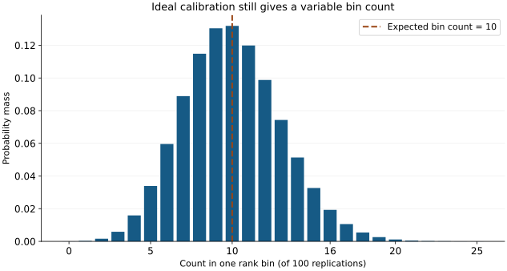

# 11 · Test assumptions and computational calibration

**Objectives:** assess prior and likelihood sensitivity; recognise missing-data assumptions; distinguish calibration from model fit; design a simulation check; derive observation-process and robustness contributions; interpret sensitivity and calibration limits. **Prerequisite:** chapter 10 and the normal and beta updates. [Appendix 2](./appendix-02_calculus.md) reviews differentiation and integration; [Appendix 4](./appendix-04_numerics.md) reviews numerical error.

## Which conclusions survive reasonable changes?

An analysis recommends changing a service because the estimated benefit exceeds a break-even point. A colleague uses another defensible prior and recommends keeping the existing design. Neither calculation contains a programming error. What should the report say? The disagreement identifies a consequential assumption, and the analysis should show how that assumption affects the decision.

Sensitivity analysis varies plausible analysis choices and records changes in a named target: a location, a tail probability, a future count, or an action. Robustness means limited sensitivity over the particular changes considered. It is always relative to that target and set of changes. An estimate can be robust to extreme observations while a tail-risk prediction remains highly sensitive to the likelihood.

Start with a small, reasoned set of alternatives. Compare observable prior predictions, fit each model, and record the target, uncertainty, computation checks, and decision. Include alternatives motivated by subject knowledge, not just settings that reproduce a preferred result. Document changes made after seeing outcomes. A sensitivity table is evidence about the consequences of assumptions; it is not permission to select the most convenient row.

## Influence is a property of an analysis

Influence asks how much changing or removing a particular observation or group changes the result. An unusual observation need not be influential if the model already expects substantial variation there. Conversely, an ordinary-looking observation can strongly affect a poorly identified contrast. Measure influence on the actual estimand, not only on coefficients or residuals.

Deletion refits are diagnostic counterfactuals. They do not justify discarding a record without a reason about its validity or target population. Compare changes with posterior uncertainty and numerical error: a shift smaller than simulation noise does not establish scientific sensitivity. If observations arrive in clusters, examine deletion of a whole cluster as well as individual rows. Removing a group can expose dependence on an exchangeability assumption that row deletion barely changes.

Prior sensitivity and observation influence can interact. A single datum may dominate under a very broad prior but have less effect under substantive regularisation. That does not by itself establish which prior is appropriate. Explain what prior information is being asserted and which observable predictions it produces.

Separate sensitivity to a scientifically meaningful alternative from sensitivity to an arbitrary computational setting. Increasing grid resolution should stabilise the same posterior; changing the observation model intentionally produces another posterior. If a numerical method has not stabilised, first resolve that problem before attributing differences to substantive assumptions. Conversely, running one model more accurately cannot settle disagreement between two plausible observation mechanisms.

The spread of a sensitivity table is not automatically a probability distribution over answers. Its rows need not be equally plausible, and the union of their credible intervals has no standard posterior coverage interpretation. If model averaging is justified, state the model weights and their basis. Otherwise report scenario-specific intervals alongside the assumptions defining each scenario, without hiding the disagreement in one unexplained wider interval.

## Why a Student-t likelihood changes influence

Write the residual as $r=y-\mu$. For a normal location model with known observation SD $\sigma$, the log likelihood contributes $-r^2/(2\sigma^2)$ plus constants. Differentiating with respect to the location gives

$$\frac{\partial\log p_N(y\mid\mu)}{\partial\mu}=\frac{r}{\sigma^2}.$$

Its magnitude grows without bound with the residual. An extreme observation pulls strongly on the location. For a Student-t location model with degrees of freedom $\nu>0$ and scale $s>0$, the corresponding term and derivative are

$$\log p_t(y\mid\mu)=C-\frac{\nu+1}{2}
\log\left(1+\frac{r^2}{\nu s^2}\right),\qquad
\frac{\partial\log p_t(y\mid\mu)}{\partial\mu}
=\frac{(\nu+1)r}{\nu s^2+r^2}.$$

Here $C$ is constant in the location when scale and degrees of freedom are fixed. The derivative is bounded and tends towards zero for extremely large residuals. It describes one observation's contribution to the posterior location equation, not a universal guarantee about the fitted estimate. In regression the coefficient derivative also contains the predictor value, so heavy-tailed outcome noise alone does not solve every high-leverage predictor problem.

A Student-t **scale is not its SD**. For $\nu>2$, variance is $s^2\nu/(\nu-2)$; for $1<\nu\le2$, the mean exists but the variance is infinite; for $\nu\le1$, even the mean is undefined. The symmetric location remains defined. With four degrees of freedom and scale one, SD is $\sqrt2$. To match a normal SD of one, use t scale $1/\sqrt2$. Holding scale fixed therefore changes both tail shape and variance, which must be acknowledged when interpreting a likelihood comparison.

An equivalent construction gives each observation a latent precision multiplier: draw $\lambda_i\sim\operatorname{Gamma}(\nu/2,\nu/2)$ using shape and rate, then draw $Y_i\mid\lambda_i,\mu\sim N(\mu,s^2/\lambda_i)$. Integrating out the multiplier gives the t likelihood. Conditional on a residual, its expected multiplier is $(\nu+1)/(\nu+r^2/s^2)$. Large residuals favour smaller multipliers, allowing more local variance. This construction explains how the likelihood accommodates an unusual outcome without requiring the common location to move as much. It is still a modelling assumption about variation, not a posterior verdict that a record should be deleted.

## Worked example 1: an extreme measurement

Lab 11 uses measurements $(0.1,-0.4,0.2,0.6,-0.2,0,8)$ and prior $\mu\sim N(0,4)$, where the prior variance is four. Under known normal observation SD one, the sum is 8.3 and posterior precision is $7+1/4=7.25$. Hence

$$E[\mu\mid y]=\frac{8.3}{7.25}=1.144828,\qquad
\operatorname{SD}(\mu\mid y)=\sqrt{1/7.25}=0.371391.$$

Without the artificial eight, the sum is 0.3 and the mean becomes $0.3/6.25=0.048$. This large change exposes the normal model's sensitivity. Under a t likelihood with four degrees of freedom and scale one, numerical integration of the normal prior times the seven t densities gives a posterior location mean of **0.136818**. Without the eight, it is **0.046157**.

The derivative calculation explains the difference. At location zero, a residual of eight contributes eight to the normal location score, but only $5(8)/(4+64)=0.588235$ to the t score. A residual of one contributes one to both. The t likelihood pays attention to the central observations while allowing an isolated larger residual.

| Prior SD | Data used for diagnostic comparison | Normal posterior location mean | Student-t posterior location mean |
|---:|---|---:|---:|
| 2 | All seven | 1.144828 | 0.136818 |
| 2 | Six central observations | 0.048000 | 0.046157 |
| 4 | All seven | 1.175221 | 0.141196 |
| 4 | Six central observations | 0.049485 | 0.047513 |

These values can be checked by independently normalising the one-dimensional posterior densities and integrating location times density. The lab uses a fine grid; extending the integration bounds checks that grid truncation is immaterial here. Likelihood choice has a much larger effect than doubling the prior SD. This is a conclusion about these data and settings, not a general ranking of priors and likelihoods.

Investigate the eight before choosing a final model. It could be a transcription error, a member of a separate population, or a legitimate rare measurement. For the synthetic lab it is deliberately inserted. A robust central-location analysis does not estimate the mean of an unspecified contamination process, nor does it guarantee accurate probabilities of extreme waits. Fitting scale or degrees of freedom adds uncertainty and can alter the comparison; the table deliberately fixes both likelihood scales.

## Describe how a value becomes observable {#describe-how-a-value-becomes-observable}

Let $R_i=1$ indicate that an outcome is observed, $\theta$ govern outcomes, and $\psi$ govern observation. A selection model can express

$$p(y,R\mid\theta,\psi)=p(y\mid\theta)p(R\mid y,\psi).$$

The observed-data likelihood integrates over missing values:

$$p(y_{\mathrm{obs}},R\mid\theta,\psi)
=\int p(y_{\mathrm{obs}},y_{\mathrm{mis}}\mid\theta)
 p(R\mid y_{\mathrm{obs}},y_{\mathrm{mis}},\psi)\,dy_{\mathrm{mis}}.$$

Missing completely at random, MCAR, means observation does not depend on observed or missing values. Missing at random, MAR, permits dependence on observed information but not on the missing values after conditioning on that information. Missing not at random, MNAR, retains that additional dependence. These are assumptions about the data-generating process; observed records alone generally cannot distinguish MAR from MNAR.

Under MAR, distinct outcome and missingness parameters, and an appropriately factorised prior, the missingness contribution can be ignored for the usual likelihood-based posterior inference about outcome parameters. This is an ignorability result with conditions, not a blanket instruction to discard incomplete rows. Complete cases can have a different covariate distribution from the target population. Population averages may still require modelling and standardisation over that target.

For missing predictors, a joint model supplies a distribution for their unknown values and integrates over them. Filling each blank with one mean and treating it as measured removes uncertainty and can distort associations. The [Stan missing-data guidance](https://mc-stan.org/docs/stan-users-guide/missing-data.html) illustrates latent-value modelling; [the observation-process bridge](./adv-03_observation_process.md) adds measurement error and selection mechanisms.

## Worked example 2: selection and an unidentified mean

First consider the lab's known demonstration mechanism. Generate a standard normal population but retain only values below 0.7. The fraction retained is $\Phi(0.7)=0.758036$. Since the derivative of the standard normal density is $\phi'(z)=-z\phi(z)$, integrating gives

$$E[Y\mid Y<0.7]=
\frac{\int_{-\infty}^{0.7}z\phi(z)\,dz}{\Phi(0.7)}
=-\frac{\phi(0.7)}{\Phi(0.7)}=-0.411925.$$

Thus even a huge observed sample concentrates near a negative mean, although the generating population mean is zero. The bias arises from the observation mechanism, not inadequate posterior computation. The calculation is a reference for the simulation, whose finite-sample mean fluctuates around it.

If a register records everyone but reports only “above 0.7” for a high value, that censored observation contributes $1-\Phi(0.7)=0.241964$ under this specified standard normal model. If high values are absent altogether and the dataset is sampled conditional on inclusion, an observed $y<0.7$ contributes the truncated density $\phi(y)/\Phi(0.7)$. The first is an event probability; the second is a conditional density with a selection normaliser. They represent different information. Treating a censoring threshold as an exact value is incorrect.

Now consider a survey with 100 eligible people, 80 responses, and an observed mean wait of ten minutes. The missing people's mean is unknown. Define a sensitivity parameter $\delta$ as their mean minus the respondents' mean. Holding those quantities fixed for this illustration, the population mean is

$$0.8(10)+0.2(10+\delta)=10+0.2\delta.$$

| Assumed extra wait among nonrespondents | Missing-group mean | Population mean |
|---:|---:|---:|
| 0 minutes | 10 minutes | 10 minutes |
| 5 minutes | 15 minutes | 11 minutes |
| 15 minutes | 25 minutes | 13 minutes |

If a policy trigger is a population mean above twelve minutes, the conclusion changes when $\delta>10$. The observed survey cannot select the correct row. Follow-up sampling or external evidence can inform plausible values; otherwise present the range and its decision implications. This table isolates structural sensitivity and is not a posterior interval. A fuller analysis also propagates uncertainty about respondent means, response fractions, and the sensitivity parameter.

The known truncation mechanism in the normal demonstration permits a specified selection likelihood. Real survey nonresponse rarely supplies such complete knowledge. Do not infer that fitting a parametric selection model automatically identifies its unobserved component. A narrow posterior can reflect a strong assumption about that component.

## What simulation-based calibration checks

Parameter recovery fixes plausible generating parameters, simulates data, fits the model, and asks whether the results make sense. Repeated recovery at selected settings can diagnose weak identification or implementation defects. It does not imply that a Bayesian interval has its advertised coverage at every fixed parameter value.

Simulation-based calibration, SBC, instead averages over the model's prior predictive distribution:

1. Draw a generating parameter $\theta^\star$ from a proper prior.
2. Generate data from the stated likelihood at $\theta^\star$.
3. Fit that same model to those data, without revealing $\theta^\star$ to the fitting algorithm.
4. Obtain $S$ posterior draws and count how many are below $\theta^\star$.

Conditional on the simulated dataset, the generating value itself has the model's posterior distribution. With correct inference, continuous parameters, and independent posterior draws, it is exchangeable with those draws. Each of the $S+1$ possible ranks is therefore equally likely. This is a consequence of the joint model and conditioning, developed in the [original SBC paper](https://arxiv.org/abs/1804.06788).

The generator must match the intended prior, likelihood, constraints, and observation mechanism. A missingness model should simulate missingness too. Improper priors cannot supply the required prior draws. Ties for discrete quantities need randomised treatment; otherwise simple continuous-rank uniformity is the wrong reference. Correlated MCMC draws also invalidate the simple independent-rank calculation. Diagnose each fit and use an appropriate dependence-aware procedure or sufficiently independent draws; ordinary posterior sample count is not enough. The [Stan SBC guide](https://mc-stan.org/docs/stan-users-guide/simulation-based-calibration.html) discusses these requirements.

## Worked example 3: ranks and their variability

Lab 11 draws $\theta^\star\sim\operatorname{Beta}(2,2)$ and $Y\mid\theta^\star\sim\operatorname{Binomial}(20,\theta^\star)$. The correct fitted posterior is Beta($2+Y,22-Y$). For illustration, if the generating value is 0.60 and four independent posterior draws are 0.42, 0.71, 0.55, and 0.63, two draws are smaller, so the rank is two. One rank is uninformative; the check repeats across independently generated datasets.

The lab uses 500 replications and 200 independent posterior draws per replication. Correct ranks range from zero through 200 and have mean 100. A discrete uniform rank has variance $S(S+2)/12$, so the mean rank across 500 replications has SE

$$\sqrt{\frac{200(202)}{12(500)}}=2.595.$$

A mean near 99 is therefore unsurprising. A mean near 33, as in the deliberately biased implementation, is far beyond ordinary variability under this reference. The biased update adds eight unjustified successes, moving posterior draws upwards; the generating value then has a small rank more often.

In ten histogram bins, expected counts are roughly 50, with marginal count SD about $\sqrt{500(0.1)(0.9)}=6.7$. There are 201 possible integer ranks, so equal-width bins need not contain exactly equal numbers of ranks: their precise expected counts differ slightly. The lab's horizontal line at 50 is a visual reference, not an exact simultaneous acceptance band. Inspect the [rank histograms](../../downloads/bayesian/artifacts/figures/11_sbc.svg) against their simulation variability.

<!-- VISUAL01:13 BEGIN -->

### Visual investigation: ideal calibration still has finite variation

An ideal SBC replication draws a parameter from the prior, data from the sampling model, then nine independent draws from the exact posterior. For a continuous parameter without ties, rank the original parameter among those nine. Predict whether repeating the experiment one hundred times should put exactly ten ranks in each bin.

**Read the figure.** The horizontal axis counts how many of the one hundred replications land in one particular rank bin. The vertical axis is its probability mass under ideal calibration. This is an exact reference distribution, not an observed SBC histogram. Ten is an expectation, not a required result.

| Quantity for one rank bin | Ideal reference |
|---|---:|
| Rank probability, for ranks 0 through 9 | 0.1 |
| Expected count among 100 independent replications | 10 |
| Count SD | 3 |
| 2.5% and 97.5% bin-count quantiles | 5 and 16 |

**Mathematical connection.** Exchangeability under the prior predictive construction makes the ten ranks uniform. Across independent replications a particular bin count is Binomial(100,0.1), with variance $100(0.1)(0.9)=9$. The ten bin counts are jointly constrained to total one hundred; they are not ten independent binomials. The displayed 0–25 count range omits a small positive tail.

**Original unscored exploration — predict, observe, explain.** Predict whether a count of sixteen alone disproves calibration; observe that it lies at the reported upper marginal quantile. Explain why this is not a simultaneous acceptance band for all ten bins. Transfer to correlated posterior draws: identify the exchangeability/independence assumptions that need attention before using this simple reference. Rank shape may reveal a problem, but does not identify its unique computational or modelling cause.

<!-- VISUAL01:13 END -->

## Interpret failure without overdiagnosing it

Excess extreme ranks can suggest posterior distributions that are too narrow; central ranks can suggest excessive spread; a sloping histogram can suggest bias. These patterns are clues, not unique diagnoses. Dependence, inaccurate fitting, generator mistakes, indexing errors, and inappropriate tie handling can produce misleading patterns. Reproduce the failure on an exact small case and change one component at a time. Record failed fits rather than silently excluding difficult simulated datasets.

Uniform ranks are necessary for the ideal calculation but are not proof of a correct implementation. An algorithm that ignores data and always draws from the prior can pass parameter-rank checks averaged over that same prior. Checking only marginal parameters can also miss dependence errors. Use analytically solved cases, posterior contraction checks, and additional quantities that depend on the data. The [test-quantity SBC paper](https://arxiv.org/abs/2211.02383) explains why the chosen checks affect sensitivity to defects.

SBC assesses computational consistency under the simulated model. Even a perfectly implemented normal model can fail to reproduce real outliers. A plausible posterior predictive plot can likewise coexist with computational bias in a direction that plot does not inspect. Scientific adequacy, identification, and computational calibration remain distinct questions.

## Lab

Run Lab 11, or its [Python source](../../downloads/bayesian/labs/11_robustness.py). Compare the normal location with its analytic value and the selected-sample mean with the truncation calculation. In a separate copy, remove the artificial outlier and double the prior SD to reconstruct the sensitivity table. State the t scale convention in the report.

Explain the direction of the biased SBC ranks before interpreting their histogram. If increasing replications, compare random bin variability rather than demanding perfectly level bars. Submit a sensitivity table and a paragraph separating computational consistency from scientific validation. Do not conclude that the observed sample alone identifies why records are missing.

## Retrieval and summary

From memory, distinguish an outlier from an influential observation; explain why matching t scale to normal SD changes variance; and say what extra assumption each row of the survey table makes. Then describe a faulty algorithm that a simple SBC histogram might miss.

Robustness is a claim about specified perturbations and targets. Observation processes belong in the model or in an explicit sensitivity analysis. Calibration simulations test the inference procedure under stated generating assumptions. A credible report names what changed, checks numerical error, and explains which uncertainties the posterior does not represent.

## Exercises

**11.1 — Concept.** A correct SBC histogram is approximately uniform, but predictions fail to reproduce observed outliers. Explain why these findings do not contradict one another.

**11.2 — Calculation.** A Student-t likelihood has $\nu=4$ and scale 2. Calculate its variance and SD. Is the likelihood's location necessarily the same estimand as the sample mean in a contaminated dataset?

**11.3 — Design.** Survey nonresponse may be more common among people with especially long waits, even after adjusting for observed variables. Explain the identification problem and propose a sensitivity analysis without claiming the observed data determine the missingness mechanism.

[Solutions](./course-solutions.md).

## Further reading

The SBC and observation-process sources linked above supply technical continuation. [Bayesian Workflow](https://arxiv.org/abs/2011.01808) connects sensitivity, checking, and iteration; the [observation-process bridge](./adv-03_observation_process.md) develops explicit missingness and measurement models.
