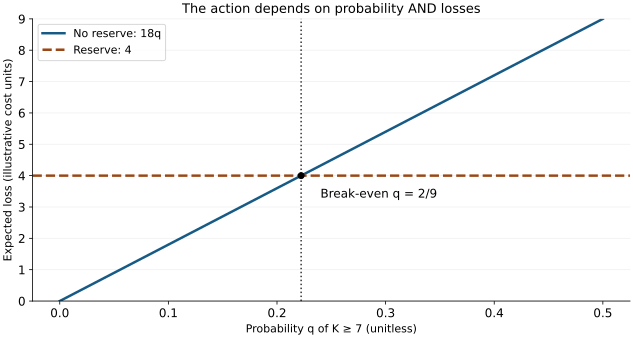

# 12 · Finish an analysis that supports a decision

**Objectives:** define a population estimand; calculate expected utility and information value; communicate model checks and sensitivity; complete a reproducible capstone; derive population expected utility; distinguish parameter uncertainty from realised risk. **Prerequisite:** chapters 1–11, especially predictive expectation, group models, and sensitivity. [Appendix 1](./appendix-01_probability.md) reviews conditional expectation and total variance.

## Start with the choice, population, and horizon

A fictional service has randomised onboarding design A or B within eight centres. It must choose a design for 10,000 future visits, equally distributed across those existing centres. An extra completion is worth five utility units and rolling out B costs 1,000 units. These are stipulated teaching quantities, not estimates of real financial value. The practical question is whether expected improvements justify the cost for this population and horizon.

An inference about completion rates does not by itself answer that question. We also need available actions, their consequences, and a rule for valuing those consequences. Keeping A is the reference action. The primary analysis allows only keeping A everywhere or adopting B everywhere; choosing a separate design for every centre would be a different decision problem with potentially different implementation costs.

Let $\theta_{jA}$ and $\theta_{jB}$ denote completion probabilities in centre $j$. For target weights $w_j\ge0$ summing to one, define

$$\Delta_w=\sum_{j=1}^8w_j(\theta_{jB}-\theta_{jA}).$$

The capstone fixes $w_j=1/8$, so $\Delta=\Delta_w$ is an equal-centre absolute probability contrast. These weights describe future visits, not precision weights for estimating effects. Training sample sizes affect posterior uncertainty but do not determine who matters in the future population.

<!-- VISUAL01:14 BEGIN -->

### Visual investigation: an action threshold comes from the loss table

Consider an original reserve decision linked to the illustrative eight-trial forecast in chapter 3. Reserve capacity costs four units regardless of the outcome and perfectly prevents an eighteen-unit disruption loss when $K\ge7$. No other costs or benefits are included. Predict whether the most probable event alone determines the preferred action.

**Read the figure.** Horizontal position is event probability $q=P(K\ge7)$, shown from zero to one half; the same straight loss functions extend to one. Vertical height is expected loss in stipulated cost units. Compare heights at the same q. The dotted crossing is a tie, not a discontinuity in either probability or loss.

| Action | Loss if K ≥ 7 | Loss otherwise | Expected loss |
|---|---:|---:|---|
| Reserve | 4 | 4 | 4 |
| No reserve | 18 | 0 | 18q |

**Mathematical connection.** Equality occurs at $q=4/18=2/9$. Above that threshold reserve has smaller expected loss; below it no reserve does; at equality both minimise expected loss. Under Beta(3,2) shared-parameter prediction for eight trials, q = 0.236364 and no-reserve loss = 4.254545. The plug-in Binomial gives q = 0.106376 and loss = 1.914762. The two probability treatments therefore change this toy decision while leaving its loss table fixed.

**Original unscored exploration — predict, observe, explain.** Hold the full predictive probability fixed and raise reserve cost from four to five. Predict the action, then observe that five exceeds 4.254545. Explain why the posterior need not change when the preferred action does. Transfer to imperfect prevention: identify which cell of the loss table would change before recalculating. These fictional losses are teaching assumptions, not an operational recommendation or a claim that reserving eliminates real disruption.

[Open the guided decision experiment](../../apps/bayesian/explorer.html#visual-decision) to predict, change one setting, and explain the result.

<!-- VISUAL01:14 END -->

## Worked example 1: the capstone from counts to action

The [training data](../../downloads/bayesian/data/experiment.csv) contain sixteen centre-arm binomial counts. Use independent Beta(1,1) priors, giving

$$\theta_{ja}\mid y\sim\operatorname{Beta}(a_{ja},b_{ja}),\qquad
 a_{ja}=1+y_{ja},\quad b_{ja}=1+n_{ja}-y_{ja}.$$

<!-- tutor-reference:start -->

**Worked assessment reference — attempt the assessment first.**

For centre zero, A has eight completions in forty trials and B has fourteen in forty. Their posteriors are Beta(9,33) and Beta(15,27), so the posterior mean contrast is $15/42-9/42=1/7=0.142857$. Equal-centre weighting makes this one eighth of the population contrast, even though centre zero is the smallest training centre.

<!-- tutor-reference:end -->

For each cell, write $m_{ja}=a_{ja}/(a_{ja}+b_{ja})$ and $v_{ja}=a_{ja}b_{ja}/[(a_{ja}+b_{ja})^2(a_{ja}+b_{ja}+1)]$. Independence under this particular model gives

$$E[\Delta\mid y]=\frac18\sum_j(m_{jB}-m_{jA}),\qquad
\operatorname{Var}(\Delta\mid y)=\frac1{64}\sum_j(v_{jB}+v_{jA}).$$

<!-- tutor-reference:start -->

**Worked assessment reference — attempt the assessment first.**

The eight mean contrasts, in centre order, are approximately 0.142857, 0.173077, 0.064516, 0, 0.024390, 0.206522, 0.029412, and 0.062500. Averaging their unrounded values yields **0.08790924**, and the analytic posterior SD is **0.02846686**. A hierarchical model would generally introduce covariance terms; do not reuse this independence formula without checking its assumptions.

<!-- tutor-reference:end -->

<!-- tutor-reference:start -->

**Worked assessment reference — attempt the assessment first.**

To get intervals and nonlinear summaries, draw all sixteen cell probabilities together, then form the eight contrasts and their weighted mean on each draw. The existing lab's 80,000 independent draws give a central 90% interval approximately **[0.04095, 0.13457]** and mean 0.08784. These are saved simulation results; the analytic mean above is an independent reference. Their difference is less than one Monte Carlo SE.

<!-- tutor-reference:end -->

In risk-neutral units, the expected incremental value of adopting B conditional on the rates is

$$U_B(\Delta)=10000(5)\Delta-1000=50000\Delta-1000,\qquad U_A=0.$$

Averaging gives the action rule

$$E[U_B\mid y]>0\quad\Longleftrightarrow\quad E[\Delta\mid y]>0.02.$$

<!-- tutor-reference:start -->

**Worked assessment reference — attempt the assessment first.**

The exact posterior expected net value is **3,395.46 units**, so choose B under the stated conditions. Lab 12's simulated estimate is about 3,392, with MCSE about five units; it agrees with this reference. The break-even expected improvement is two percentage points, not merely any positive improvement.

<!-- tutor-reference:end -->

This no-pooling model is transparent and preserves centre differences. It sacrifices information sharing and supplies no learned population distribution for unseen centres. A common-rate pooled model is a useful comparison, while a hierarchical logistic extension adds exchangeability assumptions. Complexity should improve the answer or expose consequential uncertainty. [Chapter 9](./09_hierarchical.md) develops that tradeoff.

## Expected value and realised outcomes are different distributions

Each value of $50000\Delta-1000$ is conditional expected incremental value, given completion probabilities. Its posterior distribution represents uncertainty about those expectations. It is not the distribution of the actual number of extra completions or realised rollout value. The capstone's risk-neutral action remains valid because expectation averages over both parameter uncertainty and future outcome variation.

For example, with exactly 1,250 future visits per centre, a model of realised completions under B could generate

$$K_{jB}\mid\theta_{jB}\sim\operatorname{Binomial}(1250,\theta_{jB}),\qquad K_B=\sum_jK_{jB},$$

conditionally independently across centres. Then

$$\operatorname{Var}(K_B\mid y)=
E\left[\sum_j1250\theta_{jB}(1-\theta_{jB})\mid y\right]
+\operatorname{Var}\left(\sum_j1250\theta_{jB}\mid y\right).$$

The first term is future outcome noise; the second is uncertainty about the expected total. Even if every probability were known, the first term would remain. For decisions with nonlinear utility, both terms can matter, so simulate consequences under each action before applying utility. The [Stan decision-analysis guide](https://mc-stan.org/docs/stan-users-guide/decision-analysis.html) presents this outcome-first calculation.

<!-- tutor-reference:start -->

**Worked assessment reference — attempt the assessment first.**

Using the primary capstone beta posteriors, the mean number of completions under B is 5,620.73. The two variance terms are 2,281.76 and 41,494.82 squared completions, giving total variance 43,776.58 and predictive SD 209.23 completions. These are analytic results for the explicitly specified future batch. They can also be checked by summing eight beta-binomial variances. The large second term shows that completion-rate uncertainty matters here; collecting infinitely many posterior simulation draws would not reduce it. More informative service data might.

<!-- tutor-reference:end -->

A posterior interval for the expected incremental value is obtained by transforming the interval for the contrast with the increasing affine function above. That transformation preserves its posterior probability content, but adding a label such as “prediction interval” would change its meaning incorrectly. A prediction interval for future completions requires the extra binomial simulation or equivalent beta-binomial integration. Specify which distribution every reported interval summarises.

There is an additional counterfactual issue. The same future visits cannot all receive both A and B. Independent simulated totals under the two actions describe independent hypothetical cohorts, not an identified joint distribution of paired potential outcomes for the same people. Risk-neutral expected differences need the marginal expectations. A distribution for realised paired differences needs additional dependence assumptions. Do not imply that randomisation alone supplies them.

## Population weights can change the answer {#population-weights-can-change-the-answer}

To see why weights are substantive, consider a separate two-centre example with posterior mean improvements 0.10 and −0.02. Equal weights give $0.5(0.10)+0.5(-0.02)=0.04$ and expected net value 1,000 under the capstone's horizon and cost. If future visits are instead 20% in the first centre and 80% in the second, the contrast is $0.2(0.10)+0.8(-0.02)=0.004$ and expected net value is −800. The preferred action changes because the target population changed, although the fitted centre effects did not.

<!-- tutor-reference:start -->

**Worked assessment reference — attempt the assessment first.**

For the actual eight-centre data, weights proportional to training sizes give an exact posterior mean contrast of 0.080989 rather than 0.087909. Both support B at cost 1,000. Those training weights are appropriate only if they represent the future mixture. If future weights are uncertain, model or vary them explicitly and preserve relevant dependence with centre effects.

<!-- tutor-reference:end -->

Population shares and distributional priorities are also different inputs. A service may value benefits to an underserved group more highly than its visit share, or impose a minimum benefit constraint for every centre. Make those choices explicit in the utility or constraints. An overall positive average can coexist with an unfavourable effect in a particular group.

## Utility includes risk attitudes

Expected utility compares actions by averaging a declared valuation of consequences. Linear value is risk-neutral in those units. A concave valuation represents aversion to variability: a large loss can outweigh a similarly likely gain even when expected net value is positive. Utility should reflect the decision maker's priorities; posterior probabilities cannot determine those priorities.

For a simple illustration, suppose a net consequence $V$ is +3,000 with probability 0.6 and −3,000 with probability 0.4, while keeping A yields zero. Linear utility prefers the gamble because $E[V]=600$. Under $u(V)=-\exp(-V/3000)$,

$$E[u(V)]=-0.6e^{-1}-0.4e^1\approx-1.3080<u(0)=-1.$$

This risk-averse valuation prefers zero. Its certainty equivalent, $-3000\log\{0.6e^{-1}+0.4e^1\}\approx-805.59$, is the sure net value with the same utility. This is a separate two-consequence illustration, not a fitted capstone risk model. Applying a nonlinear utility directly to the capstone's conditional expected values would omit future outcome risk unless that omission were an explicit approximation.

A probability such as $P(\Delta>0\mid y)$ concerns improvement, while $P(\Delta>0.02\mid y)$ concerns positive conditional expected net value. Neither universally determines the preferred action. A stated probability-of-loss constraint is possible, but define the loss event and its threshold rather than adding an unexplained “conservative” cutoff.

## Opportunity loss and perfect information

For each parameter state, an oracle knowing that state would choose the action with the largest conditional expected utility. Relative to that oracle, the opportunity losses for the capstone are

$$L_A=\max(0,U_B),\qquad L_B=\max(0,-U_B).$$

Opportunity loss measures a forgone opportunity, not necessarily a negative realised outcome. Their difference satisfies $L_A-L_B=U_B$ for every draw. Averaging is a useful numerical check. Minimising expected opportunity loss gives the same action as maximising expected utility because the oracle term is common to all actions.

The expected value of perfect information about these uncertain rates is

$$\operatorname{EVPI}=E[\max(0,U_B)\mid y]-\max(0,E[U_B\mid y]).$$

It equals the expected opportunity loss of the optimal current action and is nonnegative. Perfect information lets the decision depend on the state before action is taken. It does not mean foreseeing and avoiding every unlucky future completion outcome. A calculated EVPI remains conditional on the represented uncertainty and fixed decision; it does not price learning about omitted model failures.

## Worked example 2: calculate the value of a particular study

Consider a separate decision with the same horizon and cost but a simplified current posterior: $\Delta=0.08$ with probability 0.6, or $\Delta=-0.04$ with probability 0.4. These states give conditional net values +3,000 and −3,000. Current expected net value is 600, so choose B. Keeping A loses the positive-state opportunity, $0.6(3000)=1800$; choosing B loses $0.4(3000)=1200$. Their difference is 600, and EVPI is $1800-600=1200$.

A proposed study reports either “+” or “−”. Its assumed sampling model is $P(+\mid\text{positive state})=0.8$ and $P(+\mid\text{negative state})=0.2$. Enumerate possible future data before collecting them:

| Study result | Predictive probability | Updated positive-state probability | Expected net value of B | Subsequent action |
|---|---:|---:|---:|---|
| + | $0.6(0.8)+0.4(0.2)=0.56$ | $0.48/0.56=6/7$ | 2,142.857 | B |
| − | $0.6(0.2)+0.4(0.8)=0.44$ | $0.12/0.44=3/11$ | −1,363.636 | A |

The predictive probabilities sum to one. Averaging the updated positive-state probabilities gives $0.56(6/7)+0.44(3/11)=0.6$, recovering the current posterior probability. Information does not create a systematic expected effect increase. Its value comes from allowing different actions after different results.

With the study, expected optimised value is $0.56(2142.857)+0.44(0)=1200$. The **expected value of sample information**, EVSI, is therefore $1200-600=600$ units. As a check, residual expected opportunity loss after the study is $0.08(3000)+0.12(3000)=600$: wrong positive results cause the first loss and wrong negative results the second. EVPI minus that residual loss is again EVSI.

If the study costs 100 units without delaying rollout, its net expected gain is 500. If it costs 700, it is not worthwhile solely for this decision, even though that cost is below EVPI. Perfect information is an upper bound, not the study's expected benefit. These calculations assume the stated sampling model is correct and that the study does not itself change the decision horizon or consequences.

Information can change beliefs while having zero value for this action set. Suppose a weaker study has positive-result probabilities 0.55 and 0.45 in the two states. A positive result gives positive-state probability $0.33/0.51=0.647059$; a negative result gives $0.27/0.49=0.551020$. Both still favour B. Averaging the subsequent optimised values therefore gives the same 600 units as acting now, and EVSI is zero. This study might be useful for another question, but neither result changes this decision. Information value depends on the available actions and their consequences as well as statistical precision.

## General EVSI and its limits

For proposed future data $Z$, let $\bar U(a\mid y)$ be the current expected utility of action $a$. Then

$$\operatorname{EVSI}=E_{Z\mid y}\left[\max_a\bar U(a\mid y,Z)\right]
-\max_a\bar U(a\mid y).$$

For each possible or simulated dataset, update, optimise the subsequent action, and only then average over datasets. Maximising after averaging would force the same action regardless of the study result and discard the information's purpose. In larger problems this can require nested simulation; separate numerical error in the inner updates and outer averaging. Optimising noisy estimates can itself introduce bias.

Under the same model, actions, horizon, and utility, cost-free information that can be ignored satisfies $0\le\operatorname{EVSI}\le\operatorname{EVPI}$. Collection costs and delays are assessed afterwards in compatible value units. With nonlinear utility, model costs as consequences and recompute utility; arbitrary subtraction of monetary costs from utility scores is invalid. If learning also serves other populations or future decisions, calculate their value explicitly rather than carrying over this bound unchanged.

## Freeze, check, and examine sensitivity {#freeze-check-and-examine-sensitivity}

Before inspecting holdout outcomes, record the estimand, priors, exclusions, and planned comparisons. Fit only the training counts. Inspect prior predictions at the cell level as well as overall: independent uniform cell priors can produce a moderate overall average while allowing extreme individual centres. Posterior checks of centre ranges can be easy for a flexible no-pooling model, so moderate tail fractions are limited evidence of adequacy.

Evaluate the frozen models on the sixteen held-out counts using their beta-binomial predictions. Keep the same marginal cell scoring units; a sum of marginal scores is not generally a joint predictive score for a pooled or hierarchical model. Sixteen discrete counts give limited information about coverage. If the holdout prompts revision, report that it became development data and seek new validation where possible.

<!-- tutor-reference:start -->

**Worked assessment reference — attempt the assessment first.**

Use sensitivity calculations to identify what changes the recommendation. Here analytic results are:

| Scenario | Mean improvement | Expected net value | Action |
|---|---:|---:|---|
| Equal centres, Beta(1,1), cost 1,000 | 0.087909 | 3,395.46 | B |
| Equal centres, Beta(4,4), cost 1,000 | 0.080338 | 3,016.88 | B |
| Equal centres, Beta(2,6), cost 1,000 | 0.080338 | 3,016.88 | B |
| Equal centres, Beta(1,1), cost 5,000 | 0.087909 | −604.54 | A |

The two alternative priors have the same total shape, eight. Within each centre the arm sizes are equal, so their posterior mean contrast is $(y_{jB}-y_{jA})/(n_j+8)$ under either prior. Their uncertainty differs, but their exact mean contrasts coincide. Small differences between separately simulated means in saved lab results are Monte Carlo variation. The primary break-even rollout cost is about 4,395.46 units by analytic expectation.

<!-- tutor-reference:end -->

## Communicate and reproduce the decision {#communicate-and-reproduce-the-decision}

Lead a memo with the action, population, horizon, and conditions. Report the absolute improvement in percentage points, a model-based interval, expected consequence, and an assumption capable of reversing the action. Label the estimated probability as positive conditional expected net value, rather than guaranteed realised profitability. Numerical precision should serve the decision; a several-unit Monte Carlo error does not justify reporting utility to six decimal places.

For this synthetic experiment, randomisation supports a treatment interpretation within the simulated population under consistent treatment, no interference, and appropriate outcome observation. Generalising to real users or unseen centres requires additional evidence. The [causal bridge](./adv-04_causal.md) explains why prediction alone cannot establish intervention effects.

Keep a reproducibility record containing data provenance and checksums, training/holdout roles, model equations, prior revisions, target weights, units, utility and cost assumptions, software versions, seeds, commands, and generated outputs. Separate analytic quantities from simulation estimates and record their error. The exact capstone draws require moment and Monte Carlo checks; R-hat and NUTS divergences are inapplicable. An MCMC extension must supply its own diagnostics. Reproducibility lets another analyst audit the recommendation; it does not establish the truth of its assumptions.

## Lab

**Selected-core project order: attempt → save plan → consult reference → revise.** Start from the capstone brief and save your target, model, priors, split and decision rule before opening Lab 12, its executed notebook or the reference report; all are worked references. Then reproduce and critique the supplied analysis, record assistance and explain your revisions. **Extended study:** general EVSI computation and expanded opportunity-loss derivations add to the core workload.

Use the [capstone brief](./course-capstone.md), Lab 12, and [Python source](../../downloads/bayesian/labs/12_capstone.py). Reproduce the analytic moments, compare them with the saved simulation within MCSE, and verify the opportunity-loss identity. Change cost and population weights separately so their effects remain interpretable. The [decision plot](../../downloads/bayesian/artifacts/figures/12_decision.svg) marks both zero improvement and break-even improvement. Consult the [reference report](./course-capstone_solution.md) after your attempt.

## Retrieval and summary

Explain why a probable improvement need not justify an action; why future outcome variation remains with known parameters; and why an experiment can cost less than EVPI but still be unattractive. Reconstruct the two-result study tree without the table.

A decision is conditional on a population, action set, model, utility, and horizon. Weight effects for that population, propagate the uncertainties relevant to the utility, and distinguish perfect information from a particular study. Finish with a recommendation whose assumptions and calculations another reader can inspect.

## Exercises

**12.1 — Concept.** Why can B have a high probability of improving completion but still be a poor decision? State which missing quantities determine the choice.

**12.2 — Calculation.** Suppose $\Delta$ is 0.06 with probability 0.7 and −0.02 with probability 0.3. For 10,000 future visits, five utility units per extra completion and rollout cost 1,000 units, use U_B=50,000 Delta−1,000 and U_A=0 to calculate expected net utility, both expected opportunity losses, the optimal action, and EVPI.

**12.3 — Communication.** Write a five-sentence memo using your own completed capstone analysis of data/experiment.csv, including its holdout_trials and holdout_successes columns (10,000 future visits, equally weighted over eight existing centres; five utility units per extra completion, rollout cost 1,000). Attach or identify your result artifact so the memo can be checked against it. Include the target population, absolute improvement, uncertainty, decision, and one limitation. Avoid treating a model-based probability as an unconditional guarantee.

[Solutions](./course-solutions.md).

## Further reading

[Think Bayes, decision analysis](https://allendowney.github.io/ThinkBayes2/chap09.html) offers further discrete calculations. [Bayesian Modeling and Computation, workflow chapter](https://bayesiancomputationbook.com/markdown/chp_09.html) connects decisions to a complete analysis. The [reference and continuation map](./course-reference.md) identifies further study.
