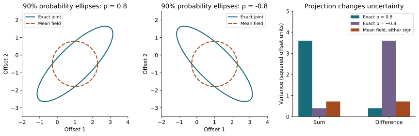
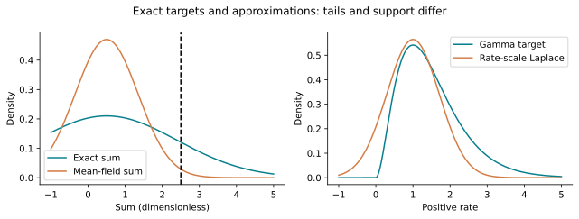

# A01 · Approximate a posterior without hiding the error

**Prerequisites:** [Monte Carlo](./05_monte_carlo.md), [HMC](./06_hmc.md), and [regression](./07_regression.md); derivatives, multivariate Normals, and stable integration in [Appendix 2](./appendix-02_calculus.md), [Appendix 3](./appendix-03_linear_algebra.md), and [Appendix 4](./appendix-04_numerics.md).

**Objectives:** A01.O1 derive Laplace and ELBO identities; A01.O2 quantify approximation error against an exact target; A01.O3 diagnose underdispersion, local modes, and optimisation limits.

## Which uncertainty can a fast fit preserve?

Suppose two calibration offsets have a strongly correlated posterior. An optimisation routine quickly returns accurate estimates of both offsets. That is encouraging if the only requested output is their posterior means. It is insufficient if the operational question concerns the probability that their sum exceeds a tolerance. That probability depends on the spread and joint structure the routine may have discarded.

This bridge studies two ways of replacing a difficult posterior with a tractable distribution: local curvature, giving a Laplace approximation, and optimisation within a chosen family, giving a variational approximation. The estimand is always specified separately from the approximation. We will examine means, covariance, and a tail probability of a linear combination. A small error in one does not guarantee a small error in another.

Write the model as a proper joint density $p(y,\theta)=p(y\mid\theta)p(\theta)$, with finite, positive evidence $p(y)$. The target is $p(\theta\mid y)$. An approximation $q(\theta)$ is an additional computational choice, not a new observation. Increasing the number of draws from $q$ makes its summaries more precise while leaving any discrepancy between $q$ and the posterior intact. This distinction parallels Monte Carlo error in the core chapters, but here even infinitely many independent draws may converge to the wrong answer.

## A quadratic picture near the mode

Let $\ell(\theta)=\log p(y,\theta)$ and let $\hat\theta$ be an interior local maximum. Assume twice continuous differentiability near that point, zero gradient, and a positive-definite negative Hessian

$$H=-\nabla^2\ell(\hat\theta).$$

A second-order Taylor expansion gives

$$\ell(\theta)\approx\ell(\hat\theta)
-\frac12(\theta-\hat\theta)^T H(\theta-\hat\theta),\qquad
q_L(\theta)=N(\hat\theta,H^{-1}).$$

The linear term vanishes at the mode. After exponentiation, the remaining quadratic has the shape of a Normal density. In numerical work solve linear systems involving the Hessian; constructing an inverse explicitly is rarely the best implementation. A negative or zero eigenvalue is a reason to investigate the stationary point, parameter redundancy, or boundary behaviour, not a reason to take absolute values until a covariance appears.

The approximation can be exact for a Gaussian posterior. More generally, it needs posterior mass to concentrate in a region where the quadratic is useful. A narrow curved ridge may look locally elliptical but bend elsewhere. A distant second mode can contain important mass without changing the Hessian at the first. A boundary mode does not satisfy the interior expansion. Heavy tails can carry substantial probability far beyond the neighbourhood checked by the curvature.

Integrating the approximate joint density also yields

$$\log p(y)\approx\ell(\hat\theta)+\frac d2\log(2\pi)
-\frac12\log|H|.$$

This evidence approximation requires the constants in the joint density. Constants discarded during posterior optimisation cannot be recovered from the Hessian. Its accuracy depends on the same global shape issues as the posterior approximation; a tidy determinant is not an independent evidence check.

## Coordinates are part of the calculation

A positive rate can be represented by $\lambda$ or by $\eta=\log\lambda$. Densities transform with a Jacobian:

$$p_\eta(\eta\mid y)=p_\lambda(e^\eta\mid y)e^\eta.$$

Modes are density summaries and therefore depend on coordinates. A Gaussian fit in log-rate space becomes a lognormal approximation after transformation; it will not equal a Gaussian fit to the rate itself. Neither should be selected just because it gives a more convenient answer. Examine support, skewness, numerical stability, and the estimand that matters.

The exact posterior probability of an event is invariant under a correctly performed transformation. Disagreement between transformed approximations measures their limitations, not two different exact posteriors. When comparing them, compute the same rate-scale event in both. Comparing the mode in one coordinate with the mean in another confounds the summary choice with the approximation choice.

## The direction of the variational objective

Choose a normalised family $q_\phi(\theta)$, indexed by optimisation parameters $\phi$. Assume its support and integrability make the following expectations finite. Starting from Bayes' rule,

$$\begin{aligned}
\operatorname{KL}(q_\phi\Vert p(\cdot\mid y))
&=E_q[\log q_\phi(\theta)-\log p(\theta\mid y)]\\
&=E_q[\log q_\phi(\theta)-\log p(y,\theta)]+\log p(y).
\end{aligned}$$

Define the evidence lower bound, or ELBO, by

$$\mathcal L(\phi)=E_q[\log p(y,\theta)]-E_q[\log q_\phi(\theta)].$$

Then

$$\log p(y)=\mathcal L(\phi)+
\operatorname{KL}(q_\phi\Vert p(\cdot\mid y))\ge\mathcal L(\phi).$$

The direction is **from the approximation to the posterior**, with expectation under the approximation. Maximising the ELBO minimises that divergence for a fixed model. It does not minimise the reverse divergence. Putting approximation mass where the posterior density is tiny is costly; omitting a region where the approximation puts almost no mass can be less costly. This helps explain why a restricted family may miss modes or have insufficient spread. It is a mechanism, not a theorem that every variational marginal must be too narrow. See the ELBO and mean-field discussion in [Blei, Kucukelbir, and McAuliffe](https://arxiv.org/html/1601.00670v9).

Three gaps deserve separate names. Optimisation error is failure to find the best member of the selected family. Approximation error remains when the best member differs from the target. Model error concerns the target itself as a description of the world. An improving objective addresses only the first gap, and even there a stochastic objective estimate can be noisy. Also, two models can have differently loose bounds: a larger ELBO across models need not imply larger evidence.

## Worked analysis: two correlated calibration offsets

For a deliberately exact benchmark, suppose earlier Gaussian calibration data and priors have produced the following posterior for two offsets, measured in the same units:

$$\theta\mid y\sim N\left[
\begin{pmatrix}1\\-0.5\end{pmatrix},
\Sigma=\begin{pmatrix}1&0.8\\0.8&1\end{pmatrix}\right].$$

This is the fully specified target for the experiment; no fitting to an unspecified dataset is required. We want the sum $S=\theta_1+\theta_2$, the difference $D=\theta_1-\theta_2$, and $P(S>2.5\mid y)$. The precision is

$$Q=\Sigma^{-1}=\frac1{0.36}
\begin{pmatrix}1&-0.8\\-0.8&1\end{pmatrix}.$$

The log density is already quadratic, so its mode is the mean and its negative Hessian is exactly $Q$. Laplace recovers the entire target. This is a valuable implementation reference because failure here is numerical or algebraic, rather than a subtle non-Gaussian effect.

Now restrict the variational family to independent Normals,

$$q(\theta)=N(a_1,v_1)N(a_2,v_2).$$

Here $\operatorname{tr}(M)=\sum_j M_{jj}$ is the matrix trace, the sum of diagonal entries. In particular $\operatorname{tr}(QV_q)=\sum_j Q_{jj}v_j$ for diagonal $V_q$. For a Gaussian target the divergence, apart from constants, is

$$\frac12\left[
\operatorname{tr}(Q V_q)+(a-m)^TQ(a-m)-\log|V_q|
\right],\qquad V_q=\operatorname{diag}(v_1,v_2).$$

Differentiating the quadratic in $a$ sets $a=m$. Differentiating with respect to each positive variance gives $Q_{jj}-1/v_j=0$, hence $v_j=1/Q_{jj}=0.36$. The optimal independent approximation has the right means and the wrong marginal variances. A reciprocal precision diagonal describes conditional spread here, whereas the exact marginal variances are one.

| Quantity | Exact posterior and Laplace | Optimal independent Normal |
|---|---:|---:|
| Mean of the sum | 0.5 | 0.5 |
| Variance of the sum | 3.6 | 0.72 |
| Variance of the difference | 0.4 | 0.72 |
| Probability the sum exceeds 2.5 | 0.145920 | 0.009211 |

The exact sum variance includes two covariance terms: $1+1+2(0.8)=3.6$. Its tail is $1-\Phi(2/\sqrt{3.6})$. The independent approximation uses $0.36+0.36=0.72$. A tolerance exceedance of roughly fifteen percent is represented as less than one percent. Meanwhile the difference is **overdispersed**, because removing positive covariance removes cancellation. “Variational uncertainty is too small” is therefore incomplete unless the quantity and direction are specified.

An ellipse plot would show what a table of marginal means hides. The exact ellipse stretches along the sum direction and contracts along the difference direction. The independent approximation cannot rotate. A richer family with unrestricted covariance contains the exact target in this example, although optimisation of that family still requires checking.

## See dependence before projecting it

Each ellipse encloses 90% probability under its own bivariate Normal distribution: its squared Mahalanobis radius is $\chi^2_{2,0.9}=4.60517$. It is not a pair of marginal 90% intervals. Both coordinates keep means $(1,-0.5)$ and exact marginal variances one. With positive correlation the ellipse extends along the sum direction; with negative correlation it extends along the difference direction. Projecting onto a direction $a$ gives variance $a^T\Sigma a$.

For a general correlation $\rho$, the exact sum and difference variances are $2+2\rho$ and $2-2\rho$. The optimal independent reverse-KL Gaussian instead has variance $1-\rho^2$ in each coordinate. Thus both of its contrast variances equal $2(1-\rho^2)$: it is not obtained merely by deleting the off-diagonal covariance while keeping unit marginal variances. At $\rho=0$ the two distributions agree.

| Correlation | Exact sum variance | Exact difference variance | Either mean-field variance | Exact probability sum > 2.5 |
|---:|---:|---:|---:|---:|
| 0.8 | 3.6 | 0.4 | 0.72 | 0.145920273 |
| −0.8 | 0.4 | 3.6 | 0.72 | 0.000782701 |

The sum mean stays 0.5 and the difference mean stays 1.5. The mean-field sum tail is 0.009211063 for either sign. Sign reversal can therefore turn an underestimated sum tail into an overestimated one without changing the approximation's sum variance. The figure's numerical table remains usable without the graphic.

[Open the guided covariance experiment](../../apps/bayesian/explorer.html#continuation-covariance). **Predict:** which contrast becomes more uncertain if correlation changes from 0.8 to −0.8? **Change:** reverse only that sign, then try zero; retain threshold 2.5. **Explain:** use the two covariance terms to explain both variances and explain why the mean-field result stays unchanged under sign reversal. **Transfer:** for $2\theta_1-\theta_2$, derive the variance before using a simulation. This is an original unscored exploration; it saves no responses.

## Worked stress test: positive, skewed uncertainty

Take a rate posterior $\lambda\mid y\sim\operatorname{Gamma}(3,2)$, using shape and rate. Its exact mean is 1.5 and variance is 0.75. The log density is $C+2\log\lambda-2\lambda$, giving rate-scale mode one and negative second derivative two at that mode. Thus direct Laplace gives $N(1,0.5)$.

That approximation assigns probability 0.078650 to a negative rate. For the operational event $\lambda>3$, the exact probability is

$$e^{-6}\left(1+6+\frac{6^2}{2}\right)=0.061969,$$

whereas the Gaussian tail is 0.002339. This is substantial approximation error even though the mode and curvature were calculated exactly. Truncating the Gaussian at zero would create yet another approximation requiring renormalisation; it does not automatically fix the right tail.

In log coordinates the transformed log density is $C+3\eta-2e^\eta$. Its mode is $\log(1.5)$ and curvature is three. A Gaussian approximation with that mean and variance $1/3$ implies a rate mean $1.5e^{1/6}=1.772041$. Respecting support improves one property while leaving other discrepancies. The lab can compare both approximations against gamma probabilities or independently normalised quadrature, with the same event thresholds throughout.

The left panel compares sum uncertainty at correlation 0.8; the right panel shows the positive gamma target and the Gaussian mass outside its support. For the changed-correlation investigation use `result = compute(rho=-0.8)` and `render(result)`: the sum variance becomes 0.4, the difference variance 3.6, and the sum tail above 2.5 is about 0.000782701129. The mean-field sum variance is 0.72 for either sign.

## A local success can miss another explanation

Consider a separate one-dimensional target that is an equal mixture of Normal densities centred at minus four and plus four, both with variance one. Its exact mean is zero and its variance is seventeen: one unit of within-component variance plus sixteen units from the separated component means. A local Gaussian near either peak can describe that neighbourhood extremely well while completely misrepresenting the overall mean, spread, and probability of a positive parameter.

Multiple optimisation starts can reveal the two peaks, but finding both is only the beginning. Their relative posterior masses depend on integrated density, not merely on peak heights. A narrow tall peak can carry less probability than a broad lower peak. Combining local approximations requires mass estimates and care about overlap, which is beyond the single-mode Laplace calculation developed here. The appropriate report may simply be that the proposed approximation does not resolve the target reliably.

A variational Normal family faces a related tradeoff. It can centre between the peaks and place substantial probability in the low-density gap, or concentrate near one peak and miss the other. Reverse KL can prefer concentration. Symmetric starts can reach equally good local solutions with opposite means. A stable objective trace then describes a stable optimisation outcome; it does not supply evidence that one explanation has negligible posterior mass.

One tempting repair is to reweight draws by the target density divided by the approximation density. Importance sampling can improve an approximation only when proposal support and tail behaviour allow useful weights. A proposal that almost never visits the other peak cannot recover it reliably from a modest draw count. Extreme weights or a handful of dominating draws are evidence of this difficulty. Report numerical uncertainty in any corrected estimate and investigate the proposal rather than interpreting a normalised weight vector as proof that all relevant regions were explored.

## Lab: establish accuracy for the requested output

Lab 13, `labs/13_approximation.py`, uses seed 1313 for optional simulation. Begin with the exact correlated target above, compute Laplace curvature and optimal independent variances, and report both linear-combination variances and the sum tail. Then reproduce the gamma stress test. The experiment requires no general-purpose variational optimiser: an analytic optimum isolates family error from optimisation error.

Compare any simulated summaries with their exact values using Monte Carlo standard errors. For numerical quadrature, expand bounds and refine spacing separately. Agreement of two implementations of the same mistaken formula is weaker evidence than agreement with an independently evaluated integral. Record approximation discrepancies as findings, rather than making the intentionally inaccurate method fail an unrelated convergence threshold.

For a later realistic fit, use several starts, inspect objective traces, and compare a small tractable subproblem with quadrature or a carefully diagnosed sampler. Posterior predictive checks still assess the model's observable implications. A fast approximation that gives a plausible predictive mean can distort a rare-event decision. MCMC R-hat and effective sample size do not certify a deterministic Laplace fit or an optimised variational family.

## Retrieval and interpretation

Without looking back, explain which expectation defines the KL direction, why the ELBO is a lower bound, and why the difference variance increased in the independent approximation. Then name a check that could expose a missed second mode. These are discussion prompts; assessed problems are separate.

The central reporting habit is to name the approximation, the coordinate system, the target summary, and the available accuracy evidence. Exactness for one Gaussian benchmark verifies a mechanism, not universal reliability. This bridge prepares you to read more advanced approximation methods while keeping their computational success distinct from posterior accuracy.

## Exercises

The public question bank contains [adv.approximation.1](./exercises-questions.md#adv.approximation.1), [adv.approximation.2](./exercises-questions.md#adv.approximation.2), and [adv.approximation.3](./exercises-questions.md#adv.approximation.3): [advanced practice questions](./exercises-questions.md). Attempt those separately; their hints and reference answers are not part of this reading.

## Further reading

- Blei, Kucukelbir, and McAuliffe, [Variational Inference: A Review for Statisticians](https://arxiv.org/html/1601.00670v9), for variational families, the ELBO, and optimisation.
- Vehtari, [BDA3 chapter notes](https://avehtari.github.io/BDA_course_Aalto/BDA3_notes.html), sections on normal approximation and transformations, for limitations of curvature summaries.
