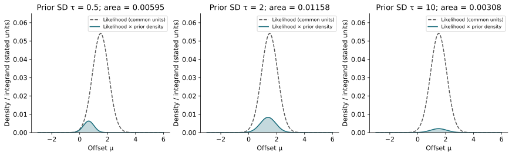
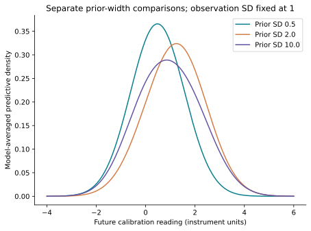

# A02 · Model evidence, prior sensitivity, and averaged predictions

**Prerequisites:** [continuous conjugate models](./04_continuous.md), [predictive comparison](./10_model_checking.md), and [decisions](./12_decisions.md); integration and log arithmetic in [Appendix 2](./appendix-02_calculus.md) and [Appendix 4](./appendix-04_numerics.md).

**Objectives:** A02.O1 calculate analytic evidence and posterior model weights; A02.O2 assess prior sensitivity and averaged predictions; A02.O3 distinguish hypothesis comparison from predictive weighting.

## What does it mean to compare models?

A laboratory measures an instrument's offset from a reference standard. One scientific hypothesis says the offset is exactly zero. Another says there is a persistent but uncertain offset. A separate operational question asks how well tomorrow's reading can be predicted. These questions are related, but they need not rank modelling choices in the same way.

The evidence, also called marginal likelihood, measures how much probability or density a model assigned to the observed dataset **before conditioning on it**. Cross-validation assesses predictions for held-out observations after learning from a training set. Both involve integration over parameters; they integrate with different distributions and answer different questions. This bridge derives evidence in a setting where the calculation is exact, then uses the same models to construct a predictive mixture.

The estimands will be posterior probability of an explicitly defined model, the mean of a future measurement, and its predictive variance. A model probability is conditional on the candidate set, the within-model priors, and the model prior probabilities. It is not an unconditional probability that the whole scientific account is true. All candidates may omit an important feature such as drift, outliers, or changing measurement precision.

## Evidence averages over a prior

For candidate $M_k$ with parameters $\theta_k$, define

$$m_k(y)=p(y\mid M_k)=\int p(y\mid\theta_k,M_k)
p(\theta_k\mid M_k)\,d\theta_k.$$

With prior model probabilities $\pi_k$, Bayes' rule gives

$$w_k=p(M_k\mid y)=\frac{\pi_k m_k(y)}{\sum_j\pi_jm_j(y)},\qquad
\frac{w_1}{w_0}=\frac{\pi_1}{\pi_0}\frac{m_1(y)}{m_0(y)}.$$

The evidence ratio is the Bayes factor. It updates prior model odds, not prior parameter odds inside one model. In continuous models the evidence is a density with units determined by the observed data. Its numerical magnitude alone is not an absolute quality score. Ratios are meaningful when models describe the same recorded event using the same observation convention.

A likelihood evaluated at its maximum is not evidence. Maximisation picks the best parameter value after seeing the data; integration averages across values the prior allowed before seeing them. A flexible model can fit well yet allocate little prior predictive density near the observed dataset. This is sometimes called an automatic complexity penalty, but “complexity” here is inseparable from the actual prior and data scale. Parameter counting alone cannot reproduce the integral.

Compute log evidences and normalise model weights with log-sum-exp. Retain all model-dependent normalising constants. A dropped likelihood factor is harmless for a posterior kernel only when it is constant in the unknowns being compared; a factor that differs between models cannot be discarded from their evidence ratio.

## An exact Normal comparison

Let $y_1,\ldots,y_n$ be conditionally independent readings in calibration units with known measurement variance $\sigma^2$. Compare

$$M_0:\ \mu=0,\quad y_i\sim N(0,\sigma^2),$$

$$M_1:\ \mu\sim N(0,\tau^2),\quad y_i\mid\mu\sim N(\mu,\sigma^2).$$

The exact-zero hypothesis has positive prior probability because it is a separate model. An ordinary continuous prior on the offset assigns probability zero to a single point, before and after observing continuous data. It cannot answer the same point-hypothesis question by counting posterior draws equal to zero.

Write $s^2=\sigma^2/n$ and $R=\sum_i(y_i-\bar y)^2$. Completing the sum of squares gives

$$\sum_i(y_i-\mu)^2=R+n(\bar y-\mu)^2.$$

Under either model, the part describing residual differences around the mean is the same. Under $M_1$, integrating the uncertain mean yields $\bar y\sim N(0,s^2+\tau^2)$; under $M_0$, $\bar y\sim N(0,s^2)$. Consequently

$$\log B_{10}=-\frac12\log\left(1+\frac{\tau^2}{s^2}\right)
+\frac{\bar y^2}{2}\left(\frac1{s^2}-\frac1{s^2+\tau^2}\right).$$

To calculate the full evidence rather than its ratio, retain the common residual factor:

$$m_1(y)=(2\pi\sigma^2)^{-n/2}e^{-R/(2\sigma^2)}
\sqrt{2\pi s^2}\;N(\bar y;0,s^2+\tau^2).$$

Here $N(z;a,b)$ denotes a Normal density evaluated at $z$, with mean $a$ and variance $b$. Multiplication by $\sqrt{2\pi s^2}$ restores the constant introduced when the mean-dependent exponential was expressed as a Normal density. This detail matters in an independent numerical integration check.

## Worked analysis: three readings and three prior widths

Use the original illustrative readings $(1.1,1.5,1.9)$, measurement SD one, and equal prior probabilities for $M_0$ and $M_1$. Then $\bar y=1.5$, $s^2=1/3$, and $R=0.32$. Treat $\tau=0.5,2,10$ as three separate sensitivity analyses of the alternative's prior, not as three extra models silently receiving additional prior mass.

Within $M_1$, conjugate updating gives

$$v_1=\left(\frac1{\tau^2}+n\right)^{-1},\qquad
a_1=v_1\sum_i y_i,\qquad
\mu\mid y,M_1\sim N(a_1,v_1).$$

| Prior SD of offset | Log Bayes factor | Bayes factor | Posterior probability of $M_1$ | Offset mean within $M_1$ |
|---:|---:|---:|---:|---:|
| 0.5 | 1.166621 | 3.211123 | 0.762534 | 0.642857 |
| 2 | 1.832910 | 6.252053 | 0.862108 | 1.384615 |
| 10 | 0.510232 | 1.665678 | 0.624861 | 1.495017 |

For the middle row, posterior variance of the offset is $4/13=0.307692$. Its posterior mean is $18/13=1.384615$. The full log evidence under the zero-offset model is $-6.291816$, and under the alternative it is $-4.458906$. Their difference reproduces the table's log Bayes factor.

The broadest prior moves the alternative's posterior mean closer to the sample mean while reducing its posterior model weight. There is no contradiction. Conditional estimation of the offset asks where the alternative fits after updating. Evidence asks how successfully its whole prior predicted the observations. A prior that expected offsets spread across tens of calibration units allocated relatively little density to this modest observed deviation.

The prior scale should therefore come from plausible instrument behaviour, historical calibration, or an explicit sensitivity range. Choosing it solely to maximise the evidence using these same readings and then treating it as fixed conceals a data-dependent choice. A hyperprior on the scale is another coherent model, requiring its own prior predictive checks and integration; it is not equivalent to selecting the best row.

## See the area that the peak cannot measure

The dashed curve is the full likelihood for these same three readings, with all constants retained. Its maximum occurs at offset 1.5 and is about 0.054106. Multiplying it by each proper Normal prior produces the solid integrand. The shaded area under that product, over the entire real line, is the evidence. The displayed range captures its visible mass; the values below use the analytic whole-line integral, independently checked by quadrature.

| Prior SD | Likelihood maximum (same for all) | Integrated full-data evidence |
|---:|---:|---:|
| 0.5 | 0.054106 | 0.005945 |
| 2 | 0.054106 | 0.011575 |
| 10 | 0.054106 | 0.003084 |

The likelihood has units of inverse cubed reading units; the product also has inverse offset units, which integration removes. Heights of the two kinds of curve are not themselves dimensionally comparable. Their common axis is a numerical display in the stipulated calibration units, not a claim that a density equals a probability. Each evidence is a density for the same observed three-dimensional event, so their ratios are meaningful. The prior with SD two puts more useful weight around supported offsets than the narrow prior, while the broadest prior spreads much of its mass far away. Merely locating the maximum cannot detect either change. These are separate prior-sensitivity analyses of the same alternative, not three new alternatives receiving extra model probability.

## Averaging future measurements

Assume tomorrow's reading has the same measurement variance and shares the persistent offset. Model averaging forms

$$p(y_*\mid y)=\sum_k w_k p(y_*\mid y,M_k).$$

Under the zero-offset model the future reading is $N(0,1)$. Under the alternative it is $N(a_1,1+v_1)$. The extra one is future measurement variation; the added $v_1$ is posterior uncertainty in the persistent offset. With $w=w_1$,

$$E[y_*\mid y]=w a_1,$$

$$\operatorname{Var}(y_*\mid y)=1+w v_1+w(1-w)a_1^2.$$

The final term is between-model uncertainty in the mean. It would disappear if we selected a model and treated that selection as certain. It would also be missed by averaging only within-model variances. A mixture generally is not Normal, even when each component is Normal; an interval or threshold probability should be computed from the mixture itself.

| Alternative prior SD | Averaged predictive mean | Averaged predictive variance |
|---:|---:|---:|
| 0.5 | 0.490200 | 1.183766 |
| 2 | 1.193688 | 1.493172 |
| 10 | 0.934177 | 1.731518 |

These are predictions for an individual future reading, not uncertainty solely about the expected reading. Subtract the future measurement variance one to obtain the variance of the mixture over the persistent offset. To simulate multiple future readings from a shared instrument, first draw one model and one offset for the whole future batch, then draw independent measurement errors. Choosing a fresh model independently for every reading describes a different process.

Compare the predictive shapes with the means and variances above. These are future-reading densities; the between-model term remains in the mixture. This plot does not replace a separate examination of prior-weighted evidence integrals.

## How prior sensitivity can become decisive

For fixed data, as the alternative's prior width grows without bound, the logarithmic penalty in the Bayes factor keeps decreasing while its data-fit improvement approaches a finite limit. Eventually the Bayes factor favours the point null strongly. This limiting argument does not prove the offset is zero. It describes the consequences of allowing the alternative to disperse its prior predictions arbitrarily far from the observed scale.

An improper “flat” prior is worse for evidence: multiplying it by any positive constant leaves the conditional posterior unchanged but multiplies the evidence by that constant. A proper posterior does not rescue an undefined model comparison. Use proper, scientifically interpretable priors for this bridge's evidence calculation. Special constructions for improper-prior comparisons require additional choices and are outside its scope.

Measurement units provide another check. If offsets are converted from one calibration unit to a tenth of that unit, transform the measurement SD and the prior SD consistently. Both continuous-data evidences acquire the same change-of-variable factor, so the Bayes factor remains unchanged. Keeping a numerical prior SD fixed while changing units specifies a different prior and can change the comparison legitimately, but unintentionally.

## Sequential evidence and the candidate set

Evidence also admits a predictive factorisation:

$$p(y_{1:n}\mid M)=\prod_{i=1}^n p(y_i\mid y_{1:i-1},M).$$

The first factor is a prior prediction, and later factors use earlier observations. This identity reconciles evidence as a prior average with its sequential learning interpretation. Under the exchangeable model above, the full product is unchanged by reordering the observations, although the individual factors change. Leave-one-out prediction uses almost the whole dataset to predict each omitted observation; it is not this same sequential product. Calling both quantities predictive does not make their training information identical.

The candidate list also affects posterior model probabilities. Suppose one alternative is duplicated under a new name. Giving every listed model an equal prior probability now increases the total prior probability assigned to that alternative's scientific story. Its combined posterior weight increases for a bookkeeping reason. If a broad hypothesis is split into several submodels, allocate its original prior mass across them deliberately. Model averaging is only as coherent as the model definitions and prior allocation supplied to it.

Finally, consider whether exact equality to zero is the scientific question. An instrument may be acceptable whenever its offset lies inside a tolerance interval. The posterior probability of that interval under a continuous model can address acceptability directly, without introducing a point-null model. If actions have different costs, integrate the relevant loss instead of applying a universal Bayes-factor threshold. Evidence comparison, practical equivalence, and decision analysis can all be useful, but each needs its own stated target.

## Prediction uses a different comparison target

Leave-one-out prediction evaluates $p(y_i\mid y_{-i},M_k)$, where the posterior is fitted without the held-out reading. Summing its logarithm estimates predictive performance for the declared holdout task. It is neither the full-data evidence nor the training log likelihood. The distinction and computational diagnostics are developed in [Vehtari, Gelman, and Gabry](https://arxiv.org/abs/1507.04544).

Predictive stacking chooses weights on a simplex to optimise a held-out mixture score, for example

$$\max_{w_k\ge0,\ \sum_k w_k=1}
\sum_i\log\left[\sum_k w_k p(y_i\mid y_{-i},M_k)\right].$$

These weights describe a predictive combination. They are not posterior probabilities that models are true. They can exploit complementary predictions even when every candidate is an approximation to the data-generating process. They depend on the scoring rule, candidate predictions, and holdout design. [Yao and colleagues](https://arxiv.org/abs/1704.02030) develop this distinction and the stacking procedure.

If tomorrow means a new instrument rather than another reading from this instrument, the predictive distribution must also change. If it means a later time with possible drift, an exchangeable leave-one-out split can misrepresent deployment. An excellent score for the wrong holdout unit does not resolve the operational question. Likewise, a favourable Bayes factor within a narrow candidate set does not validate all the shared assumptions.

## Lab and reporting practice

Lab 14, `labs/14_model_evidence.py`, uses the three readings and all three prior widths above; its default seed is 1414 if simulation is used. Evaluate the analytic full evidences and independently integrate the likelihood times the proper prior over the offset. Numerical integration should include an error estimate and a bounds or method check. Verify that posterior weights sum to one and reproduce the predictive moments using total variance or direct mixture integration.

Display evidence, model weights, conditional offset summaries, and predictive summaries in separate columns. Explain the known-noise assumption and equal prior model odds. Repeat with unequal model odds only as an explicitly labelled sensitivity analysis. Do not label a quadrature result with sampler diagnostics or interpret agreement of numerical methods as evidence that the scientific models are adequate.

## Retrieval and interpretation

Explain why widening the alternative's prior can increase its conditional posterior mean while decreasing its model probability. Describe the three sources of variance in an averaged future reading. Finally, explain what additional specification is needed before a model weight can be interpreted as a scientific hypothesis probability.

This bridge supplies a small exact example of evidence calculation and model averaging. Its practical conclusion is to report the hypothesis set, proper priors, sensitivity, and prediction target alongside the numbers. The purpose of the comparison determines which number deserves attention.

## Exercises

Attempt [adv.model_evidence.1](./exercises-questions.md#adv.model_evidence.1), [adv.model_evidence.2](./exercises-questions.md#adv.model_evidence.2), and [adv.model_evidence.3](./exercises-questions.md#adv.model_evidence.3) in the [public question bank](./exercises-questions.md). Their assessed datasets and answer keys are separate from this worked analysis.

## Further reading

- Gelman and colleagues, [Bayesian Data Analysis, third edition](https://sites.stat.columbia.edu/gelman/book/), for posterior model probabilities and model criticism.
- Yao and colleagues, [Using stacking to average Bayesian predictive distributions](https://arxiv.org/abs/1704.02030), for predictive weighting and its interpretation.
- Vehtari, Gelman, and Gabry, [Practical Bayesian model evaluation using leave-one-out cross-validation and WAIC](https://arxiv.org/abs/1507.04544), for predictive scoring and approximation checks.
