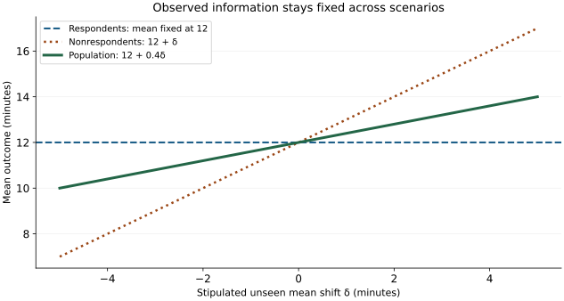

# A03 · Model what was observed, and why it was observed

**Prerequisites:** [continuous models](./04_continuous.md), [generalised regression](./08_glm.md), and [robustness and missingness](./11_robustness.md); conditioning and integration in [Appendix 1](./appendix-01_probability.md) and [Appendix 2](./appendix-02_calculus.md).

**Objectives:** A03.O1 construct integrated observation-process likelihoods; A03.O2 propagate measurement and missing-data uncertainty; A03.O3 identify unsupported selection assumptions and sensitivity parameters.

## A blank cell and a noisy reading are different evidence

A sensor survey reports four measurements and several absent records. Some instruments were unavailable; others may have failed when the physical quantity became unusually large. The surviving readings also contain measurement error. Replacing blanks with a sample mean and treating the recorded readings as exact would make a clean rectangular table, but it would not explain how the table arose.

Begin by distinguishing the quantity of scientific interest from its recorded representation. Let $X_i$ be a latent physical value, $Z_i$ a noisy reading, and $R_i$ an indicator that the reading is observed. The estimand might be the population mean of the physical value, the latent value of one particular item, or the average among respondents. Those are different targets even when they share a model.

This bridge develops one small measurement model and one missingness sensitivity analysis. The examples intentionally make some variances known so that uncertainty propagation is visible through exact calculations. Their transparency should not be mistaken for a claim that measurement precision or response mechanisms are usually known. Calibration data, repeat readings, administrative records, and design information can be essential components of an analysis.

## Write the observation process into the joint distribution

A possible factorisation, with parameters collected into $\theta$ and $\psi$, is

$$p(x,z,R\mid\theta,\psi)
=p(x\mid\theta)p(z\mid x,\theta)p(R\mid x,z,\psi).$$

The likelihood for recorded data sums or integrates over values that were not observed:

$$p(z_{\mathrm{obs}},R\mid\theta,\psi)
=\int p(x,z_{\mathrm{obs}},z_{\mathrm{mis}},R\mid\theta,\psi)
\,dx\,dz_{\mathrm{mis}}.$$

The factorisation is a proposed scientific story. It permits response to depend on latent values and noisy measurements, but a particular application may need a different dependence structure. For example, a device can fail because its unrecorded internal signal exceeded a threshold. Recording only successful measurements then changes both the distribution of observed values and the probability of observing them.

Integration expresses uncertainty about unobserved quantities. Sampling missing values inside a Bayesian program is a computational alternative to doing the integral analytically. Neither operation creates observations. If a missing outcome has a normalised conditional density that integrates to one and its missingness is ignorable, that row alone contributes no outcome information about the mean. Its eventual imputed value must not be counted as an independent extra measurement in a second fit.

## When can the missingness mechanism be ignored?

For a simpler outcome vector $y$, write $p(y,R\mid\theta,\psi)=p(y\mid\theta)p(R\mid y,\psi)$. Missing completely at random means response does not depend on the outcomes, conditional on any design information explicitly being held fixed. Missing at random means that, for the realised missingness pattern, response may depend on observed components but not additionally on missing components:

$$p(R\mid y_{\mathrm{obs}},y_{\mathrm{mis}},\psi)
=p(R\mid y_{\mathrm{obs}},\psi).$$

If the outcome and response parameters have distinct parameter spaces and independent priors, this permits the response factor to separate from inference about the outcome parameters. These conditions justify a specific ignorability calculation. The phrase “missing at random” does not mean that the observed sample is representative without adjustment or that complete-case regression is always valid. Conditioning on informative observed predictors may still be necessary.

If response depends on unobserved outcomes after accounting for observed information, the mechanism is missing not at random. A parametric selection model can be fitted, but fitting it does not establish that its extrapolation to unseen values is identified by the observed data. Different outcome distributions and selection functions can produce the same recorded distribution. A prior can select among those possibilities while the likelihood supplies little discrimination.

Observed patterns can contradict particular modelling restrictions. They generally cannot establish arbitrary missing-at-random assumptions because the relevant dependence involves unseen values. Design knowledge or follow-up sampling is often more informative than a new optimisation routine. The [Stan missing-data guide](https://mc-stan.org/docs/stan-users-guide/missing-data.html) illustrates integration through latent quantities and explains why missing predictors need their own distribution.

## Worked analysis: calibrated measurement uncertainty

Suppose respondent items have latent values and readings, in the same physical units,

$$X_i\mid\mu\sim N(\mu,4),\qquad
Z_i\mid X_i\sim N(X_i,9),\qquad
\mu\sim N(10,16).$$

Variances are the second arguments. Latent variation has SD two; independent, unbiased measurement error has SD three; the prior SD for the respondent population mean is four. Assume independence across items conditional on the mean, and suppose external calibration has established the two variance components. The four recorded values are $(8,10,11,13)$.

Writing $Z_i=X_i+E_i$ with independent $E_i\sim N(0,9)$ gives the convolution

$$Z_i\mid\mu\sim N(\mu,13).$$

This follows either by integrating the product of the two Normal densities or by adding independent Normal variables. The larger variance is measurement variation plus true item variation. It does not mean the physical items themselves became more variable.

The sum of readings is 42. Conjugate updating gives

$$V_\mu=\left(\frac1{16}+\frac4{13}\right)^{-1}=2.701299,$$

$$M_\mu=V_\mu\left(\frac{10}{16}+\frac{42}{13}\right)=10.415584.$$

The posterior SD of the mean is about 1.644 physical units. A naive analysis using variance four for the readings gives posterior mean 10.470588 and variance 0.941176. The means look similar because the sample mean is near the prior centre. The naive posterior variance is only about a third of the measurement-aware value. Comparing point estimates alone would miss the error.

Now estimate the latent value of the item whose reading was 13. Conditional on the population mean,

$$X_4\mid\mu,Z_4=13\sim
N\left(\frac9{13}\mu+\frac4{13}13,\frac{36}{13}\right).$$

Because the measurement is imprecise, the latent value is pulled towards the population mean. Integrating the posterior uncertainty in that mean gives

$$E[X_4\mid z]=11.210789,$$

$$\operatorname{Var}(X_4\mid z)
=\frac{36}{13}+\left(\frac9{13}\right)^2V_\mu
=4.063936.$$

The second term would disappear if the fitted population mean were treated as known. This calculation concerns an existing item's latent value. A new latent item has variance $4+V_\mu$; a new recorded reading has variance $13+V_\mu$. A reporting table should name which of these distributions supplies each interval.

## What if the calibration is unknown?

With only one reading per item and the model above, the marginal likelihood primarily identifies the sum of latent and measurement variances. Many pairs of variance components give exactly the same marginal reading distribution. Treating both as unknown with broad priors can therefore yield a long posterior ridge. A more powerful sampler explores the ridge; it does not remove the ambiguity.

Independent replicate measurements within items help because differences of two readings cancel the latent value. Their variance is twice the measurement variance under independent, equal-variance errors. A validation sample with a high-precision reference can identify bias and precision more directly. Correlated repeat errors or shared instrument drift weaken this simple argument and must be modelled if plausible.

Error in predictors needs equal care. If an outcome depends on a true exposure but only a noisy exposure is recorded, condition the outcome model on the latent exposure and supply a model for that exposure. Under a simple linear model with independent classical additive error, a naive population regression slope is attenuated by the ratio of true exposure variance to total recorded exposure variance. That familiar direction is not universal: differential errors, nonlinear links, and selection can behave differently. The [Stan measurement-error guide](https://mc-stan.org/docs/stan-users-guide/measurement-error.html) provides latent-variable constructions and rounding examples.

## Worked sensitivity analysis: who did not respond?

Now interpret the four calibration readings as a sample from respondents. Suppose a large administrative register establishes that respondents constitute a fixed fraction $\rho=0.4$ of the target population. We condition on that known fraction in this teaching example. It is not estimated from the four measurements.

Let the mean latent value among nonrespondents exceed the respondent mean by $\delta$ physical units. Specify a pattern-mixture model

$$X\mid R=1,\mu\sim N(\mu,4),\qquad
X\mid R=0,\mu,\delta\sim N(\mu+\delta,4).$$

The target is the **population mean**, not the realised mean of a finite set of already measured items. It is

$$\mu_{\mathrm{pop}}=\rho\mu+(1-\rho)(\mu+\delta)
=\mu+0.6\delta.$$

The respondent likelihood contains no $\delta$. Under an independent prior on that shift, its posterior equals its prior. Choosing several fixed shifts is therefore sensitivity analysis over unsupported extrapolations, not estimation of the shift from these data.

| Assumed nonrespondent shift | Posterior mean of population mean | Posterior variance conditional on shift |
|---:|---:|---:|
| -2 | 9.215584 | 2.701299 |
| 0 | 10.415584 | 2.701299 |
| 2 | 11.615584 | 2.701299 |

All rows fit the respondent readings equally well. The equality of their conditional variances does not imply that uncertainty about nonresponse is negligible; it reflects holding the shift fixed in each row. If instead $\delta$ has an independent prior variance $s_\delta^2$, population-mean variance gains $0.36s_\delta^2$. If the response fraction is uncertain, integrate its joint uncertainty too. A random prior over shifts is justified only when it represents actual beliefs or external evidence, not merely because it produces a single convenient interval.

The zero-shift row is a substantive equal-means assumption. More respondent measurements can estimate their mean precisely while leaving the shift unidentified. Targeted follow-up of nonrespondents, even a small sample with a documented collection process, can address the uncertainty that an enormous respondent sample cannot.

<!-- VISUAL01:15 BEGIN -->

### Visual investigation: unseen outcomes remain assumptions

Separate the information in respondents from an assumption about unobserved cases. In this new fixed-mean illustration, the response fraction is 0.6, respondents average twelve minutes, and nonrespondents have stipulated mean $12+\delta$. Predict which observed quantity changes when only delta changes.

**Read the figure.** The horizontal axis is a sensitivity assumption in minutes, not an estimated regression coefficient. The vertical axis is a mean outcome in minutes. The dashed respondent line is unchanged. The dotted unseen mean changes one-for-one with delta; the solid population mean changes more slowly because unseen cases carry weight 0.4.

| Delta (minutes) | Respondent mean | Assumed nonrespondent mean | Population mean |
|---:|---:|---:|---:|
| −5 | 12 | 7 | 10 |
| 0 | 12 | 12 | 12 |
| 5 | 12 | 17 | 14 |

**Mathematical connection.** Total expectation gives $E[Y]=0.6(12)+0.4(12+\delta)=12+0.4\delta$. No respondent value is altered by selecting a scenario. These are stipulated component means; the lines have no posterior bands and the scenario range is not a credible interval. A distribution over delta would require additional assumptions or information.

**Original unscored exploration — predict, observe, explain.** Change only the response fraction to 0.8. Predict the sensitivity slope, then observe $E[Y]=12+0.2\delta$. Explain why more observed coverage reduces this mixture's sensitivity without identifying the unseen mean. Transfer to a calibrated noisy measurement: distinguish uncertainty about a recorded value from absence of a value. This small illustration is separate from the frozen measurement-error fit and its uncertainty calculations later in the reading.

<!-- VISUAL01:15 END -->

## Censoring, rounding, truncation, and selection

A censored record says that a value lies in a known region. For a Normal quantity, a record “at least $c$” contributes $1-\Phi((c-\mu)/\sigma)$, not a density at the threshold. A reading rounded to the nearest unit and recorded as $r$ contributes

$$\Phi\left(\frac{r+0.5-\mu}{\sigma}\right)
-\Phi\left(\frac{r-0.5-\mu}{\sigma}\right).$$

Those interval widths are part of the observation convention. Treating a rounded value as exact can be an adequate approximation when rounding is tiny relative to variation, but the approximation should be recognised.

Truncation means items outside an inclusion region do not appear in the recorded sample. Conditional on inclusion $Y>c$, an observed value contributes

$$p(y\mid Y>c,\theta)=\frac{p(y\mid\theta)}{P(Y>c\mid\theta)},\qquad y>c.$$

The denominator depends on parameters and cannot be dropped. If the number screened and number excluded are also known, their count likelihood can carry additional information. The conditional truncated likelihood alone intentionally omits that information. General selection replaces the hard threshold with an inclusion probability, again requiring normalisation and assumptions about unseen items.

## Missing predictors and the analysis target

Suppose an outcome is observed but its explanatory exposure is missing. Integrating an outcome likelihood over an unspecified exposure is not a complete model: the exposure needs a distribution, possibly conditional on other recorded covariates. The observed outcome can then inform the missing exposure through their joint model. This feedback is legitimate inference when the outcome is part of the available data, but it can be weak or highly dependent on the exposure prior.

Prediction validation adds an information constraint. If the eventual task predicts an unavailable outcome from available predictors, an imputation procedure cannot use that held-out outcome to reconstruct its missing predictor. Fit imputation distributions on the training information and integrate the missing predictor using only information available at prediction time. Otherwise an apparently successful missing-data method leaks the answer through preprocessing. Conversely, imputing missing predictors in an explanatory analysis where outcomes are observed answers a different conditioning question and may appropriately use them.

The practical check is to list, for each target, which quantities are observed, latent, or unavailable in deployment. A single completed spreadsheet often hides those distinctions; an explicit joint model makes them reviewable.

## Lab and interpretation

Lab 15, `labs/15_observation_process.py`, uses seed 1515 for any simulation. Reproduce the four-reading measurement example, compare naive and integrated population uncertainty, and calculate the latent fourth item's moments. Verify the convolution by a separate one-dimensional integral or independent simulation. Then evaluate all three fixed missingness shifts with the same respondent posterior and known response fraction.

The experiment should label the respondent mean, latent item value, population mean, and future reading distinctly. The missingness scenarios are intentionally indistinguishable by their respondent likelihood. Do not report an optimiser's preferred shift or a posterior concentration manufactured by a narrow prior as evidence that the data identify selection.

For retrieval, explain why a missing outcome can integrate out while a missing predictor still requires a distribution, why a latent item's uncertainty contains two terms, and how knowing the count of excluded items changes a truncation analysis. The reusable habit is to write down the recorded event before choosing its likelihood.

## Fitted workflow: standards, noisy predictors, and deployment

The exact calculations above isolate measurement uncertainty by fixing its variance.
Now fit an original synthetic bench-process experiment in which calibration offset,
instrument noise, slope, intercept and response noise are all uncertain. Quantities
are dimensionless deviations on a scale fixed before generation. The target is a
future response for one new item, using only that item's available reading and the
training experiment. No medical or personal data are involved.

Lab15 freezes 48 item IDs, 0–47, before generating values. IDs with remainder three
on division by four are held out. A reading is scheduled when the ID's remainder
on division by five is neither one nor four. Thus 36 training responses have 21
available and 15 missing readings; 12 held-out responses have eight available and
four missing readings. This scheduled recording design is independent of generated
values. It is not a fitted selection mechanism. The five exact standards
$(-2,-1,0,1,2)$ each have three independent instrument readings.

The lab publishes the actual training values, calibration readings and query
readings in its result. Seed 1515 uses separate `SeedSequence([seed,k])` streams:
1 for the $(5,3)$ calibration errors, 2 for 48 latent predictors, 3 for all 48
instrument errors **before masking**, and 4 for 48 response errors. Generation
uses $(a,\alpha,\beta,\tau,\sigma)=(.35,.7,1.3,.55,.65)$. These are provenance,
not fitted inputs. Hidden predictor truths and held-out outcomes are stored in a
separate evaluation payload; no fitting or prediction interface receives them.
There is no sample standardisation or outcome-based choice of masks or priors.

### The complete generative and observed-data models

With Normal second arguments denoting variances, specify

$$W^{cal}_{jk}\mid a,\tau\sim N(c_j+a,\tau^2),\qquad
X_i\sim N(\mu_x,s_x^2),$$
$$W_i\mid X_i,a,\tau\sim N(a+X_i,\tau^2),\qquad
Y_i\mid X_i,\alpha,\beta,\sigma\sim N(\alpha+\beta X_i,\sigma^2).$$

The baseline stipulates $\mu_x=0,s_x=1$ as exact process-distribution parameters.
They are not estimated from hidden synthetic values or held-out items. Instrument
gain is exactly one, standards are exact, instrument offset and precision are
shared between calibration and regression, and there is no drift. Errors and
latent predictors are independent across items conditional on parameters.

Use independent priors

$$a\sim N(0,.5^2),\quad \alpha\sim N(0,2^2),\quad \beta\sim N(0,1.5^2),$$
$$\log\tau\sim N(\log .45,.4^2),\qquad
\log\sigma\sim N(\log .60,.4^2).$$

These are teaching choices on this stipulated scale, not universal defaults.
In 20,000 prior replications, the 5%, median and 95% quantiles are:

| Prior implication | 5% | Median | 95% |
|---|---:|---:|---:|
| Instrument SD | 0.233 | 0.450 | 0.857 |
| Response-noise SD | 0.308 | 0.599 | 1.151 |
| Largest absolute residual among 15 standard readings | 0.568 | 1.194 | 2.270 |
| Range of 36 responses | 2.007 | 5.253 | 13.089 |
| SD of 36 responses | 0.487 | 1.237 | 3.046 |

The upper response ranges are substantial on a unit predictor scale. Prior
simulation makes that assumption visible; agreement with the eventual experiment
alone would not establish prior plausibility for a different process.

Integrating $X_i$ gives the **joint** likelihood for an available reading:

$$\begin{pmatrix}W_i\\Y_i\end{pmatrix}\sim N_2\left[
\begin{pmatrix}a+\mu_x\\\alpha+\beta\mu_x\end{pmatrix},
\begin{pmatrix}s_x^2+\tau^2&\beta s_x^2\\
\beta s_x^2&\beta^2s_x^2+\sigma^2\end{pmatrix}\right].$$

A missing-reading row contributes

$$Y_i\sim N(\alpha+\beta\mu_x,\beta^2s_x^2+\sigma^2).$$

Multiply all 15 calibration densities, all 21 paired training densities, and all
15 outcome-only training densities. The missing reading integrates out exactly;
it is not a measurement with an arbitrary huge variance. Fitting only $Y\mid W$
would omit the parameter-dependent marginal reading density. No held-out outcome
**or held-out reading** enters the training likelihood. The fixed design has no
parameter-dependent recording-probability factor.

Standard residuals identify the offset and instrument variance under these
restrictions; replicate contrasts isolate instrument noise. Paired covariance
informs slope, and remaining response dispersion informs $\sigma$. The stipulated
predictor mean and variance anchor the population and scale. These facts do not
identify a model with arbitrary unknown gain, uncertain standards, drift,
correlated errors and an unknown predictor distribution. Replicates with common
drift would not have the contrast variance assumed here.

### Fitting by integration, with measured numerical error

Let $q=(\beta,\log\tau,\log\sigma)$ and $t=(a,\alpha)^T$, with
$P=\operatorname{diag}(.25,4)$. Stack calibration residuals, paired
$(W-\mu_x,Y-\beta\mu_x)$ values and unpaired $Y-\beta\mu_x$ values into $z$.
The block covariance $D$ uses the densities above; $H$ selects the relevant
intercept. Conditional on $q$, Gaussian elimination gives

$$Q=P^{-1}+H^TD^{-1}H,\quad C=Q^{-1},\quad h=H^TD^{-1}z,\quad m=Ch,$$
$$\log p(z\mid q)=-\tfrac12\{n\log(2\pi)+\log|D|+\log|P|+\log|Q|
+z^TD^{-1}z-h^TCh\}.$$

The conditional intercept posterior is $N_2(m,C)$; its covariance must be retained.
Lab15 uses grouped sufficient statistics to evaluate this collapse, then tensor
Gauss–Legendre integration over $q$. Log mass equals integrated log likelihood
plus log prior **plus log quadrature volume**. The log-SD priors are already
densities in the integration coordinates; another Jacobian would change the prior.
Nodes are not equally weighted posterior draws.

The executed refinement compares orders $(97,73,73)$ and $(129,97,97)$ on
$\beta\in[-6,6]$ and six prior SDs either side of each log-SD mean. An expansion
to $[-9,9]$ and eight prior SDs uses $(193,129,129)$. The largest change among
checked means, SDs, predictive moments and log normalizer was $5.20\times10^{-6}$;
the largest interval-endpoint change was 0.00060. Expanded-domain changes were
below $3.23\times10^{-9}$ for those moments/log normalizer and 0.000018 for
interval endpoints. Estimated expanded posterior mass outside the original box
was $3.50\times10^{-11}$; original outer-5%-shell mass was $9.26\times10^{-10}$.

The lab fails if these checked changes exceed 0.001 for moments/log normalizer,
0.01 for endpoints or 0.002 for probabilities. Each refitted sensitivity also
passes the same checks. These are empirical numerical diagnostics, not universal
error bounds. Marginal parameter intervals integrate an interpolated density and
are checked under refinement; they do not use coarse node quantiles. Mixture-CDF
calculations omit less than $10^{-13}$ mass, bounding their probability error;
all moments and log scores use full mass. R-hat and effective sample size do not
apply to deterministic quadrature. Independent sequential Gaussian updating with
Simpson integration, dense conditioning and conjugate limits provide separate
checks in the author reference and tests.

| Parameter | Posterior mean | Posterior SD | Central 90% interval |
|---|---:|---:|---|
| Offset $a$ | 0.2583 | 0.0991 | [0.0998, 0.4247] |
| Response intercept $\alpha$ | 0.7464 | 0.2151 | [0.3944, 1.1007] |
| Slope $\beta$ | 1.2218 | 0.2199 | [0.8645, 1.5828] |
| Instrument SD $\tau$ | 0.4368 | 0.0901 | [0.3116, 0.6041] |
| Response-noise SD $\sigma$ | 0.8943 | 0.2028 | [0.5615, 1.2313] |

### Reconstruction and deployment condition on different information

For an already observed training item, its outcome can legitimately inform its
predictor. Conditional on parameters, with reading availability $R_i$,

$$v_i=(s_x^{-2}+R_i\tau^{-2}+\beta^2\sigma^{-2})^{-1},$$
$$m_i=v_i\{\mu_x/s_x^2+R_i(W_i-a)/\tau^2+\beta(Y_i-\alpha)/\sigma^2\}.$$

Lab15 omits unavailable terms by indexing and integrates both these moments over
the fitted joint parameter posterior. It preserves covariance between the two
intercepts. This reconstructs existing training items, not new population draws.

Deployment instead targets $p(Y_*\mid W_{*,obs},R_*,D_{train})$, with no future
outcome argument. At a node $q$, after intercept integration, write

$$M_w=m_a+\mu_x,\quad V_w=s_x^2+\tau^2+C_{aa},$$
$$M_y=m_\alpha+\beta\mu_x,\quad
V_y=\beta^2s_x^2+\sigma^2+C_{\alpha\alpha},\quad
K=\beta s_x^2+C_{a\alpha}.$$

For a supplied reading $w$, reweight each node by $N(w;M_w,V_w)$, then use

$$Y_*\mid w,q,D_{train}\sim
N\left(M_y+K(w-M_w)/V_w,\ V_y-K^2/V_w\right).$$

An available reading informs both the local predictor and parameter uncertainty.
This query-specific conditioning does not alter the saved training posterior.
Each held-out row is predicted separately; other held-out readings are not pooled.
For an absent reading, retain the training weights and use $N(M_y,V_y)$.
Predictor moments at a node with a reading are
$\mu_x+s_x^2(w-M_w)/V_w$ and $s_x^2-s_x^4/V_w$.

Report parameter uncertainty, predictor uncertainty, latent response
$\alpha+\beta X_*$ and future observed response separately. Mixture variance
adds within-node and between-node terms. Here within-node terms already include
integrated intercept uncertainty as well as latent variation; they are not a
pure measurement-noise component. Future response variance exceeds latent
response variance by the conditional posterior expectation of $\sigma^2$.
A missing-reading baseline query has predictor variance 1, latent-response mean
0.7464 and variance 1.5875, and observed-response variance 2.4284. Its central 90%
predictive interval is [−1.8155, 3.3025], calculated from the mixture CDF rather
than a Normal approximation to its moments.

Only after predictions are frozen does a separate scorer receive held-out
outcomes. Mean log predictive density per response unit was −1.2247 for eight
available-reading cases and −2.6360 for four missing-reading cases. Their 90%
interval coverages were respectively 8/8 and 2/4. These small, different subsets
do not establish predictive calibration, causal effects of recording, or model
superiority. Density scores also depend on the response's units. Mutating or
permuting held-out outcomes can change scores but cannot change fitting or
prediction; tests enforce this boundary.

### Criticise the instrument and response model

For 12,000 posterior replications, draw one joint parameter vector per experiment,
then new independent latent items and errors under the frozen training masks.
This tests population observations, not reconstructions of existing latent items.

| Discrepancy | Observed | Replicated 5%–95% | Replicated probability at least observed |
|---|---:|---|---:|
| Mean within-standard replicate variance | 0.139 | [0.058, 0.434] | 0.616 |
| Largest absolute standard-mean residual | 0.444 | [0.266, 0.934] | 0.693 |
| Absolute residual trend over standards | 0.056 | [0.005, 0.160] | 0.469 |
| Available-reading SD | 1.236 | [0.804, 1.373] | 0.185 |
| Reading/response covariance | 1.377 | [0.488, 2.160] | 0.342 |
| Response SD, available readings | 1.481 | [1.078, 2.025] | 0.518 |
| Response SD, missing readings | 1.759 | [1.007, 2.078] | 0.216 |
| Largest absolute response | 5.397 | [2.878, 5.553] | 0.066 |

Monte Carlo standard errors range from 0.0023 to 0.0046; the saved report also
contains Wilson intervals. The extreme response deserves attention even though
these particular checks reveal no severe calibration discrepancy. Posterior
predictive probabilities reuse training data and are not uniformly distributed
significance tests. Passing this list does not certify the assumptions or explain
away possible drift; zero simulated exceedances would not prove probability zero.

### Predeclared sensitivity, including the missing-predictor population

Each alternative refits the full observed likelihood. No held-out score selected
these scenarios. Compare prediction for an available reading of 1 and for no reading:

| Alternative | Mean slope | Mean instrument SD | 90% response interval, reading 1 | 90% response interval, missing |
|---|---:|---:|---|---|
| One calibration replicate per standard | 1.247 | 0.457 | [−0.282, 3.218] | [−1.728, 3.405] |
| Offset prior SD 1; log-instrument-SD prior SD .65 | 1.223 | 0.438 | [−0.257, 3.257] | [−1.810, 3.309] |
| Slope prior SD 3; log-response-SD prior SD .65 | 1.209 | 0.432 | [−0.335, 3.344] | [−1.859, 3.358] |
| Stipulated predictor SD .8 | 1.464 | 0.506 | [−0.304, 3.366] | [−1.679, 3.247] |
| Stipulated predictor SD 1.2 | 1.112 | 0.413 | [−0.235, 3.162] | [−1.989, 3.410] |

The result additionally reports all parameter intervals, predictive variances and
$P(Y_*>2)$ for every scenario. The slope changes materially with the stipulated
predictor SD: that anchor is substantive, even when available-reading prediction
looks fairly stable. Removing replicates changes the realised calibration sample
as well as its size; this one comparison is not a general precision theorem.

A separate **deployment-population** sensitivity leaves the training fit intact
and changes only the future missing-reading predictor mean:

| Future missing-reading predictor mean | Predictive response mean | Central 90% interval | $P(Y_*>2)$ |
|---|---:|---|---:|
| −.5 | 0.1355 | [−2.4497, 2.6886] | 0.1143 |
| 0 | 0.7464 | [−1.8155, 3.3025] | 0.2079 |
| .5 | 1.3573 | [−1.1938, 3.9291] | 0.3368 |

These future shifts are assumptions, not estimated future outcomes. Do not
transfer the earlier respondent-only likelihood invariance to missing **training
predictors**: their observed responses can constrain distributional shifts under
the imposed regression model. A training pattern-mixture extension would require
its own observed likelihood and identification discussion.

### New unscored practice: a different recording schedule

Consider exact standards $(-1.5,0,1.5)$ with two independent readings each. In a
new deployment batch, one item has instrument reading −0.4 and another has no
reading; neither response is available. Keep unit gain but allow uncertain offset
and instrument noise. Write the two prediction conditioning sets, identify the
node-weight change needed for the first item, and explain which additional
variance enters an observed response rather than a latent regression response.
Then stipulate predictor SD 1.3 and a future missing-reading mean shift of .25.
State which change requires refitting the training model and which only changes
the deployment distribution. Design an outcome-mutation check for leakage. This
is original optional practice, with no new assessment ID or worked answer.

The model construction follows the explicit measurement-error and missing-data
principles in the Stan guides linked above. [Bartlett and Keogh](https://arxiv.org/abs/1603.06284)
discuss Bayesian propagation of covariate-measurement uncertainty;
[Skarstein, Martino and Muff](https://arxiv.org/abs/2303.15240) connect missingness
and measurement error in joint models. [Le Morvan et al.](https://proceedings.mlr.press/v108/morvan20a.html)
study prediction with available features and missingness patterns. Our exact
Gaussian collapse, synthetic design and priors are original teaching choices,
not reproductions of those applications or evidence of local learning efficacy.

## Exercises

The [public question bank](./exercises-questions.md) contains [adv.observation_process.1](./exercises-questions.md#adv.observation_process.1), [adv.observation_process.2](./exercises-questions.md#adv.observation_process.2), and [adv.observation_process.3](./exercises-questions.md#adv.observation_process.3). Their assessed examples and protected feedback are maintained separately.

## Further reading

- Rubin, [Inference and missing data](https://doi.org/10.1093/biomet/63.3.581), the original treatment of missingness and ignorability conditions.
- Stan Development Team, [Missing data](https://mc-stan.org/docs/stan-users-guide/missing-data.html) and [Measurement error](https://mc-stan.org/docs/stan-users-guide/measurement-error.html), for explicit latent-variable models.
- Hernán and Robins, [Causal Inference: What If](https://miguelhernan.org/whatifbook), for selection, exchangeability, and the role of design information.
