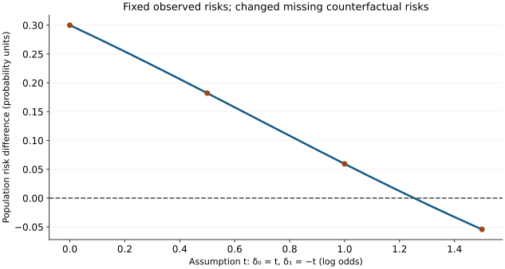

# A04 · Identify a causal target before fitting its posterior

**Prerequisites:** [generalised regression](./08_glm.md), [model checking](./10_model_checking.md), and [decision analysis](./12_decisions.md); conditional independence and total expectation in [Appendix 1](./appendix-01_probability.md).

**Objectives:** A04.O1 define causal estimands and identification assumptions; A04.O2 compute standardised identified contrasts; A04.O3 diagnose confounding, overlap, and unjustified adjustment.

## Would changing the action change the outcome?

A service offers optional training to staff handling difficult requests. Trained staff have a higher completion rate. Should everyone be offered training? The observed difference mixes any effect of training with differences between people who did and did not take it. Even a perfectly fitted Bayesian regression describes an observational distribution unless a causal argument connects that distribution to the proposed intervention.

There are three separate tasks. Define the intervention and population whose outcomes matter. Establish identification: express the causal target using quantities in an observable distribution under stated assumptions. Then estimate those quantities, perhaps with Bayesian models. Computation belongs to the third task. Its precision cannot substitute for the first two.

This bridge uses a binary intervention, a binary outcome, and a single pre-intervention covariate. It develops standardisation in a deliberately small synthetic setting where the causal mechanism is declared. More complicated longitudinal interventions, mediation, instruments, and interference need additional theory. The aim is to make the boundary between identification and posterior fitting visible, not to turn every regression into an intervention analysis.

## Define the intervention, outcome, population, and time

Let $A=1$ mean completing a specified training session before a service period, and $A=0$ mean no session. Let $Y=1$ indicate completion of a request within a stated deadline during that period. The potential outcome $Y(a)$ is the outcome that would occur under intervention $a$. Only one is observed for each unit.

For a target population with distribution $P_T$, the average treatment effect on the risk-difference scale is

$$\psi_T=E_T[Y(1)-Y(0)]
=E_T[Y(1)]-E_T[Y(0)].$$

This estimand is measured in probability units, or percentage points after multiplication by one hundred. It differs from an odds ratio, from the effect among those who were actually trained, and from the effect on a particular person. An average effect does not identify the joint distribution of the two potential outcomes or the fraction of people who personally benefit.

The intervention needs enough detail for potential outcomes to be meaningful. Different training durations or delivery formats may have different consequences. “Set training status to one” is ambiguous if observed status combines incompatible versions. Specify eligibility, assignment time, follow-up, and outcome measurement. For offers with incomplete uptake, the effect of offering training differs from the effect of completing it. A decision about offers should not silently inherit an estimate for completion.

## Assumptions that connect potential and observed outcomes

Let $Z$ denote pre-intervention request complexity. Identification by adjustment uses the following substantive conditions.

**Consistency:** the observed outcome equals the potential outcome under the intervention actually received, $Y=Y(A)$, with relevant intervention versions accounted for. **Conditional exchangeability:** within levels of measured baseline covariates, treatment assignment carries no further information about potential outcomes, $(Y(0),Y(1))\perp A\mid Z$. **Positivity:** both actions have positive probability in every covariate stratum with positive target weight. **No interference for this model:** one unit's outcome does not depend on other units' assignments.

These conditions are not outputs of the posterior sampler. Random assignment can justify exchangeability by design, subject to issues such as attrition and deviations from assignment. Observational adjustment requires a scientific argument that relevant common causes are measured and handled appropriately. Positivity can often be examined with data and design knowledge, although finite samples cannot perfectly distinguish rare exposure from structural impossibility.

If the target population differs from the source population, transport also requires that the relevant potential-outcome means are comparable after conditioning on the chosen covariates, and that those target covariates have support in the source. Supplying target weights is not enough to establish transportability. In the worked example the target and source are stipulated to share the same conditional response mechanism.

## Deriving the adjustment formula

Start with total expectation in the target population. Under transportability where needed, conditional exchangeability, consistency, and positivity,

$$\begin{aligned}
E_T[Y(a)]
&=\sum_z E_T[Y(a)\mid Z=z]P_T(Z=z)\\
&=\sum_z E[Y(a)\mid A=a,Z=z]P_T(Z=z)\\
&=\sum_z E[Y\mid A=a,Z=z]P_T(Z=z).
\end{aligned}$$

The final expression is the g-formula for this setting. For continuous covariates, replace the sum by an integral. Positivity ensures that each conditional observed mean requested by the formula is available in principle. A statistical model may still be needed to estimate it accurately from finite data.

The equation identifies marginal risks first, then takes their difference. In logistic regression one therefore predicts a probability under each intervention for every target covariate pattern and averages those probabilities. Averaging coefficients or applying the inverse logit after averaging linear predictors generally produces a different quantity. A treatment log-odds coefficient is not itself the average risk difference.

## Worked analysis: training and request complexity

Consider an original synthetic population with two equally common baseline strata: routine requests, $Z=0$, and complex requests, $Z=1$. Training probabilities are 0.2 and 0.8 respectively. For this example we **stipulate** that assignment is independent of potential outcomes within each stratum. The potential-outcome success probabilities are

$$\begin{array}{c|cc}
&P(Y(0)=1\mid Z)&P(Y(1)=1\mid Z)\\\hline
Z=0&0.10&0.30\\
Z=1&0.60&0.70
\end{array}$$

The names are merely labels in this synthetic example: complex requests are handled by a different workflow with a higher baseline completion probability. No empirical claim about real service complexity is implied. The target causal effect is

$$\psi_T=0.5(0.30-0.10)+0.5(0.70-0.60)=0.15.$$

To expose confounding, first use generating probabilities directly. Since the two strata are equally prevalent, total treatment prevalence is one half. Among trained units, eighty percent are in the high-baseline stratum; among untrained units, twenty percent are. Thus

$$P(Y=1\mid A=1)=0.2(0.30)+0.8(0.70)=0.62,$$

$$P(Y=1\mid A=0)=0.8(0.10)+0.2(0.60)=0.20.$$

The crude difference is 0.42, whereas the causal effect is 0.15. The crude comparison changes both treatment and the mixture of baseline strata. Standardisation holds the target covariate distribution fixed while changing treatment.

Now analyse the following fully specified illustrative dataset. Counts were chosen to make the population comparison transparent; they are not claimed to be a random sample generated by a particular seed.

| Baseline stratum | Training | Requests | Completions |
|---|---:|---:|---:|
| Routine | 0 | 80 | 8 |
| Routine | 1 | 20 | 6 |
| Complex | 0 | 20 | 12 |
| Complex | 1 | 80 | 56 |

Let $p_{az}=P(Y=1\mid A=a,Z=z)$. Assign independent $\operatorname{Beta}(1,1)$ priors to the four cell probabilities and independent binomial likelihoods conditional on the cell totals. This is a saturated outcome model. We condition on the assignment counts; no fitted propensity model is required for this particular posterior calculation because the identification assumptions have already been stipulated.

The four posteriors, in table order, are Beta(9,73), Beta(7,15), Beta(13,9), and Beta(57,25). Their means are respectively 0.109756, 0.318182, 0.590909, and 0.695122. Apply the identified target to every joint posterior draw:

$$\psi_T^{(s)}=0.5[p_{10}^{(s)}-p_{00}^{(s)}]
+0.5[p_{11}^{(s)}-p_{01}^{(s)}].$$

The posterior mean is 0.156319. Because the four posterior cells are independent in this model, its variance is one quarter of the sum of their beta variances, giving 0.005918 and SD about 0.07693. The posterior mean differs from the generating effect because of finite information and prior regularisation. An interval can be obtained by independent draws; a Normal interval is only an approximation to this bounded, generally non-Normal contrast.

For comparison, pooling all trained and untrained observations before a beta update gives a crude posterior mean difference $63/102-21/102=0.411765$. That is a valid estimate of a different observational contrast under its pooled model. Labelling it causal is the mistake. The adjusted analysis earns its interpretation from the declared assignment mechanism, not from being closer to the known synthetic answer.

## What an overlap failure changes

Suppose no complex requests are handled without training because policy prohibits it. The observed cell for $A=0,Z=1$ is empty for structural reasons. The target still asks what would happen to complex requests without training, but the observed distribution provides no such conditional outcome information.

With an independent Beta(1,1) prior, that cell's posterior remains its prior. The posterior distribution of the target is mathematically proper, yet its unsupported component is supplied by an assumption. A hierarchical regression may share information from other strata and reduce apparent uncertainty. That sharing can be useful extrapolation, but it does not restore nonparametric identification. A narrow interval from a rigid response surface may obscure the very uncertainty that matters.

One option is to change the estimand to a population with genuine overlap and explain the change. Another is to report sensitivity to extrapolation assumptions or seek data under a design that makes both actions possible. Restricting the target changes the question, so report who has been excluded. Very small but nonzero cell counts pose a related practical problem even when positivity holds in the population.

## Adjustment is a causal choice

A directed acyclic graph can summarise proposed causal relations. For the training example, a sufficient story has arrows $Z\to A$, $Z\to Y$, and $A\to Y$. Conditioning on the common cause blocks the noncausal path through baseline complexity. The graph encodes assumptions; it is not inferred solely from a regression coefficient.

Adding more covariates is not automatically safer. If $A\to C\leftarrow U\to Y$, the variable $C$ is a collider. Conditioning on it can associate treatment with an otherwise unrelated cause of the outcome, opening a noncausal path. For example, selecting only cases escalated either because of training-related reporting or because of hidden severity can create a misleading association within the selected subset.

If $A\to M\to Y$, the variable $M$ is a mediator. Adjusting for it can remove part of the total effect. A regression conditioned on the mediator does not automatically identify a direct causal effect either; mediator-outcome confounding and additional counterfactual assumptions must be addressed. The [back-door discussion in Pearl's overview](https://ftp.cs.ucla.edu/pub/stat_ser/r350.pdf) explains why adjustment sets depend on causal structure rather than predictive usefulness.

Temporal ordering helps distinguish baseline covariates from consequences of treatment, but it does not establish exchangeability alone. An excellent predictor measured before treatment can still fail to capture an unmeasured common cause. Conversely, a variable with modest predictive strength may be necessary for a defensible causal adjustment argument.

## Lab, checks, and communication

Lab 16, `labs/16_causal.py`, uses seed 1616. First enumerate the stipulated generator to verify the causal effect 0.15 and crude contrast 0.42. Then fit the exact four-cell beta model to the displayed table, draw joint probabilities, and compare simulated contrast moments with the analytic posterior mean and variance. Include the pooled observational contrast and the structural empty-cell scenario with a clearly labelled sensitivity analysis.

Simulation from the declared generator can test whether code recovers its known target over repeated datasets. It cannot establish that conditional exchangeability holds in an actual service. Posterior predictive checks assess the observed outcome model; they generally cannot distinguish causal stories that imply the same observed distribution. If using a logistic extension, preserve interactions needed for heterogeneous effects and standardise probabilities for each joint draw.

A useful report leads with the intervention, population, outcome horizon, effect scale, and assumptions. For this example: under the specified within-stratum assignment mechanism, the posterior mean improvement is about sixteen percentage points, with substantial uncertainty from the smaller cells. Applying that statement to a real service requires evidence supporting the same identification conditions. Good computation should make that condition easier to see.

## Retrieval and interpretation

Explain which step in the g-formula uses exchangeability, which uses consistency, and where positivity is needed. Describe why changing target weights changes the estimand. Then contrast an empty treatment cell, a poorly mixed sampler, and a misspecified outcome curve: each needs a different remedy.

The durable workflow is target, identification, estimation, and criticism. Bayesian inference provides coherent uncertainty conditional on the specified causal and statistical model. It does not make the causal assumptions consequences of the data.

## Sensitivity to selection within measured strata

The standardised posterior above conditions on exchangeability. Now hold the observed table and its likelihood fixed and ask how the answer changes if people selecting training differ in their potential outcomes even within $Z$. Keep the same intervention, follow-up and beneficial outcome $Y=1$. This is an original binary-outcome sensitivity model, not evidence that hidden selection exists or that a chosen magnitude is plausible.

Let $e_z=P(A=1\mid Z=z)$ denote the **source-population** propensity and $w_z=P_T(Z=z)$ the target weights. Here $e=(0.2,0.8)$ and $w=(0.5,0.5)$ are stipulated population quantities. Although the illustrative counts have these treatment fractions, we are not estimating propensities from those counts. Define $h(p,d)=\operatorname{expit}(\operatorname{logit}(p)+d)$ and specify two missing counterfactual risks:

$$q_{1z}=P(Y(1)=1\mid A=0,Z=z)=h(p_{1z},\delta_{1z}),$$

$$q_{0z}=P(Y(0)=1\mid A=1,Z=z)=h(p_{0z},\delta_{0z}).$$

Each $\delta$ is the missing-minus-observed log-odds difference for the **same potential outcome**, within a measured stratum. For example, $\delta_{0z}=1$ says that the odds of success without training among those who actually took training are $\exp(1)$ times those among controls. It does not say training multiplies anyone's success odds by that amount. A positive $\delta_0$ raises the untreated counterfactual risk among the treated, reducing the treatment contrast. A positive $\delta_1$ raises the treated counterfactual risk among the untreated, increasing the contrast. Selection of people with better potential success under either action into training corresponds to $\delta_0>0$ and $\delta_1<0$.

### Mix the missing and observed risks

By total expectation over source treatment status,

$$m_{1z}=E[Y(1)\mid Z=z]=e_zp_{1z}+(1-e_z)q_{1z},$$

$$m_{0z}=E[Y(0)\mid Z=z]=(1-e_z)p_{0z}+e_zq_{0z}.$$

If these source stratum means transport to the target population, the sensitivity estimand is

$$\psi_T(\delta_0,\delta_1)=\sum_z w_z\left[e_zp_{1z}+(1-e_z)h(p_{1z},\delta_{1z})-(1-e_z)p_{0z}-e_zh(p_{0z},\delta_{0z})\right].$$

This construction preserves observed $p_{az}$ and changes only missing risks. Both marginal risks remain in $[0,1]$, so the contrast is in $[-1,1]$. It is a risk difference; multiply by 100 for percentage points. Setting both shifts to zero gives $m_{az}=p_{az}$ and recovers the earlier standardisation formula for any interior $e_z$. That restriction equates the relevant potential-outcome means across treatment groups. By itself it need not make the joint pair of potential outcomes independent of treatment, which is more than this mean contrast requires.

For an interior risk, the derivatives make the sign convention checkable:

$$\frac{\partial\psi_T}{\partial\delta_{1z}}=w_z(1-e_z)q_{1z}(1-q_{1z})\geq0,\qquad
\frac{\partial\psi_T}{\partial\delta_{0z}}=-w_ze_zq_{0z}(1-q_{0z})\leq0.$$

Thus increasing $t$ along $\delta_0=t,\delta_1=-t$ can only lower each draw's contrast. These shifts summarise selection across treatment groups; they do not identify the prevalence or outcome effects of a particular unmeasured covariate.

<!-- VISUAL01:16 BEGIN -->

### Visual investigation: fixed observed risks allow different causal scenarios

To inspect the mixture formula without posterior sampling, fix one stratum at treatment fraction $e=0.4$ and observed risks $p_1=0.7$, $p_0=0.4$. Set the missing-outcome shifts to $\delta_0=t$ and $\delta_1=-t$. Predict whether increasing t can change the causal contrast while leaving these observed risks unchanged.

**Read the figure.** The horizontal coordinate is a stipulated log-odds shift. The vertical coordinate is a population risk difference in probability units. Points mark four assumptions along a continuous curve; they are neither posterior draws nor new observations. The zero line makes a sign change visible without declaring which assumptions are plausible.

| t | Risk difference |
|---:|---:|
| 0 | 0.300000 |
| 0.5 | 0.182131 |
| 1 | 0.059377 |
| 1.5 | −0.054265 |

**Mathematical connection.** Write $h(p,d)=\operatorname{logit}^{-1}(\operatorname{logit}(p)+d)$. The displayed contrast is $0.4(0.7)+0.6h(0.7,-t)-[0.6(0.4)+0.4h(0.4,t)]$. Increasing t lowers the missing treated risk and raises the missing untreated risk, so both changes lower the contrast. The bounded link keeps all component risks between zero and one.

**Original unscored exploration — predict, observe, explain.** Predict the derivative's sign before using the table, then explain why none of the observed-data likelihood terms changes. Transfer to uncertain observed risks: the nonlinear transformation must be applied draw by draw, not only to posterior means. These fixed-risk values are deliberately separate from Lab16's frozen posterior analysis. Their range is a sensitivity range, not a credible interval, and does not supply a probability model for unmeasured confounding.

<!-- VISUAL01:16 END -->

### A compatible full-data law and its observed likelihood

There is a complete joint distribution behind the mixtures. For each source stratum, draw $A$ with probability $e_z$. Conditional on $(A,Z)$, one possible coupling gives independent Bernoulli potential outcomes with means $(p_{0z},q_{1z})$ for controls and $(q_{0z},p_{1z})$ for treated people. Reveal only $Y=Y(A)$. This factorisation specifies a joint law; it does not claim that treatment temporally creates potential outcomes. Equivalently, first draw a baseline response type $U=(Y(0),Y(1))$ from its marginal distribution and then assign treatment conditional on $(U,Z)$ using Bayes' rule. The within-person association of potential outcomes is not learned here and is unnecessary for their mean difference.

For counts $s_{az}$ out of $n_{az}$, the observed-outcome likelihood conditional on cell totals remains

$$L(p;D)=\prod_{z,a}\binom{n_{az}}{s_{az}}p_{az}^{s_{az}}(1-p_{az})^{n_{az}-s_{az}}.$$

Including random treatment counts would add propensity factors proportional to $\prod_z e_z^{n_{1z}}(1-e_z)^{n_{0z}}$. Neither likelihood contains a shift. Independent Beta(1,1) priors therefore give exactly the same four beta posteriors in every scenario. The shifts are **unidentified assumptions specified by the analyst**, not parameters learned from these observed outcomes. Many such full-data laws share this observed likelihood but disagree about $\psi_T$. Predictive fit to this table cannot rank them. Choosing plausible shifts needs external subject knowledge, design information or validation data; our grid is illustrative, not calibrated to a real service.

This workflow follows the distinction between identification and estimation in [Hernán and Robins, Chapters 2–3 and Fine Point 14.2](https://miguelhernan.org/whatifbook). [VanderWeele and Arah's additive bias formulas](https://pmc.ncbi.nlm.nih.gov/articles/PMC3073860/) show how sensitivity calculations require assumptions about relationships involving unmeasured variables. [Li and colleagues' sensitivity-function method](https://pmc.ncbi.nlm.nih.gov/articles/PMC3202161/) provides a different approach based on propensity scores and corrected inverse-probability weighting. The particular bounded log-odds mixtures above are our declared model derived by total expectation; they are not those papers' formulas or a reproduction of their estimators.

## A numerical sensitivity surface

Lab16 keeps the original posterior calculation and applies each scenario to 80,000 shared independent draws of its four cell risks, using seed 1616. Here shifts are constant over $Z$. The entries below are **Monte Carlo posterior means of the risk difference**, conditional on the row and column assumptions. The largest mean MCSE in this grid is about 0.000272 risk units, or 0.0272 percentage points.

| $\delta_0$ for missing $Y(0)$ | $\delta_1=0$ | $\delta_1=-0.5$ | $\delta_1=-1$ |
|---|---:|---:|---:|
| 0 | 0.1563 | 0.1073 | 0.0658 |
| 0.5 | 0.1069 | 0.0579 | 0.0164 |
| 1 | 0.0626 | 0.0136 | -0.0279 |

The zero-shift entry agrees with the analytic standardisation mean above within simulation error. Apply the nonlinear transformation to each draw, not just to the four posterior means: in general $E[h(p,\delta)\mid D]\ne h(E[p\mid D],\delta)$.

| Fixed scenario $(\delta_0,\delta_1)$ | Mean | Central 90% interval | $P(\psi_T>0\mid D,\delta)$ | Probability MCSE |
|---|---:|---:|---:|---:|
| (0, 0) | 0.1563 | [0.0324, 0.2852] | 0.9833 | 0.00045 |
| (0.5, -0.5) | 0.0579 | [-0.0523, 0.1761] | 0.7934 | 0.00143 |
| (1, -1) | -0.0279 | [-0.1234, 0.0755] | 0.3118 | 0.00164 |

Along $(t,-t)$ the posterior mean tips between $t=0.5$ and $t=1$. At $(1,-1)$, missing $Y(0)$ odds are multiplied by about 2.718, while missing $Y(1)$ odds are multiplied by about 0.368. The posterior mean has changed sign, but substantial conditional uncertainty still allows benefit. An interval crossing zero, a mean crossing zero and a posterior probability crossing a chosen decision threshold are different criteria. None makes $t=1$ plausible by itself, and the explored grid is not a universal robustness guarantee.

### Conditional uncertainty and numerical error

For each fixed scenario, posterior SD and the 90% interval describe uncertainty in outcome risks propagated to the contrast. With $S$ independent draws, estimate mean MCSE by $s_\psi/\sqrt S$ and probability MCSE by $\sqrt{\hat\pi(1-\hat\pi)/S}$. The latter plug-in formula is unreliable if no draws, or all draws, exceed zero; a computed zero MCSE would not prove an exact tail probability. These iid calculations are not a substitute for effective sample size in an MCMC extension.

The grid's range describes different causal assumptions, not a posterior distribution over those assumptions. Do not combine rows into one credible interval unless an explicit external probability model for the shifts is supplied and justified. Likewise, this example conditions on stipulated propensities and target weights; uncertain estimated values would require additional propagation.

Shared draws preserve dependence between scenarios. For a change from zero to $(1,-1)$, form $D^{(s)}=\psi_T^{(s)}(1,-1)-\psi_T^{(s)}(0,0)$ and use $s_D/\sqrt S$. Adding the two mean variances as if the simulations were independent is incorrect for these paired draws. Lab16 records this paired MCSE as well as each conditional summary. Independent tests compare the moments with scalar beta-density quadrature and the sign probabilities with quadrature using a conditional beta CDF.

## Changing the population and losing overlap

Reweight the same source stratum potential-outcome means to $w=(0.8,0.2)$, retaining $e=(0.2,0.8)$ and the shifts. This target is assumed comparable within strata; changing weights alone cannot establish that assumption. The zero-shift mean becomes about 0.1880. Under $(1,-1)$ it becomes 0.0174, with central 90% interval [-0.0833, 0.1291] and benefit probability about 0.5900. The mean's sign differs from the equally weighted target. This is a change in the target population, not evidence that confounding disappeared. Do not replace source propensities by target weights: they play different roles in the mixtures.

For a separate **data-deletion experiment**, omit the high-stratum control observations while retaining the stipulated source population and its propensities. The base risk $p_{01}$ now has no likelihood information. Lab16 repeats $(1,-1)$ using three priors for that cell, marking each result as extrapolation:

| Prior = posterior for omitted $p_{01}$ | Scenario posterior mean | Central 90% interval |
|---|---:|---:|
| Beta(1,1) | 0.0326 | [-0.1638, 0.2969] |
| Beta(2,8) | 0.1768 | [0.0184, 0.3255] |
| Beta(8,2) | -0.0959 | [-0.1883, 0.0090] |

These are genuine posterior simulations conditional on priors and fixed shifts, not recovery of the deleted information. They complement the original zero-shift missing-cell example. Removing observations from a source with $e_1=0.8$ is different from a **structural policy** with $e_1=1$. Under that policy, $P(Y=1\mid A=0,Z=1)$ is not an observed conditional risk at all: a log-odds shift relative to it cannot solve the problem. Specify $E[Y(0)\mid Z=1]$ directly as a separate extrapolation assumption or restrict the target to supported strata. The lab transformation deliberately rejects propensity endpoints. Proper priors and finite shifts never restore nonparametric identification or positivity.

## Unscored changed-givens investigation

Use a different fictional training table: totals `[[45,35],[25,55]]`, successes `[[9,14],[13,39]]`, rows $Z=0,1$ and columns $A=0,1$. Assign independent Beta(2,3) priors. Stipulate source propensities $(0.35,0.65)$ and target weights $(0.6,0.4)$; the source assignment fractions need not equal the fixed illustrative sampling totals. Use seed 2616 and 60,000 posterior draws. This is optional unscored practice, with no supplied answer or new assessment ID.

1. Before computing, predict how $\delta_0=(0.4,0.8)$ and $\delta_1=(-0.6,-0.2)$ change the contrast relative to zero shifts. Derive the mixtures and explain each propensity factor. Use `cell_posterior` and `sensitivity_effect` in Lab16 to compare your prediction with posterior means, intervals and benefit probabilities.
2. Reuse the same cell draws under target weights $(0.3,0.7)$. Explain why a directional prediction for this population change needs information about stratum effects. Report the paired change and its MCSE.
3. Delete the $Z=1,A=0$ sample. Compare Beta(1,1) and Beta(3,7) priors for that cell only, retaining Beta(2,3) elsewhere. State which posterior stays equal to its prior. Distinguish this deletion from a source policy that prohibits controls in that stratum.
4. Write a short conclusion identifying what the observed likelihood learns, what each sensitivity assumption supplies, which result is conditional, and what outside evidence could change your assessment of plausible shifts. Do not describe a small MCSE as evidence for exchangeability.

## Exercises

Attempt [adv.causal.1](./exercises-questions.md#adv.causal.1), [adv.causal.2](./exercises-questions.md#adv.causal.2), and [adv.causal.3](./exercises-questions.md#adv.causal.3) in the [public question bank](./exercises-questions.md). Assessed datasets and protected reference analyses are separate from the teaching table above.

## Further reading

- Hernán and Robins, [Causal Inference: What If](https://miguelhernan.org/whatifbook), especially the initial treatment of counterfactuals, exchangeability, and standardisation.
- Pearl, [Causal inference in statistics: An overview](https://ftp.cs.ucla.edu/pub/stat_ser/r350.pdf), for graphical identification and adjustment.
