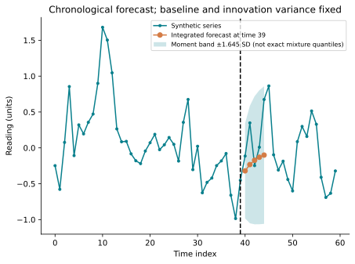
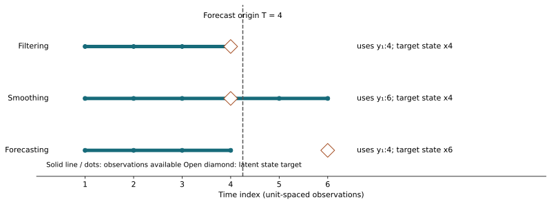

# A05 · Forecast dependent data using only the available past

**Prerequisites:** [continuous models](./04_continuous.md), [regression](./07_regression.md), and [predictive checking](./10_model_checking.md); total variance, Normal conditioning, and numerical integration in [Appendix 1](./appendix-01_probability.md), [Appendix 3](./appendix-03_linear_algebra.md), and [Appendix 4](./appendix-04_numerics.md).

**Objectives:** A05.O1 derive a dependent likelihood and multi-step forecast moments; A05.O2 propagate process and parameter uncertainty; A05.O3 design chronological validation without leakage.

## The next reading is not another exchangeable row

A sensor records a deviation from its operating baseline every hour. A positive deviation now makes a positive deviation next hour more likely. Shuffling the readings leaves their histogram unchanged but destroys information needed for forecasting. An independent Normal likelihood can describe the marginal histogram reasonably while missing the temporal behaviour that matters operationally.

The estimand in this bridge is the predictive distribution of a future reading at a specified horizon, conditional on everything available at a stated forecast origin. We also distinguish that observed reading from an underlying physical state when sensors are noisy. The conditioning information must be part of the target: a reconstruction that uses later readings is not the same distribution as a forecast made in real time.

We begin with an autoregression whose parameters are known, so the forecast equations can be checked exactly. Then we integrate uncertainty about persistence and finally add a latent state. These are small models, but they expose mistakes that remain consequential in large forecasting systems: omitted dependence, fixed-parameter intervals, future information in preprocessing, and treating an uncertain state as observed truth.

## A likelihood that preserves temporal order

For equally spaced measurements, a stationary first-order autoregression can be written

$$Y_t=\mu+\phi(Y_{t-1}-\mu)+\epsilon_t,
\qquad\epsilon_t\overset{\mathrm{iid}}{\sim}N(0,\sigma_\epsilon^2),
\qquad |\phi|<1.$$

The innovations are independent of the past. They are new shocks, not the marginal distribution of the readings themselves. Conditional on $y_0$ and parameters $\theta=(\mu,\phi,\sigma_\epsilon)$, the likelihood is

$$p(y_{1:T}\mid y_0,\theta)=
\prod_{t=1}^T N\{y_t;\mu+\phi(y_{t-1}-\mu),\sigma_\epsilon^2\}.$$

If the series is assumed to start in equilibrium, the full likelihood also includes

$$Y_0\mid\theta\sim N\left(\mu,\frac{\sigma_\epsilon^2}{1-\phi^2}\right).$$

Conditioning on the initial reading and modelling its stationary distribution are different analysis choices. Their distinction can matter for a short series, especially near a persistence boundary. Declare which likelihood is used. A long series reduces some initial-state effects but does not repair a false stationary model.

To obtain the stationary variance, subtract the mean and take variances using innovation independence: $V=\phi^2V+\sigma_\epsilon^2$. Therefore $V=\sigma_\epsilon^2/(1-\phi^2)$. Lag-$h$ correlation is $\phi^h$. A positive persistence gives long runs on the same side of the mean; negative persistence alternates signs. Neither is represented by treating the marginal variance as the innovation variance. The [Stan time-series guide](https://mc-stan.org/docs/stan-users-guide/time-series.html) develops autoregressive likelihoods and stationarity considerations.

Stationarity is a substantive assumption about a stable mean and covariance structure. A changing baseline, seasonal cycle, or intervention can violate it. A prior restricted to stationary parameters expresses that assumption; it does not demonstrate it. The limiting case $\phi=1$ with zero drift is a random walk with increasing forecast variance, not a stationary process with an inconvenient denominator.

## Derive the conditional forecast

Repeated substitution from the last available reading gives

$$Y_{T+h}-\mu=\phi^h(y_T-\mu)
+\sum_{j=0}^{h-1}\phi^j\epsilon_{T+h-j}.$$

Conditional on parameters and the observed past, the forecast is Normal, with

$$m_h(\theta)=\mu+\phi^h(y_T-\mu),$$

$$v_h(\theta)=\sigma_\epsilon^2\sum_{j=0}^{h-1}\phi^{2j}
=\sigma_\epsilon^2\frac{1-\phi^{2h}}{1-\phi^2}.$$

Each innovation affects the horizon through a different power of persistence. For stationary parameters the conditional mean approaches the long-run mean and the variance approaches the stationary variance. It does not shrink to zero with a longer forecast horizon. The formula conditions on the last state being observed exactly; a noisy sensor requires another uncertainty term below.

Forecasts at different horizons are correlated because they share future innovations. To forecast an aggregate across future times, generate whole trajectories or use the joint covariance. Adding marginal variances as if future readings were independent generally gives the wrong uncertainty. Likewise, an interval at each horizon is a set of marginal intervals, not automatically a simultaneous band for an entire trajectory.

## Worked forecast: a persistent sensor deviation

Suppose the baseline is known to be zero, persistence is 0.7, innovation SD is 0.4, and the current exact deviation is two sensor units. Then

| Hours ahead | Conditional mean | Conditional variance | Conditional SD |
|---:|---:|---:|---:|
| 1 | 1.400000 | 0.160000 | 0.400000 |
| 2 | 0.980000 | 0.238400 | 0.488262 |
| 3 | 0.686000 | 0.276816 | 0.526133 |

For the second horizon, substitute once to get $Y_{T+2}=0.7^2(2)+0.7\epsilon_{T+1}+\epsilon_{T+2}$. Its variance is $0.16(0.49+1)=0.2384$. The stationary variance is $0.16/(1-0.49)=0.313725$. A long-horizon forecast therefore remains uncertain even after the current excursion has faded from its mean.

The next-reading central Normal interval uses mean 1.4 and SD 0.4. A corresponding interval for the conditional expected reading would be a point when parameters and current state are fixed. The first describes an unobserved physical outcome; the second describes a known function of fixed inputs in this deliberately simple calculation. Later parameter uncertainty makes that function uncertain too.

This example also supplies a numerical reference for simulation. Draw many independent trajectories starting at two, with independent innovations at each step, and compare means and variances at the three horizons. Reusing one innovation for all future times would produce a different covariance structure and fail the variance calculation.

## Integrate parameter uncertainty once per trajectory

For unknown parameters, the desired distribution is

$$p(y_{T+h}\mid y_{0:T})=\int
p(y_{T+h}\mid y_T,\theta)p(\theta\mid y_{0:T})\,d\theta.$$

Its moments obey

$$E[Y_{T+h}\mid y]=E_\theta[m_h(\theta)],$$

$$\operatorname{Var}(Y_{T+h}\mid y)
=E_\theta[v_h(\theta)]+\operatorname{Var}_\theta[m_h(\theta)].$$

The second term is uncertainty about the conditional forecast mean. In general it is nonzero, and evaluating the first term at a posterior mean is not equal to averaging it. Powers of persistence make even the predictive mean nonlinear in parameters. A plug-in forecast can therefore change both the mean and variance.

For a transparent illustration, suppose a deliberately stipulated posterior places equal mass at persistence 0.4 and 0.9, with baseline zero, innovation SD 0.4, and current value two. At horizon two the component means are 0.32 and 1.62, and component variances are 0.1856 and 0.2896. The integrated mean is 0.97 and variance is $0.2376+0.4225=0.6601$. Plugging in mean persistence 0.65 instead gives mean 0.845 and variance 0.2276. This two-point distribution is a teaching device, not a posterior fitted to an unstated dataset.

To simulate a forecast, draw one parameter vector from its joint posterior, keep it fixed along a whole future path, and recursively draw innovations. Drawing a fresh persistence at every future step changes the model to one with time-varying random coefficients. Breaking posterior dependence among persistence, baseline, and innovation scale also changes the predictive distribution.

The forecast starts at the training boundary. Its widening bands describe future readings under the fitted persistence uncertainty; later observations cannot inform an earlier forecast. Re-read the horizon and noise definition before comparing these bands with latent-state uncertainty.

## An uncertain state is not a noisy parameter estimate

Suppose the sensor measures a latent deviation $X_t$ with independent measurement noise:

$$X_t=\phi X_{t-1}+\epsilon_t,\qquad
Y_t=X_t+\eta_t,\qquad\eta_t\sim N(0,r).$$

Given fixed parameters and past observations, let the current filtered state distribution be $X_T\mid y_{0:T}\sim N(m_T,P_T)$. Propagating one step gives state mean $a=\phi m_T$ and state variance $R=\phi^2P_T+\sigma_\epsilon^2$. The next observation has variance $R+r$. State uncertainty, process innovation, and new measurement noise are distinct terms.

If $m_T=2$, $P_T=0.25$, $\phi=0.7$, $\sigma_\epsilon^2=0.16$, and $r=0.09$, then $a=1.4$, $R=0.2825$, and observation forecast variance is 0.3725. Treating the filtered mean as an exact state would omit 0.1225. Treating a future latent-state interval as a reading interval would omit another 0.09.

After a new observation $y_{T+1}$ arrives, Normal conditioning gives

$$K=\frac{R}{R+r},\qquad
m_{T+1}=a+K(y_{T+1}-a),\qquad
P_{T+1}=(1-K)R.$$

This is the scalar Kalman update. It balances the predicted state with the new noisy reading. The gain is large when the reading is precise relative to state uncertainty. If parameters are themselves uncertain, the filtered distributions must also be integrated over those parameters; a fixed-parameter Kalman filter does not do that automatically.

Filtering conditions on observations through the current time. Smoothing also uses later observations to reconstruct earlier states. Smoothing is legitimate for retrospective reconstruction, but inserting smoothed historical states into a real-time forecast evaluation leaks future information. Labelling both outputs “estimated state” hides an essential difference in conditioning.

## Name the information set on the timeline

Let $x_t$ be a latent state and $y_t$ its noisy observation. The open diamond names the state being inferred; the line and dots name the observations available. At time four, filtering asks for $p(x_4\mid y_{1:4})$. Smoothing that same historical state using a record ending at six asks for $p(x_4\mid y_{1:6})$. Forecasting from origin four asks for $p(x_6\mid y_{1:4})$, or for $p(y_6\mid y_{1:4})$ after adding future measurement noise. Equal target dates alone do not make distributions comparable: their information sets must also match.

| Task | Latent target | Last observation permitted | Can use observations 5 and 6? |
|---|---|---:|---|
| Filter at 4 | State at 4 | 4 | No |
| Smooth state 4 after time 6 | State at 4 | 6 | Yes |
| Forecast two steps from 4 | State at 6 | 4 | No |

Smoothing is legitimate retrospective inference. Using its future observations to evaluate a forecast made at four would leak information. Any fitted scales, transformations and tuning choices used by that forecast must obey the same origin. In a model with predictors, additionally state whether each future predictor was known at four, forecast from past information, or supplied as an explicitly hypothetical scenario. Observed future weather is not automatically available to a historical forecast.

The [multisite prediction case C03](./case-03_air_quality.md) adds a second information boundary: which sites supply outcomes. Holding out a site and holding out future times ask different questions; neither can be inferred from the time axis alone. C03 already learns state and observation scales. Its historical omitted-site task uses contemporaneous information from other sites and permits retrospective state inference; it is not a future forecast. Read its declared prediction contract before interpreting a score. This timeline supplies a conceptual companion; it introduces no new case fit or evaluation result.

## Chronological evaluation and forecast leakage

A forecast experiment needs a table of origins, horizons, and information sets. For sixty observations indexed zero through fifty-nine, fit using indices zero through thirty-nine and forecast indices forty through forty-four. An expanding rolling-origin evaluation can then use origins thirty-nine through fifty-four for horizons one and five. At each origin, refit or update using only observations already available there. Earlier test outcomes may become training data at later origins because deployment would also have observed them by then.

A random holdout usually answers an interpolation or missing-value reconstruction question: both earlier and later neighbours may be present in training. That can be useful, but it does not estimate the performance of forecasting beyond the observed past. The same issue appears in preprocessing. Centring by the full-series mean, estimating seasonal effects from future periods, selecting a model using the final test block, or using revised covariates unavailable at the origin can all leak information.

Use training-only transformations at each origin, and state whether future predictors are known, forecast, or supplied by a scenario. Do not treat future weather observations, future demand, or a final revised economic indicator as known inputs to a historical forecast unless the deployment task really permits them. Hyperparameter selection needs an inner chronological validation scheme or a separate development period.

Score the predictive distribution with a proper score such as log predictive density, alongside interpretable errors and interval coverage. Average over posterior predictive densities before taking the logarithm; averaging log densities over parameter draws is a different quantity. Overlapping multi-step forecast errors are dependent, so an independent-row standard error for average performance can be misleading. Report the origins and horizon-specific sample sizes instead of implying that many overlapping errors are many independent experiments.

## Dependence affects information as well as forecasts

Positive serial correlation means neighbouring observations contain overlapping information about a long-run mean. Treating them as independent can make a mean estimate appear far more precise than it is. For a long stationary AR(1) series, away from boundary effects, the variance of the sample mean is approximately the marginal variance divided by the sample size, multiplied by $(1+\phi)/(1-\phi)$. This follows by adding the lag covariances in the variance of the sum. It is an approximation for a particular estimand, not a universal effective sample size for every model parameter.

Persistence near one also makes the distinction between a stable but slowly changing process and a nonstationary process difficult with a short record. A restrictive prior can noticeably shape long-horizon predictions even when one-step fitted values look similar. Compare the implied trajectories, equilibrium spread, and response to a shock under plausible priors. More exact computation cannot decide which historical stability assumptions are appropriate for the future deployment period.

## Lab and limits of the model

Lab 17, `labs/17_time_series.py`, uses seed 1717 to generate sixty stationary AR(1) readings with baseline zero, persistence 0.7, and innovation SD 0.4. Generate the initial value from its stationary Normal distribution. For a small inference experiment, keep baseline and innovation SD known, assign persistence a uniform prior on $(-0.95,0.95)$, and integrate its **conditional** likelihood given the first observation on a refined grid. This is a declared conditional analysis even though the generator starts in equilibrium.

Compare parameter-integrated and plug-in forecasts at horizons one through five, then run the stated rolling origins for horizons one and five. Verify the known-parameter forecast table independently by recursion or simulation. Include the fixed-parameter state-uncertainty calculation as a separate check. A demonstration using full-series centring should be labelled leaked and compared with the valid procedure; it need not improve the score on every random dataset to be an invalid protocol.

Inspect residual autocorrelation, changing variation, and runs of forecast errors. A simple AR(1) can miss seasonality, abrupt shifts, nonlinear dynamics, or outliers. A longer lag model is not automatically a remedy for every failure, and a flexible model still needs a defensible forecast protocol. This bridge provides exact anchors for dependence and uncertainty, not a complete forecasting system.

## Retrieval and interpretation

Explain why stationary variance exceeds innovation variance, why drawing new parameters at each simulated step changes the model, and why a smoothed state cannot be used as if it were known at a past forecast origin. A forecast statement is complete only when its horizon, available information, uncertainty components, and validation design are stated.

## Exercises

The [public question bank](./exercises-questions.md) contains [adv.time_series.1](./exercises-questions.md#adv.time_series.1), [adv.time_series.2](./exercises-questions.md#adv.time_series.2), and [adv.time_series.3](./exercises-questions.md#adv.time_series.3). Their assessed series and protected solutions are separate from this chapter's lab specification.

## Numerical precision for a simulated forecast variance {#numerical-precision-for-a-simulated-forecast-variance}

A trajectory simulation needs an error check for each reported feature. Suppose the exact forecast is a finite Normal mixture with component weights $w_j$, means $m_j$ and variances $v_j$. Let $m=\sum_j w_jm_j$ and $V=\sum_jw_j[v_j+(m_j-m)^2]$. Expanding $(Y-m)^4$ within a component, odd centred Normal moments vanish and the fourth moment is $3v_j^2$, giving

$$\mu_4=\sum_jw_j\{3v_j^2+6v_j(m_j-m)^2+(m_j-m)^4\}.$$

For N independent complete trajectories, each horizon provides N independent marginal outcomes. The sample mean has MCSE $\sqrt{V/N}$. The unbiased sample variance has exact variance $[\mu_4-(N-3)V^2/(N-1)]/N$ for N greater than one and a finite fourth moment. For large N this gives MCSE approximately $\sqrt{(\mu_4-V^2)/N}$. Dependence across horizons does not make the trajectories dependent, but it prevents treating all horizons as extra independent draws for one horizon's statistic. These errors describe simulation accuracy conditional on the specified mixture, not uncertainty in the model's calibration.

For an equal mixture of Normal(-1,1) and Normal(1,1), m=0, V=2 and $\mu_4=3+6+1=10$. With 100,000 trajectories, mean MCSE is about 0.004472 and large-N variance MCSE about 0.007746 in squared outcome units. A variance discrepancy must be compared with the second number, not with the error of the mean. Use this calculation as a reference for the two-point-parameter forecast exercise.

## Further reading

- Stan Development Team, [Time-series models](https://mc-stan.org/docs/stan-users-guide/time-series.html), for autoregressive and latent dynamic model definitions.
- Martin, Kumar, and Lao, [Bayesian Modeling and Computation in Python, chapter 6](https://bayesiancomputationbook.com/markdown/chp_06.html), for Bayesian time-series modelling and checks.
- Särkkä and Svensson, [Bayesian Filtering and Smoothing, second edition](https://users.aalto.fi/~ssarkka/pub/bfs_book_2023_online.pdf), for filtering, smoothing, and state-space methods beyond this scalar introduction.
