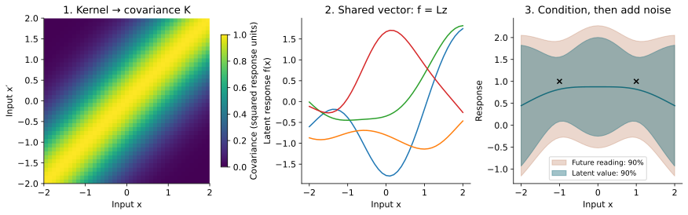
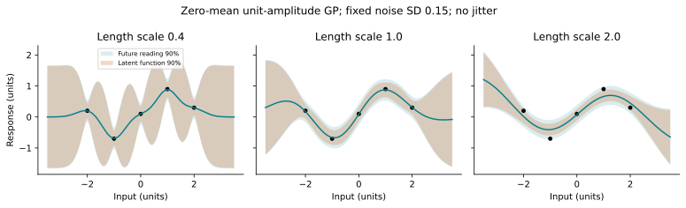

# A06 · Gaussian processes as priors over nonlinear functions

**Prerequisites:** [regression](./07_regression.md) and [model checking](./10_model_checking.md); multivariate Normal conditioning and stable linear algebra in [Appendix 3](./appendix-03_linear_algebra.md) and [Appendix 4](./appendix-04_numerics.md).

**Objectives:** A06.O1 derive GP predictive conditioning; A06.O2 implement stable latent and noisy predictions; A06.O3 critique kernels, regularisation, and computational scaling.

## What should a curve do between measurements?

A small calibration experiment measures a response at five input settings. A straight line misses the visible change in direction. A high-degree polynomial can pass near every reading but behave wildly beyond the measured range. We need a model of plausible functions, including uncertainty about unmeasured locations, rather than a curve chosen only for its visual fit.

A Gaussian process, or GP, defines a joint Normal distribution for function values at any finite collection of inputs. Its mean function states a baseline expectation; its covariance kernel states how deviations at different inputs relate. Once those functions and a Gaussian observation model are fixed, prediction follows from ordinary multivariate Normal conditioning. The calculation is exact conditional on those choices. Their appropriateness and uncertainty remain modelling questions.

The estimands here are a latent response $f(x_*)$, a future noisy measurement $Y_*$ at the same input, and joint predictions at several inputs. These are distinct distributions. A narrow interval for the latent mean curve is not an equally narrow interval for a new observation. The distinction extends the mean-versus-outcome distinction in linear regression.

## From finite regression to a function prior

Suppose a basis regression has $f(x)=h(x)^T\beta$ with $\beta\sim N(b,V)$. For any finite collection of inputs, the function values are jointly Normal, with

$$m(x)=h(x)^Tb,\qquad
k(x,x')=h(x)^TVh(x').$$

This shows how covariance expresses shared uncertainty about a curve. Nearby inputs may produce similar basis vectors and therefore correlated responses. A GP specifies a mean and kernel directly, allowing function classes richer than a fixed small basis while preserving consistent finite-dimensional Gaussian distributions.

Write

$$f\sim\operatorname{GP}(m,k),\qquad
Y_i=f(x_i)+\epsilon_i,\qquad
\epsilon_i\overset{\mathrm{iid}}{\sim}N(0,\sigma_n^2).$$

For every finite set of inputs, the matrix $K$ with entries $K_{ij}=k(x_i,x_j)$ must be symmetric and positive semidefinite. This means $c^TKc\ge0$ for every vector $c$, because that expression is a variance. A function that merely decreases with distance is not automatically a valid kernel in every input space. Repeated inputs can make the latent covariance singular without making the underlying GP invalid.

A common one-dimensional choice is the squared-exponential kernel

$$k(x,x')=a^2\exp\left[-\frac{(x-x')^2}{2\ell^2}\right].$$

Amplitude $a$ has outcome units; length scale $\ell$ has input units. Short length scales permit faster variation, whereas long length scales strongly couple distant inputs. This kernel encodes very smooth functions. A Matérn kernel allows rougher behaviour, and additive or periodic kernels encode other structures. Kernel choice is a scientific prior about functions, not a cosmetic plotting option. [Rasmussen and Williams, chapter 4](https://gaussianprocess.org/gpml/chapters/RW4.pdf) develops covariance constructions and their properties.

## Condition the joint Normal distribution

Let $X=(x_1,\ldots,x_n)$ denote training inputs and $X_*$ the requested prediction inputs. Define $K=K(X,X)$, $K_*=K(X,X_*)$, and $K_{**}=K(X_*,X_*)$. With independent measurement noise, let $C=K+\sigma_n^2I$. Then

$$\begin{pmatrix}Y\\f_*\end{pmatrix}
\sim N\left[
\begin{pmatrix}m_X\\m_*\end{pmatrix},
\begin{pmatrix}C&K_*\\K_*^T&K_{**}\end{pmatrix}\right].$$

Applying the conditional Normal result from Appendix 3 gives

$$E[f_*\mid y]=m_*+K_*^TC^{-1}(y-m_X),$$

$$\operatorname{Cov}(f_*\mid y)=K_{**}-K_*^TC^{-1}K_*.$$

Conditioning reduces latent uncertainty by an amount determined by covariance with the data and their measurement precision. For future independent measurements, add their noise variance to the diagonal of the conditional covariance. Off-diagonal entries remain important for differences, averages, and simultaneous trajectories. Drawing each prediction input independently from its marginal distribution would erase the function's joint structure.

The notation contains an inverse to state the mathematics, but a stable implementation uses Cholesky solves. Factor $C=LL^T$, solve $L u=y-m_X$ followed by $L^T\alpha=u$, and solve $L V=K_*$. Then the mean adjustment is $K_*^T\alpha$ and the latent covariance is $K_{**}-V^TV$. These steps avoid explicitly forming the inverse and reuse the factor for several predictions. The standard predictive calculation is given in [Rasmussen and Williams, chapter 2](https://gaussianprocess.org/gpml/chapters/RW2.pdf).

## Worked reference: two symmetric calibration readings

Use zero prior mean, amplitude one, length scale one, and measurement variance 0.25. Observe two readings, both equal to one, at inputs minus one and plus one. Predict the latent response at zero. The matrices reduce to

$$C=\begin{pmatrix}1.25&e^{-2}\\e^{-2}&1.25\end{pmatrix},
\qquad k_*=(e^{-1/2},e^{-1/2})^T,\qquad k_{**}=1.$$

By symmetry, multiplying the vector $(1,1)^T$ by $C$ multiplies it by $1.25+e^{-2}$. Therefore the predictive mean and latent variance are

$$m_*=\frac{2e^{-1/2}}{1.25+e^{-2}}=0.875645,$$

$$v_*=1-\frac{2e^{-1}}{1.25+e^{-2}}=0.468895.$$

A future reading at zero has variance $v_*+0.25=0.718895$. Its mean remains 0.875645 because measurement errors have mean zero. The prediction does not have to pass through one: both observations are noisy, and the prior still contributes. Nor is the interpolated latent response certain merely because two symmetric observations agree.

This example provides an algebraic check independent of a general matrix implementation. A Cholesky predictor should reproduce it to floating-point tolerance. It also checks whether the code adds noise at the correct stage. If the latent variance is reported as 0.718895, the code or label has already mixed latent and observed targets.

For a further check, with a single input and one reading $y$, amplitude one and measurement variance $s^2$, the latent mean at that same input is $y/(1+s^2)$ and variance is $s^2/(1+s^2)$. Repeated observations at the same input reduce measurement uncertainty, but repeated input coordinates themselves do not create additional latent degrees of freedom.

## Follow covariance into whole functions

The left panel evaluates the amplitude-one, length-one kernel on 41 inputs from −2 to 2. Diagonal entries are one; entries one input unit apart equal $e^{-1/2}=0.606531$, and entries two units apart equal $e^{-2}=0.135335$. A covariance square root $L$ satisfies $LL^T=K$. Draw one vector $z$ of independent standard Normals and compute the **whole** function vector $f=Lz$. The middle panel shows four such original prior draws (seed 6106); line segments join evaluated grid points and are not a simulation of every point on the continuum.

A separate vector is used for each curve, but the coordinates within a curve share the same matrix multiplication. Replacing this step by independent draws at every input would retain the marginal variance and erase the covariance. For example, two prior function values one unit apart have difference variance $2-2e^{-1/2}=0.786939$, whereas independent marginal draws would give two. This affects averages, extrema and crossings even when pointwise bands look identical. On the nearly singular dense grid the figure uses a symmetric eigenvalue square root, removing only negative roundoff eigenvalues; its reconstructed covariance is checked. A well-conditioned positive-definite matrix can instead use Cholesky.

The right panel conditions on the two readings in the preceding worked example: one at each of −1 and +1, both equal to one, with measurement variance 0.25. At zero, the mean is 0.875645, latent variance 0.468895 and future-reading variance 0.718895. The inner region is a collection of marginal 90% latent intervals; the outer region includes new independent measurement noise. Neither region promises 90% simultaneous coverage of an entire function. New noisy curve draws must add independent measurement noise to a shared latent draw, not replace that draw with independent latent marginals. [A13](./adv-13_gp_hyperparameters.md) adds unknown hyperparameters: each whole curve then shares one hyperparameter draw as well.

## Worked nonlinear example: length scale changes the story

Now use five original illustrative observations in dimensionless calibration units:

$$x=(-2,-1,0,1,2),\qquad y=(0.2,-0.7,0.1,0.9,0.3).$$

Set zero mean, amplitude one, and measurement SD 0.15. Compare fixed length scales 0.4, one, and two. These are sensitivity scenarios, not posterior samples of a length scale. Predict at 0.5, between observations, and at three, outside the observed interval.

| Length scale | Mean at 0.5 | Latent variance at 0.5 | Mean at 3 | Latent variance at 3 |
|---:|---:|---:|---:|---:|
| 0.4 | 0.437258 | 0.606260 | 0.011261 | 0.998109 |
| 1 | 0.665268 | 0.025622 | -0.088120 | 0.536856 |
| 2 | 0.431308 | 0.012830 | -0.327190 | 0.139398 |

Add 0.0225 to each latent variance for a new noisy observation. With the shortest length scale, even the half-unit gap is substantial relative to assumed correlation distance, so uncertainty between data remains large. At input three, correlation with the training observations is nearly gone and predictions approach the zero-mean, unit-variance prior.

The longest length scale produces more confident interpolation and extrapolation under a stronger smoothness assumption. Its negative extrapolated mean is not a discovered physical law. It follows from the chosen covariance acting on this small data pattern. Further away, a stationary squared-exponential kernel eventually loses correlation with the training data and returns to its prior mean. A meaningful trend beyond the observed range may require a nonzero mean function or a different kernel.

An attractive curve does not identify the length scale reliably from five noisy points. Compare prior draws on the actual input range before fitting. Ask how often those draws change direction, how quickly they vary, and how large their responses become. Those observable consequences are more interpretable than calling one numerical length scale “weakly informative.” Input rescaling requires consistent transformation of the length-scale prior.

The panels hold each length scale fixed. Compare interpolation, extrapolation and the latent band with the noisy-reading band; agreement at observed inputs does not imply agreement between them. These outputs do not integrate hyperparameter uncertainty.

## Kernel priors, regularisation, and fitted hyperparameters

Write kernel and noise settings as $\eta=(a,\ell,\sigma_n,\ldots)$. With these fixed, the predictive distribution above is analytic. With uncertainty about them,

$$p(f_*\mid y)=\int p(f_*\mid y,\eta)p(\eta\mid y)\,d\eta.$$

The resulting mixture is generally not Gaussian. Its covariance includes the average conditional covariance plus covariance of conditional means, just as in model averaging. Fitting a single best setting and conditioning on it omits the latter source of uncertainty.

Proper priors can be placed on positive scales through log coordinates, with centres and spreads chosen from the calibration units. For these dimensionless inputs, one possible sensitivity specification is $\log\ell\sim N(0,0.5^2)$, $\log a\sim N(0,0.5^2)$, with measurement SD either fixed by calibration or separately modelled. Those choices are illustrative beliefs about order-one variation, not universally appropriate defaults. Inspect their function draws before using them.

For Gaussian observations, integrating the latent training values gives the log marginal likelihood

$$\log p(y\mid\eta)=-\frac12(y-m_X)^TC^{-1}(y-m_X)
-\frac12\log|C|-\frac n2\log(2\pi).$$

The first term measures covariance-adjusted discrepancy and the determinant reflects the distribution's volume. Optimising this expression is often called empirical Bayes when used to choose hyperparameters. It is not integration over their posterior. Several combinations of short-scale variation, amplitude, and measurement noise can explain a small dataset similarly, so inspect sensitivity and possible multiple optima rather than trusting one optimiser run.

Regularisation is already present in the prior's coupling of function values. Strong smoothness can suppress noisy fluctuations but can also erase real abrupt changes. Very flexible short-scale priors can attribute noise to the latent function. The observation model and kernel therefore need joint criticism, including residual structure and held-out predictions designed for the intended interpolation or extrapolation task.

## Numerical jitter is not measurement noise

A Cholesky factor can fail when matrices are singular or numerically almost singular. Adding a small diagonal quantity, often called jitter, can stabilise floating-point calculations. This is a numerical perturbation, measured in squared outcome units. It should be documented and small enough that the requested predictions are insensitive to reasonable reductions.

Measurement noise is a scientific distribution of discrepancies between a latent function and observed readings. It belongs in the likelihood and in new-reading variance. Numerical jitter does not automatically belong in future observation noise. Large jitter can materially change inference, effectively introducing an extra noise assumption even if the code calls it a numerical trick.

Repeated or nearly repeated inputs are a useful diagnostic. With strictly positive measurement variance, the observation covariance can remain positive definite even when the latent kernel matrix is singular. For effectively noiseless duplicated inputs, consider whether the records represent repetitions, exact constraints, or inconsistent data before silently adding large jitter. Tiny negative conditional variances from rounding should prompt a tolerance-aware check; substantial negatives indicate an error or severe conditioning problem, not something to hide by unconditional clipping.

## Scalability changes the computation

A dense covariance matrix needs memory proportional to the square of the number of observations, and its Cholesky factorisation costs order $n^3$ operations. Storing one float64 matrix for ten thousand observations requires about eight hundred million bytes before other arrays and overhead. Repeating factorisations across hyperparameter proposals multiplies the work. Calling the model nonparametric does not make its computation free.

Inducing-variable methods, structured kernels, state-space representations for suitable kernels, and other approximations can reduce cost. Each exploits additional structure or changes the computational target. Their accuracy must be examined for the same predictive quantities that motivated the model. This bridge implements only the dense small-data calculation; it does not claim a scalable GP implementation. [Rasmussen and Williams, chapter 8](https://gaussianprocess.org/gpml/chapters/RW8.pdf) introduces computational approximations and their tradeoffs.

Non-Gaussian observation models, such as binary responses, also break the simple exact conditioning calculation for the posterior function. They typically need approximation or simulation. The kernel remains a prior, but a Gaussian prior does not force a Gaussian posterior under every likelihood. [Bridge A01](./adv-01_approximation.md) supplies the relevant distinction between optimisation and approximation accuracy.

## Lab and interpretation

Lab 18, `labs/18_gaussian_processes.py`, uses seed 1818 for any function draws. Implement prediction with Cholesky solves, reproduce the two-point algebraic reference, then evaluate the five-point dataset at the three length scales and two test locations above. Plot latent and noisy intervals with separate labels. Include nearly repeated inputs with positive observation noise, and vary explicitly recorded tiny jitter values to check numerical sensitivity.

Verify symmetry, finite values, and nonnegative conditional variances within a justified rounding tolerance. Compare the small reference with direct analytic algebra. A successful factorisation certifies neither kernel suitability nor extrapolation accuracy. A complete interpretation names the kernel, scale settings, whether their uncertainty was integrated, and the part of input space supported by observations.

## Retrieval and interpretation

Explain why a covariance kernel must be positive semidefinite, why a future reading has greater variance than its latent function value, and why a long length scale can produce confident but assumption-sensitive extrapolation. The GP is a coherent way to express uncertain nonlinear functions; its usefulness depends on a defensible prior and an honest prediction target.

## Exercises

The [public question bank](./exercises-questions.md) contains [adv.gaussian_processes.1](./exercises-questions.md#adv.gaussian_processes.1), [adv.gaussian_processes.2](./exercises-questions.md#adv.gaussian_processes.2), and [adv.gaussian_processes.3](./exercises-questions.md#adv.gaussian_processes.3). Their assessed matrices, code tasks, and protected feedback remain separate from this reading.

## Choose a next route

For the twenty-four-week extended route, choose the [penguin regression case C01](./case-01_penguins.md) after its regression/checking prerequisites, or the [sensor forecasting case C02](./case-02_sensor_forecasting.md) after A03/A05. Save an analysis plan before either worked reference. For computational GP depth, [A13](./adv-13_gp_hyperparameters.md) develops integrated hyperparameters and an empirical-Bayes comparison; it requires A06 and the numerical/linear-algebra appendices and adds an estimated 6–8 hours. The [advanced menu in the syllabus](./course-syllabus.md) gives other choices; chapter numbering is not a compulsory sequence.

## Further reading

- Rasmussen and Williams, [Gaussian Processes for Machine Learning, chapter 2](https://gaussianprocess.org/gpml/chapters/RW2.pdf), for Gaussian regression and the Cholesky algorithm.
- The same authors, [chapter 4](https://gaussianprocess.org/gpml/chapters/RW4.pdf), for kernels and their assumptions, and [chapter 8](https://gaussianprocess.org/gpml/chapters/RW8.pdf), for computation on larger datasets.
