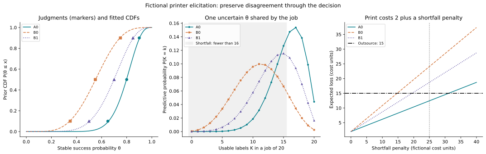
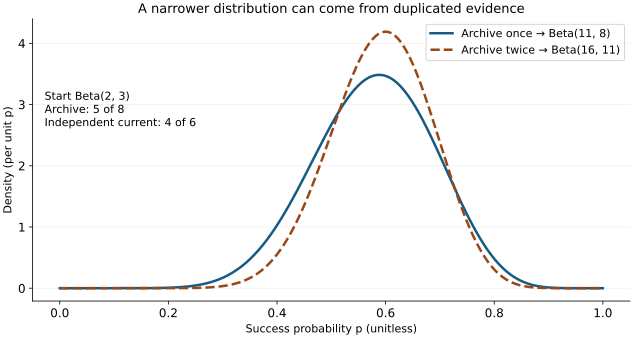

# A07 · From judgments to a defensible prior

**Prerequisites:** [conditioning and Bayes' rule](./01_bayes.md), [Beta–Binomial updating](./02_beta_binomial.md), [shared predictive uncertainty](./03_prediction.md), and [Monte Carlo error](./05_monte_carlo.md). Read these as L01–L03 and L05. You need probabilities, expectations and the distinction between a parameter and a future observation; the integral notation below describes averaging and does not require deriving special functions.

**Objectives:** A07.O1 Document quantity, population, horizon and information provenance. A07.O2 Fit probability judgments and return predictive implications for feedback. A07.O3 Explain disagreement and consequential prior sensitivity.

**Study plan:** allow 4–6 hours for reading, Lab 21, discussion and the four associated assessments. This is an unpiloted planning estimate for an optional continuation, after the prerequisites. It adds no requirement to the original core route.

## Start with a question someone could misunderstand

A small workshop needs 16 usable labels from a job that will print 20. Its planner says the printer “usually works.” The technician remembers several troublesome setups. Before translating either statement into a distribution, decide what “works” describes. Is a label usable if it is legible, correctly aligned, or both? Are these beliefs about one fixed setup, the mix of jobs over a year, or the fraction that will work in the next small job? These are different quantities.

Our original teaching scenario fixes printer P, stock S, alignment, and a usability test requiring legibility and alignment. Let $\theta$ be the stable probability that a label passes that test under this setup. The target is the next job of 20 labels before any maintenance or stock change. Conditional on $\theta$, model the labels as independent Bernoulli trials. The future count is $K\mid\theta\sim\operatorname{Binomial}(20,\theta)$.

This stable-probability assumption needs discussion before fitting. A jam that affects neighboring labels, changing ink, or a different stock can break it. A distribution on one unknown $\theta$ does not automatically model those mechanisms. If the actual target is a mix of setups, define setup-specific probabilities and their population distribution, or restrict the target. A fitted Beta curve cannot repair a wrong quantity definition.

All roles, judgments, dates, costs and observation counts in this reading are **fictional teaching inputs**. No interview, professional expert review or operational recommendation is represented here.

## Uncertainty about probability is not label-to-label variation

Suppose $\theta$ were known to be 0.8. Individual labels would still succeed or fail, and $K$ would vary between otherwise identical jobs. That is conditional sampling variation. A prior distribution describes our uncertainty about the unknown $\theta$. It does not mean that the printer physically samples a new probability before every label.

If $\theta\sim\operatorname{Beta}(a,b)$, write $s=a+b$, $\mu=a/s$ and $v=ab/[s^2(s+1)]$. Then

$$E[K]=n\mu,\qquad
\operatorname{Var}(K)=E[n\theta(1-\theta)]+\operatorname{Var}(n\theta)
=\frac{nab}{s(s+1)}+n^2v.$$

The first term averages the variation that remains at a fixed $\theta$. The second propagates uncertainty about the conditional mean. For two distinct label indicators $Y_i,Y_j$, conditional independence implies

$$\operatorname{Cov}(Y_i,Y_j)=\operatorname{Var}(\theta)=v.$$

This predictive dependence comes from a shared unknown. It is not evidence of a physical jam. Simulating the correct predictive distribution means drawing one $\theta$ for a whole simulated job, followed by its 20 Bernoulli outcomes. Drawing a new independent $\theta_i$ for every label produces independent marginal Bernoulli outcomes with probability $\mu$ and a Binomial count. The marginal prediction for one label is the same, but the joint prediction changes.

A 10th percentile for $\theta$ also differs from a 10th percentile for $K/20$. The latter includes finite-job variation and lives on 21 possible values. Ask the provider to explain in words which quantity their percentile describes before using the answer.

## Make a provenance record before fitting

The record below is part of the analysis, not paperwork to add after selecting a convenient curve. The lab preserves its machine-readable version alongside the calculations.

| Field | Fictional record |
|---|---|
| Quantity and units | $\theta$, probability of a usable label; dimensionless |
| Population and conditions | Printer P, stock S, alignment fixed; legible and aligned counts as success |
| Horizon | Next 20-label job before any maintenance or stock change |
| Providers | A: production planner; B: maintenance technician; both are scripted roles |
| Elicitation date | 2026-09-01, a fictional scenario date, not an execution timestamp |
| Information already used | Shared fictional setup memo with no numeric trial data; role-specific memories may overlap |
| Information excluded | Outcomes of the future job and the separate archive illustration below |
| Candidate family | Beta on $(0,1)$; no exact mass at failure or perfection |
| Judgments | A0 and B0 below, retained separately with their identities |
| Returned implications | Fitted CDF points, quantiles, residuals, optimizer status, 20-label predictions and losses |
| Revision | B1 retains a link to B0 and an explicit reason; A0 remains unchanged |
| Decision sensitivity | All packets, three penalty values, and an explicitly hypothetical mixture-weight sweep |

Two people can repeat the same information in different words. Their agreement is not automatically independent evidence. Preserve the shared memo identifier and any common inspections so that later updating can avoid counting them twice.

Before showing a fitted curve, ask each role for judgments separately. Explain “10th percentile 0.65” as assigning probability 0.10 to $\theta\leq0.65$, not predicting that 10% of labels have success probability 0.65. Ask for reasons and alternative conditions, not spurious decimal precision. The first packet A0 assigns the 10th, 50th and 90th percentiles of $\theta$ to 0.65, 0.80 and 0.90.

## Derive the fit and identify what it can establish

The Beta density and normalizer are

$$f(t\mid a,b)=\frac{t^{a-1}(1-t)^{b-1}}{B(a,b)},\quad
B(a,b)=\frac{\Gamma(a)\Gamma(b)}{\Gamma(a+b)},\qquad a,b>0.$$

Its CDF is the accumulated area

$$I_x(a,b)=\int_0^x f(t\mid a,b)\,dt.$$

For a continuous strictly increasing CDF, a quantile judgment $Q(p_j)=x_j$ is equivalent to $I_{x_j}(a,b)=p_j$. A0 therefore proposes three equations:

$$I_{0.65}(a,b)=0.10,\qquad I_{0.80}(a,b)=0.50,\qquad I_{0.90}(a,b)=0.90.$$

Two parameters generally cannot satisfy three equations exactly. Choose and disclose a discrepancy criterion. This lab uses equal-weight squared **CDF** residuals:

$$r_j(a,b)=I_{x_j}(a,b)-p_j,\qquad
S(a,b)=\sum_j r_j(a,b)^2.$$

The residuals have probability units. Minimizing squared errors between fitted and elicited *quantile values* would be a different fitting rule and could give different parameters. Giving one point a larger weight would also be a substantive choice; a median is not automatically three times as reliable as a tail judgment.

Optimize $u=\log a$, $v=\log b$ instead of unconstrained shapes. Substituting $a=e^u$, $b=e^v$ gives

$$\widehat{u},\widehat{v}=\arg\min_{u,v}
\sum_j [I_{x_j}(e^u,e^v)-p_j]^2.$$

Exponentiation enforces positive shapes throughout optimisation. It is a coordinate change for finding a minimum, so **no probability-density Jacobian belongs in this objective**. This is neither a posterior density on shapes nor an observation likelihood. The software estimates local changes numerically and searches from five declared starting pairs. Numerical bounds $-12\leq u,v\leq12$ prevent extreme arithmetic; they are guardrails, not elicited prior information. A boundary solution needs investigation.

The local interface `fit_beta_quantiles(values, probabilities) -> dict` returns shapes, fitted CDF values and quantiles, both kinds of residuals, the sum of squared CDF residuals, and the optimizer's message/status/evaluation count. It retains every starting fit. A successful termination means a numerical stopping rule was met; it does not establish a global minimum, a defensible family, an accurately represented belief, or truth about the printer. There is no sampling-based standard error for these fitted shapes in this exercise: the three judgments are not a random sample of observed proportions.

## Return the discrepancies to the provider

For A0 the fitted shapes are approximately $a=13.421901$, $b=3.633954$.

| Requested percentile | Elicited value | Fitted CDF at that value | CDF residual: fitted minus requested | Fitted quantile |
|---:|---:|---:|---:|---:|
| 0.10 | 0.65 | 0.092262 | −0.007738 | 0.655548 |
| 0.50 | 0.80 | 0.506860 | +0.006860 | 0.798315 |
| 0.90 | 0.90 | 0.892334 | −0.007666 | 0.902749 |

For example, the curve assigns about 9.23%, rather than 10%, below 0.65. The fitted 10th percentile is about 0.656. These are two descriptions of the same mismatch, in different units. Return both before deciding whether the approximation is useful.

The lab flags a maximum absolute CDF residual greater than 0.025, optimizer failure, or a boundary fit as requiring further feedback. This tolerance is a declared teaching screen, not a universal acceptability threshold. Smaller residuals still require substantive feedback. A returned `feedback_required=False` means only that this automatic screen found none of its specified problems.

Distinguish three situations:

1. **Unsupported or contradictory input.** Interior values paired with probabilities 0 or 1 cannot be matched exactly by a finite positive-shape Beta. Duplicate values with different CDF probabilities, decreasing probabilities, unsorted values, endpoints, NaNs, or two-dimensional stacks of provider packets are rejected. The helper requires at least two strictly increasing interior values and probabilities. It does not silently sort, clamp, average or reinterpret the judgments. Its deliberately narrow interface also rejects redundant equal-CDF entries; preserving these in a richer elicitation record is a separate task.
2. **Coherent judgments with poor family fit.** Values $(0.10,0.11,0.90)$ at probabilities $(0.1,0.5,0.9)$ can describe an increasing CDF. The lab retains this as a separate stress example, for which its best multistart Beta fit still misses a CDF probability by about 0.10. A convergence message does not remove that discrepancy. Discuss a more flexible family or the meaning of the judgments; do not call the input logically impossible just because a Beta fits badly.
3. **Disagreement between coherent packets.** Different providers may each give valid ordered judgments for the same target. Fit them separately and report the conflict. Treating their statements as extra independent Bernoulli observations silently changes both the information model and their meaning.

## A worked prediction for the job

Integrate the Binomial count mass over the fitted Beta:

$$\begin{aligned}
P(K=k)&=\int_0^1 {n\choose k}t^k(1-t)^{n-k}f(t\mid a,b)\,dt\\
&={n\choose k}\frac{B(a+k,b+n-k)}{B(a,b)},\qquad k=0,\ldots,n.
\end{aligned}$$

For A0 and $n=20$, the predicted mean is 15.7388 usable labels. The variance decomposition is $3.1676+3.7144=6.8820$ labels squared: the second term, uncertainty about the conditional mean, matters. Plugging in $E[\theta]$ would give variance about 3.3533 and discard shared uncertainty.

The predictive 10th/50th/90th count quantiles are 12, 16 and 19. Discrete quantiles are defined here as the smallest count whose cumulative probability reaches the requested probability. They do not imply exact 10% tail masses. Summing $P(K=k)$ from $k=0$ through 15 gives

$$P(K<16)=0.417959.$$

Notice the threshold: “at least 16” fails at 15, not at 16. The fitted median of $\theta$ near 0.8 does not imply that this job is nearly certain to supply 16 labels.

These are **prior predictive implications for feedback**. No actual job has been observed. A plausible predictive distribution is not an empirical goodness-of-fit result. If a provider finds the predicted shortfall surprising, revisit the quantity, their judgments and the conditional Binomial model. Do not simply narrow the prior until the prediction looks reassuring.

## Preserve disagreement and the revision trail

The technician's initial packet B0 assigns $(0.35,0.55,0.75)$ to the same three percentiles. In the scripted feedback conversation, B notices that memories of an unaligned setup influenced the answer. B offers B1, $(0.50,0.70,0.85)$, for the aligned setup. This is an illustrative clarification before future outcomes, not Bayesian updating with new data. Preserve B0, label B1 as a revision, and record the reason. In a real process the analyst could not claim this revision without obtaining and recording it.

| Packet | Status | Fitted $a$ | Fitted $b$ | Predictive mean of $K$ | $P(K<16)$ |
|---|---|---:|---:|---:|---:|
| A0 | Initial planner packet | 13.421901 | 3.633954 | 15.7388 | 0.417959 |
| B0 | Initial technician packet, retained | 5.360219 | 4.414264 | 10.9678 | 0.883668 |
| B1 | Scripted clarification of B0 | 7.615999 | 3.472578 | 13.7367 | 0.668551 |

B1 still disagrees materially with A0. Neither a small residual nor a more familiar job description resolves whose knowledge should govern. The result JSON retains the full fitted implications for all three packets. B0 does not disappear because it is inconvenient. Reasons to reopen the process might include ambiguity in the setup definition, overlapping evidence, a provider's experience being less relevant to this population, or an omitted failure mechanism. They require substantive investigation.

If a group chooses to discuss a common distribution, record what changed and whose beliefs it is intended to represent. Multiplying fitted densities usually makes a sharper distribution; without an information model it is not justified by two people agreeing. A linear mixture is another possible sensitivity construction, but its weights are assumptions, not measured credibility or posterior provider probabilities.

## Carry the disagreement into an action

Declare the loss before comparing priors. In fictional cost units, printing costs 2 plus a penalty of 25 if fewer than 16 labels are usable. Outsourcing costs 15 and is stipulated to guarantee enough labels. These are preferences and consequences, not facts learned by fitting a prior. If outsourcing can fail, its uncertainty belongs in a richer loss model.

$$L(\mathrm{print},K)=2+25\,1\{K<16\},\qquad
L(\mathrm{outsource},K)=15.$$

Expected-loss minimization selects print when

$$2+25P(K<16)<15\quad\Longleftrightarrow\quad P(K<16)<0.52.$$

At equality both actions tie. Do not optimise the mean number of labels as a substitute: the loss is driven by a threshold event.

| Packet | Expected print loss | Expected outsource loss | Lower-loss action under these assumptions |
|---|---:|---:|---|
| A0 | 12.448978 | 15 | Print |
| B0 | 24.091711 | 15 | Outsource |
| B1 | 18.713778 | 15 | Outsource |

This is consequential sensitivity: the declared plausible packets change the action. A reasonable report would explain the unresolved conflict and identify which information could clarify it. It would not select A0 because its answer is cheaper. An unchanged action across a few priors would be limited robustness over that declared set, not evidence that the priors are all true.

Preference uncertainty matters too. The lab repeats the calculation at penalties 15, 25 and 40 while holding each prior fixed. For B1, printing is preferred at 15 but outsourcing at 25; for A0 the switch occurs between 25 and 40. This separates uncertainty about the printer from uncertainty about how much a shortfall matters.

For a transparent pooling sensitivity, suppose a hypothetical prior is $w f_{A0}(\theta)+(1-w)f_{B1}(\theta)$. Integrals are linear, so its shortfall probability is

$$w(0.417959)+(1-w)(0.668551).$$

At $w=0.25,0.50,0.75$, this gives approximately 0.605903, 0.543255 and 0.480607. The action switches to print only above $w\approx0.592801$. An equal mixture therefore selects outsource. This calculation exposes how much an unelicited weight can matter; it does not recommend 50:50 pooling. To simulate this mixture correctly, draw the component and $\theta$ once per job, not once per label. Averaging fitted shape parameters is generally a different distribution.

The SVG supplies a title and description and distinguishes packets by line styles and markers as well as colour. The displayed shortfall band includes counts 0–15. The lab result contains every plotted count probability and the numerical loss comparisons.

## Audit information reuse before a likelihood is added

Here is a separate exact illustration, **not** the origin of A0/B0/B1. Start with $\operatorname{Beta}(2,2)$. A fictional archive records 8 usable labels out of 10 under the same setup. Updating once gives $\operatorname{Beta}(10,4)$. If you now call that posterior “the prior” and put the same archive into the likelihood again, you get $\operatorname{Beta}(18,6)$.

The second calculation has counted the archive twice. It changes the mean from $5/7\approx0.7143$ to $3/4=0.75$ and reduces the variance from about 0.01361 to 0.00750. Changing a label from “posterior” to “prior” does not create new information.

There are two coherent bookkeeping routes: start at Beta(2,2) and use the archive likelihood once, or start at Beta(10,4), record that it already incorporates `fictional_archive_01`, and exclude that archive from subsequent likelihoods. If a distinct new inspection records 4 usable labels out of 5, the latter route gives Beta(14,5). Reusing the archive as well would incorrectly give Beta(22,7). Exchangeability across inspections remains an assumption to justify even when the records are distinct.

Judgment packets often have less explicit information content than this exact example. Their fitted concentration $a+b$ can be useful for describing spread and conjugate updating, but it is not a count of independent labels the provider has observed. Do not manufacture a fictitious trial sample from fitted shapes. When a provider has already seen the current observations, document the overlap and choose a model or analysis sequence that accounts for it. A sensitivity analysis may reveal the consequence, but cannot retroactively certify independence.

<!-- VISUAL01:17 BEGIN -->

### Visual investigation: information enters once even when a curve gets narrower

Use a separate provenance example, not a reconstruction of the elicitation scenarios above. Begin at Beta(2,3). An archive records five successes among eight items, and an independent current batch records four among six. Predict whether feeding the archive into the likelihood again after it already informed the prior adds information.

**Read the figure.** Both axes concern the same probability parameter and its density. The dashed result is narrower, but its label marks an invalid reuse of the same evidence. Curve sharpness alone cannot establish a legitimate increase in information.

| Step / provenance | Beta parameters |
|---|---|
| Base prior, before archive | (2, 3) |
| Archive added once: 5 successes, 3 failures | (7, 6) |
| Independent current batch: 4 successes, 2 failures | (11, 8) |
| Incorrect extra use of the same archive | (16, 11) |

The legitimate posterior mean is 0.578947 with variance 0.0121884. Reusing the archive produces mean 0.592593 and variance 0.00862238. The narrower second density is a consequence of duplicated likelihood factors, not additional observations.

**Mathematical connection.** Correct updating is proportional to $p_0(p)L_{archive}(p)L_{current}(p)$. The erroneous path uses $L_{archive}(p)^2$, adding the same successes and failures twice. Conditional independence of genuinely distinct batches justifies multiplication; a second copy of a record is not an independent batch.

**Original unscored exploration — predict, observe, explain.** Replace the current batch with a genuinely independent second archive-sized batch that happens to have the same counts. Predict the algebra, then explain why identical counts can legitimately add information when their provenance differs. Transfer to expert elicitation: document which datasets the expert saw before deciding what can enter a subsequent likelihood. This conjugate example does not claim the book's elicited priors were formed from counts.

<!-- VISUAL01:17 END -->

## Complete the process, then communicate its limits

For this worked process, a defensible memo would contain the following sequence:

1. Define usability, setup, population and the next-job horizon; disclose conditional independence and stability.
2. Record A0/B0 separately with roles, information sources and date before numerical fitting.
3. Validate support and ordering; fit the declared family and discrepancy; retain all starts and numerical status.
4. Return the fitted quantiles, CDF mismatches and observable 20-label predictions; record the scripted B0→B1 clarification without erasing B0.
5. Audit information already used before introducing any new likelihood. No future job outcomes have been used here.
6. Evaluate the declared loss for all retained packets and the declared sensitivity scenarios. Report the action disagreement rather than claiming consensus.
7. State the next unresolved questions: which experience matches this setup, whether label outcomes really share one stable probability, and whether the shortfall cost and outsourcing guarantee are defensible.

The scientific conclusion is conditional: under this Binomial model and loss, the action depends on which retained packet is used. Numerical agreement between independent implementations establishes that the stated calculations were carried out correctly. It cannot establish genuine expert authority, adequacy of a fictional scenario, effectiveness of a short elicitation course, or optimality of the decision in a real workshop.

## Lab and further practice

Use [Lab 21](../../downloads/bayesian/labs/21_prior_workflow.py); its percent-format cells are the authoritative notebook source. Run `.venv/bin/python -B labs/21_prior_workflow.py` from the repository root. Read the [finite result record](../../downloads/bayesian/artifacts/results/21_prior_workflow.json), particularly `metrics.packets`, `metrics.coherent_poor_beta_fit`, `metrics.mixtures`, `metrics.information_reuse` and `checks`. The lab has no external data download or stochastic fit. Its seed field preserves the shared lab interface; it is not evidence of Monte Carlo sampling.

The independent checks integrate a density with a separately calculated gamma normalizer to verify CDF values and every predictive count probability. Expected loss is also checked by summing the state-specific losses over counts. The focused test suite adds exact polynomial-CDF and sequential-prediction references, invalid-input checks and optimizer-status checks. Integration tolerances measure numerical agreement, not trust in a judgment provider.

Before changing code, predict what happens to each variance term as the job grows. Then alter one coherent packet, retain its predecessor and explain which predictive claim changes. Construct an invalid packet separately and explain why it must be clarified before fitting. Finally, state a loss range under which the action is or is not stable. These explorations are distinct from the four optional assessed tasks in the [question bank](./exercises-questions.md): `adv.prior_workflow.1`–`.4`, covering uncertainty versus variation, conflicting fits, action sensitivity and information reuse. Their assessed situations and givens are separate from this worked example.

## Sources and scope

Garthwaite, Kadane and O'Hagan describe elicitation as an iterative preparation, judgment, fitting and feedback process and distinguish faithful representation from objective truth. Those ideas motivate the record and feedback loop here. See their author-hosted [Statistical Methods for Eliciting Probability Distributions](https://www.stat.cmu.edu/tr/tr808/tr808.pdf), especially sections 1.1–1.3.

The official [SHELF manual, `fitdist`](https://oakleyj.r-universe.dev/SHELF/SHELF.pdf) describes fitting cumulative probability judgments by least squares and returning discrepancies. This lab implements its own small SciPy example; it does not depend on R or reproduce a manual exercise. The printer story, judgments, revision, loss model and all practice prompts here are original teaching constructions. These sources support methods and process, not a claim that this module has validated learning outcomes or qualifies a reader as a professional elicitor.
