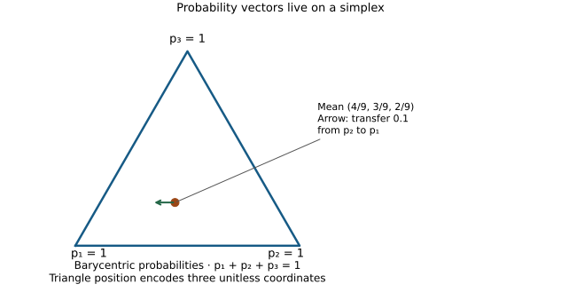
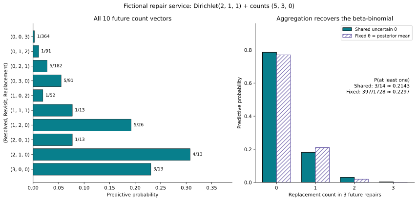

# A08 · Categorical updating and prediction

**Prerequisites:** the [beta-binomial model](./02_beta_binomial.md), [posterior prediction](./03_prediction.md), [rates and continuous measurements](./04_continuous.md), and probability notation in [Appendix 1](./appendix-01_probability.md). The gamma-function step is developed here. This optional continuation takes an estimated 4–6 hours including the lab and practice; the estimate has not been piloted.

**Objectives:** A08.O1 Derive Dirichlet updating and predictive counts. A08.O2 Distinguish shared uncertain probabilities, batch heterogeneity and types of zero.

## A repair can have more than two outcomes

A fictional service records one status for each job seven days after completion: **resolved**, **revisit**, or **replacement**. A replacement takes precedence if both a revisit and replacement occur; otherwise a revisit takes precedence over resolved. Every completed job has exactly one recorded status. These coding rules matter: three overlapping binary indicators would require a different likelihood.

Eight comparable jobs give counts $(5,3,0)$ in that order. A planner needs the distribution of replacement demand among the next three jobs. Zero observed replacements is a statement about a small sample. It does not establish that replacement is impossible.

Let $\theta=(\theta_R,\theta_V,\theta_P)$ be the probabilities under unchanged service conditions. The estimand is this common probability vector; the prediction target is a vector of future job counts. We assume jobs are conditionally independent given $\theta$, measured at the same seven-day horizon, and comparable in case mix and working conditions. These assumptions can fail if, for example, a new supplier changes the jobs. All data, prior choices and operational details here are original fictional teaching givens, not service evidence.

## The simplex and the categorical likelihood

For $K$ exclusive, exhaustive categories, the simplex is

$$\Delta_{K-1}=\{\theta: \theta_j\geq0,\ \sum_{j=1}^K\theta_j=1\}.$$

It has $K-1$ free coordinates: for three categories, choose the first two and set $\theta_3=1-\theta_1-\theta_2$. Positive probabilities live inside a triangle, not throughout a three-dimensional cube. Increasing one probability leaves less mass for the others. A category label is a name, not an ordered numerical response; assigning codes 1, 2, 3 does not make their average meaningful.

If $X_i=j$, the categorical likelihood contribution is $\theta_j$. For counts $y_j=\sum_i1\{X_i=j\}$ and $n=\sum_j y_j$,

$$p(y\mid\theta)=\frac{n!}{\prod_j y_j!}\prod_j\theta_j^{y_j}.$$

The coefficient counts distinct ordered sequences with those counts. It is constant in $\theta$, so it drops out of a posterior kernel. It must return when computing the probability of an unordered count vector. Conditional independence does not assert that the unknown probabilities themselves are independent.

<!-- VISUAL01:18 BEGIN -->

### Visual investigation: three probabilities share one constrained space

Before count prediction, inspect the space in which a three-category probability vector lives. A new Dirichlet(4,3,2) illustration has mean $(4/9,3/9,2/9)$. Predict what must happen to the other coordinates if the first probability increases by 0.1.

**Read the figure.** The triangle uses barycentric coordinates: each corner assigns probability one to its named category, an edge assigns zero to the opposite category, and interior positions assign positive probabilities to all three. These are unitless probability coordinates, not future counts or ordinary independent horizontal/vertical parameters. The arrow transfers 0.1 from category two to category one, keeping the third fixed.

| Probability triple | Sum | Interpretation |
|---|---:|---|
| (4/9, 3/9, 2/9) | 1 | Dirichlet mean |
| (4/9 + 0.1, 3/9 − 0.1, 2/9) | 1 | Valid movement along the simplex |
| (0.5, 0.4, 0.3) | 1.2 | Invalid probability vector |

**Mathematical connection.** With total concentration nine, $\operatorname{Cov}(p_1,p_2)=-4(3)/(9^2(10))=-12/810$. Negative covariance here follows from the Dirichlet joint model and the sum constraint; separately sampled marginal betas generally fail to produce a valid joint vector. For six future trials, category one's count variance is 2.222222 under Dirichlet-multinomial prediction versus 1.481481 under the plug-in multinomial. The count vector has a fixed integer total six; that is a different space from the probability simplex.

**Original unscored exploration — predict, observe, explain.** Predict whether increasing the first probability requires each other probability to fall. Observe that only their sum must fall by 0.1; the arrow shows one possible allocation. Explain why the marginals alone do not determine the joint simulation. Transfer to merging categories two and three: identify the resulting beta parameters before calculating a future count. Categories are assumed exhaustive and mutually exclusive.

<!-- VISUAL01:18 END -->

## Why the Dirichlet density has gamma functions

For $a>0$, define

$$\Gamma(a)=\int_0^\infty t^{a-1}e^{-t}\,dt.$$

Integration by parts gives $\Gamma(a+1)=a\Gamma(a)$, and $\Gamma(1)=1$, so $\Gamma(m)=(m-1)!$ for positive integers $m$. Gamma functions extend the factorial calculation to positive noninteger shapes.

Take $K$ independent gamma variables $G_j$ with shape $\alpha_j>0$ and rate one. Put $S=\sum_jG_j$ and $\theta_j=G_j/S$. In coordinates $(S,\theta_1,\ldots,\theta_{K-1})$, with the last probability determined by the others, the absolute Jacobian is $S^{K-1}$. Write $A=\sum_j\alpha_j$. The joint density becomes

$$\frac{e^{-S}S^{A-K}}{\prod_j\Gamma(\alpha_j)}
\prod_j\theta_j^{\alpha_j-1}\,S^{K-1}
=\frac{e^{-S}S^{A-1}}{\prod_j\Gamma(\alpha_j)}
\prod_j\theta_j^{\alpha_j-1}.$$

Integrating out $S$ contributes $\Gamma(A)$. Thus, with respect to ordinary volume in the first $K-1$ simplex coordinates,

$$p(\theta\mid\alpha)=\frac{1}{B(\alpha)}\prod_j\theta_j^{\alpha_j-1},\qquad
B(\alpha)=\frac{\prod_j\Gamma(\alpha_j)}{\Gamma(A)}.$$

This also derives the simplex integral $\int_{\Delta_{K-1}}\prod_j\theta_j^{\alpha_j-1}d\theta=B(\alpha)$. For $K=2$, it is the usual beta normalizer. The density and positive-shape domain agree with [SciPy's Dirichlet definition](https://docs.scipy.org/doc/scipy/reference/generated/scipy.stats.dirichlet.html).

Write $\alpha=Aq$, where $q$ sums to one. The vector $q$ is the prior mean and $A$ controls concentration around it. At fixed $q$, increasing $A$ reduces variance. A shape below one permits density that grows near a boundary; it does not create a point mass at zero. $\operatorname{Dirichlet}(1,1,1)$ is uniform in the two free coordinates of a triangle. Its individual marginals are Beta$(1,2)$, so three uniform marginal priors do not describe it.

## Updating and the full covariance

Multiplying likelihood and prior adds exponents:

$$p(\theta\mid y)\propto\prod_j\theta_j^{\alpha_j+y_j-1},\qquad
\theta\mid y\sim\operatorname{Dirichlet}(a),\quad a=\alpha+y.$$

Below, $T=\sum_j a_j=A+n$. The posterior mean is a weighted average:

$$E[\theta_j\mid y]=\frac{a_j}{T}
=\frac{A}{A+n}\frac{\alpha_j}{A}+\frac{n}{A+n}\frac{y_j}{n},\quad n>0.$$

The prior shapes act algebraically like added counts, but they need not represent previous observations. Treating an elicited prior and the same historical data as independent sources would count information twice. For $n=0$, the posterior is the prior.

To derive moments, rather than memorize them, multiply the density by a monomial. For nonnegative integer $r_j$,

$$E\!\left[\prod_j\theta_j^{r_j}\mid y\right]=\frac{B(a+r)}{B(a)}.$$

The gamma recurrence then gives

$$E[\theta_j]=\frac{a_j}{T},\quad
E[\theta_j^2]=\frac{a_j(a_j+1)}{T(T+1)},\quad
E[\theta_i\theta_j]=\frac{a_i a_j}{T(T+1)}\quad(i\ne j).$$

Subtract products of means:

$$\operatorname{Var}(\theta_j)=\frac{a_j(T-a_j)}{T^2(T+1)},\qquad
\operatorname{Cov}(\theta_i,\theta_j)=-\frac{a_i a_j}{T^2(T+1)}.$$

Equivalently, with $q=a/T$,

$$\operatorname{Cov}(\theta)=\frac{\operatorname{diag}(q)-qq^T}{T+1}.$$

The off-diagonal covariances are negative. This reflects competing shares of a fixed total, not a causal effect of resolving a job on another outcome. Each row sums to zero; the full matrix is singular because the sum of the probabilities has zero variance. Independent beta draws erase this constraint, even when each beta is the correct marginal.

## Work the repair example

Use the stipulated prior $\operatorname{Dirichlet}(2,1,1)$, with mean $(1/2,1/4,1/4)$ and concentration four. Observing $(5,3,0)$ gives

$$a=(7,4,1),\quad T=12,\quad E[\theta\mid y]=(7/12,1/3,1/12).$$

The prior normalizer is $B(2,1,1)=1/6$, and the posterior normalizer is $B(7,4,1)=1/9240$. The complete posterior covariance is

$$\operatorname{Cov}(\theta\mid y)=\frac1{1872}
\begin{pmatrix}35&-28&-7\\-28&32&-4\\-7&-4&11\end{pmatrix}.$$

The replacement probability has marginal Beta$(1,11)$ distribution. Its mean $1/12$ is a probability, not a prediction that exactly one of the next twelve jobs will require replacement. Its CDF is $1-(1-p)^{11}$, so the equal-tail 95% credible interval is approximately $(0.002299,0.284914)$. This broad interval reflects how little eight jobs establish about a rare category under this prior. It describes uncertainty in the common probability; a prediction interval for a replacement count must also include future sampling variation.

Sequential updating must agree with the batch calculation. For example, first observing $(2,1,0)$ gives $(4,2,1)$; adding $(3,2,0)$ gives $(7,4,1)$. Under the stated common-vector likelihood, any ordering of the eight jobs produces the same posterior. Order invariance is a consequence of the model, not evidence that real temporal changes are absent.

## Integrate a future count vector

Let $Z$ be the category counts in $m$ future jobs, with $\sum_j z_j=m$. Conditional on $\theta$, use a multinomial. Integrating over the posterior,

$$\begin{aligned}
p(z\mid y)&=\frac{m!}{\prod_j z_j!}\int\prod_j\theta_j^{z_j}
\frac{\prod_j\theta_j^{a_j-1}}{B(a)}\,d\theta\\
&=\frac{m!}{\prod_j z_j!}\frac{B(a+z)}{B(a)}\\
&=\frac{\Gamma(m+1)\Gamma(T)}{\Gamma(T+m)}
\prod_j\frac{\Gamma(a_j+z_j)}{\Gamma(a_j)\Gamma(z_j+1)}.
\end{aligned}$$

This is the Dirichlet–multinomial count law. [Stan's distribution reference](https://mc-stan.org/docs/functions-reference/multivariate_discrete_distributions.html) supplies a separate formula check. With $m=1$, it reduces to the posterior mean probabilities. For larger $m$, substituting the posterior mean in a multinomial generally changes the distribution.

For three future jobs there are $\binom{m+K-1}{K-1}=\binom52=10$ vectors. The coefficient follows by placing two separators among three job-count marks. The following complete table is also a text alternative to the figure. The lab checks it by a separate enumeration of all $3^3=27$ ordered paths using exact fractions.

| Resolved | Revisit | Replacement | Predictive probability |
|---:|---:|---:|---:|
| 0 | 0 | 3 | $1/364$ |
| 0 | 1 | 2 | $1/91$ |
| 0 | 2 | 1 | $5/182$ |
| 0 | 3 | 0 | $5/91$ |
| 1 | 0 | 2 | $1/52$ |
| 1 | 1 | 1 | $1/13$ |
| 1 | 2 | 0 | $5/26$ |
| 2 | 0 | 1 | $1/13$ |
| 2 | 1 | 0 | $4/13$ |
| 3 | 0 | 0 | $3/13$ |

For example, the ordered path resolved–revisit–replacement has probability
$\frac7{12}\frac4{13}\frac1{14}=1/78$. All six orders give the same product, so the count vector $(1,1,1)$ has mass $6/78=1/13$. A repeated category increments its own numerator: three resolved jobs have probability $\frac7{12}\frac8{13}\frac9{14}=3/13$. This is a predictive updating identity, not a physical claim that each repair changes the underlying service probabilities.

The expected count and full covariance follow from total expectation and total covariance. Given $\theta$,
$E[Z\mid\theta]=m\theta$ and $\operatorname{Cov}(Z\mid\theta)=m(\operatorname{diag}(\theta)-\theta\theta^T)$. Therefore

$$E[Z\mid y]=mq,$$

$$\begin{aligned}
\operatorname{Cov}(Z\mid y)
&=E[\operatorname{Cov}(Z\mid\theta)\mid y]+\operatorname{Cov}(m\theta\mid y)\\
&=\frac{mT}{T+1}(\operatorname{diag}(q)-qq^T)
+\frac{m^2}{T+1}(\operatorname{diag}(q)-qq^T)\\
&=m\frac{T+m}{T+1}(\operatorname{diag}(q)-qq^T).
\end{aligned}$$

Thus $\operatorname{Var}(Z_j)=mq_j(1-q_j)(T+m)/(T+1)$ and
$\operatorname{Cov}(Z_i,Z_j)=-mq_iq_j(T+m)/(T+1)$ for $i\ne j$.
The variance inflation relative to a fixed-$q$ multinomial is $(T+m)/(T+1)$, here $15/13$. Direct weighted summation over the ten rows yields

$$E[Z]=(7/4,1,1/4),\qquad
\operatorname{Cov}(Z)=\frac1{208}
\begin{pmatrix}175&-140&-35\\-140&160&-20\\-35&-20&55\end{pmatrix}.$$

These are count units and squared count units. The expected replacement count is $1/4$, while its variance is $55/208$. As $T$ grows at fixed $q$, shared uncertainty shrinks and the predictive covariance approaches the multinomial covariance. For $m=1$ there is no inflation.

## Merge categories without changing the question's meaning

The gamma construction also proves aggregation. Independent unit-rate gamma variables add their shapes. Consequently, for any nonempty proper subset $S$,

$$\theta_S=\sum_{j\in S}\theta_j\sim
\operatorname{Beta}\left(\sum_{j\in S}a_j,\ T-\sum_{j\in S}a_j\right).$$

More generally, merging disjoint groups that partition all categories gives another Dirichlet with summed shapes. Aggregate the observed counts by the same rule; updating before or after merging agrees. One cannot invent a finer split by dividing a shape arbitrarily without adding a new prior assumption about the finer categories.

For replacement versus everything else, the posterior is Beta$(1,11)$. The future replacement count $W=Z_P$ is beta-binomial:

$$p(W=k\mid y)=\binom3k\frac{B(1+k,11+3-k)}{B(1,11)}.$$

Summing the rows in the table gives masses $(11/14,33/182,11/364,1/364)$ for $k=0,1,2,3$. In particular,

$$P(W\geq1\mid y)=1-\frac{11\cdot12\cdot13}{12\cdot13\cdot14}
=\frac3{14}\approx0.214286.$$

Under this model, the probability of needing at least one replacement in the next three jobs is about 21%. This calculation can inform a stock discussion, but selecting inventory also requires costs, lead times and the consequences of a shortage. It is neither a guarantee nor a measured service failure rate.

The plug-in binomial fixes $\theta_P=1/12$ and gives $1-(11/12)^3=397/1728\approx0.229745$. It has a smaller variance yet a larger probability of at least one replacement in this example. Shared uncertainty increases both the mass at zero and the mass at two or three. “More uncertainty means every bad-event probability rises” is false. Here convexity of $(1-p)^3$ implies $E[(1-p)^3]\geq(1-E[p])^3$, explaining the direction of the no-replacement comparison.

## Relabelling is not changing the prior

If categories are reordered as replacement, resolved, revisit, reorder **all** arrays: the prior becomes $(1,2,1)$, the data $(0,5,3)$, and the posterior $(1,7,4)$. The original future vector $(2,0,1)$ is now $(1,2,0)$ and retains probability $1/13$. Means and covariance rows and columns permute in the same way. Changing only the names while leaving shapes attached to old array positions changes the model.

The prior need not be symmetric for relabelling invariance. Symmetry means equal prior treatment of different named categories. Relabelling means the same model represented in a different order. Lab 22 checks all six permutations, including their full covariance matrices.

## A sampling zero and a structural zero need different models

A **sampling zero** means a possible category was not observed in this sample. The repair example is such a case: a positive prior shape remains positive after adding zero. Increasing the sample of nonreplacement jobs will lower predicted replacement risk, without making it exactly zero after a finite sample.

A **structural zero** means the event is impossible within the stated population and coding system. For example, a service restricted to a component that is never replaceable may have only resolved and revisit as admissible statuses. Then construct a two-category model on that support and set the excluded category to zero by definition. Do not pass a zero shape to an ordinary Dirichlet density, whose positive-shape assumption was used in its derivation. Removing a category after seeing its count is zero is not independent evidence of impossibility. If structural status is itself uncertain, a model allowing a point mass on the boundary requires an explicit additional assumption.

Neither distinction excuses unrecorded outcomes. Missing status is not automatically a resolved job or a sampling zero. The denominator and follow-up rules need an audit before fitting. A redesign of coding, eligibility or observation horizon changes the population and may require a new prior or likelihood.

## Shared uncertainty versus actual batch heterogeneity

The calculation above draws one uncertain $\theta$ and uses it for all future jobs. Conditional on $\theta$, jobs are independent. After integrating it out, two jobs' replacement indicators have covariance $\operatorname{Var}(\theta_P)>0$: evidence that replacement is common would affect both predictions. Conversely, indicators for different categories on different jobs have covariance $\operatorname{Cov}(\theta_i,\theta_j)<0$. Within a single job the indicators are mutually exclusive, with covariance $-q_iq_j$. These are three different covariance questions.

A different scientific model says each batch $b$ has its own probability vector:

$$\theta_b\mid\mu,\kappa\overset{\mathrm{ind}}\sim\operatorname{Dirichlet}(\kappa\mu),\qquad
Y_b\mid\theta_b\sim\operatorname{Multinomial}(n_b,\theta_b).$$

Here $\kappa$ describes variation across batches conditional on hyperparameters; it is not the posterior sample size for a single shared vector. Integrating a batch vector produces the same mathematical count family, for a different reason. [PyMC's batch construction](https://www.pymc.io/projects/examples/en/latest/mixture_models/dirichlet_mixture_of_multinomials.html) explicitly assigns each batch its own vector. Lab 22 does not fit this hierarchy or estimate heterogeneity.

For two groups of three jobs sharing our posterior vector, the covariance between their count vectors is $9\operatorname{Cov}(\theta\mid y)$; the replacement-to-replacement entry is $11/208$. If instead the two groups independently draw vectors from Dirichlet$(7,4,1)$ with those shapes held fixed, each group has the same ten-state marginal, but cross-group covariance is zero. If hyperparameters are learned and shared, integrating their uncertainty can also induce cross-batch dependence. Zero covariance is conditional on the fixed-hyperparameter comparison, not a universal claim about hierarchical models.

To simulate the shared-vector prediction, draw $\theta$ **once per simulated future collection**, then draw all its jobs or batches using that vector. To simulate independent physical batch variation with fixed hyperparameters, draw one vector per batch. Drawing a fresh independent vector for every individual job removes within-collection sharing and yields a multinomial with the mean probabilities. All three recipes have the same one-job marginal; their joint predictions differ.

Repeated batches with scientifically meaningful labels, enough replication and checks of changing case mix are needed to investigate heterogeneity. A single pooled count vector and an overdispersed predictive distribution cannot establish it. Preserve batch labels before pooling; a convenient conjugate calculation cannot recover labels that were discarded.

## Diagnose independent beta fits

Each Dirichlet coordinate has a valid beta marginal, Beta$(a_j,T-a_j)$. Correct marginal means sum to one, but **independent draws from those marginals almost surely do not**. For the worked posterior, independence would give variance $78/1872=1/24$ to the sum of the three probabilities; the joint Dirichlet gives exactly zero. Renormalizing independent beta draws changes their marginals and does not generally reconstruct the intended Dirichlet.

Using unrelated Beta$(1,1)$ priors for each category-versus-rest analysis is a further error if presented as one categorical prior. With the eight jobs, their three posterior means would sum to $(6+4+1)/10=1.1$. A compatible Dirichlet prior supplies both coherent marginals and their dependence. Separate binary analyses can answer separate questions, but their outputs cannot automatically be combined into a probability vector for exclusive categories.

## Run, check and interpret

Run [Lab 22](../../downloads/bayesian/labs/22_categorical_conjugacy.py) with `.venv/bin/python -B labs/22_categorical_conjugacy.py`. Its percent cells are the authoritative notebook source. It saves the [numerical result](../../downloads/bayesian/artifacts/results/22_categorical_conjugacy.json) and the figure below; no external dataset or random fit is required. The result includes every count vector, exact fractions, probability and count covariance matrices, aggregation and relabelling checks, and limitations.

The log-gamma implementation is compared with SciPy and with exact ordered-path enumeration. Independent tests also integrate a simplex kernel, check posterior moments and mixed moments, enumerate sequential updates and check cross-batch dependence. Numerical agreement checks the implementation under the model; it does not validate exchangeability or the stipulated prior.

Before changing code, predict what merging resolved and revisit will do to the replacement marginal. Then change the future horizon, verify normalisation and moments, and explain the change in variance inflation. Finally write the two batch simulation recipes and identify which evidence would justify one scientifically. These are worked-example explorations. The three separate optional assessed tasks in the [advanced question bank](./exercises-questions.md) address derivation, changed-category prediction and diagnosis of independent-beta misuse, using different givens.
