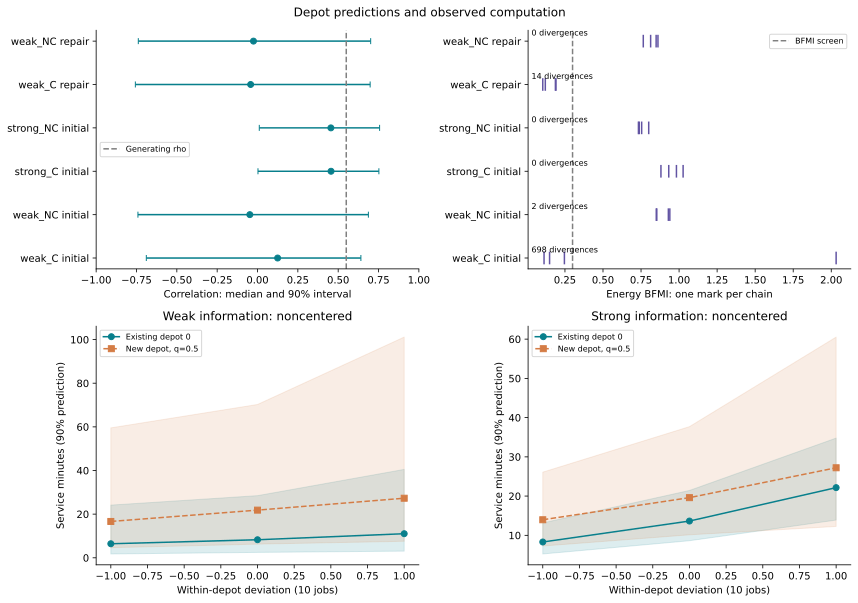

# A09 · Learning correlated depot effects

**Prerequisites:** [continuous models](./04_continuous.md), [Hamiltonian Monte Carlo](./06_hmc.md), [regression](./07_regression.md), [hierarchical models](./09_hierarchical.md), [linear algebra](./appendix-03_linear_algebra.md), and [numerical computation](./appendix-04_numerics.md). This optional continuation takes an estimated 8–12 hours including the lab and an executed repair memo. That estimate has not been piloted.

**Objectives:** A09.O1 Construct and interpret covariance through scales and correlation. A09.O2 Make existing- and new-group predictions with shared draws and within/between contrasts. A09.O3 Diagnose and re-evaluate equivalent parameterizations.

## The question: does a depot's baseline tell us about its workload response?

A fictional service company records visit duration at twelve depots. Some depots have few recorded visits, and some operate over a narrow range of workloads. A dispatcher wants to predict several visits at an existing depot and at a depot without duration records. She also asks whether depots with longer baseline service times tend to be more sensitive to workload.

An intercept-only hierarchy cannot answer that last question: it requires a different workload slope at each depot and an estimated relationship between intercepts and slopes. A table of separately fitted slopes is also inadequate when the smallest depot has only two observations. The model must express both the pooling assumption and uncertainty about the distribution that supplies the pooling.

Everything in this example is original synthetic teaching data. Depot selection, design, coefficients and priors are stipulated, not elicited business evidence. The numerical exercise can expose implementation and computational mistakes. It cannot establish that these depots represent a real population or that workload causes longer visits.

## Separate within-depot and between-depot workload

Let $x_{ij}$ be workload in jobs for visit $i$ at depot $j$, and let $\bar x_j$ be that depot's design mean. Define

$$w_{ij}=\frac{x_{ij}-\bar x_j}{10},\qquad q_j=\frac{\bar x_j-50}{10},\qquad
y_{ij}=\log\!\left(\frac{\text{duration}_{ij}}{1\text{ minute}}\right).$$

The denominator makes the logarithm dimensionless. A one-unit within-depot contrast means ten additional jobs relative to that depot's mean. A one-unit between-depot contrast means ten additional jobs in a depot's average workload. The lab constructs the workload design before generating outcomes; no service-time information enters either centering operation.

Our sampling model is

$$y_{ij}\mid b_j,\theta\sim N\!\left(\alpha+b_{0j}+(\beta_W+b_{1j})w_{ij}+\beta_Bq_j,\;\sigma^2\right),$$

$$b_j=\begin{pmatrix}b_{0j}\\b_{1j}\end{pmatrix}\mid\Sigma\sim N_2(0,\Sigma),
\qquad j=1,\ldots,J.$$

The distribution notation uses **variance** as the second normal parameter. The PyMC implementation takes **standard deviation**. Conditional on the group effects and population parameters, visit errors are independent. This assumption excludes remaining serial dependence, shared visit shocks and residual variance differences between depots.

At a fixed depot, changing $w$ to $w+1$ changes expected log duration by $\beta_W+b_{1j}$. It multiplies the conditional median duration by $\exp(\beta_W+b_{1j})$. In contrast, comparing population-average predictions at the same within-depot deviation but with $q$ increased by one changes expected log duration by $\beta_B$. Two particular depots also differ in their realized intercept and slope effects. These are distinct comparisons, even though both are expressed in ten-job units.

For example, a depot with $\bar x=40$ has $q=-1$; a visit at workload 50 has $w=1$. A depot with $\bar x=60$ has $q=1$; a visit at workload 50 has $w=-1$. They share the same raw workload but occupy different positions relative to their own operation. Replacing both terms by one coefficient of $(x-50)/10=w+q$ imposes equality of the population within and between coefficients. That is an additional model restriction, not harmless centering.

We condition on known design means. For prediction at a new depot, the dispatcher supplies a planned or externally known mean workload. If that mean is uncertain, inferred from a short future sequence, or changed by a policy intervention, it needs a model too. Do not quietly replace a training mean with a future sample mean and claim the same predictive target.

## Build a covariance that means something

Write

$$\Sigma=D\Omega D,\qquad D=\operatorname{diag}(\tau_0,\tau_1),\qquad
\Omega=\begin{pmatrix}1&\rho\\\rho&1\end{pmatrix}.$$

Thus

$$\Sigma=\begin{pmatrix}\tau_0^2&\rho\tau_0\tau_1\\\rho\tau_0\tau_1&\tau_1^2\end{pmatrix},
\qquad |\Sigma|=\tau_0^2\tau_1^2(1-\rho^2).$$

Positive scales and $-1<\rho<1$ give a positive-definite covariance. The scales answer separate questions: how much baseline log duration varies, and how much the log-duration response per ten jobs varies. Correlation describes how these deviations co-vary. It is not the correlation between all observed durations and workloads.

A lower triangular factor that preserves this decomposition is

$$L=\begin{pmatrix}\tau_0&0\\\rho\tau_1&\tau_1\sqrt{1-\rho^2}\end{pmatrix},\qquad LL^T=\Sigma.$$

If $z_0,z_1$ are independent standard normals, $b_0=\tau_0z_0$ and $b_1=\tau_1(\rho z_0+\sqrt{1-\rho^2}z_1)$. Both effects share $z_0$, which creates their covariance. Multiplying the slope by $\tau_0$ instead of $\tau_1$, or putting $L$ on the wrong side of a row vector, creates a different model. The lab's independent tests check the reconstructed covariance and every recorded noncentered effect vector.

Conditioning a bivariate normal also gives a direct interpretation:

$$b_1\mid b_0,\tau,\rho\sim N\!\left(\rho\frac{\tau_1}{\tau_0}b_0,\;\tau_1^2(1-\rho^2)\right).$$

As a worked illustration, fix $\tau_0=0.4$, $\tau_1=0.2$, $\rho=0.5$ and a known intercept deviation $b_0=0.3$. The conditional slope deviation has mean $0.075$ and standard deviation $\sqrt{0.03}\approx0.173$. With population slope $0.18$, its conditional mean total slope is $0.255$. This is not a plug-in recipe for the fitted model: a real depot intercept and all three covariance parameters remain uncertain and must be integrated over.

## Put priors on implications, not just matrix entries

The lab uses independent population priors

$$\alpha\sim N(2.8,0.6^2),\quad\beta_W\sim N(0.18,0.3^2),\quad
\beta_B\sim N(0.25,0.4^2),$$

$$\tau_0\sim\operatorname{HalfNormal}(0.65),\quad
\tau_1\sim\operatorname{HalfNormal}(0.45),\quad
\sigma\sim\operatorname{HalfNormal}(0.5),\quad\Omega\sim\operatorname{LKJ}(2).$$

Here HalfNormal arguments are scales. The scale priors are proper and allow values near zero. They neither guarantee strong identification nor prevent narrow posterior geometry. At typical workload, $\exp(2.8)\approx16.4$ minutes is the prior median from the population intercept alone; random depot effects, regression uncertainty and visit noise make full predictions much broader.

The LKJ density is proportional to $|\Omega|^{\eta-1}$ on positive-definite correlation matrices. Its shape and domain are specified in the [Stan correlation-distribution reference](https://mc-stan.org/docs/functions-reference/correlation_matrix_distributions.html). For **two** effects, the normalising integral is especially transparent:

$$\int_{-1}^{1}(1-r^2)^{\eta-1}dr=B(1/2,\eta),\qquad
p(\rho)=\frac{(1-\rho^2)^{\eta-1}}{B(1/2,\eta)}.$$

Set $u=(\rho+1)/2$. Since $d\rho/du=2$, the transformed density is proportional to $u^{\eta-1}(1-u)^{\eta-1}$, with the beta normalizer. Therefore the lab implements the exact bivariate LKJ law using $u\sim\operatorname{Beta}(\eta,\eta)$ and $\rho=2u-1$. It does not fix correlation or estimate it from fitted group means. This beta identity with shapes $(\eta,\eta)$ must not be transferred unchanged to larger correlation matrices.

At $\eta=1$ the bivariate correlation is uniform. At $\eta=2$, $p(\rho)=3(1-\rho^2)/4$, so $E[\rho]=0$, $E[\rho^2]=1/5$, and

$$P(|\rho|>0.8)=2\int_{0.8}^1\frac34(1-r^2)dr=0.056.$$

The corresponding probability under $\eta=1$ is $0.20$. These are substantial differences about extreme association, not universally good or bad defaults. The scales-and-correlation construction also allows domain judgments for each scale separately; see the [Stan multivariate hierarchical regression discussion](https://mc-stan.org/docs/stan-users-guide/regression.html#multivariate-priors-for-hierarchical-models).

The lab makes 5,000 prior draws and predicts three visits at a new depot with $q=0.5$ and $w=-1,0,1$. Under the base prior, the simulated medians are about 15.5, 19.1 and 22.1 minutes; the respective 90% intervals are about 2.3–108.7, 3.6–99.6 and 3.4–146.4 minutes. These wide intervals merit discussion before any data are fitted. About 7.6% of these simulated visits fall outside a **teaching review range** of 2–120 minutes. That range is not a physical impossibility or a likelihood truncation.

Doubling both effect-scale priors increases that share to about 19.3%, and the upper 90% bound at $w=1$ rises to about 401 minutes. Changing only $\eta$ to one yields about 7.5% outside the range, but increases extreme-correlation prior mass markedly. Similar marginal duration summaries can hide very different beliefs about joint responses. These simulation values have Monte Carlo variation; the exact correlation-tail calculations above do not. Neither alternative is used to quietly repair a sampler: both change the statistical target.

## How the data supply different amounts of information

The weak regime has depot visit counts

$$2,3,4,5,6,8,10,12,15,18,22,28,$$

for a total of 133. Its within-depot workloads have a narrow range and its generating residual standard deviation is 0.65. The strong regime uses

$$40,45,50,55,60,65,70,75,80,90,100,120,$$

for a total of 850, a wider workload range, and residual standard deviation 0.28. Both panels share the same twelve generated depot effects and design means; they have different visit realizations. The generating effect scales are 0.30 and 0.18, with correlation 0.55. Those values are a simulation record, not answers that a finite-data posterior must recover exactly.

The relevant information for a depot slope is not merely its observation count. At fixed noise scale it also depends on $\sum_i w_{ij}^2$. A hundred visits at nearly the same workload can leave the slope weakly identified. Likewise, hundreds of visits at twelve depots do not become hundreds of independent depot pairs for estimating correlation. The strong regime estimates each depot effect more accurately, while the population covariance is still informed by only twelve such effects.

The twelve realized synthetic slope deviations average about $0.132$, even though their generating distribution has mean zero. Their average total slope is therefore about $0.22+0.132=0.352$, rather than $0.22$. This is ordinary finite-group variation: zero population expectation is not a sample sum-to-zero constraint. Precise visits reveal the realized depot slopes; they do not remove uncertainty about how representative those twelve slopes are of the population. Requiring a posterior to reproduce the generating population coefficient exactly would be an invalid acceptance test.

The planned predictions use $w=-1,0,1$. The two outer workload values extend beyond the weak panel's narrow observed support, especially at the depot with only two visits. Their intervals therefore depend on the assumed linear workload response outside that depot's observations. They are useful for exposing uncertainty, but are not evidence that extrapolation is reliable. The new depot's specified $q=0.5$ lies within the design's between-depot range; that does not supply missing within-depot information.

## Derive the fixed-hyperparameter update

For one depot, write $r=y-\mu$, where $\mu_i=\alpha+\beta_Ww_i+\beta_Bq$, and let $X$ have rows $(1,w_i)$. At fixed $\Sigma$ and $\sigma$, the log posterior kernel in $b$ is

$$-\frac12b^T\Sigma^{-1}b-\frac{1}{2\sigma^2}(r-Xb)^T(r-Xb).$$

Expanding the square and collecting terms gives precision and linear term

$$Q=\Sigma^{-1}+\frac{X^TX}{\sigma^2},\qquad h=\frac{X^Tr}{\sigma^2}.$$

Complete the square, $b^TQb-2b^Th=(b-m)^TQ(b-m)-m^TQm$, where $Qm=h$. Hence

$$b\mid y,\theta\sim N_2(m,V),\qquad V=Q^{-1},\qquad m=Q^{-1}h.$$

Use linear solves rather than computing a matrix inverse to multiply a vector. If $X^TX$ is small, prior precision dominates and the effect shrinks toward zero. If it is large in one direction only, pooling remains strong in the other direction. Correlation couples the directions, so shrinking each univariate regression independently misses part of the update.

For a numerical reference, take $\Sigma=\left(\begin{smallmatrix}0.49&-0.07\\-0.07&0.0625\end{smallmatrix}\right)$, $\sigma=0.6$, $w=(-1,0.5,1.5)$, $y=(0.3,-0.2,0.8)$ and $\mu=(0.1,0.2,0.3)$. The update is approximately

$$m=(0.066672,0.021050)^T,\qquad
V=\begin{pmatrix}0.102967&-0.019680\\-0.019680&0.038520\end{pmatrix}.$$

An independent route starts with $\operatorname{Cov}(y)=X\Sigma X^T+\sigma^2I$ and $\operatorname{Cov}(b,y)=\Sigma X^T$, then conditions the joint Gaussian. The tests also integrate the original likelihood times prior directly over both effect coordinates. An implementation that swaps an effect scale, drops the likelihood normalizer, or uses $\sigma$ where $\sigma^2$ is required will fail appropriate checks.

This conditional Gaussian is useful for validating the **actual hierarchy**, but it is not its full posterior. When covariance and residual scale are learned, the posterior for each depot is a mixture of these conditional distributions. Freezing those hyperparameters at estimates understates uncertainty.

## Two coordinates, one target

In centered coordinates we sample $b_j\sim N_2(0,\Sigma)$. In noncentered coordinates we sample $z_j\sim N_2(0,I)$ and set $b_j=Lz_j$. The data likelihood is evaluated at exactly the same $b_j$ in both models. A row-oriented array implements this as `b = z @ L.T`.

For $J$ depots, the absolute determinant of the transformation from all $z_j$ to all $b_j$ is $|L|^J$. With hyperparameters held fixed,

$$\log p_z(z\mid\Sigma)=\log p_b(Lz\mid\Sigma)+J\log|L|,$$

$$\log|L|=\log\tau_0+\log\tau_1+\tfrac12\log(1-\rho^2).$$

This is an equality of probability measures expressed in different coordinates, not an equality of raw density heights. In the joint transformation $(z,\tau,\rho)\mapsto(b,\tau,\rho)$, cross-derivatives of $b$ with respect to the hyperparameters do not add another factor: the Jacobian is block triangular. The determinant is still the product of the effect blocks. In code that directly declares standard-normal $z$, the induced $b$ distribution is already correct; adding a second $J\log|L|$ term would be a mistake.

There are further Jacobians in the sampler's unconstrained coordinates. Positive scales represented as $s=\exp(v)$ contribute $\log s$. A beta variable $u=\operatorname{logistic}(a)$ contributes $\log u+\log(1-u)$. Our independent density test compares the compiled PyMC joint density with normalised SciPy prior and likelihood densities, including these transformations. It then compares the two models after adding $J\log|L|$. Merely checking two handwritten functions against one another would not establish what the fitted code actually samples.

Why change coordinates? When data barely inform a depot, its effect and a small population scale can form a narrow joint region in centred coordinates. Expressing the weakly informed effect as a standard-normal $z$ can reduce that dependence. With highly informative depot observations, $b$ may be well constrained, while $z=L^{-1}b$ must move jointly with $L$; centering can then work better. This dependence on data information is described in [Stan's reparameterization discussion](https://mc-stan.org/docs/stan-users-guide/efficiency-tuning.html#hierarchical-models-and-the-non-centered-parameterization). The lab tests both regimes rather than declaring one coordinate system universally superior.

## Predictions share a depot, not just a label

For an existing depot, a posterior draw already contains its effect vector. For each posterior draw, use that same vector in **all** planned visits to that depot, and then draw independent visit errors. Replacing the learned effect with a fresh draw from the population discards that depot's records and answers a new-depot question instead.

For a new depot at each posterior draw:

1. Take the population coefficients, $\Sigma$ and $\sigma$ from that draw.
2. Draw one $b_{\mathrm{new}}\sim N_2(0,\Sigma)$ for that depot.
3. Reuse it for every planned visit there; draw one independent visit error per visit.
4. For a second new depot, draw a second effect vector. Reuse the same population draw for both.

At fixed population parameters, put $a(w)=(1,w)^T$. For two distinct visits to one new depot,

$$\operatorname{Cov}(y_a,y_b\mid\theta)=a(w_a)^T\Sigma a(w_b)
=\tau_0^2+(w_a+w_b)\rho\tau_0\tau_1+w_aw_b\tau_1^2.$$

The variance of a single visit additionally includes $\sigma^2$. For two different new depots, the conditional covariance of their log durations is zero under this model. After integrating uncertain population coefficients, predictions at different depots can still be dependent. Apply the law of total covariance: average the conditional covariance and add the covariance of the conditional means.

For example, with $\tau=(0.5,0.3)$, $\rho=0.6$, $\sigma=0.2$ and visits at $w=0,1$, the shared-depot covariance is $0.25+0.09=0.34$. Redrawing a depot effect at every visit removes that term conditional on the population parameters. Single-visit histograms might look correct, while uncertainty for a depot's average, total workload response, or probability that **all** visits exceed a threshold is wrong. The lab tests this failure explicitly.

At fixed lognormal parameters, the median is $\exp(m)$ and the mean is $\exp(m+v/2)$. For parameter mixtures, obtain predictive quantiles from propagated predictive draws or the averaged CDF. A physical-scale mixture mean requires checking that the integral of $\exp(m+v/2)$ is finite; a finite simulated average does not establish this. This lab reports physical-scale quantiles and event probabilities.

## Units and zero-sum restrictions can change the model

For a linear predictor $a+bx$, changing to $x'=(x-c)/s$ and $y'=Ay+d$ yields

$$\begin{pmatrix}a'\\b'\end{pmatrix}
=A\begin{pmatrix}1&c\\0&s\end{pmatrix}\begin{pmatrix}a\\b\end{pmatrix}
+\begin{pmatrix}d\\0\end{pmatrix},\qquad
\Sigma'=T\Sigma T^T,\quad T=A\begin{pmatrix}1&c\\0&s\end{pmatrix}.$$

Residual scale changes to $|A|\sigma$. For $n$ observed responses the transformed density has log Jacobian $n\log|A|$. Scaling without shifting leaves correlation unchanged for positive units, but moving the intercept's reference point mixes slope into intercept and can change their correlation. Retaining independent priors with the same numerical parameters after such changes generally defines a new target. For the lab's logarithmic response, changing minutes to seconds adds $\log60$ to the intercept; it does not multiply log-response coefficients by 60.

Likewise, forcing $\sum_jb_j=0$ is not automatically equivalent to independent zero-mean normal effects. For scalar independent effects of variance $\tau^2$, subtracting their sample average makes each variance $\tau^2(1-1/J)$ and introduces covariance $-\tau^2/J$ between different effects. If the population intercept absorbs that average, its induced prior also changes and depends on $\tau$. Equivalent constrained coordinates are possible only with the full induced joint prior. Adding a zero-sum restriction while leaving other priors unchanged is a model intervention and must be labelled as such.

## Execute a diagnosis, intervention and re-evaluation

[Lab 23](../../downloads/bayesian/labs/23_multivariate_hierarchy.py) supplies a complete recorded experiment. The matching [result](../../downloads/bayesian/artifacts/results/23_multivariate_hierarchy.json) contains every initial and repaired fit, predictive summaries and a diagnosis ledger. It is a worked computational reference for self-study, not an assessed answer key. The script and helper files are authoritative; the generated notebook explains when it is replaying evidence.

The declared initial comparison uses four chains, each with 1,000 warmup and 1,000 retained draws, in each of four fits: weak centred, weak noncentered, strong centred and strong noncentered. All use the same priors and likelihood within their regime, target acceptance 0.90 and maximum tree depth 12. Separate deterministic seeds are assigned before seeing any diagnostic. Chain execution and BLAS each use one core. The recording keeps both warmup and retained arrays, dimensions, source snapshots, versions, UTC times, logs, wall time and process peak memory.

A failed initial numerical screen triggers the declared repair: the same target and coordinates, target acceptance 0.99, 2,000 warmup and 2,000 retained draws per chain. The original remains in the ledger. Increasing target acceptance asks adaptation for a smaller integration step; it can cost more work and does not guarantee that the problem disappears. More draws help precision only when exploration is adequate. Changing a prior to eliminate a narrow region is instead a scientific model revision requiring renewed prior and posterior criticism.

The numerical screens are rank-normalized $\widehat R<1.01$, bulk and tail ESS above 400, no divergences or maximum-depth hits, and energy BFMI above 0.3 in every chain. These are diagnostic conventions, not mathematical sufficiency conditions. Energy BFMI compares successive energy changes with the energy distribution's variance; low values suggest poor energy exploration. The actual record retains energy quantiles, per-chain values and raw energy draws, not just a minimum or a green flag.

Mean MCSE is checked for population coefficients, each effect scale, correlation, residual scale, an existing-depot expected log duration, a new-depot expected log duration, and its conditional log-response variance. The prospective precision limits are 0.02 in each reported estimand's units, except 0.03 for correlation. A posterior standard deviation is uncertainty under the model; MCSE is uncertainty from finite simulation. A tiny MCSE does not mean correlation is precisely learned.

For an estimand with means $\hat m_C,\hat m_N$ from independently seeded coordinate runs, compare

$$|\hat m_C-\hat m_N|\quad\text{with}\quad5\sqrt{\operatorname{MCSE}_C^2+\operatorname{MCSE}_N^2}.$$

The five-MCSE rule is a declared diagnostic tolerance for this set of comparisons, not a calibrated omnibus hypothesis test. Report the values, not just “agreement.” Chains trapped in the same region can agree. MCSE from poorly explored chains can itself be misleading. An observed divergence is neither a required teaching outcome nor something to erase by selecting another seed.

Full re-evaluation also includes support and units, independent density/conditional checks, prior prediction, posterior prediction by depot, and remaining weak identification. The lab reports replicated mean, standard deviation and maximum log duration, groupwise predictive means and in-sample 90% coverage. Coverage from the same visits used to fit the model is descriptive, not held-out calibration. A posterior predictive tail probability is a model-criticism summary, not the probability that the model is true.

<!-- A09_EXECUTION_SUMMARY -->

The current complete recording `20260927T005939Z_f269cd58` produced the following results. C denotes centred and NC noncentered coordinates. ESS values are the minimum over all monitored parameters, including depot effects and noncentered auxiliaries. The JSON retains every individual estimand and chain diagnostic, not just these rounded summaries.

| Fit | Divergences | Max R-hat | Min bulk / tail ESS | Min BFMI | Correlation mean MCSE | Wall seconds |
|---|---:|---:|---:|---:|---:|---:|
| Weak C, initial | 698 | 1.583 | 7 / 4 | 0.113 | 0.0157 | 61.8 |
| Weak NC, initial | 2 | 1.005 | 1081 / 1326 | 0.850 | 0.0071 | 13.4 |
| Strong C, initial | 0 | 1.008 | 545 / 703 | 0.881 | 0.0050 | 64.7 |
| Strong NC, initial | 0 | 1.005 | 1072 / 1573 | 0.733 | 0.0054 | 59.2 |
| Weak C, repair | 14 | 1.020 | 278 / 186 | 0.104 | 0.0073 | 596.2 |
| Weak NC, repair | 0 | 1.003 | 1861 / 2546 | 0.765 | 0.0057 | 58.8 |

The weak centred initial run is unusable under the declared screens. Reparameterization improved exploration substantially, but the initial noncentered run still had two divergences. Its numerical repair passed the declared screens. The centred numerical repair took about **9.9 minutes** and still failed: fourteen divergences, poor energy exploration, R-hat above 1.01 and insufficient ESS remained. Its mean-MCSE limits passed, illustrating why apparently adequate estimand precision cannot replace exploration diagnostics. No fit hit maximum tree depth. The two strong-regime fits both passed; here NC had the higher minimum ESS. These observations support an information-dependent investigation, not a rule that centering must win with strong data.

All ten final estimand-mean comparisons met the five-combined-MCSE tolerance in each regime. For correlation, the strong-coordinate mean difference was 0.0040, against tolerance 0.0366; the weak-coordinate difference was 0.0201, against tolerance 0.0463. **Weak-coordinate agreement does not certify the centered fit:** its failed energy, divergence and convergence screens remain disqualifying. The worked weak predictions therefore use the repaired NC fit; the strong predictions use the passing NC initial fit. Every alternative remains visible in the ledger and figure.

The repaired weak fit's correlation median was about -0.025, with a 90% interval **[-0.739, 0.701]**. Its small mean MCSE, about 0.0057, does not turn that broad scientific uncertainty into a well-learned correlation. The strong NC interval was **[0.011, 0.757]**, with median 0.455: more information, still only twelve groups. A generating correlation of 0.55 is neither a required posterior mean nor a threshold for accepting computation.

For a new depot at $q=0.5$, $w=0$, the weak fit predicted a median duration of about 21.8 minutes and a 90% interval of 6.3–70.3 minutes. At existing depot zero, the corresponding prediction was 8.3 minutes with interval 2.5–28.5 minutes. The strong-fit intervals were about 10.1–37.7 minutes for the new depot and 8.6–21.4 for depot zero. Different mean workloads and conditioning information prevent treating these differences as a controlled effect of being a new depot.

The selected fits' observed mean, standard deviation and maximum log durations all lay within their corresponding central 90% replicated-statistic intervals. For the maximum, posterior predictive upper-tail probabilities were about 0.858 in the weak regime and 0.590 in the strong regime. These checks did not identify an extreme discrepancy for those particular summaries; they do not test every possible mismatch or establish predictive calibration. Groupwise in-sample coverage ranged from 50% to 100% in the weak panel and about 84% to 96% in the strong panel. The weak depot-zero value is just one of two visits inside its nominal 90% band: such tiny denominators cannot establish coverage accuracy. The JSON also reports each depot's design information, effect intervals, replicated mean and residual summaries.

The complete recorder took **855.5 seconds (14.3 minutes)** on the recorded machine, with one chain core and one thread in each installed BLAS library. Process CPU time was 851.1 seconds, peak resident memory about 409.3 MiB, and retained compressed fit arrays 23.2 MiB. Wall time includes setup inside the recorder, sampling, diagnostics and serialization; it excludes interpreter startup, earlier import work and subsequent notebook/predictive verification. Earlier attempts are preserved separately: one oversubscription interruption has an observed elapsed lower bound of 589 seconds; another incomplete recording retains two completed fits totaling 228.3 seconds, with its unfinished work unmeasured. The earlier complete recording `20260926T205711Z_ff11e2f7` took 3109.0 seconds (51.8 minutes), including a 2080.2-second (34.7-minute) failed centred repair, with 2947.2 CPU seconds and 385.7 MiB peak memory. That superseded recording remains historical evidence. All these earlier costs are additional to the current recorder's 14.3 minutes; timings depend on the execution environment and cache state.

Notebook execution explicitly replayed and verified the current `20260927T005939Z_f269cd58` recording; it was not a second NUTS run. Future changed-source recordings must refresh this summary and retain earlier evidence. This package has local mathematical/computational checks, not independent human approval or a claim that NUTS screens prove the model true.

<!-- A09_EXECUTION_SUMMARY_END -->

The upper figure panels show all fits, including the initial failures and their repairs. The lower panels distinguish visit predictions for depot zero from a new depot with $q=0.5$. These depots have different mean workloads and different conditioning information; the width and location differences are not an isolated causal effect of “being new.” The figure's labels and the JSON table provide a text alternative, and colour is supplemented by points, line styles and captions.

## A small conjugate check with a carefully limited claim

A separate normal–inverse-Wishart fixture offers an independent exact calculation. It models independent **bivariate observations**, not scalar visits with correlated depot coefficients. Declare

$$y_i\mid\mu,\Sigma\sim N_2(\mu,\Sigma),\quad
\mu\mid\Sigma\sim N_2(m_0,\Sigma/\kappa_0),$$

$$p(\Sigma)\propto|\Sigma|^{-(\nu_0+d+1)/2}
\exp\!\left[-\tfrac12\operatorname{tr}(\Psi_0\Sigma^{-1})\right].$$

The exponent fixes the inverse-Wishart convention; alternative parameter names can hide different degrees of freedom. For a derivation of these conjugate families see [Murphy's Gaussian conjugacy note](https://www.cs.ubc.ca/~murphyk/Papers/bayesGauss.pdf).

With observations $(1,0),(0,1),(1,1)$, $m_0=0$, $\kappa_0=1$, $\nu_0=4$, and $\Psi_0=I$, the raw sums give $\kappa_n=4$, $\nu_n=7$, $m_n=(1/2,1/2)$, and

$$\Psi_n=I+\sum_i y_i y_i^T-4m_nm_n^T=2I.$$

Integrating both unknowns yields a bivariate Student predictive with degrees of freedom $\nu_n-d+1=6$ and scale matrix

$$\frac{\kappa_n+1}{\kappa_n(\nu_n-d+1)}\Psi_n=\frac5{12}I.$$

The t scale matrix is **not** its covariance; with six degrees of freedom the covariance is $(6/4)(5I/12)=5I/8$. Tests independently derive the update using exact rational raw moments, compare predictive density to a ratio of integrated evidences, and simulate an inverse-Wishart/normal mixture. None of these checks validates the posterior under separate half-normal scales and an LKJ correlation prior. That requires the actual-model density, conditional-Gaussian, coordinate and predictive checks already described.

## Write the repair memo

Use this sequence for your own investigation before consulting assessed solutions:

1. State the prediction target, response and predictor units, design support, priors and exchangeability assumptions. Distinguish within from between effects.
2. Predict which regime and coordinates may be difficult, then inspect all actual runs. Record uncertainty about that prediction.
3. Identify whether your intervention changes coordinates, numerical settings, data, likelihood or prior. Show a density/Jacobian argument when claiming equivalence.
4. Repeat numerical diagnostics, estimand precision and agreement checks. Retain failures and costs; do not turn a failed initial run into a disappearing draft.
5. Repeat predictive criticism and explain what remains scientifically uncertain even if numerical screens improve. For new depots, demonstrate effect reuse across visits.

A satisfactory memo can conclude that one coordinate system is unusable for a particular regime, or that an attempted repair did not resolve a problem. It must then restrict numerical claims accordingly. “All screens pass, therefore this is the true depot model” is never an adequate conclusion. The lesson's three optional assessments are `adv.multivariate_hierarchy.1`–`.3`; the final item is the executed repair memo, with no extra COMP01 item.
