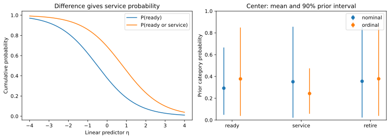
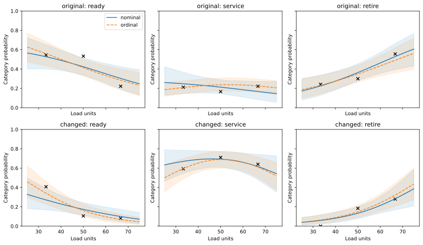

# A10 — Regressions for named and ordered outcomes

A fictional inspection team classifies reusable shipping containers as **ready**, **service**, or **retire**. Can load and age predict the next inspection label? Before fitting anything, sketch how you expect each category's probability to change as load increases. Must the service probability increase monotonically? Would giving the labels an order justify using the same predictor effect at both category boundaries?

A08 learned one common vector of categorical probabilities. Here that vector depends on measured predictors. This optional chapter follows L06, L08, L10, and A08: likelihoods, generalized regression, model checking, and categorical outcomes. Allow 6–8 hours for chapter, lab, investigation, and optional assessments; the estimate awaits learner pilots and adds work beyond the selected core. The observation unit is one independent inspection. The main target is the change in retirement probability between loads 25 and 75 at age five, with secondary targets covering the whole category vector and predictive frequencies.

## Start with the generative question

Code ready, service, and retire as 0, 1, and 2. Codes identify categories; treating them as measured numeric values would introduce assumptions about spacing that the labels do not supply. We generate ninety training inspections and thirty independent evaluation inspections. Load is uniform from 25 to 75 and age uniform from one to nine. Fixed transformations are

$$
x_L=(L-50)/25,\qquad x_A=(A-5)/4.
$$

Thus a one-unit change in scaled load is twenty-five load units, and a one-unit age change is four years. The transformations are declared before looking at either dataset. They make slopes interpretable over a specified range without using evaluation outcomes to choose preprocessing.

The original synthetic generator uses an ordered logistic model with linear predictor $\eta=0.9x_L+0.6x_A$ and thresholds −0.5 and 0.8. That is a teaching mechanism, not evidence that container inspection is governed by proportional odds. We fit two alternatives under proper priors. Evaluation data are not supplied to fitting functions, and no model is redesigned after evaluation scores are read.

Conditionally independent labels are a simplifying assumption. Repeated inspections of the same container, inspector disagreement, or batch effects would require additional structure. Likewise, load need not be causally assigned. The present target is predictive association under the declared data-generating and observation assumptions, not the effect of an intervention on load.

## Nominal regression: predict a simplex

A nominal model treats the labels as distinct without imposing an ordering. Define logits

$$
z_0=0,\quad z_1=\alpha_1+\beta_{L1}x_L+\beta_{A1}x_A,
\quad z_2=\alpha_2+\beta_{L2}x_L+\beta_{A2}x_A.
$$

Probabilities are $p_k=\exp(z_k)/\sum_j\exp(z_j)$, and the observed category is a categorical draw from that vector. Independent intercept priors are $N(0,1.5^2)$; independent slope priors are $N(0,1)$. Normal notation uses variance, while software accepts standard deviation. Each nonbaseline coefficient describes a log probability ratio against ready, conditional on the other predictor.

Adding a constant to every logit changes none of the probabilities: numerator and denominator gain the same multiplicative factor. If every category had an unrestricted intercept, this shift would be unidentified by the likelihood. Setting the ready logit to zero chooses coordinates. It does not mean that ready is impossible or that its probability stays fixed; its probability changes through the denominator.

A baseline change also needs a prior transformation. Subtracting an old nonbaseline logit from every logit creates differences of coefficients. Those differences are correlated under the original independent priors. If you instead assign fresh independent priors after relabeling the baseline, you have changed the prior probability model, not merely rewritten the same fit. This matters especially with limited data or rare categories.

## Worked step 1: normalize before interpreting

Take logits $(0,\log2,\log3)$. Exponentials are $(1,2,3)$, so probabilities are $(1/6,2/6,3/6)$. The retire-versus-ready probability ratio is three; retirement probability itself is one half. Interpreting a logit as a category probability would confuse the ratio scale with the response scale.

Now add 1,000 to every logit. The mathematical probabilities are unchanged, but directly exponentiating can overflow. Stable softmax subtracts the largest logit or uses log-sum-exp before exponentiating. The lab checks invariance and normalisation, including extreme logits. Stability should preserve a valid model, not silently clip arbitrary invalid probabilities into range.

For independent observations the likelihood is $\prod_i p_{i,y_i}$. The vectorized log likelihood is the sum of selected log probabilities. The lab checks a direct product against that sum for an actual fitted draw. This is a small implementation check: it verifies category indexing and multiplication, not prior adequacy or the scientific fit.

## Ordered regression: two boundaries, one slope vector

An ordinal alternative uses

$$
P(Y\le k\mid x)=\operatorname{logit}^{-1}(c_k-x^\top\beta),
\qquad k=0,1,
$$

with $c_0<c_1$. We parameterize the cutpoints as $m-d/2$ and $m+d/2$, where $m\sim N(0,1.5^2)$, $\log d\sim N(\log1.3,0.4^2)$, and both slopes independently follow $N(0,1)$. The exponential of log gap is positive, guaranteeing ordered cutpoints without sorting independently drawn thresholds.

There is no additional intercept in $x^\top\beta$. If an intercept and both cutpoints could shift together, the cumulative probabilities would remain unchanged and the likelihood would not identify their common location. The midpoint provides the location; the predictor contains slopes only. Proper priors complete the model but should not disguise a redundant parameterization.

The cumulative log odds are $c_k-x^\top\beta$. Increasing scaled load by one multiplies the odds of being at or below **either** boundary by $e^{-\beta_L}$. This shared multiplier is the proportional-odds restriction. It does not assert constant probability differences, equal spacing of categories, or equal category-specific odds ratios. Ordered labels make cumulative splits meaningful; they do not demonstrate that one slope vector describes both splits.

## Worked step 2: difference cumulative probabilities

At centered predictors under the generating thresholds, cumulative probabilities are $\operatorname{logit}^{-1}(-0.5)=0.377541$ and $\operatorname{logit}^{-1}(0.8)=0.689974$. Therefore ready, service, and retire probabilities are approximately $(0.377541,0.312434,0.310026)$. The middle probability is the difference between cumulative probabilities, and the final probability is one minus the upper cumulative probability.

As the linear predictor increases, both cumulative curves decrease. Yet the gap between them can first grow and then shrink. A hump-shaped middle-category probability is therefore possible under an ordinary proportional-odds model. Seeing a service hump is not by itself a diagnostic failure. What matters is whether the two cumulative splits can share a linear predictor on the log-odds scale.

The left panel depicts that construction. The right panel summarizes 4,000 prior parameter draws. At the centre, nominal mean probabilities are (0.2925, 0.3515, 0.3560), while ordinal means are (0.3777, 0.2436, 0.3787). For nominal retirement probability, the central 90% prior interval is approximately [0.0231, 0.8549]; for ordinal service probability it is [0.0575, 0.4745]. These are distributions of probabilities before outcomes, not intervals containing a future category label.

Prior draws also inspect all four corners of the declared predictor domain. Across corners, nominal mean retirement probability ranges from 0.3560 to 0.3675 and ordinal mean service probability from 0.2049 to 0.2070. Individual draws are much more extreme than these averages: corner retirement upper 95th percentiles exceed 0.93 for both models. Averaging can conceal implausibly decisive prior curves. If this were a real application, review whole curves and plausible covariate ranges before observing outcomes; do not retune priors to manufacture a desired evaluation score.

## Actual fitting and numerical evidence

Lab 25 fits both models with four NUTS chains, one CPU core, 1,000 warmup iterations and 1,500 retained draws per chain, target acceptance 0.95, and jittered adaptive diagonal initialization. It repeats both fits for the changed-givens dataset and fits two intercept-only benchmarks. Named random streams separate data generation, priors, fitting, and posterior replication.

All six fits have zero divergences. The largest reported rank R-hat is 1.00201; the smallest bulk or tail effective sample size across reported parameters and targets is 2,829.45. Those pass the frozen thresholds R-hat below 1.01 and ESS at least 400. These diagnostics address sampling behaviour. They do not prove a proportional-odds assumption, guarantee accuracy of every unreported tail, or transform synthetic data into empirical evidence.

For an independent reference, remove covariates and use category counts (3,2,3), retaining each model's actual priors. Nominal integration runs over two nonbaseline logits; ordinal integration runs over midpoint and log gap. Two-dimensional Gauss–Legendre rules use orders 31 and 61 over eight prior standard deviations per coordinate. The finer nominal mean vector is (0.357569, 0.269178, 0.373253); the ordinal vector is (0.361114, 0.277771, 0.361114). Symmetric outer counts and the ordinal location prior imply equal outer-category posterior means, providing another useful structural check.

The largest order-31/61 discrepancy is 0.001264 for nominal probabilities and 0.003119 for ordinal probabilities. The corresponding maximum sampler-versus-finer-rule discrepancies are about 0.004042 and 0.001337. Each category passes the declared allowance of five target-specific MCMC MCSE plus the measured quadrature refinement discrepancy. The rule comparison is a practical error estimate, not a rigorous bound on quadrature error or truncated tails. In particular, the coarse ordinal rule is visibly less accurate than the printed decimal precision might suggest. This tractable fixture checks a subproblem; it does not certify an exact reference posterior for the full regression.

## Read the response-scale results

Each curve fixes age at five; bands are pointwise 90% posterior intervals for category probabilities. Black crosses are raw category proportions in load thirds, averaging over the ages actually observed there. They are useful orientation, not age-matched validation points. The top row shows original data and the bottom row the changed generator. Category names, line styles, and the following tables provide alternatives to color-only interpretation.

For the original data, fitted mean probabilities at load fifty and age five are:

| Model | Ready | Service | Retire |
|---|---:|---:|---:|
| Nominal | 0.423653 | 0.212503 | 0.363844 |
| Ordinal | 0.413995 | 0.236910 | 0.349095 |

The retirement contrast compares load seventy-five with twenty-five at age five, using the **same posterior draw** at both endpoints. Nominal mean contrast is 0.432971, with 90% interval [0.182003, 0.657307] and MCSE 0.001437. Ordinal mean contrast is 0.373940, interval [0.144510, 0.587793], MCSE 0.001526. Subtracting independently drawn endpoint probabilities would lose their posterior dependence and give the wrong contrast uncertainty.

A future inspection is categorical even when its probability vector is uncertain. A posterior interval for retirement probability does not predict a continuous fraction of an individual inspection. To simulate a future label, draw parameters, compute its vector, then draw a category. To simulate several inspections, retain their shared parameter draw before conditionally generating outcomes. Replicated frequencies then include both parameter uncertainty and sampling variation.

The independent thirty-inspection evaluation gives average log predictive scores −1.017618 for nominal and −1.000541 for ordinal; larger is better. The paired nominal-minus-ordinal difference is −0.017077 with an iid-row standard error of 0.027634. That modest difference does not establish a general winner. Scores use the log of the posterior-averaged category probability, not the average log likelihood across parameter draws. The latter evaluates a different quantity.

## Criticize the cumulative splits

Posterior replication evaluates $P(Y\le0)$ and $P(Y\le1)$ within three predetermined load bands, retaining each observation's age. In the middle band of the original sample, observed cumulative proportions are (0.5333, 0.7000). Nominal replicated means are (0.4295, 0.6348), and ordinal means are (0.4177, 0.6475). Both underpredict those observed proportions, but the observed values lie inside their broad central 90% replicated ranges.

At high load, the observed pair is (0.2222, 0.4444), compared with ordinal replicated means (0.3002, 0.5174). This suggests a useful direction for criticism without providing decisive rejection in a small dataset. Band summaries can miss local departures and interactions. A larger scientific analysis could examine both cumulative logits against each predictor, category-specific residual patterns, and sensitivity to plausible alternatives. Do not interpret a posterior predictive tail area as a conventional uniformly distributed test p-value.

## Changed givens: a nominal mechanism and an honest negative comparison

Save a prediction before running the second scenario. It uses separately generated training and evaluation inspections with logits

$$
(0,\ 1+1.8x_L+0.2x_A,\ -0.3+4x_L+0.6x_A).
$$

Retirement grows more sharply relative to ready than service does. The induced cumulative logits generally have different, nonlinear slopes, challenging the proportional-odds restriction. Explain that restriction explicitly; “service rises then falls” is insufficient because the ordinal model can also produce such a hump.

Both models are actually refitted under the same frozen priors and computation settings. At centred predictors, the nominal mean category vector is (0.173324, 0.692778, 0.133898) and the ordinal vector (0.161152, 0.689686, 0.149162). Their mean retirement contrasts are 0.347313 and 0.393997. All observed cumulative proportions by load band still lie within the displayed broad replicated ranges. These particular data do not expose the known generating restriction sharply.

The outer score is −1.051651 for nominal and −1.010023 for ordinal. The paired difference is −0.041628 with standard error 0.028157: the more flexible nominal model loses on this realized evaluation sample, even though the changed generator is nominal. This is a result to explain, not to erase by selecting another seed. Prior shrinkage, estimation uncertainty, and small-sample score variation all matter. A correctly specified family does not guarantee that its fitted predictive distribution wins every finite comparison.

Conclude your investigation by separating three statements: the changed mechanism violates a restriction; the chosen posterior predictive check has limited power to reveal it; and the realized outer comparison does not favor the flexible fit. None logically cancels the others. Save your explanation before consulting the worked reference.

## Limits and optional practice

These models require clear, stable category definitions. Misclassification, unobserved grouping, changing inspection practice, and extrapolation beyond the declared predictor domain are outside the fitted example. Predictive associations also need not be causal effects. A well-mixing sampler and normalised probability vector are necessary computational achievements, not complete scientific validation.

The [worked lab](../../downloads/bayesian/labs/25_outcome_regression.py) contains complete fitted references and the changed scenario. For methodological background, see the identification and ordered-logistic sections of the [Stan regression guide](https://mc-stan.org/docs/stan-users-guide/regression.html). Attempt the three optional [outcome-regression questions](./exercises-continuation_questions.md#adv-outcome-regression-1), save your work, then consult the protected [solutions and rubrics](./exercises-continuation_solutions.md#adv-outcome-regression-1). These optional items leave the original core grading and mastery requirements unchanged.
