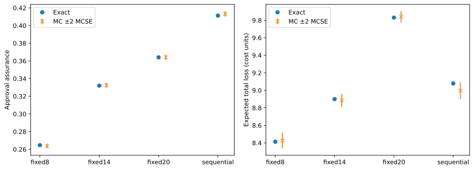
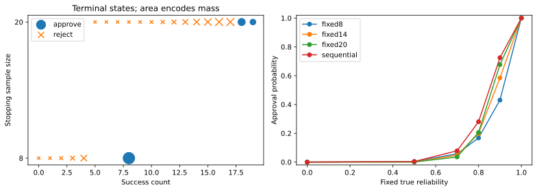

# A11 — Study design: evaluate the whole rule

A fictional laboratory tests protective seals. A seal either holds under a specified test or fails. The laboratory wants to approve a batch only when its underlying success probability exceeds 0.7. Before any tests are observed, should it commit to eight tests, twenty tests, or a rule that sometimes stops after eight? Predict which option has the greatest approval probability, which uses the fewest tests, and which has the lowest total loss. There is no reason those answers must name the same design.

This optional module builds on beta updating, predictive distributions, simulation, and decision analysis in L02, L03, L05, and L12. Allow 5–7 hours including the lab, investigation, and optional questions; this is an unpiloted planning estimate. It adds work beyond the selected twelve-week route. The goal is to evaluate a complete candidate policy, not to discover a universally optimal sample size. One observation is one completed test of a different seal. We assume immediate, correctly classified results and conditionally independent outcomes with a common reliability throughout a study.

## Two priors, two jobs

Let the unknown reliability be $p$. Conditional on it, each result is Bernoulli: $Y_i\mid p\sim\mathrm{Bernoulli}(p)$. The **design prior**, $p\sim\mathrm{Beta}(8,2)$, expresses uncertainty when anticipating possible studies. Its mean is 0.8. We use it to assign probabilities to future datasets and to average consequences across possible truths. It is optimistic about reliability; that optimism should be visible rather than hidden inside a simulation function.

The **analysis prior** is separately fixed at $\mathrm{Beta}(1,1)$. After $s$ successes in $n$ trials, the stipulated analysis reports $p\mid s,n\sim\mathrm{Beta}(1+s,1+n-s)$. Its tail probability

$$
q(s,n)=P(p>0.7\mid s,n)
$$

controls the decision. Different priors here do not mean that the same analyst must simultaneously hold contradictory beliefs. We are evaluating an analysis procedure under a particular prospective distribution. For example, a laboratory may be required to use a standard analysis while a sponsor has additional planning information. The design calculation asks how that stipulated procedure behaves if the planning assumptions are credible.

Do not insert both priors into one posterior. Nor should you use the analysis posterior to average planning losses merely because it is already available. The observation rule and the distribution used to evaluate it have different roles. Recording both prevents an apparently technical choice from silently changing the scientific question.

## Freeze the entire policy

We compare fixed sample sizes 8, 14, and 20 with one sequential policy. Fixed designs approve when $q\ge0.95$ at their only look and otherwise reject. The sequential policy looks after 8 and 20 tests. At eight, it approves if $q\ge0.95$, rejects for futility if $q\le0.10$, and otherwise continues. At twenty, it approves if $q\ge0.95$ and otherwise rejects. Twenty is a hard cap.

A test costs 0.25 loss units. Approving when $p\le0.7$ costs 190; rejecting when $p>0.7$ costs 10. Correct terminal decisions have no additional loss. These numbers are fictional judgments, not monetary estimates. They make false approval much more consequential than false rejection while allowing testing itself to matter. The probability threshold is a stipulated rule; it has not been derived as the optimal action for these costs and the design prior.

No extra looks, delayed outcomes, replacement of failed seals, or changing thresholds after a disappointing result are allowed. Such changes define another policy. Optional stopping is not a license to omit the stopping mechanism from a prospective comparison. A Bayesian posterior may remain coherent under a stated sampling rule while the probability of ever crossing a decision boundary changes substantially.

## Worked step 1: from an observed count to a decision

Suppose all eight initial seals hold. The analysis posterior is Beta(9,1), so

$$
q(8,8)=1-0.7^9=0.959646393.
$$

That exceeds 0.95 and leads to approval. A probability statement about reliability is being converted into an action by a declared threshold. It is not the probability that the next seal holds, which under this analysis posterior is $9/10$.

Before seeing any results, the design probability of eight successes is

$$
P(S_8=8)=\frac{B(16,2)}{B(8,2)}=\frac{9}{34}
=0.2647058824.
$$

The first calculation used the analysis prior to interpret a dataset. The second used the design prior to weight how often that dataset might arise. Confusing them would change assurance. Enumerating the other eight possible counts shows that at the first look, counts 0–4 stop for futility, counts 5–7 continue, and count 8 approves.

For a fixed $n$, all possible counts follow the beta-binomial predictive law,

$$
P(S_n=s)=\binom ns\frac{B(8+s,2+n-s)}{B(8,2)}.
$$

Multiply each count probability by its approval indicator and sum. That is **assurance**: the prospective probability that the analysis will declare success. It averages over uncertainty about the truth as well as sampling variability. It is not power at $p=0.8$, even though 0.8 is the design-prior mean; averaging a nonlinear decision probability generally differs from evaluating it at the average truth.

## Worked step 2: continuing paths and their loss

For a continuing first-stage count $s$, the design distribution updates to Beta(8+s,10−s). The number of additional successes among twelve new tests is therefore beta-binomial with those updated shapes. The joint probability of a two-stage path is its first-stage mass multiplied by that conditional second-stage mass. Reusing Beta(8,2) at the second stage would incorrectly erase information shared by all observations within a study.

At a terminal count $(n,s)$, let

$$
u(s,n)=P(p\le0.7\mid s,n,\text{design prior}).
$$

Conditional expected terminal loss is $190u$ for approval and $10(1-u)$ for rejection. Add $0.25n$, then average using terminal-state masses. This integrates the uncertain truth on the appropriate side of the reliability boundary. The stopping event gives no extra information about $p$ once an exchangeable sequence's sufficient counts are known, under this fully specified rule. Its effect still matters when calculating which terminal counts can occur and with what probability.

An independent calculation advances a probability distribution over states $(n,s)$ one trial at a time. Under the design prior, a success transition has probability $(8+s)/(10+n)$. It only checks decisions at declared looks. This method shares the mathematical model with count enumeration but uses a different computational route; agreement can expose missed paths or mistaken conditional weights.

A smaller exact anchor makes the structure inspectable. Use uniform design and analysis priors, reliability threshold 0.5, looks 2 and 4, success threshold 0.8, and futility threshold 0.2. Two successes at the first look approve, zero reject, and one continues. Each initial count has probability $1/3$. Conditional on continuation, the updated design prior is Beta(2,2); two further successes occur with probability $3/10$, the only successful continuation. Thus assurance is $1/3+(1/3)(3/10)=13/30$, and expected size is $2(2/3)+4(1/3)=8/3$. A fixed four-test design approves counts 3 or 4, each with probability $1/5$, giving $2/5$. Lab 26 independently enumerates all sixteen ordered paths using rational arithmetic.

## Try the exact policy before scaling up

[Open the guided stopping experiment](../../apps/bayesian/explorer.html#continuation-study-design). This deliberately small version uses uniform design and analysis priors, unlike the main reliability study's Beta(8,2) design prior. It implements the exact two-look anchor above, with no Monte Carlo noise. **Predict:** will allowing the first look change assurance even if the terminal success criterion stays fixed? **Change:** keep looks 2 and 4 and thresholds 0.8/0.2, then raise only the success threshold to 0.9. **Explain:** the default first-look posterior probabilities are 0.125, 0.5 and 0.875. Raising the success threshold removes early approval while retaining early futility; enumerate the surviving successful path. **Transfer:** compare assurance to approval probability at fixed truth 0.5. Why does substituting the design-prior mean for its distribution change the calculation?

| Policy (uniform priors, reliability boundary 0.5) | Assurance | Expected size | Approval probability at fixed truth 0.5 |
|---|---:|---:|---:|
| Default sequential, success threshold 0.8 | 13/30 = 0.433333 | 8/3 | 0.375 |
| Fixed four tests, success threshold 0.8 | 2/5 = 0.4 | 4 | 0.3125 |
| Sequential, success threshold 0.9 | 1/5 = 0.2 | 10/3 = 3.333333 | 0.0625 |

For the default rule, first-look counts zero, one and two each have design mass 1/3. Only count one continues, and its conditional chance of two further successes is 3/10, giving assurance 1/3 + (1/3)(3/10) = 13/30. This explains the default table without requiring JavaScript.

In the last row, only four successes approve: the two-success first stage now continues. The design probability of all four successes is 1/5; its fixed-truth probability at 0.5 is 1/16. These exact values, the earlier path derivation and the table form a complete offline and print alternative. The explorer also exposes terminal-state masses, including rejected states. Reset restores every default independently of the other explorers. This original unscored investigation saves no responses; the approval threshold is a posterior decision rule, not a guaranteed repeated-sampling error level.

## What the executed comparison says

The figure compares exact calculations with 100,000 prospective studies per policy. The following table is its numerical equivalent; loss includes test costs and terminal errors.

| Policy | Exact assurance | Expected tests | Expected loss |
|---|---:|---:|---:|
| Fixed 8 | 0.264706 | 8 | 8.413355 |
| Fixed 14 | 0.332016 | 14 | 8.899708 |
| Fixed 20 | 0.364027 | 20 | 9.830133 |
| Looks 8, 20 | 0.411226 | 15.493213 | 9.078560 |

More fixed tests improve assurance here, but increase expected total loss. The sequential rule has greater assurance than fixed twenty and uses fewer tests on average, yet fixed eight has the lowest expected loss among these four candidates. Calling the sequential policy “best” without naming the target would hide that tradeoff. None of these comparisons certifies global optimality among all possible stopping rules.

For the sequential rule, simulation gives assurance 0.413100 with MCSE 0.001557, expected size 15.499520 with MCSE 0.018372, and loss 8.997080 with MCSE 0.048482. The simulated loss is lower than its exact reference by about 0.08148, which is 1.68 MCSE. That difference is Monte Carlo noise in estimating an expectation, not evidence that simulation creates a better policy. All recorded simulation comparisons fall within five MCSE of the exact results. Count enumeration and recursion agree within the predeclared $10^{-12}$ tolerance and terminal masses normalise to one within that tolerance.

One reliability is drawn per simulated study, then retained for all its trials. Drawing a new reliability before every seal would produce a different dependence structure and the wrong distribution of counts. MCSE for a probability is approximately $\sqrt{\hat a(1-\hat a)/M}$; for size and loss, use sample standard deviation divided by $\sqrt M$. If no approvals occur, a zero estimated MCSE does not prove a zero population probability: report a finite-simulation upper bound. Fixed sample size has genuinely zero simulation variance and is returned as its exact integer.

## Assurance and fixed-truth behavior answer different questions

The terminal-state panel uses distinct markers for approve/reject. Marker area has a small visibility baseline plus 1,000 times probability mass; it increases with mass but is not directly proportional to it. Minimum-size marks can represent zero-mass, unreachable terminal counts. Use the numerical masses, not ratios of marker areas, for quantitative comparisons. The aggregate masses are 0.264706 for early approval, 0.110860 for early rejection, 0.146520 for approval at twenty, and 0.477914 for rejection at twenty. Only the two declared looks can end a study. These four numbers also explain the expected size: all studies pay for eight tests, while the remaining probability 0.624434 pays for twelve more.

For a fixed truth, the recursion replaces its predictive success probability by that constant $p$. The analysis rule remains unchanged. The plotted lines connect six evaluated truths as visual guides; they are not exact interpolation formulas. The sequential operating characteristics are:

| Fixed reliability | Approval probability | Expected tests |
|---|---:|---:|
| 0 | 0 | 8 |
| 0.5 | 0.004032 | 12.312500 |
| 0.7 | 0.078557 | 16.978972 |
| 0.8 | 0.280182 | 17.311355 |
| 0.9 | 0.724653 | 14.774101 |
| 1 | 1 | 8 |

At the boundary $p=0.7$, approval counts as an error under the declared loss. Its probability is about 7.86%, despite requiring a posterior tail of at least 95% at every approval. The two percentages condition on different objects. A posterior statement conditions on observed data and a prior; an operating characteristic conditions on a fixed truth and averages over data. Extra looks would require recalculation of the event “approve at any allowed look.” They cannot inherit a 5% guarantee from the posterior threshold.

## Changed givens: less optimistic planning

Before opening the worked lab output, replace only the design prior with Beta(3,2). Write down which quantities can change and which must stay fixed. Then recompute all four policies and explain the result. The analysis posterior, thresholds, action for a particular count, and fixed-truth operating curves must remain unchanged. Assurance, expected size under the design distribution, and design-averaged loss may change because datasets and truths receive new weights.

The executed reference obtains assurances 0.090909, 0.107843, 0.114907, and 0.141728 for fixed 8, fixed 14, fixed 20, and sequential respectively. Their expected losses are 6.119819, 6.838740, 7.892057, and 7.400578. Sequential expected size falls to 13.818182 because early futility becomes more common: its probability rises to 0.424242. Lower assurance and lower average loss can coexist when lower reliability makes rejection appropriate. Do not interpret loss reductions across different design priors as an improvement to the same policy under the same population.

This exercise tests an explanation, not just replacement of two beta parameters. Save your initial claim, run the changed calculation, and identify any mistaken assumption. A useful extension is to change a cost while leaving the rule frozen, distinguish reevaluation from redesign, and resist retroactively calling a revised rule validated by the original calculation.

## Limits and next steps

This prospective model assumes a stable common reliability and conditionally independent outcomes given that reliability; integrating over its uncertainty gives exchangeable, predictively dependent seal outcomes. Immediate outcomes exclude decisions made with pending tests. A fixed test definition excludes changes in stress level during the study. If those assumptions are implausible, adding more Monte Carlo replications only estimates the wrong prospective model more precisely. Costs also deserve sensitivity analysis: a decision recommendation is conditional on their meaning and relative magnitude.

The [worked lab](../../downloads/bayesian/labs/26_study_design.py) exposes `Policy`, count enumeration, recursion, and simulation separately. Its output is a reference containing answers; use it after saving a prediction. The method extends the decision-analysis logic in L12 from one expectation to an entire observation-and-action process. Primary background is the [Stan decision-analysis guide](https://mc-stan.org/docs/stan-users-guide/decision-analysis.html) and the finite predictive calculations discussed by [Wilson and colleagues](https://pmc.ncbi.nlm.nih.gov/articles/PMC9325402/); the seal scenario, costs, and results here are original teaching choices.

Complete the three optional [study-design questions](./exercises-continuation_questions.md#adv-study-design-1) after your investigation. They distinguish the two priors, require a new small stopping calculation, and challenge a false error-rate claim. Save an attempt before consulting the separately protected [worked solutions](./exercises-continuation_solutions.md#adv-study-design-1). Their optional marks do not alter core grading or mastery requirements.
