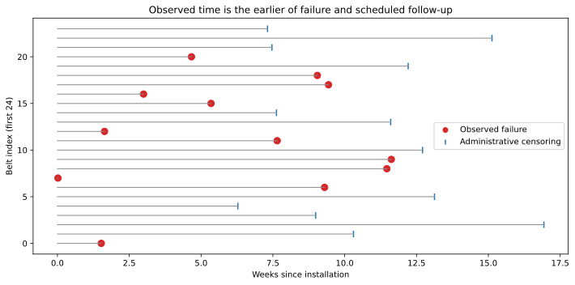
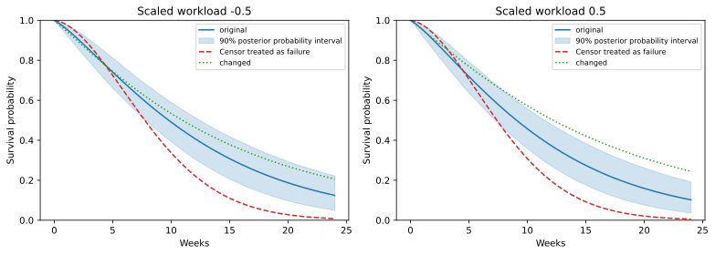

# A12 — Survival regression when observation ends first

A fictional factory installs ninety conveyor belts at different workloads. Some fail during follow-up; others are still running when their scheduled observation ends. What fraction of comparable belts would survive twelve weeks at a specified workload? Before calculating, predict what would happen if every last observed time were treated as a failure. Also predict what information a belt observed running for eleven weeks contributes, even though its lifetime is unknown.

This optional module follows continuous models, generalized regression, predictive checking, and observation models in L04, L08, L10, and A03. Numerical integration is also needed. Allow 6–8 hours including the lab and investigation, an unpiloted planning estimate beyond the selected core. The observation unit is one belt, followed from installation. Time is measured in weeks; workload $x$ is a dimensionless, predetermined scale. The target is a probability for a population under stated conditions, not a promise about any individual belt.

## Generate a lifetime, then generate its observation

Let $T_i>0$ be latent failure time and $C_i>0$ the administrative follow-up limit. We observe

$$
t_i=\min(T_i,C_i),\qquad \delta_i=1(T_i\le C_i).
$$

An event indicator of one means the failure time was observed. Zero means only that the belt survived beyond its last observation. Censoring is not a category of failure, an imputed lifetime, or a missing record to discard. The observation process is part of the model.

For the teaching data, workload is uniform on $[-1,1]$, the Weibull shape is 1.4, and its scale is $\lambda(x)=12\exp(-0.35x)$ weeks. Follow-up is independently uniform from six to eighteen weeks, conditional on workload. These choices generate reproducible synthetic data; they are not engineering evidence about belts. The generator's negative workload coefficient makes greater workload shorten lifetimes, but a small realized sample need not recover that coefficient precisely.

The fitted model leaves scale and shape unknown:

$$
\log\lambda_i=a+b x_i,\qquad k=\exp(r),
$$

with independent priors $a\sim N(\log12,0.6^2)$, $b\sim N(0,0.5^2)$, and $r\sim N(0,0.4^2)$. The second Normal argument denotes variance; software receives standard deviations 0.6, 0.5, and 0.4. The log scale is the logarithm of the numerical time measured in weeks. Changing time units therefore changes its intercept and prior location. Shape and workload slope remain dimensionless.

A positive $b$ lengthens lifetime in this parameterization. Increasing workload by one multiplies every conditional lifetime quantile by $e^b$. This is an accelerated-time interpretation. At a common shape, the corresponding hazard ratio is $e^{-kb}$, so it is not simply $e^b$. State the parameterization before interpreting a sign or exponentiated coefficient.

## Density, survival, hazard, and interval probability

For a Weibull lifetime,

$$
S(t\mid\lambda,k)=\exp[-(t/\lambda)^k],\quad
f(t\mid\lambda,k)=\frac{k}{\lambda}(t/\lambda)^{k-1}S(t),
$$

and $h(t)=f(t)/S(t)$. Survival is dimensionless. Density and hazard have units of inverse weeks. A density value is not the probability of failure at exactly that time; under a continuous model that point probability is zero. A small interval probability is approximately density times interval width, while a hazard describes the instantaneous event rate among survivors.

For fixed model parameters, failure between weeks eight and twelve conditional on survival to eight has probability

$$
1-\frac{S(12)}{S(8)}
=1-\exp\{-[(12/\lambda)^k-(8/\lambda)^k]\}.
$$

This integrates hazard over an interval and transforms the integrated rate. Multiplying the hazard at week eight by four weeks is only an approximation, and can be poor if the hazard changes markedly. The model permits decreasing hazards for $k<1$, constant hazard for $k=1$, and increasing hazards for $k>1$; it does not permit arbitrary peaks or multiple failure phases.

Administrative censoring contributes $S(t_i)$, because the recorded event is “still functioning through $t_i$.” Observed failure contributes $f(t_i)$. Conditional independence of censoring and lifetime, given recorded workload, lets us omit factors involving only the censoring distribution when learning lifetime parameters. That assumption is substantive: withdrawal after an unrecorded vibration warning would not be administrative censoring of this kind.

## Worked step 1: count failures, retain all exposure

Start with the exponential special case $k=1$, where the failure rate is $\theta=1/\lambda$ per week. Suppose failures occur at two and five weeks and a third belt is still running at four weeks. The likelihood is

$$
(\theta e^{-2\theta})(\theta e^{-5\theta})e^{-4\theta}
=\theta^2 e^{-11\theta}.
$$

There are two events but eleven belt-weeks of exposure. Discarding the censored record loses four informative weeks. Calling it a failure changes the power of $\theta$ from two to three and asserts an event that was never observed.

With a Gamma prior of shape two and rate ten weeks, multiplication gives Gamma(shape four, rate twenty-one weeks). Its posterior mean rate is $4/21=0.1904761905$ per week. The rate parameter of the Gamma distribution has units of weeks so that its product with the random failure rate is dimensionless. This convention differs from software's Gamma scale argument, which is the reciprocal of that rate.

Lab 27 independently integrates the unnormalized prior-times-likelihood density and its first moment. Their ratio agrees with $4/21$ to the recorded floating-point precision. Setting Weibull shape to one reproduces the exponential event-count/exposure log likelihood exactly in the fixture. These calculations test both the event power and the inclusion of censored exposure; a plausible survival curve alone would not reveal either mistake.

For the full synthetic dataset, the observed event count is 57 and total exposure is 754.938708 belt-weeks. Ignoring workload and assuming exponential lifetimes would give Gamma(59, 764.938708) for the rate. This is an anchor with stronger assumptions, not the fitted Weibull regression posterior. The full analysis uses the individual covariates and learns shape.

Every line begins at installation and stops at the earlier of failure or the follow-up limit. Circles and vertical ticks carry different likelihood contributions even when their positions are similar. Across all ninety records, 57 lines end in failure and 33 in censoring; observed exposure sums to 754.938708 weeks. The lab result contains every time, indicator, workload, and scheduled censor limit, providing a numerical equivalent to the displayed subset.

## Worked step 2: construct and integrate the regression posterior

Taking logs of the density/survival product gives

$$
\ell(a,b,r)=\sum_i\delta_i\{\log k-k\log\lambda_i+(k-1)\log t_i\}
-\sum_i(t_i/\lambda_i)^k.
$$

Only observed events multiply the density terms inside braces; every belt contributes cumulative hazard in the final sum. The code checks positive finite times, binary indicators, aligned covariates, and consistency with a supplied administrative schedule. A censored time must equal its follow-up limit; no observed time may exceed that limit.

There are only three unknown parameters, so this lab uses deterministic integration rather than Monte Carlo sampling. First, numerical optimisation finds a convenient posterior location and a positive-definite local curvature matrix. Its inverse supplies a coordinate scale. Tensor Gauss–Legendre nodes then span a box in those standardized coordinates, and each node receives the actual prior-times-likelihood weight multiplied by the integration weight and transformation determinant.

The Gaussian curvature defines coordinates; it does not replace the posterior by a Gaussian. Dropping the determinant would corrupt the normalizer. Dropping prior normalisation constants would also corrupt it, even when normalised posterior means happened to remain unchanged. The retained normalizer refers to continuous event-time densities expressed in weeks, not to the probability of observing an exact dataset.

Orders 31, 51, and 71 use standardized bounds ±7. A separate order-71 calculation expands the box to ±9. This sequence runs for the proper analysis, shorter-follow-up investigation, and deliberate censor-as-failure comparison. The predeclared thresholds are $10^{-4}$ for target survival/conditional-probability means, $10^{-3}$ for parameter means, and $10^{-3}$ for log normalizers. All comparisons pass. Across those scenarios, the largest parameter-mean change is about $5.42\times10^{-6}$, and the largest log-normalizer change is $3.62\times10^{-6}$.

The original and shortened-follow-up mode searches report precision loss, with gradient norms about $6.88\times10^{-6}$ and $2.34\times10^{-6}$. Those messages remain in the records. A failed optimizer termination is not relabeled successful. Here the mode is only a coordinate choice; positive curvature and subsequent independent order/bound checks establish the reported integration stability. They do not establish that optimisation found a unique global mode or prove a rigorous bound on every omitted posterior tail.

Independent references add different checks. Separate SciPy Weibull log-density/log-survival calculations agree with the hand-written fixture likelihood. Adaptive integration of the event density over positive time gives one within $1.34\times10^{-15}$. A tiny no-covariate posterior is integrated adaptively in two dimensions and compared with a separate tensor rule over the same bounded rectangle: its mean $S(12)$ is 0.2590747527, with absolute discrepancy $1.10\times10^{-10}$. That bounded fixture is not an exact reference for the ninety-belt regression.

## What survives to twelve weeks?

Solid curves use the proper observation model; shaded bands are pointwise 90% posterior intervals for a survival probability. Dashed curves deliberately treat every censored time as a failure. Dotted curves use shorter follow-up with the same latent lifetimes. The numerical equivalents at week twelve are:

| Analysis | Workload −0.5: mean S(12) | Workload +0.5: mean S(12) |
|---|---:|---:|
| Proper censoring | 0.409569 | 0.374833 |
| Censoring called failure | 0.224386 | 0.198027 |
| Shorter follow-up | 0.465652 | 0.507003 |

Under the proper fit, the low-workload 90% posterior interval is approximately [0.3080, 0.5152], and the high-workload interval [0.2737, 0.4812]. The mean high-minus-low contrast is −0.034736, with interval [−0.1690, 0.0994]. There is considerable uncertainty about the workload difference. The fitted mean slope is −0.076521, much nearer zero than the generating value −0.35. A synthetic truth does not entitle us to replace the realized inference with the expected story.

At workload zero, the posterior mean of the parameter-specific conditional failure probability during weeks eight–twelve is 0.312586, with interval about [0.2436, 0.3859]. Averaging $1-S(12)/S(8)$ over parameter draws answers that parameter-uncertainty question. The posterior predictive probability for a newly observed survivor involves $1-E[S(12)]/E[S(8)]$, because surviving to eight also changes the parameter weights. The two summaries need not coincide. Always name which conditioning operation was performed.

These intervals quantify uncertainty about probabilities. A future belt either survives or fails; it does not have an outcome inside the probability interval. For a specified belt drawn under the model, posterior predictive survival probability is the posterior mean of $S$. For many future belts, shared parameter uncertainty also induces dependence after parameters are integrated out.

## Reproduce observation, not just lifetimes

Posterior prediction draws a shared parameter vector, simulates ninety latent lifetimes at the recorded workloads, and then applies each belt's actual censoring schedule. Comparing uncensored simulated lifetimes directly with observed minimum times would compare different quantities. The lab uses 4,000 such replicated datasets and reports event fractions and observed mean times by workload half.

For low workload, the observed event fraction is 0.6383 and the replicated mean is 0.6057; its 90% replicated range is [0.4681, 0.7447]. For high workload, these are 0.6279 and 0.6273, with range [0.4651, 0.7907]. The observed mean times, 8.0885 and 8.7158 weeks, lie within the corresponding replicated ranges [7.1047, 9.7524] and [6.6966, 9.4492]. MCSEs for replicated mean event fractions are about 0.00141 and 0.00146. The broad ranges describe dataset variation, not MCSE. Passing these coarse checks does not validate every feature of the Weibull model.

Weeks-to-days conversion provides another diagnostic. Multiply all times and scales by seven and shift the prior mean of $a$ by $\log7$. Survival predictions remain unchanged. Each event density acquires a factor $1/7$, so the log likelihood shifts by minus the event count times $\log7$. The fixture checks that shift within $2.67\times10^{-15}$, and checks the transformed log-scale prior within $4.45\times10^{-16}$. Comparing raw density values across units without the Jacobian would produce a false discrepancy.

## Changed givens and limits

Save a prediction, then reduce administrative follow-up to Uniform(3,9) weeks using a separate stream while retaining the original latent lifetimes and workloads. Explain what is lost about twelve-week survival before inspecting the reference. The shorter schedule yields 26 observed events and 469.202003 belt-weeks. All follow-up now ends before the target time, making twelve-week inference more dependent on the assumed lifetime family and priors.

The fitted mean workload slope becomes +0.111167. The high-minus-low survival contrast is +0.041351 with a broad interval [−0.1263, 0.2086]. This sign change does not show that lower follow-up improves belts or reverses a causal effect. The likelihood contains less event-time information from this realized sample. Both displayed S(12) intervals widen here, but there is no universal theorem that every posterior interval must widen after every loss of observations. Their centres and shapes may change too. Weighted quadrature interval endpoints are approximate; the numerical convergence criteria above explicitly certify means and normalizers, not equally precise endpoint locations.

Finally, suppose a belt is removed after an unrecorded vibration alarm. Removal may predict imminent failure even conditional on recorded workload. The administrative-censoring factorization no longer applies. Record the alarm process if possible, consider a joint observation model or sensitivity analysis, and limit conclusions. More integration nodes cannot recover an unmeasured withdrawal mechanism. Competing risks, left truncation, recurring repairs, and operational replacement optimisation are outside this bounded lesson.

The [worked lab](../../downloads/bayesian/labs/27_survival.py) includes complete reference calculations. The [Stan survival guide](https://mc-stan.org/docs/stan-users-guide/survival.html) supplies methodological background; the equations are independently checked here. Attempt the three optional [survival questions](./exercises-continuation_questions.md#adv-survival-1), save your reasoning, then consult the protected [worked solutions](./exercises-continuation_solutions.md#adv-survival-1). Optional marks do not change core grading.
