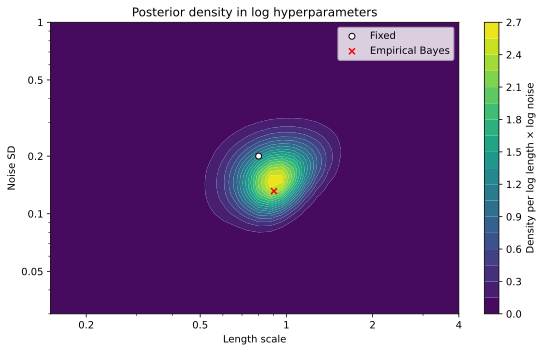
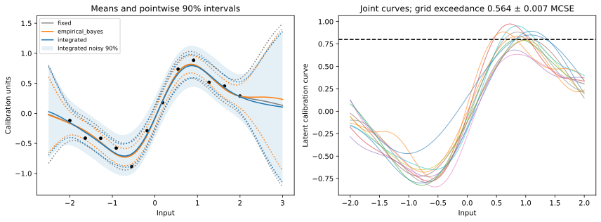

# A13 — Learn the smoothness, then predict the curve

A calibration instrument has been measured at twelve input settings. Between those settings, several smooth curves could explain the observations. Outside them, the curves disagree much more. Should we choose the smoothness that fits best, or carry uncertainty about smoothness into prediction? Before calculating, sketch two plausible curves through a noisy collection of points. Mark where their disagreement reflects measurement noise and where it reflects uncertainty about the latent calibration function.

This optional module follows [A06](./adv-06_gaussian_processes.md), with Gaussian conditioning and numerical integration from the appendices. Allow six to eight hours for the chapter, Lab 28, investigation and questions. It belongs to the computational depth route alongside [predictive combinations](./adv-14_predictive_combination.md), [fitted variational inference](./adv-15_variational_fit.md) and [splines](./adv-16_splines.md); those are alternative extensions, not compulsory intervening prerequisites. The breadth modules on [outcomes](./adv-10_outcome_regression.md), [design](./adv-11_study_design.md) and [survival](./adv-12_survival.md) ask the same foundational questions about observation units, targets and assumptions in different settings. None changes the selected twelve-week core or its grading.

## A curve and a measurement are different targets

Our observation unit is one calibration measurement at a known input. Inputs are dimensionless standardized settings; outcomes have calibration units. The synthetic observations use twelve equally spaced inputs from −2 to 2 and the mechanism

$$
y_i=0.6\sin(1.8x_i)+0.2x_i+\epsilon_i,\qquad
\epsilon_i\sim N(0,0.18^2).
$$

This mechanism creates a reproducible teaching dataset. It is not empirical evidence about an instrument, and the generating curve need not be a draw from the fitted prior. Knowing the generator lets us explain the exercise; the fitting functions receive only the observations.

We fit a zero-mean Gaussian process with covariance

$$
k_\ell(x,x')=\exp\{- (x-x')^2/(2\ell^2)\},
\qquad y_i\mid f,\sigma\sim N(f(x_i),\sigma^2).
$$

The amplitude is fixed at one calibration unit and the prior mean at zero. We learn the length scale and observation-noise standard deviation, with independent priors

$$
\log\ell\sim N(\log0.8,0.6^2),\qquad
\log\sigma\sim N(\log0.2,0.5^2).
$$

Normal notation here uses variance as the second argument; software `scale` arguments use standard deviation. Log-scale priors guarantee positivity without imposing hard scientific cutoffs. Length controls how rapidly function values can vary together. Noise describes repeat-to-repeat variation at an unchanged input. Sparse observations can leave these explanations partially confounded: a rapidly varying curve with little noise may explain similar data to a smoother curve with more noise.

Our point targets are latent values and future noisy measurements at inputs 0, 1 and 3. Input 3 lies beyond the measured range. We also ask for the average latent curve across a specified grid and the probability that any grid value exceeds 0.8. A pointwise interval cannot answer either curve question by itself.

## Worked example 1: condition two measurements by hand

Take inputs −1 and 1 and observations 0.2 and −0.1. Fix length at 0.8 and noise SD at 0.2. The training covariance has diagonal $d=1.04$ and off-diagonal $r=\exp(-2/0.8^2)$. Its inverse is

$$
C^{-1}=\frac{1}{d^2-r^2}
\begin{pmatrix}d&-r\\-r&d\end{pmatrix}.
$$

At the midpoint, both cross covariances equal $h=\exp[-0.5/0.8^2]$. Consequently the conditional mean is $h(0.2-0.1)/(d+r)$ and the latent variance is $1-2h^2/(d+r)$. The mean is about 0.042 and the latent variance about 0.613. Add 0.04 to that variance for a new noisy measurement. Check that both predictions share a mean; observation noise changes predictive spread, not the conditional expectation.

This calculation makes two useful distinctions. First, a GP prediction conditions on all measurements jointly rather than drawing a line independently through each neighborhood. Second, the training covariance includes measurement noise, whereas the latent query covariance does not. Adding noise everywhere would confuse uncertainty about the curve with uncertainty about an additional reading.

For twelve measurements the same formulas use matrix factorization instead of explicit inversion. With $C=K_\ell+\sigma^2I$ and cross covariance $K_*$,

$$
m_*=K_*^TC^{-1}y,\qquad
V_*=K_{**}-K_*^TC^{-1}K_*.
$$

Cholesky solves are numerically preferable to forming $C^{-1}$. A tiny diagonal jitter of $10^{-10}$ is used in variance units. Jitter is an arithmetic stabilization choice, not an extra learned noise component. The lab refits at zero and $10^{-8}$ jitter and compares the integrated noisy predictive 95th percentile at query $x=3$ with its value at the default jitter, using a $10^{-5}$ absolute tolerance. This is one targeted sensitivity check, not a check of every predictive summary.

## Three ways to handle unknown hyperparameters

The fixed analysis uses length 0.8 and noise 0.2. It provides a useful reference to the earlier GP lesson, but it deliberately treats two uncertain quantities as known. The empirical-Bayes analysis chooses the largest attained marginal likelihood,

$$
p(y\mid\ell,\sigma)=N(y;0,K_\ell+\sigma^2I),
$$

after integrating the latent training function analytically. This is not maximizing the joint density over twelve latent function values. The determinant in the marginal likelihood accounts for the volume of functions compatible with a hyperparameter setting, connecting the calculation to A02's distinction between a high peak and an integrated probability.

The empirical-Bayes optimizer starts from nine declared length/noise pairs. Every termination message, gradient norm and boundary hit is retained. Multiple starts reduce dependence on one initialization; they do not certify a global optimum. The attained setting is approximately length 0.905 and noise SD 0.131. The integrated posterior means are approximately 0.917 and 0.167. A posterior mean of hyperparameters is descriptive; substituting those means into one GP does not reproduce the integrated predictive distribution.

The full analysis multiplies the marginal likelihood by the two proper log-scale prior densities and integrates. Because integration coordinates are log length and log noise, those are the densities supplied to quadrature. Applying an additional exponential Jacobian would change the intended prior. Conversely, integrating in positive length/noise coordinates would require the corresponding lognormal densities.

The plotted surface represents posterior density per unit log length and log noise, obtained by dividing node probabilities by quadrature integration weights. The axes label positive length and noise on logarithmic scales. It is not a density per unit of positive length or noise; changing coordinates changes a density height. Read its broad support and dependence as well as the labelled colour scale. The posterior leaves several smoothness/noise explanations plausible. Fixed amplitude and mean remain assumptions even after both displayed quantities have been integrated.

## Worked example 2: build a mixture prediction

Suppose, for illustration, two posterior hyperparameter components have weights 0.3 and 0.7. At a query their conditional predictions are $N(-1,0.5^2)$ and $N(1,1)$. The mixture mean is $0.3(-1)+0.7(1)=0.4$. Its variance is

$$
0.3\{0.25+(-1-0.4)^2\}
+0.7\{1+(1-0.4)^2\}=1.615.
$$

The variance contains within-component uncertainty and disagreement between component means. Keeping only the weighted conditional variances gives 0.775 and discards that disagreement. The same identity works for vectors: integrated covariance is the mean conditional covariance plus the covariance of conditional means.

A mixture percentile is not a weighted percentile. To find its 90th percentile solve

$$
0.3\Phi((q+1)/0.5)+0.7\Phi(q-1)=0.9.
$$

A bracketed root finder supplies a value whose substituted CDF can be checked directly. The optional assessment asks you to perform that calculation with your own bracket. In the fitted lab, every hyperparameter node contributes one Normal CDF and its normalised posterior weight. Endpoints for the 90% intervals are roots at probabilities 0.05 and 0.95, not averages of node endpoints. The result record includes the CDF residual.

At input zero the integrated latent mean is about −0.076, with a 90% interval approximately [−0.257, 0.110]. The fixed analysis gives approximately [−0.305, 0.134]. Integration is narrower here because the data shift probability toward different hyperparameters than the chosen fixed reference. The law of total variance compares integration with the *posterior average* conditional variance, not with an arbitrary fixed model's variance. It therefore does not prove that every integrated interval must be wider than every plug-in interval.

The left panel separates latent intervals from the integrated noisy band. Extrapolation toward input 3 exposes differences that can be hard to see among the measured points. With the declared stationary, zero-mean prior, sufficiently distant predictions return toward zero and prior variability. That is a modelling consequence, not evidence that an actual calibration curve must return to zero.

## One random curve needs shared random quantities

For each replicated curve, draw one hyperparameter pair from its posterior. Conditional on that pair, draw one multivariate Normal function vector on the entire prediction grid. Do not redraw length separately at each query and do not replace the vector draw by independent marginal Normals. Both shortcuts destroy dependencies relevant to averages, slopes and threshold events.

On 31 equally spaced points from −2 to 2, trapezoidal weights are $1/30$ internally and $1/60$ at the endpoints. They sum to one because the integral is divided by the domain length. For each conditional Gaussian component, the average has mean $a^Tm$ and variance $a^TVa$. These one-dimensional Normals form another exactly specified finite quadrature mixture. Its fitted mean is approximately 0.0263 and its 90% interval approximately [−0.0565, 0.1096]. The lab compares simulated mean and variance against those analytic mixture moments, reporting target-specific Monte Carlo standard errors.

The threshold event is more difficult, so 5,000 joint draws estimate its probability. The result is 0.5642, with Monte Carlo error about 0.0070. The finer grid gives 0.5690, a paired increase of 0.0048. A paired refinement uses the same curves evaluated on 61 points, then subsamples every other point for the coarse grid. This isolates the effect of looking at more locations from the error caused by drawing another independent simulation sample. The larger grid can discover an exceedance between coarse points. Neither event is the exact continuum maximum; a continuous-path claim would require further work.

## Numerical evidence has several layers

The first quadrature order, 41 per dimension over six prior SDs, was insufficient: some extrapolation interval endpoints changed by roughly 0.004 on refinement to 81, beyond the declared 0.001 criterion. That failure remains recorded. The final analysis uses finer integration and an additional 161-point rule at the expanded eight-SD bound. CDF tolerance remains $10^{-4}$, endpoint tolerance $10^{-3}$ and log-normalizer tolerance $10^{-3}$. A failed coarse rule is useful evidence about resolution, not grounds to relax the tolerances.

Independently, the two-measurement fixture uses its explicit determinant and inverse inside adaptive two-dimensional integration. Agreement with the grid implementation checks more than re-evaluating the same vectorized formula. It is still a small fixture, not proof that every larger GP calculation is correct. Normalization, root residuals, jitter sensitivity, integration refinement and joint-functional simulation each address different possible mistakes.

None of these checks establishes that the squared-exponential covariance is scientifically appropriate. Abrupt calibration changes, nonstationarity, input error, outliers or correlated observation noise could make the fitted model misleading despite impeccable arithmetic. A useful criticism would compare replicated local differences and repeated-measurement discrepancies with observations. Extending the mean or amplitude model would create additional uncertainty rather than being silently covered by the current intervals.

## Check what remains shared in a future measurement

Suppose two future measurements are planned at the same input. They share the latent function value and the hyperparameters but have independent observation errors under this model. Their posterior covariance is therefore the integrated latent variance, while each marginal variance additionally includes the posterior mean noise variance. Their difference removes the latent value, leaving conditional variance twice the noise variance. This is why replication is informative about noise in a way that two measurements at different inputs are not: the latter difference also includes function variation. If repeat errors were correlated, that cancellation argument would need a revised observation model. Describe this dependence before simulating repeated readings, rather than independently drawing two entire latent curves. The distinction also helps interpret calibration averages: averaging repeated noisy readings reduces independent noise, but does not erase uncertainty about their shared latent mean. A posterior interval for that mean and a predictive interval for the next reading answer different questions even at the same input.

## Investigation: a repeated input

Before opening the changed-givens output in [Lab 28](../../downloads/bayesian/labs/28_gp_hyperparameters.py), predict what an extra independently noisy reading at the sixth existing input can tell us. Save your reasoning. The lab retains the original observations and adds one new reading from a separate stream. It then integrates the same model with the same priors and verifies refinement again.

Compare posterior noise and length means, latent predictions, and noisy predictions. Explain why replication directly informs repeatability without introducing a new input separation. It can help distinguish noise from local function variation, but one replicate cannot settle every covariance choice. Its realized discrepancy might shift noise upward or downward. Report the observed direction and explain it; do not retrofit an expectation that all intervals must expand.

Finish with the three [optional questions](./exercises-continuation_questions.md#adv-gp-hyperparameters-1). Attempt and save your work before consulting the protected worked feedback. A useful continuation project combines this chapter's uncertainty propagation with A16's learned smoothing comparison. Count that analysis once in your workload, and identify any optional activity it replaces. The methodological background is [GPML chapter 5](https://gaussianprocess.org/gpml/chapters/RW5.pdf) and the [Stan GP guide](https://mc-stan.org/docs/stan-users-guide/gaussian-processes.html); the synthetic analysis and numerical evidence here are local work.
