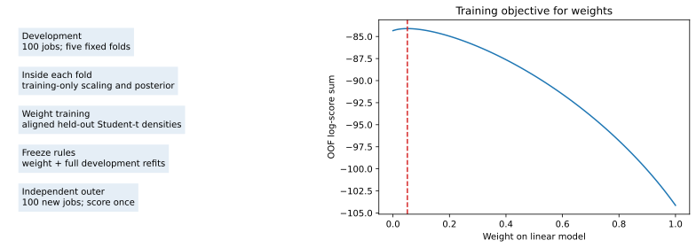
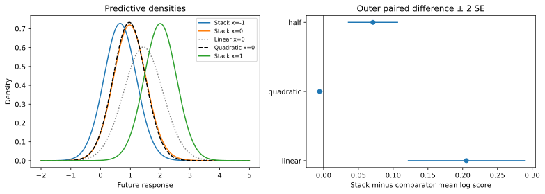

# A14 — Learn weights for predictions

Two regression models disagree about a future parcel-handling job. One is linear; the other allows curvature. Could a mixture predict better than either? Before fitting, describe what evidence would convince you. A combination that scores well on observations used to choose its weights has learned those observations. It still needs a separate predictive evaluation.

This optional module builds on regression, predictive checking and A02's discussion of model comparison. Allow five to seven hours including Lab 29 and the assessment. It extends the earlier conceptual explanation of stacking into an actual fitted workflow. It does not replace Bayesian model averaging or declare one combination method universally preferable. Within the seven-module continuation, A10 and A12 supply different outcome models that could later become candidates; A13 and A16 show how a single candidate can already integrate substantial parameter uncertainty. A15 asks whether approximating that uncertainty changes consequential predictions.

## Specify the unit and distribution being predicted

One row is one independent fictional job. A known scalar input describes its operating setting, and the outcome is a continuous handling response. We generate 100 development rows and later 100 independent outer rows using

$$
x\sim U(-2,2),\qquad
y=1+0.6x+0.35x^2+0.4\sin(2x)+\epsilon,
\quad\epsilon\sim N(0,0.5^2).
$$

The generator deliberately contains structure omitted by both candidates. A linear mean misses curvature and the oscillation; a quadratic mean still misses the oscillation. Neither label is a claim of truth. Our score evaluates a predictive *density for a future response*, not just an estimated mean. A candidate can have a plausible mean and poor variance, producing a poor log score.

The models share a conjugate prior convention. With $X$ their respective design matrices,

$$
y\mid\beta,\sigma^2\sim N(X\beta,\sigma^2I),\qquad
\beta\mid\sigma^2\sim N(0,\sigma^2V_0),\qquad
\sigma^2\sim IG(3,1).
$$

Here the inverse-gamma density is proportional to $(\sigma^2)^{-4}\exp(-1/\sigma^2)$. Thus the second parameter is the scale in the inverse-gamma convention, not a gamma rate applied directly to variance. Set $V_0=\operatorname{diag}(4,1,\ldots,1)$: the intercept has a larger prior variance multiplier than each nonconstant coefficient.

The linear design is $(1,u)$ and quadratic design $(1,u,u^2)$. Within each training set, $u=(x-\bar x_{train})/s_{train}$, using the population-SD divisor. That transformation is learned from inputs, so it belongs inside the fitting boundary. The outer values cannot influence it. This convention also defines the prior: changing coefficient coordinates while assigning fresh independent priors generally changes the prior over functions.

## Worked example 1: a predictive Student distribution

For a training matrix $X$ and outcomes $y$, conjugacy gives

$$
V_n=(V_0^{-1}+X^TX)^{-1},\quad m_n=V_nX^Ty,
\quad a_n=3+n/2,
$$

$$
b_n=1+\tfrac12(y^Ty-m_n^TV_n^{-1}m_n).
$$

At design row $h$, integrating coefficients and residual variance yields

$$
y_*\mid y\sim t_{2a_n}\left(h^Tm_n,
\sqrt{\frac{b_n}{a_n}(1+h^TV_nh)}\right).
$$

The second displayed argument is the Student distribution's scale, not its standard deviation. For degrees of freedom greater than two, its variance additionally multiplies squared scale by $\nu/(\nu-2)$. The leading one inside parentheses represents new observation noise. Dropping it would score a latent-mean distribution against noisy outcomes and make predictions excessively concentrated.

As a small independently checkable fixture, use inputs −1, 0, 1 and responses 0.2, 0.8, 1.4 under the linear model. Compute the training centre, SD, design and posterior, then evaluate the predictive density at input 0.4 and outcome 0.9. Lab 29 verifies that answer in a different way: integrate coefficients and variance jointly for the combined training and new response vector, evaluate the multivariate Student density, and divide by the training marginal density. Its log ratio agrees with the coefficient-space predictive calculation within $10^{-9}$.

For that fixture, the training centre is 0 and population SD is 0.816497. The posterior coefficient mean is (0.738462, 0.367423), with shape 4.5 and rate 1.163846. At input 0.4 the predictive mean is 0.918462, Student scale is 0.594752 and degrees of freedom are 9; the log density at outcome 0.9 is −0.427584. These intermediate values let you locate a disagreement in scaling, fitting or prediction before testing the joint-density ratio.

This identity tests the conjugate distribution and scale convention. It does not establish that the chosen polynomial mean or inverse-gamma prior is scientifically adequate. Posterior predictive checks for residual pattern and spread still matter. Nor does it imply that a mixture of Student distributions is itself Student; the final stack remains a mixture density.

## Why a held-out density matrix is necessary

A fixed, outcome-independent permutation assigns development IDs to five folds. For each fold and candidate, fit the input transformation using the other four folds, fit the posterior there, and evaluate a predictive log density at each held-out row's observed response. Put that result in the row's original position. The completed matrix has 100 rows and two columns. Every cell concerns the same observational unit and conditioning target as the other cell in its row.

Saving fold membership and transformations makes the information boundary inspectable. A low density should mean that a candidate predicted that observation poorly, not that rows were misaligned or one column used a different outcome transformation. Comparing a density in seconds with another in minutes without the relevant Jacobian would also invalidate the objective. Here all candidates score the same response in the same units.

No group effects occur in this synthetic example. In an application with sites or subjects, a held-out subject's outcomes cannot help estimate its effect. Decide whether the target is another observation from a known group or an observation from a new group. That decision controls fold construction, effect integration and scoring units. Merely moving a scaler inside the fold does not repair leakage through an estimated group effect.

The flow diagram shows two distinct uses of held-out information. Fold-held-out outcomes train the combination weights. They are not subsequently untouched evidence about those weights. The outer sample evaluates the entire frozen procedure. In the implementation, outer data are generated only after weight estimation, development refitting and a digest of the resulting rules have been constructed.

## Worked example 2: optimize densities before logs

Let $p_{i1}$ and $p_{i2}$ be the two held-out predictive densities for row $i$. The stacking rule chooses $0\le w\le1$ to maximize

$$
L(w)=\sum_i\log\{wp_{i1}+(1-w)p_{i2}\}.
$$

For a simple two-row illustration, take columns $(0.8,0.2)$ and $(0.2,0.8)$. At weight one half, each mixture probability is 0.5, giving total log score $2\log0.5\approx-1.386$. Either endpoint gives $\log0.8+\log0.2\approx-1.833$. The mixture benefits because each component compensates for the other's weak row. This does not make one half optimal for arbitrary data; the third row in the optional assessment changes the calculation.

Averaging log densities would instead optimise $w\sum\log p_{i1}+(1-w)\sum\log p_{i2}$, a linear function of the weight. It usually selects an endpoint and represents a different operation. Average the densities for each observation, then take its logarithm. The lab uses stable log-sum-exp arithmetic to avoid underflow when densities are very small.

For positive component densities, the derivative and second derivative are

$$
L'(w)=\sum_i\frac{p_{i1}-p_{i2}}{wp_{i1}+(1-w)p_{i2}},\qquad
L''(w)=-\sum_i\frac{(p_{i1}-p_{i2})^2}{\{wp_{i1}+(1-w)p_{i2}\}^2}.
$$

Concavity supplies a strong numerical check. At an interior optimum the first derivative should be near zero; at zero it should be nonpositive and at one nonnegative. The lab compares bounded optimisation with both endpoints and an independently evaluated grid of 10,001 weights. Its result passes the declared objective and derivative checks. A numerical optimizer alone would be weaker evidence, especially if it reported a point just inside a superior endpoint.

## What the fitted combination actually did

The learned weight on the linear model is approximately 0.05096; the remainder is on the quadratic model. This means the linear predictive density made a small useful contribution to the development objective. It is not a 5.1% posterior probability that the linear model is true. Stacking optimizes a predictive mixture within the supplied candidates, and its weights depend on those candidates, the scoring rule, and the development observations.

On the independent outer sample, mean log scores are approximately −1.08983 for linear, −0.87877 for quadratic, −0.95547 for the fixed half-and-half mixture, and −0.88451 for the fitted stack. Larger is better. The stack beats linear by 0.20532 units per row, with paired SE 0.04215, and the fixed mixture by 0.07096, with SE 0.01806. It loses to quadratic by 0.00574, with SE 0.00210.

The right panel reports differences using the same outer rows for both predictions. If $d_i$ is stack log score minus comparator log score, the estimated standard error is $s_d/\sqrt{100}$. Treating component scores as independent would discard this pairing. Two-SE bars are a familiar approximate uncertainty display, not an exact finite-sample confidence guarantee or evidence from repeated independent model-development exercises.

Empirical coverage of nominal 90% predictive intervals is 0.85 for linear and 0.90 for quadratic, the fixed mixture and the stack. Intervals for mixtures are computed by inverting the mixture Student CDF. Equal coverage does not mean equal predictive quality: interval width, density shape, and the locations of misses also matter. With only 100 outer rows, even coverage estimated at exactly 0.90 has appreciable sampling uncertainty.

The negative comparison with quadratic is a central finding. The learned mixture nearly selected that component, but the small addition that helped on development data hurt on this particular outer sample. This is compatible with correct optimisation. It also illustrates why a development objective cannot stand in for evaluation. After seeing the outer result, replacing the stack with quadratic might be a reasonable future decision, but that revised selection would need fresh evaluation before being presented as independently validated.

## Density scores depend on a declared outcome scale

A predictive density has reciprocal outcome units. If response units change by a positive factor c, the transformed density divides by c and every log score shifts by minus log c. When all candidates use the same transformation, their paired log-score differences stay unchanged because the common shift cancels. Comparing one candidate in the original units with another in transformed units without a Jacobian would instead create an artificial advantage. This provides a useful independent check of a scoring pipeline: transform the outcome and every candidate consistently, then verify that relative scores agree. Coverage alone would not reveal every such error, because interval endpoints might be transformed correctly while density normalisation is not. Before extending the lab to models of a logged response, write the predictive density on the actual scoring scale and identify its Jacobian explicitly. This is part of defining comparable predictions, not an optional numerical decoration after weight fitting.

## Investigation: duplicate a model

Save a prediction before running the changed-givens section of [Lab 29](../../downloads/bayesian/labs/29_predictive_combination.py). Duplicate the entire linear column of held-out predictions and optimise three simplex weights. Should the duplicate copies receive equal weight? Should their total weight change? What should happen to predictions if one copy gains exactly the weight lost by the other?

Because the duplicate columns are identical, the objective depends only on their combined weight. The lab runs two declared initializations. One solution splits the roughly 0.05096 total into about 0.01699 and 0.03397; another into about 0.03822 and 0.01274. Both give effectively the same density mixture, with maximum checked predictive discrepancy around $2.3\times10^{-8}$. Different individual weights are expected nonidentifiability, not automatically an optimizer failure.

This example warns against interpreting small differences in model weights as stable scientific rankings. Correlated or nearly duplicate candidates can produce similar instability without being exactly identical. Examine predictive differences, not just a sorted list of weights. A richer candidate library may help prediction, but choosing that library after inspecting outer errors uses the outer sample for development.

## A defensible workflow beyond this example

Start by stating what a future observation means, what covariates will be available then, and what the candidate predictive densities condition on. Freeze the transformation, prior, fold and scoring rules. Trace a particular row through those rules before trusting the full matrix. An outer design that differs from deployment cannot be repaired by precise weight optimisation. For dependent time series, random row folds may expose future information; for grouped observations, the group rather than the row may be the appropriate held-out unit.

Keep three claims separate in your report. The conjugate reference supports the density calculation. The grid and derivative checks support optimisation of the specified development objective. The outer comparison estimates performance of the frozen procedure on the stated population. None proves that the population will remain unchanged or that candidate models contain every scientifically plausible mechanism.

Attempt the three [optional questions](./exercises-continuation_questions.md#adv-predictive-combination-1), save your calculations and diagnosis, then consult feedback. A useful independent investigation substitutes survival or nominal-response candidates only after defining comparable predictive units; that is additional project work, not something already completed by this lab. The [loo stacking vignette](https://mc-stan.org/loo/articles/loo2-weights.html) and [stacking paper](https://arxiv.org/html/1704.02030v3) provide methodological background. Their examples are separate from this original synthetic analysis and do not validate its local results.
