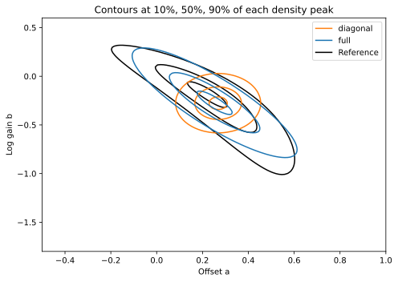
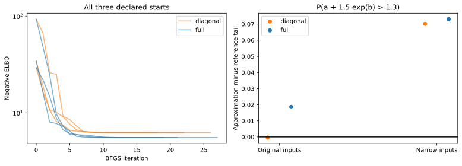

# A15 — Fit a variational posterior, then ask what it misses

A sensor has an unknown offset and a positive gain. You have twelve calibration readings and need to predict its response beyond the calibration range. A Gaussian approximation is quick to evaluate and convenient to store. Does a well-optimized Gaussian preserve the uncertainty that matters for this prediction? Before looking at a contour plot, explain how a larger gain could be compensated by a smaller offset over a short input range.

This optional chapter follows [A01](./adv-01_approximation.md), Gaussian regression and the optimisation and integration appendices. Allow six to eight hours for the worked lab, investigation and questions. A01 derives an optimal approximation for a Gaussian target; this chapter actually runs an optimizer for a nonlinear target. Optimization already appears elsewhere in the course, including proposal fitting and prior elicitation. The new step is optimising a variational distribution and separating its numerical convergence from its posterior accuracy.

Within the continuation, A13 and A16 integrate low-dimensional hyperparameters, while A10 uses sampling and A12 deterministic posterior integration. Those methods offer useful comparisons rather than a ranking of universally best algorithms. The common question is whether computational evidence supports the particular mean, covariance or tail being reported. None of these optional modules changes the core assessments.

## The scientific model comes first

The observation unit is a calibration reading at a known input. The fitted response model is

$$
y_i=a+\exp(b)x_i+\epsilon_i,\qquad
\epsilon_i\sim N(0,0.3^2),
$$

with independent priors $a\sim N(0,1)$ and $b\sim N(0,0.7^2)$. Offset $a$ has response units, while $b$ is log gain under the stated input/output convention. The gain is positive because it is exponentiated. The noise SD 0.3 is treated as known. The synthetic generator uses offset 0.25, log gain −0.4 and twelve equally spaced inputs from 0.2 to 1.2. This is an original teaching mechanism, not a validated description of a real sensor.

The response is nonlinear in $b$, so a Gaussian prior does not yield a Gaussian posterior in $(a,b)$. Conditional on a particular $b$, however, inference for $a$ is Gaussian. This partial conjugacy gives us a strong independent numerical reference while leaving a genuinely nonconjugate joint target for variational fitting.

We care about posterior gain, offset/log-gain covariance, and

$$
P\{a+1.5\exp(b)>1.3\mid y\}.
$$

The event concerns the latent mean response at input 1.5. A future noisy reading above 1.3 is a different event and would integrate an additional observation-noise tail. State which event informs your decision before choosing an approximation: a visually plausible posterior may still distort its probability.

## Choose a family, not just an algorithm

We fit two families in the original offset/log-gain coordinates. The diagonal family is $q(a,b)=N(a;m_a,s_a^2)N(b;m_b,s_b^2)$. The full family is a bivariate Gaussian with a free positive-definite covariance. Its lower-triangular factor has positive diagonal entries, represented by exponentials of unconstrained log scales. For a full factor, the second diagonal entry is a conditional scale parameter; the marginal SD of $b$ also depends on the off-diagonal entry.

Coordinate choice matters. A Gaussian in $(a,b)$ induces a non-Gaussian distribution for positive gain. A Gaussian directly in $(a,\exp b)$ would be a different family and could assign probability to negative gain unless constrained. Calling both “Gaussian VI” would conceal an important modelling approximation.

Maximizing the evidence lower bound,

$$
\operatorname{ELBO}(q)=E_q[\log p(y,a,b)]-E_q[\log q(a,b)],
$$

is equivalent to minimizing $KL(q\Vert p(a,b\mid y))$. The marginal likelihood is constant with respect to the variational parameters. The direction of KL matters: this objective penalizes placing approximation mass where the target density is small and can concentrate the approximation. It is not designed to match every marginal variance or every decision-tail probability.

A full covariance expands the family and cannot have a worse globally optimal ELBO than the diagonal subfamily. That mathematical ordering does not imply a smaller error for every particular target. The lab supplies a concrete counterexample for the decision tail, even when the full family's contour looks more convincing.

## Worked example 1: optimize a target whose answer is known

Before using the nonlinear model, fit a Gaussian target with mean $(1,-0.5)$ and covariance

$$
\Sigma=\begin{pmatrix}1&0.8\\0.8&1\end{pmatrix}.
$$

Its precision is $\Sigma^{-1}=(1/0.36)\begin{pmatrix}1&-0.8\\-0.8&1\end{pmatrix}$. The reverse-KL diagonal optimum has the correct mean and variances equal to reciprocal precision diagonals, both 0.36. They are not the target marginal variances of one. The full Gaussian optimum recovers the target covariance itself.

Actually run the optimizer for both families. Then compare its fitted means and covariance entries with these analytic answers to tolerance $10^{-6}$. This checks parameterization, entropy, gradients and optimisation together. Merely assigning the known answer would test neither the optimizer nor the chain of transformations it uses.

For the target's sum, variance is 3.6; the mean-field approximation gives 0.72. For the difference, target variance is 0.4, and mean-field still gives 0.72. The same approximate covariance understates one contrast and overstates another. “VI underestimates uncertainty” is an incomplete description unless you state the target and family. Changing the sign of correlation reverses which contrast is compressed, connecting this anchor to A01's changed-correlation investigation.

The Gaussian test passes in Lab 30. Its success is a bounded implementation check. It cannot prove that a Gaussian family approximates the nonlinear sensor posterior, just as a correct linear algebra routine cannot prove that an assumed scientific likelihood is appropriate.

## Worked example 2: evaluate the nonlinear ELBO

Let a joint Gaussian approximation have means $m_a,m_b$, variances $v_a,v_b$ and covariance $c$. Its exponential moments are

$$
E[e^b]=e^{m_b+v_b/2},\quad E[e^{2b}]=e^{2m_b+2v_b},
\quad E[ae^b]=(m_a+c)e^{m_b+v_b/2}.
$$

Expand the squared residual before taking expectations:

$$
E[(y-a-xe^b)^2]
=y^2-2ym_a-2yxE[e^b]+m_a^2+v_a
+2xE[ae^b]+x^2E[e^{2b}].
$$

The covariance contribution in $E[ae^b]$ is essential for the full family. Omitting it would optimise an incorrect objective while still allowing the code to produce smooth traces. Add the Gaussian prior expectations and analytic Gaussian entropy to obtain the ELBO. These identities make objective evaluation deterministic; they do not tell us the maximizing variational parameters.

Lab 30 uses BFGS from means $(0,0)$, $(0.7,-0.7)$ and $(-0.7,0.7)$, with initial SDs 0.5 and zero correlation. The declared maximum is 2,000 iterations and gradient tolerance $10^{-8}$. Complex-step derivatives avoid subtractive cancellation in the optimisation gradient. Independently, centred finite differences at fixed parameter points check those derivatives. Gauss–Hermite rules of orders 21 and 41 integrate the direct log joint at several fixed Gaussian distributions and check the closed-form objective to $10^{-7}$.

Every start retains initial and final objective, callback trajectory, gradient norm, iteration count, status and message. Some runs report precision loss even with small independently evaluated gradients. Those messages remain visible. Selecting the largest attained ELBO is a declared selection rule; deleting unfavorable starts or renaming precision loss as success would destroy useful diagnostic evidence.

## Build an independent posterior reference

Conditional on log gain $b$, define $r_i=y_i-e^b x_i$. The offset posterior has

$$
v_a(b)=\left(1+n/0.09\right)^{-1},\qquad
m_a(b)=v_a(b)\sum_i r_i/0.09.
$$

Integrating offset analytically leaves a one-dimensional log-gain density proportional to

$$
\exp\left[-\frac12\left\{\frac{\sum r_i^2}{0.09}
-\frac{(\sum r_i/0.09)^2}{1+n/0.09}+\frac{b^2}{0.49}\right\}\right].
$$

Terms constant in $b$ cancel when normalising posterior moments. The reference record's normalizer therefore concerns this proportional kernel; it should not be interpreted as the model's marginal likelihood. Direct two-dimensional integration includes the normalised joint density separately.

Adaptive quadrature integrates the kernel, moments and conditional Normal tail on [−5,5], then repeats on [−7,7]. The tail integral conditions on $b$, using the Gaussian probability that offset exceeds $1.3-1.5e^b$. This avoids approximating a discontinuous two-dimensional indicator on a coarse grid. Separate two-dimensional Gauss–Legendre rules of orders 121 and 181 cross-check means and covariances. These routes share the scientific model but differ in numerical reduction and implementation.

The expanded reference yields offset mean about 0.25451, gain mean 0.78593, covariance between offset and log gain −0.05270, and decision-tail probability 0.72942. Bound expansion changes the original tail by much less than $10^{-5}$. Reported adaptive error estimates and tensor discrepancies are numerical evidence, not mathematical guarantees about every omitted tail or every future dataset.

The contour levels are 10%, 50% and 90% of each distribution's peak density as approximated on the finite plotting grid: each displayed density is divided by its sampled grid maximum. They are not 10%, 50% and 90% enclosed-probability regions. The diagonal ellipse cannot follow the negative dependence; the full ellipse can tilt, but the nonlinear target has curvature and shape that an ellipse cannot reproduce. A good visual inspection names both successes and remaining differences.

## Read the targets, not just the trace

The diagonal approximation gives gain mean about 0.76609 and gain variance 0.01195, versus reference variance 0.05615. The full approximation gives mean 0.78839 and variance 0.04427. Its gain uncertainty is closer to the reference, though still compressed. Offset/log-gain covariance is zero by construction in the diagonal family and approximately −0.03769 in the full family, compared with −0.05270 in the reference.

Yet the diagonal decision tail is approximately 0.72906, exceptionally close to reference 0.72942, while the full approximation gives 0.74801. This is target-specific cancellation, not evidence that removing covariance is generally advantageous. The full approximation has the more flexible family and a better fitted objective, but the chosen event slices through the posterior in a way not summarized by either fact.

The optimization panel includes all starts, and the target panel compares probabilities with the independent reference. Keep three error sources separate. Optimizer error concerns reaching a good point within the chosen family. Family error is what remains when that family is optimised accurately. Scientific model error concerns the assumed response, prior, noise and observation mechanism. More iterations may address the first; a richer family may address the second; neither alone addresses the third.

R-hat is a diagnostic for comparing simulation chains, not a certificate for deterministic VI convergence. Likewise, drawing a million values from a fitted Gaussian can make its Monte Carlo error tiny while leaving its discrepancy from the target unchanged. In this lab the objective is deterministic, so noisy ELBO estimates do not explain persistent target differences.

## A prediction can hide a covariance error

For a future latent response at input x, the Gaussian approximation implies mean $m_a+xE[e^b]$ and variance $v_a+x^2\operatorname{Var}(e^b)+2x\operatorname{Cov}(a,e^b)$. The last covariance equals $cE[e^b]$. Near the observed calibration range, negative dependence can make the total response much more precise than either offset or gain alone suggests. Extrapolation changes the balance because the gain-variance term grows quadratically with input while the covariance term grows linearly. Checking only the posterior mean curve can therefore conceal both missing dependence and underestimated gain uncertainty. Compute these terms separately at an interior input and at 1.5, and explain their signs before looking at a total interval. This algebra does not make the response distribution Gaussian: exponentiated log gain is lognormal and correlated with offset. Moment agreement is a useful diagnostic but cannot substitute for the tail calculation used in the decision. Two distributions can share a mean and variance while assigning different probabilities to that event.

## Investigation: shorten the calibration range

Predict what happens when all twelve inputs lie between 0.2 and 0.5. Save an explanation before viewing the changed analysis in [Lab 30](../../downloads/bayesian/labs/30_variational_fit.py). The lab generates fresh readings from a separate random stream with the same offset, gain and noise mechanism, then repeats both fits and the independent reference. Narrowing the input range makes it harder to distinguish an offset shift from a gain change, while the event at input 1.5 becomes a longer extrapolation.

The actual changed reference tail is approximately 0.92573. The fitted diagonal and full Gaussian tails are about 0.99590 and 0.99883. Both substantially overstate that probability, and full covariance does not solve the problem. Reference gain mean is about 1.47288 in this realized sample, not the generating gain $e^{-0.4}$. Sampling variation and weak identification can move a posterior substantially; an analysis must report its observed result rather than force the fitted mean toward the simulation truth.

Compare the changed covariance, gain distribution and event probabilities with the original analysis. Explain why changing both design support and realized noise prevents attributing every numerical difference solely to range restriction. A paired investigation retaining a common noise vector could isolate that contrast more directly, but would be an additional experiment with its own declared design.

Finish the [optional questions](./exercises-continuation_questions.md#adv-variational-fit-1) before consulting worked feedback. For a continuation project, choose a consequential target before fitting and explain which independent reference would challenge your approximation. Count this work once if it also serves as your optional project. The [VI review](https://arxiv.org/html/1601.00670v9) explains the objective and family distinctions; [CmdStan's VI configuration guide](https://mc-stan.org/docs/cmdstan-guide/variational_config.html) motivates transparent optimisation records. The present deterministic SciPy implementation is not an execution of CmdStan ADVI.
