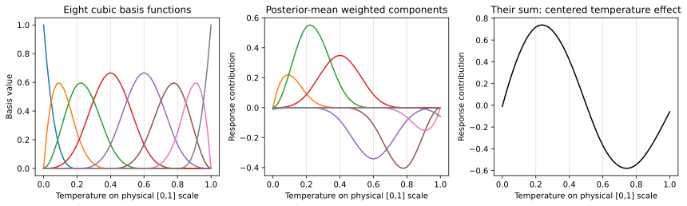
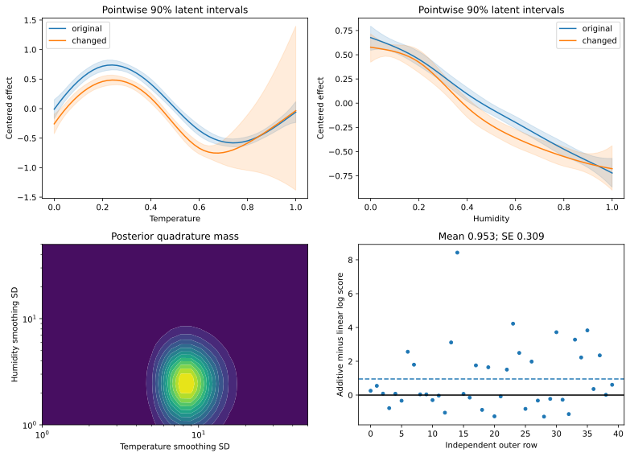

# A16 — Learn smooth additive effects

A coating process responds to both temperature and humidity. A straight line may miss a broad rise and fall, but a highly flexible curve can follow noise. How can we fit smooth effects while admitting uncertainty about how much curvature the observations support? Before looking at a spline basis, sketch a plausible temperature response and explain what observations near the boundary would tell you that observations near the centre would not.

This optional chapter extends the basis-expansion idea from regression into a fitted additive model with learned regularization. Regression, predictive evaluation and the linear algebra and integration appendices are prerequisites; A06 is helpful but not required. Allow six to eight hours including Lab 31, the changed-support investigation and questions. With A13, A14 and A15 it forms the computational depth menu, estimated at 23–31 additional hours. Combined with the breadth modules, the seven-module route adds 40–54 planning hours. These are unpiloted estimates, not a claim that everything fits into the old core schedule.

## State the observation model and its limits

One observation is an independently prepared coating under known temperature and humidity. The two predictors are scaled to predetermined physical ranges [0,1]. These are fixed units, not minima and maxima estimated from all available rows. The original synthetic mechanism is

$$
y=0.2+0.7\sin(2\pi x)+0.6\cos(\pi z)+\epsilon,
\qquad\epsilon\sim N(0,0.2^2),
$$

with independent uniform inputs. There are 80 training observations and 40 independent outer observations. The fitted model assumes

$$
y_i=\alpha+f_x(x_i)+f_z(z_i)+\epsilon_i.
$$

Noise SD 0.2 is known in this bounded example. Additivity means that changing temperature has the same mean-response effect at every humidity. An interaction, such as temperature becoming harmful only at high humidity, lies outside this model. Smooth marginal effects cannot automatically represent that mechanism.

Our targets include centred component effects, total mean responses, future noisy outcomes, and predictive performance against a matched linear model. The component curves describe the model under its identifiability convention; they are not causal effects of interventions. A scientific application would require assumptions about how temperature and humidity were assigned and which other process conditions were controlled.

## Worked example 1: a basis is a collection of fixed functions

Write a smooth effect as $f(u)=\sum_j c_jB_j(u)$. At a particular input suppose three nonzero basis values are $(0.2,0.5,0.3)$ and the associated coefficients are $(1,-0.4,0.8)$. Then the prediction is $0.2-0.2+0.24=0.24$. The functions may vary nonlinearly with the predictor, but for fixed inputs the prediction is a dot product and is linear in the coefficients.

This distinction explains why Gaussian regression algebra remains useful. Building a nonlinear design matrix does not make the conditional coefficient posterior non-Gaussian when the likelihood and priors are Gaussian. The difficult question becomes which coefficient combinations should be shrunk, and how much. Ordinary independent small-variance priors on all raw coefficients would impose a particular curve prior, but would not transparently separate slope from curvature.

The lab uses cubic B-splines with four fixed interior knots at 0.2, 0.4, 0.6 and 0.8. Boundary knots at zero and one repeat four times, producing eight raw basis functions. Their values are nonnegative and sum to one within the domain, including endpoint evaluation. Local support means that only a few contribute at most interior inputs. Knots divide the polynomial pieces; they do not mean the fitted curve must have a sharp corner there.

The figure follows the calculation from basis to weighted sum. Each middle-panel line is one raw basis function multiplied by its posterior-mean coefficient after the fitted centred effect has been mapped back to raw coordinates. The final line is their sum. Individual raw coefficients are coordinate-dependent quantities; the curve is the more useful scientific object. The plot therefore does not invite interpreting each coefficient as a separate physical mechanism.

## Worked example 2: penalize curvature, protect the nullspace

The derivative penalty is

$$
c^TRc=\int_0^1\{f''(u)\}^2du,\qquad
R_{jk}=\int_0^1 B_j''(u)B_k''(u)du.
$$

For $f(u)=a+bu$, the second derivative vanishes and the penalty is zero regardless of $a$ and $b$. For $f(u)=u^2$, the second derivative is two, so the penalty is exactly four. Lab 31 reconstructs these polynomials in the basis and verifies their penalties independently. It also checks that the raw penalty has exactly two numerically zero eigenvalues.

Each cubic basis has a piecewise linear second derivative. Products of those derivatives are piecewise quadratic, so three-point Gauss–Legendre integration on every knot interval is sufficient to integrate them exactly up to floating-point arithmetic. This is an actual integrated derivative penalty. An arbitrary second-difference penalty on coefficients may also encourage smoothness, but should not automatically be described as this exact continuous penalty, especially with different knot spacing.

A prior proportional only to $\exp[-c^TRc/(2\tau^2)]$ is improper. Moving arbitrarily far along either affine null direction leaves the penalty unchanged; integrating the supposed density along that direction diverges. A likelihood can sometimes make a posterior proper despite an improper prior, but that does not turn the prior into a probability distribution or make every comparison valid. Here we explicitly complete the model with proper priors.

## Identify the additive effects before fitting

An intercept and two unrestricted smooths are redundant: adding a constant to one smooth and subtracting it from the intercept leaves every fitted mean unchanged. We impose empirical training constraints

$$
\sum_{i\in train}f_x(x_i)=0,\qquad
\sum_{i\in train}f_z(z_i)=0.
$$

For each term, the mean row of its training basis defines a one-row constraint. An orthonormal nullspace matrix maps seven free coordinates into eight raw coefficients satisfying that constraint. Diagonalizing the restricted penalty then isolates one remaining zero-penalty affine direction and six positive-penalty directions. The training-derived transformation is stored and reused for future inputs. Recomputing centering using query rows would change the meaning of the fitted model at prediction time.

The intercept has prior $N(0,1)$. Each term's normalised affine coordinate also has prior $N(0,1)$. Each positive-penalty direction is divided by the square root of its penalty eigenvalue, making the penalty the squared norm of its new coordinates. Conditional on a smoothing SD $\tau_j$, those six coordinates receive independent $N(0,\tau_j^2)$ priors. Finally,

$$
\log\tau_x,\log\tau_z\ \stackrel{ind}{\sim}\ N(\log5,0.7^2).
$$

A larger smoothing SD permits more curvature; smaller values shrink it. Some software calls the inverse variance a smoothing parameter, reversing the verbal direction. Always state the parameterization. The normalised affine coordinate is not a slope in original physical units, so its unit-SD prior should be understood through its mapped curve. The lab draws 2,000 prior coefficient sets and reports mean-response intervals at fixed queries to make that induced scale inspectable.

## Integrate coefficients and smoothing uncertainty

Conditional on the two smoothing scales, the model is a proper Gaussian regression with known noise variance. If coefficient prior covariance is $D$, its posterior covariance and mean are

$$
V=(D^{-1}+X^TX/0.04)^{-1},\qquad
m=VX^Ty/0.04.
$$

Integrating coefficients gives a Gaussian marginal likelihood with observation covariance $0.04I+XDX^T$. The implementation works in prior-whitened coefficient space, which is smaller and remains stable when some prior variances approach zero. An independent tiny fixture evaluates the observation-space multivariate Normal density and conditioning formulas directly to check the coefficient-space calculation.

Numerical integration over log smoothing scales combines this marginal likelihood with their proper priors. Each quadrature node supplies a coefficient posterior and therefore a Normal distribution for any linear function of coefficients. The full predictive distribution is a mixture. Means and total covariance average conditional uncertainty and between-node differences; interval endpoints invert mixture CDFs. Adding 0.04 produces future-observation variance within every component. Averaging component endpoints would repeat the mixture-quantile mistake discussed in A13.

The initial rules used orders 31, 61 and 91 over six prior SDs, followed by an eight-SD expansion. In the changed-support analysis, the coarsest CDF comparison missed the $10^{-4}$ criterion by a small amount. That failed execution remains recorded. A further 121-point rule checks the expanded domain without relaxing mean, CDF, endpoint or normalizer criteria. This is numerical refinement after a documented failure, not tuning the model to improve its evaluation score.

## What the fitted curves and predictions show

Posterior mean smoothing SDs are approximately 9.14 for temperature and 2.76 for humidity. The greater permitted temperature curvature accords with a full oscillation across the domain, while the humidity mechanism makes a smoother half-wave. That interpretation is specific to the chosen derivative penalty and coordinate scaling; comparing these numbers to an unrelated basis parameterization would be misleading.

At humidity 0.5, predicted noisy-response means at temperatures 0.25, 0.5 and 0.9 are about 0.840, 0.114 and −0.244. Their 90% predictive intervals are approximately [0.494,1.186], [−0.231,0.458] and [−0.587,0.100]. These include residual variation, so they are wider than uncertainty intervals for the latent mean. The figures show component uncertainty rather than treating the plotted posterior mean as the whole result.

The posterior hyperparameter panel displays quadrature mass over log-scale nodes. The colours locate mass in this particular numerical grid; without dividing by integration weights they are not posterior density heights and should not be compared across quadrature resolutions. The effect panels compare the original fit with a changed training-support analysis. Their vertical zero points depend on each analysis's training-centering convention. A shifted component curve is not necessarily evidence of a changed physical effect; compare total response predictions as well as centred components.

## Compare a genuinely matched linear baseline

The baseline retains exactly the intercept and the two unpenalized affine directions, with the same proper priors as the additive model. It therefore matches the limiting model as both curvature SDs approach zero. A separately chosen raw slope prior might produce a different linear model and confound the comparison of functional flexibility with a change in prior scale. The lab verifies the small-$\tau$ limit numerically at $10^{-6}$.

Both fits are completed using training data before outer data are generated. Knots, physical units, centering, priors, noise assumptions and model definitions are not selected from evaluation outcomes. Prediction receives only query inputs; a separate scoring step receives outcomes. Tests also check that perturbing outer outcomes cannot alter a fitted transformation or its predictions.

On the 40 outer observations, additive minus linear mean log score is approximately 0.953, with paired row SE 0.309. Mean scores are about 0.046 and −0.907 respectively; positive log density is possible for a continuous outcome whose density exceeds one in its units. The additive model's nominal 90% predictive coverage is 0.925, or 37 of 40 rows. That small sample provides limited precision. The favorable comparison supports this frozen analysis on this synthetic population; it does not establish that additive splines outperform linear regression in general.

## Boundaries are modeling choices

Clamping the knots defines basis evaluation at the endpoints; it does not mean the fitted curve is flat there. Boundary behaviour is influenced by fewer nearby observations, proper nullspace priors and the curvature penalty. The implementation rejects inputs outside [0,1] instead of silently extending the terminal polynomial piece. A library's ability to extrapolate does not supply scientific justification for that extrapolation.

If an application needs predictions outside the physical range, choose and explain a boundary model: for example, a separately justified linear continuation, a saturating mean, or a mechanistic model. Then propagate its uncertainty and assess it where data are available. Such a model is additional work. It is not already supported by the present fitted intervals.

Even inside [0,1], weak data support can make predictions strongly prior-dependent. Predictor correlation can also make the division between two additive effects uncertain despite a well-estimated total mean. Sum-to-zero constraints remove exact algebraic ambiguity; they do not create information about every combination of temperature and humidity.

## Investigation: remove the warmest training settings

Before viewing the changed analysis in [Lab 31](../../downloads/bayesian/labs/31_splines.py), predict the consequences of dropping all training rows with temperature above 0.7 while retaining the same physical domain and knots. Save the prediction and name a query where loss of support should be especially consequential. The lab refits both smoothing scales and propagates their uncertainty using the retained rows.

At temperature 0.9 and humidity 0.5, the changed noisy interval is roughly [−0.939,0.874], compared with [−0.587,0.100] originally. Its mean shifts to about −0.047. This is extrapolation relative to observed training support, even though the query remains inside the permitted physical basis domain. Distinguish those two meanings of extrapolation. The changed smoothing means also increase, but one realized dataset does not establish a universal rule that removing observations increases smoothing SDs or widens every interval.

Explain why the component centering changes when rows disappear and why a total-response comparison is needed alongside the effect plot. Diagnose what an unmodeled temperature–humidity interaction would look like in residual checks. Finally attempt the three [optional questions](./exercises-continuation_questions.md#adv-splines-1), save your work and then consult feedback. For a continuation project, combine these ideas with A14's evaluation boundaries or A13's joint curve functionals, naming any displaced optional activity and counting shared analysis once. Background on basis construction appears in [Bayesian Modeling and Computation](https://bayesiancomputationbook.com/markdown/chp_05.html), while [smooth identifiability](https://www.stat.ethz.ch/R-manual/R-devel/library/mgcv/html/identifiability.html) explains why additive constraints need explicit treatment.
