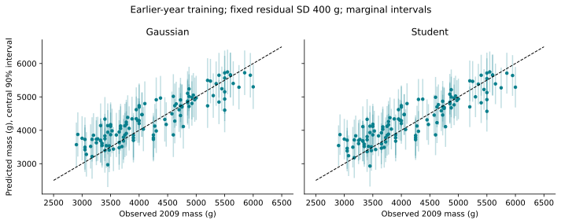

# Case 01 worked report — Penguin mass prediction

**Protected worked reference · C01.solution · answer-bearing. Exclude this entire report, the case script/notebooks, generated results and verification records from ordinary tutor retrieval and the answer-free learner export.** This is an original course analysis, not an ecological publication or independent human peer review.

## Question, population and provenance

The question is whether measured flipper length and bill dimensions support useful predictions of an individual adult's body mass. The target is a further measured adult resembling the sampled penguins, with predictors inside their observed range. It is not a global population mean, an intervention effect, or an extrapolation to juvenile penguins. Conditioning on recorded measurements makes the target operational: the model predicts from the measurements available to the field team, without claiming those measurements are error-free biological quantities.

The genuine public table contains 344 rows and eight fields. It is preserved byte-for-byte from palmerpenguins commit `8957207b78d6ccd1b4654a9dd9c9041b657478ab`, with SHA-256 `f204db2c753b0937caac3cb35258562c14f073e4bbc76be24b4c51ce22767a93`. Acquisition, the frozen raw URL and scientific citations are recorded in [provenance.json](../../downloads/bayesian/data/provenance.json). The maintainer states that the data are available under [CC0](https://allisonhorst.github.io/palmerpenguins/#license); the associated licence is preserved locally. The project's additional request to contact the investigator when preparing research publications is retained in provenance. No investigator contact or external publication was undertaken.

The observations concern adult penguins near Palmer Station, across three species and three islands in 2007–2009. The [upstream dictionary](https://allisonhorst.github.io/palmerpenguins/reference/penguins.html) documents their units and categories. Species and islands are not randomly assigned, and their support is uneven. The simplified table cannot establish independent nesting units. We do not create a nesting variable from adjacent rows. The analysis is predictive and deliberately leaves possible dependence as a limitation.

## Observation process and split

There are two missing entries in each of the four required measurement fields: the same two rows lack flipper length, both bill dimensions and mass. Excluding those rows leaves 342 records. The 11 missing recorded-sex entries overlap these omissions. Sex is not a predictor in the main model, so dropping every row with any missing field would unnecessarily change eligibility.

Training uses 223 eligible records from 2007–2008; the 119 eligible records from 2009 form the temporal holdout. This split tests a modest change in year within the available support. It is not a demonstration of transport to a new island, species or decade. The row is the scoring unit, although errors might be correlated within unrecorded nests or sampling occasions. Consequently, aggregate scores are descriptive comparisons, without independent-row standard errors attached.

Each of the three predictors is centred and divided by its training standard deviation, using divisor n. Held-out measurements use those same constants. Response mass is expressed as `body_mass_g/1000 - 4`, so coefficients operate in kilograms around a four-kilogram baseline. The script saves every transformation constant. A test alters all held-out flipper lengths and masses and verifies that the training design and scaling remain unchanged. Complete-case prediction assumes that the retained measurement process adequately represents the intended eligible population; this is an assumption, not a result from two missing records.

## Generative model, priors and prior prediction

Let x contain an intercept followed by standardised flipper length, bill length and bill depth. Let z be centred mass in kilograms. The main Gaussian model is

$$z_i\mid\beta\sim N(x_i^T\beta,0.4^2),\qquad
\beta\sim N\{0,\operatorname{diag}(1.5^2,0.8^2,0.8^2,0.8^2)\}.$$

All observations are conditionally independent under this working model. The intercept prior is centred at an actual mass of four kilograms. Each slope prior allows a substantial mass difference per training standard deviation. They are proper regularising priors, not estimates from the holdout. The residual standard deviation is fixed at 400 grams as a transparent teaching assumption. It is not a verified instrument-error standard deviation and it also represents unexplained biological variation.

The robustness comparison replaces the Normal residual with Student-t residuals of four degrees of freedom and scale 0.4 divided by the square root of two kilograms. Its residual variance is therefore also 0.16 square kilograms. Equal variance makes the tail comparison interpretable, but its central concentration differs. Degrees of freedom and residual scales are fixed; neither fit integrates uncertainty in these choices.

For prior prediction, draw a coefficient vector and one new residual for every training predictor row, then pool predicted masses across rows and draws. The Gaussian central 90% range is about 551–7,443 grams and the Student range about 621–7,398 grams. Approximately 2.89% and 2.70% of their predictions are negative. These are serious plausibility defects in broad unbounded priors, not negative observations in the dataset. They caution against treating the model as a credible population generator. We retain the declared reference fit to expose the failure and report narrower/wider prior sensitivity. A log-mass model or better elicitation would deserve a new analysis protocol and validation, rather than a silent retrospective repair.

## Inference and computational diagnostics

For Gaussian errors, let V0 be the prior covariance. Completing the square gives posterior precision V0 inverse plus X transpose X divided by 0.16. Solving this system yields the posterior mean and covariance; no optimisation or chain is needed. The coefficient mean is approximately [0.1971, 0.7166, 0.0202, 0.0719] kilograms. The flipper association dominates this particular linear prediction after simultaneous adjustment. Collinearity and omitted species structure make causal interpretations inappropriate.

The Student posterior is integrated by importance sampling. An optimiser finds a mode using analytic gradients and curvature. A multivariate Student-t proposal with five degrees of freedom is centred there; its shape is the inverse local posterior Hessian. Thirty thousand independent proposals receive weights proportional to the exact Student likelihood times the proper Normal prior, divided by proposal density. This is an approximation to posterior integrals, not a substitution of the mode for the posterior.

The saved run has importance effective sample size about 26,018 and maximum normalised weight 0.0000494. The largest mode-gradient component is below one trillionth. Coefficient mean Monte Carlo standard errors range from about 0.14 to 0.23 grams on the standardised coefficient scale. These diagnostics suggest stable integration of the reported means; they do not establish every tail or exclude all missed modes. Importance ESS is not chain ESS, and R-hat is inapplicable.

Three independent checks strengthen this assessment. First, joint Gaussian conditioning agrees with the conjugate precision calculation. Second, the importance routine is run against the Gaussian posterior whose exact answer is known. Third, a separate one-dimensional Student problem is integrated by adaptive quadrature in the tests. A second independent Student proposal run agrees within six combined Monte Carlo standard errors for the case coefficients. The tests uncovered and corrected a scalar-proposal array-shape issue; no failing output was accepted as verified.

## Posterior prediction and held-out results

The Gaussian predictive distribution integrates coefficient uncertainty analytically. Student log densities integrate over all weighted proposals; Student intervals invert the weighted Student predictive CDF directly, with root tolerance $10^{-11}$ kilograms, eliminating predictive resampling noise. Each scenario seed spawns distinct proposal, posterior-check and prior-check streams using [NumPy SeedSequence](https://numpy.org/doc/stable/reference/random/parallel.html); proposal draws are never replayed for prediction. Predictions are transformed back into grams. Log density also receives the required minus log(1000) change-of-units term. Omitting that term would make a per-kilogram density look like a per-gram score.

| 2009 marginal prediction criterion | Gaussian | Student-t |
|---|---:|---:|
| RMSE, grams | 404.63 | 401.69 |
| Mean log density per gram, higher is better | −7.4222 | −7.4817 |
| Central 90% interval coverage | 103/119 = 86.55% | 100/119 = 84.03% |
| Mean interval width, grams | 1,327 | 1,215 |

For predictive endpoint q, let $F_i(q)$ and $f_i(q)$ be the Student CDF and density for proposal i, with normalised importance weight $w_i$. Solve $\sum_iw_iF_i(q)=p$. The self-normalised importance estimate of its CDF standard error is $[\sum_iw_i^2\{F_i(q)-p\}^2]^{1/2}$; divide by $\sum_iw_if_i(q)$ for the delta-method endpoint MCSE. This is conditional on a suitable independent proposal with finite importance variance. It cannot detect unvisited posterior regions. The reported 238 endpoint MCSEs range from about 0.16 to 0.46 grams; a second independent proposal run checks both endpoints at the first, middle and last holdout rows against six combined MCSEs. A separate test integrates a small mixture density by quadrature and verifies its quantile probabilities. Whole-gram reporting is appropriate for these interval estimates; hundredth-gram endpoint claims are not.

These are marginal per-row scores averaged over the holdout, not the joint predictive density of all records. Student tails slightly improve squared-error prediction while its sharper centre gives narrower intervals and worse log score/coverage here. Robustness is not an automatic improvement in every loss function. Coverage below 90% is evidence to investigate, although one restricted holdout cannot determine population coverage precisely.

The figure compares predicted and measured 2009 mass in grams. Vertical intervals include residual and coefficient uncertainty under each fixed-scale model. The diagonal marks exact point prediction; it is not a fitted trend line. The scatter around it remains substantial for individual birds.

## Predictive criticism and sensitivity

Posterior predictive checks compare simulated residual arrays with residuals from observed training masses at the same sampled coefficients. The probability that a replicate maximum absolute residual exceeds its observed counterpart is about 0.443 under Gaussian errors and 0.938 under Student errors. Residual-standard-deviation tail fractions are about 0.632 and 0.469. The heavy-tailed model frequently generates a more extreme maximum than the data contain. These checks concern replicated training discrepancies; they are not out-of-sample accuracy measures or frequentist p-values.

Grouping residuals by recorded species reveals a more informative weakness than the pooled residual spread. Gaussian mean residuals are approximately +56 grams for Adelie, −255 grams for Chinstrap and +72 grams for Gentoo. The Student model still overpredicts Chinstrap by about 238 grams on average. Changing residual tails does not remove systematic mean structure. A species-aware mean function, interactions, or a nonlinear predictor could be worth exploring, but the small set of species/islands limits transport claims.

Multiplying all prior standard deviations by one half or two changes actual predictions, not merely a prior plot. Gaussian RMSE moves from about 404.32 to 404.72 grams; Student RMSE from 401.49 to 401.75 grams. Gaussian mean log scores range from −7.4214 to −7.4224. Student scores remain around −7.482; differences at this scale also contain integration error. Data dominate the coefficient priors for this design, but that stability says nothing about the assumed mean function or fixed residual scale.

A stricter eligibility analysis removes all 11 rows with missing recorded sex, leaving 216 training and 117 held-out records. Gaussian RMSE becomes 407.51 grams and mean log density −7.4294. This is a different eligible population and scoring set, so the change is not a paired estimate of missing-data bias. It demonstrates why a seemingly routine complete-case command can change the target. It cannot identify masses for the two fully unmeasured records.

## Stakeholder memo

For adults resembling the sampled penguins, these measurements support mass predictions with errors around 400 grams and individual uncertainty intervals wider than one kilogram. The heavier-tailed model slightly improves average squared error but has worse held-out density scores and lower interval coverage. There is no clear reason to replace the Gaussian reference solely because “robust” sounds preferable.

Both models systematically overpredict Chinstrap mass, and their broad priors allow impossible negative masses. We recommend refining the mean structure and prior predictive model, then checking them against new observations before operational use. These results do not establish accurate prediction for different populations or a biological effect of changing a measurement.

## Reproduction and limits

Run [the documented extension build](../../downloads/bayesian/labs/EXTENSIONS.md). Exact values, checks and hashes are in [19_case_penguins.json](../../downloads/bayesian/artifacts/results/19_case_penguins.json); source is [19_case_penguins.py](../../downloads/bayesian/labs/19_case_penguins.py). The reference models and sensitivity settings were specified before inspecting these saved scores. This report interprets their first holdout evaluation; it does not tune a winning model and claim fresh validation. Conditional scale assumptions, potential dependence, prior implausibility and restricted sampling remain unresolved scientific limitations.
