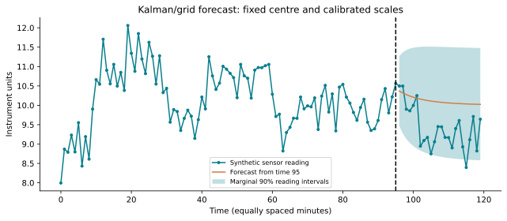

# Case 02 worked report — Forecast a noisy sensor

**Protected worked reference · C02.solution · answer-bearing. Exclude this report, the generator, case script/notebooks, results and verification evidence from ordinary tutor retrieval and the answer-free learner export.** The series is original synthetic teaching data. It provides no empirical evidence about a real instrument.

## Question, target and observation mechanism

An operator needs predictions for the next 24 one-minute readings of a process monitored by a noisy instrument. The target is the future observation, with a secondary interest in the underlying latent state. These differ because even a perfectly known state would not determine the next noisy reading. We also distinguish the uncertainty in a fitted historical state from uncertainty in a future state, which accumulates new process innovations.

The public CSV contains only `time_index` and `reading`, with exactly 120 ordered records and no missing values. Its units are fictional instrument units, sampled at equally spaced one-minute intervals. The generator uses a separate seed, 20260927, and the analysis uses seed 2020 for predictive simulation. The generator and its numerical truths are saved in [protected generating-process documentation](../../downloads/bayesian/data/generating_processes.md). File hashes, column definitions and source paths are in [provenance.json](../../downloads/bayesian/data/provenance.json). No downloaded series, proprietary instrument data or implied field study is involved.

Indices 0–95 are training observations. Indices 96–119 are held out as a single future trajectory forecast from time 95. This is a multistep forecast task, not 24 one-step predictions updated after each held-out observation. Within training, we also examine rolling origins 60–90 and horizons one and five. Every rolling origin refits persistence using only its available prefix. The final block is used once to describe the declared models; none of its readings update their forecast states.

The centre is fixed at 10 instrument units. We do not estimate a full-series mean and then pretend the holdout was untouched. Process variance 0.16 and measurement variance 0.09 are supplied as hypothetical calibrations. Fixing them makes a small, transparent numerical example; a real instrument would require defensible calibration evidence or a model for their uncertainty. Those two variances cannot be interpreted interchangeably.

## Generative and observation model

Write the centred latent process as x. Its stationary state-space model is

$$x_0\mid\phi\sim N\left(0,\frac{q}{1-\phi^2}\right),\qquad
x_t\mid x_{t-1},\phi\sim N(\phi x_{t-1},q),$$

$$y_t\mid x_t\sim N(10+x_t,r),\qquad
q=0.16,\quad r=0.09,\quad \phi\sim U(-0.95,0.95).$$

Innovations and measurement errors are mutually independent across time and between processes. The observation error is not a second autoregressive state. Stationarity gives a proper initial distribution, included in the likelihood. This differs from lab 17's conditional likelihood given its first observation. Both are coherent models; silently switching between them changes the inferential target.

The independent-reading baseline sets phi to zero with the same centre and variances. Its readings are then independent Normal variables with mean 10 and variance 0.25. It is intentionally simple and uses the same calibration information. It is not an unconstrained baseline whose variance has been tuned to the final holdout. This makes the comparison reproducible, while also limiting what a favourable comparison can establish.

The prior excludes a random walk and all explosive processes. Negative persistence remains possible before observing data. The upper limit 0.95 is substantive support information, not merely a numerical grid endpoint. Sensitivity to a prior favouring weaker persistence is examined below; the case does not claim exhaustive sensitivity over support bounds, drifting centres or non-Gaussian shocks.

## Prior prediction

For each of 4,000 prior draws, simulate a persistence parameter, a stationary initial state and a full 96-reading series. Include both innovation and sensor noise. This produces a pooled central 90% reading interval of approximately 8.986–11.019 units. Across trajectories, central 90% lag-one sample correlations run from approximately −0.732 to +0.706. A histogram of marginal readings alone would conceal this range of dynamics.

These simulations clarify the initial assumptions: the process fluctuates around a stable centre, and all changes occur within a stationary structure. They cannot represent drift in the nominal centre, a sudden calibration jump or a lasting regime shift. If the operator expected any of those mechanisms, the model would need revision before data fitting. Prior prediction therefore asks a scientific plausibility question, not whether a posterior will eventually become concentrated.

The finite prior support keeps stationary variance bounded, but trajectories close to the support limits still have appreciably larger marginal variation. A wider persistence range would alter prior trajectories and long-horizon uncertainty. This is one reason to record the bound alongside the fitted parameter, rather than describe the prior simply as “weak.”

## Inference and independent numerical checks

For a fixed phi, the Kalman recursion propagates a Normal filtered state. Starting with the stationary law, form the predictive state mean and variance, add measurement variance for the reading, accumulate its Normal log density, and update using the Kalman gain. We evaluate the complete training likelihood at 1,200 midpoint cells over the prior support. Posterior cell masses include cell widths and are normalised with log-sum-exp.

This yields a posterior persistence mean of 0.8599 and an approximate central 90% interval [0.7698, 0.9341]. The latter is obtained from the cumulative grid masses. Doubling resolution to 2,400 cells changes reported forecast means and variances by less than the predeclared 0.00002-unit numerical tolerance (variance comparisons are in squared units). Grid refinement addresses integration resolution, not the assumed support or calibration values. There are no Markov chains, so R-hat and chain ESS are neither available nor required.

A separate small-data reference constructs the entire multivariate Normal covariance of four observations, with stationary covariance between times proportional to phi raised to their separation. Its dense log density agrees with the summed Kalman predictive log densities. Direct Gaussian conditioning also agrees with the final filtered latent mean and variance. This checks initialisation, time order and measurement-noise addition independently of the recursive implementation.

Setting measurement variance to zero supplies another limiting check. The final filtered state then equals the last centred reading and has zero conditional variance; the joint likelihood reduces to the stationary first-observation density times the ordinary AR transition densities. Tests check multiple persistence values, including zero and negative persistence. They also verify multistep variance by repeated recursion instead of relying only on the geometric-sum formula.

The protected generator uses persistence 0.82, process standard deviation 0.4 and sensor standard deviation 0.3. Its persistence lies inside the saved posterior interval. That is a recovery illustration for one simulated series, not evidence of repeated-sampling calibration. The inference was made easier by supplying the true centre and noise scales. A broad simulation study would be necessary before claiming general parameter recovery.

## Forecast construction and evaluation

At each grid value, forecasts propagate the filtered state at origin 95. At horizon h, the latent variance is the propagated filtered-state variance plus the sum of new innovation variances. Add r for the future reading. Mixture means and variances then integrate over posterior phi, including the between-parameter variation in conditional forecast means. The script saves latent and reading variances separately.

The one-step forecast mean is 10.3676 units and its reading standard deviation is 0.5452. At horizon 24 the reading standard deviation is about 0.8852. Credible predictive intervals are computed by root-finding the Normal-mixture cumulative distribution, not by assuming that a mixture is Normal. The saved intervals are marginal central 90% intervals for each horizon; they are not a simultaneous band covering an entire path with 90% probability.

The dashed boundary separates training from held-out readings. The shaded band contains process, filtered-state, sensor and persistence uncertainty under the fixed calibration assumptions. Forecasts revert toward the supplied centre as the horizon grows. The graph does not draw a fitted state trajectory and label it a forecast.

On the 24-point final holdout, the dependent model has mean marginal log score −1.2238, compared with −1.5176 for the independent baseline. Higher is better on this common observation scale. Its RMSE is 0.8569 units, and 23 of 24 readings fall in the marginal 90% intervals. These readings are dependent and belong to one path, so that fraction is not 24 independent trials demonstrating coverage. The mean of marginal log densities is also not the joint log density of the future path.

The training-only rolling results prevent an overly simple victory claim. At horizon one the dependent and independent mean scores are −0.6340 and −0.6032; at horizon five they are −0.8170 and −0.5109. The independent baseline does better in both of these particular rolling comparisons. Their origins overlap and their future readings are reused across horizons, so these are dependent score observations too. Different stretches of one short series can favour different models. We retain the declared comparison instead of hiding the inconvenient scores or tuning the baseline after inspecting the final block.

## Posterior predictive criticism

For dynamic posterior checks, sample phi from its posterior and generate new stationary 96-reading trajectories. These are replicated experiments under the fitted model, not conditional forecasts continuing the actual last state. Compare two discrepancies: lag-one sample correlation and the standard deviation of first differences. The former probes persistence; the latter probes local roughness and the combined effect of process and observation noise.

Observed lag-one correlation is 0.7078. Its replicated central 90% interval is approximately [0.4886, 0.8656], and the fraction of replications at least as large is 0.4855. Observed first-difference standard deviation is 0.5864, versus replicated central 90% [0.5191, 0.6742], with tail fraction 0.5623. These discrepancies do not reveal a conspicuous mismatch on this series. Their simulation standard errors are roughly 0.008 near a half, using 4,000 independent replications.

Passing two discrepancies does not establish adequacy for drift, rare shocks or changing measurement quality. The data were generated within the fitted model class, and the scales were supplied correctly. Posterior checks here teach how to construct a comparison; they should not be presented as external validation of a real instrument or as a universal model-selection test.

## Sensitivity and operational implications

Keeping process variance fixed, lowering sensor variance from 0.09 to 0.04 changes the one-step mean to 10.4089 and standard deviation to 0.4734. Raising sensor variance to 0.16 changes them to 10.3217 and 0.6254. The noisier-sensor scenario gives less weight to the final reading and more uncertainty about the next one. This is an interpretable observation-process effect, not a numerical instability.

Changing process variance to 0.09 or 0.25 shifts the persistence mean to approximately 0.8984 or 0.8196. The model trades persistence against process noise when scales are supplied differently. Corresponding horizon-24 reading standard deviations are about 0.7726 and 0.9812. A concentrated posterior for phi conditional on one calibration cannot account for those between-model differences by itself.

The alternative persistence prior is a zero-centred Normal with standard deviation 0.35, truncated to the same stationary support. Its normalising constant cancels in posterior weighting within that scenario. It moves the persistence mean to 0.8413 and horizon-24 reading standard deviation to 0.8396. These are fixed sensitivity scenarios, not draws from a posterior over calibrations or prior choices. None was selected using final-holdout performance.

## Stakeholder memo

For this synthetic sequence, a dependent model forecasts the final block more successfully by mean log score than the specified independent baseline, but it loses in the two training-only rolling comparisons. We would not interpret one favourable block as reliable superiority across operating conditions.

Forecast uncertainty grows with horizon and changes materially when sensor or process noise assumptions change. Before using this approach for an actual instrument, obtain calibration evidence and validate on additional chronological periods, including any expected shifts in operating conditions. The current result demonstrates a transparent forecasting workflow under known simulation conditions; it does not justify an operational deployment claim.

## Reproduction and remaining limits

The [extension build guide](../../downloads/bayesian/labs/EXTENSIONS.md) runs the source and notebook offline. [20_case_sensor_forecasting.json](../../downloads/bayesian/artifacts/results/20_case_sensor_forecasting.json) contains all scenarios, actual checks and source hashes; [the source](../../downloads/bayesian/labs/20_case_sensor_forecasting.py) defines exact rolling origins and scoring conventions. Data generation is a separate reproducible command. Short duration, fixed centre/scales, restricted stationary support, dependent scores and the absence of regime changes remain substantive limitations. Numerical agreement cannot resolve them.
