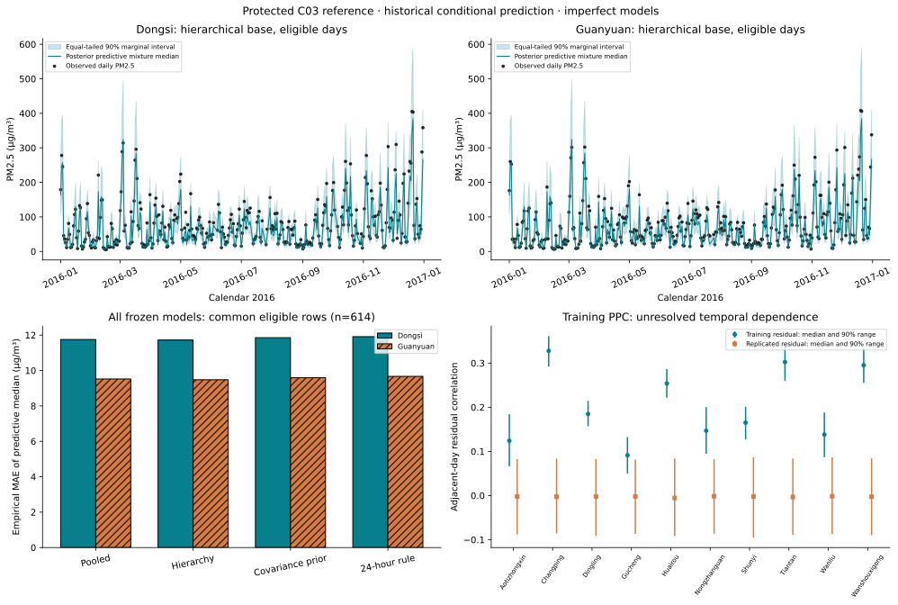

<!-- tutor-reference:start -->
# Case 03 — Protected reference solution

**C03.solution · answer-bearing review reference. Exclude this entire report,
case code/notebooks and results/figures from ordinary tutor retrieval and the
answer-free learner export.** Attempt the public brief and starter first.
Material model misfit remains, and environmental deployment adequacy is not
established. The comparison below concerns historical conditional prediction.
Diagnostic uncertainty uses unrounded values and excludes nonfinite results;
the reported fits and scores remain their original numerical observations.

## Target, data and evaluation boundary

We predict eligible 2016 PM2.5 at an omitted monitored station conditional on
observed wind and the complete 2016 outcome panel at ten other stations.
Training-year smoothing can use later other-site outcomes. This is historical
conditional prediction, not a forecast, causal wind analysis or exposure estimate.
No invented coordinates or adjacency enter the model.

The [offline daily CSV](../../downloads/bayesian/data/beijing_2016_daily.csv) adapts Chen (2017),
[UCI Beijing Multi-Site Air Quality](https://doi.org/10.24432/C5RK5G), under
[CC BY 4.0](../../downloads/bayesian/data/licenses/beijing_CC_BY_4.md). Acquisition on 2026-09-26
retained raw SHA-256 b04da438b2f331ac0ffd45aebdfec0d20d2367feb5f6948c4b1f7ce1191e33c4.
The released daily SHA-256 is
5db35bec396349bfebf21d13dec43947e24a20924246701b2f1d0b3ca762831d.
The [dictionary](../../downloads/bayesian/data/README.md) defines every field. Twelve sites × 366
dates remain. Both means use identical paired available hours; NA is missing,
zeros are observations, and no offset was added. Eligible training
concentrations were strictly positive. Base training uses 3,597 rows;
24-hour training uses 3,054. Missingness need not be random. Nearest-station
weather can share measurement error.

The identifier-hash split selected Dongsi and Guanyuan before outcome inspection.
Training outcomes and permitted final wind/eligibility were separate from
quarantined final concentrations. The acquisition custodian parsed final bytes
to partition/reproduce the dataset without displaying concentrations.
This is a workflow boundary, not OS-enforced secrecy.

SC01 replaced predictive-mean reporting prospectively. The analysis freeze,
recorded **2026-09-26 23:59:14 UTC**, has SHA-256
401ffb1d0a9c4ed0a5282df4c08a886f7af9c155e456e32994cef33d6adce829.
All four corrected predictions passed diagnostics/precision and were sealed
before **2026-09-27 00:19:30 UTC**, the first declared concentration access.
One scoring pass finished at 00:19:56 UTC. No score-informed refit followed.
The full CSV was released afterward. Future changes informed by these results
are **development** and need fresh outer validation for new performance claims.

## Models, priors and prior prediction

Use the observation and stationary AR(1) equations in the brief. Base-training
wind mean is 1.8382765984 m/s and population SD 0.7878380323 m/s; all models
reuse these constants. Center annual sine/cosine over all 366 days. States
transition across missing days, starting with variance
$a_u^2=\sigma_u^2/(1-\phi^2)$; there is no latent free mean or trend.

Illustrative teaching priors, not expert elicitation, are
$\alpha\sim N(\log50,1)$, $\beta\sim N(0,.5^2)$, each annual coefficient
$N(0,.5^2)$, $\sigma_y\sim HN(.5)$, stationary SD $a_u\sim HN(.75)$,
and $p_\phi\sim Beta(4,2)$ with $\phi=2p_\phi-1$.
Innovation SD $\sigma_u=a_u\sqrt{1-\phi^2}$ therefore has an induced prior.
For station effects, independently $\tau_0\sim HN(.5)$,
$\tau_1\sim HN(.35)$ and $(\rho+1)/2\sim Beta(\eta,\eta)$, with base $\eta=2$.
This is the bivariate LKJ identity, not a higher-dimensional formula.
Noncentered effects use

$$L=\begin{pmatrix}\tau_0&0\\
\rho\tau_1&\tau_1\sqrt{1-\rho^2}\end{pmatrix},\qquad b_j=L\xi_j,\quad
\xi_j\sim N_2(0,I).$$

Pooled sets station effects to zero with the same temporal/seasonal structure.
The covariance alternative changes only $\eta$ to 1; completeness changes only
eligibility to 24 paired hours. No prior bounds or tail clipping were added.

Fifty thousand prior draws (seed 242400) give a one-SD wind multiplier
90% range about [0.44,2.28]. At standardized wind zero, concentration
5th/50th/95th percentiles are approximately 4.20/50.00/589.92 µg/m³;
at wind +2, 2.02/49.32/1189.96. These broad tails express weak assumptions,
not environmental frequencies. Quantiles do not certify finite moments.

## C03.T1/T2: numerical evidence and model criticism

The grouped Gaussian Kalman likelihood retains within-day sums of squares,
$\log n_t$, Normal scale constants and the stationary initial law. It
integrates states while fitting; training-only smoothing propagates state
uncertainty into predictions. FFBS PPC uses one joint path per draw shared
across sites. New-site trajectories reuse one effect vector across dates.
Observation noise is additional to state, parameter, initial-state and
new-group uncertainty.

Independent dense covariance/filter/smoother and gradient tests cover gaps,
repeated observations, negative/zero persistence, near-zero process variance,
unit changes and wrong initialization. The tiny unknown-scale fixture uses
five calendar days, observations on days 0,0,2,3,4, and uniform priors on
$\phi\in[-.8,.8]$ and log scales in $[\log .08,\log .8]$.
Independent normalized dense Gauss–Legendre integration at 24 and 40 nodes
per dimension agrees within $3.11\times10^{-15}$.
Log evidence is −1.33650942797, $E[\phi]=.0073499005$,
$E[\sigma_u]=.2013306916$, $E[\sigma_y]=.2397553456$.
A real four-chain 1,000/1,000 sampler agrees for six moments and three CDF
probabilities within five MCSE plus integration error. This validates that
bounded fixture, not the environmental likelihood's adequacy.

The training propriety check independently used pivoted QR and SVD with
unrestricted day intercepts, station intercepts and station-specific slopes.
Residual sums of squares 110.54594 (base) and 84.96349 (24 hours) exceed the
declared margin. The resulting likelihood bound near residual SD zero
establishes posterior propriety and inverse residual-scale moments needed for
density-contribution MCSE. Proper priors alone would not establish this.

Every final role uses four chains, 1,000 warmup and 1,000 retained draws,
target acceptance .95, depth limit 10 and one sampling/BLAS core. The base
reuses an authenticated training execution; the other three are fresh final
executions. There are four real fits, not four new sampling runs in this slot.

| Model | Seed | Wall s (fit process) | Max R-hat | Min bulk / tail ESS | Min BFMI | Divergences / depth hits |
|---|---:|---:|---:|---:|---:|---:|
| Pooled | 242411 | 28.77 | 1.00395 | 2216 / 2136 | 0.938 | 0 / 0 |
| Hierarchy | 242401 | 147.46 | 1.00392 | 1057 / 1633 | 0.693 | 0 / 0 |
| Covariance prior | 242412 | 143.94 | 1.00741 | 928 / 1439 | 0.728 | 0 / 0 |
| 24-hour rule | 242413 | 155.39 | 1.00423 | 974 / 1483 | 0.726 | 0 / 0 |

Development failures remain preserved. A persistence-prior warmup proposal
rounded to an unrepresentable boundary. Rejecting that proposal with
negative-infinite density repaired arithmetic without clipping the model;
the repeated base posterior was bit-identical. A seasonal-prior run failed
R-hat (1.01144). Its prospectively recorded development-only repair used
2,000 retained draws; final fits kept 1,000. The final covariance fit emitted
a warmup overflow warning; retained diagnostics pass. Correlations with
pooled fixed-zero group summaries are undefined and explicitly stored as null.

**Material misfit remains.** Hierarchical-base station residual lag-one
medians range .091–.328; replicated independent residuals center near zero.
Station dispersion/skewness also disagree. Pooled and both alternatives
retain temporal discrepancies. Passing MCMC does not make these PPCs pass.
A richer residual model is a future development question.

Annual coefficients and corresponding state projections correlate approximately
−.998 and −.999. Proper priors did not orthogonalize realized paths. Interpret
the combined predictor, not separate environmental mechanisms. Base $\rho$
has median −.202 and 90% interval [−.614,.307]; covariance alternative
[−.694,.293], completeness alternative [−.667,.243]. Ten sites give weak
population-correlation information.

Training sensitivities changed persistence to Beta(2,2), stationary SD to
HN(1.5), and annual coefficients to N(0,1). At twelve declared training-design
anchors, maximum absolute log-median changes were at most .001921.
That limited check does not establish universal robustness or resolve the
decomposition/residual problems. All attempts remain in the development ledger.

## SC01 estimand and precision

For every retained draw, integrate residual, smoothed-state and new-site
variance, then invert the averaged CDF at .05/.50/.95. Float64 Brent inversion
uses component-quantile brackets, absolute tolerance $10^{-10}$, relative
tolerance $10^{-12}$ and CDF residual ≤$10^{-10}$. Neither component median
averaging nor an exponential-of-average shortcut is used. Marginal density
includes the physical-scale $-\log c$ Jacobian.

The hierarchy has a sufficient infinite-mean condition
$|x|>\sqrt{1-.5^2}/.35=2.4743583$; sixteen eligible final-weather rows exceed
it, determined without concentrations. Below that sufficient threshold we make
no finite-mean assertion. The sufficient second-moment condition holds at
any nonzero standardized wind. All four models use the same mixture-median
point rule. No physical predictive mean or variance is reported or assumed finite.
Finite simulated averages cannot prove integrability. Finite empirical MAE/RMSE
do not establish finite posterior risk or Bayes optimality. Observed log
density also does not establish finite expected logarithmic loss.

Within-chain batches of 25 and 50 retain the larger MCSE estimate. Prescore
limits are .01 CDF MCSE, .02 log-median MCSE and .03 log-endpoint MCSE.
Per-row log-density MCSE must be ≤.05 nats. All passed, including observed
concentrations; largest final log-quantile MCSE was .00308.

| Model | Max observed log-density MCSE (nats) | Native mean-log-density MCSE (nats) |
|---|---:|---:|
| Pooled | 0.00191 | 0.000076 |
| Hierarchy | 0.03147 | 0.003085 |
| Covariance prior | 0.03761 | 0.003402 |
| 24-hour rule | 0.04213 | 0.003540 |

Native aggregate log-density MCSE retains shared posterior-draw dependence.
No independent-day standard error or two-site confidence interval is reported.
MCSE concerns numerical error under adequate exploration; predictive intervals
concern model-conditional observation uncertainty. Neither captures all model
error or uncertainty about transfer to other sites.

## C03.T3: one final comparison

Each site has 366 days. Base counts are 348 Dongsi and 362 Guanyuan (710
total), with 18 and 4 ineligible days. Strict counts are 295 and 319 (614
total), with 71 and 47 ineligible. No eligible outcome caused support,
integrity or precision failure; no row was silently dropped.
Every model is compared on the same 614-key intersection.

**MAE/RMSE are empirical errors of the posterior predictive mixture median**,
in µg/m³. Log density is mean marginal log predictive density in nats, using
numerical µg/m³; higher is better. Coverage is empirical coverage of equal-tailed
90% marginal intervals; width is their mean width in µg/m³. Marginal intervals
are not simultaneous bands and marginal log scores are not a trajectory density.

Native eligible rows:

| Model | Site | n | MAE | RMSE | Log density | Coverage | Width |
|---|---|---:|---:|---:|---:|---:|---:|
| Pooled | Dongsi | 348 | 12.120 | 18.756 | -3.8585 | 0.960 | 55.01 |
| Pooled | Guanyuan | 362 | 9.381 | 14.612 | -3.7080 | 0.986 | 54.49 |
| Hierarchy | Dongsi | 348 | 12.073 | 18.663 | -3.8843 | 0.968 | 60.13 |
| Hierarchy | Guanyuan | 362 | 9.335 | 14.522 | -3.7459 | 0.992 | 59.54 |
| Covariance prior | Dongsi | 348 | 12.203 | 18.834 | -3.8935 | 0.968 | 60.77 |
| Covariance prior | Guanyuan | 362 | 9.451 | 14.679 | -3.7544 | 0.992 | 60.17 |
| 24-hour rule | Dongsi | 295 | 11.909 | 18.991 | -3.8512 | 0.976 | 59.27 |
| 24-hour rule | Guanyuan | 319 | 9.670 | 15.285 | -3.7510 | 0.991 | 59.10 |

Identical common eligible rows:

| Model | Site | n | MAE | RMSE | Log density | Coverage | Width |
|---|---|---:|---:|---:|---:|---:|---:|
| Pooled | Dongsi | 295 | 11.751 | 18.713 | -3.8208 | 0.973 | 55.38 |
| Pooled | Guanyuan | 319 | 9.521 | 15.046 | -3.7170 | 0.987 | 55.18 |
| Hierarchy | Dongsi | 295 | 11.722 | 18.635 | -3.8512 | 0.980 | 60.57 |
| Hierarchy | Guanyuan | 319 | 9.476 | 14.959 | -3.7549 | 0.991 | 60.31 |
| Covariance prior | Dongsi | 295 | 11.850 | 18.806 | -3.8603 | 0.980 | 61.23 |
| Covariance prior | Guanyuan | 319 | 9.589 | 15.115 | -3.7634 | 0.991 | 60.95 |
| 24-hour rule | Dongsi | 295 | 11.909 | 18.991 | -3.8512 | 0.976 | 59.27 |
| 24-hour rule | Guanyuan | 319 | 9.670 | 15.285 | -3.7510 | 0.991 | 59.10 |

Paired differences on 614 identical keys (alternative minus pooled):

| Alternative | MAE | RMSE | Log density | Coverage | Width |
|---|---:|---:|---:|---:|---:|
| Hierarchy | -0.0371 | -0.0820 | -0.0343 | +0.0049 | +5.158 |
| Covariance prior | +0.0830 | +0.0814 | -0.0431 | +0.0049 | +5.804 |
| 24-hour rule | +0.1536 | +0.2582 | -0.0322 | +0.0033 | +3.901 |

Base hierarchy changes common-row median MAE by only −.037 µg/m³ versus
pooled, while mean marginal log density changes by −.0343 nats and width
increases by 5.16 µg/m³. Both sensitivity variants have higher common-row
errors than pooled. These finite differences do not establish a stable ranking
in a wider site population. We did not use scores to refit a new claimed winner.

Coverage exceeds .90, often approaching .99; broad intervals do not establish
precise calibration. The 24-hour native population differs from base. Common
rows fix the evaluation keys, but its training population still changes; this
comparison cannot identify missingness bias. Training misfit remains even
when held-out scores look useful.

## Reproduction and cost

The [percent-cell script](../../downloads/bayesian/labs/24_case_air_quality.py),
notebook,
[finite result](../../downloads/bayesian/artifacts/results/24_case_air_quality.json) and
[accessible SVG](../../downloads/bayesian/artifacts/figures/24_case_air_quality.svg) contain answers.
Ordinary offline execution verifies manifests, arrays, diagnostics, seals and
the one saved score record. It never silently fits, fetches data or scores again.
Missing/stale evidence raises. Internal trace/cache paths are author evidence,
not learner downloads.

Planning targets were 5–20 minutes per fit, ≤60 minutes for all four roles,
RAM ≤2 GB and retained evidence ≤100 MB. Actual evaluation was **632.05
seconds (10.53 minutes)**, including reused-base execution/inspection, three
new fits, diagnostics, state recovery, sealing/scoring, and a conservative
59.11-second cold-backend charge. Individual fits were faster than the target
range. Measured scoring process time was 26.76 seconds, including 25.47
seconds in outcome loading/reconstruction/scoring.
Peak sampled process-tree RSS was **553,680,896 bytes**; 50-ms sampling can
miss shorter peaks. Retained evidence at scoring was below 100 MB.

Hardware: Intel Core i7-1265U, 12 logical CPUs, Linux, Python 3.12.8 and pinned
dependencies including PyMC 5.28.5. Sampling/BLAS used one core. Posterior
and warmup arrays preserve chain/draw axes. No daily log-likelihood cube or
all-model component cube is retained. Manifests retain full versions,
dimensions, dtypes, seeds and time scopes.

Separate development includes 950.05 seconds across six completed runs and
about 115.98 seconds for the aborted persistence attempt, whose CPU/RAM
are unknown. Completed-run CPU is parent CPU, not total compiler CPU.
The reused base appears in both the development ledger and final-role
allocation: do not add overlapping scopes as unique work. Acquisition,
unknown-scale fixture, prior sensitivity, backend and inspection costs remain
recorded. Raw archive/environment are separate from working storage.
Notebook replay is actual execution of verification, not fresh sampling.

## Stakeholder memo (under 250 words)

We evaluated historical daily pollution predictions at two omitted monitoring
sites using their wind and concurrent data from ten other sites. Every model
and comparison was frozen before the two sites' concentrations were examined.
The hierarchy gave almost the same median prediction error as the pooled
model, with wider intervals and slightly worse marginal log predictive density
on common eligible days. Sensitivities do not establish a reliable improvement.

These conditional reconstructions of 2016 measurements do not forecast future
pollution or estimate personal exposure. Missing hours and weather matching
limit interpretation. Residual temporal dependence, unequal station dispersion
and weak separation of seasonal/shared daily effects remain. Ten training sites
give broad correlation uncertainty. High interval coverage on two sites does
not establish calibration across Beijing.

Computation passed its declared checks, but adequacy remains open. A richer
residual model would be development informed by current evidence. It requires
genuinely fresh outer validation before a new performance claim. No operational
or health decision is justified by this reference alone.
<!-- tutor-reference:end -->
