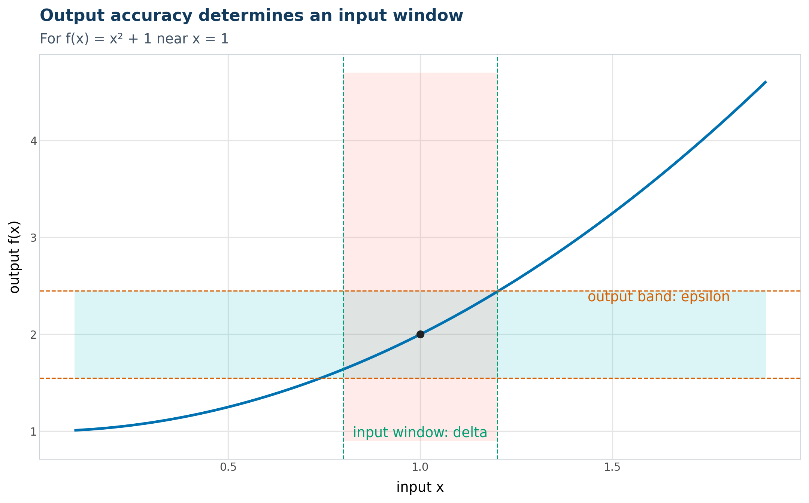

# Limits and continuity {#sec-limits}

An average rate uses an interval. Instantaneous change asks what happens as that interval shrinks toward zero, where direct substitution often creates $0/0$. A **limit** records stable nearby behavior without requiring the function to be defined at the target point. This separation between “near” and “at” is the conceptual hinge of calculus.

## Approaching a value

We write
$$
\lim_{x\to a} f(x)=L
$$
when values of $f(x)$ can be made as close to $L$ as desired by taking $x$ sufficiently close to, but not equal to, $a$. A two-sided limit exists only when the left-hand limit $\lim_{x\to a^-}f(x)$ and right-hand limit $\lim_{x\to a^+}f(x)$ both exist and agree.

**Worked example.** For $x\ne3$,
$$
\frac{x^2-9}{x-3}=x+3.
$$
Therefore $\lim_{x\to3}(x^2-9)/(x-3)=6$, even though the original quotient is undefined at $3$. Cancellation did not repair the function at the point; it exposed its nearby behavior.

Graphical and numerical evidence can suggest a limit but cannot establish it for every nearby input. A table may miss a spike, and pixels may hide oscillation. Symbolic reasoning or a definition-based estimate supplies the guarantee.

## Limit laws and techniques

If $\lim f=L$ and $\lim g=M$, then sums, products, and scalar multiples behave as expected; quotients do too when $M\ne0$. Polynomials can be evaluated by substitution, and rational functions can be evaluated wherever the denominator's limit is nonzero.

Indeterminate forms are prompts for more analysis. The form $0/0$ does not have a value: it can conceal any finite limit, an infinite limit, or no limit. Factoring, rationalizing, or comparison may reveal the behavior.

The **Squeeze Theorem** says that if $g(x)\le f(x)\le h(x)$ near $a$ and both outer functions tend to $L$, then $f(x)\to L$. Because $-|x|\le x\sin(1/x)\le |x|$, we get $\lim_{x\to0}x\sin(1/x)=0$ despite unending oscillation.

A foundational trigonometric result, with angles in radians, is
$$
\lim_{x\to0}\frac{\sin x}{x}=1.
$$
Geometric bounds on the unit circle prove it. This limit later yields derivatives of sine and cosine.

## Precision: epsilon and delta

The formal definition makes “arbitrarily close” operational.

<div class="callout callout-note">
<p class="callout-title">Definition: finite limit</p>

We say $\lim_{x\to a}f(x)=L$ if for every $\varepsilon>0$ there exists $\delta>0$ such that
$$
0<|x-a|<\delta \quad\Longrightarrow\quad |f(x)-L|<\varepsilon.
$$
The output tolerance $\varepsilon$ is chosen first; we respond with an input tolerance $\delta$.

</div>

The quantifier order matters. One rule for choosing $\delta$ must work for every input within that window, though it may depend on $\varepsilon$.

**Worked proof.** Show $\lim_{x\to2}(3x-1)=5$. Given $\varepsilon>0$, observe
$$
|(3x-1)-5|=3|x-2|.
$$
Choose $\delta=\varepsilon/3$. Then $0<|x-2|<\delta$ implies $|(3x-1)-5|<3\delta=\varepsilon$. The proof begins by translating output error into input error.

For nonlinear expressions, one often adds a preliminary restriction. To prove $x^2\to4$ as $x\to2$, write $|x^2-4|=|x-2||x+2|$. Requiring $|x-2|<1$ ensures $1<x<3$, so $|x+2|<5$. Taking $\delta=\min(1,\varepsilon/5)$ completes the control.

<figure id="fig-epsilon-delta">


<figcaption>

Figure 2.1: Input windows map into prescribed output bands for a continuous function.

</figcaption>
</figure>

[Figure 2.1](#fig-epsilon-delta) depicts the logical order: the horizontal $\varepsilon$ band is the requirement, and the vertical $\delta$ band is chosen to satisfy it. The picture guides a proof but does not replace the universal quantifiers.

## Infinite behavior

Writing $\lim_{x\to a}f(x)=\infty$ means values exceed every positive bound near $a$; infinity is not a real output. For $1/x^2$, both one-sided limits at zero are $+\infty$. For $1/x$, the sides have opposite signs, so there is no two-sided infinite limit.

Limits at infinity describe end behavior. Dividing numerator and denominator by the highest power shows
$$
\lim_{x\to\infty}\frac{5x^2-x}{2x^2+7}=\frac52.
$$
This identifies a horizontal asymptote, not a barrier the graph cannot cross.

## Continuity and existence theorems

A function is **continuous at $a$** when $f(a)$ is defined, $\lim_{x\to a}f(x)$ exists, and the two are equal. It is continuous on an interval when the appropriate one-sided condition holds at endpoints and continuity holds internally. Sums, products, compositions, and valid quotients of continuous functions remain continuous.

The **Intermediate Value Theorem** states: if $f$ is continuous on $[a,b]$ and $N$ lies between $f(a)$ and $f(b)$, then some $c\in[a,b]$ satisfies $f(c)=N$. It proves existence without necessarily locating $c$. Since $x^3+x-1$ is continuous, negative at $0$, and positive at $1$, it has a root in $(0,1)$.

The **Extreme Value Theorem** says a continuous function on a closed, bounded interval attains both an absolute maximum and minimum. Each hypothesis matters: $f(x)=1/x$ on $(0,1]$ has no maximum, and $f(x)=x$ on $(0,1)$ attains neither endpoint value.

Discontinuities can be removable, jump-like, infinite, or oscillatory. In applications, a discontinuity may represent an actual switch, a measurement convention, or the failure of a simplified model. It is not automatically an error.

<div class="callout callout-warning">
<p class="callout-title">Common pitfalls</p>

- Substituting at a hole reports the function value problem, not the limit.
- Left and right limits must agree for a two-sided limit.
- $\infty-\infty$ and $1^\infty$ are indeterminate descriptions, not arithmetic.
- The Intermediate Value Theorem requires continuity throughout the whole interval.

</div>

<!-- inline-formula-code:start -->
## Formula and finite computation

A useful formula in this chapter is

$$
c_n=\frac{a_n+b_n}{2}
$$

Bisection translates the Intermediate Value Theorem into nested intervals. The following standalone Python block expresses that finite rule with its inputs and stopping conditions visible.

```python
from collections.abc import Callable
from math import isfinite

def bisect_root(
    function: Callable[[float], float],
    left: float,
    right: float,
    tolerance: float = 1e-10,
) -> tuple[float, int]:
    """Return a root bracket midpoint and the iteration count."""
    if not all(isfinite(value) for value in (left, right, tolerance)):
        raise ValueError("endpoints and tolerance must be finite")
    if tolerance <= 0.0 or left >= right:
        raise ValueError("require left < right and a positive tolerance")
    f_left = function(left)
    f_right = function(right)
    if not all(isfinite(value) for value in (f_left, f_right)):
        raise ArithmeticError("nonfinite endpoint value")
    if f_left == 0.0:
        return left, 0
    if f_right == 0.0:
        return right, 0
    if (f_left < 0.0) == (f_right < 0.0):
        raise ValueError("the endpoints must have opposite signs")
    for iterations in range(4096):
        if right - left <= tolerance:
            return left / 2.0 + right / 2.0, iterations
        middle = left / 2.0 + right / 2.0
        if not left < middle < right:
            raise ArithmeticError("midpoint stagnation before tolerance")
        f_middle = function(middle)
        if not isfinite(f_middle):
            raise ArithmeticError("nonfinite midpoint value")
        if f_middle == 0.0:
            return middle, iterations + 1
        if (f_left < 0.0) != (f_middle < 0.0):
            right = middle
        else:
            left, f_left = middle, f_middle
    if right - left <= tolerance:
        return left / 2.0 + right / 2.0, 4096
    raise RuntimeError("bisection evaluation budget exhausted")

root, steps = bisect_root(lambda x: x**3 - x - 2.0, 1.0, 2.0)
print(root, steps, root**3 - root - 2.0)
```

**What the computation establishes.** For a continuous real target with reliable finite signs, the bracket supplies a location bound. Bisection rejects nonfinite input/evaluations, stalled midpoints and exhausted 4096-update budgets; each callback must terminate. A computed zero is not an exact-root proof.
<!-- inline-formula-code:end -->

## Summary

Limits formalize controlled nearby behavior. Limit laws reduce many calculations to algebra, while squeezing and epsilon–delta estimates establish cases where substitution is inadequate. Continuity connects limits to function values and enables powerful existence theorems. Always separate evidence from proof and identify the interval and hypotheses being used.

## Exercises

<div class="exercise" id="calculus-02-limits-continuity-ex-1">
<p class="exercise-title"><strong>Exercise 1</strong></p>

Evaluate $\lim_{x\to4}(\sqrt{x}-2)/(x-4)$ by rationalizing.

<details class="solution"><summary>Solution</summary>

For Chapter 2, Exercise 1,
$$
\frac{\sqrt{x}-2}{x-4}
\frac{\sqrt{x}+2}{\sqrt{x}+2}
=\frac{1}{\sqrt{x}+2}
$$
for $x\ne4$. Therefore the nearby expression tends to $1/4$ as $x\to4$. We did not assign a value to the original quotient at $4$; we replaced it by an equal expression on a punctured neighborhood.

</details>

</div>

<div class="exercise" id="calculus-02-limits-continuity-ex-2">
<p class="exercise-title"><strong>Exercise 2</strong></p>

Find both one-sided limits of $(x+1)/|x+1|$ at $-1$.

</div>

<div class="exercise" id="calculus-02-limits-continuity-ex-3">
<p class="exercise-title"><strong>Exercise 3</strong></p>

Prove directly that $\lim_{x\to-1}(2x+7)=5$.

</div>

<div class="exercise" id="calculus-02-limits-continuity-ex-4">
<p class="exercise-title"><strong>Exercise 4</strong></p>

Build an epsilon–delta proof for $\lim_{x\to3}x^2=9$ using a preliminary bound.

</div>

<div class="exercise" id="calculus-02-limits-continuity-ex-5">
<p class="exercise-title"><strong>Exercise 5</strong></p>

Explain why a table with a million entries cannot prove a limit.

</div>

<div class="exercise" id="calculus-02-limits-continuity-ex-6">
<p class="exercise-title"><strong>Exercise 6</strong></p>

Use the Intermediate Value Theorem to bracket a solution of $\cos x=x$ in an interval of length $1/2$.

</div>

<div class="exercise" id="calculus-02-limits-continuity-ex-7">
<p class="exercise-title"><strong>Exercise 7</strong></p>

Classify the discontinuity at zero of $f(x)=\sin x/x$ when $f(0)$ is undefined, then specify a continuous extension.

</div>

<div class="exercise" id="calculus-02-limits-continuity-ex-8">
<p class="exercise-title"><strong>Exercise 8</strong></p>

**Challenge.** Give a function that is defined at $a$ and has a limit there but is not continuous at $a$.

</div>
