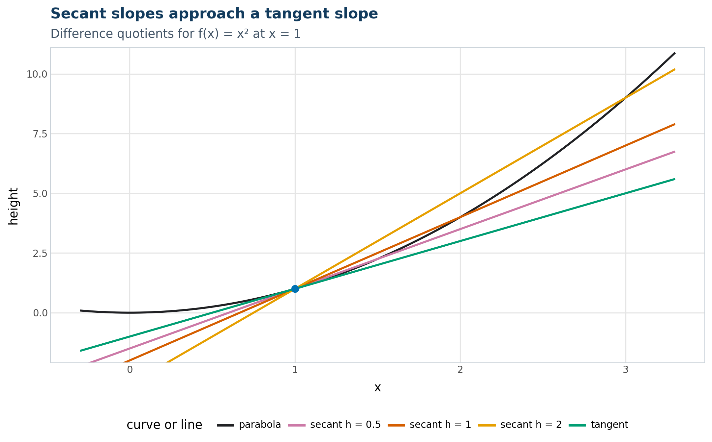

# The derivative {#sec-derivative}

A derivative measures the coefficient of the best local linear model. Slope, velocity, marginal cost, sensitivity, and instantaneous growth are interpretations of the same limiting construction. The computational rules are powerful because they preserve this local meaning through sums, products, and compositions.

## From secants to tangents

For an increment $h\ne0$, the quotient
$$
\frac{f(a+h)-f(a)}{h}
$$
is an average rate over a short interval. If these rates approach a finite value as $h\to0$, that value is the derivative.

<div class="callout callout-note">
<p class="callout-title">Definition: derivative</p>

The derivative of $f$ at $a$ is
$$
f'(a)=\lim_{h\to0}\frac{f(a+h)-f(a)}{h},
$$
provided the limit exists. The derivative function $f'$ assigns this value wherever it exists.

</div>

**Worked derivation.** For $f(x)=x^2$,
$$
\frac{(a+h)^2-a^2}{h}=2a+h,
$$
so $f'(a)=2a$. This derivation explains the rule; the limit is not obtained by setting $h=0$ in the original quotient, which would divide by zero.

<figure id="fig-secant">


<figcaption>

Figure 3.1: Secant slopes converge toward the tangent slope on a parabola.

</figcaption>
</figure>

In [Figure 3.1](#fig-secant), shrinking horizontal increments make the secant lines approach the tangent. The visual suggests convergence of slopes; the difference quotient supplies the numerical statement.

## Differentiability and continuity

If $f$ is differentiable at $a$, then it is continuous there. Indeed,
$$
f(a+h)-f(a)=h\frac{f(a+h)-f(a)}{h}\to0.
$$
The converse fails: $|x|$ is continuous at zero but has left derivative $-1$ and right derivative $1$. Corners, cusps, vertical tangents, and discontinuities are common reasons differentiability fails.

Notation emphasizes different roles. $f'(x)$ and $dy/dx$ name a derivative; $(d/dx)[f(x)]$ names the operation. Units are output-units divided by input-units. If position is metres and time seconds, velocity is metres per second and acceleration is metres per second squared.

## Rules derived from local change

For differentiable functions $f,g$ and constant $c$:
$$
(cf+g)'=cf'+g',\qquad (fg)'=f'g+fg',
$$
and, where $g\ne0$,
$$
\left(\frac{f}{g}\right)'=\frac{f'g-fg'}{g^2}.
$$
The power rule $(x^n)'=nx^{n-1}$ follows first for positive integers from the binomial theorem and extends, with domain care, to broader exponents.

The **chain rule** expresses nested local changes:
$$
\frac{d}{dx}f(g(x))=f'(g(x))g'(x).
$$
It is not merely a mnemonic. A small change $\Delta x$ produces approximately $g'(x)\Delta x$ in the inner variable, then $f'(g(x))$ times that change in the output.

**Worked example.** For $y=e^{\sin(x^2)}$,
$$
y'=e^{\sin(x^2)}\cos(x^2)\,2x.
$$
The nested layers are square, sine, and exponential. Reading outside inward identifies derivatives; multiplying in reverse dependence order produces the same factors.

The chain rule can be evaluated as two named local rates. The independent
centered-difference check below is included so a missing inner factor would be
immediately visible.

```python
from collections.abc import Callable
from math import cos, exp, sin

def chain_rule_rate(
    outer_derivative: Callable[[float], float],
    inner_value: float,
    inner_rate: float,
) -> float:
    """Evaluate f'(g(x))g'(x) from the three local ingredients."""
    return outer_derivative(inner_value) * inner_rate

def nested_function(input_value: float) -> float:
    """Evaluate exp(sin(input_value squared))."""
    return exp(sin(input_value**2))

point = 0.7
inner_value = sin(point**2)
inner_rate = cos(point**2) * 2.0 * point
chain_value = chain_rule_rate(exp, inner_value, inner_rate)
step = 1e-6
finite_difference = (
    nested_function(point + step) - nested_function(point - step)
) / (2.0 * step)
print(chain_value, finite_difference, abs(chain_value - finite_difference))
```

The two finite calculations agree to the expected rounding scale at one point.
That checks the implementation and displays the inner factor; the chain rule
for arbitrary differentiable compositions is the theorem, not the numerical
comparison.

## Transcendental derivatives

The exponential function is characterized by $(e^x)'=e^x$. More generally,
$$
(a^x)'=a^x\ln a,\qquad (\ln x)'=\frac1x\quad(x>0).
$$
For trigonometric functions,
$$
(\sin x)'=\cos x,\quad (\cos x)'=-\sin x,\quad (\tan x)'=\sec^2x.
$$
The radian measure assumption is essential; measuring angles in degrees introduces a conversion factor.

Logarithmic differentiation simplifies variable powers and products. If $y=x^x$ for $x>0$, then $\ln y=x\ln x$, so
$$
\frac{y'}y=\ln x+1,\qquad y'=x^x(\ln x+1).
$$

## Motion and higher derivatives

If $s(t)$ is position, then $v=s'$ is velocity and $a=v'=s''$ is acceleration. Speed is $|v|$, not $v$. A particle changes direction when velocity changes sign, not merely when acceleration is zero.

**Worked example.** Let $s(t)=t^3-6t^2+9t$ for $0\le t\le5$. Then $v=3(t-1)(t-3)$ and $a=6t-12$. The particle moves forward on $(0,1)$ and $(3,5)$ and backward on $(1,3)$. At $t=2$, acceleration vanishes but velocity remains negative, so the particle does not reverse there.

## Linearization and differentials

Differentiability means
$$
f(a+h)=f(a)+f'(a)h+r(h),\qquad \frac{r(h)}h\to0.
$$
Thus the **linearization** $L(x)=f(a)+f'(a)(x-a)$ is the unique best affine approximation near $a$. With $f(x)=\sqrt{x}$ at $a=100$,
$$
\sqrt{101}\approx10+\frac1{20}=10.05.
$$
The differential notation $dy=f'(x)dx$ records predicted output change under a small input change. Actual change $\Delta y$ differs by a smaller-order error.

<div class="callout callout-warning">
<p class="callout-title">Common pitfalls</p>

- The derivative of a product is not $f'g'$.
- The chain rule requires the derivative of every nested layer.
- A vertical tangent is not a finite derivative.
- Velocity and speed differ; negative velocity indicates direction, not negative speed.

</div>

<!-- inline-formula-code:start -->
## Formula and finite computation

A useful formula in this chapter is

$$
f'(x)=\lim_{h\to0}\frac{f(x+h)-f(x)}h
$$

The loop evaluates shrinking nonzero steps and prints the signed error. The following standalone Python block expresses that finite rule with its inputs and stopping conditions visible.

```python
def square(point: float) -> float:
    """Return the square of a named input point."""
    return point * point

def forward_slope(point: float, step_size: float) -> float:
    """Return a forward difference quotient at the requested point."""
    if step_size == 0.0:
        raise ValueError("step_size must be nonzero")
    return (square(point + step_size) - square(point)) / step_size

for step_size in (1.0, 0.5, 0.1, 0.01):
    approximation = forward_slope(1.0, step_size)
    print(step_size, approximation, approximation - 2.0)
```

**What the computation establishes.** The calculation checks a declared finite instance; the surrounding argument explains what is true beyond those inputs.
<!-- inline-formula-code:end -->

## Summary

The derivative is a limit of average rates and the slope coefficient of local linearization. Differentiability guarantees continuity but is stricter. Algebraic and transcendental rules preserve local structure, while higher derivatives describe how rates themselves change. Units, signs, and domain restrictions are integral parts of derivative calculations.

## Exercises

<div class="exercise" id="calculus-03-derivative-ex-1">
<p class="exercise-title"><strong>Exercise 1</strong></p>

Derive the derivative of $f(x)=1/x$ from the limit definition.

</div>

<div class="exercise" id="calculus-03-derivative-ex-2">
<p class="exercise-title"><strong>Exercise 2</strong></p>

Differentiate $x^3\cos(2x)$ and label each rule used.

</div>

<div class="exercise" id="calculus-03-derivative-ex-3">
<p class="exercise-title"><strong>Exercise 3</strong></p>

Find the tangent line to $y=\ln x$ at $x=e$.

</div>

<div class="exercise" id="calculus-03-derivative-ex-4">
<p class="exercise-title"><strong>Exercise 4</strong></p>

For $s(t)=2t^3-15t^2+36t$, find all intervals of forward and backward motion for $0\le t\le6$.

</div>

<div class="exercise" id="calculus-03-derivative-ex-5">
<p class="exercise-title"><strong>Exercise 5</strong></p>

Use linearization at $x=8$ to estimate $\sqrt[3]{8.12}$.

</div>

<div class="exercise" id="calculus-03-derivative-ex-6">
<p class="exercise-title"><strong>Exercise 6</strong></p>

Give a continuous function with no derivative at two specified points and explain why.

</div>

<div class="exercise" id="calculus-03-derivative-ex-7">
<p class="exercise-title"><strong>Exercise 7</strong></p>

**Challenge.** Prove the product rule by adding and subtracting $f(a+h)g(a)$ inside the difference quotient.

<details class="solution"><summary>Solution</summary>

For Chapter 3, Exercise 7, begin with
$$
\frac{f(a+h)g(a+h)-f(a)g(a)}h.
$$
Add and subtract $f(a+h)g(a)$, then regroup:
$$
f(a+h)\frac{g(a+h)-g(a)}h
+g(a)\frac{f(a+h)-f(a)}h.
$$
Differentiability implies continuity, so $f(a+h)\to f(a)$. Taking limits gives $f(a)g'(a)+g(a)f'(a)$.

</details>

</div>

<div class="exercise" id="calculus-03-derivative-ex-8">
<p class="exercise-title"><strong>Exercise 8</strong></p>

**Modeling.** If $C(q)$ is cost in pounds, interpret $C'(500)=2.8$ and state why it need not equal the exact cost of item $501$.

</div>
