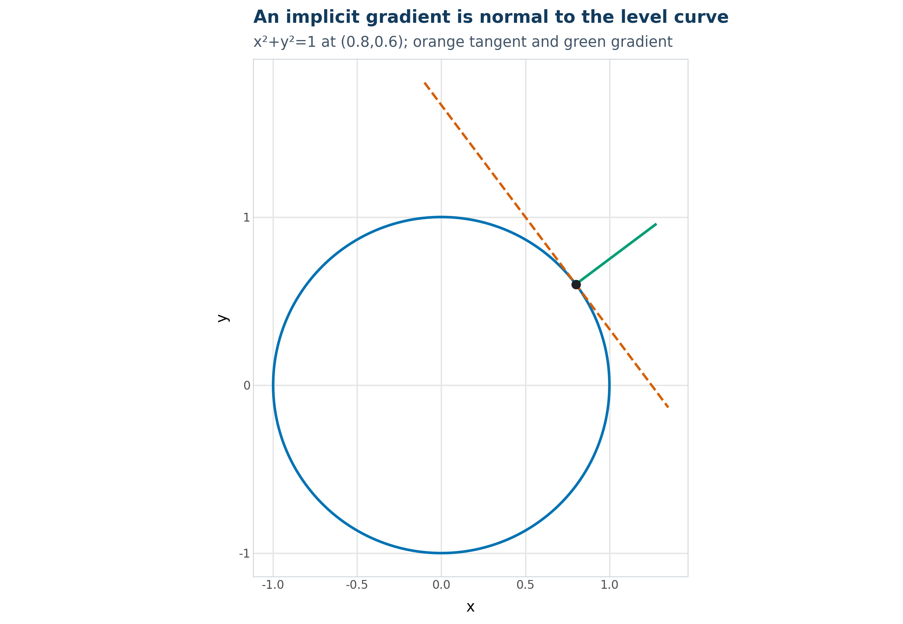

# Implicit differentiation and derivative applications {#sec-implicit}

Many important relationships cannot be solved conveniently for one variable. A moving point may be constrained to a circle, pressure and volume may satisfy an equation of state, or an inverse function may be known only through its forward rule. Implicit differentiation lets the chain rule operate directly on these relationships. Related rates, elasticity, Newton iteration, and error propagation then turn derivatives into tools for coupled change.

## Implicit relationships

Suppose $x$ and $y$ satisfy $x^2+y^2=25$ and $y$ is locally a differentiable function of $x$. Differentiating both sides with respect to $x$ gives
$$
2x+2y\frac{dy}{dx}=0,
$$
so $dy/dx=-x/y$ where $y\ne0$. Every occurrence of $y$ acquires a factor $dy/dx$ because it is really $y(x)$.

At $(3,4)$ the slope is $-3/4$, giving tangent line
$$
y-4=-\frac34(x-3).
$$
At $(5,0)$ the formula is undefined because the circle has a vertical tangent. The geometry explains the algebraic denominator.

For a more layered example, differentiate $x^2y+\sin y=3x$. We obtain
$$
2xy+x^2y'+\cos(y)y'=3,
$$
and therefore
$$
y'=\frac{3-2xy}{x^2+\cos y},
$$
provided the denominator is nonzero. The relation can have several local branches, so a point is required before a numerical slope makes sense.

The last displayed quotient is directly evaluable once a point on the curve is
specified. The denominator check corresponds to the hypothesis needed for
$y$ to be a differentiable local function of $x$.

```python
from math import cos, isclose, sin

def implicit_curve_slope(x_value: float, y_value: float) -> float:
    """Return dy/dx for x^2 y + sin(y) = 3x at a regular point."""
    residual = x_value**2 * y_value + sin(y_value) - 3.0 * x_value
    if not isclose(residual, 0.0, abs_tol=1e-10):
        raise ValueError("the supplied point is not on the implicit curve")
    denominator = x_value**2 + cos(y_value)
    if abs(denominator) < 1e-12:
        raise ArithmeticError("the local y-as-a-function-of-x test fails here")
    return (3.0 - 2.0 * x_value * y_value) / denominator

# (0, 0) lies on the curve and has a regular local branch.
slope = implicit_curve_slope(0.0, 0.0)
print(slope)
```

The output $3$ is the tangent slope on the local branch through $(0,0)$. It
does not select a global branch or establish that every point of the implicit
relation is regular.

## Inverse functions

If $f$ is differentiable, one-to-one near $a$, and $f'(a)\ne0$, then its inverse satisfies
$$
(f^{-1})'(f(a))=\frac{1}{f'(a)}.
$$
This follows by differentiating $f(f^{-1}(x))=x$. It explains inverse-trigonometric derivatives. If $y=\arcsin x$, then $\sin y=x$ and
$$
\cos y\,y'=1.
$$
On the chosen range, $\cos y=\sqrt{1-x^2}$, giving $(\arcsin x)'=1/\sqrt{1-x^2}$ for $|x|<1$.

The nonzero-derivative hypothesis matters. Although $f(x)=x^3$ is one-to-one, its inverse $x^{1/3}$ has a vertical tangent at zero because $f'(0)=0$.

## Related rates

Related-rates problems describe several changing quantities linked by a constraint. The reliable order is: name time-dependent quantities, write the relationship, differentiate with respect to time, then substitute the instant's values. Substituting too early can turn a changing quantity into a false constant.

**Worked example: inflating sphere.** Air enters a spherical balloon at $dV/dt=24$ cubic centimetres per second. Since $V=(4/3)\pi r^3$,
$$
\frac{dV}{dt}=4\pi r^2\frac{dr}{dt}.
$$
When $r=3$ cm,
$$
\frac{dr}{dt}=\frac{24}{36\pi}=\frac{2}{3\pi}\text{ cm/s}.
$$
The radius increases more slowly for larger balloons under the same volume inflow because each radial layer has greater surface area.

**Worked example: sliding ladder.** A 10-metre ladder satisfies $x^2+y^2=100$, where $x$ is the foot's distance from a wall and $y$ the top's height. If $dx/dt=0.8$ m/s, then
$$
x\frac{dx}{dt}+y\frac{dy}{dt}=0.
$$
At $x=6$, the positive height is $y=8$, so $dy/dt=-0.6$ m/s. The sign says the top moves downward.

## Relative sensitivity and elasticity

Absolute rate depends on scale. The **relative rate** $f'(x)/f(x)$ measures fractional output change per unit input. The **elasticity**
$$
E_f(x)=\frac{x f'(x)}{f(x)}
$$
approximates percentage output change divided by percentage input change. For a demand model $q(p)=Ap^{-k}$, elasticity is $-k$ at every price. A 1% price increase predicts approximately a $k$% quantity decrease.

Elasticity is dimensionless, making it useful across units, but it is a local approximation. Large percentage changes need the full nonlinear model.

## Newton's method

To solve $f(x)=0$, replace the curve near a guess $x_n$ with its tangent. The tangent crosses the axis at
$$
x_{n+1}=x_n-\frac{f(x_n)}{f'(x_n)}.
$$
For $f(x)=x^2-2$ with $x_0=1.5$, the sequence begins
$$
x_1=1.416\overline6,\qquad x_2\approx1.4142157,
$$
rapidly approaching $\sqrt2$.

Newton's method is not infallible. A zero derivative makes the step undefined; a poor initial point can jump to another root or diverge; and stopping because two rounded iterates agree can be misleading. Check the residual $|f(x_n)|$ and, when possible, bracket the root using continuity.

## Error propagation and conditioning

If a measured input has small uncertainty $dx$, then $dy\approx f'(x)dx$. Relative error is approximately
$$
\frac{|dy|}{|y|}\approx\left|\frac{x f'(x)}{f(x)}\right|\frac{|dx|}{|x|}.
$$
Thus elasticity is also a condition measure.

**Worked example.** The area of a disk is $A=\pi r^2$. A radius $r=10.0$ cm measured within $0.05$ cm gives $|dA|\approx2\pi(10)(0.05)=\pi$ square centimetres. Relative area error is about $2(0.05/10)=1\%$. Reporting many more digits would imply unjustified precision.

<div class="callout callout-warning">
<p class="callout-title">Common pitfalls</p>

- Treat $y$ as a function while differentiating: $(y^3)'=3y^2y'$.
- In related rates, distinguish a fixed length from a length changing with time.
- A Newton iterate is an approximation; verify its residual and domain.
- Differential error estimates are first-order and can understate large uncertainties.

</div>

## Visual checkpoint: tangent and implicit gradient

<figure id="fig-calc-implicit-circle-tangent">


<figcaption>

Figure 4.1: The gradient of an implicit circle is perpendicular to its tangent.

</figcaption>
</figure>

At the marked point in [Figure 4.1](#fig-calc-implicit-circle-tangent), differentiating
$x^2+y^2=1$ gives the tangent slope while $(2x,2y)$ gives a normal direction.
The picture joins the two formulas; the nonzero partial derivative is the
hypothesis that makes the local branch legitimate.

<!-- inline-formula-code:start -->
## Formula and finite computation

A useful formula in this chapter is

$$
x_{n+1}=x_n-\frac{f(x_n)}{f'(x_n)}
$$

Safeguards make the Newton formula a terminating, inspectable procedure. The following standalone Python block expresses that finite rule with its inputs and stopping conditions visible.

```python
from collections.abc import Callable

def newton_root(
    function: Callable[[float], float],
    derivative: Callable[[float], float],
    initial: float,
    tolerance: float = 1e-12,
    max_steps: int = 30,
) -> tuple[float, int]:
    """Run Newton iteration with explicit failure conditions."""
    if tolerance <= 0.0 or max_steps <= 0:
        raise ValueError("tolerance and max_steps must be positive")
    x = initial
    for step in range(max_steps):
        value = function(x)
        if abs(value) <= tolerance:
            return x, step
        slope = derivative(x)
        if abs(slope) < 1e-14:
            raise ArithmeticError("derivative too small for a safe Newton step")
        x -= value / slope
    if abs(function(x)) <= tolerance:
        return x, max_steps
    raise RuntimeError("Newton iteration did not reach the requested residual")

root, steps = newton_root(lambda x: x**2 - 2.0, lambda x: 2.0 * x, 1.0)
print(root, steps, root**2 - 2.0)
```

**What the computation establishes.** The calculation checks a declared finite instance; the surrounding argument explains what is true beyond those inputs.
<!-- inline-formula-code:end -->

## Summary

Implicit differentiation applies the chain rule to constraints without first solving them. Inverse derivatives are reciprocal slopes under a nonzero-slope condition. Related rates couple time derivatives through geometry or physics. Elasticity compares relative changes, Newton's method repeatedly uses tangent models, and differentials propagate small measurement errors.

## Exercises

<div class="exercise" id="calculus-04-implicit-applications-ex-1">
<p class="exercise-title"><strong>Exercise 1</strong></p>

Find $dy/dx$ for $x^3+y^3=6xy$ and the tangent slope at $(3,3)$.

</div>

<div class="exercise" id="calculus-04-implicit-applications-ex-2">
<p class="exercise-title"><strong>Exercise 2</strong></p>

Derive $(\arctan x)'=1/(1+x^2)$ from $\tan y=x$.

</div>

<div class="exercise" id="calculus-04-implicit-applications-ex-3">
<p class="exercise-title"><strong>Exercise 3</strong></p>

A cone has $V=\pi r^2h/3$ and always satisfies $h=3r$. Find $dV/dt$ when $r=2$ and $dr/dt=0.4$.

</div>

<div class="exercise" id="calculus-04-implicit-applications-ex-4">
<p class="exercise-title"><strong>Exercise 4</strong></p>

Compute two Newton steps for $x^3-x-1=0$ from $x_0=1.5$ and report each residual.

</div>

<div class="exercise" id="calculus-04-implicit-applications-ex-5">
<p class="exercise-title"><strong>Exercise 5</strong></p>

Find the elasticity of $f(x)=Ce^{kx}$ and interpret why it depends on $x$.

</div>

<div class="exercise" id="calculus-04-implicit-applications-ex-6">
<p class="exercise-title"><strong>Exercise 6</strong></p>

Estimate the volume uncertainty of a cube with side $8.0\pm0.02$ cm.

</div>

<div class="exercise" id="calculus-04-implicit-applications-ex-7">
<p class="exercise-title"><strong>Exercise 7</strong></p>

**Challenge.** Construct a differentiable function and starting value for which Newton's method alternates between two points.

</div>

<div class="exercise" id="calculus-04-implicit-applications-ex-8">
<p class="exercise-title"><strong>Exercise 8</strong></p>

**Project.** Compare Newton's method with bisection on one equation, tracking iterations, residuals, and guarantees.

</div>
