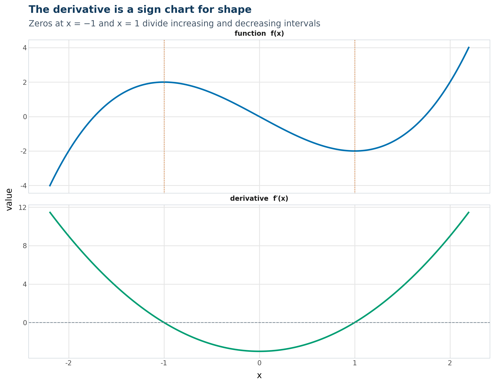

# Shape, optimization, and approximation {#sec-shape}

The derivative turns local slope information into global conclusions about shape. With continuity and compactness hypotheses, it identifies extrema; with the Mean Value Theorem, it controls how a function can change across an interval. These ideas make optimization a reasoned modeling process rather than a search for where $f'=0$.

## Extrema and critical points

A function has an **absolute maximum** at $c$ on a domain $D$ if $f(c)\ge f(x)$ for all $x\in D$; local extrema require the comparison only near $c$. A **critical number** is an interior domain point where $f'(c)=0$ or $f'(c)$ does not exist.

On a closed interval $[a,b]$, the candidates for absolute extrema are critical numbers and endpoints. The closed-interval method evaluates the function at every candidate and compares values. Endpoints need attention even though a two-sided derivative is unavailable there.

**Worked example.** For $f(x)=x^3-3x$ on $[-2,3]$, $f'=3(x^2-1)$, so critical numbers are $-1$ and $1$. Values are $f(-2)=-2$, $f(-1)=2$, $f(1)=-2$, and $f(3)=18$. The absolute minimum is $-2$, attained twice, and maximum is $18$ at $3$.

## Mean Value Theorem

**Rolle's Theorem** says that if $f$ is continuous on $[a,b]$, differentiable on $(a,b)$, and $f(a)=f(b)$, some $c\in(a,b)$ satisfies $f'(c)=0$. Geometrically, a smooth trip returning to its starting height has a horizontal tangent somewhere.

<div class="callout callout-note">
<p class="callout-title">Mean Value Theorem</p>

If $f$ is continuous on $[a,b]$ and differentiable on $(a,b)$, then there exists $c\in(a,b)$ such that
$$
f'(c)=\frac{f(b)-f(a)}{b-a}.
$$

</div>

The theorem is an existence statement. Its consequences are structural: if $f'=0$ throughout an interval, then $f$ is constant there; if $f'=g'$ throughout, then $f-g$ is constant; if $|f'|\le M$, then $|f(b)-f(a)|\le M|b-a|$.

Hypotheses cannot be discarded. The function $|x|$ on $[-1,1]$ has equal endpoint values but no interior point with derivative zero because it is not differentiable at zero.

## Shape from signs

Where $f'>0$, $f$ increases; where $f'<0$, it decreases. A change from positive to negative gives a local maximum, while negative to positive gives a local minimum. Merely having $f'=0$ is insufficient: $x^3$ has a horizontal tangent but continues increasing.

The second derivative records concavity. If $f''>0$, tangent slopes increase and the graph is concave up; if $f''<0$, it is concave down. An inflection point requires a change of concavity, not simply $f''=0$.

<figure id="fig-derivative-shape">


<figcaption>

Figure 5.1: A function and its derivative connect slope to shape.

</figcaption>
</figure>

[Figure 5.1](#fig-derivative-shape) shows how zeros and signs of $f'$ partition the graph into monotonic pieces. Shape analysis reads the lower panel as instructions for the upper one; it does not confuse a derivative's height with the original function's height.

## Optimization workflow

Optimization has four phases: define variables and objective, encode constraints, reduce the objective to its feasible domain, and solve and interpret the calculus problem. A critical point outside the feasible domain is irrelevant, and a mathematically optimal answer may violate an unstated practical constraint.

**Worked example: open box.** Cut squares of side $x$ from the corners of a $24$ by $15$ sheet and fold an open box. Its volume is
$$
V(x)=x(24-2x)(15-2x),\qquad 0<x<7.5.
$$
Expanding gives $V=360x-78x^2+4x^3$, so $V'=360-156x+12x^2$. The feasible critical roots solve $x^2-13x+30=0$, giving $x=3$ or $10$; only $3$ is feasible. Volume tends to zero at both domain ends, so $x=3$ gives the absolute maximum, $V(3)=486$ cubic units.

**Worked example: closest point.** To find the point on $y=x^2$ closest to $(0,3)$, minimize squared distance
$$
D^2(x)=x^2+(x^2-3)^2.
$$
Using squared distance avoids a square root without changing the minimizer. Differentiation gives $2x+4x(x^2-3)=2x(2x^2-5)$. Candidates are $0$ and $\pm\sqrt{5/2}$. Comparing values shows the two symmetric nonzero points are closest.

Sensitivity matters. If a design near its optimum has a very flat objective, manufacturing tolerances may barely affect performance. A steep constraint boundary may matter more than another decimal place in the optimizer.

## Indeterminate forms and L'Hopital's Rule

If $f,g\to0$ or both tend in magnitude to infinity, and suitable differentiability and denominator conditions hold near the target, L'Hopital's Rule may give
$$
\lim\frac{f(x)}{g(x)}=\lim\frac{f'(x)}{g'(x)},
$$
provided the latter limit exists in the appropriate extended sense. It applies to quotients, not to every expression that looks complicated.

For example,
$$
\lim_{x\to0}\frac{e^x-1-x}{x^2}
=\lim_{x\to0}\frac{e^x-1}{2x}
=\lim_{x\to0}\frac{e^x}{2}=\frac12.
$$
Forms such as $0\cdot\infty$ or $\infty-\infty$ must first be rewritten as quotients. Sometimes algebra, a known limit, or a Taylor approximation is clearer.

## Toward Taylor approximation

Linearization matches value and first derivative. A quadratic approximation can also match the second derivative:
$$
f(a+h)\approx f(a)+f'(a)h+\frac{f''(a)}{2}h^2.
$$
Continuing this pattern leads to Taylor polynomials in [Chapter 10](10-series-taylor.md). Derivative data determine increasingly faithful local shape, but error control is needed before trusting an approximation far from its center.

<div class="callout callout-warning">
<p class="callout-title">Common pitfalls</p>

- Critical points are candidates, not automatic extrema.
- An inflection point requires a concavity change.
- Check endpoints, feasibility, and units in every optimization problem.
- L'Hopital's Rule applies only after verifying an eligible indeterminate quotient.

</div>

<!-- inline-formula-code:start -->
## Formula and finite computation

A useful formula in this chapter is

$$
x_{k+1}=x_k-\alpha\nabla f(x_k)
$$

The stopping test reports why the gradient iteration ended. The following standalone Python block expresses that finite rule with its inputs and stopping conditions visible.

```python
import numpy as np
from numpy.typing import NDArray

def gradient(point: NDArray[np.float64]) -> NDArray[np.float64]:
    """Return the gradient of (x-1)^2 + 4(y+2)^2."""
    return np.array([2.0 * (point[0] - 1.0), 8.0 * (point[1] + 2.0)])

def gradient_descent(
    initial: NDArray[np.float64], step_size: float = 0.18, tolerance: float = 1e-8
) -> list[NDArray[np.float64]]:
    """Return a certified gradient-descent path for the declared quadratic."""
    if not 0.0 < step_size < 0.25 or tolerance <= 0.0:
        raise ValueError("require 0 < step_size < 0.25 and positive tolerance")
    path = [initial.astype(float).copy()]
    for _ in range(500):
        current_gradient = gradient(path[-1])
        if float(np.linalg.norm(current_gradient)) <= tolerance:
            return path
        path.append(path[-1] - step_size * current_gradient)
    raise RuntimeError("gradient tolerance was not reached")

path = gradient_descent(np.array([-3.0, 3.0]))
print(len(path) - 1, path[-1], np.linalg.norm(gradient(path[-1])))
```

**What the computation establishes.** The calculation checks a declared finite instance; the surrounding argument explains what is true beyond those inputs.
<!-- inline-formula-code:end -->

## Summary

Derivative signs determine monotonicity and concavity. The Mean Value Theorem connects a secant rate with an interior instantaneous rate and supports global conclusions. Optimization combines modeling, feasible domains, candidate analysis, and interpretation. L'Hopital's Rule and local polynomial approximations address limiting behavior when direct substitution is inconclusive.

## Exercises

<div class="exercise" id="calculus-05-shape-optimization-ex-1">
<p class="exercise-title"><strong>Exercise 1</strong></p>

Find all absolute extrema of $x^4-4x^2$ on $[-3,2]$.

<details class="solution"><summary>Solution</summary>

For Chapter 5, Exercise 1, let $f=x^4-4x^2$ on $[-3,2]$. Since
$$
f'=4x(x^2-2),
$$
critical points are $0$ and $\pm\sqrt2$, all in the interval. Values are
$$
f(-3)=45,\quad f(2)=0,\quad f(0)=0,
\quad f(\pm\sqrt2)=-4.
$$
The absolute maximum is $45$ at $-3$, and the absolute minimum is $-4$ at both $\pm\sqrt2$. Continuity on the closed interval guarantees extrema occur among these candidates.

</details>

</div>

<div class="exercise" id="calculus-05-shape-optimization-ex-2">
<p class="exercise-title"><strong>Exercise 2</strong></p>

Verify the Mean Value Theorem hypotheses for $f(x)=\sqrt{x}$ on $[1,4]$ and find every eligible $c$.

</div>

<div class="exercise" id="calculus-05-shape-optimization-ex-3">
<p class="exercise-title"><strong>Exercise 3</strong></p>

Sketch a function whose derivative is positive, then negative, then positive, with exactly two critical points.

</div>

<div class="exercise" id="calculus-05-shape-optimization-ex-4">
<p class="exercise-title"><strong>Exercise 4</strong></p>

Find the dimensions of a rectangle with perimeter $80$ that maximizes area; explain why the result is global.

</div>

<div class="exercise" id="calculus-05-shape-optimization-ex-5">
<p class="exercise-title"><strong>Exercise 5</strong></p>

A cylindrical can has fixed volume $V$. Express surface area as a function of radius and find the material-minimizing ratio of height to radius.

</div>

<div class="exercise" id="calculus-05-shape-optimization-ex-6">
<p class="exercise-title"><strong>Exercise 6</strong></p>

Evaluate $\lim_{x\to0}(\ln(1+x)-x)/x^2$ with justified uses of L'Hopital's Rule.

</div>

<div class="exercise" id="calculus-05-shape-optimization-ex-7">
<p class="exercise-title"><strong>Exercise 7</strong></p>

**Challenge.** Use the Mean Value Theorem to prove $|\sin u-\sin v|\le|u-v|$.

</div>

<div class="exercise" id="calculus-05-shape-optimization-ex-8">
<p class="exercise-title"><strong>Exercise 8</strong></p>

**Project.** Formulate an optimization with a realistic constraint, solve it, and discuss sensitivity to one parameter.

</div>
