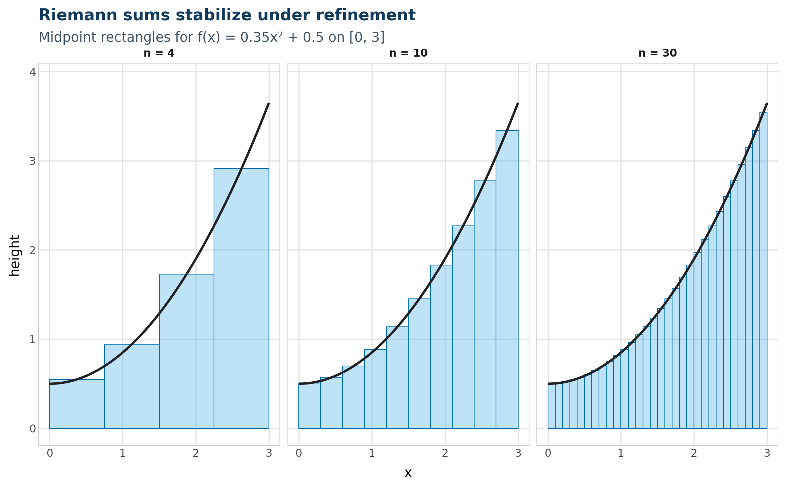

# Definite integrals and the Fundamental Theorem {#sec-integrals}

Derivatives zoom in; integrals assemble. When a rate varies, total change cannot be found by multiplying one rate by one duration. Instead we divide the interval, approximate each small contribution, and pass to a limit. The Fundamental Theorem of Calculus then reveals that exact accumulation and instantaneous rate are inverse processes.

## From sums to accumulation

Partition $[a,b]$ at points $a=x_0<x_1<\cdots<x_n=b$. On subinterval $[x_{i-1},x_i]$, choose a sample $x_i^*$ and width $\Delta x_i=x_i-x_{i-1}$. A **Riemann sum** is
$$
\sum_{i=1}^n f(x_i^*)\Delta x_i.
$$
If these sums approach a common value as the largest subinterval width tends to zero, independently of sample choices, $f$ is Riemann integrable and the limit is $\int_a^b f(x)\,dx$.

For velocity $v(t)$, each $v(t_i^*)\Delta t_i$ approximates displacement. For density $\rho(x)$, it approximates small mass. Units multiply: integrand-units times input-units.

<figure id="fig-riemann">


<figcaption>

Figure 6.1: Increasingly fine midpoint rectangles approximate the area under a curve.

</figcaption>
</figure>

In [Figure 6.1](#fig-riemann), refinement reduces visible gaps between rectangles and curve. The integral is not defined as “area” alone—signed quantities and nongeometric accumulations matter—but area provides a useful case.

Continuous functions on closed intervals are integrable. Some discontinuous functions are integrable too; a finite number of jumps does not prevent Riemann integration. The definition concerns the stability of total sums.

## Signed area and properties

Where $f\ge0$, the integral gives ordinary area between graph and axis. Where $f<0$, contributions are negative. Thus net signed area can be zero even when geometric area is positive. Reversing orientation gives
$$
\int_b^a f(x)\,dx=-\int_a^b f(x)\,dx,
$$
and adjacent intervals add. Integration is linear:
$$
\int_a^b(\alpha f+\beta g)\,dx
=\alpha\int_a^b f\,dx+\beta\int_a^b g\,dx.
$$

If $m\le f(x)\le M$ on $[a,b]$, then
$$
m(b-a)\le\int_a^b f(x)\,dx\le M(b-a).
$$
Order is preserved: $f\le g$ implies $\int f\le\int g$. These estimates check plausibility without exact computation.

## Accumulation functions and the FTC

Define $A(x)=\int_a^x f(t)\,dt$. Increasing $x$ by a small $h$ adds a thin strip whose average height is near $f(x)$, so $A(x+h)-A(x)\approx f(x)h$.

<div class="callout callout-note">
<p class="callout-title">Fundamental Theorem of Calculus</p>

**Part I.** If $f$ is continuous on $[a,b]$, then for each interior point $x$
$$
\frac{d}{dx}\int_a^x f(t)\,dt=f(x).
$$
**Part II.** If $f$ is continuous on $[a,b]$, $F$ is continuous on $[a,b]$, and $F'=f$ on $(a,b)$, then
$$
\int_a^b f(x)\,dx=F(b)-F(a).
$$

</div>

For Part I, the difference quotient is
$$
\frac1h\int_x^{x+h}f(t)\,dt,
$$
an average value of $f$ on a shrinking interval. Continuity forces it toward $f(x)$. Part II follows by noting that any two antiderivatives differ by a constant.

**Worked example.** Evaluate $\int_0^2(3x^2-4x+1)\,dx$. An antiderivative is $F(x)=x^3-2x^2+x$, so
$$
F(2)-F(0)=8-8+2=2.
$$
Because the integrand changes sign, $2$ is net signed area, not total geometric area.

If $G(x)=\int_1^{x^2}\cos(t^3)\,dt$, Part I and the chain rule give
$$
G'(x)=\cos(x^6)\,2x.
$$
No elementary antiderivative of $\cos(t^3)$ is required.

## Net change and average value

If $Q$ is continuous on $[a,b]$, differentiable on $(a,b)$, and its rate $Q'$ extends continuously to $[a,b]$, then
$$
Q(b)-Q(a)=\int_a^b Q'(t)\,dt.
$$
This **Net Change Theorem** is often more meaningful than area language. If water flows into a tank at $r_{in}$ and out at $r_{out}$, the change in volume is $\int(r_{in}-r_{out})dt$.

The average value of an integrable function on $[a,b]$ is
$$
f_{avg}=\frac1{b-a}\int_a^b f(x)\,dx.
$$
For continuous $f$, the Mean Value Theorem for Integrals ensures some $c$ has $f(c)=f_{avg}$. Symmetry can simplify integrals: odd functions integrate to zero on $[-a,a]$, while even functions give twice the integral on $[0,a]$.

## Numerical integration

When data rather than a formula are available, or antiderivatives are inaccessible, numerical rules approximate the integral. For equal width $h$:

- midpoint rule uses $h$ times the sum of midpoint values;
- trapezoid rule joins endpoint samples linearly;
- Simpson's rule fits quadratics over pairs of subintervals.

For $n$ even, Simpson's rule is
$$
S_n=\frac h3\left[f(x_0)+4f(x_1)+2f(x_2)+\cdots+4f(x_{n-1})+f(x_n)\right].
$$
Smoothness controls errors. Refining the mesh and comparing successive approximations is a practical convergence check, not an absolute proof unless an error bound is available.

The alternating weights in Simpson's formula are easiest to understand when
they remain visible in the loop. Requiring an even panel count enforces the
pair-of-subintervals construction.

```python
from collections.abc import Callable
from math import isfinite

def simpson_integral(
    function: Callable[[float], float],
    left: float,
    right: float,
    panels: int,
) -> float:
    """Apply composite Simpson quadrature on equally spaced panels."""
    if left >= right or panels <= 0 or panels % 2 != 0:
        raise ValueError("require left < right and a positive even panel count")
    width = (right - left) / panels
    values = [function(left + index * width) for index in range(panels + 1)]
    if not all(isfinite(value) for value in values):
        raise ValueError("function values must be finite on the grid")
    odd_sum = sum(values[index] for index in range(1, panels, 2))
    even_sum = sum(values[index] for index in range(2, panels, 2))
    return width * (values[0] + 4.0 * odd_sum + 2.0 * even_sum + values[-1]) / 3.0

estimate = simpson_integral(lambda input_value: input_value**3, 0.0, 2.0, 4)
print(estimate)
```

The value $4$ is exact here because Simpson's rule integrates cubics exactly.
For a general smooth function the same finite weighted sum is only an
approximation until a remainder estimate or convergence theorem is supplied.

**Worked example.** The trapezoid rule on $[0,2]$ with $n=2$ for $f(x)=x^2$ gives
$$
T_2=1\left(\frac{f(0)}2+f(1)+\frac{f(2)}2\right)=3,
$$
while the exact integral is $8/3$. Concavity up makes chords lie above the graph, explaining the overestimate.

<div class="callout callout-warning">
<p class="callout-title">Common pitfalls</p>

- A definite integral is a number; an indefinite integral denotes a family $F+C$.
- Net change differs from total variation or geometric area.
- The integration variable is dummy: $\int_a^b f(t)dt=\int_a^b f(u)du$.
- Numerical agreement at displayed precision is not automatically an error guarantee.

</div>

## Further connections {#forward-handoff}

[Chapter 38](38-measure-integration.md) revisits accumulation when functions
need not be continuous or even Riemann integrable. It preserves the integral's
linearity and order while replacing partitions by measurable sets, and it
states the almost-everywhere version of the Fundamental Theorem with the extra
hypotheses made explicit.

<!-- inline-formula-code:start -->
## Formula and finite computation

A useful formula in this chapter is

$$
M_n=\sum_{k=1}^nf(x_k^*)\,\Delta x
$$

The midpoint rule is implemented as exactly this finite sum. The following standalone Python block expresses that finite rule with its inputs and stopping conditions visible.

```python
from collections.abc import Callable

import numpy as np
from numpy.typing import NDArray

def midpoint_integral(
    function: Callable[[NDArray[np.float64]], NDArray[np.float64]],
    left: float,
    right: float,
    panels: int,
) -> float:
    """Approximate an integral with equal-width midpoint rectangles."""
    if panels <= 0 or left >= right:
        raise ValueError("require left < right and a positive panel count")
    dx = (right - left) / panels
    midpoints = left + (np.arange(panels) + 0.5) * dx
    return float(np.sum(function(midpoints)) * dx)

for panels in (4, 16, 64, 256):
    estimate = midpoint_integral(lambda x: x**2, 0.0, 1.0, panels)
    print(panels, estimate, abs(estimate - 1.0 / 3.0))
```

**What the computation establishes.** The calculation checks a declared finite instance; the surrounding argument explains what is true beyond those inputs.
<!-- inline-formula-code:end -->

## Summary

Riemann sums convert small approximate contributions into exact accumulated quantities. The integral is linear, ordered, and oriented. The Fundamental Theorem links accumulation functions with derivatives and evaluates definite integrals through antiderivatives. Net change, average value, symmetry, and numerical rules broaden the integral beyond geometric area.

## Exercises

<div class="exercise" id="calculus-06-integrals-ftc-ex-1">
<p class="exercise-title"><strong>Exercise 1</strong></p>

Write a right-endpoint Riemann sum for $\int_1^4\ln x\,dx$ with $n$ equal subintervals.

</div>

<div class="exercise" id="calculus-06-integrals-ftc-ex-2">
<p class="exercise-title"><strong>Exercise 2</strong></p>

Use geometry to evaluate $\int_{-2}^2\sqrt{4-x^2}\,dx$.

</div>

<div class="exercise" id="calculus-06-integrals-ftc-ex-3">
<p class="exercise-title"><strong>Exercise 3</strong></p>

Differentiate $H(x)=\int_{x}^{3x}\sqrt{1+t^4}\,dt$.

</div>

<div class="exercise" id="calculus-06-integrals-ftc-ex-4">
<p class="exercise-title"><strong>Exercise 4</strong></p>

A velocity is $v(t)=t^2-4t+3$. Find displacement and total distance on $[0,4]$.

<details class="solution"><summary>Solution</summary>

For Chapter 6, Exercise 4, $v(t)=t^2-4t+3=(t-1)(t-3)$. An antiderivative is $V(t)=t^3/3-2t^2+3t$. Displacement on $[0,4]$ is $V(4)-V(0)=4/3$. Velocity is positive on $[0,1)$, negative on $(1,3)$, and positive on $(3,4]$. Total distance is
$$
[V(1)-V(0)]-[V(3)-V(1)]+[V(4)-V(3)]
=\frac43+\frac43+\frac43=4.
$$
The sign partition is essential.

</details>

</div>

<div class="exercise" id="calculus-06-integrals-ftc-ex-5">
<p class="exercise-title"><strong>Exercise 5</strong></p>

Compute the average value of $\sin x$ on $[0,\pi]$ and find where it is attained.

</div>

<div class="exercise" id="calculus-06-integrals-ftc-ex-6">
<p class="exercise-title"><strong>Exercise 6</strong></p>

Apply midpoint and trapezoid rules with four subintervals to $\int_0^2 e^{-x^2}dx$; compare the results.

</div>

<div class="exercise" id="calculus-06-integrals-ftc-ex-7">
<p class="exercise-title"><strong>Exercise 7</strong></p>

**Challenge.** Use integral bounds to show $\int_0^1 1/(1+x^2)\,dx$ lies between $1/2$ and $1$.

</div>

<div class="exercise" id="calculus-06-integrals-ftc-ex-8">
<p class="exercise-title"><strong>Exercise 8</strong></p>

**Project.** Estimate an accumulation from a real table of rates, state the chosen numerical rule, and analyze units and uncertainty.

</div>
