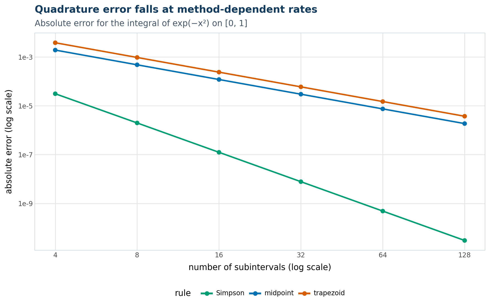

# Integration techniques {#sec-techniques}

Differentiation has an algorithmic feel; antidifferentiation is a recognition problem. The same integrand may yield to several methods, and many elementary-looking functions have no elementary antiderivative. A sound strategy classifies structure, chooses a transformation, records domain restrictions, and differentiates the result to check it.

## Substitution: reverse chain rule

If $u=g(x)$, then $du=g'(x)dx$, and
$$
\int f(g(x))g'(x)\,dx=\int f(u)\,du.
$$
The method replaces a complete nested pattern, not merely a favorite subexpression.

**Worked example.** In
$$
\int \frac{x}{(1+x^2)^3}\,dx,
$$
let $u=1+x^2$, so $du=2x\,dx$. Then
$$
\frac12\int u^{-3}\,du=-\frac{1}{4u^2}+C
=-\frac{1}{4(1+x^2)^2}+C.
$$
Differentiation recovers the integrand.

For definite integrals, either return to $x$ before applying old bounds or transform the bounds. Mixing the two is an error. For instance,
$$
\int_0^1 2xe^{x^2}\,dx=\int_0^1e^u\,du=e-1,
$$
where the new bounds are $u(0)=0$ and $u(1)=1$.

## Integration by parts

Integrating the product rule gives
$$
\int u\,dv=uv-\int v\,du.
$$
Choose $u$ to become simpler when differentiated and $dv$ to integrate readily. The mnemonic “logarithmic, inverse trigonometric, algebraic, trigonometric, exponential” can suggest $u$, but structural judgment is better.

**Worked example.** For $\int x e^x dx$, take $u=x$ and $dv=e^x dx$:
$$
\int xe^x dx=xe^x-\int e^x dx=e^x(x-1)+C.
$$
Repeated integration by parts handles polynomial–exponential products. A self-referential use evaluates $\int e^x\cos x\,dx$: after two steps, the original integral reappears and can be solved algebraically, giving $e^x(\sin x+\cos x)/2+C$.

## Trigonometric structure

For products of powers of sine and cosine, parity guides the method. If a sine power is odd, reserve one sine factor and convert the rest with $\sin^2x=1-\cos^2x$; then set $u=\cos x$. If a cosine power is odd, reverse roles. If both powers are even, use half-angle identities.

For powers of tangent and secant, reserve $\sec^2x$ for $u=\tan x$ when possible, or reserve $\sec x\tan x$ for $u=\sec x$. Identities reorganize the remaining factors.

**Worked example.** Since $\sin^3x=(1-\cos^2x)\sin x$,
$$
\int\sin^3x\cos^2x\,dx
=-\int(1-u^2)u^2\,du
=-\frac{u^3}{3}+\frac{u^5}{5}+C,
$$
where $u=\cos x$.

## Trigonometric substitution

Radicals suggest identities:
$$
\sqrt{a^2-x^2}: x=a\sin\theta,\qquad
\sqrt{a^2+x^2}: x=a\tan\theta,\qquad
\sqrt{x^2-a^2}: x=a\sec\theta.
$$
The substitution encodes a right triangle and comes with interval choices that control signs.

For example, with $x=a\sin\theta$ on $[-\pi/2,\pi/2]$, $\sqrt{a^2-x^2}=a\cos\theta$ and $dx=a\cos\theta d\theta$. Back-substitution should state the domain on which the triangle relations apply.

Completing the square may be required first. The denominator $\sqrt{4x-x^2}$ becomes $\sqrt{4-(x-2)^2}$, revealing a sine substitution centered at $2$.

## Partial fractions

A proper rational function $P(x)/Q(x)$ with degree $P<$ degree $Q$ can be decomposed according to factors of $Q$. Perform polynomial division first if necessary. Distinct linear factors receive constants; repeated linear factors receive a ladder of powers; irreducible quadratics receive linear numerators.

**Worked example.** Decompose
$$
\frac{5x+1}{(x-1)(x+2)}=\frac{A}{x-1}+\frac{B}{x+2}.
$$
Solving $5x+1=A(x+2)+B(x-1)$ gives $A=2$, $B=3$, hence
$$
\int\frac{5x+1}{(x-1)(x+2)}dx
=2\ln|x-1|+3\ln|x+2|+C
$$
on any interval avoiding the poles.

## Improper integrals

An integral is **improper** if its interval is unbounded or its integrand becomes unbounded. It is defined through a limit. Thus
$$
\int_1^\infty\frac1{x^p}dx
$$
converges exactly when $p>1$. Near zero,
$$
\int_0^1\frac1{x^p}dx
$$
converges exactly when $p<1$. The location of the singular behavior changes the threshold.

If an integrand has an interior singularity at $c$, split the integral and require both one-sided improper integrals to converge. Opposing infinities cannot be cancelled under the ordinary definition.

Comparison is often more valuable than exact antidifferentiation. If $0\le f\le g$ eventually and $\int g$ converges, then $\int f$ converges. If $0\le g\le f$ and $\int g$ diverges, then $\int f$ diverges.

<figure id="fig-quadrature">


<figcaption>

Figure 7.1: Errors of midpoint, trapezoid, and Simpson rules decrease as the mesh is refined.

</figcaption>
</figure>

[Figure 7.1](#fig-quadrature) emphasizes that numerical integration methods have different convergence rates on a smooth test function. Straight trends on logarithmic axes encode power-law error reduction; actual performance still depends on smoothness and rounding.

## A decision strategy

First simplify algebra and inspect composition. Look for a derivative of an inner expression, then products suited to parts, rational structure, trigonometric identities, and radical geometry. If no elementary method works, a definite integral can still be approximated numerically or treated as a named function.

Computer algebra is useful for conjecturing antiderivatives, but equivalent forms can look unrelated and branch restrictions may be hidden. Always differentiate the candidate on the claimed domain. For a definite integral, also inspect singularities before trusting a numerical value.

<div class="callout callout-warning">
<p class="callout-title">Common pitfalls</p>

- Change both integrand and bounds under definite substitution.
- Include absolute values in logarithmic antiderivatives where required.
- Split an improper integral at every singularity before taking limits.
- “No elementary antiderivative” does not mean “no integral” or “no useful answer.”

</div>

<!-- inline-formula-code:start -->
## Formula and finite computation

A useful formula in this chapter is

$$
T_n=\frac{\Delta x}{2}\left(f(a)+2\sum_{k=1}^{n-1}f(x_k)+f(b)\right)
$$

The trapezoid formula is evaluated under successive refinements. The following standalone Python block expresses that finite rule with its inputs and stopping conditions visible.

```python
from math import log

import numpy as np

def trapezoid_square(panels: int) -> float:
    """Integrate x squared on [0, 1] with the composite trapezoidal rule."""
    if panels <= 0:
        raise ValueError("panels must be positive")
    x = np.linspace(0.0, 1.0, panels + 1)
    y = x**2
    return float((y[0] / 2.0 + y[1:-1].sum() + y[-1] / 2.0) / panels)

values = [trapezoid_square(n) for n in (16, 32, 64)]
errors = [abs(value - 1.0 / 3.0) for value in values]
observed_order = log(errors[0] / errors[1]) / log(2.0)
print(values)
print(errors, observed_order)
```

**What the computation establishes.** The calculation checks a declared finite instance; the surrounding argument explains what is true beyond those inputs.
<!-- inline-formula-code:end -->

## Summary

Substitution reverses composition, while integration by parts reverses a product rule. Trigonometric identities and substitutions exploit special algebraic forms, and partial fractions reduce rational functions to standard pieces. Improper integrals are limits whose convergence must be established. A robust solution includes method choice, domain awareness, and derivative verification.

## Exercises

<div class="exercise" id="calculus-07-integration-techniques-ex-1">
<p class="exercise-title"><strong>Exercise 1</strong></p>

Evaluate $\int x^3\sqrt{1+x^2}\,dx$ by a substitution after algebraic rewriting.

</div>

<div class="exercise" id="calculus-07-integration-techniques-ex-2">
<p class="exercise-title"><strong>Exercise 2</strong></p>

Find $\int x^2\ln x\,dx$ for $x>0$.

</div>

<div class="exercise" id="calculus-07-integration-techniques-ex-3">
<p class="exercise-title"><strong>Exercise 3</strong></p>

Evaluate $\int\sin^4x\,dx$ using power-reduction identities.

</div>

<div class="exercise" id="calculus-07-integration-techniques-ex-4">
<p class="exercise-title"><strong>Exercise 4</strong></p>

Evaluate $\int dx/(x^2\sqrt{x^2-9})$ on $x>3$.

</div>

<div class="exercise" id="calculus-07-integration-techniques-ex-5">
<p class="exercise-title"><strong>Exercise 5</strong></p>

Decompose and integrate $(2x^2+3x+4)/(x(x^2+1))$.

</div>

<div class="exercise" id="calculus-07-integration-techniques-ex-6">
<p class="exercise-title"><strong>Exercise 6</strong></p>

Determine convergence of $\int_2^\infty dx/(x\ln^2x)$.

</div>

<div class="exercise" id="calculus-07-integration-techniques-ex-7">
<p class="exercise-title"><strong>Exercise 7</strong></p>

**Challenge.** Prove convergence of $\int_1^\infty e^{-x^2}dx$ by comparison without finding an antiderivative.

<details class="solution"><summary>Solution</summary>

For Chapter 7, Exercise 7, when $x\ge1$ we have $x^2\ge x$, hence $e^{-x^2}\le e^{-x}$. Both functions are nonnegative, and
$$
\int_1^\infty e^{-x}dx=e^{-1}
$$
converges. Direct comparison proves convergence of the Gaussian tail without an elementary antiderivative.

</details>

</div>

<div class="exercise" id="calculus-07-integration-techniques-ex-8">
<p class="exercise-title"><strong>Exercise 8</strong></p>

**Project.** Build a one-page decision tree for integration methods and test it on ten mixed examples, noting where more than one route works.

</div>
