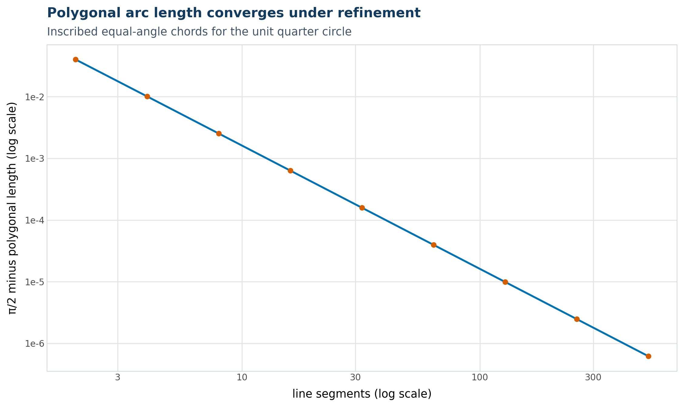

# Geometric and physical applications of integration {#sec-integral-apps}

An integral becomes a modeling instrument when we can identify a small contribution. The universal pattern is: choose a slicing variable, write “amount in one thin slice,” sum, and pass to a limit. Area, volume, work, mass, probability, and pressure differ in context but share this architecture.

## Area between curves

If $f(x)\ge g(x)$ on $[a,b]$, the area between their graphs is
$$
A=\int_a^b[f(x)-g(x)]\,dx.
$$
If the graphs cross, split at intersection points so “top minus bottom” remains nonnegative. Horizontal slices may be more efficient, giving “right minus left” integrated with respect to $y$.

**Worked example.** The curves $y=2x$ and $y=x^2$ intersect at $0$ and $2$. On this interval $2x\ge x^2$, so
$$
A=\int_0^2(2x-x^2)dx
=\left[x^2-\frac{x^3}{3}\right]_0^2=\frac43.
$$
Units are square coordinate-units.

## Volume by slicing

If cross-sectional area perpendicular to the $x$-axis is $A(x)$, then
$$
V=\int_a^b A(x)dx.
$$
Rotating a region around an axis yields disks or washers. A washer with outer radius $R(x)$ and inner radius $r(x)$ has area $\pi(R^2-r^2)$.

**Worked example.** Rotate the region under $y=\sqrt{x}$ on $0\le x\le4$ about the $x$-axis. Disk area is $\pi y^2=\pi x$, so
$$
V=\pi\int_0^4x\,dx=8\pi.
$$
Rotating the same region about another line changes every radius and therefore the model.

For cylindrical shells about a vertical axis, a strip at $x$ produces circumference $2\pi r$, height $h$, and thickness $dx$:
$$
V=2\pi\int_a^b r(x)h(x)dx.
$$
Shells can avoid solving for $x$ in terms of $y$. The best method follows the geometry, not a preference for one formula.

## Arc length and surface area

A small smooth curve segment behaves like the hypotenuse of a tiny right triangle. For $y=f(x)$,
$$
L=\int_a^b\sqrt{1+[f'(x)]^2}\,dx.
$$
This measures distance along the curve, not horizontal width. Rotating a nonnegative curve about the $x$-axis gives surface area
$$
S=2\pi\int_a^b f(x)\sqrt{1+[f'(x)]^2}\,dx.
$$
The factor $2\pi f(x)$ is local circumference and the square-root factor converts horizontal thickness to arc length.

These integrals often resist elementary antiderivatives; a numerical answer with an error estimate may be the natural conclusion.

## Work and force

Constant force parallel to motion gives work $W=Fd$. A variable force gives
$$
W=\int_a^b F(x)dx.
$$
For a spring obeying Hooke's law $F=kx$, work required to stretch from $x=a$ to $x=b$ is $k(b^2-a^2)/2$.

**Worked example: lifting a rope.** A uniform 12-metre rope weighs $3$ newtons per metre and hangs from a ledge. A piece currently $x$ metres below the ledge must be lifted $x$ metres. Its small weight is $3dx$, so
$$
W=\int_0^{12}3x\,dx=216\text{ joules}.
$$
Equivalently, when $y$ metres have been pulled up, $12-y$ metres remain and the force is $3(12-y)$; integrating from $0$ to $12$ agrees.

Fluid pressure grows with depth: pressure is $\rho gd$. A horizontal strip of area $w(y)dy$ at depth $d(y)$ experiences force $\rho g d(y)w(y)dy$. Coordinate definitions and units are especially important because width and depth may be expressed from different reference levels.

## Mass, moments, and centroids

For a rod with linear density $\rho(x)$, mass is
$$
m=\int_a^b\rho(x)dx,
$$
and moment about the origin is $M=\int_a^b x\rho(x)dx$. Its center of mass is $\bar x=M/m$. The formula is a weighted average: points with more nearby mass influence the balance point more.

For a planar lamina between $y=f(x)$ and $y=g(x)$ of constant density, area plays the role of mass up to a constant. The centroid coordinates are
$$
\bar x=\frac1A\int_a^b x[f(x)-g(x)]dx,
$$
$$
\bar y=\frac1{2A}\int_a^b[f(x)^2-g(x)^2]dx.
$$
Symmetry should be used before calculation.

## Probability as accumulation

A continuous probability density $p(x)$ satisfies $p\ge0$ and $\int_{-\infty}^{\infty}p(x)dx=1$. Probabilities are areas over events:
$$
P(a\le X\le b)=\int_a^b p(x)dx.
$$
The expected value is $E[X]=\int xp(x)dx$ when it converges. Density can exceed $1$; only total probability and event probabilities are bounded by $1$.

**Worked example.** Let $p(x)=2x$ on $0\le x\le1$ and zero elsewhere. It is normalized because $\int_0^1 2x dx=1$. Then $P(X\le1/2)=1/4$ and
$$
E[X]=\int_0^1 2x^2dx=\frac23.
$$
The expected value need not be the most likely value.

<div class="callout callout-warning">
<p class="callout-title">Common pitfalls</p>

- Determine intersections before integrating area between curves.
- Radii are distances to the axis of rotation, not automatically function heights.
- Work multiplies each small force by the distance that particular piece moves.
- Probability density is not probability at a point; a single point has zero probability in a continuous model.

</div>

## Modeling project workflow

Choose a tank, manufactured shape, cable, or density distribution. Draw a labeled slice, write its small contribution with units, identify bounds, and explain why summing slices leads to the chosen integral. Estimate the answer's scale before evaluating it. Then alter one parameter and discuss sensitivity. A good report makes the setup reproducible even if computation is delegated to software.

## Visual checkpoint: arc length under refinement

<figure id="fig-calc-applications-arc-length">


<figcaption>

Figure 8.1: Inscribed polygonal arc lengths converge to the unit quarter-circle length.

</figcaption>
</figure>

The decreasing error in [Figure 8.1](#fig-calc-applications-arc-length) shows how a curved
length is approached by finite straight pieces. The arc-length integral is the
limit object; any one polygon is an approximation with a declared mesh.

<!-- inline-formula-code:start -->
## Formula and finite computation

A useful formula in this chapter is

$$
A(x)=\int_a^xf(t)\,dt,\qquad A'(x)=f(x)
$$

Cumulative trapezoids and finite differences show the recovery mechanism. The following standalone Python block expresses that finite rule with its inputs and stopping conditions visible.

```python
from math import pi, sin

def cumulative_trapezoids(values: list[float], step: float) -> list[float]:
    """Return cumulative trapezoidal sums beginning at zero."""
    if len(values) < 2 or step <= 0.0:
        raise ValueError("need at least two values and a positive step")
    totals = [0.0]
    for left, right in zip(values, values[1:]):
        totals.append(totals[-1] + step * (left + right) / 2.0)
    return totals

points = [2.0 * pi * index / 2_000 for index in range(2_001)]
step = points[1] - points[0]
values = [sin(x) + 0.3 * x for x in points]
areas = cumulative_trapezoids(values, step)
recovered = [
    (areas[index + 1] - areas[index - 1]) / (2.0 * step)
    for index in range(1, 2_000)
]
error = max(
    abs(estimate - values[index])
    for index, estimate in enumerate(recovered, start=1)
)
print(step, error, areas[-1])
```

**What the computation establishes.** The calculation checks a declared finite instance; the surrounding argument explains what is true beyond those inputs.
<!-- inline-formula-code:end -->

## Summary

Applications of integration begin with an infinitesimal contribution. Areas use height times thickness; volumes use cross-sectional area; work uses force times displacement; mass uses density times size; probability uses density over an event. Geometry determines bounds and method. Unit checks, symmetry, estimates, and alternative slicings validate the setup.

## Exercises

<div class="exercise" id="calculus-08-integration-applications-ex-1">
<p class="exercise-title"><strong>Exercise 1</strong></p>

Find the area enclosed by $y=x+2$ and $y=x^2$.

</div>

<div class="exercise" id="calculus-08-integration-applications-ex-2">
<p class="exercise-title"><strong>Exercise 2</strong></p>

Set up, but do not evaluate, both washer and shell integrals for rotating the region under $y=1-x^2$, $0\le x\le1$, about the $y$-axis.

</div>

<div class="exercise" id="calculus-08-integration-applications-ex-3">
<p class="exercise-title"><strong>Exercise 3</strong></p>

Find the arc length of $y=x^{3/2}$ from $0$ to $4$.

</div>

<div class="exercise" id="calculus-08-integration-applications-ex-4">
<p class="exercise-title"><strong>Exercise 4</strong></p>

A spring requires 20 N to hold it 0.1 m beyond natural length. Find the work to stretch it from 0.05 m to 0.15 m.

</div>

<div class="exercise" id="calculus-08-integration-applications-ex-5">
<p class="exercise-title"><strong>Exercise 5</strong></p>

Set up the force on a vertical triangular plate with its vertex at the water surface and base 3 m below.

</div>

<div class="exercise" id="calculus-08-integration-applications-ex-6">
<p class="exercise-title"><strong>Exercise 6</strong></p>

Find the center of mass of a rod on $[0,2]$ with density $1+x$.

</div>

<div class="exercise" id="calculus-08-integration-applications-ex-7">
<p class="exercise-title"><strong>Exercise 7</strong></p>

**Challenge.** Design two different solids with the same cross-sectional area function and explain why Cavalieri's principle gives equal volumes.

</div>

<div class="exercise" id="calculus-08-integration-applications-ex-8">
<p class="exercise-title"><strong>Exercise 8</strong></p>

**Project.** Complete the modeling workflow above and include a diagram, estimate, integral, computed value, and limitation.

</div>
