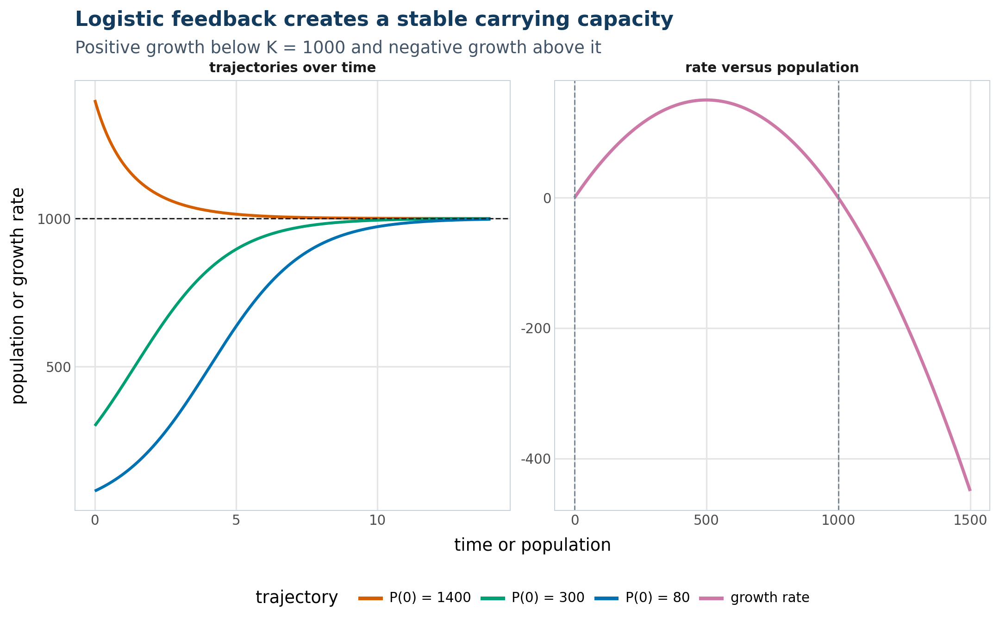

# Differential equations and dynamical models {#sec-odes}

A differential equation specifies how a state changes rather than giving the state directly. That is often the natural language of science: populations grow in response to current population, temperatures change according to their surroundings, and concentrations evolve through inflow and outflow. Exact solutions matter, but slope fields, equilibria, and numerical approximations often reveal more about a model.

## Equations for change

An **ordinary differential equation** relates an unknown function of one independent variable to its derivatives. Its order is the highest derivative present. A solution is a function that satisfies the equation on an interval; an initial condition such as $y(0)=y_0$ selects a trajectory from a family.

For $y'=2y$, every $y=Ce^{2t}$ is a solution. The initial condition $y(0)=3$ gives $C=3$. Checking means substitution: derivative $6e^{2t}$ equals twice the function.

A direction field for $y'=F(t,y)$ draws a small segment of slope $F(t,y)$ at each sampled point. Curves following the segments suggest solution behavior. A field is qualitative evidence, while existence and uniqueness theorems determine when a single trajectory passes through an initial point.

## Separable equations

If $y'=g(t)h(y)$, variables can often be separated:
$$
\frac{dy}{h(y)}=g(t)dt.
$$
This notation is justified through the chain rule after integration. Before dividing by $h(y)$, record equilibrium solutions where $h(y)=0$; division would discard them.

**Worked example.** Solve $y'=ty$ with $y(0)=4$. For nonzero $y$,
$$
\frac{dy}{y}=t\,dt,
$$
so $\ln|y|=t^2/2+C$ and $y=Ce^{t^2/2}$. The initial value gives $y=4e^{t^2/2}$. The zero solution also satisfies the differential equation but not this initial condition.

## Exponential growth and decay

The law $P'=kP$ says relative growth rate is constant. Its solution is $P(t)=P_0e^{kt}$. For $k>0$, doubling time is $\ln2/k$; for decay with $k<0$, half-life is $\ln2/|k|$. These time scales do not depend on $P_0$.

**Worked example.** A substance has half-life 12 years. Then $k=-\ln2/12$. After 30 years the remaining fraction is
$$
e^{k(30)}=2^{-30/12}\approx0.177.
$$
The continuous model treats quantity as divisible; for small counts of atoms or organisms a stochastic model may be more appropriate.

## Logistic growth and stability

Unlimited exponential growth is often temporary. The logistic equation
$$
P'=rP\left(1-\frac{P}{K}\right)
$$
has carrying capacity $K>0$. For the growth claims, take r positive and populations nonnegative. Equilibria are $P=0$ and $P=K$. For $0<P<K$, growth is positive; for $P>K$, it is negative. The positive solution is
$$
P(t)=\frac{K}{1+Ae^{-rt}},\qquad A=\frac{K-P_0}{P_0}.
$$
Growth $P'$ is largest at $P=K/2$, the inflection level—not when population reaches $K$.

<figure id="fig-logistic">


<figcaption>

Figure 9.1: Logistic trajectories and a state-domain rate curve show equilibria and stability.

</figcaption>
</figure>

[Figure 9.1](#fig-logistic) combines time-domain trajectories with state-domain rates. Positive slopes below $K$ and negative slopes above $K$ make $K$ stable; near zero, positive populations move away, making zero unstable within the physical domain. When r is zero every nonnegative population is an equilibrium; when r is negative the slope signs and stability of the two isolated equilibria reverse. For positive initial population, the displayed closed form remains valid for any real r on each interval where its denominator is positive.

## First-order linear equations

An equation in standard form
$$
y'+p(t)y=q(t)
$$
has integrating factor $\mu(t)=e^{\int p(t)dt}$. Multiplication makes the left side $(\mu y)'$, hence
$$
y=\frac{1}{\mu(t)}\left(\int\mu(t)q(t)dt+C\right).
$$

**Worked example: cooling with forcing.** If $T'+kT=kT_a(t)$, an integrating factor $e^{kt}$ gives
$$
T(t)=e^{-kt}\left(T(0)+k\int_0^te^{ks}T_a(s)ds\right).
$$
When ambient temperature varies, present temperature depends on a weighted history of the environment. Constant ambient temperature reduces to Newton's familiar exponential approach.

Mixing models use the balance law “rate in minus rate out.” If a tank holds constant volume $V$, inflow concentration is $c_{in}$, and equal flow rate is $q$, the solute amount $A$ satisfies
$$
A'=qc_{in}-\frac{q}{V}A.
$$
State units before solving: both right-hand terms have amount per time.

## Euler's method

For $y'=F(t,y)$ with step $h$, Euler's method follows the tangent:
$$
t_{n+1}=t_n+h,\qquad y_{n+1}=y_n+hF(t_n,y_n).
$$
It is repeated local linearization. For $y'=y$, $y(0)=1$, and $h=0.5$, values are $1$, $1.5$, $2.25$ at times $0$, $0.5$, $1$. The exact $e\approx2.718$ shows accumulated underestimation because the true solution is concave up and left-end tangents fall below it.

Smaller steps usually reduce truncation error but increase computation and eventually expose rounding effects. A convergence study compares $h$, $h/2$, and $h/4$. Stability can impose a stronger step restriction: an explicit method can oscillate or grow even when the true solution decays.

<div class="callout callout-warning">
<p class="callout-title">Common pitfalls</p>

- Dividing during separation can lose equilibrium solutions.
- A formula is not a solution until it satisfies both equation and initial condition.
- Carrying capacity is a model parameter, not an immutable environmental fact.
- A visually smooth numerical curve can still be inaccurate or unstable.

</div>

<!-- inline-formula-code:start -->
## Formula and finite computation

A useful formula in this chapter is

$$
y_{n+1}=y_n+h f(t_n,y_n)
$$

Euler's method stores the time and state ledger defined by the recurrence. The following standalone Python block expresses that finite rule with its inputs and stopping conditions visible.

```python
from collections.abc import Callable

import numpy as np
from numpy.typing import NDArray

def euler(
    rate: Callable[[float, float], float],
    initial: float,
    final_time: float,
    steps: int,
) -> tuple[NDArray[np.float64], NDArray[np.float64]]:
    """Solve a scalar initial-value problem by explicit Euler steps."""
    if final_time <= 0.0 or steps <= 0:
        raise ValueError("final_time and steps must be positive")
    time = np.linspace(0.0, final_time, steps + 1)
    values = np.empty(steps + 1)
    values[0] = initial
    dt = final_time / steps
    for index in range(steps):
        values[index + 1] = values[index] + dt * rate(time[index], values[index])
    return time, values

time, approximation = euler(lambda t, y: -2.0 * y, 1.0, 2.0, 40)
exact = np.exp(-2.0 * time)
print(approximation[-1], exact[-1], np.max(np.abs(approximation - exact)))
```

**What the computation establishes.** The calculation checks a declared finite instance; the surrounding argument explains what is true beyond those inputs.
<!-- inline-formula-code:end -->

## Summary

Differential equations encode laws of change. Separation and integrating factors solve important first-order classes. Exponential and logistic models differ in their feedback and long-term behavior. Equilibria and sign analysis reveal stability without exact solutions. Euler's method builds approximate trajectories from local slopes and requires step-size checks.

## Exercises

<div class="exercise" id="calculus-09-differential-equations-ex-1">
<p class="exercise-title"><strong>Exercise 1</strong></p>

Verify that $y=1/(C-t)$ solves $y'=y^2$ where defined, and impose $y(0)=2$.

</div>

<div class="exercise" id="calculus-09-differential-equations-ex-2">
<p class="exercise-title"><strong>Exercise 2</strong></p>

Solve $y'=x(1+y^2)$ with $y(0)=0$ and state the maximal interval containing zero.

</div>

<div class="exercise" id="calculus-09-differential-equations-ex-3">
<p class="exercise-title"><strong>Exercise 3</strong></p>

A population triples every 8 years under exponential growth. Find $k$ and the time to grow by a factor of 10.

</div>

<div class="exercise" id="calculus-09-differential-equations-ex-4">
<p class="exercise-title"><strong>Exercise 4</strong></p>

For logistic parameters $r=0.4$, $K=1000$, and $P_0=100$, find when $P=500$.

<details class="solution"><summary>Solution</summary>

For Chapter 9, Exercise 4,
$$
P(t)=\frac{1000}{1+9e^{-0.4t}}.
$$
Setting $P=500$ gives $1+9e^{-0.4t}=2$, so
$$
t=\frac{\ln9}{0.4}\approx5.493.
$$
This is also the time of maximum logistic growth because $P=K/2$.

</details>

</div>

<div class="exercise" id="calculus-09-differential-equations-ex-5">
<p class="exercise-title"><strong>Exercise 5</strong></p>

Solve $y'+2y=t$ using an integrating factor and check by differentiation.

</div>

<div class="exercise" id="calculus-09-differential-equations-ex-6">
<p class="exercise-title"><strong>Exercise 6</strong></p>

Take four Euler steps for $y'=-3y$, $y(0)=1$, with $h=0.2$. Compare with the exact value at $0.8$.

</div>

<div class="exercise" id="calculus-09-differential-equations-ex-7">
<p class="exercise-title"><strong>Exercise 7</strong></p>

**Challenge.** Explain from the Euler update why $h>2/k$ causes magnitude growth for $y'=-ky$.

</div>

<div class="exercise" id="calculus-09-differential-equations-ex-8">
<p class="exercise-title"><strong>Exercise 8</strong></p>

**Project.** Fit exponential and logistic models to a bounded-growth scenario, compare assumptions and residuals, and avoid claiming that fitted parameters are universal constants.

</div>
